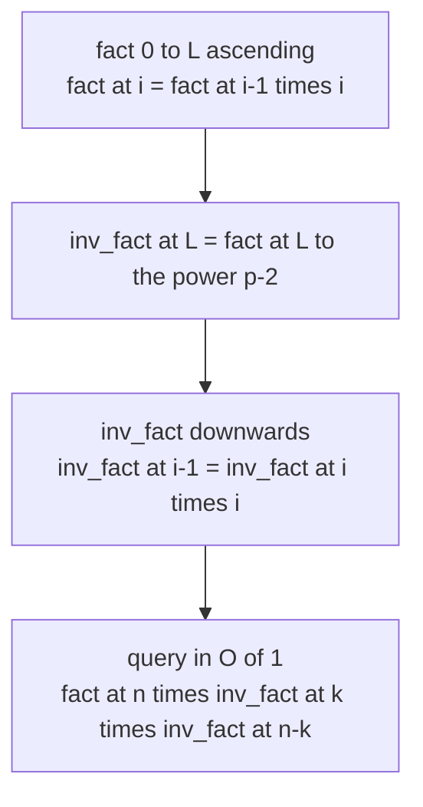
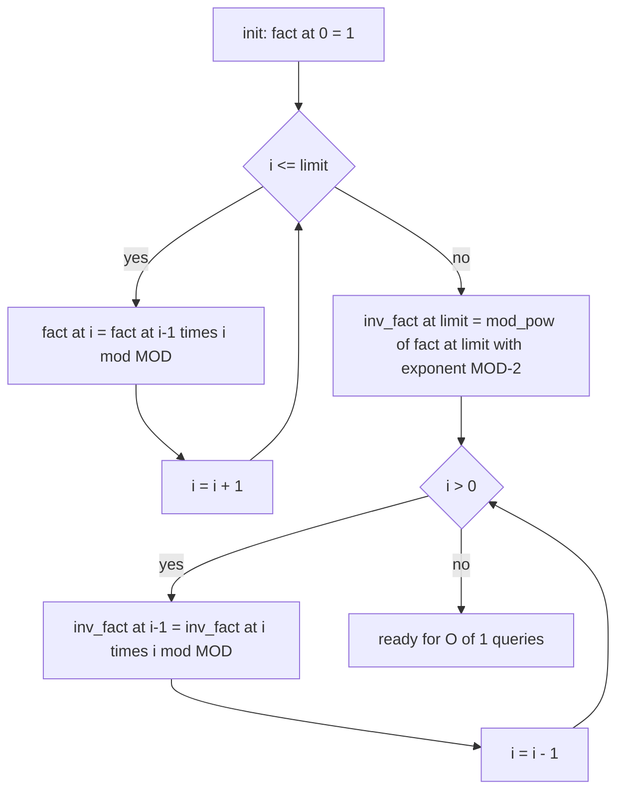
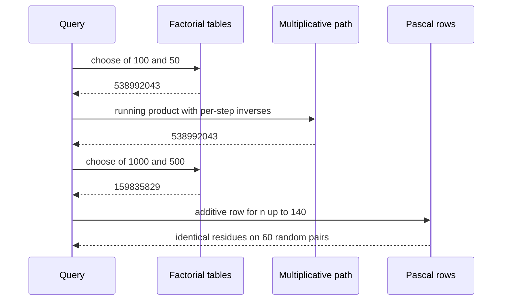

# 379 — Implement combinatorics nCr modulo prime (precompute factorials).

> **Tier:** Intermediate · **CTCI chapter:** Ch 6 — Math and Logic Puzzles
> **Task spec:** [379-implement-combinatorics-ncr-modulo-prime-precompute-factorials.md](../../../tasks/intermediate/379-implement-combinatorics-ncr-modulo-prime-precompute-factorials.md)
> **Solutions:** [Python](../../../solutions/python/intermediate/379-implement-combinatorics-ncr-modulo-prime-precompute-factorials/solution.py) ·
> [Java](../../../solutions/java/intermediate/379-implement-combinatorics-ncr-modulo-prime-precompute-factorials/Solution.java) ·
> [JavaScript](../../../solutions/javascript/intermediate/379-implement-combinatorics-ncr-modulo-prime-precompute-factorials/solution.js) ·
> [C#](../../../solutions/csharp/intermediate/379-implement-combinatorics-ncr-modulo-prime-precompute-factorials/Solution.cs)

## 1. Problem restatement

**Input:** a precomputation limit `L`, then a stream of queries `(n, k)` with `0 <= k <= n < p`,
where `p = 1_000_000_007` is the modulus. The `Binomial` object is built once with `limit = L`,
and every `choose(n, k)` after that is expected to be O(1).

**Output:** `C(n, k) mod p`, an integer in `[0, p)`. Edge conventions, all asserted by the four
files:

| Call | Result | Why |
| --- | --- | --- |
| `choose(10, 3)` | `120` | the exact value is below the modulus |
| `choose(20, 10)` | `184756` | exact value, no wrap |
| `choose(5, 0)` / `choose(5, 5)` | `1` | there is one empty selection and one full selection |
| `choose(0, 0)` | `1` | the empty choice from nothing |
| `choose(3, 5)` | `0` | `k > n` has no selections |
| `choose(3, -1)` | `0` | negative `k` is not a valid selection count |
| `choose(0, 1)` | `0` | the `k > n` rule again, at the boundary |
| `choose(100, 50)` | `538992043` | the exact value `100891344545564193334812497256` reduced modulo `p` |
| `choose(1000, 500)` | `159835829` | a value far beyond any native integer type |

The table is built for `limit = 1000` in `main`; the exact-value assertions (`120`, `184756`,
`2598960` for five-card poker hands) come from a second function that never touches the factorial
tables, and the two big constants are each reproduced by that independent path as well. Queries
above the precomputed limit are a programming error, and the Python `choose` raises
`ValueError("n above the precomputed limit")` instead of returning a wrong number.

## 2. Intuition

The naive idea is the textbook formula:

    C(n, k) = n! / (k! (n - k)!)

Evaluate it literally and you are in trouble twice over. First, `1000!` has about 2568 decimal
digits: no 64-bit type holds it, and in JavaScript even `C(100, 50)` exceeds `Number.MAX_SAFE_INTEGER`.
Second, in modular arithmetic there is no division — you cannot reduce the numerator and the
denominator separately and then divide, because `a / b mod p` is not `(a mod p) / (b mod p)`.

So the two problems are separated. Multiplication modulo `p` is easy and cheap, division is
replaced by **multiplication by a modular inverse**, and — this is the part that makes the task
O(1) per query — the inverses are precomputed once. Fermat's little theorem does the lifting: for
a prime `p` and any `a` not divisible by `p`,

    a^(p - 1) ≡ 1 (mod p),   hence   a^(-1) ≡ a^(p - 2) (mod p)

which the files evaluate with the binary exponentiation in `mod_pow`. One inverse per factorial is
enough: the inverse factorial table is filled **downwards** from `inv_fact[L]`, using
`inv_fact[i - 1] = inv_fact[i] * i`, because `1/(i-1)! = (1/i!) · i`.



The precomputation is O(L) arithmetic steps plus one exponentiation of O(log p) multiplications.
After that every query is three multiplications and two reductions.

## 3. Algorithm

1. **Set the modulus.** `MOD = 1_000_000_007`, prime, chosen because products of two residues
   still fit the widest native types in Java, C# and Python (`Java`’s `long` holds up to
   `9.2e18`, and `(1e9)^2 = 1e18`).
2. **Build `fact` ascending.** `fact[0] = 1`; for `i` from `1` to `L`, `fact[i] = fact[i-1] * i mod p`.
3. **Build `inv_fact` starting from the top.** `inv_fact[L] = mod_pow(fact[L], p - 2, p)`, a single
   Fermat inversion. Then walk `i` from `L` down to `1` and set
   `inv_fact[i-1] = inv_fact[i] * i mod p`.
4. **Answer a query.** Reject `k < 0`, `n < 0` or `k > n` with `0`; reject `n > L` loudly; otherwise
   return `fact[n] * inv_fact[k] mod p * inv_fact[n-k] mod p`.
5. **Cross-check with independent paths.** `choose_multiplicative(n, k)` computes
   `prod_{i=1..k} (n - k + i) * i^(-1) mod p` with a fresh inversion per step and never reads the
   tables, while `pascal_row(n)` builds the additive row `C(n, 0..n)` without any inverses at all.

`mod_pow` is the standard square-and-multiply loop: look at the low bit of the exponent, multiply
the accumulator when it is set, then square the base and shift the exponent right. Its cost is
`O(log exponent)` multiplications, and it is the only non-trivial piece of the precomputation.

```text
procedure mod_pow(base, exponent, modulus)
    result ← 1 mod modulus
    base ← base mod modulus
    while exponent &gt; 0 do
        if exponent is odd then
            result ← result * base mod modulus
        end
        base ← base * base mod modulus
        exponent ← exponent >> 1
    end
    return result
end

procedure build_factorials(limit)
    fact ← array of limit + 1 values, all 1
    for i ← 1 to limit do
        fact[i] ← fact[i - 1] * i mod MOD
    end
    inv_fact ← array of limit + 1 values, all 1
    inv_fact[limit] ← mod_pow(fact[limit], MOD - 2, MOD)
    for i ← limit down to 1 do
        inv_fact[i - 1] ← inv_fact[i] * i mod MOD
    end
    return fact, inv_fact
end

function choose(n, k)
    if k &lt; 0 or n &lt; 0 or k &gt; n then
        return 0
    end
    if n &gt; limit then
        fail "n above the precomputed limit"
    end
    return fact[n] * inv_fact[k] mod MOD * inv_fact[n - k] mod MOD
end
```



Notice that the two loops travel in opposite directions and for different reasons: `fact` must be
built upward because `i!` depends on `(i-1)!`, while `inv_fact` must be built downward because the
only cheap departure point is the single Fermat inversion at the top. Reaching `inv_fact[i]` from
`inv_fact[i+1]` uses `(i+1)! = (i+1) · i!`, so `1/i! = (i+1) / (i+1)!` — one multiply, no
exponentiation.

## 4. Worked example

Trace `build_factorials` for a small limit so the tables fit on the page. Take `limit = 6` and
pretend the modulus is `97` (still prime); every value below is `mod 97`.

| Step | Operation | Value |
| --- | --- | --- |
| `fact[0]` | seed | `1` |
| `fact[1..6]` | upward multiply: `120 mod 97 = 23`, `720 mod 97 = 41` | `1, 1, 2, 6, 24, 23, 41` |
| `inv_fact[6]` | `mod_pow(41, 95, 97)` — one Fermat inversion | `71`, because `41 * 71 = 2911 = 30 * 97 + 1` |
| `inv_fact[5..0]` | downward: `inv_fact[i-1] = inv_fact[i] * i` | `38, 93, 81, 49, 1, 1` |
| query `C(6, 2)` | `fact[6] * inv_fact[2] mod 97` then `* inv_fact[4] mod 97` | `41 * 49 = 2009 ≡ 69`, `69 * 93 = 6417 ≡ 15`, and indeed `C(6, 2) = 15` |

Every row of the table can be checked without a computer: `23 * 38 ≡ 1` (since `23 * 38 = 874 = 9 * 97 + 1`)
proves `inv_fact[5]` inverts `fact[5]`, and the final `15` is the textbook value of `C(6, 2)`. The
point of the trace is also the *shape* of the work — one upward pass, one inversion, one downward
pass — because that shape is what makes the real modulus affordable.

A cleaner check is the real modulus and the asserted milestones, which the code reproduces through
two different arithmetic paths:



The LCG harness picks `(n, k)` pairs from `seed = 37913`, with `k` drawn from `-1` up to `n + 1` on
purpose: the generator `k = seed mod (n + 2) - 1` deliberately produces `-1`, `0`, `n` and `n + 1`,
so the boundary conventions are exercised, not just the interior. Sixty pairs are compared against
the additive Pascal row, and the symmetry `C(n, k) = C(n, n-k)` is asserted for `n` up to `1000`.

## 5. Complexity

Let `L` be the precomputation limit, `p` the modulus and `k` the second argument of a query.

| Measure | Bound | Why it holds |
| --- | --- | --- |
| Precompute `fact` | O(L) | one multiply-and-reduce per index |
| Precompute `inv_fact` | O(L + log p) | one `mod_pow` with a `log p`-bit exponent, then one multiply per index downward |
| Space | O(L) | two arrays of `L + 1` residues |
| Query, table path | O(1) | three multiplies and two reductions, independent of `n` |
| Query, multiplicative path | O(k log p) | up to `k` steps, each doing a fresh Fermat inversion |
| Pascal row oracle | O(n²) time, O(n) space | row `i` is built from row `i - 1` by two additions per cell |
| Exact big-integer path (C# oracle) | O(n²) bit operations | `BigInteger` arithmetic on 2568-digit values for `n = 1000` |
| Constant types | products below `1e18` | `(p - 1)² ≈ 1e18` fits in 64-bit signed integers, so Java and C# can use `long` |

The `L`-fold precomputation pays for itself after roughly `L` queries of the multiplicative path,
which is why competitive code always builds the tables up front. It also explains the hard limit:
the O(1) query is only valid for `n <= L`, and the code refuses anything larger rather than
returning a plausible-looking wrong answer.

## 6. Pitfalls and edge cases

- **JavaScript cannot use `Number` for the residues.** `(1e9)²` is `1e18`, far above
  `Number.MAX_SAFE_INTEGER` (`9007199254740991`), so the JavaScript file does all modular
  arithmetic in `BigInt`; mixing a `Number` literal into the expressions would silently lose
  precision. Java and C# get away with `long` because `1e18 < 9.22e18`.
- **Division is not modular.** Reducing `n!` and `k!` and then dividing computes nonsense. The
  inverse-factorial table exists precisely so that only multiplication is ever needed.
- **`p` must be prime for Fermat.** `a^(p-2)` is the inverse of `a` only for prime `p` and
  `a` not a multiple of `p`; that is why the modulus is the prime `1_000_000_007` and why the
  factorial tables cannot contain a factor of `p` unless `n >= p` (the docstring notes that Lucas
  would be needed at that point, and the task stays strictly below `p`).
- **Boundary conventions are asserted, not implied.** `k = -1` and `k = n + 1` both return `0`, and
  `choose(0, 0) = 1`. The LCG harness is written to hit exactly those four boundary values.
- **Above the limit is an error, not a zero.** Python raises `ValueError`, and the other languages
  signal the same condition; silently reading past the array would be a memory error in Java and
  `undefined` in JavaScript.
- **Index type.** The `n` and `k` values are small indices and stay as plain integers in every
  language — only the *residues* need the wide type. Mixing the two concerns is a common source of
  `BigInt`-contagion bugs in JavaScript.
- **Precomputation is per-object, not static.** `Binomial(limit)` owns its tables; two instances
  with different limits do not interfere, and every query on one instance shares the same arrays.
- **The oracles must agree exactly.** All checks compare residues with `==`, never with a
  tolerance — this is exact integer arithmetic from end to end, which the docstring states
  explicitly so that nobody "fixes" the comparisons with an epsilon.

## 7. Variants and follow-ups

- **Lucas' theorem.** For `n >= p`, split `n` and `k` into base-`p` digits and multiply the small
  `C(n_i, k_i)` terms; the factorial table becomes unnecessary above `p`.
- **Multiplicative formula without tables.** `C(n, k) = prod_{i=1..k} (n - k + i) / i` using
  `k` inverses is the second path in these files; it wins when only one query is asked and `L`
  would be wasteful.
- **Additive Pascal rows.** The third path, used as an oracle, needs no inverses at all — the
  trade-off between the three is exactly the time/space/precomputation triangle this task is
  about.
- **Factorials and inverses for other problems.** The same `mod_pow` table powers the number
  theoretic transform in
  [302-implement-convolution-using-number-theoretic-transform-outline-t.md](../../../tasks/intermediate/302-implement-convolution-using-number-theoretic-transform-outline-t.md),
  the primality test in
  [382-implement-primality-test-miller-rabin-deterministic-small-bases.md](../../../tasks/intermediate/382-implement-primality-test-miller-rabin-deterministic-small-bases.md)
  and the RSA demo in
  [385-implement-rsa-key-generation-and-basic-encrypt-decrypt-demo.md](../../../tasks/intermediate/385-implement-rsa-key-generation-and-basic-encrypt-decrypt-demo.md).
- **Counting without modular arithmetic.** When the counts stay small, plain DP is simpler — see
  [378-implement-integer-partition-dp-count-ways.md](../../../tasks/intermediate/378-implement-integer-partition-dp-count-ways.md),
  which tops out at `190569292` and needs no inverse at all.

## 8. Check yourself

1. Why can the table path answer `choose(n, k)` in O(1) while the formula it implements needs
   `n!`, which nobody can store?

<details><summary>Show answer</summary>

Because only the *residues* are stored, and all three factors of
`C(n, k) = n! / (k! (n-k)!)` are multiplied, never divided. The division is replaced by multiplying
by `inv_fact[k]` and `inv_fact[n-k]`. Three multiplications and two reductions complete the query
regardless of `n`.

</details>

2. Why is `inv_fact` built downward instead of calling `mod_pow` for every index?

<details><summary>Show answer</summary>

One Fermat inversion at `L!` is enough: from `inv_fact[i]` the previous entry follows by a single
multiplication, `inv_fact[i-1] = inv_fact[i] * i`. Inverting each factorial separately would cost
`O(L log p)` instead of `O(L + log p)`, which matters because `log p` is about 30 multiplications
per index.

</details>

3. What happens in JavaScript if the residues are kept as `Number`, and what does the solution do
   about it?

<details><summary>Show answer</summary>

Products of two residues near `1e9` reach `1e18`, beyond `Number.MAX_SAFE_INTEGER`
(`9007199254740991`), so the low bits are silently rounded away and the modular result is wrong.
The JavaScript file performs every modular multiplication in `BigInt`; `n` and `k` stay as plain
numbers because they are small indices.

</details>

4. Which inputs does `choose` reject with `0`, and which does it reject loudly?

<details><summary>Show answer</summary>

`k < 0`, `n < 0` and `k > n` return `0` — those are the convention asserted for `choose(3, 5)`,
`choose(3, -1)` and `choose(0, 1)`. `n` above the precomputed limit raises instead (Python
`ValueError`), because that is a programming error rather than a mathematically empty selection.

</details>

5. Name the three independent verification paths and what each one proves.

<details><summary>Show answer</summary>

The multiplicative path (running product with a fresh inverse per step) proves the tables agree with
a computation that never reads them; the additive Pascal rows prove agreement with arithmetic that
uses no modular inverses at all; and the known constants `C(100,50) = 538992043` and
`C(1000,500) = 159835829` are reproduced by an exact big-integer reduction in the C# file, pinning
the tables to values no single language's arithmetic produced first.

</details>
