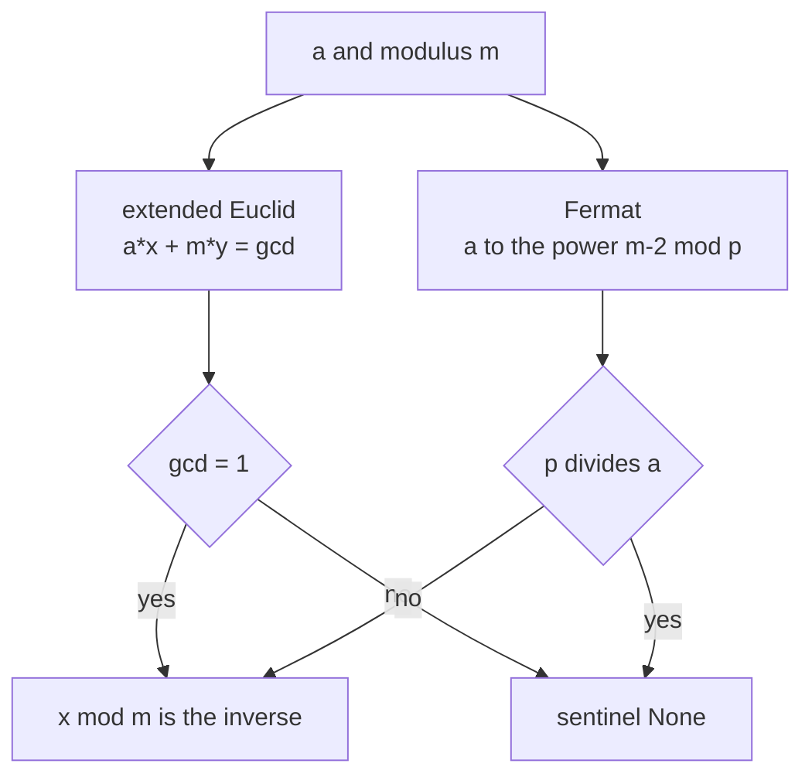
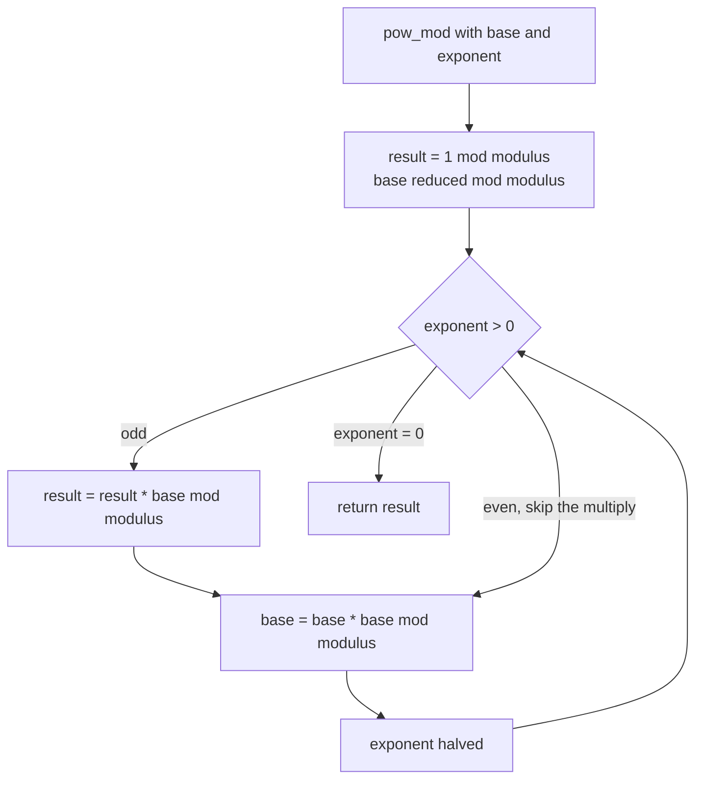
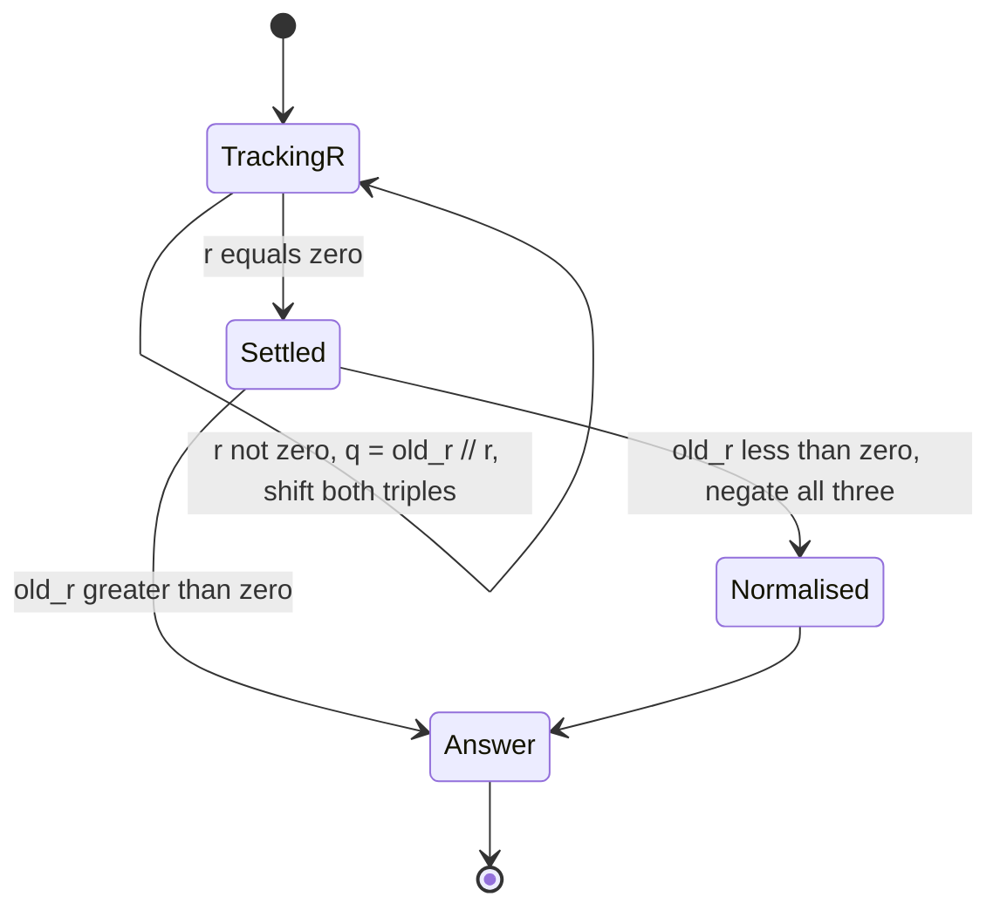
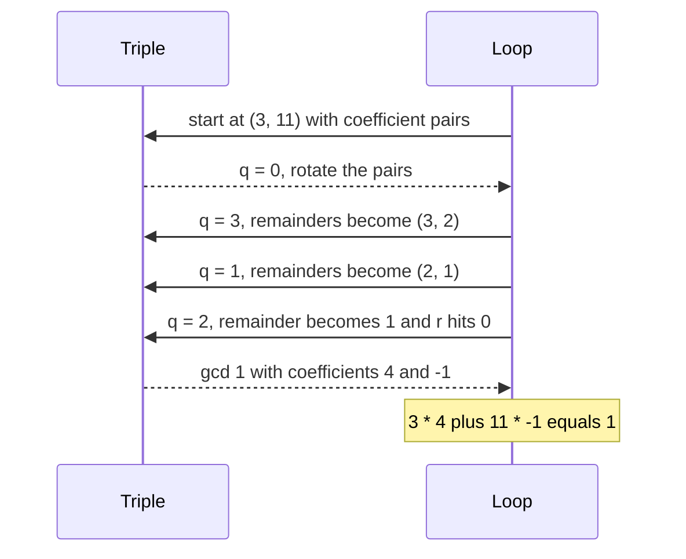

# 380 — Implement modular inverse / fast modular exponent.

> **Tier:** Intermediate · **CTCI chapter:** Ch 6 — Math and Logic Puzzles
> **Task spec:** [380-implement-modular-inverse-fast-modular-exponent.md](../../../tasks/intermediate/380-implement-modular-inverse-fast-modular-exponent.md)
> **Solutions:** [Python](../../../solutions/python/intermediate/380-implement-modular-inverse-fast-modular-exponent/solution.py) ·
> [Java](../../../solutions/java/intermediate/380-implement-modular-inverse-fast-modular-exponent/Solution.java) ·
> [JavaScript](../../../solutions/javascript/intermediate/380-implement-modular-inverse-fast-modular-exponent/solution.js) ·
> [C#](../../../solutions/csharp/intermediate/380-implement-modular-inverse-fast-modular-exponent/Solution.cs)

## 1. Problem restatement

**Inputs:** an integer `a` and a modulus `m` (or `p`, when the modulus is prime), plus a base and a
non-negative exponent for the exponentiation routine.

**Outputs:**

- `pow_mod(base, exponent, modulus)` — `base^exponent mod modulus`, computed by binary
  (square-and-multiply) exponentiation. Contract: `pow_mod(a, 0, m) = 1 mod m`.
- `mod_inverse_euclid(a, m)` — the `x` in `[0, m)` with `a * x ≡ 1 (mod m)`, or the documented
  sentinel `None` (`null`) when `gcd(a, m) != 1`.
- `mod_inverse_fermat(a, p)` — the same value for a **prime** `p`, via `a^(p-2) mod p`, or `None`
  when `p` divides `a`.

The hand-checked assertions in every language give the contract concrete content:

| Call | Result | Why |
| --- | --- | --- |
| `pow_mod(2, 10, 1000000007)` | `1024` | `2^10` is small enough to be the exact value |
| `pow_mod(3, 0, 1000000007)` | `1` | the empty product |
| `pow_mod(0, 0, 7)` | `1` | `1 mod 7`, the documented convention for a zero exponent |
| `pow_mod(7, 1, 5)` | `2` | `7 mod 5` |
| `pow_mod(5, 3, 13)` | `8` | `125 mod 13 = 8`, matching `125 % 13` in the assertion |
| `pow_mod(2, 1000, 1000000007)` | `688423210` | recomputed independently; no brute force possible |
| `pow_mod(3, 200, 1000000007)` | `136318165` | recomputed independently |
| `mod_inverse_euclid(3, 11)` | `4` | `3 * 4 = 12 ≡ 1 (mod 11)` |
| `mod_inverse_euclid(10, 17)` | `12` | `10 * 12 = 120 ≡ 1 (mod 17)` |
| `mod_inverse_euclid(4, 8)` | `None` | `gcd(4, 8) = 4`, no inverse exists |
| `mod_inverse_euclid(0, 5)` | `None` | `gcd(0, 5) = 5` |
| `mod_inverse_fermat(5, 101)` | `81` | `5 * 81 = 405 = 4 * 101 + 1` |
| `mod_inverse_fermat(11, 11)` | `None` | `p` divides `a`, so `a ≡ 0` has no inverse |

Two documented out-of-range cases raise instead of returning a sentinel: a negative exponent, and a
modulus `<= 1` (the `m = 1` case is documented as out of scope because every residue is `0` mod `1`).
Every arithmetic operation is exact integer arithmetic — the docstring says "no floating point
anywhere" in all four files.

## 2. Intuition

Exponentiation first. The naive loop multiplies the base `exponent` times, which is hopeless for
`2^1000`: the exponent is 1000, and for the RSA-scale exponents used later in this tier it is
hundreds of digits. The binary trick is to write the exponent in base 2 and square the base as you
shift. Every squaring doubles the power the current base represents, so after `k` iterations the
base holds `base^(2^k)`, and only the set bits of the exponent contribute to the accumulator.
`log₂(exponent)` multiplications instead of `exponent` multiplications.

Division is the second problem. Modular arithmetic has no division operator: `a / b mod m` cannot
be computed by dividing residues. The replacement is a **modular inverse** — a number `b⁻¹` with
`b * b⁻¹ ≡ 1 (mod m)`, so that dividing by `b` becomes multiplying by `b⁻¹`. Two classical
algorithms find it, and the files implement both on purpose, because they can then check each
other:

- **Extended Euclid** tracks the Bézout coefficients while running the ordinary gcd loop, ending
  with `a*x + m*y = gcd(a, m)`. If that gcd is `1`, then `a*x ≡ 1 (mod m)` and `x mod m` is the
  inverse. It works for **any** modulus, and it also *proves* when no inverse exists: a gcd greater
  than `1` is a definitive "no".
- **Fermat's little theorem** answers the same question for a **prime** modulus in one
  exponentiation: `a^(p-2) ≡ a⁻¹ (mod p)`. Shorter to code, but useless when `p` is composite or
  when `p` divides `a`.



## 3. Algorithm

The files ship four routines: `pow_mod`, `gcd`, `extended_gcd`, `mod_inverse_euclid` and
`mod_inverse_fermat`. In order of use:

1. **`pow_mod(base, exponent, modulus)`.** Reject a negative exponent or a non-positive modulus.
   Seed `result = 1 mod modulus` and reduce `base mod modulus`. While the exponent is positive:
   if the low bit is set, multiply the accumulator by the base; square the base; shift the
   exponent right by one. Return the accumulator.
2. **`gcd(a, b)`.** The classic Euclid loop, `while b: a, b = b, a mod b`. It is used by the tests
   to decide whether an inverse should exist.
3. **`extended_gcd(a, b)`.** The iterative Bézout extension: keep the pair `(old_r, r)` initialised
   to `(a, b)` and the coefficient pairs `(old_s, s) = (1, 0)`, `(old_t, t) = (0, 1)`. Each step
   computes `q = old_r // r` and replaces both triples with the standard shift. When `r` becomes
   `0`, `old_r` is the gcd and `(old_s, old_t)` are the Bézout coefficients. A negative gcd is
   normalised by negating all three results.
4. **`mod_inverse_euclid(a, m)`.** Require `m >= 2`; call `extended_gcd(a mod m, m)`; return `None`
   when the gcd is not `1`, otherwise return `x mod m`.
5. **`mod_inverse_fermat(a, p)`.** Require `p > 1`; reduce `a mod p`; return `None` when that is
   `0`; otherwise `pow_mod(a, p - 2, p)`.
6. **Cross-check with `pow_naive(base, exponent, modulus)`**, an O(exponent) loop that is useless
   for big exponents but is an exact oracle for small ones.

```text
function pow_mod(base, exponent, modulus)
    if exponent &lt; 0 then
        fail "negative exponents are not supported"
    end
    if modulus &lt;= 0 then
        fail "modulus must be positive"
    end
    result ← 1 mod modulus
    base ← base mod modulus
    while exponent &gt; 0 do
        if exponent is odd then
            result ← result * base mod modulus
        end
        base ← base * base mod modulus
        exponent ← exponent >> 1
    end
    return result
end

procedure extended_gcd(a, b)
    old_r ← a; r ← b
    old_s ← 1; s ← 0
    old_t ← 0; t ← 1
    while r != 0 do
        q ← old_r // r
        (old_r, r) ← (r, old_r - q * r)
        (old_s, s) ← (s, old_s - q * s)
        (old_t, t) ← (t, old_t - q * t)
    end
    if old_r &lt; 0 then
        negate old_r, old_s and old_t
    end
    return old_r, old_s, old_t
end

function mod_inverse_euclid(a, m)
    if m &lt;= 1 then
        fail "m greater or equal to 2 required"
    end
    g, x ← extended_gcd(a mod m, m)
    if g != 1 then
        return none
    end
    return x mod m
end

function mod_inverse_fermat(a, p)
    if p &lt;= 1 then
        fail "p greater than 1 required"
    end
    a ← a mod p
    if a = 0 then
        return none
    end
    return pow_mod(a, p - 2, p)
end
```



The Bézout loop is worth picturing as a two-track state machine: the `r` track is Euclid's
remainder sequence, and the `s`/`t` tracks carry the coefficients that reconstruct each remainder
from the original `a` and `b`. Nothing is stored per step, so the whole thing is O(1) space.



## 4. Worked example

**Powers: `pow_mod(2, 10, 1000000007)`.** The exponent `10` is `1010` in binary, so its set bits are
positions 1 and 3.

| Iteration | `exponent` | low bit | `result` after the step | `base` after the step |
| --- | --- | --- | --- | --- |
| initial | `10` | — | `1` | `2` |
| 1 | `10` | `0` | `1` | `4` |
| 2 | `5` | `1` | `1 * 4 = 4` | `16` |
| 3 | `2` | `0` | `4` | `256` |
| 4 | `1` | `1` | `4 * 256 = 1024` | `65536` |
| end | `0` | — | `1024` | `65536` |

The accumulator collects `2^(2^1) · 2^(2^3) = 2^2 · 2^8 = 2^10 = 1024`, exactly the asserted value,
and the modulus never bites because the true value is tiny. With `exponent = 1000` the same loop
performs about ten squarings-and-multiplies instead of 1000 multiplications, producing the asserted
`688423210`.

**Inverses: `mod_inverse_euclid(3, 11)`.** Run `extended_gcd(3, 11)` and watch the triple.

| Iteration | `q` | `(old_r, r)` | `(old_s, s)` | `(old_t, t)` |
| --- | --- | --- | --- | --- |
| initial | — | `(3, 11)` | `(1, 0)` | `(0, 1)` |
| 1 | `0` | `(11, 3)` | `(0, 1)` | `(1, 0)` |
| 2 | `3` | `(3, 2)` | `(1, -3)` | `(0, 1)` |
| 3 | `1` | `(2, 1)` | `(-3, 4)` | `(1, -1)` |
| 4 | `2` | `(1, 0)` | `(4, -11)` | `(-1, 3)` |

`r` reached `0`, so the gcd is `old_r = 1` with coefficients `old_s = 4`, `old_t = -1`:
`3 * 4 + 11 * (-1) = 1`. Reading off the `a` coefficient gives `x = 4`, the asserted
`mod_inverse_euclid(3, 11) == 4`. Note the `q = 0` first step: `a < b` costs an iteration and
changes nothing but the pairing, and the code relies on the same loop shape for both orders.



The two paths are then compared directly: for each prime in `7, 11, 13, 101, 65537, 1000000007` and
twelve random bases drawn from `[1, prime - 1]`, `mod_inverse_euclid` and `mod_inverse_fermat` must
return the *same* number, and `a * inverse % prime` must be `1`. A separate loop asserts Fermat's
little theorem in its own right, `pow_mod(a, p - 1, p) == 1`, and a small Wilson check confirms
`18! ≡ -1 (mod 19)`.

## 5. Complexity

Let `e` be the exponent, `m` the modulus, and `p` the prime modulus used by the Fermat path.

| Measure | Bound | Why it holds |
| --- | --- | --- |
| `pow_mod` time | O(log e) | one squaring per bit of the exponent, one extra multiply per set bit |
| `pow_mod` space | O(1) | three running integers |
| `gcd` time | O(log min(a, b)) | Euclid's remainder sequence shrinks at least like Fibonacci numbers |
| `extended_gcd` time | O(log min(a, b)) | same number of iterations, each doing a constant amount of bookkeeping |
| `extended_gcd` space | O(1) in the iterative version | the six tracked values are all that is kept |
| `mod_inverse_euclid` | O(log m) time, O(1) space | one extended gcd plus a reduction |
| `mod_inverse_fermat` | O(log p) time, O(1) space | one exponentiation with a `p - 2` exponent |
| `pow_naive` oracle | O(e) time | the loop the binary version replaces; only usable for small `e` |

Everything here is logarithmic in the *values*, which is the reason RSA works at all: the primes
in the later tasks are 1024-bit and the exponentiations still finish instantly. The naive loop is
kept in the file only as an oracle for small exponents; the LCG harness runs 60 bases with
exponents below `40` so the comparison stays cheap.

## 6. Pitfalls and edge cases

- **No inverse exists when the gcd is not 1.** `mod_inverse_euclid(4, 8)` and `mod_inverse_euclid(6, 9)`
  return the sentinel, asserted in the files; `mod_inverse_euclid(0, 5)` also returns it, because
  the gcd is `5`. Extended Euclid *detects* this rather than producing garbage, which is its main
  advantage over Fermat's method.
- **Fermat needs a prime and a non-multiple.** `mod_inverse_fermat(11, 11)` returns the sentinel
  because `a mod p == 0`. With a composite modulus the routine silently returns a wrong number, so
  the docstrings are explicit that the Fermat path is only for prime `p`.
- **`m = 1` is out of scope and rejected.** Every residue is `0` mod `1`, so there is nothing to
  invert; the code raises rather than pretending. The same applies to `m <= 0`.
- **Negative exponents are rejected.** `pow_mod` supports exponents `>= 0` only. A negative exponent
  would need an inverse first, which is exactly what the other two routines provide; combining them
  is left to the caller.
- **`pow_mod(a, 0, m) = 1 mod m`.** The seed is `1 % modulus`, not the literal `1`; that is what
  makes `pow_mod(0, 0, 7) == 1` true and keeps the routine honest for `m = 1`.
- **Modulo of a negative number is language-dependent.** Python's `%` returns a non-negative result,
  while Java, C# and JavaScript truncate and can return a negative remainder. The Java, JavaScript
  and C# files normalise explicitly with `((a % m) + m) % m` before using a value as a residue —
  a port that drops this line can return a negative "inverse".
- **JavaScript needs `BigInt`.** Products of two residues near `1e9` reach `1e18`, past
  `Number.MAX_SAFE_INTEGER`; the JavaScript file does all modular arithmetic in `BigInt`, while Java
  and C# use 64-bit `long` (`(p - 1)² ≈ 1e18 < 9.22e18`).
- **A negative gcd is normalised.** `extended_gcd` can return a negative `old_r` if it is called
  with negative arguments directly; the code negates all three outputs so that the returned gcd is
  non-negative and the Bézout identity still reads `a*x + b*y = g`.
- **Do not compare against a float tolerance.** All the assertions here are exact integer
  equalities; there is no `EPS` anywhere in these files, unlike the simplex task.

## 7. Variants and follow-ups

- **Binary vs. sliding-window exponentiation.** The square-and-multiply loop is the simple version;
  windowed methods group exponent bits and can use fewer multiplications at the cost of a small
  table of precomputed powers.
- **Inverse via the extended Euclid of the modulus.** `mod_inverse_euclid` is exactly the machinery
  the CRT merge needs; that is how
  [381-chinese-remainder-theorem-solver-for-pairwise-coprime-moduli.md](../../../tasks/intermediate/381-chinese-remainder-theorem-solver-for-pairwise-coprime-moduli.md)
  builds its solution.
- **Fermat inverses inside factorial precomputation.** The single inversion at the top of the
  inverse-factorial table in
  [379-implement-combinatorics-ncr-modulo-prime-precompute-factorials.md](../../../tasks/intermediate/379-implement-combinatorics-ncr-modulo-prime-precompute-factorials.md)
  is this same `pow_mod(a, p - 2, p)`.
- **Where the exponentiation gets used next.** The Miller-Rabin base test in
  [382-implement-primality-test-miller-rabin-deterministic-small-bases.md](../../../tasks/intermediate/382-implement-primality-test-miller-rabin-deterministic-small-bases.md)
  and the RSA demo in
  [385-implement-rsa-key-generation-and-basic-encrypt-decrypt-demo.md](../../../tasks/intermediate/385-implement-rsa-key-generation-and-basic-encrypt-decrypt-demo.md)
  both start from this routine.
- **Pollard's rho depends on the same gcd.** The factoring outline in
  [383-factor-large-integer-with-pollard-s-rho-outline-test-small.md](../../../tasks/intermediate/383-factor-large-integer-with-pollard-s-rho-outline-test-small.md)
  leans on `gcd` for its cycle detection.

## 8. Check yourself

1. Why does the binary exponentiation loop square the base on *every* iteration, but multiply the
   accumulator only on set bits?

<details><summary>Show answer</summary>

After `k` iterations the base holds `base^(2^k)` — that is the value of the bit at position `k`.
Squaring advances to the next bit for free. Only the bits of the exponent that are `1` actually
contribute a factor, so the accumulator picks them up with a single multiply each. The result is
`log₂(e)` squarings plus at most `log₂(e)` multiplies.

</details>

2. `mod_inverse_euclid(4, 8)` returns the sentinel. What does `extended_gcd(4, 8)` produce, and why
   is no inverse possible?

<details><summary>Show answer</summary>

The gcd is `4`, with Bézout coefficients satisfying `4x + 8y = 4`. Any common multiple of `4` and
`8` is divisible by `4`, so `4 * x ≡ 1 (mod 8)` would require `8 | (4x - 1)`, which is impossible
because the left side is divisible by `4` and `1` is not. The gcd check catches this exactly.

</details>

3. Both inverse routines return the same answer for prime moduli. Why keep both?

<details><summary>Show answer</summary>

Because they are independent evidence. Extended Euclid works for any modulus but needs the
iteration; Fermat is one exponentiation but only valid for a prime that does not divide `a`.
Comparing them on the primes `7, 11, 13, 101, 65537, 1000000007` with twelve bases each means a bug
in the exponentiation or in the Bézout bookkeeping has to survive an unrelated algorithm to go
unnoticed. The files also use Euclid as the general case and Fermat as the fast special case.

</details>

4. What does `pow_mod(5, 3, 13)` return, and how does the assertion in the file phrase it?

<details>
<summary>Show answer</summary>

`8`. The assertion is written as `pow_mod(5, 3, 13) == 125 % 13 == 8`, i.e. it shows the exact
intermediate value and the reduction in one line, so the reader can check `125 = 9 * 13 + 8`.

</details>

5. Why is JavaScript forced to use `BigInt` here when Java and C# can use `long`?

<details><summary>Show answer</summary>

Both need products of two residues below `1e9`, so up to about `1e18`. A 64-bit signed integer
holds that (`9.22e18`), but a JavaScript `Number` only guarantees exact integers up to
`9007199254740991`. The JavaScript file therefore uses `BigInt` for the residues and keeps only the
loop counters as plain numbers.

</details>
