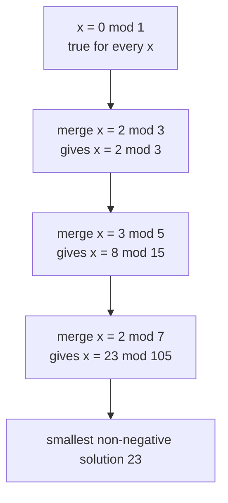
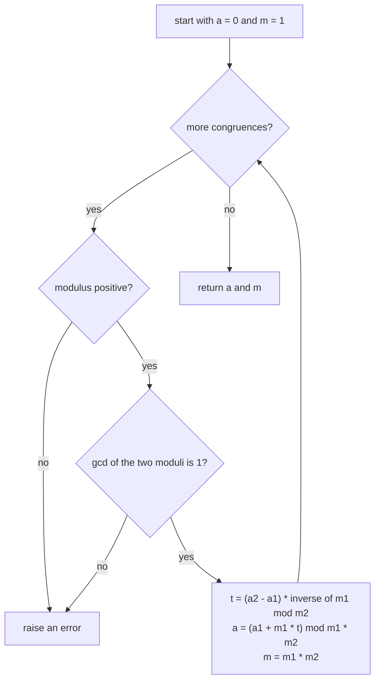
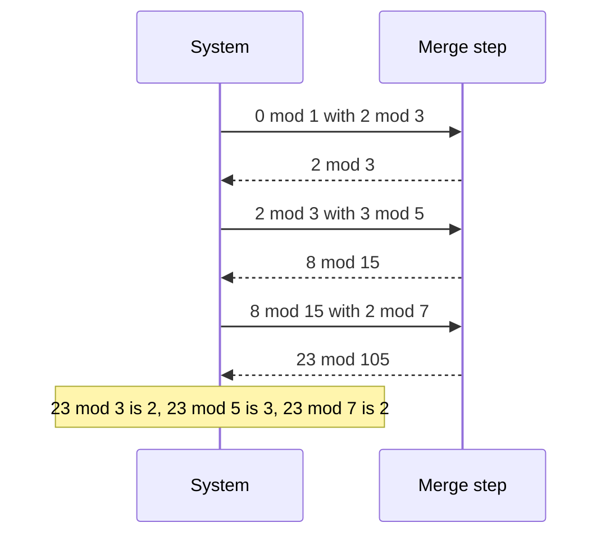

# 381 — Chinese remainder theorem solver for pairwise coprime moduli.

> **Tier:** Intermediate · **CTCI chapter:** Ch 6 — Math and Logic Puzzles
> **Task spec:** [381-chinese-remainder-theorem-solver-for-pairwise-coprime-moduli.md](../../../tasks/intermediate/381-chinese-remainder-theorem-solver-for-pairwise-coprime-moduli.md)
> **Solutions:** [Python](../../../solutions/python/intermediate/381-chinese-remainder-theorem-solver-for-pairwise-coprime-moduli/solution.py) ·
> [Java](../../../solutions/java/intermediate/381-chinese-remainder-theorem-solver-for-pairwise-coprime-moduli/Solution.java) ·
> [JavaScript](../../../solutions/javascript/intermediate/381-chinese-remainder-theorem-solver-for-pairwise-coprime-moduli/solution.js) ·
> [C#](../../../solutions/csharp/intermediate/381-chinese-remainder-theorem-solver-for-pairwise-coprime-moduli/Solution.cs)

## 1. Problem restatement

**Input:** a list of congruences `(residue, modulus)`, one per line of the system

    x ≡ a₁ (mod m₁),  x ≡ a₂ (mod m₂),  …,  x ≡ a_k (mod m_k)

with the moduli **pairwise coprime** (`gcd(m_i, m_j) = 1` for `i ≠ j`).

**Output:** the pair `(x, m)` where `m = m₁·m₂···m_k` and `x` is the smallest **non-negative**
solution, so `0 <= x < m`. The four files agree on these cases:

| Call | Result | Why |
| --- | --- | --- |
| `crt([(2, 3), (3, 5), (2, 7)])` | `(23, 105)` | the classic worked example: `23 mod 3 = 2`, `23 mod 5 = 3`, `23 mod 7 = 2` |
| `crt([(4, 9)])` | `(4, 9)` | a single congruence is the identity case |
| `crt([(2, 7), (3, 5), (2, 3)])` | `(23, 105)` | the merge order must not matter |
| `crt([(0, 2), (1, 3)])` | `(4, 6)` | `4` is even and `4 mod 3 = 1` |
| `crt([])` | raises | an empty system has no solution to describe |
| `crt([(1, 4), (2, 6)])` | raises | moduli `4` and `6` are not coprime |
| `crt([(1, 9), (1, 3)])` | raises | not coprime — rejected *even though* `x = 1` is consistent |
| `crt([(0, 2), (0, 4)])` | raises | not coprime, although the residues agree |

The last two rows are deliberate: the documented contract is "pairwise coprime moduli", and the
general non-coprime case (which needs `gcd(m₁, m₂) | (a₂ - a₁)`) is out of scope and rejected with an
error rather than solved. The tests also drive 40 randomly generated systems from an LCG and check
the answer by substitution, by the product identity `m = Π mᵢ`, by `x < m`, and — whenever `m` is at
most `100000` — by brute-force enumeration of all residues.

## 2. Intuition

The naive approach is to search. The CRT guarantees a unique solution modulo the product, so you
*can* scan `x = 0, 1, 2, …` and stop at the first value satisfying every congruence; the test
harness does exactly this as an oracle. But the search is `O(m)` where `m` is the product of the
moduli, and the product is exactly what CRT is used to build — for the moduli of an RSA modulus or a
residue number system, scanning is unthinkable.

The good idea is to merge the system **one congruence at a time**, keeping the invariant

> "the answer so far is the single congruence `x ≡ a (mod m)`"

which starts as the trivial `x ≡ 0 (mod 1)` — true for every `x`, so it constrains nothing. Merging
the next congruence `x ≡ a₂ (mod m₂)` into `x ≡ a (mod m₁)` means finding the `x` that satisfies
both:

    x = a + m₁·t     for some integer t,  and we need  a + m₁·t ≡ a₂ (mod m₂)

Solving that linear congruence for `t` gives

    t ≡ (a₂ - a) · m₁⁻¹  (mod m₂)

and the inverse exists precisely because `gcd(m₁, m₂) = 1` for pairwise coprime moduli. That is why
the coprimality condition is not just a hypothesis to check but the very thing that makes the
division legal: **modular division is multiplication by an inverse**, and the inverse comes from the
extended Euclid routine of [380-modular-inverse-fast-modular-exponent.md](../../../tasks/intermediate/380-implement-modular-inverse-fast-modular-exponent.md).



The new modulus is always the product `m₁·m₂`, so the running modulus grows to `Π mᵢ`: after `k`
merges there is one congruence left, and its residue is the answer. Note the pleasing loop
invariant: at every stage the system has been replaced by a *single* equivalent congruence.

## 3. Algorithm

The files provide `extended_gcd`, `mod_inverse`, `crt_two` and `crt`:

1. **`extended_gcd(a, b)`** returns `(g, x, y)` with `a·x + b·y = g = gcd(a, b)`. When `b = 0` the
   answer is `(a, 1, 0)`; otherwise recurse on `(b, a mod b)` and rotate the coefficients with
   `g = g'`, `x = y'`, `y = x' - (a // b)·y'`. The Python and Java versions are recursive, the
   JavaScript and C# versions in this task keep the same recursion shape.
2. **`mod_inverse(a, modulus)`** reduces `a` into `[0, modulus)`, runs `extended_gcd`, and raises when
   the gcd is not `1` (no inverse). Otherwise it returns `x mod modulus`.
3. **`crt_two(a1, m1, a2, m2)`** checks `gcd(m1, m2) = 1` and raises if not. It computes
   `t = (a2 - a1) · inv(m1 mod m2) mod m2`, sets `modulus = m1 · m2`, and returns
   `((a1 + m1·t) mod modulus, modulus)` — the merged congruence, already reduced to the smallest
   non-negative residue.
4. **`crt(congruences)`** rejects an empty list, then folds left from `(a, m) = (0, 1)`. Each element
   must have a positive modulus (else raise), and its residue is reduced with `residue mod modulus`
   before merging, so residues larger than their modulus are handled. The fold returns the final
   `(a, m)`.
5. **Verify** by substitution (`x mod mᵢ = aᵢ` for every input row), by the product identity, and by
   brute force when the product is small.

```text
function crt_two(a1, m1, a2, m2)
    g ← gcd(m1, m2)
    if g != 1 then
        fail "moduli are not coprime"
    end
    t ← (a2 - a1) * mod_inverse(m1 mod m2, m2) mod m2
    modulus ← m1 * m2
    return (a1 + m1 * t) mod modulus, modulus
end

function crt(congruences)
    if congruences is empty then
        fail "empty congruence system"
    end
    a ← 0
    m ← 1
    for (residue, modulus) in congruences do
        if modulus &lt;= 0 then
            fail "modulus must be positive"
        end
        a, m ← crt_two(a, m, residue mod modulus, modulus)
    end
    return a, m
end
```



The identity start `(0, 1)` is the reason `crt` has no special case for a single congruence: `1`
divides every modulus, so the first merge always succeeds and simply installs the first
congruence. It also means the empty system is the only degenerate input, and the code rejects it
explicitly.

## 4. Worked example

Trace `crt([(2, 3), (3, 5), (2, 7)])`, the classic example asserted by all four files.

| Merge | `a₁` | `m₁` | `a₂` | `m₂` | inverse of `m₁ mod m₂` | `t = (a₂ - a₁)·inv mod m₂` | new `a` | new `m` |
| --- | --- | --- | --- | --- | --- | --- | --- | --- |
| 1 | 0 | 1 | 2 | 3 | `1` (since `1 ≡ 1`) | `(2 - 0)·1 mod 3 = 2` | `(0 + 1·2) mod 3 = 2` | `3` |
| 2 | 2 | 3 | 3 | 5 | `2` (since `3·2 = 6 ≡ 1 mod 5`) | `(3 - 2)·2 mod 5 = 2` | `(2 + 3·2) mod 15 = 8` | `15` |
| 3 | 8 | 15 | 2 | 7 | `1` (since `15 ≡ 1 mod 7`) | `(2 - 8)·1 mod 7 = 1` | `(8 + 15·1) mod 105 = 23` | `105` |

Check the intermediate results against the original system: after merge 2 the claim is
`x ≡ 8 (mod 15)`, and `8 mod 3 = 2`, `8 mod 5 = 3` — both original rows hold. After merge 3 the
claim is `x ≡ 23 (mod 105)`, and `23 mod 3 = 2`, `23 mod 5 = 3`, `23 mod 7 = 2` — the asserted
answer. The third row is also a reminder that the `%` operator must be the non-negative one:
`(2 - 8) mod 7 = -6 mod 7 = 1` in Python, while a language with truncated remainder would compute
`-6` and then need `((-6 % 7) + 7) % 7`.



The randomised harness repeats this structure 40 times from `seed = 4212`. Each trial draws a count
of `2 + seed mod 3` distinct primes from `[3, 5, 7, 11, 13, 17, 19, 23]`, draws a residue per prime,
solves, and asserts three things: every original congruence holds for `x`, the returned modulus
equals the product of the chosen primes, and `x < m`. When the product is at most `100000` the
harness also brute-forces the answer with `next(v for v in range(m) if ...)`, and the run asserts
that at least 10 of the 40 systems were small enough to be checked that way. Random systems are
worth the effort here because they exercise four-prime merges, which the hand-written examples do
not.

## 5. Complexity

Let `k` be the number of congruences and `B` the bit length of the moduli (all of them of similar
size, as in the tests).

| Measure | Bound | Why it holds |
| --- | --- | --- |
| One merge, inversion | O(log m₂) iterations | extended Euclid's remainder sequence, each step exact integer arithmetic |
| One merge, arithmetic | a constant number of multiplications around the inverse | one multiply for `t`, one for `m₁·t`, one for `m₁·m₂` |
| Total merges | `k - 1` | one per congruence after the identity start |
| Total time | O(k² · B²) word operations with schoolbook multiplication | merge `i` multiplies numbers of about `i·B` bits by `B`-bit values, and the sum over `i` is quadratic |
| Space | O(1) beyond the input and the running `(a, m)` | the fold keeps two values; the recursion in `extended_gcd` is O(log) deep |
| Random-system check | 40 systems, at least 10 brute-forced | the harness counts the brute-force hits and asserts `checked >= 10` |
| Brute-force alternative | O(m) time | scanning every residue below the product; `m <= 100000` in the checked cases |

The interesting column is the last one. Solving is logarithmic in the *bits* of the product while
searching is linear in the *value* of the product, so the gap widens very fast — for the tiny
products in this task (`105` in the worked example, at most `23·19·17·13 = 96577` for the four-prime
systems the harness can generate) brute force is still feasible, which is exactly why it is usable as
an oracle. Enumerating all residues stops being an option as soon as the moduli get large.

## 6. Pitfalls and edge cases

- **Pairwise coprime is a hard requirement, checked per merge.** `crt_two` tests `gcd(m1, m2) = 1`
  and raises otherwise. `[(1, 4), (2, 6)]` is rejected both because the moduli share the factor `2`
  and because the system is genuinely unsolvable, while `[(1, 9), (1, 3)]` and `[(0, 2), (0, 4)]`
  are rejected *even though* they are consistent — the contract only covers coprime moduli, and the
  general case would need the divisibility test `gcd(m₁, m₂) | (a₂ - a₁)`.
- **The empty system raises.** There is no answer to return, so Python raises `ValueError` and the
  other languages throw the equivalent; returning `(0, 1)` would be defensible mathematically but is
  not the documented behaviour.
- **Non-positive moduli raise.** A modulus of `0` would make the inverse meaningless; the fold
  checks `modulus <= 0` before merging.
- **The answer must be the smallest non-negative residue.** Both `crt_two` and the final result use
  a non-negative `%`, which is asserted with `x < m`. A negative result would still satisfy every
  congruence but would break the documented contract, and the brute-force oracle would disagree.
- **Merge order does not matter.** `crt([(2, 7), (3, 5), (2, 3)])` yields the same `(23, 105)` as the
  ascending order. Different orders take different intermediate `(a, m)` pairs but converge to the
  same unique residue modulo the product.
- **Residues are reduced first.** `residue mod modulus` is applied on the way in, so `(9, 7)` and
  `(2, 7)` behave identically. Forgetting this breaks the arithmetic when a caller passes a residue
  larger than its modulus.
- **Negative modular results in Java, C# and JavaScript.** The Java, C# and JavaScript files all
  normalise with `((a % modulus) + modulus) % modulus` around the inverse, because truncating `%`
  can return a negative value. Python's `%` already returns a non-negative result, so the Python
  file needs no such guard.
- **Wide types are only safe while the product fits.** The Java and C# files use 64-bit integers,
  and the systems the tests generate stay far below that limit: at most four moduli drawn from
  `[3, 23]`, so the product is at most `96577`. A production version must either use arbitrary
  precision or Garner's algorithm, which reconstructs the answer modulo each modulus without ever
  forming the product.
- **JavaScript uses `BigInt`.** The JavaScript file writes the residues and coefficients with
  `BigInt` literals (`1n`, `0n`) so that both the Bézout bookkeeping and the products stay exact.

## 7. Variants and follow-ups

- **Garner's algorithm.** Reconstruct the solution digit by digit modulo each modulus, never forming
  the product — the standard choice when the product cannot be represented, and the basis of
  residue number systems.
- **The general non-coprime case.** Replace the coprimality check with `g = gcd(m1, m2)`, reject only
  when `(a2 - a1) mod g != 0`, and merge into modulus `lcm(m1, m2)`. The code here deliberately
  documents that it does not do this.
- **The inverse machinery it borrows.** The merge is a direct application of the extended Euclid
  inverse from
  [380-implement-modular-inverse-fast-modular-exponent.md](../../../tasks/intermediate/380-implement-modular-inverse-fast-modular-exponent.md);
  reading that task first makes the `t = (a₂ - a₁)·m₁⁻¹` line obvious.
- **Where CRT shows up in this repository.** The factorial-based binomial tables of
  [379-implement-combinatorics-ncr-modulo-prime-precompute-factorials.md](../../../tasks/intermediate/379-implement-combinatorics-ncr-modulo-prime-precompute-factorials.md)
  need CRT (or the generalised merge) once the modulus stops being prime, and the RSA demo in
  [385-implement-rsa-key-generation-and-basic-encrypt-decrypt-demo.md](../../../tasks/intermediate/385-implement-rsa-key-generation-and-basic-encrypt-decrypt-demo.md)
  runs on a modulus that is a product of two primes — the exact structure CRT decomposes. The
  Miller-Rabin test in
  [382-implement-primality-test-miller-rabin-deterministic-small-bases.md](../../../tasks/intermediate/382-implement-primality-test-miller-rabin-deterministic-small-bases.md)
  is what certifies those primes.

## 8. Check yourself

1. Why does the code reject `crt([(1, 9), (1, 3)])` when `x = 1` clearly satisfies both congruences?

<details><summary>Show answer</summary>

Because the documented contract is *pairwise coprime moduli*, and `gcd(9, 3) = 3`. The general case
needs a different merge (`g` must divide `a₂ - a₁`, and the new modulus is the lcm), which the files
explicitly leave out. Raising on a non-coprime input is safer than solving a case the rest of the
task never promised to handle.

</details>

2. Which single fact makes the equation `t = (a₂ - a₁)·m₁⁻¹ mod m₂` well defined?

<details><summary>Show answer</summary>

Coprimality: `gcd(m₁, m₂) = 1` means `m₁` has an inverse modulo `m₂`, so division by `m₁` in the
congruence `m₁·t ≡ a₂ - a₁ (mod m₂)` is legal and the solution for `t` is unique modulo `m₂`. That is
also why `crt_two` checks the gcd before doing any arithmetic.

</details>

3. After merging `(2, 3)` with `(3, 5)` the pair is `(8, 15)`. How do you verify that intermediate
   result without trusting the solver?

<details><summary>Show answer</summary>

Check that it reproduces the rows merged so far: `8 mod 3 = 2` and `8 mod 5 = 3`. The merged
congruence must agree with every original congruence, so substitution is always available as a
local check — which is exactly what the randomised harness does after every solve.

</details>

4. Why start the fold at `(0, 1)` rather than at the first congruence in the list?

<details><summary>Show answer</summary>

`x ≡ 0 (mod 1)` holds for every integer, so it is the neutral element of the merge: merging it with
any congruence returns that congruence. It removes the special case for a single-element system,
which the files assert works (`crt([(4, 9)]) == (4, 9)`), and it means the loop body has exactly one
shape.

</details>

5. The solution is unique modulo `m = Π mᵢ`. Where in the trace of the worked example can you see
   the product being built?

<details><summary>Show answer</summary>

In the `new m` column: `1 → 3 → 15 → 105`. Each merge multiplies the running modulus by the new one,
because the congruence `x ≡ a (mod m₁)` plus `x ≡ a₂ (mod m₂)` is equivalent to a single congruence
modulo `m₁·m₂` when the moduli are coprime. The final value `105 = 3·5·7` is asserted by the test
along with the residue.

</details>
