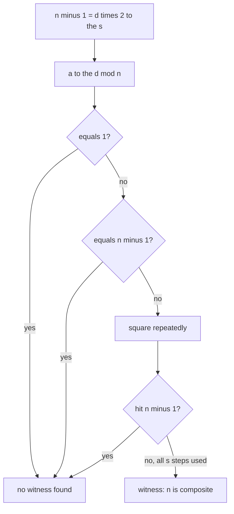
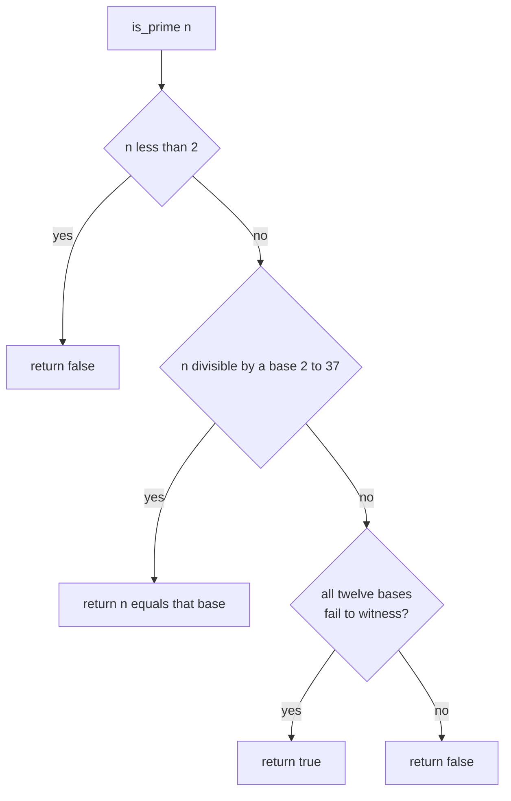
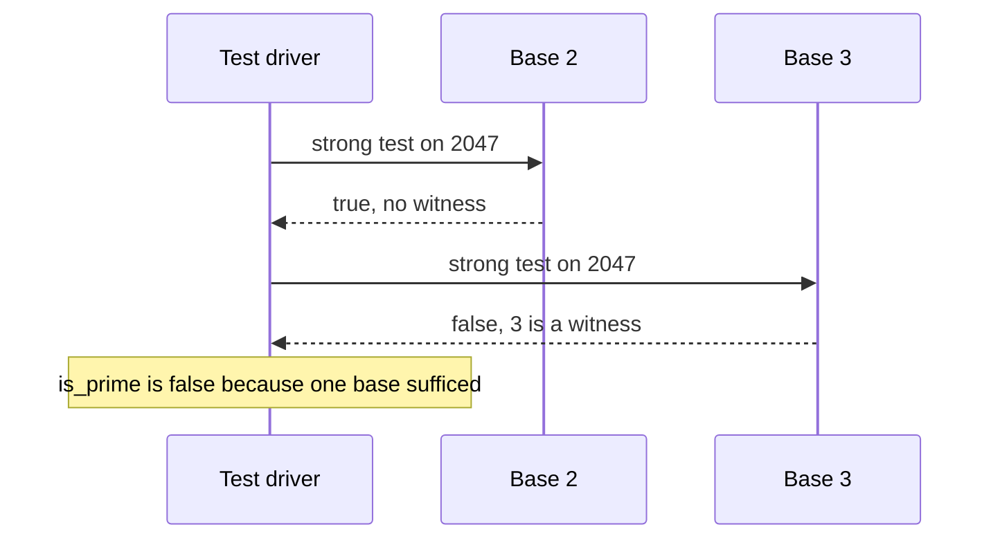

# 382 — Implement primality test Miller-Rabin (deterministic small bases).

> **Tier:** Intermediate · **CTCI chapter:** Ch 6 — Math and Logic Puzzles
> **Task spec:** [382-implement-primality-test-miller-rabin-deterministic-small-bases.md](../../../tasks/intermediate/382-implement-primality-test-miller-rabin-deterministic-small-bases.md)
> **Solutions:** [Python](../../../solutions/python/intermediate/382-implement-primality-test-miller-rabin-deterministic-small-bases/solution.py) ·
> [Java](../../../solutions/java/intermediate/382-implement-primality-test-miller-rabin-deterministic-small-bases/Solution.java) ·
> [JavaScript](../../../solutions/javascript/intermediate/382-implement-primality-test-miller-rabin-deterministic-small-bases/solution.js) ·
> [C#](../../../solutions/csharp/intermediate/382-implement-primality-test-miller-rabin-deterministic-small-bases/Solution.cs)

## 1. Problem restatement

**Input:** an integer `n` (any `n`, including `0`, `1` and negatives).

**Output:** `true` when `n` is prime, `false` otherwise. The implementation is the strong
probable-prime test run against the **twelve fixed bases**

    DETERMINISTIC_BASES = {2, 3, 5, 7, 11, 13, 17, 19, 23, 29, 31, 37}

which is documented — from Sorenson and Webster — as *deterministic* for every `n < 3.3e24`. So for
the whole range this repository tests, the answer is not probabilistic: it is a proof from a finite
base set. The exposed pieces are:

- `is_strong_probable_prime(n, base)` — one base's verdict: `true` when that base *fails* to prove
  `n` composite, `false` when it is a witness of compositeness.
- `is_prime(n)` — the small-prime pre-pass followed by all twelve bases.
- `is_prime_trial_division(n)` — the O(√n) reference oracle used for cross-checking.

The assertions give the contract concrete teeth:

| Call | Result | Why |
| --- | --- | --- |
| `is_prime(p)` for every base `p` in the base set | `true` | the base set itself must be recognised as prime |
| `is_prime(41)`, `is_prime(7919)`, `is_prime(104729)` | `true` | small known primes |
| `is_prime(2147483647)` | `true` | the Mersenne prime `2^31 - 1` |
| `is_prime(2305843009213693951)` | `true` | the Mersenne prime `2^61 - 1` |
| `is_prime(67280421310721)` | `true` | a known prime beyond 64-bit square roots of the naive test |
| `is_prime(0)`, `is_prime(1)` | `false` | below the definition of primality |
| `is_prime(341)` | `false` | `341 = 11·31`, a Fermat pseudoprime |
| `is_prime(561)`, `is_prime(1105)`, `is_prime(1729)` | `false` | Carmichael numbers, `3·11·17`, `5·13·17`, `7·13·19` |
| `is_prime(4294967297)` | `false` | `641 · 6700417`, the fifth Fermat number |
| `is_strong_probable_prime(2047, 2)` | `true` | `2047 = 23·89` is the smallest strong pseudoprime to base 2 |
| `is_strong_probable_prime(2047, 3)` | `false` | base 3 exposes it, so `is_prime(2047)` is `false` |
| `is_strong_probable_prime(3215031751, b)` for `b` in `{2, 3, 5, 7}` | `true` | `3215031751 = 151·751·28351` passes four bases |
| `is_strong_probable_prime(3215031751, 11)` | `false` | the fifth base settles it |
| `is_prime(n)` vs trial division for all `n <= 10000` | identical | the cross-check loop, 1229 primes found |

That last row matters: `pi(10000) = 1229` is asserted as well, so a test that returns `true` too
often or too rarely fails even if the individual primality calls look right.

## 2. Intuition

Trial division is the naive answer: test every divisor up to `√n`. It is exact, and it is the oracle
in these files — but it costs `√n` divisions, which for the asserted prime `2^61 - 1 ≈ 2.3e18` means
about `1.5e9` iterations. Fast it is not, and it gives no hint about compositeness beyond the first
factor it finds.

Fermat's little theorem, `a^(p-1) ≡ 1 (mod p)` for prime `p`, suggests a much cheaper test:
pick a base `a`, exponentiate, and compare. It is correct for primes — and useless on its own,
because the converse is false: `341 = 11·31` satisfies `2^340 ≡ 1 (mod 341)`, and the Carmichael
numbers `561`, `1105` and `1729` satisfy the congruence for *every* base coprime to them.

Miller-Rabin repairs the converse by working with the **unique factorisation of `n - 1`**. Write

    n - 1 = d · 2^s      with d odd

and look at the sequence `a^d, a^(2d), a^(4d), …, a^(2^(s-1)·d) = a^(n-1)/2` modulo `n`. For a prime
`n`, the last element is `1` by Fermat, and — this is the key fact — in a field the only square roots
of `1` are `±1`. So the sequence must either start at `1`, or hit `-1` at some point and only then
become `1`. If neither happens, `n` cannot be prime: the base is a **witness**.



The cost per base is one exponentiation (O(log n) multiplications) plus at most `s - 1` squarings,
so a base is millions of times cheaper than trial division for a 61-bit `n`. Using twelve bases
covers a wall of pseudoprimes that a single base misses: `2047` sails through base 2, and
`3215031751` passes bases `2, 3, 5` and `7`.

## 3. Algorithm

1. **Factor `n - 1`.** Set `d = n - 1`, `s = 0`; while `d` is even, halve it and increment `s`. For
   example `n = 41` gives `40 = 5 · 2^3`, so `d = 5`, `s = 3`.
2. **First power.** Compute `x = base^d mod n` with the binary exponentiation from
   [380-modular-inverse-fast-modular-exponent.md](../../../tasks/intermediate/380-implement-modular-inverse-fast-modular-exponent.md).
3. **Two immediate exits.** If `x = 1` or `x = n - 1`, this base finds no witness: return `true`.
   (The `x = n - 1` case covers `r = 0`, the `x = 1` case is the "sequence starts at 1" branch.)
4. **Square up to `s - 1` times.** Each step sets `x = x² mod n` and returns `true` as soon as
   `x = n - 1`. If the loop finishes without that hit, return `false` — this base proves `n`
   composite.
5. **`is_prime(n)` wraps it.** Return `false` for `n < 2`. Then run the small-prime pre-pass: for
   each base `p`, if `n mod p = 0` return `n = p`, which resolves `n = 2` and prevents a base that
   divides `n` from producing nonsense. Only then require `is_strong_probable_prime(n, a)` for all
   twelve bases.
6. **Cross-check.** `is_prime_trial_division` performs the naive `O(√n)` scan; the harness compares
   the two for every `n <= 10000` and separately counts the primes to check `pi(10000) = 1229`.

```text
function is_strong_probable_prime(n, base)
    if n &lt; 2 then
        return false
    end
    d ← n - 1
    s ← 0
    while d is even do
        d ← d / 2
        s ← s + 1
    end
    x ← power_mod(base mod n, d, n)
    if x = 1 or x = n - 1 then
        return true
    end
    repeat s - 1 times
        x ← x * x mod n
        if x = n - 1 then
            return true
        end
    end
    return false
end

function is_prime(n)
    if n &lt; 2 then
        return false
    end
    for p in DETERMINISTIC_BASES do
        if n mod p = 0 then
            return n = p
        end
    end
    for a in DETERMINISTIC_BASES do
        if not is_strong_probable_prime(n, a) then
            return false
        end
    end
    return true
end
```



The pre-pass is not an optimisation detail; it is a correctness requirement. Without it, testing
`n = 3` against base `3` computes `x = 3^1 mod 3 = 0`, which is neither `1` nor `n - 1`, and the
routine would report the prime `3` as composite. The files assert
`all(is_prime(p) for p in DETERMINISTIC_BASES)` precisely to pin this down.

## 4. Worked example

**`n = 41`, base `2`.** Factor `n - 1 = 40 = 5 · 2^3`, so `d = 5` and `s = 3`.

| Step | Operation | `x` | Verdict |
| --- | --- | --- | --- |
| 1 | factor `40` | — | `d = 5`, `s = 3` |
| 2 | `x = 2^5 mod 41` | `32` | not `1`, not `40`, so square |
| 3 | `r = 1`: `x = 32² mod 41 = 1024 mod 41` | `40` | equals `n - 1`, return `true` |

`1024 = 24 · 41 + 40`, which is why the square lands exactly on `-1`. The base found no witness, so
41 survives base 2, and the same happens for the remaining eleven bases: `is_prime(41)` is `true`.

**`n = 2047`, the interesting failure.** `2047 = 23 · 89` and `n - 1 = 2046 = 1023 · 2^1`, so `d =
1023` and `s = 1`.

| Base | `x = base^1023 mod 2047` | Verdict |
| --- | --- | --- |
| `2` | `2^11 = 2048 ≡ 1 (mod 2047)`, so `2^1023 = (2^11)^93 ≡ 1` | `x = 1` → **no witness**, the base is fooled |
| `3` | `3` is not `±1` here: modulo `23` the value is `1`, modulo `89` it is `52` | no `-1` anywhere, `s - 1 = 0` squarings → **witness** |

The base-2 row is exactly why a single base is not a primality test: 2047 is the smallest strong
pseudoprime to base 2. The base-3 row also shows why `s = 1` is a special shape — there is no
squaring step at all, so the entire verdict rests on whether `x` is `±1`. Since `x ≡ 1 (mod 23)` but
`x ≡ 52 (mod 89)`, it is neither `1` nor `2046` modulo `2047`, and `is_prime(2047)` returns `false`
while `is_prime_trial_division(2047)` agrees.



The four-base wall is the other instructive case. `3215031751 = 151 · 751 · 28351` passes bases
`2, 3, 5` and `7` — the files assert all four of those `true` results — and falls to base `11`. That
is the empirical reason the base set has to be large: each added base kills a pseudoprime family,
and the twelve-base list has been proven to cover everything below `3.3e24`.

## 5. Complexity

Let `k = 12` be the number of fixed bases and `n` the input.

| Measure | Bound | Why it holds |
| --- | --- | --- |
| One base | O(log n) multiplications | binary exponentiation for `base^d`, plus at most `s - 1 <= log₂ n` squarings |
| All bases | O(k log n) multiplications, O(log² n) bit operations | each multiplication is on `log n`-bit values; `k` is a constant |
| Space | O(1) | only `d`, `s`, `x` and the loop counters are kept |
| Factoring `n - 1` | O(log n) | repeated halving |
| Small-prime pre-pass | O(k) | twelve modulo operations |
| Trial-division oracle | O(√n) divisions | exact but astronomically slower; `√n ≈ 1.5e9` for the asserted `2^61 - 1` |
| Determinism range | `n < 3.3e24` | the proven bound for the twelve-base set, quoted in the docstrings |

The comparison worth internalising is `log² n` versus `√n`. For `n = 2^61 - 1` the test does about
`12 · 61 ≈ 732` modular multiplications while trial division would need roughly `1.5e9` divisions —
which is why the oracle is only used up to `10000` in the harness. Beyond the proven bound the same
code becomes a probabilistic test, with error at most `4^-k` for random bases, so the deterministic
guarantee is a property of the *base set*, not of Miller-Rabin in general.

## 6. Pitfalls and edge cases

- **The small-prime pre-pass is required, not decorative.** A base equal to `n` makes
  `x = n^d mod n = 0`, which fails the `±1` checks — so without the pre-pass, `is_prime(3)` would
  return `false`, because `3` is one of the bases. The pre-pass returns `n = p` for that case and the
  file asserts every base is prime.
- **`n < 2` is `false`.** `0`, `1` and negatives are handled first; the composite list starts with
  `0` and `1` precisely to lock that in.
- **Even numbers are caught by the pre-pass.** `n mod 2 = 0` returns `n = 2`, so `2` is prime and
  every other even number is composite without any exponentiation.
- **One base is not enough — with numbers.** `2047 = 23·89` is a strong pseudoprime to base `2`, and
  `3215031751 = 151·751·28351` passes bases `2, 3, 5, 7`. Both cases are asserted with both the
  failing and the succeeding base, so the base set's size is justified by tests rather than prose.
- **Carmichael numbers fall too.** `561 = 3·11·17`, `1105 = 5·13·17` and `1729 = 7·13·19` fool
  Fermat's congruence for every coprime base; the strong test rejects them because the `±1` sequence
  condition is strictly more demanding. The file even asserts the factorisations.
- **The squaring loop is `s - 1` steps, not `s`.** The `r = 0` case (`x = a^d`) is handled by the two
  early exits before the loop, so the loop covers `r = 1 … s - 1`. Using `s` steps repeats a check
  and using `s - 2` misses the last element of the sequence.
- **Intermediate products overflow 64 bits.** `x²` for `x` up to `2^61` needs ~122 bits. The C# file
  casts the multiplication to `UInt128` before reducing, Java delegates the exponentiation and the
  squaring to `BigInteger` (`modPow` and `multiply().mod()`), and JavaScript uses `BigInt`
  throughout. Python needs nothing because its integers are arbitrary precision.
- **Determinism has a bound.** The docstring states the twelve-base set is deterministic for
  `n < 3.3e24` — beyond that the test is probabilistic unless more bases are added. Do not describe
  this implementation as a general primality *proof*.
- **Not a factoring routine.** A witness tells you `n` is composite and nothing more; the factoring
  task [383-factor-large-integer-with-pollard-s-rho-outline-test-small.md](../../../tasks/intermediate/383-factor-large-integer-with-pollard-s-rho-outline-test-small.md)
  is the follow-up that actually extracts a factor.

## 7. Variants and follow-ups

- **Fewer bases, careful choice.** For `n < 3 215 031 751` the bases `{2, 3, 5, 7}` suffice; for
  `n < 3.4e14` the bases `{2, 3, 5, 7, 11, 13, 17}` suffice. The twelve-base set here buys the
  `3.3e24` bound at the cost of eight extra exponentiations.
- **Random bases instead of fixed ones.** Plain Miller-Rabin draws `a` at random and repeats until
  the error probability `4^-k` is acceptable — the right choice when `n` can be arbitrarily large and
  a tiny error probability is acceptable.
- **Baillie-PSW.** A base-2 strong test plus a Lucas test has no known counterexample and is the
  usual practical alternative for big integers.
- **The exponentiation it stands on.** Both the first power and the squarings are the `pow_mod`
  routine from
  [380-implement-modular-inverse-fast-modular-exponent.md](../../../tasks/intermediate/380-implement-modular-inverse-fast-modular-exponent.md);
  the JavaScript and C# files inline their own version for speed, but the algorithm is the same.
- **What the prime test feeds.** RSA key generation in
  [385-implement-rsa-key-generation-and-basic-encrypt-decrypt-demo.md](../../../tasks/intermediate/385-implement-rsa-key-generation-and-basic-encrypt-decrypt-demo.md)
  needs exactly this test to pick its two primes, and the CRT merge in
  [381-chinese-remainder-theorem-solver-for-pairwise-coprime-moduli.md](../../../tasks/intermediate/381-chinese-remainder-theorem-solver-for-pairwise-coprime-moduli.md)
  relies on the coprime structure those primes provide.

## 8. Check yourself

1. Why is `is_strong_probable_prime(2047, 2)` true even though 2047 is composite?

<details><summary>Show answer</summary>

Because `2047 = 23 · 89` is a strong pseudoprime to base 2. With `2046 = 1023 · 2^1` the test
computes `2^1023 mod 2047`, and `2^11 = 2048 ≡ 1 (mod 2047)` forces that value to be `1` — one of the
two favourable exits. The base simply cannot see the factors; base 3 can, which is why the test uses
twelve of them.

</details>

2. What exactly makes a base a witness of compositeness?

<details><summary>Show answer</summary>

For `n - 1 = d·2^s` with `d` odd, the base `a` is a witness when `a^d ≢ 1 (mod n)` and
`a^(d·2^r) ≢ -1 (mod n)` for every `0 <= r < s`. In a prime modulus the sequence must start at `1` or
reach `-1` (the only square roots of `1`), so failing both conditions proves `n` is not prime.

</details>

3. Why does `is_prime` run the small-prime pre-pass before the strong tests?

<details><summary>Show answer</summary>

Because a base that divides `n` computes `x = 0`, which fails the `±1` checks: testing the prime `3`
against the base `3` would otherwise report composite. The pre-pass returns `n = p` when `n` is
divisible by a base `p`, which also settles `n = 2` and every other even number immediately. The file
asserts that all twelve bases are recognised as prime.

</details>

4. The harness compares against trial division for `n <= 10000` only. Why not for all the values it
   tests?

<details><summary>Show answer</summary>

Trial division costs O(√n). For `n <= 10000` that is at most 100 iterations per value, so the full
sweep is cheap — and the sweep also proves `pi(10000) = 1229`. For an asserted prime such as
`2^61 - 1` the oracle would need about `1.5e9` iterations, so those values are checked against
independently known primes instead.

</details>

5. Is this a primality *proof* for every input?

<details><summary>Show answer</summary>

No. The twelve fixed bases are proven deterministic only for `n < 3.3e24`. Above that bound the same
code is a probabilistic test whose error can be bounded by choosing bases at random. The docstrings
state the bound explicitly so the guarantee is not over-claimed.

</details>
