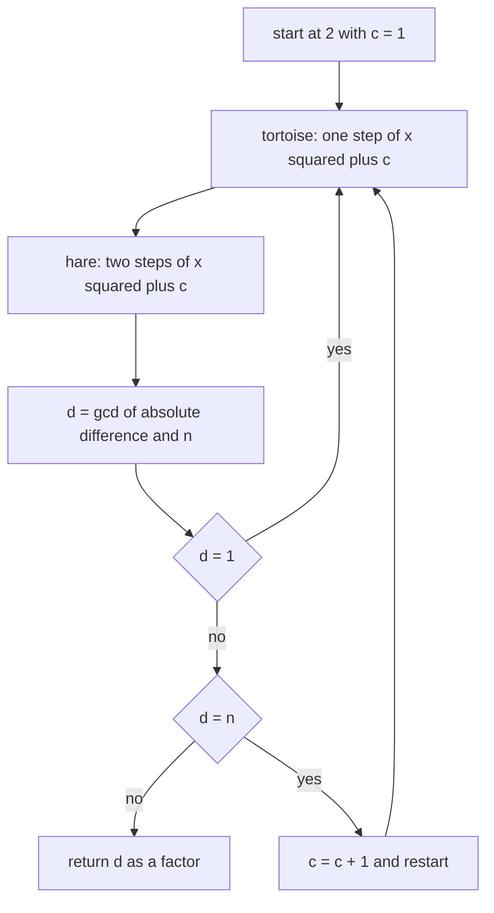
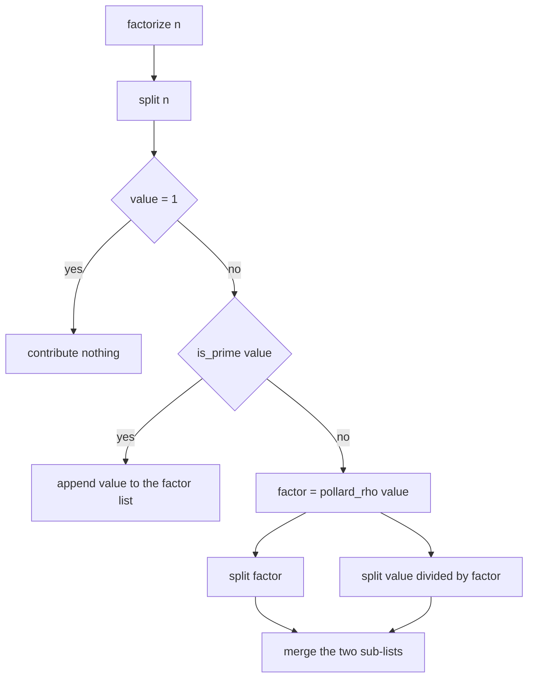
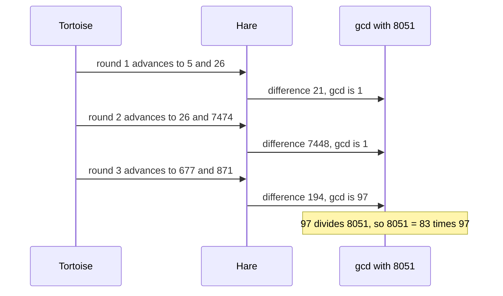
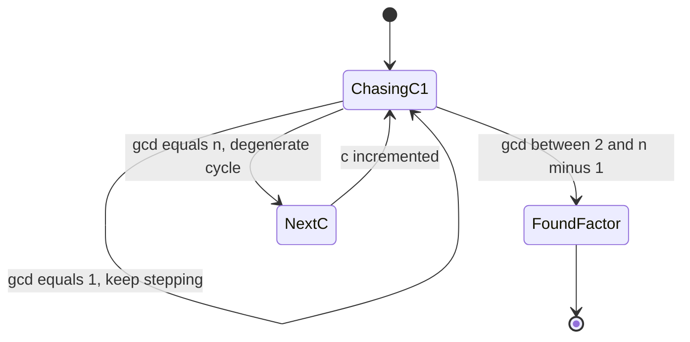

# 383 — Factor large integer with Pollard’s Rho (outline/test small).

> **Tier:** Intermediate · **CTCI chapter:** Ch 6 — Math and Logic Puzzles
> **Task spec:** [383-factor-large-integer-with-pollard-s-rho-outline-test-small.md](../../../tasks/intermediate/383-factor-large-integer-with-pollard-s-rho-outline-test-small.md)
> **Solutions:** [Python](../../../solutions/python/intermediate/383-factor-large-integer-with-pollard-s-rho-outline-test-small/solution.py) ·
> [Java](../../../solutions/java/intermediate/383-factor-large-integer-with-pollard-s-rho-outline-test-small/Solution.java) ·
> [JavaScript](../../../solutions/javascript/intermediate/383-factor-large-integer-with-pollard-s-rho-outline-test-small/solution.js) ·
> [C#](../../../solutions/csharp/intermediate/383-factor-large-integer-with-pollard-s-rho-outline-test-small/Solution.cs)

## 1. Problem restatement

This is an **outline** task: the implemented routine is the Floyd cycle-finding variant of
Pollard's rho, wrapped in a recursive factorisation, and the test corpus is deliberately small —
the docstring states that all test numbers stay below about `2^40`.

**Input:** a positive integer `n`, typically composite.

**Outputs:**

- `pollard_rho(n)` — one non-trivial factor of `n` (a divisor other than `1` and `n`). It raises
  `RuntimeError` in the documented give-up case.
- `factorize(n)` — the complete prime factorisation as a list in ascending order, with repeats
  (`factorize(65536) == [2] * 16`), and `[]` for `n = 1`.
- `is_prime(n)` — the deterministic twelve-base Miller-Rabin certificate from task 382, used to
  decide when the recursion may stop.

| Call | Result | Why |
| --- | --- | --- |
| `factorize(8051)` | `[83, 97]` | `83 · 97 = 8051` is asserted |
| `factorize(10403)` | `[101, 103]` | twin primes |
| `factorize(2 ** 32 + 1)` | `[641, 6700417]` | Euler's factorisation of the Fermat number `F5` |
| `factorize(123456789)` | `[3, 3, 3607, 3803]` | `3607 · 3803 = 13717421` and `9 · 13717421 = 123456789` |
| `factorize(600851475143)` | `[71, 839, 1471, 6857]` | the Project Euler 3 target, `71 · 839 · 1471 · 6857` |
| `factorize(2 ** 40 + 1)` | `[257, 4278255361]` | `257 · 4278255361 = 2^40 + 1` |
| `factorize(1048577)` | `[17, 61681]` | `2^20 + 1` |
| `factorize(999983)` | `[999983]` | prime, so no rho round ever runs |
| `factorize(1)` | `[]` | the empty product |
| `factorize(97 * 97)` | `[97, 97]` | a repeated prime is emitted twice |

The harness also loops over a sample list and checks three invariants for every input: the product
of the returned factors equals `n`, every returned factor passes `is_prime`, and the list is sorted.
That last check is what makes `pollard_rho` allowed to return *either* factor of a semiprime.

## 2. Intuition

Trial division finds a factor in `O(√n)` — fine for the `999983` prime in the sample list, hopeless
for the RSA-scale numbers this family of tasks is heading towards. Pollard's rho replaces the
divisor scan with a *collision* search.

Pick a simple polynomial iteration, `f(x) = x² + c mod n`, and look at the sequence
`x₀ = 2, x₁ = f(x₀), x₂ = f(x₁), …`. Modulo `n` this sequence looks random-ish, but modulo any
prime factor `p` of `n` it is a deterministic map on `p` values — so by the birthday bound it
repeats after about `√p` steps. Once two terms collide modulo `p`, their difference is a multiple of
`p`, so `gcd(|x - y|, n)` picks up `p` and splits `n`. The expected number of rounds scales like
`n^(1/4)`, because the collision happens modulo the *smallest* prime factor.

Detecting the collision without storing the whole sequence is Floyd's tortoise-and-hare trick:
advance one pointer one step and another pointer two steps per round, and compare them. A cycle
modulo `n` itself is the degenerate case — the gcd comes out as `n`, no factor is extracted — and
the code then retries with the next polynomial `c`.



The recursion on top is the natural completion: `factorize(n)` splits `n` into `d` and `n/d`, and
recurses on both. The recursion terminates because every split is non-trivial, and it stops at
primes because `is_prime` certifies each leaf with Miller-Rabin rather than with a second rho round.

## 3. Algorithm

1. **`pollard_rho(n)`**, small divisors first: `n mod 2 = 0` returns `2`, `n mod 3 = 0` returns `3`
   (the polynomial chase would dawdle on these).
2. **Chase.** For `c = 1, 2, …` while `c < 100`: start both pointers at `2` and `d = 1`. While
   `d = 1`, step the tortoise once and the hare twice, then set `d = gcd(|x - y|, n)`. The loop ends
   when the gcd is no longer `1`.
3. **Accept or retry.** If `d ≠ n`, return `d` — a genuine factor. If `d = n`, the cycle closed
   modulo `n` itself and no information was gained, so increment `c` and start over with a different
   polynomial. After 100 polynomials, raise `RuntimeError("Pollard's rho failed to find a factor")`.
4. **`is_prime(n)`**: the twelve deterministic Miller-Rabin bases, with the small-prime pre-pass,
   exactly as in [382-implement-primality-test-miller-rabin-deterministic-small-bases.md](../../../tasks/intermediate/382-implement-primality-test-miller-rabin-deterministic-small-bases.md).
5. **`factorize(n)`**: flatten with a recursive helper `split(value)`. If `value = 1`, return
   nothing; if `is_prime(value)`, record it; otherwise call `pollard_rho(value)` once, then recurse on
   the factor and on the cofactor `value / factor`. Sort the collected leaves before returning.
   Sorting is what makes the output independent of which factor rho happened to find first.
6. **Verify.** For each sample: multiply the factors back, assert each is prime, and assert the list
   is ascending. Hand-checked factorisations pin the small cases.

```text
function pollard_rho(n)
    if n mod 2 = 0 then
        return 2
    end
    if n mod 3 = 0 then
        return 3
    end
    c ← 1
    while c &lt; 100 do
        x ← 2
        y ← 2
        d ← 1
        while d = 1 do
            x ← (x * x + c) mod n
            y ← (y * y + c) mod n
            y ← (y * y + c) mod n
            d ← gcd(absolute value of (x - y), n)
        end
        if d != n then
            return d
        end
        c ← c + 1
    end
    fail "Pollard's rho failed to find a factor"
end

procedure split(value, out)
    if value = 1 then
        return
    end
    if is_prime(value) then
        append value to out
        return
    end
    factor ← pollard_rho(value)
    split(factor, out)
    split(value / factor, out)
end

function factorize(n)
    out ← empty list
    split(n, out)
    return sort(out)
end
```



Two details are easy to get wrong in a transcription. The hare makes **two** calls to `f` per round,
not one, which is what makes the pointer gap grow by one each round; and the retry condition is
`d = n`, not `d = 0`. A gcd of `n` means "the collision happened modulo every factor at once"; a
`d` of `1` simply means "not yet".

## 4. Worked example

**`pollard_rho(8051)` with `c = 1`.** Note `8051 = 83 · 97`, and the chase has no idea about either
factor.

| Round | tortoise `x` | hare `y` | `abs(x - y)` | `gcd(abs(x - y), 8051)` |
| --- | --- | --- | --- | --- |
| 1 | `5` | `26` | `21` | `1` |
| 2 | `26` | `7474` | `7448` | `1` |
| 3 | `677` | `871` | `194` | **`97`** |

Round 3 returns `97`, a non-trivial factor, and `8051 / 97 = 83`. Both are prime, so the recursion
stops immediately at two leaves, and the sort turns the pair into `[83, 97]` — the asserted result.
Note how small the arithmetic stays: every value is reduced modulo `8051`, and the gcd is taken
against `8051` each round.



The degenerate branch is not hypothetical. When the gcd comes back as `n`, the code throws the round
away and increments `c`, which is exactly what the loop structure below shows: the polynomial is a
parameter of the chase, not a fixed choice.



**Recursing on the harder inputs.** `factorize(600851475143)` finds one factor, then recurses: the
four primes `71, 839, 1471, 6857` are each certified prime by Miller-Rabin, so the recursion
terminates in four leaves that sort into the asserted list. `factorize(2 ** 32 + 1)` is the
interesting structure case: `F5` splits into `641` and `6700417`, both prime, so two leaves again —
and the same number appears in task 382 as a composite that primality testing must reject.

## 5. Complexity

Let `n` be the number and `p` its smallest prime factor.

| Measure | Bound | Why it holds |
| --- | --- | --- |
| Pollard rho, expected iterations | about `O(√p)` | the birthday bound on collisions of the sequence modulo `p`, so about `n^(1/4)` when `p ≈ √n` |
| Pollard rho, worst case | no useful bound | the method is heuristic; a degenerate cycle costs a retry with a new `c`, and the code gives up after `c` reaches `100` |
| Per iteration | one modular multiplication triple plus a gcd | `x²`, two `y` updates and `gcd(diff, n)` |
| Miller-Rabin certification | O(log n) multiplications per base, twelve bases | the deterministic base set from task 382 |
| `factorize` recursion | O(number of prime factors) calls to `split` | every split is non-trivial, so the recursion tree has one leaf per prime factor |
| Space | O(log p) for the recursion depth plus the factor list | the chase itself is O(1) beyond its counters |
| Corpus bound | test numbers below about `2^40` | stated in the Python docstring; the outline is not tuned for RSA-scale inputs |

The comparison that matters: trial division is `O(√n)` *always*, while rho is about `n^(1/4)` in
expectation but has no worst-case guarantee. For the asserted inputs (`2^40 + 1` is about
`1.1e12`) the difference is roughly a factor of `10⁶` in iterations — which is why the factoring
tasks in this tier all reach for rho while keeping trial division only as a small-prime check.

## 6. Pitfalls and edge cases

- **The degenerate cycle is normal, not exceptional.** When the tortoise and hare meet modulo `n`
  the gcd is `n` and nothing is learned. The loop increments `c` and retries with `f(x) = x² + c`;
  a transcription that treats `d = n` as "done" would return `n`, which is not a factor.
- **Two hare steps per round.** Floyd's algorithm needs the hare to advance twice so the gap grows
  by one each round. Stepping it once visits the same node forever and never detects a cycle.
- **Even and divisible-by-three inputs short-circuit.** `pollard_rho` returns `2` or `3`
  immediately; without that, small factors can make the chase thrash.
- **The recursion must stop at primes.** `split` asks `is_prime` first, which is why `factorize(97)`
  returns `[97]` after one Miller-Rabin certificate instead of looping in rho. The prime list
  `[999983]` and the repeated-prime list `[97, 97]` are both asserted.
- **Order is not the algorithm's output.** `pollard_rho` may return either factor of a semiprime, so
  the recursion appends leaves in whatever order the splits happen. `factorize` sorts, and the
  harness asserts `factors == sorted(factors)`; a test that hard-coded the unsorted order would be
  fragile.
- **`factorize(1)` is `[]`, not `[1]`.** The empty product is the correct factorisation, and the
  helper checks `value = 1` before anything else. `factorize(0)` is not part of the contract.
- **`d` can be a composite factor.** Pollard's rho returns *a* factor, not necessarily a prime one;
  `factorize` handles that by recursing on both sides, which is why the recursion tree is binary.
- **64-bit intermediates overflow.** Squaring a `long` near `2^62` overflows, so the Java file uses
  `BigInteger.modPow` for the cheap exponentiation and `BigInteger` for the squaring, the C# file
  casts to `UInt128` before reducing, and the JavaScript file works in `BigInt`. The Python file gets
  arbitrary precision for free.
- **This is an outline.** The docstring says so: the corpus stays below `2^40`, there is no Brent
  variant, no batched gcd and no large-prime heuristic. Do not present it as a tool for RSA moduli.

## 7. Variants and follow-ups

- **Brent's improvement.** Replace Floyd's two-pointer walk with the cycle-detection-by-doubling
  scheme plus batched gcds, which cuts the constant factor substantially; the algorithm and the
  retry logic stay the same.
- **Trial division for the small part.** Combining rho with a small-prime sieve (primes below a few
  thousand, say) removes the easy factors first and improves the expected behaviour on smooth
  numbers; this outline only special-cases `2` and `3`.
- **The primality certificate it depends on.** Every leaf is certified by
  [382-implement-primality-test-miller-rabin-deterministic-small-bases.md](../../../tasks/intermediate/382-implement-primality-test-miller-rabin-deterministic-small-bases.md);
  without that test the recursion would not know when to stop.
- **The consumer of the certificate.** RSA key generation in
  [385-implement-rsa-key-generation-and-basic-encrypt-decrypt-demo.md](../../../tasks/intermediate/385-implement-rsa-key-generation-and-basic-encrypt-decrypt-demo.md)
  relies on exactly the asymmetry this task attacks: multiplying two primes is easy, splitting their
  product is not.
- **The same Euclidean toolkit.** The gcd inside the chase and the inverse-based arithmetic in
  [380-implement-modular-inverse-fast-modular-exponent.md](../../../tasks/intermediate/380-implement-modular-inverse-fast-modular-exponent.md)
  and
  [381-chinese-remainder-theorem-solver-for-pairwise-coprime-moduli.md](../../../tasks/intermediate/381-chinese-remainder-theorem-solver-for-pairwise-coprime-moduli.md)
  share the extended Euclid core.

## 8. Check yourself

1. Why does the algorithm compare `x` and `y` rather than storing every term of the sequence?

<details><summary>Show answer</summary>

Because storing the sequence costs memory proportional to the number of steps, while Floyd's
two-pointer trick needs `O(1)` space: the hare moves twice as fast, so the gap grows by one each
round and the two pointers necessarily coincide on any cycle. The comparison `gcd(|x - y|, n)` is
what exposes a factor, and it only needs the two current values.

</details>

2. When the gcd comes back as `n`, what has gone wrong and what does the code do?

<details><summary>Show answer</summary>

The sequence collided modulo `n` itself, so the difference `|x - y|` is a multiple of `n` and the
gcd gives no information about the individual factors. The code increments `c`, restarting the chase
with `f(x) = x² + c`, and gives up only after 100 such attempts with a `RuntimeError`.

</details>

3. In the `8051` trace, the third round returns `97`. What is left to do, and why is the answer
   `[83, 97]` rather than `[97, 83]`?

<details><summary>Show answer</summary>

`8051 / 97 = 83`, and `is_prime` certifies both values, so the recursion produces the two leaves
`97` and `83`. `factorize` sorts the leaves before returning, so the caller always sees the ascending
order `[83, 97]` no matter which factor rho found first.

</details>

4. Why does `factorize(97)` never enter `pollard_rho`, and what would happen if it did?

<details><summary>Show answer</summary>

`split` checks `is_prime(97)` first, which returns `true` from Miller-Rabin, so `97` is appended as a
leaf. Running rho on a prime would either spin until the `c < 100` cap and raise, or return the prime
itself as `d = n`, which is the degenerate branch — so the primality check is what makes the
outline terminate on all-prime inputs.

</details>

5. The docstring limits the corpus to about `2^40`. What does that say about the complexity claim?

<details><summary>Show answer</summary>

That the guarantee is heuristic. Pollard's rho is expected to find a factor of a composite with
smallest prime factor `p` in roughly `√p` steps, but there is no worst-case bound — degenerate cycles
can recur and the code caps retries at 100 polynomials. The `2^40` ceiling is the range where the
outline has been exercised, and the task explicitly says "outline/test small".

</details>
