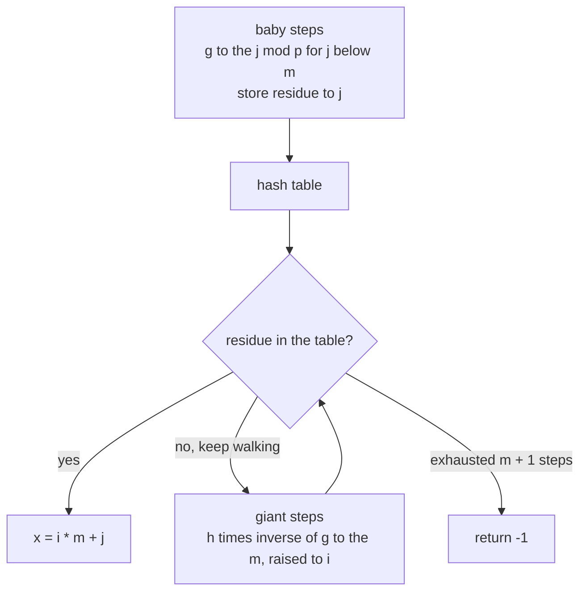
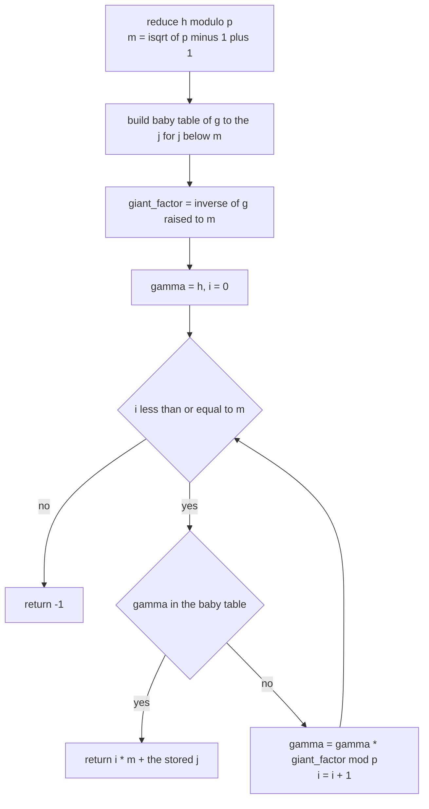
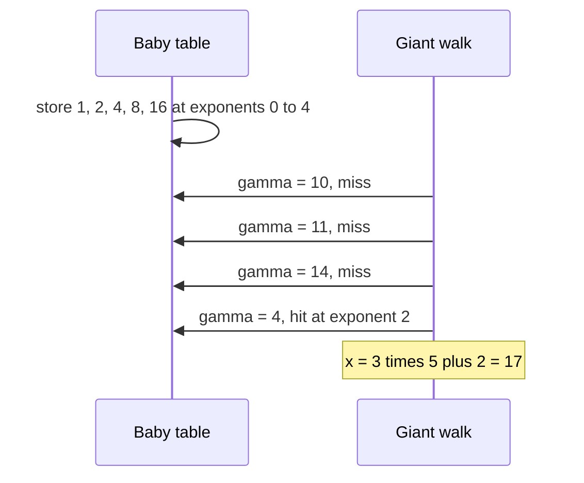

# 384 — Implement discrete logarithm baby-step giant-step.

> **Tier:** Intermediate · **CTCI chapter:** Ch 6 — Math and Logic Puzzles
> **Task spec:** [384-implement-discrete-logarithm-baby-step-giant-step.md](../../../tasks/intermediate/384-implement-discrete-logarithm-baby-step-giant-step.md)
> **Solutions:** [Python](../../../solutions/python/intermediate/384-implement-discrete-logarithm-baby-step-giant-step/solution.py) ·
> [Java](../../../solutions/java/intermediate/384-implement-discrete-logarithm-baby-step-giant-step/Solution.java) ·
> [JavaScript](../../../solutions/javascript/intermediate/384-implement-discrete-logarithm-baby-step-giant-step/solution.js) ·
> [C#](../../../solutions/csharp/intermediate/384-implement-discrete-logarithm-baby-step-giant-step/Solution.cs)

## 1. Problem restatement

**Input:** an odd prime `p`, a base `g` with `1 <= g < p`, and a target `h`.

**Output:** the **smallest** `x >= 0` with

    g^x ≡ h (mod p)

or the sentinel `-1` when no such `x` exists (the docstring's example: `2^x = 3 (mod 7)` has no
solution because the subgroup generated by `2` is `{1, 2, 4}`). The three routines are
`discrete_log(g, h, p)`, the O(p) oracle `brute_force_discrete_log(g, h, p)`, plus the shared
`mod_power`, `extended_gcd` and `mod_inverse` helpers.

Hand-verified cases asserted by all four files:

| Call | Result | Why |
| --- | --- | --- |
| `discrete_log(2, 8, 13)` | `3` | `2³ = 8` |
| `discrete_log(3, 13, 17)` | `4` | the comment spells the chain out: `3, 9, 27 = 10, 30 = 13 (mod 17)` |
| `discrete_log(2, 10, 19)` | `17` | `2^17 ≡ 10 (mod 19)` |
| `discrete_log(2, 5, 11)` | `4` | `2⁴ = 16 ≡ 5 (mod 11)` |
| `discrete_log(2, 1, 13)` | `0` | `g⁰ = 1` for every `g` |
| `discrete_log(2, 3, 7)` | `-1` | `<2> = {1, 2, 4}`, so `3` is unreachable |
| `discrete_log(3, 2, 11)` | `-1` | `<3> = {1, 3, 4, 5, 9}`, so `2` is unreachable |
| `discrete_log(1, 2, 7)` | `-1` | every power of `1` is `1` |
| `discrete_log(2, 0, 7)` | `-1` | `0` is never a power of `g` |

The sentinel is a documented convention, not an error: the callers of a discrete log (Diffie-Hellman,
ElGamal) live in a prime-order subgroup, so "no solution" has to be reportable. A modulus `p <= 1`
is a programming error and raises `ValueError` instead.

## 2. Intuition

The naive method walks the powers of `g`: `1, g, g², g³, …` and stops when the value equals `h`.
That is exactly the oracle, and it costs O(p) modular multiplications — for the `1009` in the LCG
prime list that is fine, for a cryptographic `p` of 2048 bits it is impossible.

Baby-step giant-step is a meet-in-the-middle refinement of the same walk. Write the unknown exponent
as

    x = i·m + j      with  0 <= j < m  and  i >= 0

where `m = ⌈√p⌉`. Substituting into `g^x = h` and dividing by `g^(i·m)` gives the equivalent
equation

    h · (g^(-m))^i  ≡  g^j   (mod p)

which is a *collision* between two sequences: a "baby" sequence of small powers `g^j` for
`j < m`, and a "giant" sequence `h·(g^(-m))^i` for growing `i`. Build the baby sequence once,
store each value with its smallest exponent `j` in a hash table, then walk the giant sequence and
look each value up. The first hit is the answer.



Two facts make the answer *minimal*, not just correct. First, the baby table keeps the **smallest**
`j` for each residue (the build loop only writes a residue the first time it appears). Second, the
giant index `i` is walked from `0` upward, and `x = i·m + j` is increasing in `i` and, for equal `i`,
in `j`. So the first collision is the smallest solution — no second pass over candidates is needed.

## 3. Algorithm

1. **Validate.** Raise when `p <= 1`. Reduce `h` modulo `p`, so callers may pass any representative.
2. **Choose the block size.** `m = isqrt(p - 1) + 1`, which is `⌈√p⌉` without floating point: the
   integer square root of `p - 1` plus one.
3. **Build the baby table.** Start `value = 1 mod p`. For `j` from `0` to `m - 1`: insert
   `baby[value] = j` *only if the residue is new*, then multiply `value` by `g` modulo `p`. Storing
   only the first occurrence is what preserves minimality.
4. **Compute the giant factor.** `giant_factor = (g⁻¹)^m mod p`, using `mod_inverse(g, p)` (the
   extended Euclid routine of the neighbouring tasks) and then `mod_power` to raise it to `m`.
   Multiplying by this factor is the same as stepping `i` by one.
5. **Walk the giant steps.** Start `gamma = h` and, for `i` from `0` to `m` inclusive: if `gamma` is
   in the baby table with exponent `j`, return `i·m + j`; otherwise multiply `gamma` by
   `giant_factor` and continue.
6. **Report failure.** If all `m + 1` giant steps miss, return `-1`.
7. **Cross-check.** `brute_force_discrete_log` walks the powers directly; the harness compares the two
   for every `(g, h, p)` in a small grid and for 60 LCG-generated triples where `h` was built as
   `g^x mod p` so a solution is guaranteed.

```text
function discrete_log(g, h, p)
    if p &lt;= 1 then
        fail "modulus must exceed 1"
    end
    h ← h mod p
    m ← integer_square_root(p - 1) + 1
    baby ← empty hash table
    value ← 1 mod p
    for j ← 0 to m - 1 do
        if value is not a key of baby then
            baby[value] ← j
        end
        value ← value * g mod p
    end
    giant_factor ← mod_power(mod_inverse(g, p), m, p)
    gamma ← h
    for i ← 0 to m do
        if gamma is a key of baby then
            return i * m + baby[gamma]
        end
        gamma ← gamma * giant_factor mod p
    end
    return -1
end
```



The table has to cover a full block, and the giant walk has to cover one block more than the baby
walk does: any solution can be written as `i·m + j` with `0 <= j < m` and `i <= ⌈(p - 1)/m⌉ <= m`.
That is why the loops are `m` and `m + 1` steps respectively — an off-by-one in either direction
reintroduces exactly the solutions at the block boundaries.

## 4. Worked example

Trace `discrete_log(2, 10, 19)`, the third asserted case. Here `p = 19`, so `p - 1 = 18`,
`isqrt(18) = 4` and `m = 5`.

**Baby steps:** `value` starts at `1` and is multiplied by `2` modulo `19` five times.

| `j` | `2^j mod 19` | stored? |
| --- | --- | --- |
| 0 | `1` | yes → `baby[1] = 0` |
| 1 | `2` | yes → `baby[2] = 1` |
| 2 | `4` | yes → `baby[4] = 2` |
| 3 | `8` | yes → `baby[8] = 3` |
| 4 | `16` | yes → `baby[16] = 4` |

**Giant factor:** `mod_inverse(2, 19) = 10` (since `2 · 10 = 20 ≡ 1`), and `10⁵ mod 19 = 3`, so every
giant step multiplies by `3` — equivalent to multiplying the exponent by `g^(-5)`.

| `i` | `gamma` | in the table? | action |
| --- | --- | --- | --- |
| 0 | `10` | no | `10 · 3 = 30 ≡ 11` |
| 1 | `11` | no | `11 · 3 = 33 ≡ 14` |
| 2 | `14` | no | `14 · 3 = 42 ≡ 4` |
| 3 | `4` | yes, `j = 2` | return `3 · 5 + 2 = 17` |

The answer `17` matches the assertion, and `2^17 mod 19 = 10` confirms it. Note how much work was
saved: the direct walk needs 18 multiplications to reach exponent 17, while baby-step giant-step
built 5 table entries and walked 4 giant steps — 9 multiplications plus the inversion.



The failure branch is just as easy to see with the same machinery. `discrete_log(2, 3, 7)`: `p = 7`,
`m = isqrt(6) + 1 = 3`, baby table `{1: 0, 2: 1, 4: 2}`, `giant_factor = (2⁻¹)³ = 4³ ≡ 1 (mod 7)`, so
`gamma` stays `3` for every `i`; three misses and the function returns `-1`. The `gamma` sequence is
constant precisely because `3` is not in the subgroup `<2> = {1, 2, 4}`, which is the algorithmic
signature of "no solution".

## 5. Complexity

Let `p` be the modulus and `m = ⌈√p⌉` the block size.

| Measure | Bound | Why it holds |
| --- | --- | --- |
| Baby table build | O(m) modular multiplications | one multiply per entry, `j = 0 … m - 1` |
| Giant factor | O(log m) + O(log p) | one extended-Euclid inverse plus one binary exponentiation with exponent `m` |
| Giant walk | O(m) lookups and multiplications | at most `m + 1` steps |
| Total time | O(√p) expected, with hash lookups on `√p` keys | both phases are linear in `m` |
| Space | O(√p) | the hash table is the whole memory cost |
| Brute-force oracle | O(p) time, O(1) space | the walk it replaces; used for the small grid and the cross-checks |
| Correct block size | `m = isqrt(p - 1) + 1` | integer square root avoids the floating-point error of `sqrt(p)` on large values |

The trade is time for memory: `O(√p)` instead of `O(p)` time at the cost of `O(√p)` space. For the
asserted primes (`13` up to `1009`) both are trivial; the point of the exercise is that the same code
scales to a `p` where the direct walk would not finish, and that the table — not the arithmetic — is
what eventually limits it.

## 6. Pitfalls and edge cases

- **Minimality depends on two ordering choices.** The table must keep the *first* `j` seen for a
  residue (`if value not in baby`), and the giant loop must count `i` upward from `0`. Reversing
  either one still produces a *valid* exponent but not the smallest one, and the brute-force oracle
  returns the smallest, so the cross-check fails.
- **The giant walk runs `m + 1` steps, not `m`.** A solution with `i = m` is legal — the maximum
  useful exponent is `p - 1 < m² + m` — and stopping at `i = m - 1` would miss the block-boundary
  cases the LCG harness generates.
- **`g` must be invertible modulo `p`.** `mod_inverse` raises when `gcd(g, p) != 1`; for prime `p`
  that only happens when `g ≡ 0`, which the documented domain `1 <= g < p` excludes.
- **No solution is `-1`, not an exception.** `discrete_log(1, 2, 7)` (all powers of `1` are `1`),
  `discrete_log(2, 0, 7)` (`0` is never a power) and the two subgroup examples all return `-1`, and
  `brute_force_discrete_log` agrees on each of them.
- **`h` is reduced before use.** `h %= p` means `h = p + 10` behaves like `h = 10`; without the
  reduction the table lookups fail on values that are mathematically equivalent.
- **`p` must be an odd prime for the arithmetic to be a group.** The inverse step silently assumes
  the units modulo `p` form a group in which the walk is well behaved; a composite modulus can make
  the oracle and the solver disagree.
- **`p <= 1` raises.** There is no multiplicative structure to search in, so the code reports a
  programming error rather than a sentinel — the same convention as the other modular tasks in this
  tier.
- **Integer square root, not `sqrt`.** `m = isqrt(p - 1) + 1` is exact for arbitrarily large `p`,
  whereas a floating-point `sqrt` can round down and leave the table one block short. The `p - 1`
  (rather than `p`) is what makes `m` the ceiling of `√p`.
- **Hashing needs a good key.** The table holds residues modulo `p`; in the Python file they are
  Python integers, in the JavaScript file `BigInt` values, which hash by value. Mixing `Number` and
  `BigInt` keys in JavaScript would create two entries for the same residue and break minimality.

## 7. Variants and follow-ups

- **Pohlig-Hellman.** When `p - 1` factors into small primes, solve the discrete log in each prime
  subgroup and combine the answers with CRT; baby-step giant-step is the per-subgroup workhorse.
- **Pollard's rho for discrete logs.** The same cycle-finding idea used for factoring in
  [383-factor-large-integer-with-pollard-s-rho-outline-test-small.md](../../../tasks/intermediate/383-factor-large-integer-with-pollard-s-rho-outline-test-small.md)
  solves discrete logs with O(1) memory — at the cost of a randomised walk instead of the
  deterministic table.
- **The inverse and the exponentiation it needs.** The giant factor is built from
  `mod_inverse` and `mod_power`, the two routines of
  [380-implement-modular-inverse-fast-modular-exponent.md](../../../tasks/intermediate/380-implement-modular-inverse-fast-modular-exponent.md);
  swapping in a different exponentiation changes the constant, not the algorithm.
- **Order finding first.** Determining the order of `g` tells you whether *any* `h` is reachable, and
  it is a by-product of the same baby table; the subgroup examples in the assertions are exactly the
  cases that check this.
- **Where the asymmetry is used.** RSA in
  [385-implement-rsa-key-generation-and-basic-encrypt-decrypt-demo.md](../../../tasks/intermediate/385-implement-rsa-key-generation-and-basic-encrypt-decrypt-demo.md)
  and Diffie-Hellman both rest on the difficulty of the problems this task attacks; the `O(√p)`
  bound here is why cryptographic group sizes are chosen so generously.

## 8. Check yourself

1. Why does writing `x = i·m + j` turn the search into a collision between two lists?

<details><summary>Show answer</summary>

Because `g^(i·m + j) = h` can be rearranged as `h·(g⁻¹)^(i·m) = g^j`. The left side depends only on
`i` and the right side only on `j`, so collecting the `m` values of `g^j` and then walking the values
`h·(g⁻¹)^(i·m)` means a match *is* a solution. A search for one value in a set of `√p` values is a
lookup, not a scan.

</details>

2. The baby table build uses `if value not in baby`. What breaks if that guard is removed?

<details><summary>Show answer</summary>

A residue that appears twice among `g^0 … g^(m-1)` — which happens whenever the order of `g` is below
`m` — would be overwritten by the larger exponent. The returned `x = i·m + j` would then be a valid
solution but not the minimal one, and the brute-force oracle, which returns the smallest, would
disagree. The `discrete_log(1, 2, 7)` case is the extreme version of this: the table holds only `1`.

</details>

3. In the `p = 19` trace, how many modular multiplications does each phase perform, and how does that
   compare with the direct walk?

<details><summary>Show answer</summary>

Five multiplications build the baby table (one per entry), and four are spent in giant steps before
the hit at `i = 3`; the giant factor adds one inversion and a short exponentiation. The direct walk to
`x = 17` needs 17 multiplications, and it has no table at all — but it is O(p) rather than O(√p), so
it is the one that becomes unusable as `p` grows.

</details>

4. `discrete_log(2, 3, 7)` returns `-1`. How does the algorithm "know"?

<details><summary>Show answer</summary>

It never finds a collision. With `p = 7`, `m = 3` and `giant_factor = (2⁻¹)³ ≡ 4³ ≡ 1 (mod 7)`, so the
giant sequence is the constant `3`, which is not in the baby table `{1, 2, 4}`. After `m + 1 = 4`
misses the routine returns the documented sentinel; `brute_force_discrete_log(2, 3, 7)` also returns
`-1`, since `<2> = {1, 2, 4}`.

</details>

5. Why is `m` computed from `p - 1` with an integer square root rather than from `p` with `sqrt`?

<details><summary>Show answer</summary>

`isqrt(p - 1) + 1` equals `⌈√p⌉` exactly — for `p = 19`, `isqrt(18) + 1 = 5` — so the table and the
giant walk together cover every exponent in `[0, p - 1]`. A floating-point `sqrt` can be off by one
for large `p`, which would leave a block uncovered, and the extra `+ 1` guarantees `m·m >= p`
without any rounding assumption.

</details>
