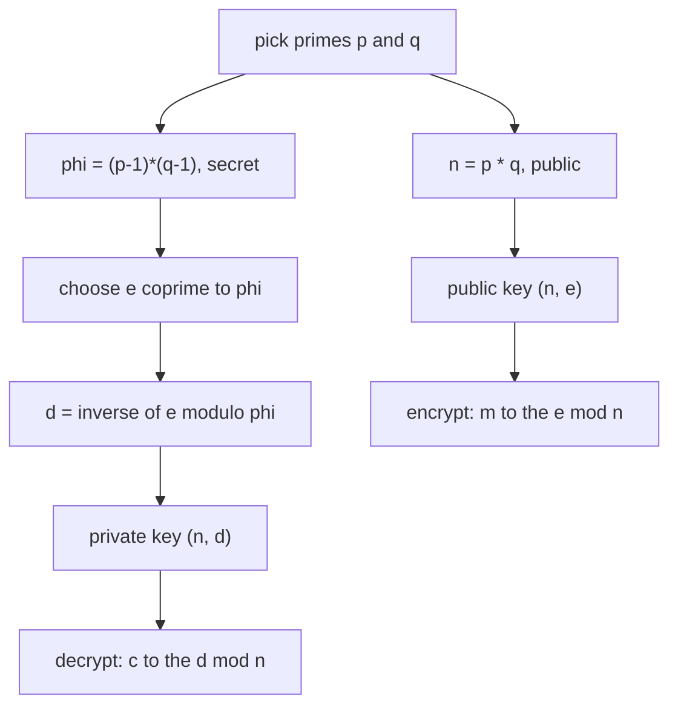
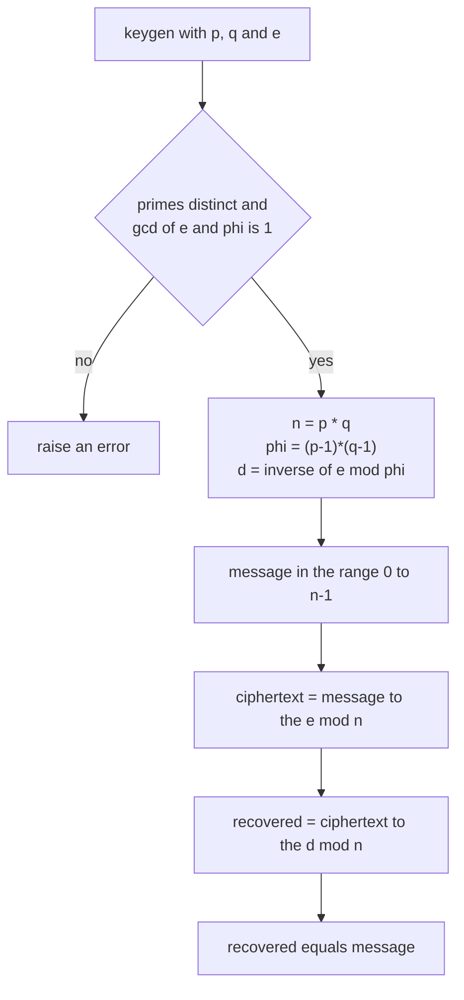
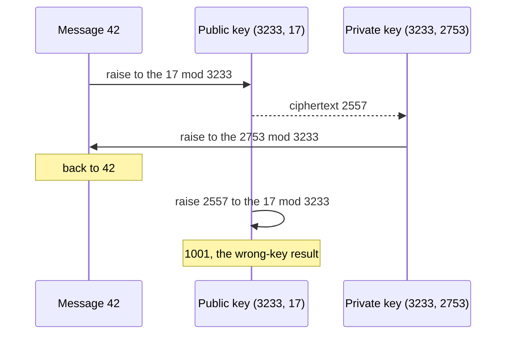

# 385 — Implement RSA key generation and basic encrypt/decrypt (demo).

> **Tier:** Intermediate · **CTCI chapter:** Beyond — Security & Privacy
> **Task spec:** [385-implement-rsa-key-generation-and-basic-encrypt-decrypt-demo.md](../../../tasks/intermediate/385-implement-rsa-key-generation-and-basic-encrypt-decrypt-demo.md)
> **Solutions:** [Python](../../../solutions/python/intermediate/385-implement-rsa-key-generation-and-basic-encrypt-decrypt-demo/solution.py) ·
> [Java](../../../solutions/java/intermediate/385-implement-rsa-key-generation-and-basic-encrypt-decrypt-demo/Solution.java) ·
> [JavaScript](../../../solutions/javascript/intermediate/385-implement-rsa-key-generation-and-basic-encrypt-decrypt-demo/solution.js) ·
> [C#](../../../solutions/csharp/intermediate/385-implement-rsa-key-generation-and-basic-encrypt-decrypt-demo/Solution.cs)

## 1. Problem restatement

The docstring is blunt about the scope: this is **textbook (unpadded) toy RSA**, a demo, not a
cipher. Real RSA uses large keys, padding such as OAEP, and more. What the task exercises is the
number theory: keys from two primes, a modular inverse, and two modular exponentiations that undo
each other.

**Inputs and outputs:**

- `keygen(p, q, e)` → `(n, e, d, phi)` with `n = p·q`, `phi = (p-1)(q-1)`, and `d = e⁻¹ mod phi`.
  It raises `ValueError` when `p` or `q` is not prime, when `p = q`, or when `gcd(e, phi) != 1`.
- `encrypt(message, e, n)` → `message^e mod n`; raises unless `0 <= message < n`.
- `decrypt(ciphertext, d, n)` → `ciphertext^d mod n`; raises unless `0 <= ciphertext < n`.

| Call | Result | Why |
| --- | --- | --- |
| `keygen(61, 53, 17)` | `(3233, 17, 2753, 3120)` | `n = 61·53`, `phi = 60·52`, and `e·d = 46801 ≡ 1 (mod 3120)` |
| `keygen(101, 113, 3)` | `(11413, 3, 7467, 11200)` | the second keypair, with a small public exponent |
| round trip for `m` in `{0, 1, 2, 42, 65, 1000, 3232}` | `decrypt(encrypt(m)) = m` | including the domain boundaries `0` and `n - 1` |
| `encrypt(0, 17, 3233)` | `0` | documented fixed point |
| `encrypt(1, 17, 3233)` | `1` | documented fixed point |
| `encrypt(3232, 17, 3233)` | `3232` | `n - 1 ≡ -1`, and `(-1)^e = -1` for odd `e` |
| `encrypt(m, 17, 3233)` for `m` in `{2, 42, 65, 1000}` | different from `m` | the non-trivial messages do change |
| `decrypt(encrypt(42, 17, 3233), 17, 3233)` | `1001`, not `42` | applying the public exponent again is not decryption |
| `decrypt(encrypt(7, 3, 11413), 3, 11413)` | `8652`, not `7` | the same mis-use on the second keypair |
| `keygen(7, 13, 3)`, `keygen(9, 53, 17)`, `keygen(61, 61, 17)`, `keygen(61, 53, 4)` | raise | bad primes, repeated prime, or `gcd(e, phi) != 1` |
| `encrypt(3233, 17, 3233)`, `encrypt(-1, 17, 3233)` | raise | outside the message domain |

The wrong-key rows are assertions about **concrete examples**, and the docstring says so: nothing
guarantees that the public exponent fails to invert *every* message, only that it fails for the
values the tests pin down.

## 2. Intuition

RSA is built on the gap between two operations: multiplying two primes is trivial, recovering them
from their product is not — the same asymmetry that
[383-factor-large-integer-with-pollard-s-rho-outline-test-small.md](../../../tasks/intermediate/383-factor-large-integer-with-pollard-s-rho-outline-test-small.md)
attacks from the other side.

The construction:

1. Pick distinct primes `p` and `q`, and set `n = p·q`. Both `p` and `q` are secret; `n` is public.
2. Work modulo `phi = (p-1)(q-1)`, the order of the multiplicative group of units modulo `n`
   (for a product of two distinct primes the group has exactly `(p-1)(q-1)` invertible residues).
3. Choose a public exponent `e` coprime to `phi`. Then `e` has an inverse `d` modulo `phi`, and
   `d` is the private exponent.
4. Encryption raises the message to `e`; decryption raises the ciphertext to `d`.

The reason the round trip works is Euler's theorem: since `e·d ≡ 1 (mod phi)`, there is an integer
`k` with `e·d = 1 + k·phi`, and for every message coprime to `n`,

    (m^e)^d = m^(1 + k·phi) = m · (m^phi)^k ≡ m (mod n)

The files only need the *result*, so the consequence is all that matters: **the two exponents are
inverses modulo `phi`**, which is why `d` comes straight out of the extended-Euclid inverse used in
the earlier tasks of this cluster.



The demo's documented quirks follow directly from the arithmetic. `0` and `1` are fixed points of
every exponentiation, so their ciphertext equals their plaintext. `n - 1 ≡ -1` is fixed too when `e`
is odd, which it always is here because `phi` is even and `e` must be coprime to it.

## 3. Algorithm

1. **Validate the demo parameters** in `keygen`. `is_small_prime(p)` and `is_small_prime(q)` reject
   non-primes by trial division; `p != q` is required because the group size formula assumes distinct
   primes; and `gcd(e, phi) != 1` is rejected because then `e` has no inverse modulo `phi` and no
   private exponent exists.
2. **Build the modulus and the group order.** `n = p·q`, `phi = (p-1)·(q-1)`.
3. **Invert the public exponent.** `d = mod_inverse(e, phi)`, using the extended Euclid routine.
4. **Encrypt.** Check `0 <= message < n` (a message at least `n` would wrap and decrypt to a
   different value), then return `pow(message, e, n)` — binary modular exponentiation.
5. **Decrypt.** Check `0 <= ciphertext < n`, then return `pow(ciphertext, d, n)`.
6. **Verify.** Assert the keypair values, `e·d mod phi = 1`, round trips over a message list that
   includes `0`, `1` and `n - 1`, the fixed-point behaviour, the non-fixed behaviour for `2, 42, 65,
   1000`, and the specific wrong-key results.

```text
function keygen(p, q, e)
    if not is_small_prime(p) or not is_small_prime(q) or p = q then
        fail "p and q must be distinct primes"
    end
    n ← p * q
    phi ← (p - 1) * (q - 1)
    if gcd(e, phi) != 1 then
        fail "public exponent must be coprime with phi of n"
    end
    return n, e, mod_inverse(e, phi), phi
end

function encrypt(message, e, n)
    if message &lt; 0 or message &gt;= n then
        fail "message must satisfy 0 less or equal m less than n"
    end
    return mod_power(message, e, n)
end

function decrypt(ciphertext, d, n)
    if ciphertext &lt; 0 or ciphertext &gt;= n then
        fail "ciphertext must satisfy 0 less or equal c less than n"
    end
    return mod_power(ciphertext, d, n)
end
```



Note that the *only* asymmetric ingredient in the whole file is the inverse: encryption and
decryption are the same routine `mod_power` with different exponents. Everything else — the primality
filter, the gcd check, the inverses — is shared with the neighbouring modular-arithmetic tasks.

## 4. Worked example

Trace the classic keypair `p = 61`, `q = 53`, `e = 17`.

| Step | Operation | Value |
| --- | --- | --- |
| modulus | `n = 61 · 53` | `3233` |
| group order | `phi = 60 · 52` | `3120` |
| gcd check | `gcd(17, 3120)` | `1`, so `e` is usable |
| private exponent | `d = 17⁻¹ mod 3120` | `2753`, and `17 · 2753 = 46801 = 15 · 3120 + 1` |
| encrypt `42` | `42^17 mod 3233` | `2557` |
| decrypt `2557` | `2557^2753 mod 3233` | `42`, the original message |
| wrong key | `2557^17 mod 3233` | `1001`, which is the asserted value and is *not* the message |

The first and last rows are the point. The same ciphertext, raised to two different exponents,
gives the plaintext for `d` and garbage for `e` — the measured behaviour the assertions pin down.
The correctness condition `e·d ≡ 1 (mod phi)` is asserted separately (`e * d % phi == 1`), which is
the invariant that makes the round trip work at all.



The small-exponent keypair tells the same story with `e = 3`: `keygen(101, 113, 3)` gives
`n = 11413`, `phi = 11200` and `d = 7467`. Round trips succeed for `0, 1, 2, 5, 42, 999` and `11412`,
and the wrong-key result for the message `7` is `8652`.

The boundary messages are worth watching in the first keypair:

| Message | Ciphertext | Recovered | Comment |
| --- | --- | --- | --- |
| `0` | `0` | `0` | fixed point, documented |
| `1` | `1` | `1` | fixed point, documented |
| `2` | `2^17 mod 3233 = 1752` | `2` | a real round trip, and `1752 ≠ 2` |
| `3232` | `3232` | `3232` | `n - 1 ≡ -1` and `17` is odd, so `(-1)^17 = -1` |

## 5. Complexity

Let `n = p·q` be the modulus and `e`, `d` the exponents.

| Measure | Bound | Why it holds |
| --- | --- | --- |
| `keygen` primality check | O(√p) + O(√q) | `is_small_prime` is trial division, used only to reject obviously bad demo primes |
| `keygen` gcd | O(log phi) | Euclid's algorithm |
| `keygen` inverse | O(log phi) | one extended-Euclid run |
| `encrypt` | O(log e) modular multiplications | binary exponentiation with exponent `e` |
| `decrypt` | O(log d) modular multiplications | the same routine with the much larger exponent `d` — decryption is the slow direction |
| Space | O(1) beyond the returned key material | only the running accumulator and the gcd coefficients are kept |
| Integer width | products stay below `1e18` in the demo | the Java file delegates to `BigInteger.modPow`, C# casts to `UInt128`, JavaScript uses `BigInt`, Python is arbitrary precision |

The asymmetry between `log e` and `log d` is why real implementations (including this task's own
tie to CRT) use the Chinese remainder trick: decrypt modulo `p` and `q` separately with the smaller
exponents `d mod (p-1)` and `d mod (q-1)`, then recombine — roughly four times faster than one
exponentiation modulo `n`, using exactly the merge in
[381-chinese-remainder-theorem-solver-for-pairwise-coprime-moduli.md](../../../tasks/intermediate/381-chinese-remainder-theorem-solver-for-pairwise-coprime-moduli.md).

## 6. Pitfalls and edge cases

- **`0`, `1` and `n - 1` are fixed points.** `0^e = 0`, `1^e = 1`, and since `e` is odd,
  `(-1)^e = -1`. The tests assert all three, and the docstring flags them so nobody mistakes them for
  a bug. `n - 1` is the interesting one: it depends on `e` being odd, which is guaranteed because
  `phi` is even and `e` must be coprime to `phi`.
- **The wrong key usually fails, but "usually" is not "always".** `decrypt(encrypt(42, 17, 3233), 17,
  3233) = 1001`, asserted — and the docstring warns that the assertions pin the concrete examples
  rather than a general theorem. Messages `0` and `1` are always recovered even with the wrong
  exponent.
- **`p` and `q` must be distinct primes.** `p = q` breaks the group size formula (`phi = (p-1)²` is
  wrong for `n = p²`) and leaks the factor instantly through `√n`; the demo rejects it, and
  `keygen(61, 61, 17)` is asserted to raise.
- **`e` must be coprime to `phi`.** Otherwise `mod_inverse` fails and there is no `d`. The rejected
  parameter set `(61, 53, 4)` is exactly that case, since `4` shares the factor `2` with `3120`.
- **Message domain is enforced on both sides.** `encrypt(3233, 17, 3233)` and `encrypt(-1, …)` raise,
  because a message of `n` or more would reduce to a different value and decrypt to that reduced
  value instead. `decrypt` applies the same check to the ciphertext.
- **`d != e` is asserted.** For the toy keypair `d = 2753` and `e = 17`; with tiny primes and a small
  `e` it is possible in principle for the inverse to be the exponent itself, which would make the
  "wrong key" checks vacuous.
- **`is_small_prime` is a demo filter, not a certificate.** It is trial division, so it only rejects
  obviously composite parameters. The real certificate is the deterministic Miller-Rabin test in
  [382-implement-primality-test-miller-rabin-deterministic-small-bases.md](../../../tasks/intermediate/382-implement-primality-test-miller-rabin-deterministic-small-bases.md);
  a production `keygen` must use it (or generate provable primes) and must never take its primes from
  an untrusted caller.
- **Textbook RSA is not a cipher.** No padding means the scheme is deterministic (equal messages
  produce equal ciphertexts) and malleable; it is vulnerable to a host of chosen-ciphertext attacks.
  The file is a number-theory demo, and the docstring says so.
- **Wide-integer handling.** Java uses `BigInteger.modPow`, C# raises each intermediate to `UInt128`
  before reducing, JavaScript works in `BigInt`, and Python needs no special handling. A `long`
  multiplication of two residues near `1e9` would be fine, but the C# `UInt128` cast keeps the
  squaring step safe for larger demo moduli.

## 7. Variants and follow-ups

- **CRT-accelerated decryption.** Keep `d mod (p-1)` and `d mod (q-1)` and decrypt modulo `p` and `q`
  separately, then merge with the
  [381-chinese-remainder-theorem-solver-for-pairwise-coprime-moduli.md](../../../tasks/intermediate/381-chinese-remainder-theorem-solver-for-pairwise-coprime-moduli.md)
  routine; this is what real RSA libraries ship as the "CRT" private key.
- **Padding.** OAEP turns textbook RSA into a usable encryption scheme by randomising the message
  before the exponentiation; PKCS#1 v1.5 is the older alternative with known pitfalls.
- **Signing instead of encrypting.** Swap the exponents — raise the *hash* with `d` to sign and verify
  with `e` — which relies on `d` being secret rather than on the group's asymmetry.
- **Choosing the primes.** Real keygen generates random candidates and certifies them with
  [382-implement-primality-test-miller-rabin-deterministic-small-bases.md](../../../tasks/intermediate/382-implement-primality-test-miller-rabin-deterministic-small-bases.md),
  rather than accepting them as parameters.
- **The attack the demo invites.** Factoring `n` with
  [383-factor-large-integer-with-pollard-s-rho-outline-test-small.md](../../../tasks/intermediate/383-factor-large-integer-with-pollard-s-rho-outline-test-small.md)
  recovers `phi` and therefore `d`; doing it for `n = 3233` is a good exercise, and doing it for a real
  modulus is the reason key sizes are what they are.

## 8. Check yourself

1. Why does `d = e⁻¹ mod phi` make decryption undo encryption?

<details><summary>Show answer</summary>

Because `e·d ≡ 1 (mod phi)` means `e·d = 1 + k·phi` for some integer `k`, and Euler's theorem says
`m^phi ≡ 1 (mod n)` for messages coprime to `n`. So `(m^e)^d = m^(1 + k·phi) ≡ m (mod n)`. The files
assert the prerequisite directly as `e * d % phi == 1`.

</details>

2. Which messages are unaffected by encryption in this demo, and why?

<details><summary>Show answer</summary>

`0`, `1` and `n - 1`. Zero and one are fixed by every exponentiation; `n - 1 ≡ -1 (mod n)` and the
public exponent is odd (it must be coprime to the even `phi`), so `(-1)^e = -1 ≡ n - 1`. The tests
assert all three, and the docstring calls them documented fixed points.

</details>

3. `keygen(61, 53, 4)` raises. Which check fires?

<details><summary>Show answer</summary>

The gcd check. Both `61` and `53` pass the primality filter and they are distinct, but
`phi = 60 · 52 = 3120` is even, so `gcd(4, 3120) = 4 ≠ 1` and no inverse of `4` modulo `3120` exists.
Without `d` there is no private key.

</details>

4. Why is `encrypt(3233, 17, 3233)` rejected instead of returning `0`?

<details><summary>Show answer</summary>

Because `3233 ≡ 0 (mod 3233)` would encrypt to `0`, and decrypting `0` returns `0`, not `3233` — the
message would be silently ambiguous. RSA operates on residues in `[0, n)`, so the domain is enforced
instead of quietly reducing the input. The same check applies to the ciphertext in `decrypt`.

</details>

5. What does `decrypt(encrypt(42, 17, 3233), 17, 3233)` return, and what does that demonstrate?

<details><summary>Show answer</summary>

It returns `1001`, not `42` — the assertion pins this exact value for the first keypair, and the
second keypair has the analogous `8652` for the message `7`. It demonstrates that encryption and
decryption are two different exponents and that using the public exponent on a ciphertext is not
decryption. The docstring warns that this is only asserted for the concrete examples, since `0` and
`1` would round-trip even under the wrong exponent.

</details>
