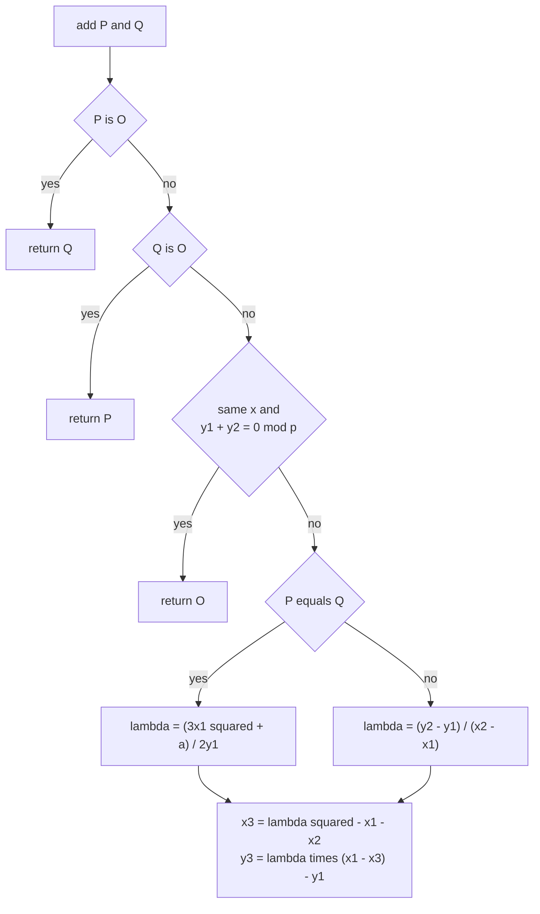
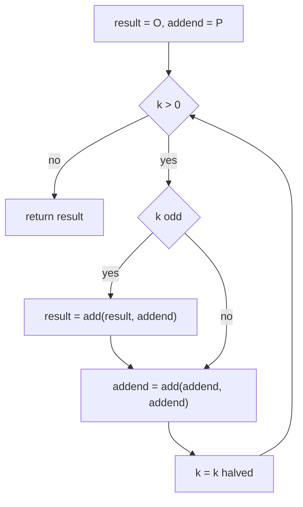
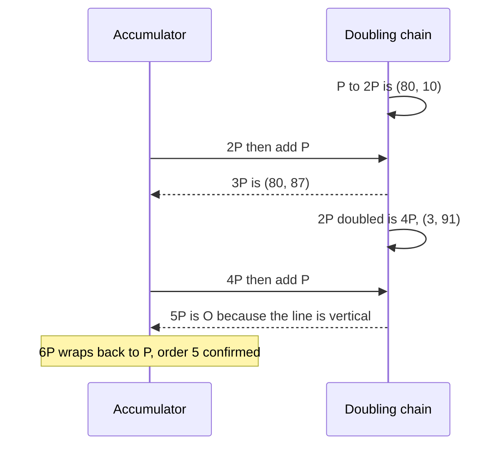
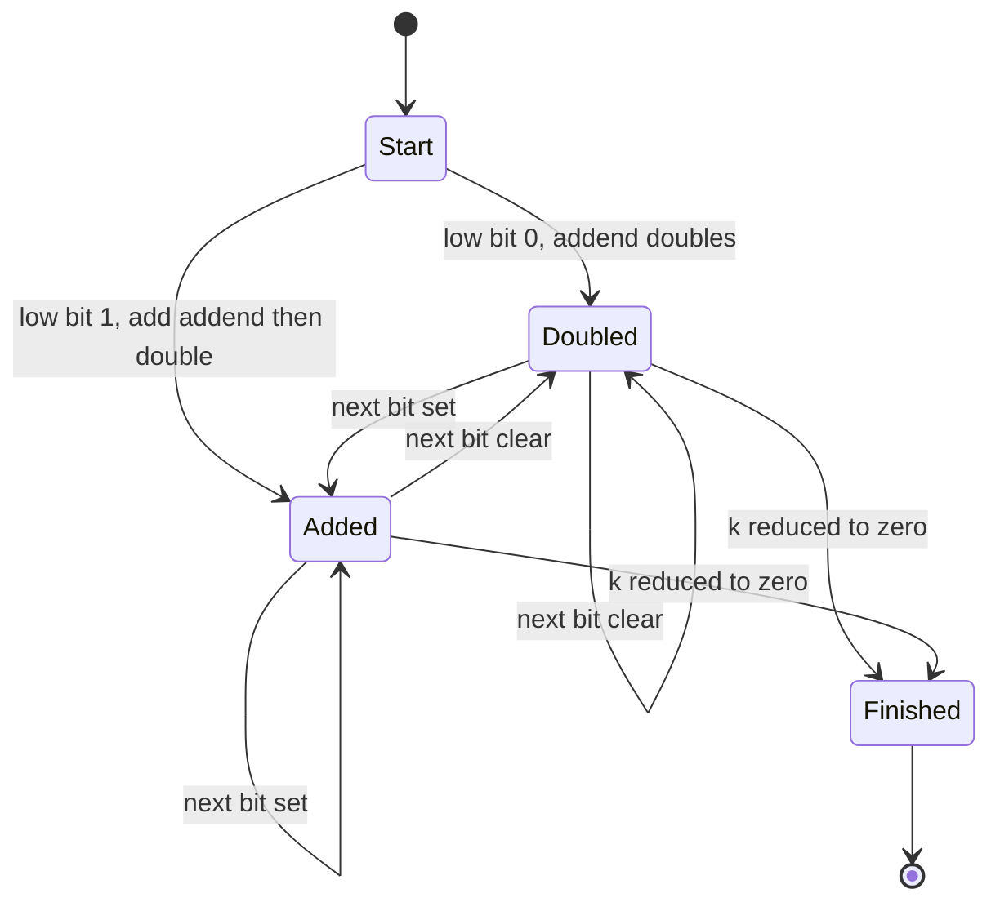

# 386 — Implement elliptic curve point arithmetic (outline).

> **Tier:** Intermediate · **CTCI chapter:** Beyond — Security & Privacy
> **Task spec:** [386-implement-elliptic-curve-point-arithmetic-outline.md](../../../tasks/intermediate/386-implement-elliptic-curve-point-arithmetic-outline.md)
> **Solutions:** [Python](../../../solutions/python/intermediate/386-implement-elliptic-curve-point-arithmetic-outline/solution.py) ·
> [Java](../../../solutions/java/intermediate/386-implement-elliptic-curve-point-arithmetic-outline/Solution.java) ·
> [JavaScript](../../../solutions/javascript/intermediate/386-implement-elliptic-curve-point-arithmetic-outline/solution.js) ·
> [C#](../../../solutions/csharp/intermediate/386-implement-elliptic-curve-point-arithmetic-outline/Solution.cs)

## 1. Problem restatement

This is an **outline** task with a small, fully enumerable instance: the short Weierstrass curve

    E: y² = x³ + a·x + b     over the prime field F_p

instantiated as `y² = x³ + 2x + 3` over `F_97`, which the docstring describes as a classic small
textbook example of group order `100`. A point is a tuple `(x, y)`; the point at infinity `O` is
represented by the language's null value — `None` in Python, `null` in Java and JavaScript, `null`
for the C# tuple representation.

The API is five functions:

- `is_on_curve(point, a, b, p)` — the curve equation, with `O` on every curve by definition.
- `add(point1, point2, a, p)` — the group law, returning `O` for `P + (-P)`.
- `scalar_multiply(k, point, a, p)` — double-and-add, with `k >= 0` and `k = 0` giving `O`.
- `scalar_multiply_naive(k, point, a, p)` — repeated addition, the independent oracle.
- `enumerate_points(a, b, p)` and `curve_order(a, b, p)` — the brute-force point list and the
  Legendre-symbol count of the group order.

| Call | Result | Why |
| --- | --- | --- |
| `is_on_curve((3, 6), 2, 3, 97)` | `true` | `6² - (3³ + 2·3 + 3) = 36 - 36 ≡ 0` |
| `len(enumerate_points(2, 3, 97))` | `99` | affine points; the group order `100` includes `O` |
| `curve_order(2, 3, 97)` | `100` | `= len(points) + 1`, and `(100 - 98)² = 4 <= 4·97` satisfies Hasse |
| `add((3, 6), (3, 6), 2, 97)` | `(80, 10)` | `2P` for `P = (3, 6)` |
| `add((80, 10), (3, 6), 2, 97)` | `(80, 87)` | `3P` |
| `add((80, 10), (80, 10), 2, 97)` | `(3, 91)` | `4P` |
| `add((3, 6), (3, 91), 2, 97)` | `O` | `(3, 91) = -P`, so `P + (-P) = O` |
| `scalar_multiply(5, (3, 6), 2, 97)` | `O` | `P` has order `5` |
| `scalar_multiply(6, (3, 6), 2, 97)` | `(3, 6)` | `6P = P` because `5P = O` |
| `add((0, 10), (0, 87), 2, 97)` | `O` | two points with the same `x` and opposite `y` |
| `add((30, 0), (30, 0), 2, 97)` | `O` | doubling a `y = 0` point, the order-2 case |
| `scalar_multiply(100, pt, 2, 97)` for every enumerated `pt` | `O` | the group order is `100` |
| `scalar_multiply(k, pt, 2, 97)` vs `scalar_multiply_naive` | equal for `k` in `0..30` (and `0..12` on the first six points) | the double-and-add check |

The order-2 points `(30, 0)`, `(68, 0)` and `(96, 0)` are asserted to be in the enumerated list,
which is how the doubling branch that avoids dividing by zero gets exercised.

## 2. Intuition

An elliptic curve over a finite field is a set of points with an addition operation that behaves like
integer addition: it is associative, commutative, has an identity (`O`), and every point has an
inverse `-P`. The geometric origin of the law is the chord-and-tangent construction — a line through
two points meets the curve in a third, and that third point's reflection in the `x`-axis is the sum —
but over a finite field there is no picture, only the algebra it produces:

    P + Q:   λ = (y₂ - y₁) / (x₂ - x₁)                      when P ≠ ±Q
    2P:      λ = (3x₁² + a) / (2y₁)                         the tangent slope
    then     x₃ = λ² - x₁ - x₂,      y₃ = λ·(x₁ - x₃) - y₁

Every division is a **modular inverse**, which is why this task reuses the extended Euclid helper of
the earlier modular tasks: the field is `F_p`, so "divide by `2y₁`" means "multiply by the inverse of
`2y₁`".

The three special cases are not exceptions to the law — they are the law's boundary:

- `P + O = P` and `O + O = O`: the identity element.
- `P + (-P) = O` where `-P = (x, -y)`: the line through `P` and `-P` is vertical, so it never meets
  the curve a third time. The code tests `x₁ = x₂` and `y₁ + y₂ ≡ 0 (mod p)`.
- Doubling a point with `y = 0`: `P = -P`, so `2P = O`. The same test catches it, because
  `y + y = 2y ≡ 0 (mod p)` when `y = 0`.



Scalar multiplication is where the group law becomes useful: `k·P` by repeated addition costs `k`
additions, while **double-and-add** — square the point by `log₂ k` doublings and add in the set bits
of `k` — costs `O(log k)` additions. That is the same binary-exponentiation idea as
[380-implement-modular-inverse-fast-modular-exponent.md](../../../tasks/intermediate/380-implement-modular-inverse-fast-modular-exponent.md),
transplanted from the multiplicative group of integers into the additive group of curve points.

## 3. Algorithm

1. **Representation.** A point is `(x, y)` with coordinates reduced modulo `p`; `O` is the null value.
2. **Membership.** `is_on_curve` checks `y² ≡ x³ + a·x + b (mod p)`, and returns `true` for `O`.
3. **Addition.** Handle the identity and inverse cases first, then pick the slope: the tangent formula
   when the two points are equal, the chord formula otherwise. Both slopes multiply by a modular
   inverse. Finish with `x₃ = λ² - x₁ - x₂ mod p` and `y₃ = λ·(x₁ - x₃) - y₁ mod p`.
4. **Scalar multiplication.** Start `result = O` and `addend = P`. While `k > 0`: if the low bit of
   `k` is set, `result = add(result, addend)`; then `addend = add(addend, addend)` and `k >>= 1`.
   Return `result` — `O` when `k` started at `0`.
5. **Oracle.** `scalar_multiply_naive(k, P)` adds `P` to itself `k` times; it is only usable for
   small `k`, which is exactly the range the tests compare.
6. **Point enumeration and order.** `enumerate_points` tries every `x` and `y` in `[0, p)` and keeps
   the solutions of the curve equation. `curve_order` counts without enumeration: start at `1` for
   `O`, add `1` when `x³ + ax + b ≡ 0` (one `y`, namely `0`), add `2` when the right-hand side is a
   non-zero quadratic residue, which the Legendre symbol `f(x)^((p-1)/2) mod p` tests.
7. **Verify.** Assert the hand-computed multiples `2P = (80, 10)`, `3P = (80, 87)`, `4P = (3, 91)`,
   `5P = O`, `6P = P`; assert `order == 100 == len(points) + 1` and the Hasse bound; compare
   double-and-add against repeated addition; and assert `100·P = O` for every point in the group.

```text
function add(point1, point2, a, p)
    if point1 is O then
        return point2
    end
    if point2 is O then
        return point1
    end
    x1, y1 ← point1
    x2, y2 ← point2
    if x1 = x2 and (y1 + y2) mod p = 0 then
        return O
    end
    if point1 = point2 then
        slope ← (3 * x1 * x1 + a) * inverse(2 * y1, p) mod p
    else
        slope ← (y2 - y1) * inverse(x2 - x1, p) mod p
    end
    x3 ← (slope * slope - x1 - x2) mod p
    y3 ← (slope * (x1 - x3) - y1) mod p
    return (x3, y3)
end

function scalar_multiply(k, point, a, p)
    result ← O
    addend ← point
    while k &gt; 0 do
        if k is odd then
            result ← add(result, addend, a, p)
        end
        addend ← add(addend, addend, a, p)
        k ← k / 2 rounded down
    end
    return result
end
```



The doubling step happens on **every** iteration, exactly as the squaring step does in binary
exponentiation, because after `i` iterations `addend` holds `2^i · P`; the running `result` collects
the powers that correspond to set bits, and the final value is `k·P`.

## 4. Worked example

Trace the asserted multiples of `P = (3, 6)` on `y² = x³ + 2x + 3` over `F_97`. First check `P` is on
the curve: `6² = 36` and `3³ + 2·3 + 3 = 27 + 6 + 3 = 36`, so `36 ≡ 36`. The curve is non-singular
as well: `4a³ + 27b² = 32 + 243 = 275 ≡ 81 ≠ 0 (mod 97)`.

**Doubling `P`.** `λ = (3·3² + 2)·(2·6)⁻¹ = 29 · 12⁻¹ mod 97`. Since `12 · 89 = 1068 = 11·97 + 1`,
the inverse of `12` is `89`, so `λ = 29 · 89 = 2581 ≡ 59 (mod 97)`. Then
`x₃ = 59² - 3 - 3 = 3481 - 6 = 3475 ≡ 80` and `y₃ = 59·(3 - 80) - 6 = -4549 ≡ 10`, giving
`2P = (80, 10)`.

| Step | Operation | Result |
| --- | --- | --- |
| `P` | on-curve check | `(3, 6)`, order `5` |
| `2P = P + P` | tangent slope `59` | `(80, 10)` |
| `3P = 2P + P` | chord slope `(6 - 10)·(3 - 80)⁻¹ ≡ 58` | `(80, 87)` |
| `4P = 2P + 2P` | tangent at `(80, 10)`: `(3·80² + 2)·(2·10)⁻¹ ≡ 58` | `(3, 91)` |
| `5P = 4P + P` | `x₁ = x₂ = 3` and `y₁ + y₂ = 91 + 6 = 97 ≡ 0` | `O` |
| `6P = 5P + P` | `O + P` | `P` |

The fifth row is the interesting one: adding `(3, 91)` to `(3, 6)` hits the vertical-line case, so the
result is `O` and `P` turns out to have order exactly `5`. The sixth row is the identity branch — once
the accumulator is `O`, adding `P` returns `P`. That is precisely why the doubled-and-added
accumulator handles `k = 6` without a special case.



**Double-and-add for `k = 6`.** Binary `110`: the loop iterates three times with `addend` taking the
values `P, 2P, 4P`, adding `2P` and `4P` into the accumulator for the two set bits:
`O → 2P → 2P + 4P = 6P = P`. Repeated addition needs five adds to reach the same point, and the gap
only widens with `k`.



**The group order.** Enumeration finds `99` affine points, and `curve_order` — which never enumerates
— returns `100 = 99 + 1`, counting `O`. The Hasse bound `|#E - (p + 1)| <= 2√p` is asserted as
`(100 - 98)² = 4 <= 4·97 = 388`. Because the order is `100`, the files can assert `100·P = O` for
every point in the group, a much stronger check than comparing a handful of multiples.

## 5. Complexity

Let `k` be the scalar, `p` the field size and `n = #E(F_p)` the group order.

| Measure | Bound | Why it holds |
| --- | --- | --- |
| `add` | O(log p) for the inverse plus O(1) multiplications | extended Euclid is logarithmic; the coordinate formulas are a fixed handful of operations |
| `scalar_multiply` | O(log k) additions | one double-and-add step per bit of `k` |
| `scalar_multiply_naive` | O(k) additions | the oracle it replaces; used only for `k <= 30` in the harness |
| `enumerate_points` | O(p²) | every `(x, y)` pair in the plane is tested |
| `curve_order` | O(p log p) | one Legendre-symbol exponentiation per `x` |
| Space | O(1) for the arithmetic, O(p) for the enumerated list | the group law keeps a few field elements; enumeration stores all points |
| Harness coverage | `k` in `0..30`, plus 40 LCG scalars below `50` | the comparisons against repeated addition |

The double-and-add gain is the same one binary exponentiation gives: `O(log k)` group operations
instead of `O(k)`. For the `k` values in the tests the constant is irrelevant, but it is the whole
reason elliptic-curve cryptography is practical — a scalar of 256 bits costs a few hundred point
additions, not `2^256`. In a real implementation the `O(log p)` inversion per addition is replaced by
projective coordinates, which trade a few extra multiplications for no inversion at all.

## 6. Pitfalls and edge cases

- **`P + (-P)` must be checked before the slope.** For `P = (3, 6)` and `-P = (3, 91)`,
  `x₂ - x₁ = 0` and the chord formula would try to invert `0`. The guard
  `x₁ = x₂ and (y₁ + y₂) mod p = 0` catches it and returns `O`.
- **The same guard handles `y = 0` doubling.** `(30, 0)` is an order-2 point, so `2P = O`; the code
  reaches that through `y₁ + y₂ = 0 + 0 ≡ 0`, not through a separate branch. Dividing by `2y₁ = 0`
  would otherwise raise.
- **`k = 0` returns `O`.** The `while k > 0` loop never runs, and the initialised result is `O`; the
  harness checks `k = 0` against the naive oracle, which also returns `O` immediately.
- **`O` is the null value, not a coordinate.** Python's `None`, Java's and JavaScript's `null` and
  C#'s null tuple all serve; `is_on_curve` returns `true` for it by definition, and every `add`
  starts by checking both arguments. Testing `(0, 0)` as "infinity" would be wrong — `(0, 0)` may be a
  genuine point, and here it is not on the curve at all (`0 ≠ 3`).
- **Coordinate reductions.** All three coordinate computations take `mod p`, including `y₃`, which is
  where negative intermediate values appear. Skipping a reduction leaves negative coordinates that
  fail the on-curve check even though the point is correct.
- **The curve must be non-singular.** `4a³ + 27b² ≠ 0`; for `a = 2, b = 3, p = 97` the discriminant
  is `81`, safely non-zero. A singular curve is not an elliptic curve and the group law degenerates.
- **Point counting needs the Legendre symbol.** For non-zero `f(x)`, `f(x)^((p-1)/2)` is `1` for a
  quadratic residue (two solutions), `p - 1` for a non-residue (none) and `0` when `f(x) = 0` (one
  solution). The count starts at `1` for `O`. The independent enumeration is what proves the count
  (`99 + 1 = 100`).
- **Small-field caveat.** `F_97` is a teaching instance: the group order `100` is highly composite
  (`2² · 5²`), so the discrete log on it is trivial by
  [384-implement-discrete-logarithm-baby-step-giant-step.md](../../../tasks/intermediate/384-implement-discrete-logarithm-baby-step-giant-step.md).
  Nothing about the arithmetic here is secure.
- **Affine vs projective.** Every `add` costs a modular inverse because it works in affine
  coordinates. That is fine for an outline and hopeless for production, where Jacobian or projective
  coordinates batch the inversions away.

## 7. Variants and follow-ups

- **Projective coordinates.** Replace the affine division with formulas that keep a `Z` denominator and
  invert once at the end; the group law is the same, the cost profile is very different.
- **Curve forms.** Montgomery and Edwards curves have faster, exception-free addition formulas;
  the short Weierstrass form used here is the textbook one.
- **Point counting for large `p`.** Enumerating `p²` pairs is only possible for tiny fields;
  Schoof's algorithm computes `#E(F_p)` in polynomial time for cryptographic sizes.
- **Scalar multiplication hardening.** Double-and-add leaks the scalar through timing and branch
  patterns; Montgomery ladders and constant-time addition are the standard countermeasures.
- **The modular core it shares.** The inverse in the slope and the Legendre exponentiation come from
  the same routines as
  [380-implement-modular-inverse-fast-modular-exponent.md](../../../tasks/intermediate/380-implement-modular-inverse-fast-modular-exponent.md);
  the related hardness assumption is the one attacked by
  [384-implement-discrete-logarithm-baby-step-giant-step.md](../../../tasks/intermediate/384-implement-discrete-logarithm-baby-step-giant-step.md),
  and the RSA demo in
  [385-implement-rsa-key-generation-and-basic-encrypt-decrypt-demo.md](../../../tasks/intermediate/385-implement-rsa-key-generation-and-basic-encrypt-decrypt-demo.md)
  is the multiplicative-group analogue of this additive group.

## 8. Check yourself

1. Why does `add((3, 6), (3, 91), 2, 97)` return `O` instead of raising a division-by-zero error?

<details><summary>Show answer</summary>

Because the inverse case is handled before any slope is computed. The two points share `x = 3` and
their `y` coordinates sum to `97 ≡ 0 (mod 97)`, so the second point is `-P` and the sum is the
identity — the line through them is vertical and meets no third point. Without that guard the chord
formula would try `inverse(x2 - x1) = inverse(0)`, which does not exist.

</details>

2. What is `2·(30, 0)` on this curve, and through which branch of `add`?

<details><summary>Show answer</summary>

`O`. The point has `y = 0`, so it is its own inverse (`-P = (x, -y) = (x, 0) = P`), which means
`2P = O`. The branch is the same `x₁ = x₂ and (y₁ + y₂) mod p = 0` test, since `0 + 0 ≡ 0`; the
doubling formula would have divided by `2y₁ = 0`.

</details>

3. The group order is `100`. How can you tell that `P = (3, 6)` has order `5`?

<details><summary>Show answer</summary>

By the hand-verified multiples: `2P = (80, 10)`, `3P = (80, 87)`, `4P = (3, 91)` and `5P = O`, which
is asserted directly. Since the order divides the group order, `5 | 100` is consistent, and
`scalar_multiply(6, P) = P` follows from `6P = 5P + P = O + P`.

</details>

4. Why is `curve_order` a useful independent check when `enumerate_points` already lists the points?

<details><summary>Show answer</summary>

Because they use completely different machinery: enumeration tests `p²` candidate pairs against the
curve equation, while `curve_order` never looks at a `y` coordinate — it evaluates the Legendre symbol
per `x` and adds `1`, `2` or `0` accordingly. Agreement on `100 = 99 + 1` means an error would have
to exist in both approaches, and the Hasse bound `|#E - (p + 1)| <= 2√p` gives a sanity check
independent of both.

</details>

5. Why does the doubling step run on every loop iteration of `scalar_multiply`, even when the bit is
   zero?

<details><summary>Show answer</summary>

Because `addend` must hold `2^i · P` at iteration `i`, and the running value is what the set bits of
the scalar select from. Skipping the doubling would leave the wrong power available for later bits.
The same structure appears in binary modular exponentiation, where the base is squared every
iteration and multiplied into the accumulator only for set bits.

</details>
