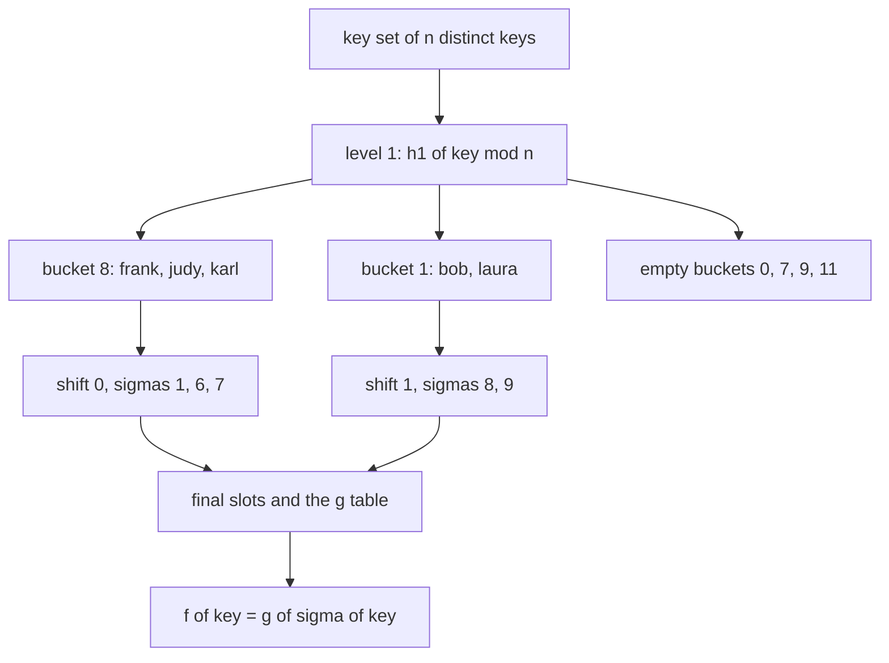
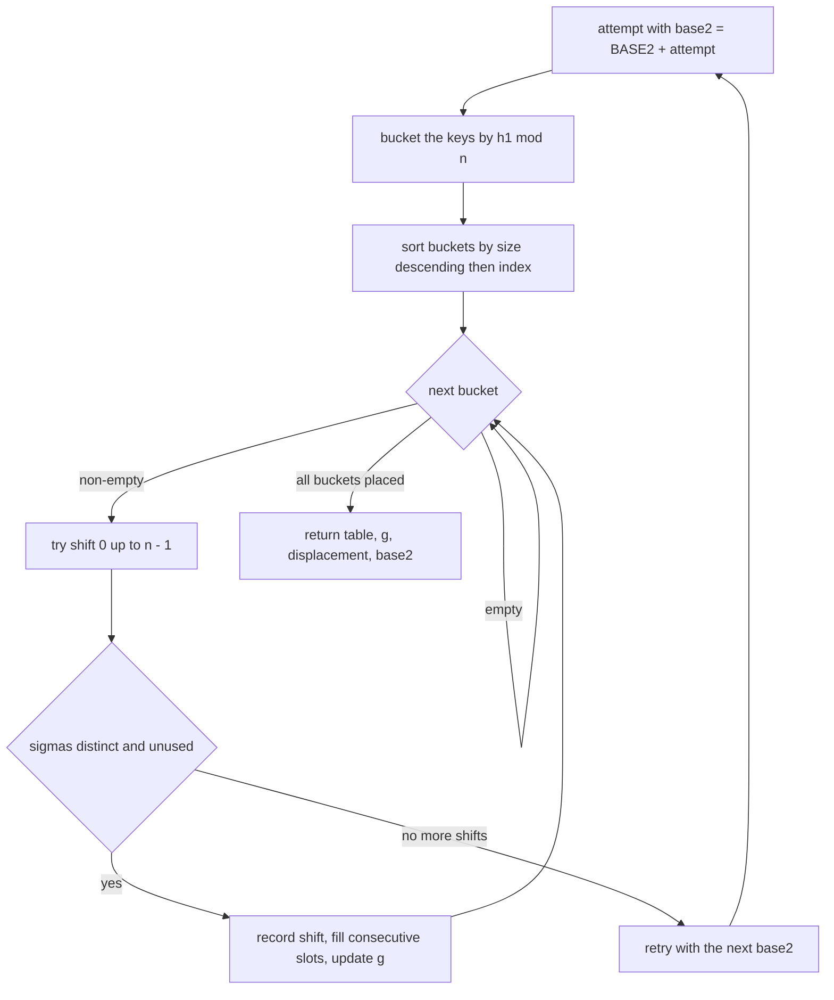
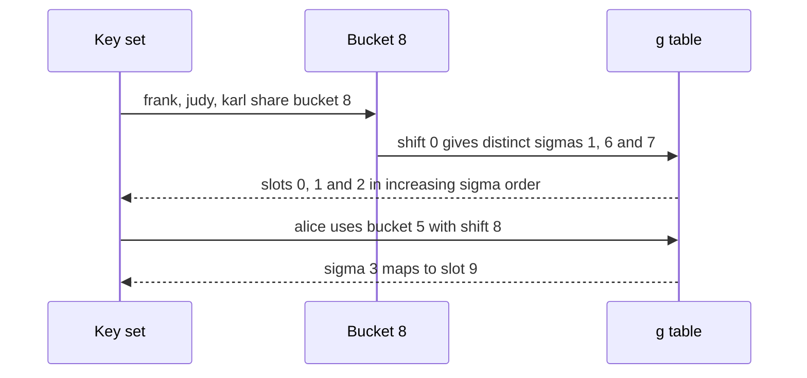
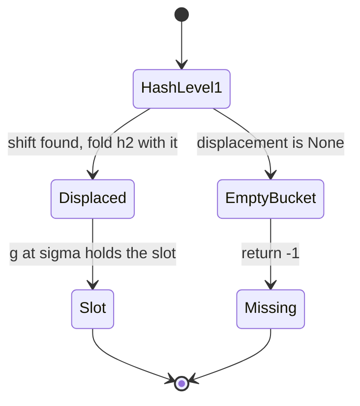

# 387 — Implement minimal perfect hash concept (CHM) small example.

> **Tier:** Intermediate · **CTCI chapter:** Beyond — Advanced Data Structures & Algorithms
> **Task spec:** [387-implement-minimal-perfect-hash-concept-chm-small-example.md](../../../tasks/intermediate/387-implement-minimal-perfect-hash-concept-chm-small-example.md)
> **Solutions:** [Python](../../../solutions/python/intermediate/387-implement-minimal-perfect-hash-concept-chm-small-example/solution.py) ·
> [Java](../../../solutions/java/intermediate/387-implement-minimal-perfect-hash-concept-chm-small-example/Solution.java) ·
> [JavaScript](../../../solutions/javascript/intermediate/387-implement-minimal-perfect-hash-concept-chm-small-example/solution.js) ·
> [C#](../../../solutions/csharp/intermediate/387-implement-minimal-perfect-hash-concept-chm-small-example/Solution.cs)

## 1. Problem restatement

A **minimal perfect hash function** (MPHF) maps a fixed key set of `n` strings onto `[0, n)` with no
collisions and no wasted slots: the map is a bijection. This task builds one with a hash-displace
construction **in the spirit of CHM, simplified** — the docstring is explicit that there is no ranked
bit array, i.e. no compressed representation of the slot assignment.

**Input:** a list of `n` distinct keys. The fixed sets are `KEYS` (12 names) and `MORE_KEYS`
(8 names).

**Output of `build_mphf(keys)`:** the tuple `(table, g, displacement, base2)` where

- `table[slot]` is the key stored at that final slot (every slot filled),
- `g[sigma] = slot` is the level-2 lookup table, indexed by the displaced sigma,
- `displacement[bucket]` is the shift chosen for that level-1 bucket (`None` when the bucket is
  empty),
- `base2` is the hash base actually used, `BASE2 + attempt`.

`mphf_lookup(table, g, displacement, base2, key)` returns the slot of a **member** key in `[0, n)`,
or `-1` for a key whose first-level bucket is empty. Non-member keys are documented as out of scope.

| Call | Result | Why |
| --- | --- | --- |
| `poly_hash("alice", 131)` | `893813729` | pins the polynomial hash constants `HASH_MOD = 2147483647` and `BASE1 = 131` |
| `poly_hash("alice", 1000003)` | `76280623` | pins `BASE2 = 1000003` |
| `poly_hash(k, 131) mod 12` for `k` in `KEYS` | buckets `1, 2, 3, 4, 5, 6, 8, 10` non-empty | `bob`/`laura` share bucket `1`; `frank`/`judy`/`karl` share bucket `8`; the largest bucket has size `3` |
| `build_mphf(KEYS)[3]` | `BASE2` | the first attempt already succeeds for this key set |
| `build_mphf(KEYS)[0]` | `["frank", "judy", "karl", "laura", "bob", "ivan", "grace", "heidi", "dave", "alice", "erin", "carol"]` | the slot assignment the build produces |
| `build_mphf(KEYS)[1]` | `[7, 0, 5, 9, 10, 11, 1, 2, 3, 4, 6, 8]` | the level-2 `g` table |
| `build_mphf(KEYS)[2]` | `[None, 1, 7, 0, 5, 8, 5, None, 0, None, 6, None]` | one shift per non-empty bucket |
| `sorted(slots.values())` over all 12 keys | `list(range(12))` | bijection, so the hash is minimal *and* perfect |
| `build_mphf(MORE_KEYS)[3]` | `BASE2 + 2` | attempts `0` and `1` fail for this set, attempt `2` succeeds |
| `mphf_lookup(..., "stranger")` | `-1` or any value in `[0, n)` | non-members are out of scope, so only that is asserted |

## 2. Intuition

A perfect hash function maps a key set without collisions; a *minimal* one also uses exactly `n`
slots. Random hashing cannot promise either, because collisions are a matter of chance. The CHM
family replaces chance with a **build-time search**: the function is allowed to be complicated, as
long as evaluation stays cheap and the build can verify success.

The construction uses two levels, both powered by the same polynomial hash with different bases:

- **Level 1** splits the keys into `n` buckets by `h1(key) mod n`. Some buckets end up with several
  keys — for the twelve names, bucket `8` holds `frank`, `judy` and `karl`, and four buckets stay
  empty. Empty buckets are free: they contribute no keys at all.
- **Level 2** gives every non-empty bucket its own **displacement** `shift`, chosen so that the
  displaced values `sigma(key) = (h2(key) + shift) mod n` are distinct within the bucket *and* not
  already claimed by an earlier bucket. The bucket then occupies a block of consecutive final slots,
  and the mapping is recorded in the `g` table: `f(k) = g[sigma(k)]`.

The build is therefore a search over shifts, and success has a clean definition: every non-empty
bucket must be placeable. Because bucket sizes sum to `n`, a successful build fills exactly `n` slots
— which is where minimality comes from, with no counting argument required afterwards.



Two design choices make the search deterministic, and the tests depend on them. Buckets are
processed by **decreasing size**, with ties broken by increasing bucket index, because placing the
crowded buckets first leaves the most room for the easy ones. And if some bucket cannot be placed at
all, the **entire build is retried** with `base2` shifted by one, which changes every level-2 hash and
therefore every conflict.

## 3. Algorithm

1. **Hash.** `poly_hash(text, base)` folds the characters with
   `value = (value · base + code(ch)) mod HASH_MOD`, using `HASH_MOD = 2147483647` (a Mersenne prime),
   `BASE1 = 131` for level 1 and `BASE2 = 1000003` for level 2.
2. **Retry loop.** For `attempt = 0, 1, …` up to `99`: set `base2 = BASE2 + attempt` and try a full
   build. If every bucket is placed, return the result; otherwise start over. After 100 attempts,
   raise `RuntimeError("no displacement assignment found")`.
3. **Bucket.** Put each key into `buckets[h1(key) mod n]`.
4. **Order the buckets** by `(-size, index)` — largest first, ties by the smaller index.
5. **Place a bucket.** For `shift` from `0` to `n - 1`, compute the sigmas
   `(h2(key) + shift) mod n` for the bucket's members and accept the shift only if the sigmas are
   **pairwise distinct** and **none of them is already assigned in `g`**. Take the smallest accepted
   shift. If no shift works, the build fails and the retry loop moves on.
6. **Fill.** Sort the members by their sigma and write them into consecutive slots starting at
   `next_slot`: `g[sigma] = next_slot + rank` and `table[next_slot + rank] = key`. Advance
   `next_slot` by the bucket size.
7. **Look up.** `bucket = h1(key) mod n`; if `displacement[bucket]` is `None`, return `-1`; otherwise
   compute `sigma = (h2(key) + shift) mod n` and return `g[sigma]`, or `-1` if that entry is still
   empty.
8. **Verify.** Assert the exact `table`, `g`, `displacement` and `base2` for `KEYS`; assert that the
   twelve slots are a permutation of `[0, 12)`; assert that a rebuild gives an identical structure;
   and check the second key set, which is asserted to succeed on attempt `2`.

```text
function build_mphf(keys)
    n ← number of keys
    for attempt ← 0 to 99 do
        base2 ← BASE2 + attempt
        buckets ← n empty lists
        for key in keys do
            append key to buckets[poly_hash(key, BASE1) mod n]
        end
        order ← bucket indices sorted by decreasing size, then increasing index
        table ← n empty slots
        g ← n empty slots
        displacement ← n empty markers
        next_slot ← 0
        for bucket in order do
            members ← buckets[bucket]
            if members is empty then
                continue
            end
            chosen ← none
            for shift ← 0 to n - 1 do
                sigmas ← sorted list of (poly_hash(key, base2) + shift) mod n for key in members
                if sigmas are all distinct and all g slots free then
                    chosen ← shift
                    break
                end
            end
            if chosen is none then
                mark the attempt as failed and leave the loop
            end
            displacement[bucket] ← chosen
            pairs ← members sorted by (poly_hash(key, base2) + chosen) mod n
            for rank ← 0 to size of pairs - 1 do
                sigma, key ← pairs[rank]
                g[sigma] ← next_slot + rank
                table[next_slot + rank] ← key
            end
            next_slot ← next_slot + size of members
        end
        if the attempt succeeded then
            return table, g, displacement, base2
        end
    end
    fail "no displacement assignment found"
end
```



Because the placement of a bucket never moves keys placed earlier, the build is a greedy
assignment. What makes it work in practice is that each bucket has `n` candidate shifts and needs
only a handful of free sigmas; with `n` buckets and `n` sigma values, the constraint is tight enough
that a retry is sometimes needed but the search space is small enough that the loop never runs long.

## 4. Worked example

Take `KEYS`, the twelve names. Level 1 with `BASE1 = 131` produces:

| Bucket | Members |
| --- | --- |
| `1` | `bob`, `laura` |
| `2` | `grace`, `ivan` |
| `3` | `heidi` |
| `4` | `dave` |
| `5` | `alice` |
| `6` | `erin` |
| `8` | `frank`, `judy`, `karl` |
| `0, 7, 9, 11` | empty |

The processing order is `8` (size 3), then `1` and `2` (size 2, smaller index first), then
`3, 4, 5, 6, 10` (size 1). Level 2 then fills the final slots in that order:

| Bucket | Shift chosen | Sigmas in ascending order | Slots written | Keys placed there |
| --- | --- | --- | --- | --- |
| `8` | `0` | `1`, `6`, `7` | `0, 1, 2` | `frank`, `judy`, `karl` |
| `1` | `1` | `8`, `9` | `3, 4` | `laura`, `bob` |
| `2` | `7` | `2`, `10` | `5, 6` | `ivan`, `grace` |
| `3` | `0` | `0` | `7` | `heidi` |
| `4` | `5` | `11` | `8` | `dave` |
| `5` | `8` | `3` | `9` | `alice` |
| `6` | `5` | `4` | `10` | `erin` |
| `10` | `6` | `5` | `11` | `carol` |

Every sigma in the table is distinct — that is the "pairwise distinct and unused" test doing its job
— and all twelve slots `0…11` get exactly one key. Reading the third column top to bottom gives
`g` grouped by bucket: `g[1] = 0`, `g[6] = 1`, `g[7] = 2`, `g[8] = 3`, `g[9] = 4`, `g[2] = 5`,
`g[10] = 6`, `g[0] = 7`, `g[11] = 8`, `g[3] = 9`, `g[4] = 10`, `g[5] = 11`, which is exactly the
asserted `g = [7, 0, 5, 9, 10, 11, 1, 2, 3, 4, 6, 8]`.



A lookup follows the same path in three steps. For `alice`: the level-1 bucket is `5`, the recorded
shift is `8`, `h2("alice") mod 12 = 7`, so `sigma = (7 + 8) mod 12 = 3`; with `g[3] = 9` the slot is
`9`, and indeed `table[9] = "alice"`. For `bob`: bucket `1`, shift `1`, `h2("bob") mod 12 = 8`, so
`sigma = 9`, `g[9] = 4`, and `table[4] = "bob"`. Three constant-time steps — two polynomial hashes and
one `g` read — for every member key.



The second key set is the retry case. `MORE_KEYS` (`kiwi, mango, melon, olive, peach, plum, quince,
raspberry`) cannot be placed on attempts `0` and `1`, so `build_mphf` returns
`base2 = BASE2 + 2`, with `displacement = [0, 0, 0, None, 1, 4, None, None]` and
`table = ["plum", "kiwi", "peach", "melon", "olive", "mango", "raspberry", "quince"]`. Both key sets
are asserted to end with `sorted(slots) == list(range(n))`, and rebuilding the first set is asserted
to produce an identical structure — the construction is deterministic, which is what makes exact
expected values testable at all.

## 5. Complexity

Let `n` be the number of keys, `L` the average key length and `A` the number of build attempts.

| Measure | Bound | Why it holds |
| --- | --- | --- |
| One hash | O(L) | one multiply-add per character, run twice per key |
| Bucketing | O(n·L) | one level-1 hash per key |
| Bucket ordering | O(n log n) | a sort over `n` bucket indices |
| Shift search | O(n · Σ|B|) = O(n²) worst case | per bucket, up to `n` candidate shifts, each checking `|B|` sigmas |
| Filling | O(Σ|B| log|B|) | one sort per bucket, over buckets that sum to `n` |
| Whole build | O(A · n²) with `A <= 100` | the shift search is dominated by the retry loop |
| Space | O(n) | `table`, `g`, `displacement` and the buckets are all linear |
| Lookup | O(L) | two polynomial hashes plus one array read, no probing |

The `n²` in the shift search is why the docstring calls this a small example: the twelve-name set is
solved on the first attempt, and the eight-name set needs three. Real CHM implementations push the
search cost down with smaller level-1 bucket counts and compression of the `g` table into a ranked
bit array — precisely the part this simplified version leaves out. What the simplification buys is
visibility: the three arrays `table`, `g` and `displacement` make every decision inspectable, and the
asserted values pin down the exact build.

## 6. Pitfalls and edge cases

- **Success depends on the shift search, and failure is a whole-build retry.** If one bucket has no
  valid shift, the partial assignment cannot be salvaged by patching that bucket — earlier buckets
  already own sigmas. The code restarts with `base2 + 1`, which changes every `h2` value. The
  non-member branch never triggers a retry; only placement failure does.
- **Ordering is part of the contract, not an optimisation detail.** Buckets are sorted by decreasing
  size and then by increasing index. That is what makes the asserted `table`, `g` and `displacement`
  reproducible; changing the tie-break changes every expected list.
- **Sigmas must be unused, not merely distinct.** The check has two halves: distinct within the
  bucket, and empty in `g` across buckets. Dropping the second half lets two buckets claim the same
  sigma, and the invariant `f(k) = g[sigma(k)]` silently collapses.
- **Minimality comes from `Σ|B| = n`.** Every member is written once, so a successful build uses
  exactly `n` slots. Buckets that are empty never get a shift (`displacement[b] is None`) and never
  write anything.
- **Keys must be distinct.** The bucket sizes must sum to `n` for the argument above; duplicated keys
  would place two copies of the same string into different slots and break the bijection. The file
  asserts `len(set(KEYS)) == n`.
- **Non-member keys are out of scope — do not trust their answer.** `mphf_lookup` returns `-1` for an
  empty bucket and otherwise a sigma lookup that may or may not hit an assigned entry. The test only
  asserts `stranger == -1 or 0 <= stranger < n`, i.e. that the answer is in range and nothing more.
  A perfect hash is perfect on exactly one key set.
- **`base2` is data, not a constant.** Lookup must use the `base2` returned by the build; using the
  module constant `BASE2` on a structure built with `BASE2 + 2` computes different sigmas and returns
  wrong slots. The Java and C# ports store `base2` in the returned object for exactly this reason.
- **Numeric range of the hash.** `HASH_MOD = 2147483647` keeps `value · base` below `2^53`, so the
  JavaScript file can use plain `Number` without losing exactness (the file says so in a comment) —
  unlike the modular tasks in this tier, which needed `BigInt`.
- **Sentinel conventions differ per language.** Python uses `None` for an unused `g` slot and for an
  empty bucket's displacement, Java and C# use `-1` in the integer arrays, and JavaScript uses `-1`
  as well.

## 7. Variants and follow-ups

- **The real CHM scheme.** Store the `g` table in compressed form with a ranked bit array, which cuts
  memory to a few bits per key at the cost of a rank operation per lookup — the piece this outline
  omits.
- **Other perfect-hash families.** FKS uses a two-level scheme with *random* second-level functions
  and expected O(n) construction; displacement-based CHM, as here, trades randomness for a
  deterministic build and an exact expected-value test.
- **Recursive splitting.** Larger key sets are usually split into a few dozen level-1 buckets with
  small second-level tables, which keeps the shift search cheap and the retries rare.
- **Why a fast lookup is worth a slow build.** MPHF structures are built once and queried millions of
  times — in compilers, database indexes and static language runtimes — which is the whole reason the
  build may spend O(n²) and a handful of attempts.
- **Related hashing tasks in this repository.** The bucket-by-hash idea is the same one behind
  [233-group-anagrams-hashmap-with-sorted-key.md](../../../tasks/intermediate/233-group-anagrams-hashmap-with-sorted-key.md),
  and the collision-handling alternative is the open-addressing used in
  [345-design-a-randomized-set-with-insert-delete-getrandom.md](../../../tasks/intermediate/345-design-a-randomized-set-with-insert-delete-getrandom.md);
  the polynomial hash itself is the string-hashing core reused by the pattern-matching tasks such as
  [313-implement-z-function-for-pattern-matching.md](../../../tasks/intermediate/313-implement-z-function-for-pattern-matching.md).

## 8. Check yourself

1. Why is a successful build automatically *minimal*, without any explicit slot-count check?

<details><summary>Show answer</summary>

Because each non-empty bucket writes exactly `size(bucket)` keys into consecutive slots, and the
bucket sizes sum to `n`. So a completed build writes `n` distinct keys into `n` slots starting at
`0`, which is a bijection onto `[0, n)`. Empty buckets write nothing and get no displacement, so
they cannot create gaps.

</details>

2. What are the two conditions a shift must satisfy for a bucket?

<details><summary>Show answer</summary>

First, the displaced values `(h2(key) + shift) mod n` must be pairwise distinct inside the bucket —
otherwise two members would share a sigma and hence a slot. Second, none of those sigmas may already
be assigned in `g` by a previously placed bucket, because `g[sigma]` holds a single slot and a
sigma can only ever mean one key.

</details>

3. Why are buckets processed largest-first?

<details><summary>Show answer</summary>

Because the crowded buckets are the ones that can fail: a bucket with many members needs many
distinct unused sigmas for one shift. Placing them while the `g` table is still empty maximises the
chance of success, and the deterministic tie-break by index makes the outcome reproducible. It is
also why the largest bucket `8` is fixed first in the worked example.

</details>

4. `mphf_lookup(..., "stranger")` returns a number in `[0, n)`. What does that number mean?

<details><summary>Show answer</summary>

Nothing. A perfect hash is defined only on the key set it was built for; a non-member can hash to any
bucket, take any shift and land on any `g` entry. The file asserts only that the result is either
`-1` or inside `[0, n)` — that no out-of-range value escapes — and documents non-members as out of
scope.

</details>

5. Why does `MORE_KEYS` need `base2 = BASE2 + 2` while `KEYS` needs no retry?

<details><summary>Show answer</summary>

Because placement is a constraint problem on the specific hashes. For the twelve names, every bucket
finds a shift on the first attempt. For the eight other names, at least one bucket cannot be placed
with `base2 = BASE2` or `BASE2 + 1`, so the whole build is retried; attempt `2` succeeds and the
assertion records both the retried base and the resulting table. The retry changes every level-2 hash,
which reshuffles all the conflicts at once.

</details>
