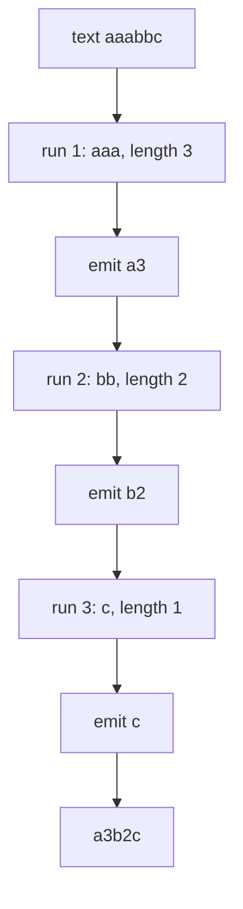
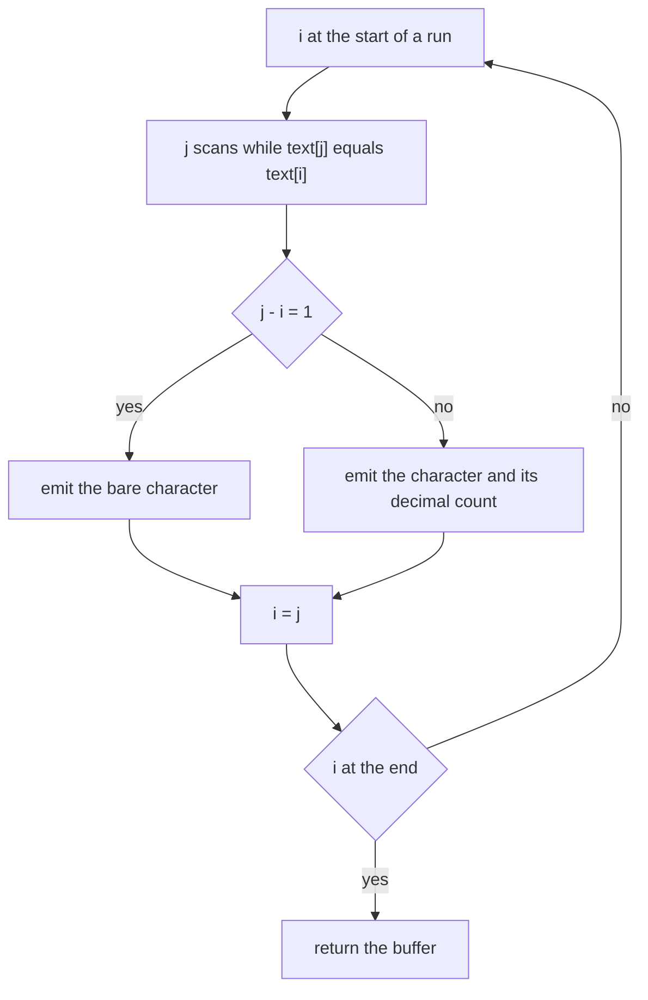
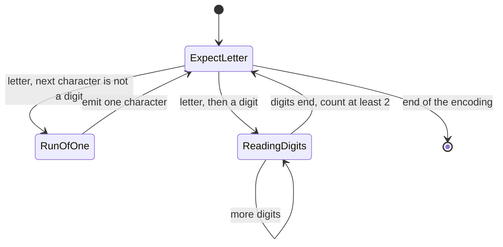
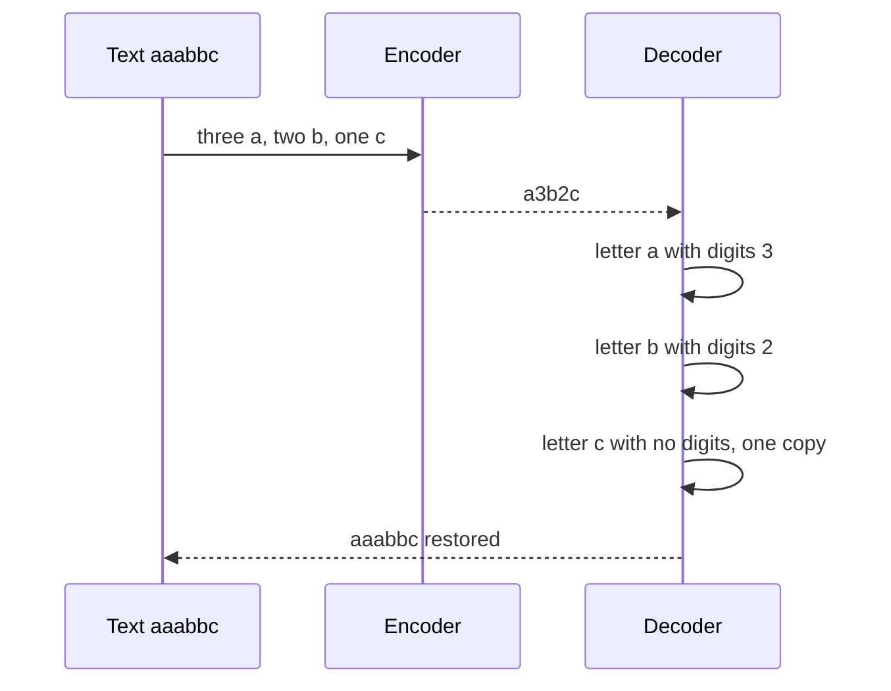

# 388 — Implement string compression (run-length encoding + decode).

> **Tier:** Intermediate · **CTCI chapter:** Ch 1 — Arrays and Strings
> **Task spec:** [388-implement-string-compression-run-length-encoding-decode.md](../../../tasks/intermediate/388-implement-string-compression-run-length-encoding-decode.md)
> **Solutions:** [Python](../../../solutions/python/intermediate/388-implement-string-compression-run-length-encoding-decode/solution.py) ·
> [Java](../../../solutions/java/intermediate/388-implement-string-compression-run-length-encoding-decode/Solution.java) ·
> [JavaScript](../../../solutions/javascript/intermediate/388-implement-string-compression-run-length-encoding-decode/solution.js) ·
> [C#](../../../solutions/csharp/intermediate/388-implement-string-compression-run-length-encoding-decode/Solution.cs)

## 1. Problem restatement

**Input:** a string. `rle_encode` expects text (the files assert only letters are used), `rle_decode`
expects an encoding produced by that encoder or an equivalent canonical one.

**Output:** the run-length encoding, or the original text, with a convention that is identical in all
four languages:

- a maximal run of one character is written as the **bare character**,
- a maximal run of length `>= 2` is written as the **character followed by its decimal count**.

So `"aaabbc"` encodes to `"a3b2c"` and `"a"` stays `"a"`. Decoding reads a letter and then the
optional digits that follow it. Two documented restrictions keep the format unambiguous: input text
is restricted to letters (a digit used as data could not be told from a count), and decoding rejects
the non-canonical counts `0` and `1`.

| Call | Result | Why |
| --- | --- | --- |
| `rle_encode("aaabbc")` | `"a3b2c"` | runs of `3, 2, 1` |
| `rle_decode("a3b2c")` | `"aaabbc"` | the inverse |
| `rle_encode("")` / `rle_decode("")` | `""` | nothing to encode |
| `rle_encode("a")` | `"a"` | run of one stays bare |
| `rle_encode("abcd")` | `"abcd"` | four runs of one, no digits at all |
| `rle_encode("aab")` | `"a2b"` | a run of exactly two keeps its count |
| `rle_encode("abb")` | `"ab2"` | the bare `a` is not followed by a digit |
| `rle_encode("aabbaa")` | `"a2b2a2"` | the same letter may run again later |
| `rle_encode("aaabccccd")` | `"a3bc4d"` | `c4` followed by a bare `d` |
| `rle_encode("a"*9 + "b")` | `"a9b"` | the last single-digit count |
| `rle_encode("a"*10)` | `"a10"` | the `9 → 10` boundary, a two-digit count |
| `rle_decode("a99")` | `"a"*99` | greedy digit reading, any count length |
| round trip for canonical strings | identical | `rle_encode(rle_decode(x)) == x` for `"a3b2c"`, `"a2b2a2"`, `"a9b"`, `"a10"`, `"a12"`, `"a3bc4d"`, `"abcd"`, `"a"`, `"a99"` |
| `rle_decode("3")`, `"a0"`, `"a1"`, `"ab1"` | raise | a leading digit, and the non-canonical counts `0` and `1` |

The definition of *maximal* run matters: the encoder never emits two adjacent runs of the same
character, which is what makes `a2b2a2` a legal encoding of `aabbaa` while `a2a2b2` would not be
canonical.

## 2. Intuition

The naive reading of "compress a string" is a counting problem: walk the string, tally how many
times each character occurs, and write `char + count` for each. That is a **histogram**, and it
destroys the information the decoder needs — `"aaabbc"` and `"abacab"` have the same letter counts
but different order, so a histogram cannot be inverted. A compression scheme must be reversible.

Run-length encoding keeps the order and compresses only the *consecutive* repetition. The encoder
walks the string once, finds maximal runs with two indices (`i` at the start of a run, `j` past its
last character), and emits the character plus the length when the length is `>= 2`. The decoder walks
the encoding with the same two-index discipline: `i` reads a letter, then the digits that follow it
are consumed as the count.

Two conventions interact well. First, run length `1` has no digits, so a bare letter is always
unambiguous — nothing follows it that could be read as a count. Second, the count is written in
decimal, which means the decoder must read *all* consecutive digits, not just one: `"a10"` is ten
`a`s.



The decoder is the mirror image, and the reversibility is worth stating precisely: for every text
over letters, `rle_decode(rle_encode(text)) == text`, and for every *canonical* encoding
`rle_encode(rle_decode(encoded)) == encoded`. Both directions are asserted, the second over an
explicit list of encodings.

## 3. Algorithm

**Encoder.**

1. Start at index `i = 0` with an output buffer.
2. Let `j` scan forward while `text[j] == text[i]`; the run length is `j - i`.
3. Append the single character `text[i]`; if the run length is `>= 2`, append its decimal
   representation as well.
4. Set `i = j` and repeat until the end of the string. Join the buffer.

**Decoder.**

1. Start at index `i = 0` with an output buffer.
2. Read `encoded[i]`; if it is not a letter, raise `ValueError("expected a letter at position …")`.
   Advance.
3. Collect every following digit into a string. If there are none, append one copy of the letter and
   continue — this is the run-of-one case.
4. Otherwise convert the digits to an integer. If the count is below `2` (i.e. `0` or `1`), raise
   `ValueError("count … is not canonical")`, because the encoder never writes those.
5. Append `count` copies of the letter and continue.
6. **Cross-check with `run_characters`**: the first character of each maximal run of the text equals
   the sequence of letters in the encoding, which is asserted on every random trial.

```text
function rle_encode(text)
    out ← empty buffer
    i ← 0
    while i &lt; length(text) do
        j ← i
        while j &lt; length(text) and text[j] = text[i] do
            j ← j + 1
        end
        run ← j - i
        if run = 1 then
            append text[i] to out
        else
            append text[i] and the decimal digits of run to out
        end
        i ← j
    end
    return the concatenation of out
end

function rle_decode(encoded)
    out ← empty buffer
    i ← 0
    while i &lt; length(encoded) do
        ch ← encoded[i]
        if ch is not a letter then
            fail "expected a letter"
        end
        i ← i + 1
        digits ← empty string
        while i &lt; length(encoded) and encoded[i] is a digit do
            digits ← digits + encoded[i]
            i ← i + 1
        end
        if digits is empty then
            append ch to out
        else
            count ← integer value of digits
            if count &lt; 2 then
                fail "count is not canonical"
            end
            append count copies of ch to out
        end
    end
    return the concatenation of out
end
```



The decoder is a small state machine with exactly two states, and the distinction between "no digits"
and "digits" is the whole of the format:



## 4. Worked example

**Encode `"aaabbc"`.** The outer index `i` jumps from run to run; the inner index `j` finds the end of
each run.

| Iteration | `i` | `j` after the scan | run length | Emitted | Output so far |
| --- | --- | --- | --- | --- | --- |
| 1 | 0 | 3 | 3 | `a3` | `a3` |
| 2 | 3 | 5 | 2 | `b2` | `a3b2` |
| 3 | 5 | 6 | 1 | `c` | `a3b2c` |

After the third iteration `i = 6` equals the length, so the loop ends with `"a3b2c"` — the asserted
result. Note that the third iteration emits a *bare* `c` with no digits, and that this is what the
decoder's "no digits → one copy" branch is for.

**Decode `"a3b2c"`.**

| Iteration | Index before | Letter read | Digits collected | Count | Emitted |
| --- | --- | --- | --- | --- | --- |
| 1 | 0 | `a` | `"3"` | 3 | `aaa` |
| 2 | 2 | `b` | `"2"` | 2 | `bb` |
| 3 | 4 | `c` | none | — | `c` |

The result is `"aaabbc"`, and re-encoding it gives `"a3b2c"` again — one of the canonical
idempotence checks in the file.



**The `9 → 10` boundary.** `"a" * 9 + "b"` encodes to `"a9b"` (single-digit count), while
`"a" * 10` encodes to `"a10"` (two-digit count) and `rle_decode("a10")` returns ten `a`s. The decoder
handles it automatically because the digit loop is greedy — it consumes `"10"` as one number rather
than reading `1` and then choking on the `0`. The explicit `rle_decode("a99") == "a"*99` assertion
covers the same path with a larger count.

**The randomised harness.** Two hundred trials with `seed = 5150` generate strings of length below
`60` over alphabets of size `2` to `5`. Each trial asserts four properties: the encoding is never
longer than the input (`len(encoded) <= len(text)`), the letters of the encoding equal
`run_characters(text)`, decoding recovers the exact text, and re-encoding the decoded result gives
the same encoding back. The alphabet size matters: an alphabet of `2` produces very long runs and
exercises multi-digit counts, while larger alphabets produce many runs of length one.

## 5. Complexity

Let `n` be the length of the text and `m` the length of the encoding.

| Measure | Bound | Why it holds |
| --- | --- | --- |
| `rle_encode` time | O(n) | `i` and `j` only move forward, and the total scanned work is `n` |
| `rle_encode` space | O(1) beyond the output | two indices and the buffer that becomes the result |
| `rle_decode` time | O(n) | each digit group is read once and each output character written once |
| `rle_decode` space | O(1) beyond the output | the index and the current digit group |
| Compression bound | `m <= n` for letters-only input | a run of `1` costs one character, a run of `2` costs two, and every longer run costs fewer |
| Counting alternative | O(n) time, O(1) space, **not invertible** | a histogram loses the run structure, so it cannot be a codec |

The compression bound is worth reading carefully. Runs of length `1` and `2` are never compressed —
`"ab"` stays `"ab"` and `"aab"` becomes `"a2b"`, both two characters for two letters. Only runs of
`3` or more shrink, and they shrink dramatically: `a * 99` becomes `"a99"`, three characters. So RLE
is a win exactly when the data has long runs, and a break-even-or-worse choice on alternating data —
which is why the harness asserts `m <= n` rather than any stronger bound.

## 6. Pitfalls and edge cases

- **Digits in the input are ambiguous.** `"a10"` could mean `a` once followed by `1`, `0` — or ten
  `a`s. The files restrict the alphabet to letters and say so in the docstring; a real codec either
  escapes the delimiter or uses a separate count stream.
- **Non-canonical counts are rejected on decode.** `"a0"` and `"a1"` raise, and so does `"ab1"`. The
  encoder never emits them (a run of one has no digits), so accepting them would create two encodings
  for the same text and break the canonical idempotence check.
- **A leading non-letter is rejected.** `"3"` has no character to repeat; the decoder raises
  `"expected a letter at position 0"` instead of guessing.
- **Greedy digit reading.** The count is one or more digits, so the decoder must consume all of them:
  `"a12"` is twelve `a`s, not one `a` followed by the run described by `2`. Stopping after the first
  digit leaves `"2"` to be parsed as a letter and raises.
- **Bare characters are not followed by counts.** `"ab2"` decodes to `"abb"`: the `a` has no digits,
  so it is a single copy, and the `b` takes the `2`. Reading the format as "letter, count" would
  make `"a"` undecodable.
- **The empty string.** `rle_encode("") == ""` and `rle_decode("") == ""`; the loops simply never
  execute, and no special case is needed.
- **Case matters.** `is_letter` accepts `a`–`z` and `A`–`Z`, and runs are case-sensitive, so
  `"aA"` is two runs of one, not one run of two. Non-ASCII letters are rejected, because the helper
  is an explicit range check rather than a Unicode property.
- **Runs of exactly two do not shrink.** `"aa"` encodes to `"a2"`, the same length. Anyone expecting
  strict compression has to check `m < n`, which is *not* guaranteed — the harness asserts the weaker
  `m <= n`, and `"abcd"` is exactly the boundary case.
- **`run_characters` is an independent check.** The letters of an encoding must equal the first
  character of every maximal run of the original text. It is computed by a separate forward scan over
  the text, so it catches an encoder that merges or splits runs without looking at the digits at all.
- **No length prefix or header.** The format is self-delimiting only because the alphabet excludes
  digits. Nothing in the encoding records the original length, so a corrupted count silently changes
  the decoded length instead of being detected.

## 7. Variants and follow-ups

- **Runs of two also shorten.** Some conventions write `a2` only for `>= 3` and leave `aa` as `"aa"`;
  both are canonical as long as encoder and decoder agree, and the choice only shifts which strings
  shrink.
- **Escaping the delimiter.** Allow digits in the data by escaping them (or by writing the count
  before the character, as `3a2b1c`). The classic CTCI compression question is the variant that
  returns the *original* string when the compressed form is not shorter.
- **Binary RLE.** For byte streams the count can be packed into a byte, giving a compact scheme used
  in fax formats and bitmap encodings; the two-pointer run scan is unchanged.
- **A run-counting pre-pass.** `run_characters(text)` in these files is the natural first stage of any
  run-based analysis, and it is asserted against the encoding on every random trial.
- **Where a real codec goes next.** RLE alone is a weak compressor; the LZ-family encoders in
  [392-implement-lzw-compression-encoder-decoder-skeleton.md](../../../tasks/intermediate/392-implement-lzw-compression-encoder-decoder-skeleton.md)
  and
  [393-implement-basic-brotli-or-deflate-idea-demo-lz77-huffman-simpl.md](../../../tasks/intermediate/393-implement-basic-brotli-or-deflate-idea-demo-lz77-huffman-simpl.md)
  add dictionary matches on top, and
  [389-implement-huffman-coding-for-characters-frequency.md](../../../tasks/intermediate/389-implement-huffman-coding-for-characters-frequency.md)
  is the entropy-coding half of the same stack.

## 8. Check yourself

1. Why is a histogram (`char → count`) not a valid encoder for this task?

<details><summary>Show answer</summary>

Because it is not invertible: it forgets the order of the characters. `"aaabbc"` and `"abacab"` have
identical letter counts, so a decoder given the histogram could not tell them apart. Run-length
encoding keeps the order by describing *consecutive* runs, which is what makes decoding possible.

</details>

2. What is `rle_encode("abc")`, and how many digits does it contain?

<details><summary>Show answer</summary>

`"abc"` — no digits at all. Every run has length `1`, and the convention writes a run of one as the
bare character. The same rule gives `"aaabccccd" → "a3bc4d"`, where the `b` and the `d` appear bare
between the counted runs.

</details>

3. Why does `rle_decode("a1")` raise while `rle_encode` never produces such input?

<details><summary>Show answer</summary>

The encoder writes a count only for runs of length `>= 2`, so `"a1"` is not a canonical encoding —
it would be a second, redundant spelling of `"a"`. Rejecting it keeps the encoding unique, which the
canonical idempotence assertions (`rle_encode(rle_decode(x)) == x`) depend on. The same reasoning
rejects `"a0"`.

</details>

4. Is the encoding always shorter than the input?

<details><summary>Show answer</summary>

No. Runs of length `1` cost one character and runs of length `2` cost two, so `"abcd"` and `"aab"`
compress to themselves. Only runs of `3` or more shrink. That is why the harness asserts the weaker
property `len(encoded) <= len(text)`, and why `"a" * 99 → "a99"` is where the scheme shines.

</details>

5. What does the assertion `run_characters(text) == letters of encoded` check that a round trip does
   not?

<details><summary>Show answer</summary>

A round trip only proves that encoder and decoder are mutual inverses — both could be wrong in
compensating ways. `run_characters` walks the original text independently and extracts the first
character of every maximal run; the encoding's letters must match that sequence exactly. It therefore
verifies the *structure* of the encoding (which runs exist, in what order) rather than just its
reversibility.

</details>
