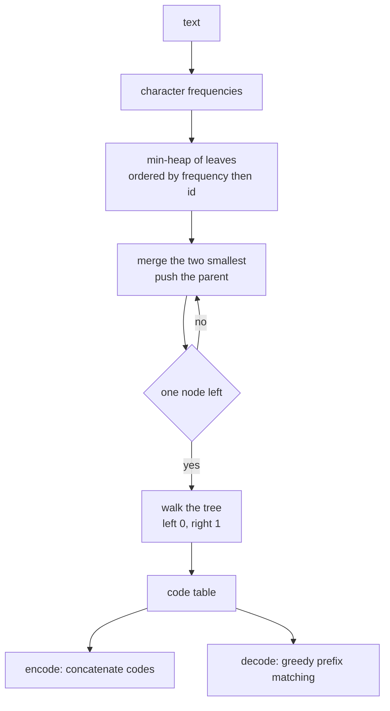
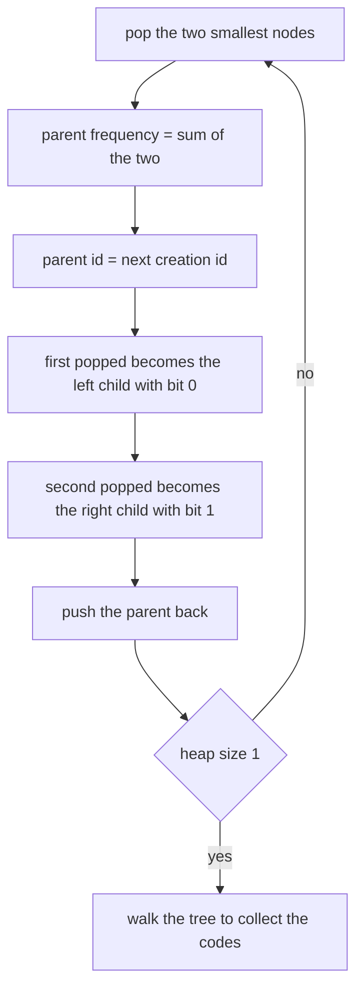
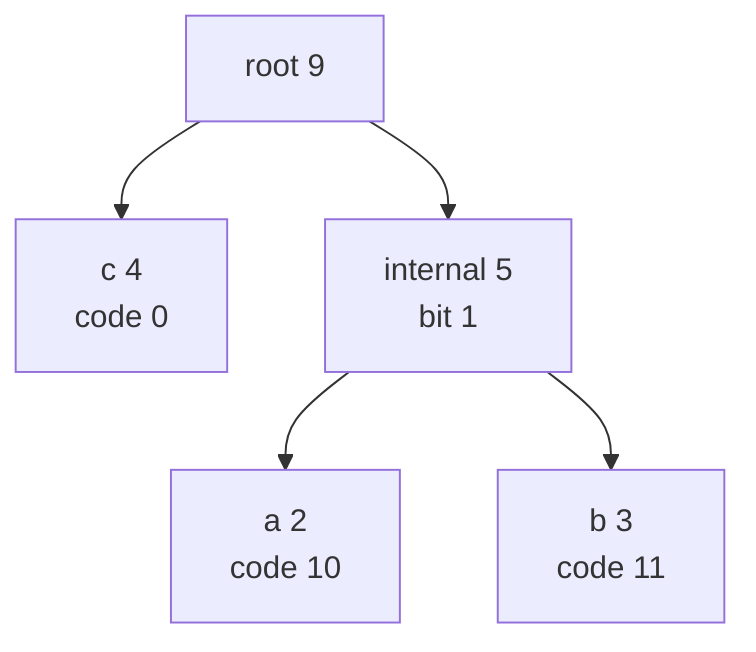
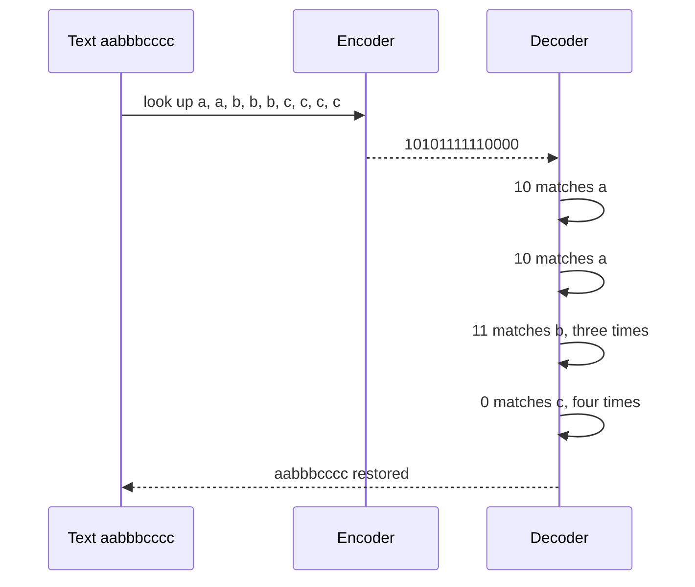

# 389 — Implement Huffman coding for characters frequency.

> **Tier:** Intermediate · **CTCI chapter:** Beyond — Advanced Data Structures & Algorithms
> **Task spec:** [389-implement-huffman-coding-for-characters-frequency.md](../../../tasks/intermediate/389-implement-huffman-coding-for-characters-frequency.md)
> **Solutions:** [Python](../../../solutions/python/intermediate/389-implement-huffman-coding-for-characters-frequency/solution.py) ·
> [Java](../../../solutions/java/intermediate/389-implement-huffman-coding-for-characters-frequency/Solution.java) ·
> [JavaScript](../../../solutions/javascript/intermediate/389-implement-huffman-coding-for-characters-frequency/solution.js) ·
> [C#](../../../solutions/csharp/intermediate/389-implement-huffman-coding-for-characters-frequency/Solution.cs)

## 1. Problem restatement

**Input:** a text, or the frequency table of a text.

**Output:** a Huffman prefix code together with its cost, plus an encoder and a decoder:

- `character_frequencies(text)` → a map `char → count`.
- `huffman_codes(frequencies)` → `(codes, weighted_length)` where `codes[ch]` is a bit string and
  `weighted_length = Σ freq(ch) · len(codes[ch])`, the exact number of bits an encoding uses.
- `huffman_encode(text)` → `(bits, codes, weighted_length)`; `huffman_decode(bits, codes)` → the
  text, raising `ValueError` when the bit string ends in an incomplete code.
- Property helpers: `is_prefix_free(codes)` and `kraft_sum_ok(codes)`.

The construction is **deterministic**, which the docstring calls out: nodes are ordered by
`(frequency, creation id)`; leaves receive ids in **sorted character order** and internal nodes in
creation order; and on a merge the first popped node becomes the left child (`0`) and the second the
right child (`1`). The asserted tables pin every one of those choices.

| Call | Result | Why |
| --- | --- | --- |
| `character_frequencies("aabbbcccc")` | `{a: 2, b: 3, c: 4}` | counts the runs of the sample text |
| `huffman_codes({a: 2, b: 3, c: 4})` | `{c: "0", a: "10", b: "11"}`, weighted `14` | `4·1 + 2·2 + 3·2 = 14` |
| `huffman_encode("aabbbcccc")` | bits `"10101111110000"`, length `14` | the bit length equals the weighted path length exactly |
| `huffman_codes({a: 35, b: 17, c: 17, d: 16, e: 15})` | `{a: "0", e: "100", d: "101", b: "110", c: "111"}`, weighted `230` | `35·1 + (17+17+16+15)·3 = 230` |
| `huffman_codes({a: 4})` | `{a: "0"}`, weighted `4` | a single distinct character needs one code, `"0"` |
| `huffman_encode("aaaa")` | bits `"0000"` | four copies of the only code |
| `huffman_encode("")` | `("", {}, 0)` | nothing to encode |
| `huffman_decode("", {})` | `""` | nothing to decode |
| `huffman_decode("1", {c: "0", a: "10", b: "11"})` | raises | `"1"` is a prefix of `"11"` but not a code |
| 120 random strings, alphabet size `1…6` | round trip, `len(bits) == weighted_length`, prefix-free, Kraft equality | the property checks below |

The last row also asserts a bound: `weighted_length <= len(sample) · max(1, ⌈log₂ distinct⌉)`, i.e. no
code is ever longer than the balanced-tree length on average.

## 2. Intuition

A prefix code assigns every character a bit string such that no code is a prefix of another. That
property is what makes decoding unambiguous: read bits one at a time and a character ends exactly
where its code ends. The question is which prefix code to choose, and the answer has a clean greedy
form: **frequent characters get short codes**.

Huffman's algorithm builds the code tree bottom-up. Start with one leaf per character, labelled with
its frequency, in a min-heap. Repeatedly take the two smallest frequencies, merge them into a new
node whose frequency is their sum, and push it back. After `k - 1` merges — where `k` is the number
of distinct characters — a single root remains, and reading the path from the root to a leaf gives
that character's code (`0` for a left branch, `1` for a right branch).

The reason the greedy merge is right: the two least frequent characters can always be made siblings
at the deepest level of an optimal tree without increasing the cost. Merging them *is* that move,
and the recursive structure of the problem ("solve the instance with a merged symbol") gives the
algorithm its inductive justification.



Decoding never needs the tree — only the code table — because a prefix code can be checked greedily:
accumulate bits until the accumulated string is a known code, emit that character, reset, and repeat.
If bits are left over at the end, the encoding was truncated and the routine raises.

## 3. Algorithm

1. **Count.** Walk the text once, incrementing a map entry per character: `O(n)` work.
2. **Seed the heap.** One entry per distinct character, as a tuple `(freq, id, ch, left, right)` where
   `left`/`right` are null for leaves. Character ids come from `sorted(frequencies.items())`, so ties
   are broken by character, and `heapify` orders the initial set by `(freq, id)`.
3. **Merge `k - 1` times.** Pop the two smallest nodes, create the parent
   `(left.freq + right.freq, next_id, ch = None, left, right)`, push it, and increment `next_id`. The
   first popped node is the **left** child — bit `0` — and the second is the right child — bit `1`.
4. **Walk for codes.** Recursively descend the surviving root, appending `"0"` on left and `"1"` on
   right. At a leaf, record the accumulated prefix; if the prefix is empty (the single-character case)
   record `"0"` instead, because a code of length zero is not a code.
5. **Encode.** Concatenate `codes[ch]` for every character of the text.
6. **Decode.** Maintain a growing `current` prefix; after each appended bit, check the reverse table
   and emit on a hit. A non-empty `current` at the end raises `ValueError("bits end with an
   incomplete code")`.
7. **Check the properties.** `is_prefix_free` compares every pair of codes; `kraft_sum_ok` verifies
   `Σ 2^(L - len(code)) == 2^L` for `L` the longest code, which holds exactly for the codes of a
   complete binary tree — with the documented exception of a single-symbol table, whose lone `"0"`
   sums to `1/2` and is checked separately.

```text
function huffman_codes(frequencies)
    if frequencies is empty then
        return empty table, 0
    end
    heap ← one node (freq, id, character, no children) per distinct character,
            with ids in sorted character order
    build a min-heap on (frequency, id)
    next_id ← number of nodes
    while heap holds more than one node do
        left ← pop the smallest node
        right ← pop the next smallest node
        push node (left.freq + right.freq, next_id, none, left, right)
        next_id ← next_id + 1
    end
    codes ← empty table
    walk(root, "")
    return codes, sum of freq(ch) * len(codes[ch]) over all characters
end

procedure walk(node, prefix)
    if node is a leaf then
        if prefix is empty then
            codes[node.character] ← "0"
        else
            codes[node.character] ← prefix
        end
        return
    end
    walk(node.left, prefix + "0")
    walk(node.right, prefix + "1")
end

function huffman_decode(bits, codes)
    reverse ← table from code to character
    out ← empty buffer
    current ← ""
    for bit in bits do
        current ← current + bit
        if current is a key of reverse then
            append reverse[current] to out
            current ← ""
        end
    end
    if current is not empty then
        fail "bits end with an incomplete code"
    end
    return the concatenation of out
end
```



The tie-break rule is a real part of the algorithm here, not a detail: several trees can have the
same weighted length, and the asserted code tables (`{c: "0", a: "10", b: "11"}` and the five-symbol
table) depend on `(frequency, id)` ordering with ids assigned in sorted character order.

## 4. Worked example

**Building the code for `{a: 2, b: 3, c: 4}`.** Leaves get ids in sorted character order: `a = 0`,
`b = 1`, `c = 2`. The heap orders them by `(frequency, id)`.

| Step | Heap contents (frequency, id) | Action | New node |
| --- | --- | --- | --- |
| start | `(2, 0)`, `(3, 1)`, `(4, 2)` | — | — |
| merge 1 | `(4, 2)` | pop `a(2, 0)` as left, `b(3, 1)` as right | `(5, 3)`, left `a`, right `b` |
| merge 2 | — | pop `c(4, 2)` as left, `(5, 3)` as right | `(9, 4)`, left `c`, right `(5, 3)` |

The root is `(9, 4)`. Walking it: the left branch is the leaf `c`, so `c → "0"`; the right branch is
the internal node, whose left child is `a` (`"10"`) and whose right child is `b` (`"11"`). That is the
asserted table `{c: "0", a: "10", b: "11"}`, with weighted length
`4·1 + 2·2 + 3·2 = 4 + 4 + 6 = 14`.



**Encoding `"aabbbcccc"`.** Substituting the codes gives `10 10 11 11 11 0 0 0 0`, i.e.
`"10101111110000"` — sixteen characters of text compressed to exactly `14` bits, which is the
asserted equality `len(bits) == weighted_length`. That identity is not a coincidence: each character
contributes `len(code)` bits and the weighted sum adds exactly those contributions, so the file can
assert it on every random trial.



**The five-symbol table `{a: 35, b: 17, c: 17, d: 16, e: 15}`.** Ids in sorted character order make
the initial heap `a(35, 0), b(17, 1), c(17, 2), d(16, 3), e(15, 4)`. The merges are
`e + d → (31, 5)`, `b + c → (34, 6)`, `(31, 5) + (34, 6) → (65, 7)`, and finally `a + (65, 7) → (100, 8)`.
Walking it gives `a = "0"`, `e = "100"`, `d = "101"`, `b = "110"`, `c = "111"` — the asserted table —
with weighted length `35·1 + 15·3 + 16·3 + 17·3 + 17·3 = 230`.

Note the documented determinism in the second merge: `b(17, 1)` and `c(17, 2)` tie on frequency and
are separated by creation id, which is why `b` becomes `"110"` and `c` becomes `"111"` rather than the
other way round. Both trees cost `230` bits, but only one of them is the asserted one.

## 5. Complexity

Let `n` be the text length and `k` the number of distinct characters.

| Measure | Bound | Why it holds |
| --- | --- | --- |
| Frequency count | O(n) | one map update per character |
| Heap build | O(k) | the entries are already in `(freq, id)` order before `heapify` |
| Merges | O(k log k) | `k - 1` merges, each with two pops and one push on a heap of size `<= k` |
| Tree walk | O(k) | one visit per node of a tree with `k` leaves |
| Encoding | O(n · L) with `L` the longest code | one code concatenation per character; O(n) with a precomputed buffer |
| Decoding | O(total bits) | each bit is appended to the prefix and tested once |
| Space | O(k) for the structures, O(n) for the encoded and decoded strings | the heap and code table are bounded by the alphabet |
| Weighted length | at most `n · max(1, ⌈log₂ k⌉)` | asserted as `weight <= len(sample) * max(1, ceil_log2(distinct))` |

The `k log k` merging cost is negligible next to the O(n) text scan, which is why Huffman coding is
cheap in practice. What is *not* free is transmitting the code table: the decoder needs it, and this
task passes it around in memory rather than serialising it. That overhead is why real formats
(and the sibling task [390-implement-shannon-fano-coding-contrast-with-huffman.md](../../../tasks/intermediate/390-implement-shannon-fano-coding-contrast-with-huffman.md))
treat "which codes" as a separate design problem.

## 6. Pitfalls and edge cases

- **A single distinct character gets the code `"0"`.** With one leaf there is no branch to
  distinguish, so the walk finds an empty prefix. Writing `""` would make `"aaaa"` encode to an empty
  bit string and decode to nothing; the files special-case it and assert
  `huffman_codes({a: 4}) == {a: "0"}`.
- **Empty input returns empty structures, not an error.** `huffman_encode("") == ("", {}, 0)`,
  `huffman_decode("", {}) == ""`, and `huffman_codes({}) == ({}, 0)`. The weighted length of nothing
  is zero.
- **Decoding must reject dangling bits.** `huffman_decode("1", {c: "0", a: "10", b: "11"})` raises,
  because `"1"` is a proper prefix of `"11"` and matches no code. Silently dropping it would hide a
  truncated stream.
- **Ties must be broken deterministically.** Several optimal trees exist; the asserted tables depend
  on ordering by `(frequency, creation id)` with leaf ids taken in sorted character order. Changing
  the tie-break to, say, insertion order, still produces a valid Huffman code but fails the exact
  expected-value assertions.
- **Left/right assignment fixes the codes.** The first popped node becomes the left child and gets bit
  `0`; swapping the convention flips every code (`c: "1"`, `a: "01"`, …) while keeping the same
  weighted length.
- **The Kraft equality needs a complete tree.** `Σ 2^(-len) == 1` holds for Huffman codes because
  every internal node has two children — checked by `kraft_sum_ok` as
  `Σ 2^(L - len) == 2^L`. The single-symbol table is the documented exception (a lone leaf with sum
  `1/2`), and the helper asserts its value is exactly `["0"]`.
- **Prefix-freeness is checked, not assumed.** `is_prefix_free` compares all pairs of codes, so a
  bug that produced `"1"` and `"11"` in the same table would be caught immediately rather than
  surfacing as a decoding failure.
- **Encoding and decoding use different directions of the same table.** Decoding inverts the map once
  and then scans; a duplicate code would be silently overwritten by the inversion, which is why
  prefix-freeness is a prerequisite rather than a nicety.
- **Frequencies must be the real ones for the length claim.** The decoded text is fixed by the table,
  but the equality `len(bits) == weighted_length` only holds when the table was built from the same
  text's frequencies; the harness checks it per sample and asserts the ceiling bound too.
- **`ceil_log2` is computed with shifts.** For `distinct = 1` the helper is called through
  `max(1, ceil_log2(distinct))`, so a single-symbol text is allowed one bit per character — matching
  the `"0"` code — instead of a zero-bit bound.

## 7. Variants and follow-ups

- **Shannon-Fano, the top-down alternative.** Splitting the sorted frequency list instead of merging
  from the bottom yields codes that are valid and prefix-free but never better than Huffman's; the
  direct comparison, including the five-symbol `230` versus `231` case, is task
  [390-implement-shannon-fano-coding-contrast-with-huffman.md](../../../tasks/intermediate/390-implement-shannon-fano-coding-contrast-with-huffman.md).
- **Canonical Huffman codes.** Sort by code length and frequency and assign codes by a fixed rule so
  the table can be reconstructed from the lengths alone — the trick that makes real formats compact.
- **Serialising the table.** Writing the code lengths (or the tree in a canonical traversal) is the
  missing half of a usable codec; without it the decoder cannot start.
- **Adaptive and semi-adaptive variants.** Rebuilding the tree as text arrives removes the need to
  transmit it; the outline is
  [391-implement-adaptive-huffman-outline-conceptual.md](../../../tasks/intermediate/391-implement-adaptive-huffman-outline-conceptual.md).
- **Entropy coding inside a real compressor.** DEFLATE pairs an LZ77 match finder with a Huffman
  stage, which is the design outlined in
  [393-implement-basic-brotli-or-deflate-idea-demo-lz77-huffman-simpl.md](../../../tasks/intermediate/393-implement-basic-brotli-or-deflate-idea-demo-lz77-huffman-simpl.md);
  the run-length encoder in
  [388-implement-string-compression-run-length-encoding-decode.md](../../../tasks/intermediate/388-implement-string-compression-run-length-encoding-decode.md)
  is the simplest member of the same family.

## 8. Check yourself

1. Why does the greedy merge of the two least frequent nodes produce an optimal prefix code?

<details><summary>Show answer</summary>

Because there is always an optimal tree in which the two least frequent characters are siblings at the
greatest depth. Merging them into a single node of combined frequency turns the problem into an
instance with one fewer symbol, and by induction the greedy choice at each step is safe. The removal
of the deepest level is what keeps the exchange argument valid.

</details>

2. What is the code for a text with exactly one distinct character, and why is the empty string not
   acceptable?

<details><summary>Show answer</summary>

`"0"` — the files assert `huffman_codes({a: 4}) == {a: "0"}` and `huffman_encode("aaaa") == "0000"`.
With one symbol there is nothing to distinguish, so the tree is a lone leaf with no branch; emitting a
zero-length code would make the encoded bit string empty and the decoder could not tell how many
copies were encoded. The `kraft_sum_ok` helper handles this case separately, since the lone leaf
satisfies `1/2` rather than `1`.

</details>

3. What does `huffman_decode("1", {c: "0", a: "10", b: "11"})` do, and why is that important?

<details><summary>Show answer</summary>

It raises `ValueError("bits end with an incomplete code")`. `"1"` is a prefix of `"11"` but is not a
code, so the remaining `current` prefix is non-empty at the end of the scan. Treating that as the end
of a character would silently accept a truncated stream and produce wrong output.

</details>

4. Two different Huffman trees for `{a: 35, b: 17, c: 17, d: 16, e: 15}` can both cost 230 bits. Why
   does the file assert one specific table?

<details><summary>Show answer</summary>

Because the tie-break is documented and deterministic: nodes are ordered by `(frequency, creation
id)`, leaves get ids in sorted character order, and the first popped node becomes the left child. That
fixes `b(17, 1)` before `c(17, 2)` and yields `{a: "0", e: "100", d: "101", b: "110", c: "111"}`. The
file also asserts the *cost* `230` and the prefix-free and Kraft properties, so the invariants are
checked independently of the particular tree.

</details>

5. Why is `len(bits) == weighted_length` exact rather than approximate?

<details><summary>Show answer</summary>

Because each character of the text contributes exactly `len(codes[ch])` bits to the encoded string,
and `weighted_length` sums `freq(ch) · len(codes[ch])` over the whole text. The two expressions are
the same sum grouped two different ways, so the harness can assert strict equality on every random
trial — and the ceiling bound `n · max(1, ⌈log₂ k⌉)` gives an independent check that no character was
assigned an unexpectedly long code.

</details>
