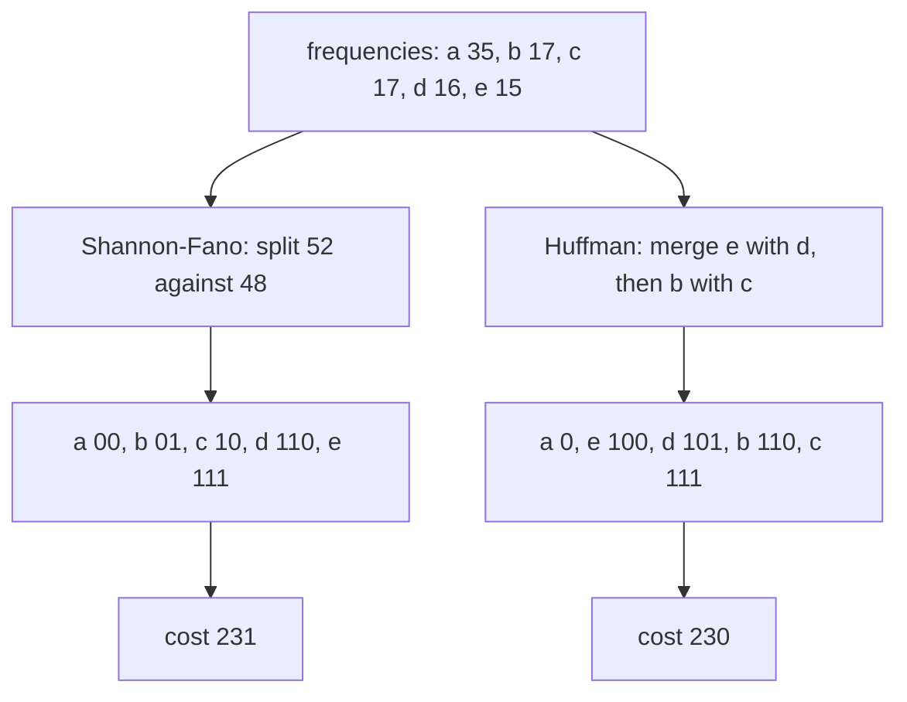
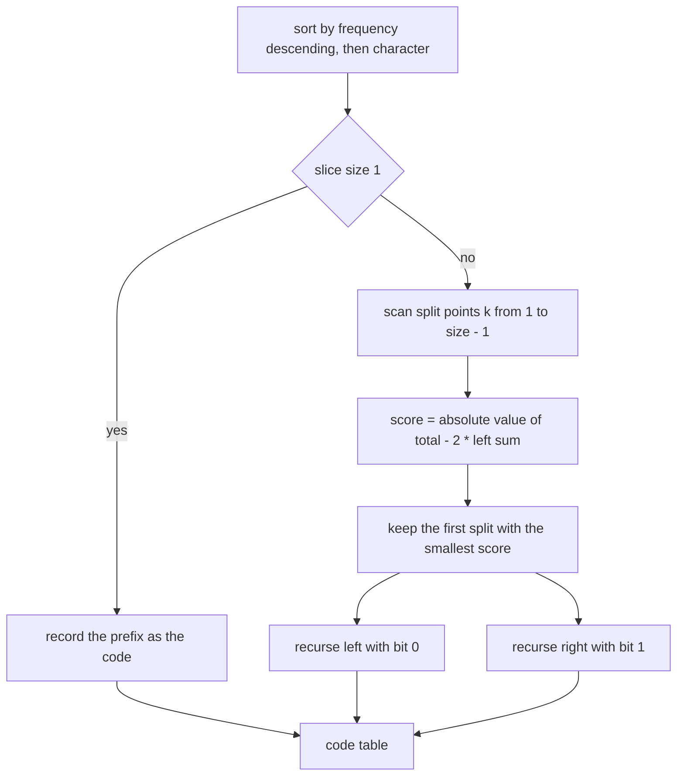
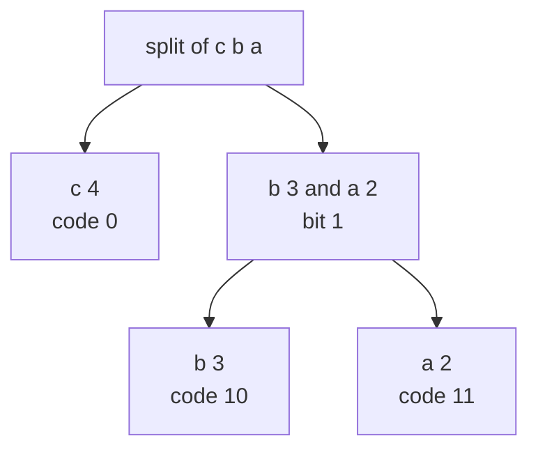
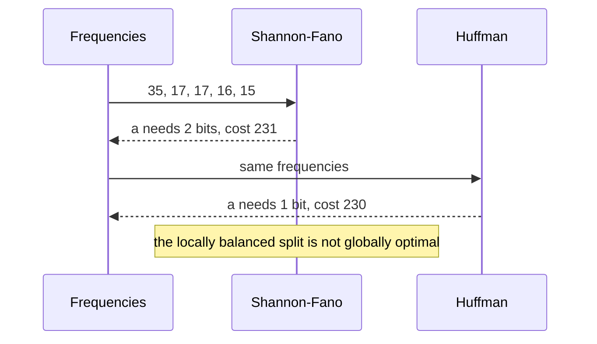

# 390 — Implement Shannon-Fano coding (contrast with Huffman).

> **Tier:** Intermediate · **CTCI chapter:** Beyond — Advanced Data Structures & Algorithms
> **Task spec:** [390-implement-shannon-fano-coding-contrast-with-huffman.md](../../../tasks/intermediate/390-implement-shannon-fano-coding-contrast-with-huffman.md)
> **Solutions:** [Python](../../../solutions/python/intermediate/390-implement-shannon-fano-coding-contrast-with-huffman/solution.py) ·
> [Java](../../../solutions/java/intermediate/390-implement-shannon-fano-coding-contrast-with-huffman/Solution.java) ·
> [JavaScript](../../../solutions/javascript/intermediate/390-implement-shannon-fano-coding-contrast-with-huffman/solution.js) ·
> [C#](../../../solutions/csharp/intermediate/390-implement-shannon-fano-coding-contrast-with-huffman/Solution.cs)

## 1. Problem restatement

**Input:** a frequency table, or a text from which one can be built.

**Output:** two prefix codes over the same alphabet, plus the measurement that separates them:

- `shannon_fano_codes(frequencies)` — the **top-down** code: sort symbols by frequency descending
  (ties by character ascending, documented), split the list where the two halves' total frequencies
  are closest, give `0` to the left part and `1` to the right, and recurse.
- `huffman_codes(frequencies)` — the **bottom-up** greedy code of the sibling task, re-implemented
  locally so the comparison is self-contained.
- `weighted_length(codes, frequencies)`, `encode(text, codes)`, `decode(bits, codes)`,
  `is_prefix_free(codes)`, `kraft_sum_ok(codes)` — the shared measurement and property helpers.

| Call | Result | Why |
| --- | --- | --- |
| `shannon_fano_codes({a: 2, b: 3, c: 4})` | `{c: "0", b: "10", a: "11"}` | weighted `14` |
| `huffman_codes({a: 2, b: 3, c: 4})` | `{c: "0", a: "10", b: "11"}` | weighted `14` — a **tie**, but a different assignment |
| `shannon_fano_codes({a: 35, b: 17, c: 17, d: 16, e: 15})` | `{a: "00", b: "01", c: "10", d: "110", e: "111"}` | weighted `231` |
| `huffman_codes(same)` | `{a: "0", e: "100", d: "101", b: "110", c: "111"}` | weighted `230` — strictly better |
| `shannon_fano_codes({})` / `huffman_codes({})` | `{}` | no symbols, no codes |
| `shannon_fano_codes({a: 4})` / `huffman_codes({a: 4})` | `{a: "0"}` | the single-symbol degenerate case |
| `decode(encode(text, codes), codes)` for either code | the text | both are prefix codes and both round trip |
| 120 random texts, alphabet size `1…6` | `weighted_length(huffman) <= weighted_length(shannon_fano)` | the inequality Huffman's optimality guarantees |

The last row is the point of the task. The docstring states it plainly: because Huffman is optimal
among prefix codes, its weighted length is **always** at most Shannon-Fano's, and the two hand-picked
examples show the two possible outcomes — a tie (`14` versus `14`) and a strict win (`230` versus
`231`).

## 2. Intuition

Shannon-Fano is the natural first idea. Frequencies sorted descending are a rough probability
profile, so cutting the profile into two halves of nearly equal total weight and labelling the halves
`0` and `1` gives every symbol one bit of information about which half it is in; recursing refines it.
Symbols that dominate the profile float to the top of the recursion and get short codes.

Huffman attacks the same objective from the other end. Instead of deciding *where to cut*, it decides
*what to merge*: the two least frequent symbols are folded into one, repeatedly, until a single tree
remains. The two methods produce the same kind of object — a binary tree whose leaves are the symbols,
hence a prefix code — but only the bottom-up one is provably optimal.

The intuition for why the top-down split can lose is that a locally balanced split is not globally
optimal. In the five-symbol example, Shannon-Fano's best first cut puts `a(35)` with `b(17)` against
`c(17), d(16), e(15)`, giving totals `52` and `48` — nearly equal. Huffman instead makes `a` a direct
child of the root, giving it a one-bit code and pushing the cost onto the four rare symbols. The four
extra bits spent on the rare symbols are outweighed by the `35` saved on `a`.



The measured inequality is not "Huffman is usually better" — it is a theorem, and the harness asserts
it on every one of the 120 random samples. Shannon-Fano can tie (as in the three-symbol example) but
it can never win.

## 3. Algorithm

**Shannon-Fano.**

1. Sort the symbols by `(-frequency, character)`, so equal frequencies are ordered by character.
2. Recursion on a contiguous slice of that sorted list with a current prefix:
   - A slice of length `1` records its code — the prefix, or `"0"` when the prefix is empty (the
     single-symbol case).
   - Otherwise compute the slice total, then try every split point `k` from `1` to `len - 1`,
     tracking `left_sum` incrementally and scoring with `abs(total - 2·left_sum)`. Keep the **first**
     split that achieves the smallest score — the comparison is a strict `<`, so earlier splits win
     ties.
3. Recurse with `prefix + "0"` on the left part and `prefix + "1"` on the right part.

**Huffman (for the contrast).** The same merge loop as
[389-implement-huffman-coding-for-characters-frequency.md](../../../tasks/intermediate/389-implement-huffman-coding-for-characters-frequency.md):
a min-heap ordered by `(frequency, creation id)`, `k - 1` merges, first popped node as the left child.

**Shared measurement.** `weighted_length = Σ freq(ch) · len(codes[ch])`; `encode` concatenates codes;
`decode` matches greedily and raises on a dangling prefix; `is_prefix_free` and `kraft_sum_ok` verify
the tree properties that make decoding legal.

```text
function shannon_fano_codes(frequencies)
    codes ← empty table
    if frequencies is empty then
        return codes
    end
    items ← symbols sorted by decreasing frequency, then increasing character
    recurse(items, "")
    return codes
end

procedure recurse(part, prefix)
    if length(part) = 1 then
        if prefix is empty then
            codes[part[0].character] ← "0"
        else
            codes[part[0].character] ← prefix
        end
        return
    end
    total ← sum of the frequencies in part
    best_split ← 1
    best_diff ← none
    left_sum ← 0
    for k ← 1 to length(part) - 1 do
        left_sum ← left_sum + part[k - 1].frequency
        difference ← absolute value of (total - 2 * left_sum)
        if best_diff is none or difference &lt; best_diff then
            best_split ← k
            best_diff ← difference
        end
    end
    recurse(part[0 .. best_split - 1], prefix + "0")
    recurse(part[best_split .. end], prefix + "1")
end
```



Two details of the scan are load-bearing. `left_sum` is accumulated as `k` advances, so the whole
scan is linear in the slice size rather than quadratic. And the loop stops at `len - 1`, because a
split at `len` would leave the right part empty and the recursion would never shrink.

## 4. Worked example

**The tie: `{a: 2, b: 3, c: 4}`.** Sorting by `(-freq, char)` gives `c(4), b(3), a(2)`, total `9`.

| Split `k` | Left part | `left_sum` | `abs(9 - 2·left_sum)` |
| --- | --- | --- | --- |
| 1 | `c` | 4 | 1 |
| 2 | `c, b` | 7 | 5 |

The best split is `k = 1`, so `c → "0"` and the remaining slice `b(3), a(2)` recurses with prefix
`"1"`. Inside it the total is `5`, the only split is at `k = 1` with `left_sum = 3` and difference
`1`, giving `b → "10"` and `a → "11"`. The asserted table is `{c: "0", b: "10", a: "11"}` with
weighted length `4·1 + 3·2 + 2·2 = 14`.

Huffman arrives at the same cost with the *other* assignment: its merges join `a` and `b` first, so
`a → "10"` and `b → "11"`. The two codes have identical length profiles, hence the identical
weighted length `14` — the documented tie.



**The strict win: `{a: 35, b: 17, c: 17, d: 16, e: 15}`.** Sorted: `a(35), b(17), c(17), d(16), e(15)`,
total `100`.

| Split `k` | `left_sum` | `abs(100 - 2·left_sum)` |
| --- | --- | --- |
| 1 | 35 | 30 |
| 2 | 52 | **4** |
| 3 | 69 | 38 |
| 4 | 85 | 70 |

The split at `k = 2` is chosen, so `a, b` get prefix `"0"` and `c, d, e` get `"1"`. Recursing:

| Slice | Total | Best split | Codes produced |
| --- | --- | --- | --- |
| `a(35), b(17)` | 52 | `k = 1` (`a` alone, difference 18) | `a → "00"`, `b → "01"` |
| `c(17), d(16), e(15)` | 48 | `k = 1` (`c` alone, difference 14) | `c → "10"`, then `d → "110"`, `e → "111"` |

That is the asserted `{a: "00", b: "01", c: "10", d: "110", e: "111"}` with weighted length
`35·2 + 17·2 + 17·2 + 16·3 + 15·3 = 70 + 34 + 34 + 48 + 45 = 231`. Huffman's tree gives `a` a
one-bit code instead, for `230`. The asserted comparison `len(sf_big["a"]) == 2 and
len(huff_big["a"]) == 1` pins exactly where the extra bit comes from.



Both tables are verified with `is_prefix_free` and `kraft_sum_ok`, and both round trip every sample
text, so the difference between the two methods is purely one of cost — never of correctness.

## 5. Complexity

Let `k` be the number of distinct symbols, `n` the text length, and `L` the longest code.

| Measure | Shannon-Fano | Reason |
| --- | --- | --- |
| Sorting | O(k log k) | one sort by `(-frequency, character)` |
| One split search | O(size of the slice) | `left_sum` is accumulated incrementally, so each `k` is O(1) |
| Whole recursion | O(k²) worst case | the slice sizes across a level sum to at most `k`, and the recursion is up to `k` levels deep |
| Huffman build | O(k log k) | `k - 1` heap merges |
| Encoding | O(n · L) with `L` per-symbol codes, O(n) with buffering | one code per character |
| Decoding | O(total bits) | greedy prefix matching over the bit string |
| Space | O(k) for tables and recursion, O(n) for the encoded and decoded text | the recursion stack is bounded by the code length |
| Weighted length | Huffman `<=` Shannon-Fano, always | Huffman's optimality; asserted on all 120 random samples |

The interesting column is the recursion: Shannon-Fano's split search is linear per slice, but a
degenerate frequency profile can produce `k` levels, so the build is `O(k²)` in the worst case while
Huffman's is `O(k log k)`. For the alphabets here (`1` to `6` distinct characters) neither matters,
which is precisely why the task measures the *code cost* instead: the weighted length is the metric
the two algorithms actually differ on, and it is what the assertions compare.

## 6. Pitfalls and edge cases

- **Shannon-Fano is not optimal.** The five-symbol example is strictly worse (`231` against `230`),
  and the file asserts both the inequality on that example and
  `weighted_length(huffman) <= weighted_length(shannon_fano)` on every random trial. Do not present
  the top-down split as producing the best prefix code.
- **Earliest split wins ties.** The scan keeps the *first* split achieving the smallest difference
  (`difference < best_diff`, strictly), because several split points can be equally balanced. The
  expected tables depend on that rule.
- **Sort order is documented.** Symbols are sorted by decreasing frequency and, for equal
  frequencies, by increasing character. Any other tie-break still produces a valid prefix code but
  not the asserted one.
- **The split must leave both parts non-empty.** The loop runs `k = 1 … len - 1`; a split at `len`
  gives an empty right part and the recursion would never terminate.
- **A single symbol needs the `"0"` special case.** With one entry the slice is length `1` at the top
  call with an empty prefix, and both implementations record `"0"` — asserted as
  `shannon_fano_codes({a: 4}) == {"a": "0"} == huffman_codes({a: 4})`. A zero-length code would make
  encoding produce no bits at all.
- **Empty input returns `{}` from both.** `decode("", {}) == ""` and `encode("", {}) == ""` are
  asserted, so callers do not need to special-case an empty text.
- **Both codes must be prefix-free — and are.** `is_prefix_free` and `kraft_sum_ok` are asserted for
  both tables in every trial. A split that produced nested codes would break decoding, since
  `decode` matches greedily on the first hit.
- **A dangling bit string is an error.** The shared `decode` raises `ValueError("bits end with an
  incomplete code")` rather than dropping the remainder; that behaviour is common to both codecs.
- **Identical weighted length does not mean identical codes.** In the three-symbol example the two
  methods disagree on which symbol gets `"10"`; the assertions check the exact tables *and* the
  identical cost. Confusing "same cost" with "same code" is the classic misreading.
- **The comparison is only fair on the same frequencies.** Both functions take the same table, which
  is why the harness computes `character_frequencies(sample)` once and feeds it to both.

## 7. Variants and follow-ups

- **Huffman, the optimal bottom-up method.** The full treatment, including the deterministic
  tie-break and the heap structure, is
  [389-implement-huffman-coding-for-characters-frequency.md](../../../tasks/intermediate/389-implement-huffman-coding-for-characters-frequency.md);
  this task re-implements it locally so the contrast is visible in one file.
- **Balanced splits with different scores.** Scoring by the difference of the *entropies* of the two
  halves, or by the number of symbols rather than weights, changes the code and can move the cost
  either way.
- **Length-limited codes.** Real formats cap the code length (DEFLATE allows at most 15 bits per
  code) and use package-merge or length-limited Huffman instead of the plain greedy build.
- **Adaptive coding.** When frequencies are unknown up front, the tree is updated as symbols arrive —
  see [391-implement-adaptive-huffman-outline-conceptual.md](../../../tasks/intermediate/391-implement-adaptive-huffman-outline-conceptual.md)
  for the conceptual outline and its documented simplifications.
- **Where entropy coding sits in a compressor.** DEFLATE combines an LZ77 match finder with a Huffman
  stage, which is the design sketched in
  [393-implement-basic-brotli-or-deflate-idea-demo-lz77-huffman-simpl.md](../../../tasks/intermediate/393-implement-basic-brotli-or-deflate-idea-demo-lz77-huffman-simpl.md),
  and the LZW dictionary approach in
  [392-implement-lzw-compression-encoder-decoder-skeleton.md](../../../tasks/intermediate/392-implement-lzw-compression-encoder-decoder-skeleton.md)
  reaches the same goal without any frequency modelling at all.

## 8. Check yourself

1. Both methods produce prefix codes. Why is Huffman's weighted length never worse?

<details><summary>Show answer</summary>

Because Huffman's greedy construction is provably optimal among all prefix codes: there is always an
optimal tree in which the two least frequent symbols are siblings at the deepest level, and merging
them reduces the problem to a smaller instance without loss. Shannon-Fano's top-down split makes a
locally balanced decision that need not be globally optimal, so it can tie or lose but never win.

</details>

2. In the five-symbol example Shannon-Fano costs `231` and Huffman `230`. Where does the extra bit
   come from?

<details><summary>Show answer</summary>

From the most frequent symbol. Shannon-Fano's best first cut balances `52` against `48`, which forces
`a(35)` to depth 2 — the file asserts `len(sf_big["a"]) == 2`. Huffman merges the four rare symbols
into one node first and then attaches `a` directly to the root, giving it depth 1
(`len(huff_big["a"]) == 1`). The one bit saved on `a` outweighs the extra bit paid by the rare symbols.

</details>

3. Why does the split scan use a strict `<` when comparing differences?

<details><summary>Show answer</summary>

So that the earliest split wins ties. Several split points can produce the same absolute difference —
for `{a: 2, b: 3, c: 4}` the scan scores `1` at `k = 1` — and the documented rule is "the earliest
split wins". With `<=` the last equally good split would be chosen instead, changing the code table and
failing the exact expected-value assertions.

</details>

4. The three-symbol example has weighted length `14` for both methods, but the codes differ. What does
   that tell you about the cost metric?

<details><summary>Show answer</summary>

That the weighted length depends only on the multiset of code *lengths*, not on which symbol gets
which code. Both trees have one symbol at depth 1 and two at depth 2, so both cost
`4·1 + 2·2 + 3·2 = 14` even though Shannon-Fano assigns `"10"` to `b` and Huffman assigns it to `a`.
The file asserts the exact tables separately from the costs for exactly this reason.

</details>

5. Which failure modes would the shared property helpers catch that a round trip alone might not?

<details><summary>Show answer</summary>

`is_prefix_free` catches a table where one code is a proper prefix of another — such a table can still
round trip on some inputs but makes greedy decoding ambiguous in general. `kraft_sum_ok` catches a
table that does not correspond to a complete binary tree, e.g. one produced by a bug that assigned an
unnecessarily long code or skipped a branch. Combined with the exact assertions on the code tables and
the `weighted_length(huffman) <= weighted_length(shannon_fano)` check, a defective build cannot slip
through on a lucky sample.

</details>
