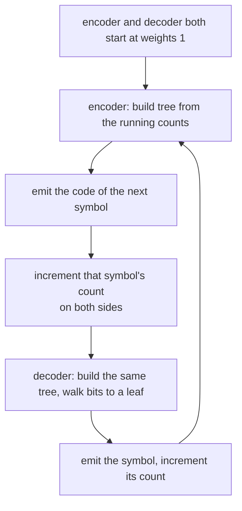
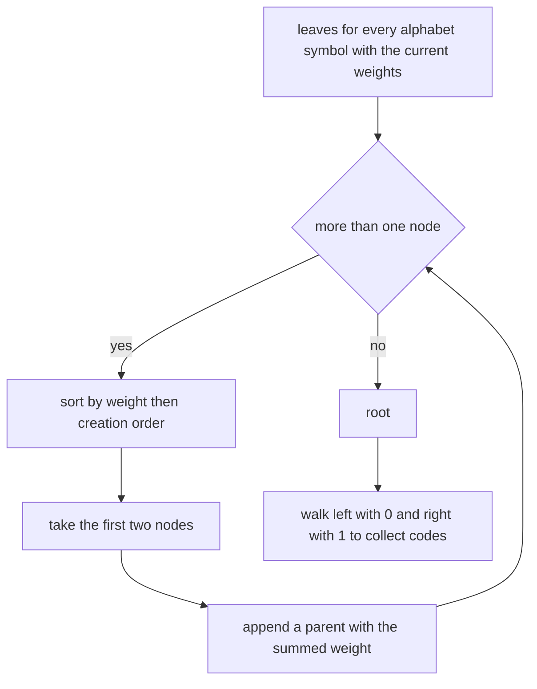
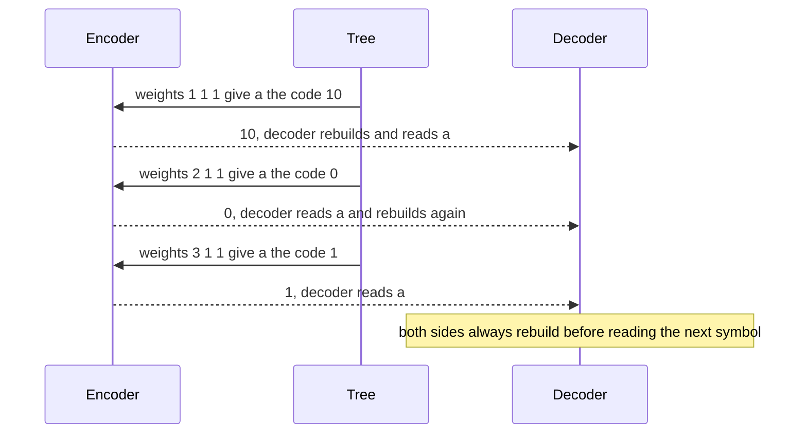
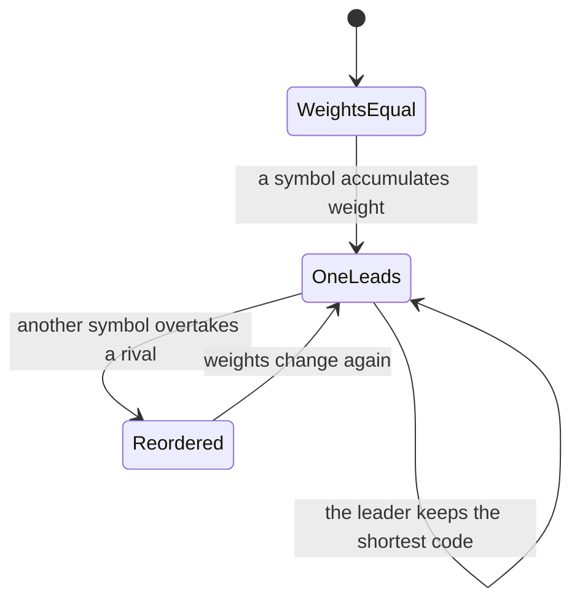

# 391 — Implement adaptive Huffman outline (conceptual).

> **Tier:** Intermediate · **CTCI chapter:** Beyond — Advanced Data Structures & Algorithms
> **Task spec:** [391-implement-adaptive-huffman-outline-conceptual.md](../../../tasks/intermediate/391-implement-adaptive-huffman-outline-conceptual.md)
> **Solutions:** [Python](../../../solutions/python/intermediate/391-implement-adaptive-huffman-outline-conceptual/solution.py) ·
> [Java](../../../solutions/java/intermediate/391-implement-adaptive-huffman-outline-conceptual/Solution.java) ·
> [JavaScript](../../../solutions/javascript/intermediate/391-implement-adaptive-huffman-outline-conceptual/solution.js) ·
> [C#](../../../solutions/csharp/intermediate/391-implement-adaptive-huffman-outline-conceptual/Solution.cs)

## 1. Problem restatement

This is a **conceptual outline**, and the docstring states the simplification up front: adaptive
Huffman normally rebuilds (or incrementally maintains) the code tree from the *running* frequencies,
and this implementation does exactly that by rebuilding the whole tree before **every** symbol. The
real FGK algorithm keeps the same tree in O(1) per symbol by preserving the sibling property; the
rebuild here is what the docstring calls "the O(n log n)-per-symbol conceptual equivalent", with `n`
standing for the alphabet size.

**Inputs:** a text and the alphabet it is drawn from. The alphabet is known to both sides in advance,
and every symbol starts with weight `1`.

**Outputs:**

- `adaptive_encode(text, alphabet)` → the bit string. The code for each symbol comes from the tree
  built from the frequencies *so far*, so the codes change as the text is processed.
- `adaptive_decode(bits, alphabet)` → the text, rebuilding the same tree with the same rule.
- `build_tree(freq, alphabet)` and `collect_codes(root)` → the tree and the code table for one
  snapshot of the frequencies.

| Call | Result | Why |
| --- | --- | --- |
| `adaptive_encode("a", "abc")` | `"10"` | with weights `1/1/1` the tree gives `c = "0"`, `a = "10"`, `b = "11"` |
| `adaptive_encode("aaa", "abc")` | `"1001"` | three different trees: `"10"`, then `"0"`, then `"1"` as `a` gains weight |
| `adaptive_encode("aaabbc", "abc")` | `"1001000110"` | six symbols, six trees, ten bits |
| `adaptive_encode("", "abc")` | `""` | no symbols |
| `adaptive_decode("1001000110", "abc")` | `"aaabbc"` | the decoder rebuilds the identical trees |
| round trip for `"a"`, `"abc"`, `"aaabbc"`, `"abababab"`, `"cccbaaa"` plus 40 random 24-symbol strings | decoded text equals the input | 45 round trips in total |
| `collect_codes(build_tree({a: 41, b: 2, c: 2}, "abc"))` | `a = "1"`, and `len(b) == len(c) == 2` | the frequent symbol ends up with the shortest code — the adaptivity |
| `adaptive_encode("d", "abc")` | raises | symbols outside the alphabet are rejected |

No frequency table is transmitted and no header is needed: the decoder derives every tree from the
symbols it has already decoded, which is the entire reason the method is called *adaptive*.

## 2. Intuition

Static Huffman has an operational wart: the decoder cannot start without the code table, so the
encoder must send it (or the frequency list) before the payload. Adaptive Huffman removes that by
making both sides derive the codes from the same evolving state. Both start from the same initial
weights (here `1` for every alphabet symbol, which is the documented convention), and after each
symbol **both** increment that symbol's count. Since the tree is a deterministic function of the
counts, the two sides stay in lockstep without transmitting anything.

The consequence is that the code for the same symbol changes over time. Early in a text, when every
count is `1`, the choice of code depends only on the tie-break; as one symbol accumulates weight, it
drifts towards the root and its code shortens.



The outline's tie-break is what makes the two sides agree exactly: nodes are compared by
`(weight, creation order)`, where leaves are created in alphabet order and internal nodes in creation
order. That is a deterministic total order, so the tree shape is a pure function of the counts and can
be asserted with exact expected values (as the tests do).

## 3. Algorithm

**`build_tree(freq, alphabet)`.**

1. Create one leaf per alphabet symbol, in alphabet order, with `weight = freq[ch]` and a fresh
   creation sequence number.
2. While the work list holds more than one node: sort by `(weight, seq)`, take the first two nodes
   `x` and `y`, remove them, and append the parent `Node(x.weight + y.weight, next_seq, left = x,
   right = y)`. Because leaves are created first and in alphabet order, ties go to the earlier
   alphabet symbol, and later ties go to the earlier-created internal node.
3. Return the surviving node.

**`collect_codes(root)`** walks the tree, appending `"0"` for a left child and `"1"` for a right
child, and records the prefix at each leaf.

**`adaptive_encode(text, alphabet)`.** Initialise `freq = {ch: 1 for ch in alphabet}`. For each
symbol: rebuild the tree, look up the code, append it to the output, then increment the symbol's
count. A symbol outside the alphabet raises `ValueError`.

**`adaptive_decode(bits, alphabet)`.** Initialise the same `freq` map. Repeatedly rebuild the tree and
walk from the root, consuming one bit per step (`0` left, `1` right) until a leaf is reached; emit
that symbol and increment its count. The bit index is shared across symbols, so the walk for the next
symbol continues exactly where the previous one stopped.

```text
function build_tree(freq, alphabet)
    work ← empty list
    seq ← 0
    for ch in alphabet do
        append node (weight = freq[ch], seq = seq, character = ch) to work
        seq ← seq + 1
    end
    while length(work) &gt; 1 do
        sort work by (weight, seq)
        x ← work[0]
        y ← work[1]
        work ← work without the first two entries
        append node (weight = x.weight + y.weight, seq = seq, left = x, right = y) to work
        seq ← seq + 1
    end
    return work[0]
end

function adaptive_encode(text, alphabet)
    freq ← one count of 1 per alphabet symbol
    bits ← empty buffer
    for ch in text do
        if ch is not in freq then
            fail "symbol outside the alphabet"
        end
        codes ← collect_codes(build_tree(freq, alphabet))
        append codes[ch] to bits
        freq[ch] ← freq[ch] + 1
    end
    return the concatenation of bits
end

function adaptive_decode(bits, alphabet)
    freq ← one count of 1 per alphabet symbol
    out ← empty buffer
    i ← 0
    while i &lt; length(bits) do
        node ← build_tree(freq, alphabet)
        while node is not a leaf do
            if bits[i] = "0" then
                node ← node.left
            else
                node ← node.right
            end
            i ← i + 1
        end
        append node.character to out
        freq[node.character] ← freq[node.character] + 1
    end
    return the concatenation of out
end
```



Two structural notes. First, the rebuild happens **before** each symbol, so the symbol being encoded
does not yet influence its own code — the decoder can therefore reproduce the code from the same state.
Second, because the alphabet is fixed and every symbol starts at weight `1`, every alphabet symbol
always has a code; there is no escape or "not yet seen" mechanism, and that is a documented
simplification of this outline.

## 4. Worked example

Encode `"aaabbc"` over the alphabet `"abc"`. Every symbol starts at weight `1`, and the tree is
rebuilt before each of the six symbols.

| Symbol | Weights before | Tree codes | Emitted | Weights after |
| --- | --- | --- | --- | --- |
| `a` | `a1 b1 c1` | `c = 0`, `a = 10`, `b = 11` | `10` | `a2 b1 c1` |
| `a` | `a2 b1 c1` | `a = 0`, `b = 10`, `c = 11` | `0` | `a3 b1 c1` |
| `a` | `a3 b1 c1` | `a = 1`, `b = 00`, `c = 01` | `1` | `a4 b1 c1` |
| `b` | `a4 b1 c1` | `a = 1`, `b = 00`, `c = 01` | `00` | `a4 b2 c1` |
| `b` | `a4 b2 c1` | `a = 1`, `b = 01`, `c = 00` | `01` | `a4 b3 c1` |
| `c` | `a4 b3 c1` | `a = 0`, `b = 11`, `c = 10` | `10` | `a5 b3 c2` |

Concatenating gives `10 0 1 00 01 10` = `"1001000110"`, which is exactly the asserted bit string. The
fourth row is a good sanity check: after three `a`s the tree has already reordered so that `a` gets
the single-bit code `"1"`, and `b` and `c` share the two-bit codes `"00"` and `"01"`. The last row is
the most instructive: once `b` overtakes `c`, the tree swaps their codes, and `c` moves from `"01"` to
`"10"` — the decoder knows this because it counted the same symbols.

The first row also shows why the whole `"aaa"` assertion is `"1001"`: the three `a`s are encoded with
three *different* codes (`"10"`, `"0"`, `"1"`) because the tree is rebuilt between them.



The adaptivity assertion isolates the effect: starting from the counts `{a: 41, b: 2, c: 2}`, the tree
gives `a = "1"` and both rare symbols a two-bit code. Compare that with `{1, 1, 1}`, where `c` gets
`"0"` purely because of the creation-order tie-break — the same alphabet, a different weight profile,
a different code assignment.



## 5. Complexity

Let `n` be the number of encoded symbols and `k = |alphabet|` the alphabet size.

| Measure | Bound | Why it holds |
| --- | --- | --- |
| One tree rebuild | O(k log k) with a heap, O(k² log k) as written | the merge loop runs `k - 1` times; a priority queue makes each merge logarithmic, while the code re-sorts a list of at most `k` nodes each round |
| `collect_codes` | O(k) | one visit per node of a tree with `k` leaves |
| Encoding | O(n · cost of one rebuild) | one rebuild and one code lookup per symbol |
| Decoding | O(total bits) for the walks plus the same rebuilds | each bit is consumed once, but the tree is rebuilt per symbol |
| Space | O(k) for the tree plus O(n) for the output | the tree holds `2k - 1` nodes |
| Real FGK comparison | O(1) per symbol | the sibling property lets the tree be updated incrementally instead of rebuilt |
| Round trips asserted | 5 fixed strings plus 40 random 24-symbol strings | all must decode exactly |

The gap between this outline and FGK is the whole point of the exercise. Rebuilding costs
`O(k log k)` per symbol (or worse for the naive loop), so the total is `O(n k log k)`; FGK updates the
tree in O(1) amortised per symbol, for `O(n)` overall. Both produce exactly the same *codes*, which is
the property the outline is there to demonstrate — and its deterministic tie-break is what allows the
expected bit strings to be asserted literally.

## 6. Pitfalls and edge cases

- **Rebuild before encoding, increment after.** The order matters: if the count were incremented
  before building, the encoder would use a code the decoder cannot know yet, and every round trip
  would fail from the second symbol onward.
- **The alphabet must be known in advance.** Every alphabet symbol starts at weight `1`, so the tree
  always contains all of them. Real adaptive Huffman starts with an *empty* tree and emits an escape
  symbol plus the raw character the first time a symbol appears; that machinery is intentionally absent
  here, and the file asserts `ValueError` for a symbol outside the alphabet.
- **Deterministic tie-break is essential.** Nodes are ordered by `(weight, creation order)`, with
  leaves created in alphabet order. Without it the encoder and decoder could build different trees
  from the same counts and desynchronise silently — the failure mode is a wrong decode, not an error.
- **Codes change mid-stream.** `"aaa"` encodes to `"1001"`, three different codes for the same
  character. Any test that assumes a stable code table for a symbol will fail; the file asserts the
  exact multi-tree bit string instead.
- **The empty text is legal.** `adaptive_encode("", "abc") == ""`, and decoding an empty bit string
  returns `""` because the outer loop never runs.
- **The decoder shares one bit index across symbols.** `i` advances through the whole bit string; the
  inner walk stops at a leaf rather than at a fixed code length, which is what makes variable-length
  codes work.
- **A truncated bit stream is not detected here.** The decoder's inner loop walks bits until it finds a
  leaf; if the stream ends mid-code, the index runs past the end. The sibling tasks
  ([389](../../../tasks/intermediate/389-implement-huffman-coding-for-characters-frequency.md) and
  [390](../../../tasks/intermediate/390-implement-shannon-fano-coding-contrast-with-huffman.md)) raise
  on a dangling prefix; this outline does not, which is consistent with its "conceptual" label.
- **The tie-break rule differs from the sibling tasks.** Those order leaves by `(frequency, creation
  id)` with ids from `sorted(frequencies.items())` — sorted *character* order — and this outline walks
  the alphabet in the order given. For the alphabet `"abc"` the two coincide, which is why the
  asserted bit strings are stable across the three tasks.
- **Weight arithmetic grows with the text.** Weights are counts of symbols seen so far, so they stay
  small; a long-lived stream would need wider counters in the fixed-width ports.
- **FGK is not implemented.** The docstring is explicit that this is the conceptual rebuild; the
  sibling-property updating, the NYT node and the O(1) change in the real algorithm are follow-ups,
  not parts of this file.

## 7. Variants and follow-ups

- **FGK / Vitter's algorithm.** Maintain the tree incrementally, keeping nodes ordered so that the
  sibling property holds, and add an NYT node to introduce new symbols; O(1) per symbol instead of a
  rebuild, and exactly the same codes for the same input.
- **Semi-adaptive coding.** Send the frequency table and then use static Huffman; one header up front
  instead of per-symbol rebuilding — see
  [389-implement-huffman-coding-for-characters-frequency.md](../../../tasks/intermediate/389-implement-huffman-coding-for-characters-frequency.md).
- **Shannon-Fano for comparison.** A different construction of the same kind of code, contrasted
  against Huffman in
  [390-implement-shannon-fano-coding-contrast-with-huffman.md](../../../tasks/intermediate/390-implement-shannon-fano-coding-contrast-with-huffman.md).
- **Where the idea appears for real.** Adaptive entropy models drive the arithmetic/range coders in
  modern compressors; the dictionary-based
  [392-implement-lzw-compression-encoder-decoder-skeleton.md](../../../tasks/intermediate/392-implement-lzw-compression-encoder-decoder-skeleton.md)
  is the other classic adaptive scheme (adapting its *dictionary* rather than its code lengths), and
  [393-implement-basic-brotli-or-deflate-idea-demo-lz77-huffman-simpl.md](../../../tasks/intermediate/393-implement-basic-brotli-or-deflate-idea-demo-lz77-huffman-simpl.md)
  combines LZ77 with Huffman on fixed block boundaries.

## 8. Check yourself

1. Why can the decoder rebuild the same trees as the encoder without receiving any table?

<details><summary>Show answer</summary>

Because the tree is a deterministic function of the symbol counts, and both sides update those counts
identically: the encoder increments after encoding a symbol, the decoder increments after decoding
that same symbol. Starting from the same initial weights (all `1`) and using the same
`(weight, creation order)` tie-break, the two sides see the same tree before every symbol, so nothing
needs to be transmitted.

</details>

2. Why does `"aaa"` encode to `"1001"` rather than to three identical codes?

<details><summary>Show answer</summary>

Because the tree is rebuilt before every symbol from the running counts. With weights `1/1/1` the code
for `a` is `"10"`; after one `a` the weights are `2/1/1` and `a` becomes `"0"`; after two `a`s they are
`3/1/1` and `a` becomes `"1"`. The three codes `"10"`, `"0"`, `"1"` concatenate to `"1001"`.

</details>

3. What role does the tie-break play, and what would happen without it?

<details><summary>Show answer</summary>

Nodes are ordered by `(weight, creation order)`, which is a total order, so the tree shape is uniquely
determined by the counts. Without a deterministic rule, two implementations (or the encoder and the
decoder in the same run) could pick different trees whenever weights tie — which happens constantly,
starting with the very first symbol when all weights are `1`. The result would be silent corruption: a
wrong decode rather than an exception.

</details>

4. How does this outline differ from real FGK adaptive Huffman?

<details><summary>Show answer</summary>

FGK maintains the tree incrementally in O(1) per symbol using the sibling property, and introduces new
symbols through an NYT (not-yet-transmitted) node with an escape code, so it needs no alphabet up
front. This outline rebuilds the entire tree before every symbol (a conceptual equivalent that costs
`O(k log k)` or more per symbol) and requires the alphabet in advance, with all weights starting at
`1` so that every symbol always has a code.

</details>

5. What does the assertion `codes["a"] == "1" and len(codes["b"]) == len(codes["c"]) == 2` for the
   counts `{a: 41, b: 2, c: 2}` demonstrate?

<details><summary>Show answer</summary>

That the code adapts to the data: the dominant symbol gets the shortest possible code (one bit) while
the two rare symbols share two-bit codes. It is the same property static Huffman exploits, but reached
through a weight profile that was built up symbol by symbol — which is why the third symbol and the
fourth symbol of `"aaabbc"` are encoded with different trees.

</details>
