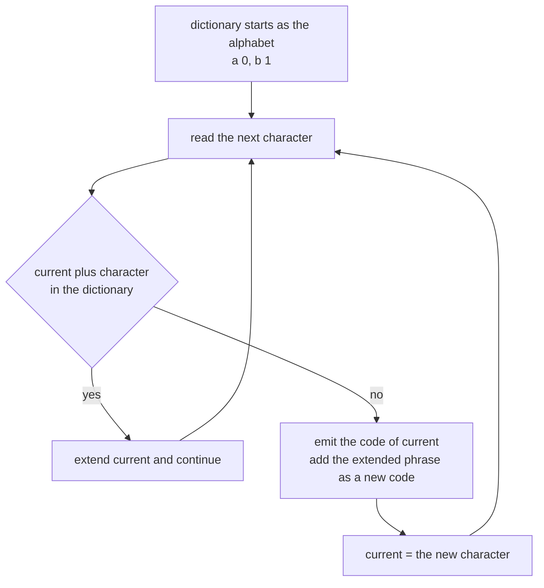
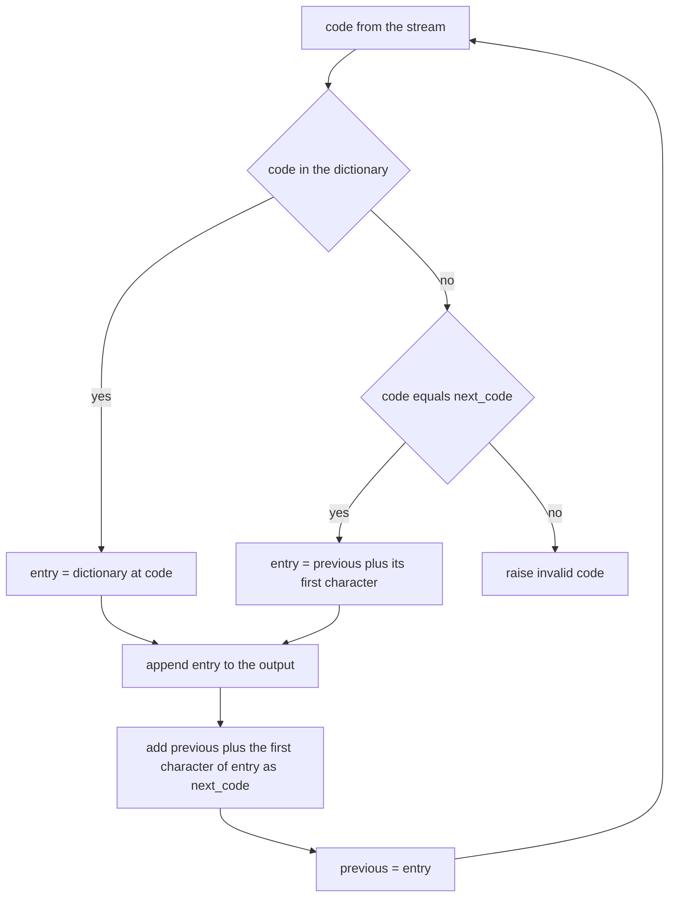
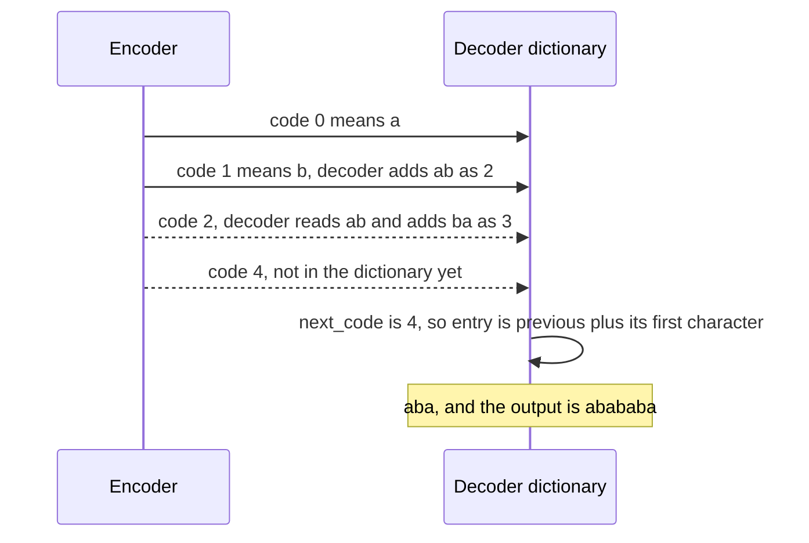

# 392 — Implement LZW compression encoder/decoder skeleton.

> **Tier:** Intermediate · **CTCI chapter:** Beyond — Advanced Data Structures & Algorithms
> **Task spec:** [392-implement-lzw-compression-encoder-decoder-skeleton.md](../../../tasks/intermediate/392-implement-lzw-compression-encoder-decoder-skeleton.md)
> **Solutions:** [Python](../../../solutions/python/intermediate/392-implement-lzw-compression-encoder-decoder-skeleton/solution.py) ·
> [Java](../../../solutions/java/intermediate/392-implement-lzw-compression-encoder-decoder-skeleton/Solution.java) ·
> [JavaScript](../../../solutions/javascript/intermediate/392-implement-lzw-compression-encoder-decoder-skeleton/solution.js) ·
> [C#](../../../solutions/csharp/intermediate/392-implement-lzw-compression-encoder-decoder-skeleton/Solution.cs)

## 1. Problem restatement

This is a **skeleton**: the codec works on lists of integer codes rather than a packed bit stream, so
the interesting machinery is visible instead of buried under bit shifting.

**Inputs:** a text and an alphabet, given as a sequence of distinct single-character symbols whose
**order fixes the initial code ids** (`a → 0`, `b → 1`, …).

**Outputs:**

- `lzw_encode(text, alphabet)` → a list of integer codes. The encoder keeps the longest dictionary
  match and emits its code; the matched phrase plus the next character becomes a new dictionary entry.
- `lzw_decode(codes, alphabet)` → the text, rebuilding the same dictionary on the fly, using the
  `cSc` rule for the one entry the encoder creates ahead of the decoder.

Because ids are assigned in **first-seen order**, the code stream is deterministic and every language
asserts the same exact lists:

| Call | Result | Why |
| --- | --- | --- |
| `lzw_encode("abababa", "ab")` | `[0, 1, 2, 4]` | `a`, `b`, `ab`, then the phrase `aba` |
| `lzw_encode("aaaa", "ab")` | `[0, 2, 0]` | `a`, then `aa`, then a final `a` |
| `lzw_encode("abcabcabcabc", "abc")` | `[0, 1, 2, 3, 5, 4, 6]` | seven codes for twelve symbols |
| `lzw_encode("", "ab")` | `[]` | nothing to emit |
| `lzw_encode("a", "ab")` | `[0]` | the pending match is flushed at the end |
| `lzw_decode([0, 1, 2, 4], "ab")` | `"abababa"` | the decoder reconstructs each phrase |
| `lzw_decode([0, 2, 0], "ab")` | `"aaaa"` | the `aa` entry is rebuilt from the code stream |
| `lzw_decode([0, 1, 2, 3, 5, 4, 6], "abc")` | `"abcabcabcabc"` | including the out-of-order code `5` |
| `lzw_decode([], "ab")` | `""` | no codes, no text |
| `lzw_decode([0], "ab")` | `"a"` | a single code needs no dictionary growth |
| round trip for 4 fixed samples, 40 random `"ab"` strings of length 30 and 40 random `"abcd"` strings of length 40 | exact text | 84 round trips |
| `len(lzw_encode("ab" * 20, "ab")) < 40` | true | repetitive text shrinks: fewer codes than symbols |
| `lzw_decode(lzw_encode("abababab", "ab"), "ab")` | `"abababab"` | the stream that exercises the `cSc` branch |

## 2. Intuition

Huffman coding models the *frequency* of individual symbols; LZW models **repetition of phrases**. The
dictionary starts as the alphabet, and every time the encoder sees a phrase it has not stored before,
it emits the code of the longest match it *did* have and records the extended phrase under a new code.
Nothing is transmitted about the dictionary — the decoder rebuilds it from the codes themselves, in the
same order, because it sees the same emerging phrases.

That symmetry is the whole design, and it has one subtle gap. The decoder is always **one step behind**:
when the encoder emits the code for phrase `P`, it simultaneously adds `P + next character` to its
dictionary, but the decoder has not yet seen that next character. When the encoder's next output is the
code it just created, the decoder has no entry for it yet — and it can still recover the phrase, because
in that single situation the missing entry is exactly `previous + previous[0]`. That is the famous
`cSc` (or `KwKwK`) rule.



Because the encoder always consumes as much text as it can before emitting, the codes describe longer
and longer phrases as the text continues, which is why the stream shrinks on repetitive data: `"ab"`
repeated 20 times (40 symbols) needs fewer than 40 codes, and `"abcabcabcabc"` needs seven.

## 3. Algorithm

**Encoder.**

1. Seed the dictionary with `{symbol: id}` in alphabet order, and set `next_code` to the alphabet
   size.
2. Keep a `current` phrase, initially empty. For each character `ch`:
   - form `candidate = current + ch`;
   - if the candidate is in the dictionary, extend `current` to it;
   - otherwise emit `dictionary[current]`, insert `candidate` with id `next_code`, increment
     `next_code`, and set `current = ch`.
3. After the text is consumed, emit `dictionary[current]` if `current` is non-empty — this flush is what
   produces the trailing code in `"abababa" → [0, 1, 2, 4]`.
4. Reject a symbol that is not in the alphabet (a documented `ValueError`), both at the start and after
   a reset.

**Decoder.**

1. Seed the dictionary `{id: symbol}` from the alphabet, and set `next_code` to the alphabet size.
2. Return `""` for an empty code list. The first code must be an initial symbol, otherwise raise
   `"invalid first code"`.
3. Set `previous = dictionary[first]` and start the output with it.
4. For each subsequent code:
   - if the code is in the dictionary, take its entry;
   - else if the code equals `next_code` (the entry the encoder created ahead), use
     `entry = previous + previous[0]` — the `cSc` rule;
   - otherwise raise `"invalid code"`.
   Then append `entry` to the output, insert `dictionary[next_code] = previous + entry[0]`, increment
   `next_code`, and set `previous = entry`.

```text
function lzw_encode(text, alphabet)
    dictionary ← { symbol : index } for the alphabet in order
    next_code ← length of the alphabet
    codes ← empty list
    current ← ""
    for ch in text do
        if ch is not in the alphabet then
            fail "symbol outside the alphabet"
        end
        candidate ← current + ch
        if candidate is a key of dictionary then
            current ← candidate
        else
            append dictionary[current] to codes
            dictionary[candidate] ← next_code
            next_code ← next_code + 1
            current ← ch
        end
    end
    if current is not empty then
        append dictionary[current] to codes
    end
    return codes
end

function lzw_decode(codes, alphabet)
    dictionary ← { index : symbol } for the alphabet in order
    next_code ← length of the alphabet
    if codes is empty then
        return ""
    end
    previous ← dictionary[codes[0]]
    out ← buffer holding previous
    for code in codes[1 .. end] do
        if code is a key of dictionary then
            entry ← dictionary[code]
        else if code = next_code then
            entry ← previous + first character of previous
        else
            fail "invalid code"
        end
        append entry to out
        dictionary[next_code] ← previous + first character of entry
        next_code ← next_code + 1
        previous ← entry
    end
    return the concatenation of out
end
```



The two sides need the same alphabet, in the same order, and they both add exactly one entry per code
after the first — that is the invariant that keeps the dictionaries in step.

## 4. Worked example

**Encoding `"abababa"` over the alphabet `"ab"`.** The dictionary starts as `{a: 0, b: 1}` with
`next_code = 2`.

| Character | `current` before | Candidate | In dictionary? | Action | Codes so far |
| --- | --- | --- | --- | --- | --- |
| `a` | `""` | `a` | yes | `current = "a"` | `[]` |
| `b` | `"a"` | `ab` | no | emit `0`, add `ab → 2`, `current = "b"` | `[0]` |
| `a` | `"b"` | `ba` | no | emit `1`, add `ba → 3`, `current = "a"` | `[0, 1]` |
| `b` | `"a"` | `ab` | yes | `current = "ab"` | `[0, 1]` |
| `a` | `"ab"` | `aba` | no | emit `2`, add `aba → 4`, `current = "a"` | `[0, 1, 2]` |
| `b` | `"a"` | `ab` | yes | `current = "ab"` | `[0, 1, 2]` |
| `a` | `"ab"` | `aba` | yes | `current = "aba"` | `[0, 1, 2]` |
| end | `"aba"` | — | — | flush `current` → emit `4` | `[0, 1, 2, 4]` |

The last two rows are the ones that make the code stream short: by the end, one code stands for the
whole phrase `aba`, which the encoder learned two steps earlier. The result `[0, 1, 2, 4]` is the
asserted stream, and four codes decode seven characters.

**Decoding `[0, 1, 2, 4]`.** The dictionary starts as `{0: a, 1: b}` with `next_code = 2`.

| Code | Lookup | Entry | New entry | `previous` after | Output |
| --- | --- | --- | --- | --- | --- |
| `0` (first) | in dictionary | `a` | — | `a` | `a` |
| `1` | in dictionary | `b` | `2 → a + b = ab` | `b` | `a b` |
| `2` | in dictionary (just added) | `ab` | `3 → b + a = ba` | `ab` | `a b ab` |
| `4` | equals `next_code` | `ab + a = aba` | `4 → ab + a = aba` | `aba` | `a b ab aba` |

The last row is the `cSc` case in the flesh: code `4` did not exist when the decoder read it, but it
equals `next_code`, and the rule `previous + previous[0] = "ab" + "a"` recovers `"aba"`. Concatenating
the output gives `"abababa"`, the original text.



The eight-character case is the decoder-side stress test: `lzw_encode("abababab", "ab")` returns
`[0, 1, 2, 4, 1]`, and decoding it walks `a`, `b`, `ab`, then the `cSc` entry `aba`, then `b` — the
asserted round trip. **Shrinking on repetitive data** is the last asserted property: `"ab" * 20` is 40
symbols and encodes to fewer than 40 codes, because the dictionary phrases grow to cover many symbols
each.

## 5. Complexity

Let `n` be the text length, `k` the alphabet size, and `L` the length of the longest phrase.

| Measure | Bound | Why it holds |
| --- | --- | --- |
| Encoder time | O(n · L) with string keys | at each step a candidate of length `<= L` is hashed or compared; a trie or rolling hash makes the lookups O(1) amortised |
| Encoder space | O(dictionary characters) | each new entry stores a phrase, and there can be O(n) of them |
| Decoder time | O(n) for the output plus the entry building | every code appends its phrase once and creates one new entry |
| Decoder space | O(output length) worst case | string-valued entries are stored separately, so the dictionary can hold O(n²) characters for pathological inputs |
| Number of codes | at most `n` | every code consumes at least one symbol, and the flush adds at most one |
| Round trips asserted | 84 strings | 4 fixed samples, 40 over `"ab"`, 40 over `"abcd"` |
| Compression evidence | `len(lzw_encode("ab" * 20, "ab")) < 40` | repetitive text produces phrases longer than one symbol |

The `O(n · L)` line is where the skeleton differs from a production LZW: real implementations store
phrases as `(prefix code, character)` pairs and build them in O(1) per step, using finite-state
transitions rather than string concatenation. That is also why the decoder's dictionary here can hold up
to O(n²) characters in the worst case — every entry is a materialised string, whereas the production
form stores two integers per entry.

## 6. Pitfalls and edge cases

- **The `cSc` rule is the crux.** When a code equals `next_code`, the decoder must use
  `entry = previous + previous[0]`. Leaving that branch out raises on perfectly valid streams — the
  asserted `[0, 1, 2, 4, 1]` case for `"abababab"` hits it. It happens exactly when the encoder emits
  the phrase it added one step earlier.
- **One dictionary entry per code, not per symbol.** Both sides insert `previous + entry[0]` after
  each code, which keeps the id sequences identical. Inserting on a different schedule desynchronises
  the dictionaries and produces garbage without any error.
- **The encoder's final flush is easy to forget.** `current` may hold a match when the text ends;
  without the flush, `"abababa"` would encode to `[0, 1, 2]` and lose the trailing `aba`.
- **The first code is special.** It must be an initial symbol — there is no `previous` to extend — and
  the decoder raises `"invalid first code"` otherwise. Everything after the first code is dictionary
  work.
- **Invalid codes raise.** A code that is neither in the dictionary nor equal to `next_code` is a
  corrupt stream and raises `"invalid code"` instead of silently producing output.
- **Symbols outside the alphabet raise.** The encoder checks twice — once when `current` is empty and
  once right after a reset — and the docstring documents the error, because an out-of-alphabet symbol
  has no initial code.
- **Alphabet order defines the ids.** `lzw_encode("a", "ab") == [0]`, but with the alphabet `"ba"` the
  same text would encode to `[1]`. That is why the alphabet is an explicit parameter and why the
  expected code lists are asserted exactly.
- **Empty input and empty code lists.** `lzw_encode("", "ab") == []` (the flush is skipped because
  `current` is empty) and `lzw_decode([], "ab") == ""` (an early return before the first-code check).
- **Codes are integers, not a bit stream.** The skeleton returns a list, so no bit-packing, no
  fixed-width code size, and no dictionary-reset logic are needed — all of which a real encoder must
  handle when the dictionary reaches its maximum size.
- **Phrase lengths grow, so `L` is not constant.** The `9`-bit-to-`10`-bit boundary in real LZW exists
  because code widths must widen as the dictionary grows; in list form that issue disappears, which is
  exactly what makes this a skeleton.

## 7. Variants and follow-ups

- **Signed or width-limited codes.** Real LZW emits fixed-width codes and widens them as `next_code`
  crosses `2^w`, resetting the dictionary when it fills; the skeleton ignores both concerns.
- **LZ78 versus LZW.** LZ78 emits `(index, character)` pairs; LZW pre-initialises the dictionary with
  the alphabet and emits a single index per phrase, which is why the `cSc` case exists only in LZW.
- **LZ77, the other dictionary family.** Sliding-window matching instead of an explicit dictionary,
  which is the match finder half of
  [393-implement-basic-brotli-or-deflate-idea-demo-lz77-huffman-simpl.md](../../../tasks/intermediate/393-implement-basic-brotli-or-deflate-idea-demo-lz77-huffman-simpl.md).
- **Entropy coding on top.** LZW's output symbols usually have skewed frequencies, so a Huffman stage
  helps; that combination is the classic `compress`/GIF pipeline, and the Huffman side is
  [389-implement-huffman-coding-for-characters-frequency.md](../../../tasks/intermediate/389-implement-huffman-coding-for-characters-frequency.md).
- **Adaptive models without a dictionary.** [391-implement-adaptive-huffman-outline-conceptual.md](../../../tasks/intermediate/391-implement-adaptive-huffman-outline-conceptual.md)
  adapts the code lengths instead of the phrase set, and the simple run-length scheme in
  [388-implement-string-compression-run-length-encoding-decode.md](../../../tasks/intermediate/388-implement-string-compression-run-length-encoding-decode.md)
  is the degenerate case where the dictionary is just the previous run.

## 8. Check yourself

1. Why does the decoder need the `cSc` rule at all?

<details><summary>Show answer</summary>

Because the encoder adds each new entry one step *before* the decoder can: when the encoder emits code
`dictionary[current]`, it also inserts the phrase `current + ch`, but the decoder has not yet seen `ch`
(it is inside the next code). If the encoder's next emitted code is that brand-new entry, the decoder
meets a code it does not have. In exactly that case the entry is `previous + previous[0]`, so the rule
recovers it — asserted by the `"abababab"` stream `[0, 1, 2, 4, 1]`.

</details>

2. `lzw_encode("abababa", "ab")` returns four codes. Which phrase does the last code stand for?

<details><summary>Show answer</summary>

`"aba"`, code `4`. The dictionary at that point is `{a: 0, b: 1, ab: 2, ba: 3, aba: 4}`, and the final
flush emits the pending `current = "aba"` rather than three separate symbols. Four codes decode seven
characters.

</details>

3. What happens if the encoder forgets the final flush, and which assertion would catch it?

<details><summary>Show answer</summary>

The pending `current` phrase would be dropped, so `"abababa"` would encode to `[0, 1, 2]` and decode
to `"abab"` — a silent data loss, not an error. The exact-stream assertion
`lzw_encode("abababa", "ab") == [0, 1, 2, 4]` catches it immediately, and so would the round-trip
assertions.

</details>

4. Why is the alphabet a parameter rather than a constant `"a"`–`"z"`?

<details><summary>Show answer</summary>

Because the alphabet order determines the initial code ids, and the code stream is asserted exactly in
all four languages. `lzw_encode("a", "ab") == [0]` holds for the alphabet `"ab"`; with `"ba"` the same
text encodes to `[1]`. Making the alphabet explicit makes the id assignment part of the contract
instead of an accident.

</details>

5. The task demonstrates compression on `"ab" * 20` but not on random text. Why?

<details><summary>Show answer</summary>

Because LZW only wins where phrases repeat. `"ab" * 20` builds phrases `ab`, `aba`, `abab`, … so a few
codes cover 40 symbols. A random string over a four-letter alphabet has few long repeats, and each new
code costs one integer per phrase of little reuse — so the code count stays close to the symbol count.
The harness asserts the shrinking property only on the repetitive sample.

</details>
