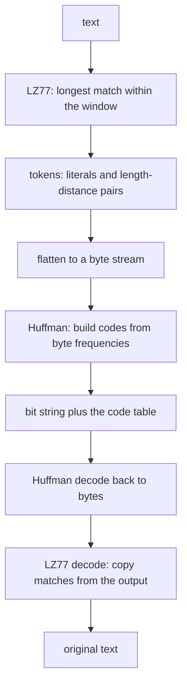
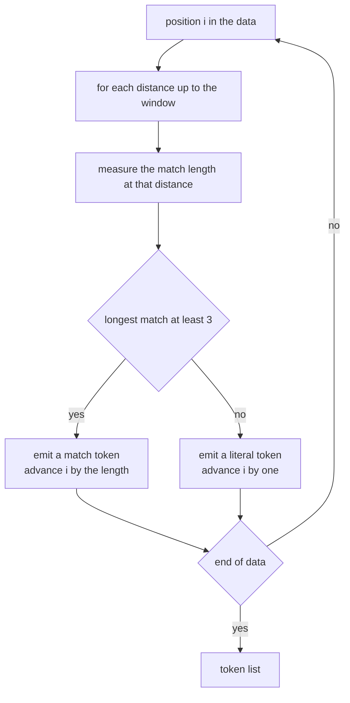
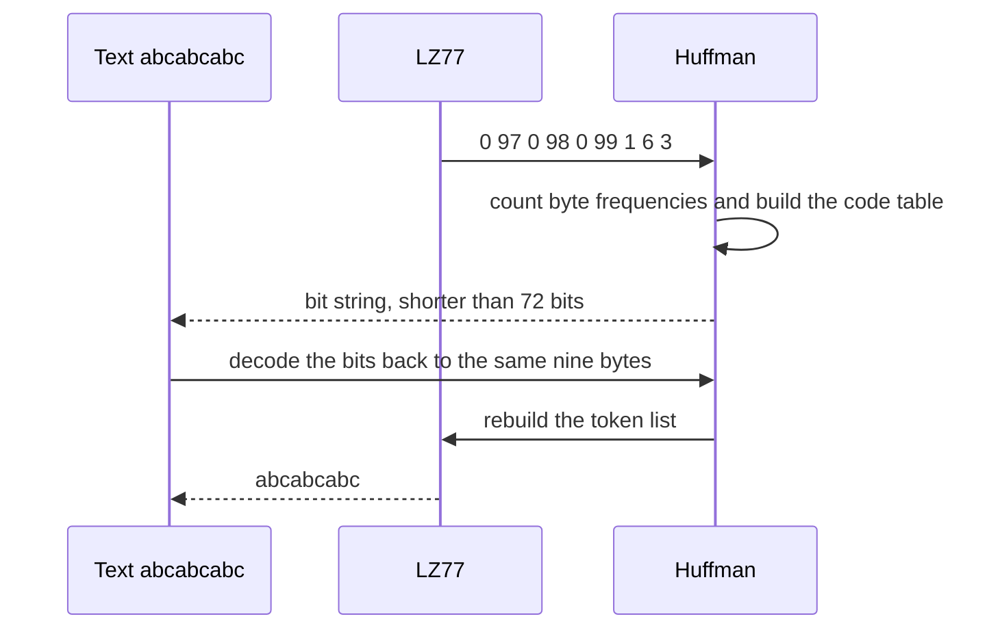

# 393 — Implement basic Brotli or deflate idea demo (LZ77+Huffman simpl.).

> **Tier:** Intermediate · **CTCI chapter:** Beyond — Advanced Data Structures & Algorithms
> **Task spec:** [393-implement-basic-brotli-or-deflate-idea-demo-lz77-huffman-simpl.md](../../../tasks/intermediate/393-implement-basic-brotli-or-deflate-idea-demo-lz77-huffman-simpl.md)
> **Solutions:** [Python](../../../solutions/python/intermediate/393-implement-basic-brotli-or-deflate-idea-demo-lz77-huffman-simpl/solution.py) ·
> [Java](../../../solutions/java/intermediate/393-implement-basic-brotli-or-deflate-idea-demo-lz77-huffman-simpl/Solution.java) ·
> [JavaScript](../../../solutions/javascript/intermediate/393-implement-basic-brotli-or-deflate-idea-demo-lz77-huffman-simpl/solution.js) ·
> [C#](../../../solutions/csharp/intermediate/393-implement-basic-brotli-or-deflate-idea-demo-lz77-huffman-simpl/Solution.cs)

## 1. Problem restatement

DEFLATE stacks two ideas: **LZ77** removes repetition by emitting `(length, distance)` matches, then
**Huffman coding** shortens the remaining bytes. This demo does both in miniature, and the docstring
states the simplifications: a token is `0` for a literal byte or `1` for a `(length, distance)` pair,
both fields fit in one byte (`window <= 255`, match length `<= 255`), and the code table is passed
around in memory. Real DEFLATE additionally uses fixed and dynamic code tables and a 258-length cap,
but the pipeline is the same.

**Inputs:** a text and a window size (default `8` in the helpers).

**Outputs:**

- `lz77_tokens(text, window)` → the token list: `(0, byte, 0)` literals and `(1, length, distance)`
  matches. A match is emitted only when the longest match is at least **3** bytes.
- `lz77_decompress(tokens)` → the text, copying matched bytes from the already-reconstructed output.
- `tokens_to_bytes` / `bytes_to_tokens` → the flat byte list DEFLATE would Huffman-code.
- `compress_text(text, window)` → `(bits, codes)`; `decompress_text(bits, codes)` → the text.

| Call | Result | Why |
| --- | --- | --- |
| `lz77_tokens("abcabcabc", 8)` | `[(0,97,0), (0,98,0), (0,99,0), (1,6,3)]` | three literals, then the match `abcabc` at distance `3` |
| `lz77_tokens("aaaaaaaa", 8)` | `[(0,97,0), (1,7,1)]` | the match overlaps itself, distance `1` |
| `lz77_tokens("abc" * 10, 8)` | `[(0,97,0), (0,98,0), (0,99,0), (1,27,3)]` | `27 = 30 - 3` bytes covered by one token |
| `lz77_tokens("", 8)` | `[]` | nothing to tokenise |
| `lz77_tokens("ab", 8)` | `[(0,97,0), (0,98,0)]` | a two-byte match is below the `3`-byte threshold |
| `lz77_tokens("abcabcabc", 2)` | nine literals | with `window = 2` the distance `3` match is unreachable |
| `tokens_to_bytes([(0,97,0), (1,6,3)])` | `[0, 97, 1, 6, 3]` | literals cost two bytes, matches three |
| `bytes_to_tokens([0, 97, 1, 6, 3])` | `[(0,97,0), (1,6,3)]` | the inverse of the serialisation |
| `lz77_decompress([(0,97,0), (0,98,0), (0,99,0), (1,6,3)])` | `"abcabcabc"` | the match is resolved against the output |
| `len(compress_text(text, 8)[0]) < 8 * len(text)` for `"abcabcabc"`, `"aaaaaaaa"`, `"abc"*10` | true | the two layers together beat a naive 8-bits-per-byte encoding |
| 36 samples (6 fixed plus 30 random over `"abc"`) | token round trip, serialisation round trip, prefix-free codes, full pipeline round trip | the property harness |

## 2. Intuition

Each layer solves a different kind of redundancy, and they compose:

- **LZ77** handles *repetition*. It keeps a sliding window of recent bytes and, at each position, looks
  for the longest earlier occurrence of the upcoming bytes. If it finds a match of length `>= 3`, it
  emits a single `(length, distance)` token instead of that many literals. The `"abc" * 10` case shows
  the payoff: 30 bytes become three literals plus one token.
- **Huffman** handles *skewed frequencies*. The token bytes are not uniformly distributed — literal
  markers, lengths and distances have their own habits — so variable-length codes shorten the stream
  further. This is exactly why real DEFLATE feeds its LZ77 symbols into two Huffman codecs (one for
  literals/lengths, one for distances; this demo lumps them into a single byte stream).

Why both, rather than either alone? LZ77 alone still emits a marker byte and two fields per match,
which costs a fixed number of bits; Huffman alone cannot see the repetition at all. Combining them is
what earned DEFLATE its name: it *deflates* the two kinds of redundancy independently.



The one rule that surprises people is the **overlap** case. In `"aaaaaaaa"` the match has distance `1`,
so its source range overlaps the range being written. The decoder must therefore copy **one byte at a
time from the growing output**, not from a snapshot of the original input; that is how a single token of
length `7` expands to seven bytes. DEFLATE relies on the same behaviour.

## 3. Algorithm

**LZ77 tokenisation.**

1. Convert the text to bytes and walk it with an index `i`.
2. For each distance `dist` from `1` up to `min(window, i)`, measure how far the bytes starting at `i`
   agree with those starting at `i - dist`, stopping at the end of the data and at a length of `255`.
3. Keep the longest match; if it is `>= 3`, emit `(1, length, distance)` and advance `i` by `length`.
4. Otherwise emit `(0, byte, 0)` for the current byte and advance by one.
5. At the end of the data, return the token list. A window of `2` cannot reach a distance of `3`, so it
   degrades to all literals — which is exactly what the test asserts.

**LZ77 decompression.** For a literal, append the byte. For a match, repeat `length` times: append
`out[len(out) - distance]`, re-reading the output each time so that overlapping copies work.

**Serialisation.** A literal becomes the two bytes `[0, byte]`; a match becomes `[1, length, distance]`.
The inverse reads the marker byte and consumes two or three fields accordingly.

**Huffman layer.** `build_huffman(freq)` merges the two lightest nodes, with the same deterministic
`(weight, creation order)` tie-break as the sibling tasks and leaves created in **sorted byte order**.
`collect_codes` turns the tree into a byte → bit-string table; `huffman_encode` returns the bit string
plus the table, and `huffman_decode` inverts it, asserting (not raising) that no partial code is left
at the end.

**Pipeline.** `compress_text(text, window)` = tokenise, flatten, Huffman-encode; `decompress_text(bits,
codes)` = Huffman-decode, rebuild tokens, LZ77-decode.

```text
function lz77_tokens(text, window)
    data ← byte values of text
    n ← length(data)
    tokens ← empty list
    i ← 0
    while i &lt; n do
        best_length ← 0
        best_distance ← 0
        for dist ← 1 to min(window, i) do
            length ← 0
            while i + length &lt; n and data[i + length] = data[i - dist + length] and length &lt; 255 do
                length ← length + 1
            end
            if length &gt; best_length then
                best_length ← length
                best_distance ← dist
            end
        end
        if best_length &gt;= 3 then
            append (1, best_length, best_distance) to tokens
            i ← i + best_length
        else
            append (0, data[i], 0) to tokens
            i ← i + 1
        end
    end
    return tokens
end

function lz77_decompress(tokens)
    out ← empty list of bytes
    for (kind, a, b) in tokens do
        if kind = 0 then
            append a to out
        else
            repeat a times
                append out[length(out) - b] to out
            end
        end
    end
    return the characters of out
end

function compress_text(text, window)
    tokens ← lz77_tokens(text, window)
    stream ← flatten tokens: literal gives 2 bytes, match gives 3
    return huffman_encode(stream)
end
```



Note the asymmetry between the two layers' data flow: LZ77's output is *not* the final answer, it is
input for the Huffman stage, and the decoder must undo the stages in reverse order — Huffman first,
then LZ77.

## 4. Worked example

**Tokenising `"abcabcabc"` with `window = 8`.** The data is `a b c a b c a b c` (bytes `97 98 99 97 98
99 97 98 99`).

| `i` | Distances tried | Longest match | Decision | Tokens so far |
| --- | --- | --- | --- | --- |
| 0 | none (no history) | `0` | literal `a` | `(0,97,0)` |
| 1 | `1` | `0` (`b` vs `a`) | literal `b` | `…(0,98,0)` |
| 2 | `1`, `2` | `0` (`c` vs `b`, `c` vs `a`) | literal `c` | `…(0,99,0)` |
| 3 | `1`, `2`, `3` | `6` at distance `3` | match | `…(1,6,3)` |

The match at `i = 3` compares the suffix starting there (`abcabc`) with the suffix starting at `i - 3 = 0`
(`abcabc`) — six bytes agree, and the scan stops at the end of the data. The token advances `i` to `9`,
which is the end, so the whole nine-byte `"abcabcabc"` becomes four tokens: three literals and one
match.

**The overlapping match.** Data `a a a a a a a a`:

| `i` | Distances tried | Longest match | Decision |
| --- | --- | --- | --- |
| 0 | none | `0` | literal `a` |
| 1 | `1` | `7` (`a` matches itself to the end) | match `(1, 7, 1)` |

Eight bytes become two tokens. Decoding the match means executing `out.append(out[-1])` seven times: the
first copy reads the literal `a`, and each subsequent copy reads the byte written immediately before.
Without that byte-at-a-time behaviour — for instance by copying from a snapshot of the source — the
decoder could not produce more output than the match source contains.



**Where the compression comes from.** `"abc" * 10` is 30 bytes; its token list is three literals plus
`(1, 27, 3)`, which flattens to nine bytes — a 3.3x reduction before Huffman even starts. The Huffman
stage then spends fewer than 8 bits on the common marker byte `0` and short codes on the frequent
fields. The asserted check is the total: `len(bits) < 8 * len(text)` for each of the three repetitive
examples. The harness also asserts the accounting identity
`len(bits) == sum(len(codes[b]) for b in bytes)` — the bit length is exactly the sum of the code lengths
of the serialised token bytes, which pins the pipeline's intermediate step.

**The window matters.** With `window = 2`, `lz77_tokens("abcabcabc", 2)` returns nine literals: at `i =
3` the only reachable distances are `1` and `2`, and neither reproduces `abc`. Smaller windows mean
cheaper distance fields and worse matching, which is one of the classic DEFLATE tuning knobs.

## 5. Complexity

Let `n` be the text length, `W` the window size, `L` the maximum match length and `k` the number of
distinct bytes.

| Measure | Bound | Why it holds |
| --- | --- | --- |
| Tokenisation | O(n · W · L) | for every position, up to `W` distances are tried, each extending a match up to `L` bytes |
| Tokenisation, tuned | O(n · W) or better with hash chains | real LZ77 indexes 3-byte prefixes instead of rescanning every distance |
| Token count | at most `n` | every token covers at least one byte |
| Serialised size | `2·literals + 3·matches` bytes | the documented token format |
| Huffman build | O(k log k) with a heap, O(k² log k) as written | the merge loop re-sorts its work list each round |
| Huffman encode/decode | O(output bits) | one lookup or one prefix match per bit |
| Space | O(n) tokens plus O(k) tree and tables | the token list dominates |
| Asserted compression | `len(bits) < 8 · len(text)` on repetitive input | the two layers together, against a naive 8-bits-per-byte baseline |

The `W · L` factor is where the real engineering lives: the demo scans every distance at every
position, which is fine for `W = 8` and hopeless for the 32 KiB windows DEFLATE uses. Production
encoders keep a hash chain of previous occurrences so that only a few candidates are examined per
position, and they cap the match search — the algorithm stays the same, the constant factor changes by
orders of magnitude.

## 6. Pitfalls and edge cases

- **Overlapping matches must be copied byte by byte.** `lz77_decompress` reads
  `out[len(out) - distance]` inside the loop, so `(1, 7, 1)` on `"aaaaaaaa"` works. Reading from a
  snapshot of the input, or copying a fixed-length slice, breaks every long run.
- **The `3`-byte threshold is not arbitrary.** Two-byte matches would cost more than the two literals
  they replace in this format, so `lz77_tokens("ab", 8)` emits two literals — the assertion pins that.
- **Length and window are one byte each.** The scan stops at length `255` and distances beyond
  `255` are outside the documented format, so a caller passing a larger window gets tokens that cannot
  be serialised correctly. Real DEFLATE solves this with 258-length caps and extra-bit encodings.
- **The decoder needs the code table.** `decompress_text(bits, codes)` takes it as a parameter — the
  demo does not serialise it, and the test harness documents that the table "stands in for DEFLATE's
  stored code table". Dropping either stage's state makes the round trip impossible.
- **A truncated bit stream is asserted away.** `huffman_decode` ends with
  `assert current == "", "truncated code stream"` — an assertion rather than the `ValueError` used in
  the sibling Huffman tasks. In a language with asserts compiled out, that check disappears, which is
  worth knowing when porting.
- **Serialisation order matters.** `tokens_to_bytes` writes a literal as `[0, byte]` and a match as
  `[1, length, distance]`; the reader consumes fields in that order. Any reordering silently produces
  valid-looking but wrong tokens.
- **Empty input survives the whole pipeline.** `lz77_tokens("") == []`, `compress_text("")` returns
  `("", {})` because `huffman_encode([])` short-circuits, and `decompress_text("", {})` returns `""`.
- **Prefix-freeness is a prerequisite, not a property of the data.** The harness asserts
  `is_prefix_free(codes)` for every sample, because the code table is rebuilt per compression and a
  malformed table would make decoding ambiguous rather than merely inefficient.
- **The window is part of the format.** `window = 2` produces all literals, `window = 8` produces the
  asserted matches; decoder and encoder must agree on the window implicitly through the token stream,
  but the *interpretation* of distances depends on it.
- **The marker byte inflates the stream.** Every literal costs two bytes and every match three, so a
  text with no repetition (the random `"abc"` samples) does not shrink before Huffman; the compression
  assertion is deliberately limited to the repetitive examples.

## 7. Variants and follow-ups

- **Real DEFLATE.** Two Huffman codecs (literals/lengths and distances), fixed versus dynamic tables,
  a 258-byte length cap and extra-bit encodings for long lengths and distances — the same two-stage
  pipeline with a much denser bit-level format.
- **Brotli.** Adds a static dictionary of common strings, context modelling for the entropy stage (so
  Huffman is chosen per context), and a larger window; the LZ77-plus-entropy skeleton is unchanged.
- **LZW, the dictionary alternative.** Instead of a sliding window, an explicit dictionary grows with
  the data; see
  [392-implement-lzw-compression-encoder-decoder-skeleton.md](../../../tasks/intermediate/392-implement-lzw-compression-encoder-decoder-skeleton.md)
  for the encoder/decoder pair and its `cSc` rule.
- **The Huffman stage on its own.** Token-free entropy coding, with the deterministic tie-break and the
  frontier/property assertions, is
  [389-implement-huffman-coding-for-characters-frequency.md](../../../tasks/intermediate/389-implement-huffman-coding-for-characters-frequency.md);
  the top-down contrast is
  [390-implement-shannon-fano-coding-contrast-with-huffman.md](../../../tasks/intermediate/390-implement-shannon-fano-coding-contrast-with-huffman.md).
- **The degenerate LZ.** Run-length encoding is LZ77 with distance `1` and no window search — see
  [388-implement-string-compression-run-length-encoding-decode.md](../../../tasks/intermediate/388-implement-string-compression-run-length-encoding-decode.md)
  for the minimal member of the family.

## 8. Check yourself

1. Why does the encoder refuse to emit a match of length `2`, and what does that look like in the
   assertions?

<details><summary>Show answer</summary>

Because a match token costs three bytes (`1`, length, distance) in this simplified format, while two
literals cost four bytes — but a length-2 match saves only two literal bytes plus their markers, and in
general the shorter the match the worse the trade. The `>= 3` threshold is DEFLATE's rule, and
`lz77_tokens("ab", 8) == [(0,97,0), (0,98,0)]` pins it: no match is emitted for a two-byte text.

</details>

2. How does the decoder expand `(1, 7, 1)` on `"aaaaaaaa"`?

<details><summary>Show answer</summary>

The token means "copy 7 bytes from distance 1", and the source range overlaps the destination. The
decoder appends `out[len(out) - 1]` seven times: the first copy reads the literal `a` that was already
written, and each later copy reads the byte written in the previous iteration. That is why the loop
indexes the output rather than a snapshot of the input.

</details>

3. Which two independent redundancies do the layers remove, and can either do the job alone?

<details><summary>Show answer</summary>

LZ77 removes *repetition* (long repeated substrings become one `(length, distance)` token) and Huffman
removes *frequency skew* (frequent token bytes get short codes). Neither subsumes the other: Huffman
cannot see that a 30-byte run is a repeat, and LZ77 still spends a full marker byte plus two fields per
match, so the entropy stage is what makes those bytes cheap. `"abc" * 10` shows both: 30 bytes → 9 bytes
of tokens → fewer than 72 bits total.

</details>

4. What breaks if the window passed to `lz77_tokens` is `2` instead of `8`?

<details><summary>Show answer</summary>

The search only tries distances `1` and `2`, so it can never find the `abc` at distance `3`. The
assertion `lz77_tokens("abcabcabc", 2)` is therefore nine literals — no compression from the LZ77 stage
at all, though the Huffman stage still applies afterwards. Distances are limited by the window, so a
smaller window means fewer and shorter matches.

</details>

5. Why does the harness assert `len(bits) == sum(len(codes[b]) for b in serialised_bytes)`?

<details><summary>Show answer</summary>

Because it pins the accounting between the two stages: the Huffman stage encodes exactly the bytes the
serialisation produced, nothing more and nothing less. If the pipeline accidentally skipped or
duplicated a token field, the bit count would no longer equal the sum of the individual code lengths,
and the assertion would fail even though a round trip might still succeed by coincidence.

</details>
