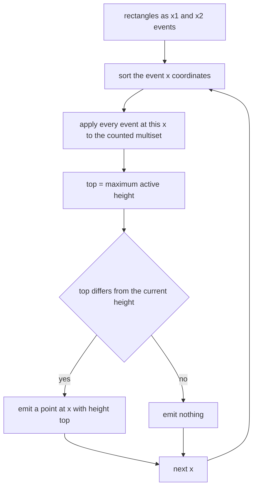
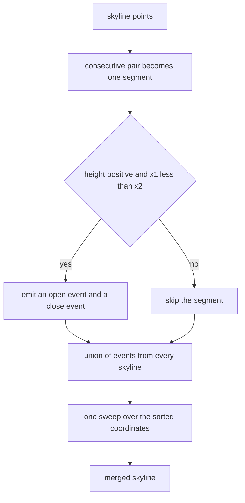
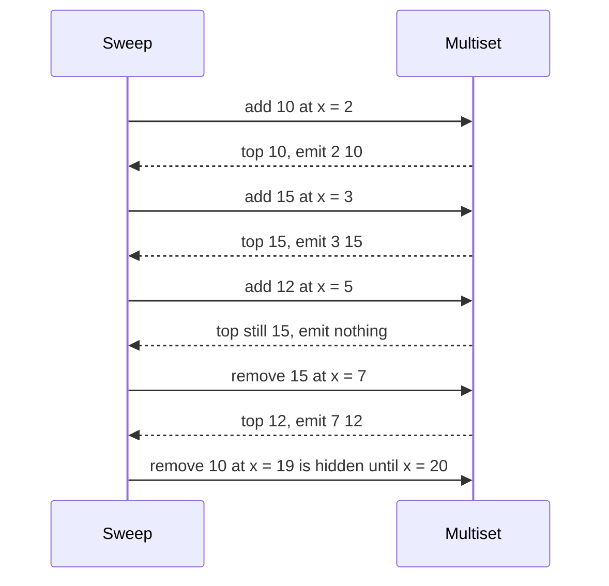
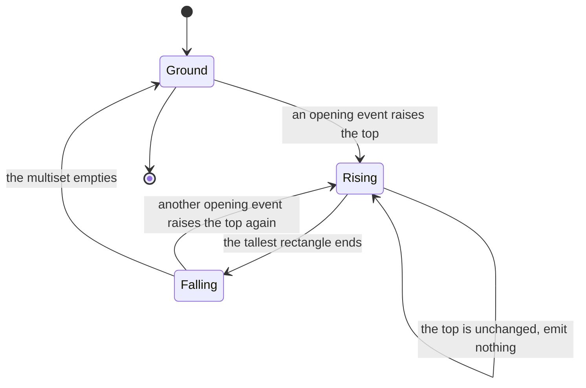

# 394 — Implement skyline merging with multiset (detailed).

> **Tier:** Intermediate · **CTCI chapter:** Beyond — Graphics, Geometry & Robotics
> **Task spec:** [394-implement-skyline-merging-with-multiset-detailed.md](../../../tasks/intermediate/394-implement-skyline-merging-with-multiset-detailed.md)
> **Solutions:** [Python](../../../solutions/python/intermediate/394-implement-skyline-merging-with-multiset-detailed/solution.py) ·
> [Java](../../../solutions/java/intermediate/394-implement-skyline-merging-with-multiset-detailed/Solution.java) ·
> [JavaScript](../../../solutions/javascript/intermediate/394-implement-skyline-merging-with-multiset-detailed/solution.js) ·
> [C#](../../../solutions/csharp/intermediate/394-implement-skyline-merging-with-multiset-detailed/Solution.cs)

## 1. Problem restatement

**Inputs and outputs** are two views of the same sweep:

- `skyline_of_rectangles(rectangles)` — each rectangle is `(x1, x2, height)`. The result is the skyline
  as a list of step points `[[x, h], …]`: the height becomes `h` at `x` and stays there until the next
  point. Rectangles with `x1 >= x2` or `height <= 0` are ignored.
- `merge_skylines(skylines)` — every consecutive pair of points in a skyline is a segment at constant
  height, and each segment becomes the same kind of add/remove event, so merging `k` skylines is one
  more sweep over all of their events.

| Call | Result | Why |
| --- | --- | --- |
| the canonical five rectangles `[(2,9,10), (3,7,15), (5,12,12), (15,20,10), (19,24,8)]` | `[[2,10], [3,15], [7,12], [12,0], [15,10], [20,8], [24,0]]` | the tallest rectangle wins at each `x` |
| `merge_skylines([[[0,3],[4,0]], [[1,1],[2,4],[5,0]]])` | `[[0,3], [2,4], [5,0]]` | the left skyline covers `[0,4)` at height `3`, the right reaches `4` from `x = 2` |
| `merge_skylines([expected, expected])` | `expected` | overlaying a skyline on itself is a no-op |
| `skyline_of_rectangles([(0,2,3), (2,4,3)])` | `[[0,3], [4,0]]` | touching rectangles drop and rise at the same `x`, so no point is emitted there |
| `skyline_of_rectangles([(0,10,5), (2,5,3)])` | `[[0,5], [10,0]]` | the inner rectangle is completely hidden |
| `skyline_of_rectangles([])` | `[]` | no rectangles, no skyline |
| `skyline_of_rectangles([(3,1,5)])` | `[]` | `x1 > x2` is discarded |
| `skyline_of_rectangles([(0,5,0)])` | `[]` | zero height draws nothing |
| 40 random 9-rectangle sets, split at a random cut point | `merge_skylines([skyline(first), skyline(second)]) == skyline(all)` | the property that ties the two functions together |

That last row is the heart of the task: splitting a rectangle set in two, taking each part's skyline
and merging them must reproduce the skyline of the whole set — for every split of every random set.

## 2. Intuition

A skyline is a step function, and a step function only ever changes at the `x` coordinates where
something starts or stops. So instead of reasoning about intervals, collect **events**: at `x1` a
height joins the active set, at `x2` it leaves. Sort the events by `x`, walk them left to right, and
after applying all events at one `x`, ask a single question: *what is the tallest height currently
active?* If the answer differs from the height of the previous segment, a new skyline point starts
here; otherwise nothing changed and no point is emitted.

The data structure that answers that question is a **multiset of active heights**, and the "multi" part
is not decoration: two rectangles can be active at the same height, and when one of them ends the
height must stay. Ids of rectangles are irrelevant — only how many rectangles are active at each
height. That is why the implementation keeps a dictionary `height → count`, adds one on an opening
event, subtracts one on a closing event, and deletes the entry when the count hits zero so that the
maximum never sees a stale height.



The merging function reuses the same sweep because a skyline is already a set of constant-height
segments. Each consecutive pair of points `[x1, h]` and `[x2, ·]` describes a segment covering
`[x1, x2)` at height `h`, which is exactly a rectangle of height `h` spanning `[x1, x2)`. Turning every
skyline into segments and running the same event sweep therefore merges arbitrarily many skylines at
once — no pairwise merging needed.

## 3. Algorithm

**`_sweep(events)`** — the single shared engine:

1. Collect the distinct event coordinates and sort them: `order = sorted({x for x, _ in events})`.
2. Group the deltas by `x` so all events at one coordinate are applied together.
3. Walk the sorted coordinates. For each delta: if it is non-negative, increment `counts[height]`; if
   negative, decrement `counts[-delta]` and delete the key when the count reaches zero.
4. After all events at that `x`, compute `top = max(counts)` — or `0` when the multiset is empty.
5. Emit `[x, top]` only if `top != current`, then set `current = top`.

**`skyline_of_rectangles(rectangles)`** turns each rectangle into `(x1, +height)` and `(x2, -height)`,
skipping degenerate rectangles, and calls `_sweep`.

**`merge_skylines(skylines)`** walks each skyline's points, pairs consecutive ones into segments, emits
`(x1, +height)` and `(x2, -height)` for every segment with `height > 0` and `x1 < x2`, and calls
`_sweep` on the union of all events.

```text
function sweep(events)
    by_x ← deltas grouped by x coordinate
    order ← sorted distinct x coordinates
    counts ← empty multiset of active heights
    points ← empty list
    current ← 0
    for x in order do
        for delta in by_x[x] do
            if delta &gt;= 0 then
                counts[delta] ← counts[delta] + 1
            else
                height ← -delta
                counts[height] ← counts[height] - 1
                if counts[height] = 0 then
                    remove height from counts
                end
            end
        end
        if counts is empty then
            top ← 0
        else
            top ← the largest key of counts
        end
        if top != current then
            append [x, top] to points
            current ← top
        end
    end
    return points
end

function skyline_of_rectangles(rectangles)
    events ← empty list
    for (x1, x2, height) in rectangles do
        if x1 &lt; x2 and height &gt; 0 then
            append (x1, height) and (x2, -height) to events
        end
    end
    return sweep(events)
end

function merge_skylines(skylines)
    events ← empty list
    for skyline in skylines do
        for each consecutive pair of points (x1, height) and (x2, next_height) do
            if height &gt; 0 and x1 &lt; x2 then
                append (x1, height) and (x2, -height) to events
            end
        end
    end
    return sweep(events)
end
```



Three details make the sweep correct. Events at the **same** `x` are all applied before the maximum is
taken — that is what makes touching rectangles produce no point at the shared edge. Heights whose count
reaches zero are **deleted**, so `max` cannot report a height that no longer exists. And a point is
emitted only on a **change**, which keeps the output minimal: the canonical example has ten events and
seven output points.

## 4. Worked example

**The canonical five rectangles.** Events:

| `x` | Events | Multiset after | Top | Point emitted |
| --- | --- | --- | --- | --- |
| `2` | `+10` | `{10: 1}` | `10` | `[2, 10]` |
| `3` | `+15` | `{10: 1, 15: 1}` | `15` | `[3, 15]` |
| `5` | `+12` | `{10: 1, 12: 1, 15: 1}` | `15` | none — unchanged |
| `7` | `-15` | `{10: 1, 12: 1}` | `12` | `[7, 12]` |
| `9` | `-10` | `{12: 1}` | `12` | none — unchanged |
| `12` | `-12` | `{}` | `0` | `[12, 0]` |
| `15` | `+10` | `{10: 1}` | `10` | `[15, 10]` |
| `19` | `+8` | `{8: 1, 10: 1}` | `10` | none — the taller rectangle hides it |
| `20` | `-10` | `{8: 1}` | `8` | `[20, 8]` |
| `24` | `-8` | `{}` | `0` | `[24, 0]` |

The output is exactly the asserted
`[[2,10], [3,15], [7,12], [12,0], [15,10], [20,8], [24,0]]`. Two rows deserve attention: at `x = 19`
the new height `8` is *added* to the multiset but the maximum is still `10`, so no point is emitted —
the taller rectangle simply hides it, and the hidden height only becomes visible at `x = 20` when the
tall one ends. And at `x = 12` the multiset empties, giving the ground-level point `[12, 0]`.



**Merging two skylines.** `left = [[0,3], [4,0]]` describes one segment, `[0,4)` at height `3`; `right =
[[1,1], [2,4], [5,0]]` describes `[1,2)` at height `1` and `[2,5)` at height `4`. The events are
`(0,+3), (4,-3), (1,+1), (2,-1), (2,+4), (5,-4)`:

| `x` | Events | Multiset after | Top | Point |
| --- | --- | --- | --- | --- |
| `0` | `+3` | `{3: 1}` | `3` | `[0, 3]` |
| `1` | `+1` | `{1: 1, 3: 1}` | `3` | none |
| `2` | `-1`, `+4` | `{3: 1, 4: 1}` | `4` | `[2, 4]` |
| `4` | `-3` | `{4: 1}` | `4` | none — the right skyline still covers this range |
| `5` | `-4` | `{}` | `0` | `[5, 0]` |

The result `[[0,3], [2,4], [5,0]]` is the asserted merge, and the `x = 2` row is the case that makes
the multiset necessary: the height `1` from the right skyline is *removed* and `4` is added at the same
coordinate, and only after both deltas does the top become `4`.



**The property that ties it together.** Forty random sets of nine rectangles (span `20`, lengths `1…6`,
heights `1…10`, `seed = 777`) are split at a random cut. For each split, the file asserts

    merge_skylines([skyline_of_rectangles(first), skyline_of_rectangles(second)]) == skyline_of_rectangles(rectangles)

That is a much stronger statement than any single example: it says the sweep is associative under
splitting, which is what "merging skylines" is supposed to mean.

## 5. Complexity

Let `m` be the number of rectangles (or segments) and `k` the number of distinct active heights.

| Measure | Bound | Why it holds |
| --- | --- | --- |
| Event generation | O(m) | two events per rectangle or per non-degenerate segment |
| Coordinate sorting | O(m log m) | sorting the distinct event `x` values |
| Sweep application | O(m) | each event applies one dictionary update, plus the deletion when a count hits zero |
| Maximum per coordinate | O(k) with a dictionary scan, O(log m) with a heap or ordered multiset | the code calls `max(counts)` after each coordinate's events |
| Whole skyline | O(m log m + m·k) as written, O(m log m) with a priority queue | the sort dominates when `k` is small |
| Space | O(m + k) | events, grouped deltas and the multiset |
| Merge property | 40 random splits asserted | the two functions must agree on every split of a set |
| Output size | at most the number of coordinates, and at most `2m` | a point is emitted only when the top changes |

For the sets in this task (`9` rectangles, heights up to `10`) the `max` scan is irrelevant, and the
honest statement is that the sweep is linearithmic in the number of events once the maximum is
maintained properly. That is exactly the difference between this detailed multiset version and the
heap-based implementation in
[328-skyline-problem-heap-sweep-line.md](../../../tasks/intermediate/328-skyline-problem-heap-sweep-line.md),
where a heap with lazy deletion replaces the dictionary scan.

## 6. Pitfalls and edge cases

- **All events at one `x` must be applied before taking the maximum.** Touching rectangles
  `(0,2,3)` and `(2,4,3)` end and start at `x = 2`: the top never changes, so the asserted output is
  `[[0,3], [4,0]]` with no point at `2`. Applying events one at a time and checking after each would
  emit a spurious drop-and-rise.
- **A height present twice must not vanish when one rectangle ends.** This is why the structure is a
  *multiset with counts* rather than a set. Removing a height means decrementing, and the key is only
  deleted at zero — otherwise two overlapping same-height rectangles would end early and the skyline
  would dip incorrectly.
- **Stale zero counts must be deleted.** If a count of `0` stayed in the dictionary, `max(counts)`
  would still report that height and the skyline would never drop to the ground.
- **The empty multiset means height `0`.** That is the ground-level point, as in `[12, 0]` and
  `[24, 0]`. An empty input list yields `[]` — no events, no points.
- **Degenerate input is dropped, not repaired.** `(3,1,5)` (`x1 > x2`) and `(0,5,0)` (zero height)
  both produce `[]`, and `merge_skylines` skips zero-height segments for the same reason.
- **A rectangle is invisible until it is the tallest.** The `x = 19` row of the trace shows a height
  being added with no point emitted; it appears later when the taller rectangle ends. Any code that
  emits a point per event rather than per *change* produces too many points.
- **Skyline convention matters for merging.** Points are step starts, and a skyline normally ends with
  a ground-level point (`[24, 0]`). Merging assumes this convention when pairing consecutive points
  into segments; a skyline whose last point is a non-zero height would leave that segment unterminated.
- **Merging is idempotent.** `merge_skylines([expected, expected]) == expected`, which is a cheap
  sanity check that the segment-to-event conversion did not shift any boundaries by one.
- **Duplicated coordinates collapse.** The sweep sorts the *distinct* coordinates, so several events
  sharing an `x` are grouped automatically; there is no need to deduplicate the skyline points
  beforehand, but two identical points in a row would produce a zero-length segment that the
  `x1 < x2` guard discards.
- **The dictionary maximum is a scan.** `max(counts)` is O(k) per distinct coordinate, so a skyline
  with many distinct heights active at once pays for it; the heap variant keeps a lazy-deletion heap
  and pays O(log m) instead.

## 7. Variants and follow-ups

- **Heap plus lazy deletion.** Keep the heights in a max-heap and delete stale entries when they reach
  the top — the same sweep with an O(log m) maximum; see
  [328-skyline-problem-heap-sweep-line.md](../../../tasks/intermediate/328-skyline-problem-heap-sweep-line.md).
- **Divide and conquer merging.** Split the rectangle set, compute both skylines recursively and merge
  them — the very property this task asserts, turned into the algorithm of
  [365-implement-skyline-of-buildings-via-divide-conquer-detailed.md](../../../tasks/intermediate/365-implement-skyline-of-buildings-via-divide-conquer-detailed.md)
  and [322-implement-algorithm-to-find-skyline-divide-conquer.md](../../../tasks/intermediate/322-implement-algorithm-to-find-skyline-divide-conquer.md).
- **Segment trees for skyline queries.** When the question becomes "what is the skyline over this
  range?" instead of "build the skyline", the same events feed a segment tree — see
  [335-implement-data-structure-for-skyline-queries-segment-tree-varian.md](../../../tasks/intermediate/335-implement-data-structure-for-skyline-queries-segment-tree-varian.md).
- **Interval partitioning is the same sweep.** Counting overlapping intervals rather than tracking a
  maximum is the sibling problem in
  [326-meeting-rooms-required-interval-partitioning.md](../../../tasks/intermediate/326-meeting-rooms-required-interval-partitioning.md),
  which uses the same "sort endpoints, then sweep" skeleton.
- **Geometry follow-ups.** Once the outline is a set of segments, the convex hull of a point set is the
  next geometric tool over the same kind of sweep machinery — see
  [367-compute-convex-hull-andrew-monotone-chain.md](../../../tasks/intermediate/367-compute-convex-hull-andrew-monotone-chain.md).

## 8. Check yourself

1. Why does the multiset need *counts* instead of just a set of active heights?

<details><summary>Show answer</summary>

Because two rectangles can be active at the same height. With a set, the first closing event would
remove the height and the skyline would drop even though the other rectangle is still standing. The
count tracks how many rectangles hold each height, and the key is only deleted when the count reaches
zero — so the maximum reflects the true active profile.

</details>

2. Touching rectangles `(0,2,3)` and `(2,4,3)` produce `[[0,3], [4,0]]`. What would a naive
   event-by-event implementation print instead?

<details><summary>Show answer</summary>

It would process `-3` at `x = 2` first, see an empty multiset, emit `[2, 0]`, then process `+3` and emit
`[2, 3]` — a spurious notch at the shared edge. The sweep avoids it by applying every event at a
coordinate before comparing the new top with the current height, so the height never appears to change.

</details>

3. In the canonical trace, the height `8` is added at `x = 19` but no point is emitted. Why, and when
   does it appear?

<details><summary>Show answer</summary>

Because the top of the multiset is still `10` — the taller rectangle hides the new one, and a point is
emitted only when the top changes. It appears at `x = 20`, where the height `10` is removed and the top
becomes `8`, producing `[20, 8]`.

</details>

4. How can `merge_skylines` reuse the rectangle sweep, given that its input is skylines and not
   rectangles?

<details><summary>Show answer</summary>

Because a skyline is just a list of constant-height segments. Every consecutive pair of points
`[x1, h]`, `[x2, ·]` describes a segment covering `[x1, x2)` at height `h`, which is a rectangle of
height `h` spanning that interval. Emitting an opening event at `x1` and a closing event at `x2` for
each segment produces exactly the event shape the sweep already consumes, so `k` skylines are merged in
one pass rather than pairwise.

</details>

5. What does the 40-split assertion actually prove about the implementation?

<details><summary>Show answer</summary>

That the sweep is consistent under partitioning: for a random set of nine rectangles and a random cut,
the skyline of the whole set equals the merge of the two parts' skylines. It ties the two public
functions together — a bug in either the event generation or the maximum tracking would show up as a
disagreement on some split, even if hand-picked examples happened to pass.

</details>
