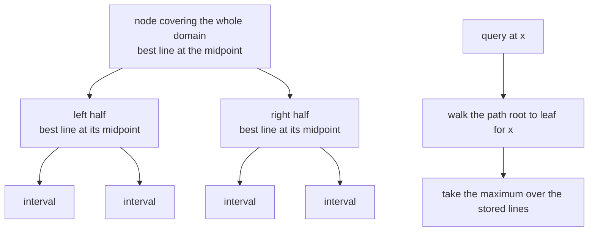
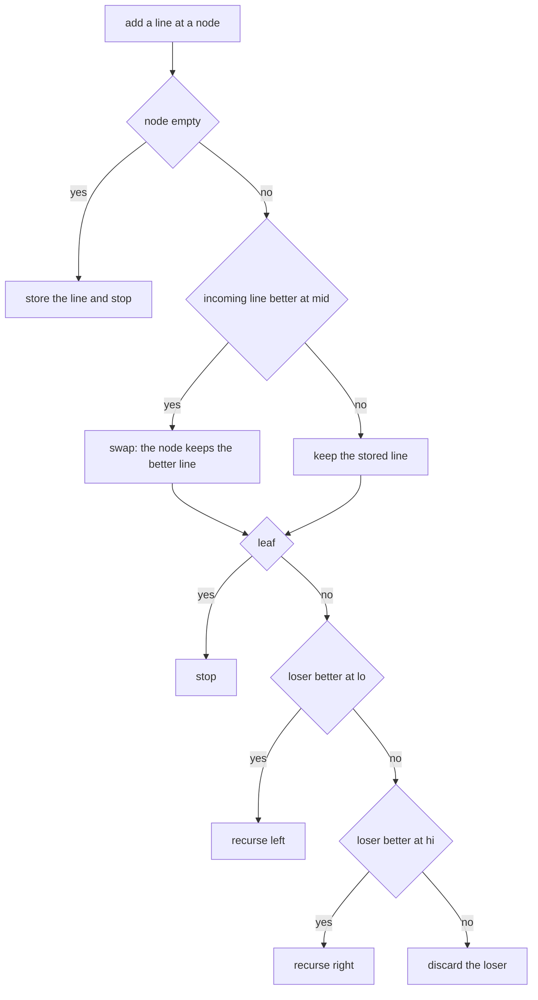
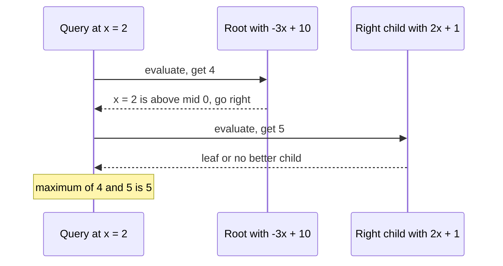
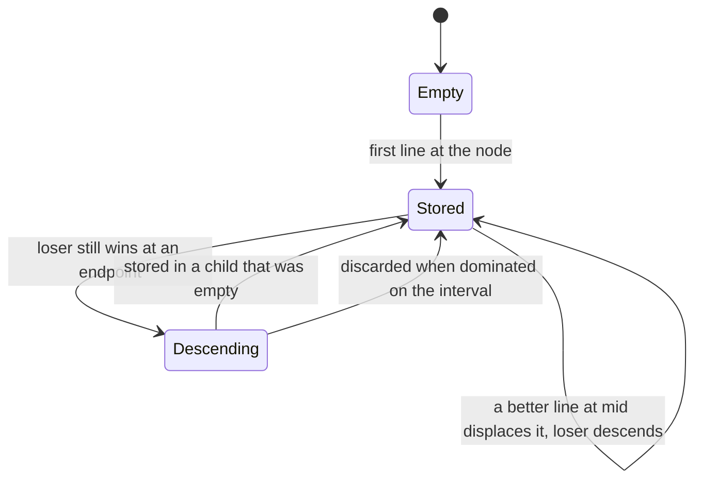

# 395 — Implement dynamic convex hull trick for max queries (Li Chao tree basic).

> **Tier:** Intermediate · **CTCI chapter:** Beyond — Advanced Data Structures & Algorithms
> **Task spec:** [395-implement-dynamic-convex-hull-trick-for-max-queries-li-chao-tree.md](../../../tasks/intermediate/395-implement-dynamic-convex-hull-trick-for-max-queries-li-chao-tree.md)
> **Solutions:** [Python](../../../solutions/python/intermediate/395-implement-dynamic-convex-hull-trick-for-max-queries-li-chao-tree/solution.py) ·
> [Java](../../../solutions/java/intermediate/395-implement-dynamic-convex-hull-trick-for-max-queries-li-chao-tree/Solution.java) ·
> [JavaScript](../../../solutions/javascript/intermediate/395-implement-dynamic-convex-hull-trick-for-max-queries-li-chao-tree/solution.js) ·
> [C#](../../../solutions/csharp/intermediate/395-implement-dynamic-convex-hull-trick-for-max-queries-li-chao-tree/Solution.cs)

## 1. Problem restatement

**Inputs:** a fixed integer domain `[x_lo, x_hi]`, a stream of lines `y = m·x + b` added one at a time,
and a stream of query points `x` in that domain.

**Output:** `query(x)` returns `max over all inserted lines of (m·x + b)` — the upper envelope of the
lines at `x`. The tree answers both operations in `O(log X)` with `X = x_hi - x_lo + 1`, and it is
**fully dynamic**: lines and queries can be interleaved in any order, unlike the offline variants.

| Call | Result | Why |
| --- | --- | --- |
| lines `(1,0)`, `(-1,0)`, `(0,0)` inserted; `query(5)` | `5` | `y = x` wins on the positive side |
| `query(-5)` on the same tree | `5` | `y = -x` wins on the negative side |
| `query(0)` | `0` | all three lines agree at the origin |
| lines `(2,1)`, `(-3,10)`; `query(2)` | `5` | `2·2 + 1 = 5` beats `-3·2 + 10 = 4` |
| `query(1)` | `7` | `-3 + 10 = 7` beats `2 + 1 = 3` |
| `query(0)` | `10` | the steeper negative line is far above at the origin |
| `query(5)` | `11` | `2·5 + 1 = 11` |
| five fixed lines over `[-20, 20]` | `query(x) == brute_force(lines, x)` for every `x` | exhaustive cross-check |
| 200 random lines over `[-500, 500]` | agrees with brute force at `101` sampled points | the randomised cross-check (`seed = 4242`) |
| adding `(3,-1)` four times; `query(7)` | `20` | duplicate lines are harmless |
| `query` on a tree with no lines | raises `ValueError` | there is no line to evaluate |

A documented detail: **ties keep the previously stored line**, because every comparison uses a strict
`>`. That affects which line sits at which node, never the value of the maximum.

## 2. Intuition

The naive answer to "evaluate the maximum of `k` lines at `x`" is to evaluate all `k` lines: O(k) per
query, and with `k` and `q` both large that is `O(k·q)`. The convex hull trick exploits geometry: the
upper envelope of a set of lines is a convex polyline, and a query is one binary search along it. That
is fast, but it requires the lines to be sorted by slope (or the hull to be maintained dynamically),
and it does not support arbitrary insertion orders cheaply.

The Li Chao tree takes a different route. Instead of maintaining the envelope, it stores **one line per
node of a segment tree over the coordinate range**. Each node owns an interval, and the line stored
there is the best candidate *at the interval's midpoint*. Insertion compares the incoming line with the
stored one at the midpoint:

- if the incoming line is better there, they swap, so the better line stays at the node and the loser
  continues downward;
- because two distinct lines cross **at most once**, the loser can only ever win on one side of the
  midpoint — so the insertion recurses into exactly one child.

A query then walks the single root-to-leaf path for `x`, taking the maximum over the lines stored at
the nodes along the way. Any line that is the maximum at `x` is guaranteed to be on that path, because
insertion pushed it down only through intervals that contain `x`.



## 3. Algorithm

The implementation is an implicit segment tree over `[x_lo, x_hi]`, stored in three parallel arrays
(`has`, `m`, `b`) sized `4 · X`.

**`add_line(m, b)`** calls `_add(1, x_lo, x_hi, m, b)`:

1. If the node is empty, store the line there and stop.
2. Compute `mid = (lo + hi) // 2`. If the incoming line is strictly better at `mid`, swap it with the
   stored line — the node now holds the better line and the incoming variable holds the loser.
3. If `lo == hi`, stop: a leaf has no children.
4. If the loser is better at `lo`, recurse into the left child `[lo, mid]`; otherwise, if it is better
   at `hi`, recurse into the right child `[mid + 1, hi]`; otherwise the loser is dominated on the whole
   interval and is discarded.

**`query(x)`** walks from the root, accumulating `best = max(best, m[node]·x + b[node])` at every
node that has a line, and descends left when `x <= mid` and right otherwise. It raises `ValueError` if
no line was ever stored.

```text
procedure add_line(m, b)
    add(1, x_lo, x_hi, m, b)
end

procedure add(node, lo, hi, m, b)
    if node is empty then
        store (m, b) at node
        return
    end
    mid ← (lo + hi) / 2 rounded down
    if m * mid + b &gt; stored_m[node] * mid + stored_b[node] then
        swap (m, b) with the line stored at node
    end
    if lo = hi then
        return
    end
    if m * lo + b &gt; stored_m[node] * lo + stored_b[node] then
        add(2 * node, lo, mid, m, b)
    else if m * hi + b &gt; stored_m[node] * hi + stored_b[node] then
        add(2 * node + 1, mid + 1, hi, m, b)
    end
end

function query(x)
    node ← 1
    lo ← x_lo
    hi ← x_hi
    best ← none
    while true do
        if node has a line then
            value ← stored_m[node] * x + stored_b[node]
            best ← value if best is none else maximum of best and value
        end
        if lo = hi then
            break
        end
        mid ← (lo + hi) / 2 rounded down
        if x &lt;= mid then
            node ← 2 * node
            hi ← mid
        else
            node ← 2 * node + 1
            lo ← mid + 1
        end
    end
    if best is none then
        fail "query on an empty tree"
    end
    return best
end
```



The phrase "recurse into the only half where the other line can still win" is the crux: two lines cross
once, so if the loser is not better at either endpoint of the interval, it cannot be better anywhere
inside it, and the insertion stops. That is what keeps the cost at `O(log X)` per line instead of
scattering it over the tree.

## 4. Worked example

**Two lines over `[-500, 500]`.** The root's interval is `[-500, 500]` with `mid = 0`.

| Step | Action | Node `1` after | Notes |
| --- | --- | --- | --- |
| `add_line(2, 1)` | node `1` is empty | `(2, 1)` | stored immediately |
| `add_line(-3, 10)` | compare at `mid = 0`: `10 > 1` | `(-3, 10)` | swap; the loser `(2, 1)` continues |
| — | loser at `lo = -500`: `2·(-500)+1 = -999` vs `1510` | — | not better on the left |
| — | loser at `hi = 500`: `1001` vs `-1490` | node `3` holds `(2, 1)` | better on the right, so it recurses into `[1, 500]` |

The tree now holds `(-3, 10)` at the root and `(2, 1)` in the right child covering `[1, 500]`. Queries
walk one path each:

| Query | Root value `-3x + 10` | Path | Child value `2x + 1` | Result |
| --- | --- | --- | --- | --- |
| `x = 2` | `4` | `2 > 0` → right `[1, 500]` | `5` (`[1,500]` → `[1,250]` → …) | `5` |
| `x = 1` | `7` | `1 > 0` → right | `3` | `7` |
| `x = 0` | `10` | `0 <= 0` → left `[-500, 0]`, no line stored | — | `10` |
| `x = 5` | `-5` | `5 > 0` → right | `11` | `11` |

All four match the asserted values. The `x = 0` row shows why the query must take the maximum over the
*whole path*: the left subtree is empty, but the root's line is still a candidate, and it is the best
one.



**The exhaustive cross-checks.** A tree over `[-20, 20]` is loaded with the five lines
`(1,0)`, `(-1,3)`, `(0,-2)`, `(5,-10)`, `(-4,6)` and every integer `x` in the domain is compared against
`brute_force(lines, x)` — 41 queries, all equal. Then a randomised check loads 200 lines generated from
`seed = 4242` (slopes in `[-50, 50]`, intercepts in `[-1000, 1000]`) into a tree over `[-500, 500]` and
compares `101` sampled points against brute force. This is the pair of tests that justify replacing the
`O(k)` scan with the tree: same answers, better asymptotics.

**Degenerate cases.** `add_line(3, -1)` four times leaves the tree holding a single distinct line, and
`query(7) = 3·7 - 1 = 20` — duplicate insertion is a no-op in effect. A fresh tree with no lines raises
`ValueError("query on an empty tree")` rather than returning a sentinel like `-inf`, because there is no
line to evaluate and the caller's intent is unclear.



## 5. Complexity

Let `X = x_hi - x_lo + 1` be the domain size, `k` the number of inserted lines and `q` the number of
queries.

| Measure | Bound | Why it holds |
| --- | --- | --- |
| `add_line` | O(log X) | each call descends at most one level deeper, and the domain halves each time |
| `query` | O(log X) | a single root-to-leaf walk with one evaluation per node |
| Total work | O((k + q) log X) | both operations are logarithmic and interleavable |
| Space | O(X) | three arrays of size `4X` (`has`, `m`, `b`) |
| Brute force per query | O(k) | evaluating every line; total O(k·q) |
| Cross-check coverage | 41 exhaustive points plus 101 sampled points over 200 lines | the assertions in `main` |

The trade against the offline hull trick (the sibling task
[396-implement-offline-convex-hull-trick-with-divide-conquer-dp-optim.md](../../../tasks/intermediate/396-implement-offline-convex-hull-trick-with-divide-conquer-dp-optim.md))
is the interesting one: with lines and queries known in advance, sorting by slope and using a monotone
stack gives amortised O(1) per operation, but it forbids interleaving. The Li Chao tree gives up a
factor of `log X` to stay fully dynamic, and it needs the coordinate domain up front — which is exactly
what makes it usable as the inner loop of a divide-and-conquer DP optimisation, where lines are added
and evaluated in arbitrary order.

## 6. Pitfalls and edge cases

- **The domain must be fixed at construction.** `LiChao(x_lo, x_hi)` allocates `4 · X` slots and every
  node's interval is derived from those bounds; a query outside the domain is not supported, and adding
  a line whose optimum lies outside is fine but never evaluated. Real extensions use coordinate
  compression or a dynamic (pointer-based) tree when the domain is huge.
- **Ties keep the stored line.** All comparisons are strict `>`, so an equal line is not swapped in.
  The maximum is unaffected, but the tree's internal arrangement — and any test asserting structure —
  depends on it. The file documents this explicitly.
- **Recurse into one child, not both.** The insertion descends at most once per level. A version that
  recursed into both halves would still be correct but would degrade to O(X) per insert; the
  single-crossing argument is what licenses the restriction.
- **Check `lo == hi` before recursing.** A leaf has no children, and the losing line is simply dropped
  there. Missing this guard indexes past the array bounds or recurses forever.
- **The empty test is explicit.** `has[node]` flags rather than sentinel values: a legitimate line could
  be `(0, 0)`, so "the value is zero" cannot mean "empty". A query that reaches no flagged node at all
  raises `ValueError`.
- **Duplicate lines are harmless.** Four copies of `(3, -1)` behave like one: after the first is stored,
  every subsequent equal line fails the strict `>` comparison at the midpoint and at the endpoints, so
  it is discarded.
- **Integer arithmetic only.** The code compares `m · x + b` exactly; with floating-point slopes, the
  midpoint and endpoint comparisons could disagree with the true maximum. The sibling
  [377-implement-simplex-algorithm-outline-for-small-lp.md](../../../tasks/intermediate/377-implement-simplex-algorithm-outline-for-small-lp.md)
  is the task that has to accept a tolerance; this one does not.
- **Coordinates are points, not segments.** The tree's leaves are individual integer `x` values, so
  `mid` and the interval splits are inclusive on the left (`[lo, mid]` and `[mid + 1, hi]`). Using
  `[lo, mid]`/`[mid, hi]` would overlap and double-count a coordinate.
- **The array size formula.** `4 · (x_hi - x_lo + 1)` is the standard safe bound for an implicit
  segment tree; a smaller `2X` can overflow for skewed recursions.
- **Insertion order does not change the answers.** The cross-checks add lines one way and query
  afterwards; interleaving would give the same results for the queries, which is the property the Li
  Chao tree exists to provide.

## 7. Variants and follow-ups

- **Offline convex hull trick.** Sort lines by slope and keep a monotone stack of the envelope for
  amortised O(1) queries — the comparison task,
  [396-implement-offline-convex-hull-trick-with-divide-conquer-dp-optim.md](../../../tasks/intermediate/396-implement-offline-convex-hull-trick-with-divide-conquer-dp-optim.md).
- **Line segments instead of full lines.** A Li Chao tree can store segments on restricted intervals by
  recursing into both halves an insert touches, at O(log²) per segment — a small change with a big
  practical payoff.
- **DP optimisation consumers.** `dp[i] = min_j (dp[j] + cost(j, i))` becomes a sequence of line
  insertions and queries when the cost is linear in the slope; that is exactly the setting of
  [396-implement-offline-convex-hull-trick-with-divide-conquer-dp-optim.md](../../../tasks/intermediate/396-implement-offline-convex-hull-trick-with-divide-conquer-dp-optim.md)
  and [398-implement-divide-conquer-dp-optimization-example.md](../../../tasks/intermediate/398-implement-divide-conquer-dp-optimization-example.md).
- **Other optimisations for similar recurrences.** The monotone-queue trick in
  [397-implement-knuth-optimization-demonstration-for-dp-speedup.md](../../../tasks/intermediate/397-implement-knuth-optimization-demonstration-for-dp-speedup.md)
  applies when the optimal split point is monotone in the index, which is a different structural
  property from the convexity used here.
- **Geometry neighbours.** Evaluating the maximum of lines is the same operation as walking the upper
  hull of a point set, which the convex-hull tasks build from scratch:
  [367-compute-convex-hull-andrew-monotone-chain.md](../../../tasks/intermediate/367-compute-convex-hull-andrew-monotone-chain.md).

## 8. Check yourself

1. Why does an insertion recurse into at most one child?

<details><summary>Show answer</summary>

Because two distinct lines intersect at most once. After the swap at the midpoint, the node holds the
better line at `mid`, and the loser can only be better on one side of the crossing point. Testing the
loser at the interval's two endpoints distinguishes the three cases: better at `lo` (recurse left),
better at `hi` (recurse right), or better at neither (dominated everywhere in the interval, so it is
discarded). Recursing into both halves would be correct but linear in the domain.

</details>

2. Why must a query take the maximum over the whole root-to-leaf path rather than just the leaf?

<details><summary>Show answer</summary>

Because lines are stored at internal nodes, not at leaves, and a line can be the answer at `x` while
being stored at any node whose interval contains `x`. In the worked example, `query(0)` returns `10`
from the root's line even though the left child has nothing stored. Taking only the leaf's value (or
only the first evaluation) would miss it.

</details>

3. What happens if `query` is called before any line is added, and why not return `-inf`?

<details><summary>Show answer</summary>

It raises `ValueError("query on an empty tree")`. Returning a sentinel would work for a maximum over a
known set, but the caller of a dynamic structure usually treats "no lines yet" as a programming error,
and a silently returned `-inf` would propagate into arithmetic. The `has[]` flags make the distinction
explicit, since a real line may legitimately evaluate to `0`.

</details>

4. How do duplicate lines behave?

<details><summary>Show answer</summary>

Harmlessly: after the first copy is stored, each later copy compares equal at the midpoint (strict `>`
fails) and equal at both endpoints, so it is discarded. The assertion adds `(3, -1)` four times and gets
`20` at `x = 7`, i.e. one effective line. The documented rule "ties keep the previously stored line" is
what makes this deterministic.

</details>

5. What is the cost of the randomised cross-check, and what does it establish?

<details><summary>Show answer</summary>

200 lines are inserted at O(log X) each, and 101 queries are compared against brute force at O(k) each
— a few tens of thousands of evaluations in total. It establishes that the tree's answers match the
definition `max(m·x + b)` on a large, non-hand-picked set of slopes and intercepts, which is the
evidence that the single-child recursion rule is implemented correctly rather than merely plausible on
toy inputs.

</details>
