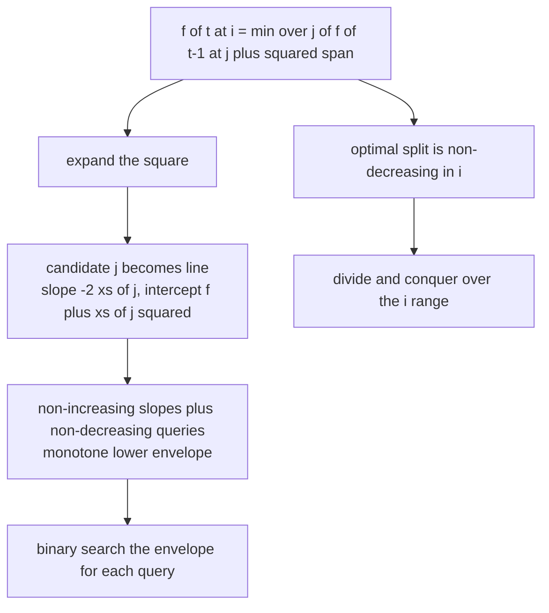
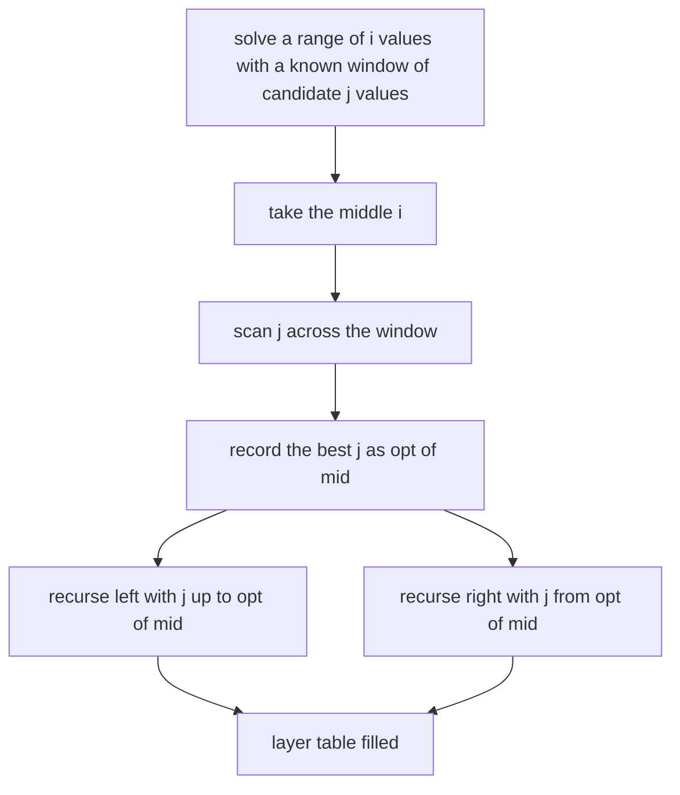
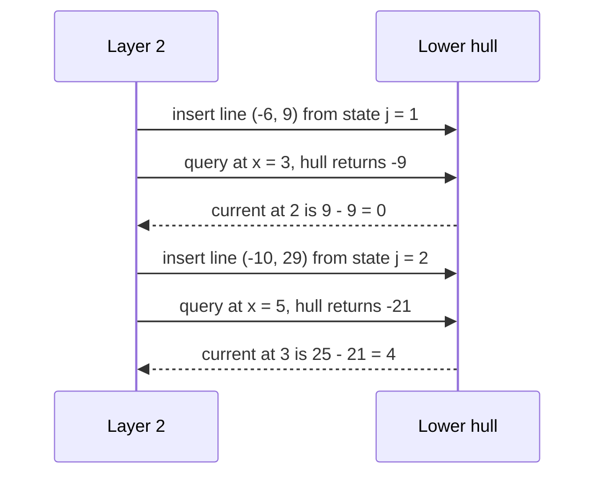
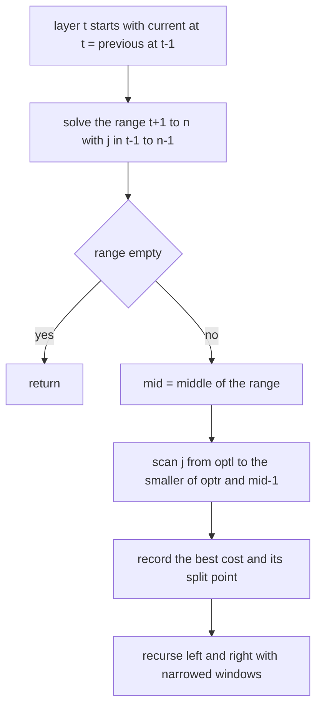

# 396 — Implement offline convex hull trick with divide & conquer DP optimization.

> **Tier:** Intermediate · **CTCI chapter:** Beyond — Advanced Data Structures & Algorithms
> **Task spec:** [396-implement-offline-convex-hull-trick-with-divide-conquer-dp-optim.md](../../../tasks/intermediate/396-implement-offline-convex-hull-trick-with-divide-conquer-dp-optim.md)
> **Solutions:** [Python](../../../solutions/python/intermediate/396-implement-offline-convex-hull-trick-with-divide-conquer-dp-optim/solution.py) ·
> [Java](../../../solutions/java/intermediate/396-implement-offline-convex-hull-trick-with-divide-conquer-dp-optim/Solution.java) ·
> [JavaScript](../../../solutions/javascript/intermediate/396-implement-offline-convex-hull-trick-with-divide-conquer-dp-optim/solution.js) ·
> [C#](../../../solutions/csharp/intermediate/396-implement-offline-convex-hull-trick-with-divide-conquer-dp-optim/Solution.cs)

## 1. Problem restatement

**The DP.** Cover `n` sorted points `xs[0] < xs[1] < … < xs[n-1]` with **exactly `k` contiguous
segments**, minimising the sum over segments of the squared span. With

    f[t][i] = min over j in [t-1, i-1] of  f[t-1][j] + (xs[i-1] - xs[j])²

the answer is `f[k][n]`. The cost has the quadrangle inequality, which is what makes two different
optimisations legal.

**Three implementations, same answer:**

- `partition_bruteforce(xs, k)` — the plain `O(k·n²)` DP, used as the oracle.
- `partition_offline_cht(xs, k)` — expand the square and read each layer as a set of **lines**
  (slope `-2·xs[j]`, intercept `f[t-1][j] + xs[j]²`) queried at increasing points. Slopes are
  non-increasing and queries non-decreasing, so a monotone hull plus a binary search over its
  intersection points answers each query in `O(log n)`. All queries are known up front: **offline**.
- `partition_divide_conquer(xs, k)` — the same layer has a **non-decreasing optimal split** `opt(i)`, so
  `solve_dc(mid)` scans only `[optl, optr]` and recurses on both halves.

| Call | Result | Why |
| --- | --- | --- |
| `partition_*([1, 3, 5], 2)` | `4` | `[1] | [3,5]` costs `0 + 4`, as does `[1,3] | [5]` |
| `partition_*([1, 3, 5], 1)` | `16` | one segment: `(5 - 1)²` |
| `partition_*([1, 3, 5], 3)` | `0` | three points, three segments, every span is zero |
| `partition_*([1, 3], 2)` | `0` | two points, two segments |
| `partition_bruteforce([1, 3], 3)` | `INF` | more segments than points |
| `partition_bruteforce([1], 1)` | `0` | one point, one segment |
| standalone `MinHull` with lines `(1,0)`, `(0,0)`, `(-1,0)` | `min(x, -x, 0)` for every `x` in `[-6, 6]` | the hull is for minima |
| 8 random arrays of 40 increasing points, `k` in `1…6` | `bruteforce == offline_cht == divide_conquer` | 48 comparisons per method |
| `MinHull().query(3)` | raises `ValueError` | an empty hull has no lines to evaluate |

`INF` is `float("inf")`, used both for unreachable states and for the `k > n` answer.

## 2. Intuition

The brute-force recurrence is a minimisation over every split point `j`, which costs `O(n)` per state
and `O(k·n²)` overall. Two independent structural facts collapse that inner loop.

**Fact 1 — the cost is a difference of squares.** Expanding

    (xs[i-1] - xs[j])² = xs[i-1]² - 2·xs[i-1]·xs[j] + xs[j]²

turns each candidate `j` into a line in the query variable `X = xs[i-1]`:

    line j:  y = (-2·xs[j]) · X + (f[t-1][j] + xs[j]²)     and     f[t][i] = xs[i-1]² + min over j of line j at X

Because the points are sorted, the slopes `-2·xs[j]` are **non-increasing** as `j` grows, and the query
points `xs[i-1]` are **non-decreasing** as `i` grows. That is the standard offline setting: the lower
envelope of the lines can be maintained as a stack, and since every query is known in advance, each one
is a binary search over the envelope.

**Fact 2 — the optimal split is monotone.** The cost satisfies the quadrangle inequality, which makes
`opt(i)` — the `j` that achieves the minimum for state `i` — non-decreasing in `i` within a layer. That
licenses divide-and-conquer: to solve a range of `i` values, compute the middle one by scanning a
known window of candidate `j` values, then restrict the left half's search to `[optl, opt(mid)]` and the
right half's to `[opt(mid), optr]`.



The two methods are not competitors but cross-checks: they exploit different properties of the same
recurrence, and the file asserts that both agree with the brute force on every sample.

## 3. Algorithm

**Offline convex hull trick (`MinHull`).**

1. `add_line(m, b)` requires slopes to be inserted in **non-increasing** order. If the new slope equals
   the last one, the new line is discarded when its intercept is `>=` the stored one, otherwise the
   stored line is popped (same slope, better intercept).
2. Then, while the hull has at least two lines, the last line is removed if it is made unnecessary by the
   new one — tested with the cross-multiplication
   `(b - b1)·(m1 - m2) <= (b2 - b1)·(m1 - m)`, which compares the intersection points without dividing.
3. `query(x)` binary-searches the hull: because the values along the hull are convex in the index, the
   comparison `m[mid]·x + b[mid] <= m[mid+1]·x + b[mid+1]` moves the search left, otherwise right. An
   empty hull raises `ValueError`.

**The CHT layer.** For each layer `t`, walk `i` from `t` upward; before querying `xs[i-1]`, insert the
state `j = i - 1` from the *previous* layer if it is finite. Then
`current[i] = xs[i-1]² + hull.query(xs[i-1])`.

**The divide-and-conquer layer.**

1. `current[t] = previous[t - 1]` — the state `i = t` has exactly one legal split.
2. Call `solve_dc(previous, current, xs, t + 1, n, t - 1, n - 1)`.
3. `solve_dc(l, r, optl, optr)`: if `l > r` return; let `mid = (l + r) // 2`; scan `j` in
   `[optl, min(optr, mid - 1)]` for the best cost; record `current[mid]`; then recurse on
   `[l, mid-1]` with `[optl, best_j]` and on `[mid+1, r]` with `[best_j, optr]`. Ties keep the first
   `j` because the comparison is a strict `<`.

```text
function partition_offline_cht(xs, k)
    n ← length(xs)
    if k &gt; n then
        return INF
    end
    previous ← [0, INF, ..., INF]
    for t ← 1 to k do
        current ← array of INF with n + 1 entries
        hull ← new empty hull
        for i ← t to n do
            j ← i - 1
            if previous[j] is finite then
                hull.add_line(-2 * xs[j], previous[j] + xs[j] * xs[j])
            end
            current[i] ← xs[i - 1] * xs[i - 1] + hull.query(xs[i - 1])
        end
        previous ← current
    end
    return previous[n]
end

procedure solve_dc(previous, current, xs, l, r, optl, optr)
    if l &gt; r then
        return
    end
    mid ← (l + r) / 2 rounded down
    best ← INF
    best_j ← -1
    upper ← minimum of optr and mid - 1
    for j ← optl to upper do
        if previous[j] is finite then
            cost ← previous[j] + (xs[mid - 1] - xs[j]) * (xs[mid - 1] - xs[j])
            if cost &lt; best then
                best ← cost
                best_j ← j
            end
        end
    end
    current[mid] ← best
    if best_j = -1 then
        best_j ← optl
    end
    solve_dc(previous, current, xs, l, mid - 1, optl, best_j)
    solve_dc(previous, current, xs, mid + 1, r, best_j, optr)
end
```



The two optimisations differ in what they need. The hull needs the lines to arrive with sorted slopes
and the queries with sorted `x` — both guaranteed by the sorted points, so the sweep is a single
left-to-right pass. The divide-and-conquer needs only monotonicity of the split point, but it must
evaluate a window of candidates per midpoint, giving `O(n log n)` per layer rather than `O(n)`.

## 4. Worked example

**Running the hull on `xs = [1, 3, 5]` with `k = 2`.** The base layer is `f[0] = [0, INF, INF, INF]`.

Layer `t = 1`: only `j = 0` is finite, so one line is inserted as soon as `i` reaches `1`.

| `i` | `j = i-1` inserted | Line `(-2·xs[j], f[j] + xs[j]²)` | Query at `xs[i-1]` | `current[i] = xs[i-1]² + min` |
| --- | --- | --- | --- | --- |
| 1 | `0` | `(-2, 1)` | `x = 1` → `-1` | `1 - 1 = 0` |
| 2 | `1` (infinite, skipped) | — | `x = 3` → `-5` | `9 - 5 = 4` |
| 3 | `2` (infinite, skipped) | — | `x = 5` → `-9` | `25 - 9 = 16` |

Layer 1 gives `f[1] = [INF, 0, 4, 16]` — one segment covering `i` points spans `xs[i-1] - xs[0]` squared,
as expected.

Layer `t = 2`, using `previous = [INF, 0, 4, 16]`:

| `i` | `j` inserted | Line | Hull so far | Query at `xs[i-1]` | `current[i]` |
| --- | --- | --- | --- | --- | --- |
| 2 | `1`: `f[1] = 0` | `(-6, 9)` | `(-6, 9)` | `x = 3` → `-9` | `9 - 9 = 0` |
| 3 | `2`: `f[2] = 4` | `(-10, 29)` | `(-6, 9)`, `(-10, 29)` | `x = 5` → `-21` | `25 - 21 = 4` |

The answer `f[2][3] = 4` matches the brute force and the divide-and-conquer run. Note the second row:
both lines evaluate to `-21` at `x = 5`, so either split achieves the optimum — the two-segment
solutions `[1] | [3,5]` and `[1,3] | [5]` both cost `4`, exactly as the small-case assertion records.



**The divide-and-conquer run on the same instance.** Layer 2 sets `current[2] = previous[1] = 0` and
calls `solve_dc(l = 3, r = 3, optl = 1, optr = 2)`:

| Step | Range | `mid` | Window scanned | Costs | Chosen |
| --- | --- | --- | --- | --- | --- |
| 1 | `[3, 3]` | `3` | `j = 1, 2` | `0 + (5-3)² = 4`, `4 + (5-5)² = 4` | `j = 1` (first minimum, strict `<`) |
| 2 | left `[3, 2]` | — | — | — | empty, returns |
| 3 | right `[4, 3]` | — | — | — | empty, returns |

`current[3] = 4`, agreeing with the hull layer. The interesting detail is that the window for the
single midpoint is `[optl, min(optr, mid - 1)] = [1, 2]` — the scan never looks at `j = 3`, because a
split must leave at least one point in the second segment.



**The property harness.** Eight random arrays of `40` increasing points (gaps `1…20`, `seed = 99`) are
solved for every `k` in `1…6` by all three methods. That is `48` comparisons of the two optimised
implementations against the `O(k·n²)` oracle, on data whose gaps are irregular enough to exercise the
hull's tie handling.

## 5. Complexity

Let `n` be the number of points, `k` the number of segments, and `L` a layer.

| Measure | Bound | Why it holds |
| --- | --- | --- |
| Brute-force DP | O(k · n²) | every state scans `O(n)` split points |
| Hull `add_line` | amortised O(1) | each line is pushed and popped at most once, and the redundant-line test is O(1) |
| Hull `query` | O(log n) | binary search over the stored envelope |
| Offline CHT layer | O(n log n) | `n` insertions and queries; slopes and queries both arrive sorted, so no sorting is needed |
| Divide-and-conquer layer | O(n log n) | the standard bound for a recursive midpoint scan over a monotone window |
| Both methods, total | O(k · n log n) | `k` layers |
| Space | O(n) | layer tables plus the hull arrays |
| Harness coverage | 8 arrays × 6 values of `k`, cross-checked against the oracle | `48` comparisons per method |

Both optimisations turn the inner `O(n)` scan into a logarithmic one, but they spend it differently:
the hull's `O(n log n)` per layer is dominated by the binary searches, while divide-and-conquer's
`O(n log n)` comes from evaluating `O(n)` candidates per level of its recursion. In practice the hull is
usually faster when both apply, because it is a single left-to-right sweep with no recursion; the
divide-and-conquer method is the tool of choice when the cost cannot be written as a line (as in
[398-implement-divide-conquer-dp-optimization-example.md](../../../tasks/intermediate/398-implement-divide-conquer-dp-optimization-example.md)),
which is exactly why both appear here on a recurrence where they can be compared.

## 6. Pitfalls and edge cases

- **The hull is for minima, and its ordering assumptions are strict.** `MinHull` requires lines with
  **non-increasing** slopes and queries with **non-decreasing** `x`. The DP satisfies both only because
  the points are sorted and inserted in index order; feeding an unsorted array breaks the hull silently
  (a wrong answer, not an exception).
- **Equal slopes are handled explicitly.** A second line with the same slope is either discarded (worse
  or equal intercept) or replaces the stored one (better intercept). Without that branch the
  redundant-line cross-product test can divide by a zero-length interval or keep a dominated line.
- **Redundant-line test without division.** The condition
  `(b - b1)·(m1 - m2) <= (b2 - b1)·(m1 - m)` compares intersection points by cross-multiplication, which
  avoids floating-point division and keeps the hull exact for integer inputs.
- **Queries run in increasing order, which is why a binary search suffices.** A fully dynamic version
  would need a pointer walk or a Li Chao tree — that is the trade described in
  [395-implement-dynamic-convex-hull-trick-for-max-queries-li-chao-tree.md](../../../tasks/intermediate/395-implement-dynamic-convex-hull-trick-for-max-queries-li-chao-tree.md).
- **Infinite states must not be inserted.** `previous[j] = INF` lines are skipped, otherwise `INF`
  arithmetic poisons the hull. The same guard appears in the divide-and-conquer scan.
- **`k > n` returns `INF`.** More segments than points cannot be formed; the answer is infinity rather
  than an error, matching the brute-force oracle's behaviour.
- **`current[t] = previous[t-1]` is the divide-and-conquer base case.** State `i = t` has exactly one
  legal split, and the recursion starts at `t + 1`, so the table is filled without a special case
  inside `solve_dc`.
- **The scan window is capped at `mid - 1`.** A split must leave at least one point for the last
  segment, so `j` never reaches `mid`. Forgetting the cap lets the DP place an empty final segment.
- **Ties keep the first split.** Both implementations use a strict `<` when updating the best, so a tie
  keeps the earliest `j`. That matters because the chosen `j` becomes the window boundary for the
  recursive halves: picking the last tie instead of the first would still be correct for this monotone
  cost, but it changes which table entries the recursion visits and any structural assertion.
- **The expansion must use the same sign convention as the layer.** Here the layer reads
  `lines(m = -2·xs[j], b = previous[j] + xs[j]²)` and adds `xs[i-1]²` after the query; flipping a sign
  yields a hull for maxima over negated values, which would need its own tie and ordering rules.
- **Floating-point `INF` is fine, but the costs are integers.** All evaluations are integer arithmetic;
  `INF` only marks unreachable states and is never mixed into a hull line except through the guard.

## 7. Variants and follow-ups

- **Li Chao tree instead of a monotone hull.** Insert lines online and query in any order at the cost of
  a `log X` factor — [395-implement-dynamic-convex-hull-trick-for-max-queries-li-chao-tree.md](../../../tasks/intermediate/395-implement-dynamic-convex-hull-trick-for-max-queries-li-chao-tree.md).
- **Divide-and-conquer without a line structure.** The same midpoint-window recursion applied to costs
  that are not linear in the query, so no hull exists — demonstrated in
  [398-implement-divide-conquer-dp-optimization-example.md](../../../tasks/intermediate/398-implement-divide-conquer-dp-optimization-example.md).
- **The third classical DP speedup.** When the optimal split is monotone *and* the cost satisfies the
  quadrangle inequality, Knuth's optimisation reshapes the loop bounds rather than the recursion — see
  [397-implement-knuth-optimization-demonstration-for-dp-speedup.md](../../../tasks/intermediate/397-implement-knuth-optimization-demonstration-for-dp-speedup.md).
- **Segment-based costs.** The partition DP here is the one-dimensional clustering problem; the same
  recurrence with a different cost function appears as the "allocate books" or "painters partition"
  family of interview problems.
- **The geometry underneath.** A lower envelope of lines is a convex hull in dual space, which is the
  same construction the hull tasks build geometrically:
  [366-compute-convex-hull-graham-scan.md](../../../tasks/intermediate/366-compute-convex-hull-graham-scan.md)
  and [367-compute-convex-hull-andrew-monotone-chain.md](../../../tasks/intermediate/367-compute-convex-hull-andrew-monotone-chain.md).

## 8. Check yourself

1. How does expanding the square turn a DP layer into a line-query problem?

<details><summary>Show answer</summary>

`(xs[i-1] - xs[j])² = xs[i-1]² - 2·xs[i-1]·xs[j] + xs[j]²`, so the term depending on `j` is
`(-2·xs[j])·X + (f[t-1][j] + xs[j]²)` with `X = xs[i-1]`, which is a line in `X`. The state minimum is
`xs[i-1]² + min over j of that line at X`, i.e. one evaluation of the lower envelope per state.

</details>

2. Why can the hull be maintained as a monotone stack here, and what would change if the points were
not sorted?

<details><summary>Show answer</summary>

Sorted points give non-increasing slopes `-2·xs[j]` on insertion and non-decreasing query points, which
is exactly the offline setting a monotone hull supports: new lines always arrive at one end and queries
only move forward, so redundant lines can be popped permanently and each query is a binary search. With
unsorted input the ordering assumptions break — the hull would keep lines that are no longer on the
envelope, giving wrong answers — and you would need a Li Chao tree or an explicit sort plus an offline
sweep.

</details>

3. What structural property licenses the divide-and-conquer optimisation, and how is it used?

<details><summary>Show answer</summary>

The optimal split `opt(i)` is non-decreasing within a layer, which follows from the quadrangle
inequality of the squared-span cost. So when solving the midpoint `mid`, only `j` in the window
`[optl, optr]` can be optimal; after finding `opt(mid)`, the left half's candidates are capped at that
value and the right half's start from it. Each level of recursion examines `O(window)` candidates across
all its midpoints, giving `O(n log n)` per layer.

</details>

4. In the layer-2 trace both lines evaluate to `-21` at `x = 5`. What does that say about the optimal
   partition, and about the tie-break?

<details><summary>Show answer</summary>

Two different partitions achieve the optimum `4`: `[1] | [3,5]` (split at `j = 1`) and `[1,3] | [5]`
(split at `j = 2`). Both are equally good, which is why the small-case assertion for `[1,3,5]` with `k =
2` simply records the value `4`. The implementations keep the *first* tie because the comparison is a
strict `<`, which makes the recursion window deterministic.

</details>

5. Why does the file keep the `O(k·n²)` brute force in the same module as two `O(k·n log n)` solutions?

<details><summary>Show answer</summary>

As an independent oracle. The two optimisations are different algorithms exploiting different
properties, so agreeing with each other is weak evidence; agreeing with the definition of the recurrence
is strong evidence. The harness runs the brute force over random arrays and asserts that both optimised
versions match it for every `k` in `1…6`, which catches sign errors, off-by-one window bounds and
ordering mistakes in either method.

</details>
