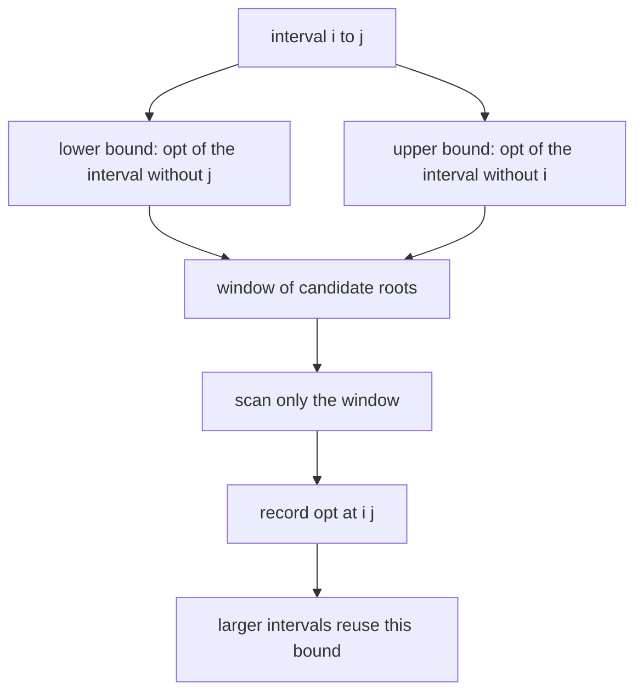
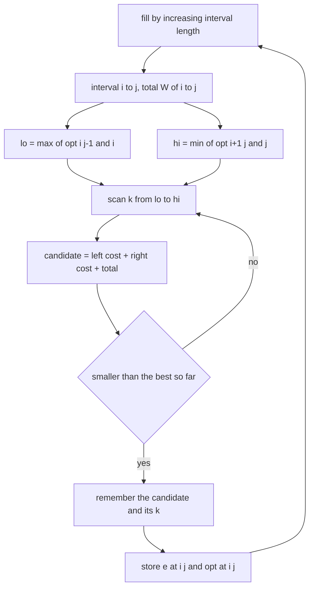
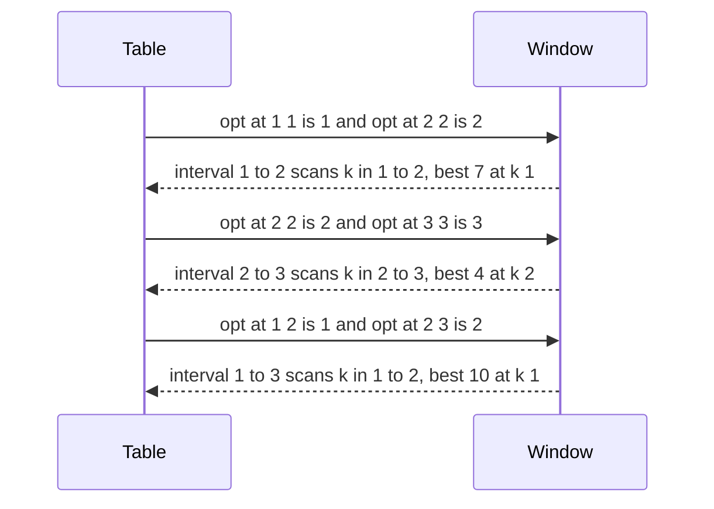
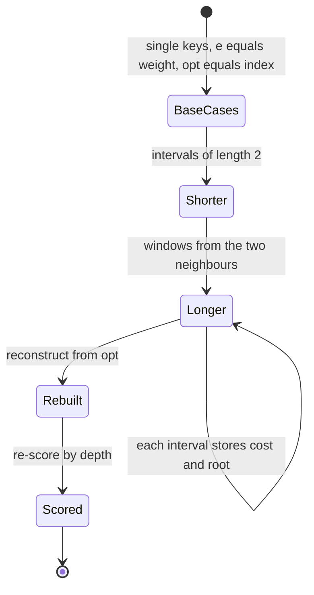

# 397 — Implement knuth optimization demonstration for DP speedup.

> **Tier:** Intermediate · **CTCI chapter:** Ch 8 — Recursion and Dynamic Programming
> **Task spec:** [397-implement-knuth-optimization-demonstration-for-dp-speedup.md](../../../tasks/intermediate/397-implement-knuth-optimization-demonstration-for-dp-speedup.md)
> **Solutions:** [Python](../../../solutions/python/intermediate/397-implement-knuth-optimization-demonstration-for-dp-speedup/solution.py) ·
> [Java](../../../solutions/java/intermediate/397-implement-knuth-optimization-demonstration-for-dp-speedup/Solution.java) ·
> [JavaScript](../../../solutions/javascript/intermediate/397-implement-knuth-optimization-demonstration-for-dp-speedup/solution.js) ·
> [C#](../../../solutions/csharp/intermediate/397-implement-knuth-optimization-demonstration-for-dp-speedup/Solution.cs)

## 1. Problem restatement

**The DP.** Build an optimal binary search tree over `n` weighted keys with weights
`weights[0..n-1]`, minimising the total search cost

    cost = Σ (weight of key k) · (depth of key k + 1)

where all keys are equally likely to be searched and the depths come from the tree you build. The
interval formulation is

    e[i][j] = min over k in [i, j] of  e[i][k-1] + e[k+1][j] + W(i, j)

with `W(i, j)` the sum of the weights in `[i, j]` (a prefix-sum difference) and `e[i][i] = weights[i-1]`
for the single-key base case.

**Input/output:** `obst_plain(weights)` returns the minimum cost in `O(n³)`;
`obst_knuth(weights)` returns `(cost, opt)`, where `opt[i][j]` is the best root index for that range —
computed in `O(n²)`.

| Call | Result | Why |
| --- | --- | --- |
| `obst_plain([5])` / `obst_knuth([5])[0]` | `5` | one key at depth 1 |
| `[1, 1]` | `3` | either key as root: `1·1 + 1·2` |
| `[3, 2, 1]` | `10` | the comment checks two roots: root 3 gives `3·1 + 2·2 + 1·3 = 10`, root 2 gives `3·2 + 2·1 + 1·2 = 10` |
| `[1, 1, 1, 1]` | `8` | the balanced tree costs `1·1 + 2·2 + 1·3 = 8` |
| 120 random weight sets (`seed = 2026`, `n = 2…40`, weights `1…50`) | `knuth == plain`, `opt` monotone, rebuild matches, inorder is `1…n` | the property harness |

The correctness requirements asserted for every random instance are the interesting part:

1. the optimised cost equals the plain `O(n³)` cost,
2. `opt[i][j-1] <= opt[i][j] <= opt[i+1][j]` — the monotonicity that licenses the optimisation,
3. rebuilding the tree from `opt` and *re-scoring* it by walking the structure reproduces the cost
   (this is `rebuild_cost`, which sums `weight · (depth + 1)` recursively), and
4. an inorder traversal of the rebuilt tree returns the keys in ascending order — i.e. the
   reconstruction is a valid BST, not just a cost-equivalent shape.

## 2. Intuition

The plain DP is a triple loop: `O(n²)` intervals, each scanning up to `O(n)` candidate roots, so
`O(n³)`. The reason it can be reduced is a theorem of Knuth's (1971) about this particular cost: the
optimal root index is **monotone in the interval**, in the precise sense

    opt[i][j-1]  <=  opt[i][j]  <=  opt[i+1][j]

Read it as "as the interval grows to the left, the best root cannot move left; as it grows to the
right, it cannot move right". So the scan for `opt[i][j]` does not need the whole range `[i, j]` — only
the window between the two neighbouring optima. Summing those window widths over every interval gives
`O(n²)` total work, which is where the cubic-to-quadratic speedup comes from.



Not every DP with a similar shape qualifies. Matrix-chain multiplication is the classic counter-example
— its optimal split point is *not* monotone, which the docstring notes is verified elsewhere in this
repository — and that is exactly why this task demonstrates Knuth's optimisation on the search-tree
recurrence instead. The property to look for is the quadrangle inequality plus monotonicity of the
cost, not merely "a min over a split point".

## 3. Algorithm

**Plain DP (`obst_plain`).**

1. Build prefix sums so that `W(i, j) = prefix[j] - prefix[i-1]` is `O(1)`.
2. Initialise `e[i][i] = weights[i-1]` for the single-key intervals.
3. Fill by increasing interval length `2…n`. For each interval `[i, j]`, scan every `k` in `[i, j]`,
   take `e[i][k-1] + e[k+1][j] + W(i, j)` (with the out-of-range sub-costs treated as `0`), and keep the
   minimum.
4. Return `e[1][n]`.

**Knuth-optimised DP (`obst_knuth`).**

1. Same prefix sums, same base cases — plus `opt[i][i] = i`.
2. Fill by increasing length as well, but bound the scan:
   `lo = max(opt[i][j-1], i)` and `hi = min(opt[i+1][j], j)`. The clamps matter at the boundaries:
   `opt[i][j-1]` can be less than `i` in uninitialised ranges, and `opt[i+1][j]` can exceed `j`.
3. Scan `k` from `lo` to `hi`, keeping the best candidate and its index (strict `<`, so ties keep the
   first `k`).
4. Record `e[i][j]` and `opt[i][j] = best_k`, then return `(e[1][n], opt)`.

**Independent checks.** `opt_is_monotone(opt, n)` re-verifies the window inequality over the whole
table; `rebuild_cost(weights, opt, 1, n)` re-scores the tree by recursion instead of by the DP
recurrence; `rebuild_inorder(opt, 1, n)` returns the keys in traversal order.

```text
function obst_knuth(weights)
    n ← length(weights)
    if n = 0 then
        return 0, an empty table
    end
    prefix ← prefix sums of weights
    e ← table of zeros with n + 2 rows and columns
    opt ← table of zeros with n + 2 rows and columns
    for i ← 1 to n do
        e[i][i] ← weights[i - 1]
        opt[i][i] ← i
    end
    for length ← 2 to n do
        for i ← 1 to n - length + 1 do
            j ← i + length - 1
            total ← prefix[j] - prefix[i - 1]
            lo ← maximum of opt[i][j - 1] and i
            hi ← minimum of opt[i + 1][j] and j
            best ← INF
            best_k ← lo
            for k ← lo to hi do
                left ← e[i][k - 1] if k - 1 is at least i, else 0
                right ← e[k + 1][j] if k + 1 is at most j, else 0
                candidate ← left + right + total
                if candidate &lt; best then
                    best ← candidate
                    best_k ← k
                end
            end
            e[i][j] ← best
            opt[i][j] ← best_k
        end
    end
    return e[1][n], opt
end

procedure rebuild_cost(weights, opt, i, j, depth)
    if i &gt; j then
        return 0
    end
    root ← opt[i][j]
    return weights[root - 1] * (depth + 1)
         + rebuild_cost(weights, opt, i, root - 1, depth + 1)
         + rebuild_cost(weights, opt, root + 1, j, depth + 1)
end
```



The window has to be applied to every interval, and the two neighbouring optima are already computed
when it is needed: `opt[i][j-1]` has a shorter length, and `opt[i+1][j]` is shorter as well. That is why
the fill order — increasing length — still works.

## 4. Worked example

**`weights = [3, 2, 1]`.** Keys are numbered `1, 2, 3` with those weights. Base cases:
`e[1][1] = 3`, `e[2][2] = 2`, `e[3][3] = 1`, and `opt[i][i] = i`.

Length 2:

| Interval | Total `W` | Window `[lo, hi]` | Candidates | Best | `opt` |
| --- | --- | --- | --- | --- | --- |
| `[1, 2]` | `5` | `[max(opt[1][1], 1), min(opt[2][2], 2)] = [1, 2]` | `k = 1`: `0 + e[2][2] + 5 = 7`; `k = 2`: `e[1][1] + 0 + 5 = 8` | `7` | `1` |
| `[2, 3]` | `3` | `[max(opt[2][2], 2), min(opt[3][3], 3)] = [2, 3]` | `k = 2`: `0 + e[3][3] + 3 = 4`; `k = 3`: `e[2][2] + 0 + 3 = 5` | `4` | `2` |

Length 3:

| Interval | Total `W` | Window | Candidates | Best | `opt` |
| --- | --- | --- | --- | --- | --- |
| `[1, 3]` | `6` | `[max(opt[1][2], 1), min(opt[2][3], 3)] = [1, 2]` | `k = 1`: `0 + e[2][3] + 6 = 10`; `k = 2`: `e[1][1] + e[3][3] + 6 = 10` | `10` (tie → first) | `1` |

The answer `10` matches `obst_plain([3, 2, 1])`. Notice that the window for the full range is `[1, 2]`
even though `k = 3` is legal: `opt[2][3] = 2` caps `hi` at `2`, and the plain DP's third candidate
(`k = 3`, cost `e[1][2] + 0 + 6 = 13`) is provably never better. That single skipped candidate is the
optimisation in miniature.

The tie at `k = 1` versus `k = 2` is also instructive: both roots give a total of `10`, and the strict
`<` keeps `k = 1`. Re-scoring confirms the cost through the structure rather than the recurrence — the
tree rooted at key 1 has key 2 at depth 2 and key 3 at depth 3, so
`3·1 + 2·2 + 1·3 = 3 + 4 + 3 = 10`. An inorder traversal of that tree is `[1, 2, 3]`, the asserted
permutation.



**The randomised harness.** 120 weight sets are generated with `seed = 2026`: each set has
`n = 2 + seed mod 39` keys (so up to `40`) with weights in `1…50`. For every set the file asserts the
four properties listed in section 1. Monotonicity is checked by `opt_is_monotone`, which walks the
whole table and fails if any interval violates `opt[i][j-1] <= opt[i][j] <= opt[i+1][j]`; the cost is
re-derived by `rebuild_cost`; and the inorder traversal must be `[1, 2, …, n]`, which catches a bug that
produced the right cost from an invalid tree shape.

**The window-size measurement.** For a fresh `n = 40` instance the file sums the actual window widths,
`Σ (opt[i][j] - opt[i][j-1] + 1)` over all intervals, and asserts `scanned < n²`. That is the empirical
counterpart of the `O(n²)` total-window bound: the optimised DP inspects fewer candidates than the
`n³/6 ≈ 10667` of the plain loop, and the assertion pins the quadratic behaviour rather than a specific
constant.



## 5. Complexity

Let `n` be the number of keys.

| Measure | Plain DP | Knuth-optimised |
| --- | --- | --- |
| Time | O(n³) | O(n²) |
| Time, per interval | O(length) candidates | the window `[opt[i][j-1], opt[i+1][j]]` |
| Total candidates | about `n³/6` | `O(n²)`, asserted as `scanned < n²` |
| Space | O(n²) for `e` plus O(n) prefix sums | O(n²) for `e` **and** `opt`, plus O(n) |
| Rebuild | not applicable | O(n) for the tree shape, O(n) for the inorder check |
| Harness | 120 random instances | 120 cross-checks against the plain DP |

The price of the speedup is the extra `opt` table — `O(n²)` indices alongside the `O(n²)` costs — and
the obligation to prove the monotonicity precondition. The payoff is one factor of `n`: at `n = 40` the
difference is invisible, at `n = 2000` the cubic version needs about 1.3·10⁹ inner steps and the
quadratic one about 4·10⁶.

## 6. Pitfalls and edge cases

- **The window must be clamped to the interval.** `lo = max(opt[i][j-1], i)` and
  `hi = min(opt[i+1][j], j)`; `opt[i][j-1]` can be below `i` (uninitialised ranges are `0`) and
  `opt[i+1][j]` can exceed `j`. Unclamped bounds either index outside the interval or read garbage.
- **The fill order is the same as the plain DP — by length.** `opt[i][j-1]` and `opt[i+1][j]` are
  shorter intervals, so both are already known; filling by `i` then `j` would break that.
- **Knuth's optimisation is not universally applicable.** It needs the quadrangle inequality and the
  monotonicity of the optimal root. Matrix-chain multiplication is the classic non-example, mentioned in
  the docstring as verified in this repository, and applying the window there gives wrong costs.
- **Ties keep the first candidate.** `best_k` starts at `lo` and the comparison is a strict `<`, so an
  equally good later root is not taken. The `[3, 2, 1]` trace relies on this: `opt[1][3] = 1` rather than
  `2`, and the monotonicity invariant is then checked against that choice.
- **Out-of-range sub-costs are zero.** `e[i][k-1]` for `k = i` and `e[k+1][j]` for `k = j` name empty
  intervals; the code guards them with `k - 1 >= i` and `k + 1 <= j` instead of relying on the table's
  zeros, which keeps the intent explicit.
- **Empty input returns `0`.** `obst_knuth([])` returns `(0, empty table)` before any table work, and
  `obst_plain([])` returns `0`; the recursion `rebuild_cost` also treats an empty range as cost `0`
  when `i > j`.
- **The base case is `e[i][i] = weights[i-1]`, not `0`.** A single key sits at depth 1, so its search
  cost is its own weight; forgetting this yields the optimal *relative* shape but a cost that is too
  small by the total weight.
- **A valid cost does not imply a valid tree.** `rebuild_inorder` returning `[1…n]` is the check that
  the `opt` table describes a binary search tree with the keys in sorted order, not merely a set of
  numbers that add up correctly. It is a cheap and strong structural assertion, and it is asserted for
  every random instance.
- **Re-scoring is a genuinely independent path.** `rebuild_cost` walks the tree with a `depth`
  parameter and multiplies weights by `depth + 1`, which has nothing in common with the interval
  recurrence — a good example of an oracle that shares no code with the algorithm under test.
- **Quadratic memory is real.** Both `e` and `opt` are `(n+2)²` tables; the speedup is in time, not
  space, and an `O(n)` rolling-array trick is not available here because every interval is needed by
  larger intervals.

## 7. Variants and follow-ups

- **Divide-and-conquer optimisation.** The other classic DP speedup, which recurses over the state
  range instead of narrowing the loop bounds — the same monotonicity precondition, different mechanics:
  [398-implement-divide-conquer-dp-optimization-example.md](../../../tasks/intermediate/398-implement-divide-conquer-dp-optimization-example.md).
- **Convex hull trick.** A speedup that applies when the transition is linear in the state, using the
  envelope of lines rather than split monotonicity — see
  [396-implement-offline-convex-hull-trick-with-divide-conquer-dp-optim.md](../../../tasks/intermediate/396-implement-offline-convex-hull-trick-with-divide-conquer-dp-optim.md)
  and [395-implement-dynamic-convex-hull-trick-for-max-queries-li-chao-tree.md](../../../tasks/intermediate/395-implement-dynamic-convex-hull-trick-for-max-queries-li-chao-tree.md).
- **Divide and conquer on trees.** The same midpoint-window idea appears in tree algorithms such as
  [399-implement-centroid-decomposition-on-tree-for-distance-queries.md](../../../tasks/intermediate/399-implement-centroid-decomposition-on-tree-for-distance-queries.md).
- **The quadrangle inequality.** Its two consequences — Knuth's window bounds and the monotone decision
  point used by divide-and-conquer optimisation — are the two halves of the same theory; the harness's
  `opt_is_monotone` is a direct test of the second consequence.
- **Other interval DPs.** The same `e[i][k-1] + e[k+1][j]` split shape appears in expression
  parenthesisation and in optimal polygon triangulation, both of which satisfy or violate the
  precondition depending on the cost.

## 8. Check yourself

1. What exactly does `opt[i][j-1] <= opt[i][j] <= opt[i+1][j]` say, and why is it enough to shrink the
   inner loop?

<details><summary>Show answer</summary>

It says the optimal root index is monotone in the interval: removing the rightmost key cannot move the
root right, and removing the leftmost key cannot move it left. So the scan for interval `[i, j]` only
needs the window between the two neighbouring optima instead of all of `[i, j]`. Summed over all
intervals the window widths total `O(n²)`, turning the `O(n³)` DP into `O(n²)`.

</details>

2. Why is matrix-chain multiplication the canonical counter-example?

<details><summary>Show answer</summary>

Because its optimal split point is not monotone in the interval, so the window bound is simply false
there — a narrowed scan can miss the true optimum and silently report a wrong (too large) cost. The
docstring notes that this is verified elsewhere in the repository, and it is why the demonstration uses
the search-tree recurrence, where the quadrangle inequality holds.

</details>

3. In the `[3, 2, 1]` trace, the full interval's window is `[1, 2]`. Which candidate does the plain DP
   consider that Knuth's version skips, and why is skipping it safe?

<details><summary>Show answer</summary>

`k = 3`, whose cost would be `e[1][2] + 0 + 6 = 13`. It is skipped because `opt[2][3] = 2` caps `hi` at
`2`, and by monotonicity no root to the right of `opt[2][3]` can beat it for the larger interval. The
plain DP also finds `10` as the minimum, so the skip costs nothing.

</details>

4. How does the file check that the reconstructed tree is a genuine BST and not just shape-compatible?

<details><summary>Show answer</summary>

`rebuild_inorder(opt, 1, n)` performs an inorder traversal driven by the `opt` table and the assertion
requires the result to be exactly `[1, 2, …, n]`. An inorder traversal of a binary search tree over the
sorted keys must visit them in ascending order, so a table that produced the right cost but an invalid
ordering (for example a duplicated or skipped root) would fail this check.

</details>

5. The cost is verified twice — once by the DP recurrence and once by `rebuild_cost`. Why bother?

<details><summary>Show answer</summary>

Because they share no logic. The DP computes intervals bottom-up with a window bound; `rebuild_cost`
ignores the interval table entirely, follows `opt` pointers to build the shape, and multiplies each
weight by `depth + 1`. Agreement means both the window optimisation and the table's interpretation are
consistent. The harness asserts this for all 120 random instances, alongside the monotonicity invariant
and the equality with the plain `O(n³)` DP.

</details>
