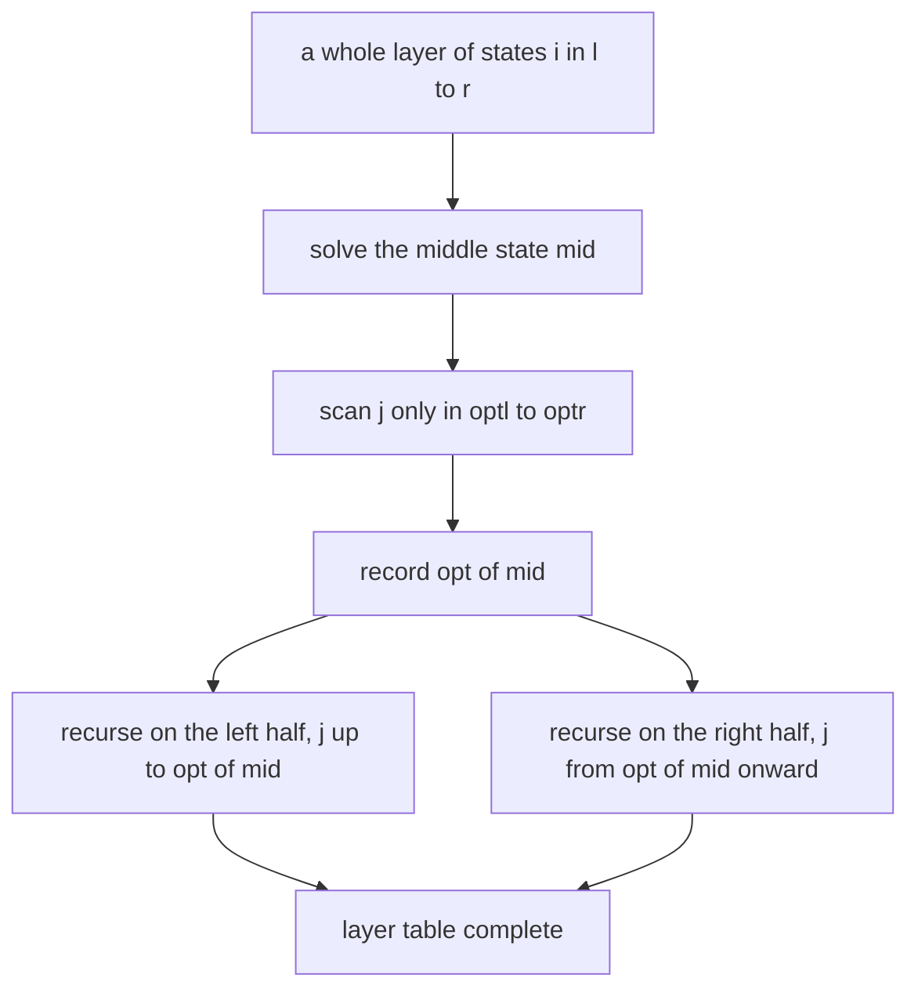
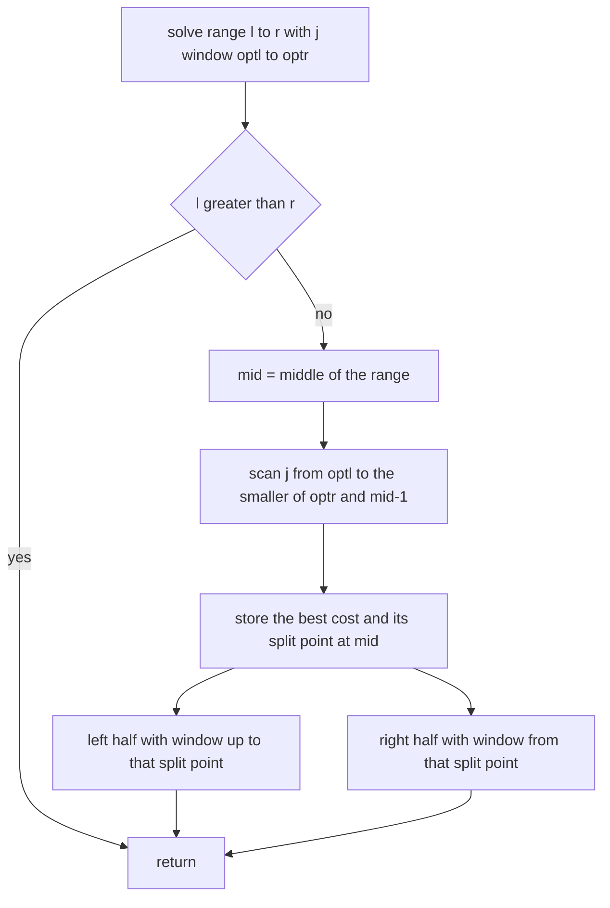
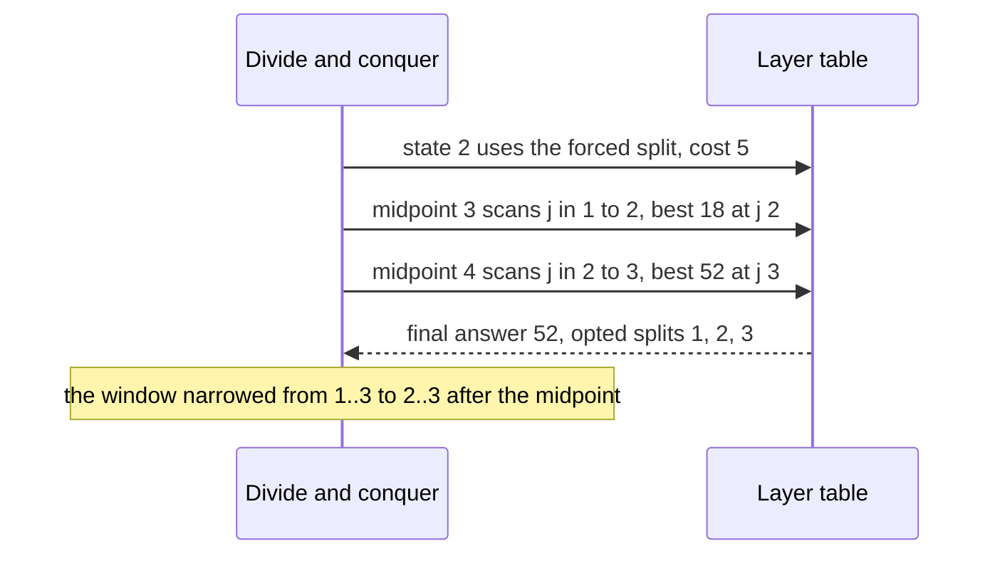
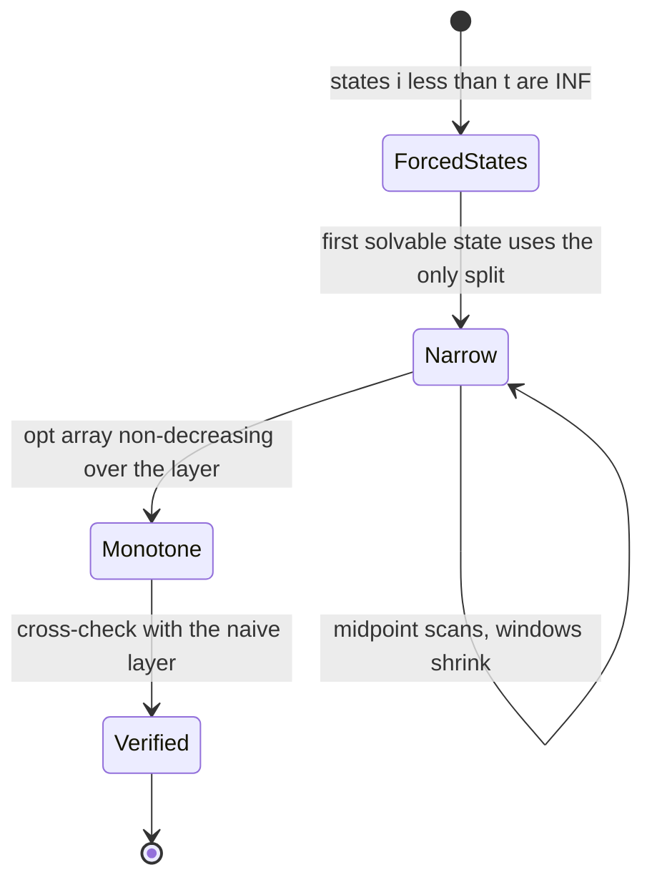

# 398 — Implement divide & conquer DP optimization example.

> **Tier:** Intermediate · **CTCI chapter:** Ch 8 — Recursion and Dynamic Programming
> **Task spec:** [398-implement-divide-conquer-dp-optimization-example.md](../../../tasks/intermediate/398-implement-divide-conquer-dp-optimization-example.md)
> **Solutions:** [Python](../../../solutions/python/intermediate/398-implement-divide-conquer-dp-optimization-example/solution.py) ·
> [Java](../../../solutions/java/intermediate/398-implement-divide-conquer-dp-optimization-example/Solution.java) ·
> [JavaScript](../../../solutions/javascript/intermediate/398-implement-divide-conquer-dp-optimization-example/solution.js) ·
> [C#](../../../solutions/csharp/intermediate/398-implement-divide-conquer-dp-optimization-example/Solution.cs)

## 1. Problem restatement

**The DP.** Split an array `values[0..n-1]` into **exactly `k` contiguous non-empty groups**,
minimising the sum of the squared group sums:

    f[t][i] = min over j in [t-1, i-1] of  f[t-1][j] + (prefix[i] - prefix[j])²

where `prefix` is the prefix-sum array, so `prefix[i] - prefix[j]` is the sum of the last group. With
`f[1][i] = prefix[i]²` (one group holding everything) and `f[t][i] = INF` when `i < t`, the answer is
`f[k][n]`.

**Two implementations:**

- `partition_naive(values, k)` — the plain `O(k·n²)` DP, the oracle.
- `partition_dc(values, k)` — the divide-and-conquer optimisation, which returns
  `(answer, opt_choices per layer)` so the monotonicity of the split points can be *asserted* rather
  than assumed. A layer costs `O(n log n)` evaluations instead of `O(n²)`.

| Call | Result | Why |
| --- | --- | --- |
| `partition_naive([1, 2, 3, 4], 2)` | `52` | `[1,2,3] | [4]` costs `36 + 16`; `[1,2] | [3,4]` costs `58`; `[1] | [2,3,4]` costs `82` |
| `partition_naive([1, 2, 3, 4], 1)` | `100` | one group: `(1+2+3+4)²` |
| `partition_naive([1, 2, 3, 4], 4)` | `30` | singletons: `1 + 4 + 9 + 16` |
| `partition_dc([1, 2, 3, 4], 2)[0]` | `52` | the optimisation agrees with the oracle |
| `partition_dc([1, 2, 3, 4], 4)[0]` | `30` | `k = n`, every group a singleton |
| `partition_naive([5], 1)` | `25` | one value, one group |
| `partition_naive([1, 2], 3)` | `INF` | more groups than elements |
| 40 random arrays (`seed = 804`, `n = 2…60`, values `1…9`), `k` in `1…min(n, 8)` | `dc == naive` and `opt` non-decreasing in every layer | the property harness |

The second half of the harness is what makes this a *demonstration* rather than a claim: for every layer
of every instance, `opt_is_monotone(opt, t, n)` requires `opt[i]` to be non-decreasing over
`i = t, t+1, …, n`. If the precondition failed anywhere, the optimisation would be producing wrong costs
— and the cross-check against the naive DP would catch it at the same time.

## 2. Intuition

The naive recurrence scans every possible boundary `j` for every state `i`, which is the `O(n²)` inner
work per layer. The divide-and-conquer optimisation replaces that scan with a *structural* claim about
where the best boundary can be.

The cost `(prefix[i] - prefix[j])²` is a squared difference, which satisfies the quadrangle inequality:
as `i` grows, the best `j` never decreases. Formally, within a layer

    opt(t, t) <= opt(t, t+1) <= … <= opt(t, n)

so the optimal split point is a monotone function of the state. That property is usable in the
following way: to compute the whole layer for `i` in a range `[l, r]`, take the middle state `mid`,
find its optimal `j` by scanning a *known window* `[optl, optr]`, then recurse. Because `opt` is monotone,
every state left of `mid` has its optimum in `[optl, opt(mid)]` and every state right of `mid` in
`[opt(mid), optr]`. The windows shrink as the recursion descends, and the total number of candidates
examined per level is `O(n)`, giving `O(n log n)` per layer.



The optimisation needs much less than the convex-hull trick of the sibling tasks: no line structure, no
ordering of queries — only monotonicity of the decision point. That is its advantage when the transition
is not linear in the state, and it is exactly why both techniques appear in this tier.

## 3. Algorithm

**Naive layer.** For `t = 1…k`, compute `current[i]` for `i = t…n` by scanning `j = t-1…i-1`,
skipping `INF` predecessors, and taking `previous[j] + (prefix[i] - prefix[j])²`.

**Divide-and-conquer layer.**

1. Fill the single forced state: `current[t] = previous[t-1] + values[t-1]²`, and `opt[t] = t - 1`.
2. If `t + 1 <= n`, call `solve(l = t+1, r = n, optl = t-1, optr = n-1)`.
3. `solve(l, r, optl, optr)`: if `l > r`, return. Otherwise `mid = (l + r) // 2`; scan
   `j` from `optl` to `min(optr, mid - 1)` (the cap guarantees the last group is non-empty), skipping
   `INF`, and keep the smallest cost with `best_j` (initialised to `optl`, strict `<`, so ties keep the
   earliest candidate). Store `current[mid]` and `opt[mid]`, then recurse into `[l, mid-1]` with
   `[optl, best_j]` and `[mid+1, r]` with `[best_j, optr]`.
4. Return the final `previous[n]` together with the per-layer `opt` arrays.

```text
function partition_dc(values, k)
    n ← length(values)
    if k &gt; n then
        return INF, empty list
    end
    prefix ← prefix sums of values
    previous ← [0, INF, ..., INF]
    all_opts ← empty list
    for t ← 1 to k do
        current ← array of INF with n + 1 entries
        opt ← array of zeros with n + 1 entries
        current[t] ← previous[t - 1] + values[t - 1] * values[t - 1]
        opt[t] ← t - 1
        if t + 1 &lt;= n then
            solve(previous, current, opt, prefix, t + 1, n, t - 1, n - 1)
        end
        append opt to all_opts
        previous ← current
    end
    return previous[n], all_opts
end

procedure solve(previous, current, opt, prefix, l, r, optl, optr)
    if l &gt; r then
        return
    end
    mid ← (l + r) / 2 rounded down
    best ← INF
    best_j ← optl
    upper ← minimum of optr and mid - 1
    for j ← optl to upper do
        if previous[j] is finite then
            group ← prefix[mid] - prefix[j]
            cost ← previous[j] + group * group
            if cost &lt; best then
                best ← cost
                best_j ← j
            end
        end
    end
    current[mid] ← best
    opt[mid] ← best_j
    solve(previous, current, opt, prefix, l, mid - 1, optl, best_j)
    solve(previous, current, opt, prefix, mid + 1, r, best_j, optr)
end
```



The recursion's shape is the key: the midpoint scan costs `O(window)`, and the two recursive calls
partition the state range. Because the windows only shrink, the total work at each *level* of the
recursion is `O(n)`, and there are `O(log n)` levels — hence `O(n log n)` per layer.

## 4. Worked example

**`values = [1, 2, 3, 4]`, `k = 2`.** Prefix sums: `prefix = [0, 1, 3, 6, 10]`. The base layer is
`previous = [0, INF, INF, INF, INF]`.

Layer `t = 1` — one group, so everything is `prefix[i]²`:

| State | Computed | `opt` |
| --- | --- | --- |
| `i = 1` | `previous[0] + 1² = 1` | `0` |
| `i = 2` | `9` | `0` |
| `i = 3` | `36` | `0` |
| `i = 4` | `100` | `0` |

Every split point is `0`, because a single group must start at the beginning; the layer is monotone
trivially. `t = 1` gives `[INF, 1, 9, 36, 100]`.

Layer `t = 2` — the midpoint recursion on `l = 3, r = 4`, window `optl = 1, optr = 3`:

| Call | Range | `mid` | Window scanned | Candidates | Chosen |
| --- | --- | --- | --- | --- | --- |
| 1 | `[3, 4]` | `3` | `j = 1…2` | `j=1`: `1 + (6-1)² = 26`; `j=2`: `9 + (6-3)² = 18` | `j = 2`, cost `18` |
| 2 | `[3, 2]` | — | — | — | empty, returns |
| 3 | `[4, 4]` | `4` | `j = 2…3` | `j=2`: `9 + (10-3)² = 58`; `j=3`: `36 + (10-6)² = 52` | `j = 3`, cost `52` |

The state `i = 2` was filled directly: `current[2] = previous[1] + values[1]² = 1 + 4 = 5`, with
`opt[2] = 1`. The three split points are `1, 2, 3` — non-decreasing, as the invariant requires — and the
answer `current[4] = 52` matches `partition_naive([1, 2, 3, 4], 2)`.

Notice the window for the last call: `[best_j, optr] = [2, 3]`, so `j = 1` is never re-examined, even
though it was legal for `i = 4` as well. That is the optimisation working: the monotonicity theorem says
the optimum for the larger state cannot be to the left of the optimum for the smaller one.



**The random harness.** 40 arrays are generated with `seed = 804`: lengths `n = 2 + seed mod 59` (so up
to `60`) with values in `1…9`. For each array and each `k` up to `min(n, 8)`, the file asserts
`dc == naive` and then checks every layer's `opt` array for monotonicity. That is several hundred
comparisons, and it exercises the tricky boundary cases — `k = 1` (a single forced state), `k = n`
(every group a singleton, so every state is forced), and everything in between.



## 5. Complexity

Let `n` be the array length and `k` the number of groups.

| Measure | Naive | Divide-and-conquer |
| --- | --- | --- |
| Work per layer | O(n²) | O(n log n) |
| Candidates per state | up to `i - t + 1` | bounded by the window `[optl, optr]` |
| Total time | O(k · n²) | O(k · n log n) |
| State table | O(n) per layer, rolled over | O(n) per layer, rolled over, plus `O(n)` for `opt` |
| Split-point table | not stored | O(n) per layer, retained for the monotonicity assertion |
| Recursion | none | O(log n) deep, O(n) candidates per level |
| Harness coverage | 40 arrays × up to 8 values of `k`, each cross-checked and monotonicity-checked | |

Both implementations keep only the previous layer's costs, so the space is linear rather than
`O(k·n)`. The windows make the difference visible only at large `n`: at `n = 60` the naive layer scans
about 1800 candidates while the optimised layer scans a few hundred, and the advantage grows with the
square-versus-linearithmic gap.

## 6. Pitfalls and edge cases

- **The window must be capped at `mid - 1`.** A split at `j = mid` would leave the final group empty, so
  the scan stops at `min(optr, mid - 1)`. Letting `j` reach `mid` produces a zero-sum group and a
  too-small cost that the naive DP would contradict.
- **`INF` predecessors must be skipped.** States with `i < t-1` are unreachable in the previous layer;
  adding `INF` to a candidate would make it useless, and in integer ports it could overflow. Both loops
  guard with an explicit finiteness check.
- **The forced state `i = t` is not handled by the recursion.** It has exactly one legal split
  (`j = t - 1`), so the code fills it directly and starts the recursion at `t + 1`. Leaving it to
  `solve` would either leave `INF` in the table or require a special case inside the recursion.
- **Ties keep the earliest split.** `best_j` starts at `optl` and the comparison is a strict `<`, so an
  equal-cost later candidate is ignored. This keeps the `opt` array deterministic, which matters because
  the monotonicity assertion is checked against it.
- **The window bounds must stay inside `[optl, optr]`.** The recursive calls pass `best_j` as one of the
  new bounds, so a `best_j` outside the scanned window would corrupt the next level's search. That is why
  `best_j` is initialised to `optl` rather than to `-1`.
- **Monotonicity is a precondition, not a consequence.** The cost `(prefix[i] - prefix[j])²` satisfies
  the quadrangle inequality, which is what makes the windows legal. A different cost — an absolute
  difference with a sign, or a non-convex penalty — can violate it, and the algorithm would return wrong
  answers without any error. The harness therefore asserts the invariant per layer on every random
  instance rather than trusting it.
- **`k > n` returns `INF`.** Not every split is possible; the oracle and the optimised version agree, and
  the small-case assertion `partition_naive([1, 2], 3) == INF` pins it.
- **`k = 1` and `k = n` are the boundary layers.** With `k = 1` the whole layer is a single group and
  every split point is `0`; with `k = n` every state is forced. Both are covered by the random harness,
  where `k` runs from `1` to `min(n, 8)`.
- **The recursion returns nothing; it writes into the layer.** `solve` fills `current[mid]` and
  `opt[mid]` and recurses; because each state is written exactly once, no ordering between the two
  recursive calls matters.
- **Values must be positive for the intended reading.** The harness uses values in `1…9`, matching the
  intended problem (splitting a list of positive numbers); squared costs still make sense with negative
  values, but the quadrangle inequality for this cost is established for the standard positive-weight
  form, so do not generalise without re-deriving it.

## 7. Variants and follow-ups

- **Convex hull trick on the same recurrence.** Expanding the square turns each layer into a set of
  lines, giving `O(n log n)` by a monotone hull or the Li Chao tree — the sibling task
  [396-implement-offline-convex-hull-trick-with-divide-conquer-dp-optim.md](../../../tasks/intermediate/396-implement-offline-convex-hull-trick-with-divide-conquer-dp-optim.md)
  solves exactly this partition problem both ways, which makes it a good side-by-side read.
- **Li Chao tree for the online variant.** When queries and insertions cannot be sorted,
  [395-implement-dynamic-convex-hull-trick-for-max-queries-li-chao-tree.md](../../../tasks/intermediate/395-implement-dynamic-convex-hull-trick-for-max-queries-li-chao-tree.md)
  replaces the hull at the cost of a `log X` factor.
- **Knuth's optimisation, the third speedup.** A different structural fact — bounds on the root index
  rather than a recursion over the states — demonstrated on the optimal search tree in
  [397-implement-knuth-optimization-demonstration-for-dp-speedup.md](../../../tasks/intermediate/397-implement-knuth-optimization-demonstration-for-dp-speedup.md).
- **Divide and conquer beyond DP.** The midpoint-window recursion reappears as the structure of
  centroid decomposition on trees,
  [399-implement-centroid-decomposition-on-tree-for-distance-queries.md](../../../tasks/intermediate/399-implement-centroid-decomposition-on-tree-for-distance-queries.md),
  where the "range" is a set of tree nodes rather than an index interval.
- **Why the plain DP stays in the file.** It is the oracle: the two optimisations exploit structural
  properties that are easy to get subtly wrong, and an `O(k·n²)` reference on the same input is the
  cheapest way to notice.

## 8. Check yourself

1. What property of the cost function makes the narrowed window legal?

<details><summary>Show answer</summary>

The squared group-sum cost satisfies the quadrangle inequality, which implies that the optimal split
point `opt(t, i)` is non-decreasing in `i` within a layer. So the optimum for a middle state bounds the
optima of all states to its left (no greater) and to its right (no smaller), letting each recursive call
restrict its scan window. The harness verifies the monotonicity of the recorded `opt` arrays rather than
assuming it.

</details>

2. Why is the state `i = t` filled outside the recursion?

<details><summary>Show answer</summary>

Because it has exactly one legal split, `j = t - 1` (every group must be non-empty, so the first `t`
elements occupy one group each). The code writes
`current[t] = previous[t-1] + values[t-1]²` and `opt[t] = t - 1`, then starts the recursion at `t + 1`.
That removes the need for a special case inside `solve` and avoids leaving `INF` in the table.

</details>

3. In the worked example the last recursion scans `j = 2…3` instead of `j = 1…3`. Which candidate is
   skipped, and on what grounds?

<details><summary>Show answer</summary>

`j = 1`, whose cost for `i = 4` would be `1 + (10-1)² = 82`. It is skipped because the previous
midpoint (`i = 3`) had its optimum at `j = 2`, and monotonicity says `opt(4) >= opt(3) = 2`. The naive
DP finds `52` as the minimum, so the skipped candidate was never competitive.

</details>

4. What is the cost per layer, and where does each factor come from?

<details><summary>Show answer</summary>

`O(n log n)`. The recursion has `O(log n)` levels because the state range halves at each step, and at
each level the midpoints' windows together cover `O(n)` candidate boundaries (the windows are nested
within the level's range). Each candidate is evaluated in O(1) thanks to the prefix sums.

</details>

5. The harness checks three separate things. Which, and what would each catch?

<details><summary>Show answer</summary>

`dc == naive` catches any error in the window bounds or the recursion; `opt_is_monotone` catches a
failure of the precondition itself (which would mean the optimisation is invalid for that cost);
and the small hand-checked cases pin the boundary behaviour of `k = 1`, `k = n` and `k > n`. Together
they cover both "the optimised code is wrong" and "the theorem does not apply here".

</details>
