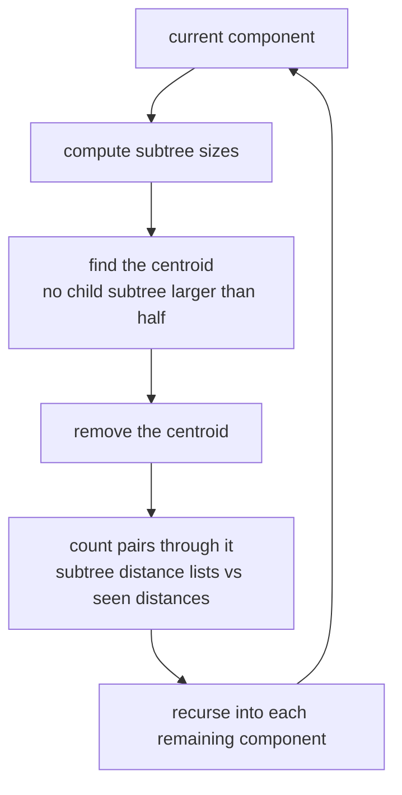
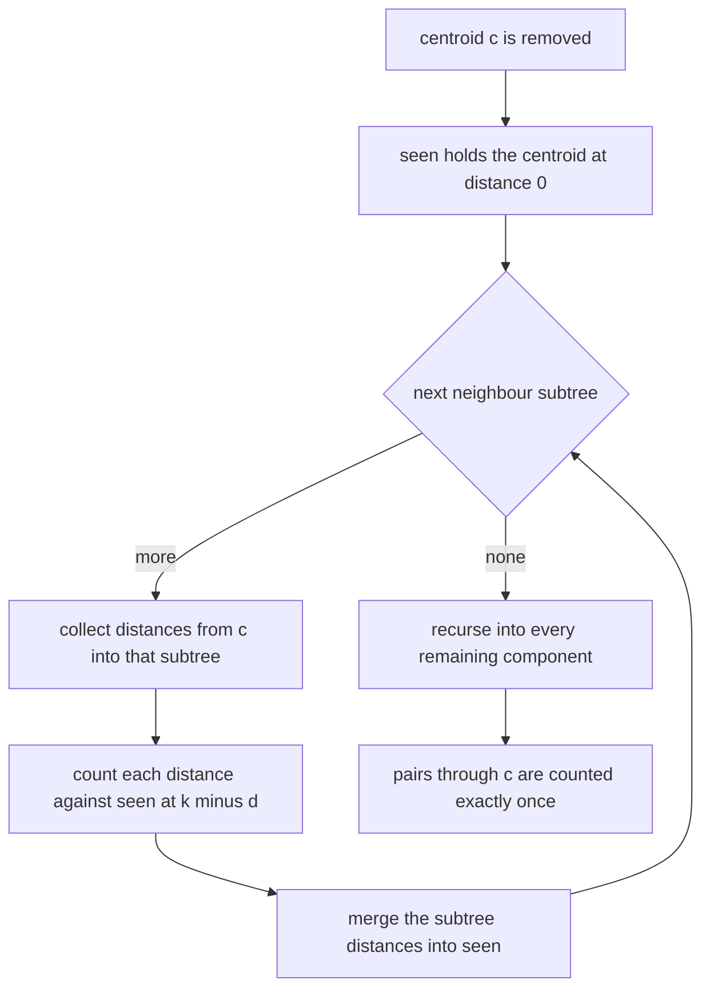
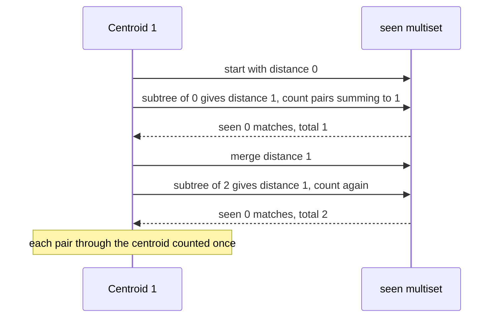
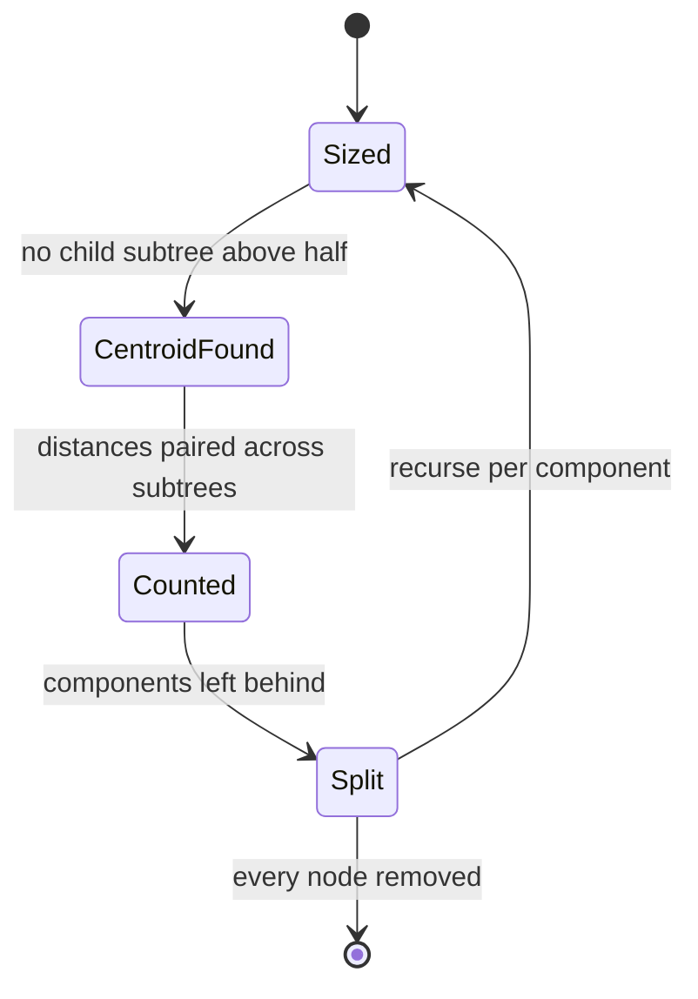

# 399 — Implement centroid decomposition on tree for distance queries.

> **Tier:** Intermediate · **CTCI chapter:** Ch 4 — Trees and Graphs
> **Task spec:** [399-implement-centroid-decomposition-on-tree-for-distance-queries.md](../../../tasks/intermediate/399-implement-centroid-decomposition-on-tree-for-distance-queries.md)
> **Solutions:** [Python](../../../solutions/python/intermediate/399-implement-centroid-decomposition-on-tree-for-distance-queries/solution.py) ·
> [Java](../../../solutions/java/intermediate/399-implement-centroid-decomposition-on-tree-for-distance-queries/Solution.java) ·
> [JavaScript](../../../solutions/javascript/intermediate/399-implement-centroid-decomposition-on-tree-for-distance-queries/solution.js) ·
> [C#](../../../solutions/csharp/intermediate/399-implement-centroid-decomposition-on-tree-for-distance-queries/Solution.cs)

## 1. Problem restatement

**Input:** a tree with `n` nodes given as an edge list, and a distance `k`.

**Output:** `count_pairs_at_distance(n, edges, k)` — the number of **unordered pairs** of distinct nodes
whose tree distance is exactly `k`.

| Call | Result | Why |
| --- | --- | --- |
| path `0-1-2`, `k = 1` | `2` | the two edges: `(0,1)` and `(1,2)` |
| path `0-1-2`, `k = 2` | `1` | `(0,2)` through the middle |
| path `0-1-2`, `k = 3` | `0` | the diameter is `2` |
| star `1-0-2`, `k = 1` | `2` | the two edges |
| star `1-0-2`, `k = 2` | `1` | `(1,2)` through the centre |
| single node, `k = 0` | `0` | there is no distinct pair |
| two nodes with one edge, `k = 1` | `1` | the only pair is adjacent |
| two nodes with one edge, `k = 2` | `0` | beyond the diameter |
| path of six nodes, `k = 0…6` | matches `brute_force` | the exhaustive small check |
| 30 random trees (`seed = 600`, `n = 2…60`), `k = 0…5` | matches `brute_force` | the randomised cross-check |

`brute_force(n, edges, k)` is the oracle: a BFS from every node, then a count over the resulting
distance table, `O(n²)` time per query.

## 2. Intuition

For every pair `(u, v)` at distance `k`, look at the path between them. If the tree is split by deleting
some node `c`, then either the path passes through `c`, or both endpoints lie in the same remaining
component. That observation alone gives a recursion:

- count the pairs whose path passes through `c`, then
- recurse into each component left behind by removing `c`.

The catch is that this decomposition can be as deep as the tree is long — deleting the end of a path
peels off one node at a time, giving `O(n)` levels and `O(n²)` total work. The fix is to always delete a
**centroid**: a node whose removal leaves components of at most half the tree's size. Every tree has one,
and using it bounds the recursion depth by `O(log n)`, so `n log n` work replaces `n²`.

Counting the pairs through a node `c` is then a *distance-list* problem. Distances from `c` are grouped
by the component the node lies in (its "subtree" after removing `c`), with `c` itself at distance `0`.
A pair at distance `k` through `c` consists of two nodes in **different** components whose distances sum
to `k` — so for each component, count its nodes' distances against everything seen so far, then merge the
component's distances into the seen multiset. The two-phase order is what prevents counting pairs that
lie inside one component: those are precisely the pairs whose path does *not* pass through `c`, and the
recursion will handle them.



Every pair is counted exactly once — at the first removed centroid that lies on its path — which is why
the totals simply add up and no inclusion-exclusion correction is needed.

## 3. Algorithm

1. **Build adjacency** from the edge list, and keep a `removed` flag per node.
2. **Sizes.** `sizes(u, parent)` fills `size[u]` with the number of non-removed nodes in `u`'s subtree of
   the current component.
3. **Centroid.** `find_centroid(u, parent, component_size)` walks down into any child whose
   `size[v] > component_size // 2`; if no child qualifies, `u` is the centroid. Descending greedily is
   correct because at most one child can exceed half the component.
4. **Remove** the centroid by setting `removed[centroid] = True`, then initialise
   `seen = {0: 1}` — one node at distance `0`, the centroid itself.
5. **Count per component of the centroid.** For each neighbour `v` that is not removed, collect the
   distances from the centroid to every node in that subtree (`collect(v, centroid, 1, subtree)`, so the
   first distance is `1`). Then:
   - **count**: for each `d` in the subtree list, add `seen.get(k - d, 0)` to the total;
   - **merge**: for each `d` in the subtree list, increment `seen[d]`.
6. **Recurse** into every neighbour `v` that is not removed, which decomposes each leftover component.
7. Return the accumulated total; `n = 0` returns `0` immediately.

```text
function count_pairs_at_distance(n, edges, k)
    build adjacency and removed flags
    total ← 0

    procedure decompose(start)
        sizes(start, parent = none)
        centroid ← find_centroid(start, parent = none, component size = size[start])
        removed[centroid] ← true
        seen ← multiset containing distance 0 once
        for v in neighbours of centroid do
            if v is not removed then
                subtree ← empty list
                collect(v, centroid, 1, subtree)
                for d in subtree do
                    total ← total + seen[k - d]
                end
                for d in subtree do
                    seen[d] ← seen[d] + 1
                end
            end
        end
        for v in neighbours of centroid do
            if v is not removed then
                decompose(v)
            end
        end
    end

    if n &gt; 0 then
        decompose(0)
    end
    return total
end

procedure collect(u, parent, distance, out)
    append distance to out
    for v in neighbours of u do
        if v is not parent and not removed[v] then
            collect(v, u, distance + 1, out)
        end
    end
end
```



The two loops over `subtree` are the heart of the correctness argument. Counting before merging means a
pair of nodes inside the same subtree is never counted at this centroid (their sum would need two
entries from that subtree); merging afterwards means every later subtree *does* see this one, so
cross-subtree pairs are counted exactly once.

## 4. Worked example

**Count pairs at distance `1` in the path `0-1-2`.**

| Step | Action | Result |
| --- | --- | --- |
| sizes from `0` | `size[2] = 1`, `size[1] = 2`, `size[0] = 3` | component size `3` |
| find centroid | child `1` has `size = 2 > 3 // 2 = 1`, descend; at `1` the child `2` has `size = 1 <= 1` | centroid `1` |
| remove | `removed[1] = True` | `seen = {0: 1}` |
| neighbour `0` | `collect` → `[1]`; count `seen[1 - 1] = seen[0] = 1` | `total = 1` (pair `(1,0)`) |
| merge `0` | `seen = {0: 1, 1: 1}` | — |
| neighbour `2` | `collect` → `[1]`; count `seen[1 - 1] = 1` | `total = 2` (pair `(1,2)`) |
| merge `2` | `seen = {0: 1, 1: 2}` | — |
| recurse | components `{0}` and `{2}` are single nodes | no further pairs |

The result `2` matches the assertion, and the two pairs counted were exactly the edges incident to the
centroid. Running the same tree with `k = 2` shows the cross-subtree case: for the subtree of `0` the
lookup is `seen[2 - 1] = seen[1] = 0` (nothing seen yet), but for the subtree of `2` it is
`seen[2 - 1] = seen[1] = 1` — the node `0` merged earlier — so `(0, 2)` is counted once. `k = 3` finds
nothing, since `3 - d > 1` is never in `seen`.



**Why the centroid matters.** In a path of six nodes, deleting an end node leaves a component of five, so
a naive "peel one node at a time" decomposition would take five levels. The centroid of a six-node path
is node `2` or `3`, whose removal leaves components of size `2` and `3` — at most half — so the
recursion depth is `log₂ 6` levels. The file checks the six-node path exhaustively: for every `k` from
`0` to `6`, the centroid count matches the BFS oracle, which is what pins the "counted exactly once"
claim on a shape with a non-trivial decomposition.

**The randomised harness.** 30 trees are generated with `seed = 600`: node `i` attaches to
`seed mod i`, which produces a spread of random shapes (bushy and path-like). For each tree, `k` runs
from `0` to `5` and both methods must agree. The `k = 0` case is worth noting: no distinct pair is at
distance `0`, and the algorithm naturally returns `0` because every lookup uses a negative index
(`k - d` with `d >= 1`).



## 5. Complexity

Let `n` be the number of nodes and `k` the queried distance.

| Measure | Bound | Why it holds |
| --- | --- | --- |
| Sizes + centroid search | O(size of the component) | two linear traversals of the component |
| Distance collection | O(size of the component) | one traversal per subtree, together covering the component |
| Counting per centroid | O(size of the component) | one dictionary lookup or update per node |
| Work per decomposition level | O(n) | the components at one level are disjoint and sum to at most `n` |
| Decomposition depth | O(log n) | a centroid leaves components of at most half the size |
| Total | O(n log n) | level work times depth, with `O(1)` expected dictionary operations |
| Space | O(n) | adjacency, sizes, removed flags, and `O(depth)` recursion |
| Brute-force oracle | O(n²) per query | BFS from every node |
| Harness coverage | 30 trees × 6 distances, plus 4 hand-checked trees | cross-checked against the oracle |

The oracle's `O(n²)` per query is not a fair fight at scale: for the `n = 60` trees in the harness the
brute force does `3600` steps per query while the decomposition does a few hundred, and the gap widens
as `log n` versus `n`. The price is that the decomposition is built for a whole tree and reused across
queries in a real application, whereas the file rebuilds it per call for clarity.

## 6. Pitfalls and edge cases

- **Count against `seen` *before* merging the subtree.** Reversing the two loops counts pairs of nodes
  inside the same subtree, whose path does not pass through the centroid, and then the recursion counts
  them again — a double count that the oracle catches immediately.
- **The centroid itself sits in `seen` at distance `0`.** `seen = {0: 1}` is what makes pairs of the form
  `(centroid, node)` countable: a node at distance `k` pairs with the distance-`0` entry. Omitting it
  loses every pair that has the centroid as an endpoint.
- **Distances in a subtree start at `1`, not `0`.** The neighbour is one edge from the centroid; starting
  the collection at `0` would count the centroid twice and corrupt all lookups.
- **The centroid must be removed before collecting.** The `removed` flag keeps `collect` and the recursive
  calls inside the current component, so the traversal never crosses back through an already-processed
  centroid.
- **`find_centroid` must use the component's size, not the tree's.** It tests `size[v] > component_size // 2`
  against the size computed for the current component; using `n // 2` instead can select a node that is
  not a centroid, and the decomposition depth guarantee — the reason for the whole technique — disappears.
- **Only one child can exceed half.** That is what makes the greedy descent correct; there is no need to
  compare candidates or to backtrack.
- **`k = 0` returns `0`.** No two distinct nodes are at distance `0`, and the lookups `seen[k - d]` with
  `d >= 1` ask for negative keys, which are simply absent. The six-node path check covers `k = 0`
  explicitly.
- **Distances beyond the diameter return `0`.** `k = 3` on a three-node path finds no partner for any
  collected distance, which is the asserted `0`.
- **An empty tree and a single node.** `n = 0` skips the decomposition entirely (`if n > 0`), and `n = 1`
  runs it once with a component of size `1`, producing no pairs — both are asserted.
- **Recursion depth has two independent limits.** The decomposition is `O(log n)` deep, but `sizes` and
  `collect` recurse along the component's shape, so a long path can still exhaust a small stack. The
  harness stays at `n <= 60`; a production version would make those traversals iterative.
- **Dictionary costs are expected, not worst case.** `seen` is a hash map, so the `O(1)` per node is an
  average-case claim; a count array indexed by distance would make it exact for bounded diameters.

## 7. Variants and follow-ups

- **Distance-sum queries.** Replacing the `k`-exact count with a sum over all distances needs the same
  decomposition but a different aggregation (counting and summing distances per subtree), which is the
  classic "sum of distances in a tree" problem.
- **Count pairs at most `k`.** Prefix sums over the distance multiset answer a threshold instead of an
  equality, at the cost of a Fenwick tree per decomposition level.
- **Centroid decomposition for path queries.** The same structure answers "is there a path of length at
  most `k` through a node" and other path properties; each centroid handles the paths passing through it.
- **Path queries with a different decomposition.** Heavy-light decomposition answers path queries on trees
  by splitting paths into `O(log n)` segments rather than by removing centroids — the sibling task
  [400-implement-heavy-light-decomposition-basics-for-path-queries.md](../../../tasks/intermediate/400-implement-heavy-light-decomposition-basics-for-path-queries.md).
- **Trees versus graphs.** Both this task and the traversal tasks around it assume a tree; the general
  graph distance problem needs BFS from every node or a distance oracle — the branch-and-bound oracle here
  is exactly that BFS, kept as a check — see also
  [281-tarjan-s-strongly-connected-components.md](../../../tasks/intermediate/281-tarjan-s-strongly-connected-components.md).

## 8. Check yourself

1. What is a centroid, and why does always removing one bound the recursion depth?

<details><summary>Show answer</summary>

A centroid is a node whose removal leaves every component with at most half of the tree's nodes. Because
each recursive call works on a component of at most half the size of its parent's, the recursion depth is
`O(log n)` regardless of the tree's shape. That is precisely what a naive "remove one node at a time"
decomposition lacks — on a path it would take `n` levels.

</details>

2. Why does the per-subtree loop count first and merge afterwards?

<details><summary>Show answer</summary>

Counting before merging means the lookup at `k - d` can only see entries from the centroid itself and
from *previously processed* subtrees, so two nodes from the same subtree are never paired at this
centroid — their path does not pass through it and the recursion handles them deeper. Merging afterwards
makes the subtree visible to all later subtrees, so every cross-subtree pair is counted exactly once.

</details>

3. In the three-node path with `k = 2`, why is `(0, 2)` counted in the second subtree's turn rather than
   the first?

<details><summary>Show answer</summary>

When the subtree of node `0` is processed, `seen` only holds the centroid's distance `0`, so the lookup
`seen[2 - 1] = seen[1]` is empty. After merging `1` into `seen`, the subtree of node `2` performs the same
lookup and finds the entry created by `0`, producing the pair `(0, 2)`. One direction of the pair is
enough, because the pairs are unordered and each cross-subtree pair is examined only when its later
member is processed.

</details>

4. What would go wrong if `find_centroid` compared against `n // 2` instead of the component size?

<details><summary>Show answer</summary>

On a component that is already much smaller than the whole tree, the test would be far too permissive: a
child holding a large share of the *component* could pass as a "centroid", and the decomposition would
split unevenly. In the worst case the depth degrades towards `O(n)` and the whole point of the technique
— `O(n log n)` total work — is lost, even though the answers would still be correct.

</details>

5. How is each pair guaranteed to be counted exactly once across the whole recursion?

<details><summary>Show answer</summary>

For a pair `(u, v)`, consider the first centroid removed that separates them — the one whose removal puts
`u` and `v` in different components (or which equals one of them). At that centroid, the path between
them passes through it, the two nodes are in different subtrees (or one is the centroid), and the
count-then-merge order pairs them exactly once. Deeper in the recursion they never appear together again,
because the component is split; higher up they were still in the same subtree and therefore excluded. The
`brute_force` cross-check on random trees is the assertion that this argument holds in practice.

</details>
