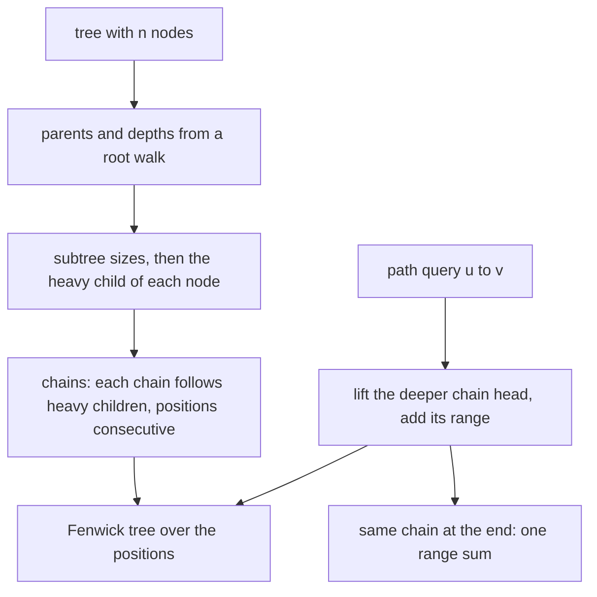
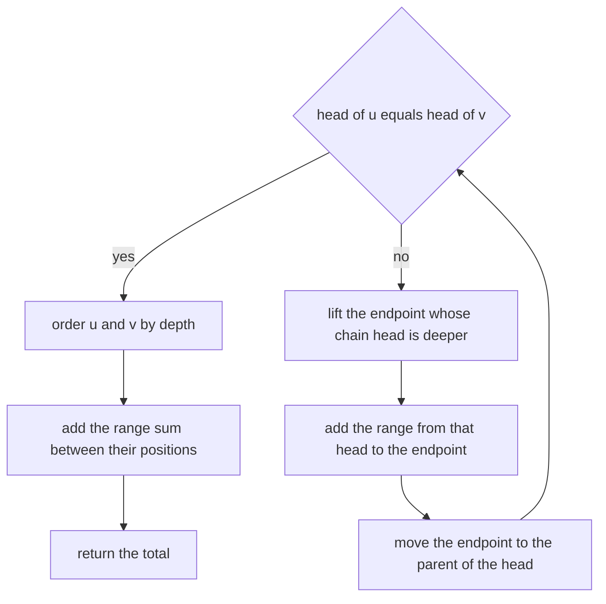
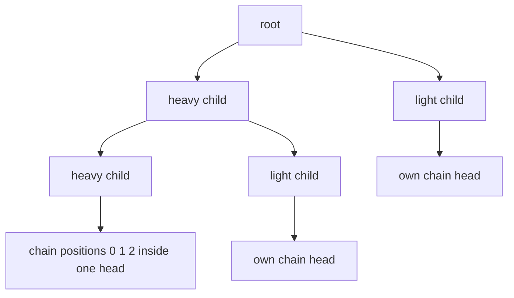
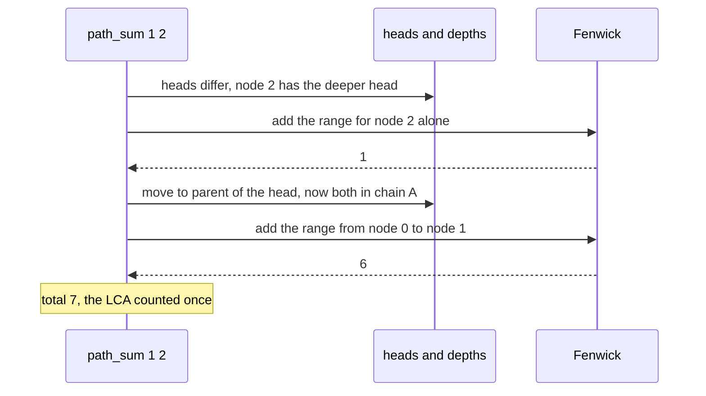

# 400 — Implement heavy-light decomposition basics for path queries.

> **Tier:** Intermediate · **CTCI chapter:** Ch 4 — Trees and Graphs
> **Task spec:** [400-implement-heavy-light-decomposition-basics-for-path-queries.md](../../../tasks/intermediate/400-implement-heavy-light-decomposition-basics-for-path-queries.md)
> **Solutions:** [Python](../../../solutions/python/intermediate/400-implement-heavy-light-decomposition-basics-for-path-queries/solution.py) ·
> [Java](../../../solutions/java/intermediate/400-implement-heavy-light-decomposition-basics-for-path-queries/Solution.java) ·
> [JavaScript](../../../solutions/javascript/intermediate/400-implement-heavy-light-decomposition-basics-for-path-queries/solution.js) ·
> [C#](../../../solutions/csharp/intermediate/400-implement-heavy-light-decomposition-basics-for-path-queries/Solution.cs)

## 1. Problem restatement

**Input:** a tree with `n` nodes, one value per node, and a sequence of operations: a **point update**
(change a node's value) or a **path query** (sum the values on the path between two nodes, endpoints
included).

**Output:** the structure `HeavyLight` exposes

- `update(node, value)` — replace a node's value,
- `path_sum(u, v)` — the sum of the values on the `u`–`v` path,
- and internally `head`, `pos`, `depth`, `parent`, `size`, `heavy`, plus a `Fenwick` tree over the
  positions.

The contract is fixed by the assertions:

| Call | Result | Why |
| --- | --- | --- |
| path `0-1-2-3` with values `[1,2,3,4]`, `path_sum(0, 3)` | `10` | the whole path, one chain |
| `path_sum(0, 0)` | `1` | a single node |
| `path_sum(1, 2)` | `5` | the middle two nodes |
| after `update(2, 10)`, `path_sum(0, 3)` | `17` | the old value `3` becomes `10` |
| `path_sum(1, 2)` after the update | `12` | `2 + 10` |
| `path_sum(2, 2)` after the update | `10` | the updated node itself |
| star `0-1`, `0-2` with values `[5,1,1]`, `path_sum(1, 2)` | `7` | two chains: the query climbs from node `2` to the head, then crosses |
| `path_sum(0, 0)` on the star | `5` | the centre |
| 25 random trees (`seed = 400`, values in `-5…14`, `n = 2…50`), 12 random queries and a random update each | equal to `brute_path_sum` | the randomised cross-check, including negative values |

`brute_path_sum` is the oracle: BFS from `u` to find parents, then walk from `v` back to `u` adding
values. It is `O(n)` per query, which is exactly what the decomposition is meant to beat.

## 2. Intuition

A path in a tree can be long — in a path graph it is the entire tree — so summing values along a query
path naively costs `O(n)`. Two ideas make it fast:

1. **Flatten the tree into an array** so that range-sum queries are cheap. A Fenwick tree answers a
   contiguous range sum in `O(log n)`, but only if the nodes on the query path occupy contiguous
   positions.
2. **Make the path a small number of contiguous ranges.** That is what the heavy-light labels do: every
   node belongs to a **chain**, a downward path that always follows the **heavy child** — the child with
   the largest subtree. Inside a chain, positions are assigned consecutively, so any chain segment is one
   contiguous range. Every light edge (a non-heavy parent-child edge) leads to a subtree at most half the
   size of its parent's, so a root-to-node path crosses at most `O(log n)` chains.

A path query is then a climb: while the two endpoints are in different chains, lift the one whose chain
head is deeper, add its chain segment, and jump to the parent of that head. When both endpoints are in
the same chain, one final range sum covers the rest, including the LCA.



The heavy choice is what makes the decomposition useful rather than arbitrary: whichever child you label
heavy, the path from the root to a node uses at most one light edge per halving of the subtree, hence
`O(log n)` chain jumps — and with each jump costing `O(log n)` for the Fenwick range, the query is
`O(log² n)`.

## 3. Algorithm

**Construction.**

1. **Parents and depths.** Walk from the root (`0`) in BFS order, recording `parent[v]` and
   `depth[v] = depth[u] + 1` for each neighbour that is not the parent. The BFS order is kept — it
   guarantees parents appear before children, which the next two passes rely on.
2. **Sizes and heavy children.** Iterate the order **in reverse**: `size[u] = 1 + Σ size[child]`, and
   `heavy[u]` is the child with the largest `size` (ties keep the first child considered, since the
   comparison is a strict `>`).
3. **Chains and positions.** Walk the order forward: a node starts a **new chain** when it is the root or
   when it is not the heavy child of its parent. From that node, follow `heavy` links to the bottom,
   assigning `head[x] = u` and consecutive positions `pos[x]`. Every node is assigned exactly once.
4. **Fenwick initialisation.** Insert `values[node]` at `pos[node]` for every node — `n` point updates.

**Update.** `update(node, value)` computes `delta = value - values[node]`, stores the new value, and calls
`fenwick.add(pos[node], delta)`. Keeping the old value is what makes an arbitrary change a `O(log n)`
point update.

**Query.** `path_sum(u, v)`:

1. While `head[u] != head[v]`: if `depth[head[u]] < depth[head[v]]`, swap `u` and `v` so the deeper head
   is lifted; add `fenwick.range_sum(pos[head[u]], pos[u])`; set `u = parent[head[u]]`.
2. When the heads match, order the endpoints by depth (`u` shallower) and add
   `fenwick.range_sum(pos[u], pos[v])` — this includes the LCA exactly once.

```text
function path_sum(u, v)
    total ← 0
    while head[u] != head[v] do
        if depth[head[u]] &lt; depth[head[v]] then
            swap u and v
        end
        total ← total + fenwick.range_sum(pos[head[u]], pos[u])
        u ← parent[head[u]]
    end
    if depth[u] &gt; depth[v] then
        swap u and v
    end
    total ← total + fenwick.range_sum(pos[u], pos[v])
    return total
end

function build_chains(order, heavy, parent)
    position ← 0
    for u in order do
        if u is the root or heavy[parent[u]] != u then
            x ← u
            while x != none do
                head[x] ← u
                pos[x] ← position
                position ← position + 1
                x ← heavy[x]
            end
        end
    end
end
```



The Fenwick tree itself is the standard one: `add(index, delta)` walks `i += i & -i` upward, and
`prefix(count)` walks `i -= i & -i` downward, so `range_sum(left, right)` is
`prefix(right + 1) - prefix(left)`.



## 4. Worked example

**The path `0-1-2-3` with values `[1, 2, 3, 4]`.** The tree is a line, so every child is the heavy child
of its parent and the whole tree is a single chain.

| Pass | Result |
| --- | --- |
| parents, depths | `parent = [-1, 0, 1, 2]`, `depth = [0, 1, 2, 3]` |
| sizes (reverse order) | `size = [4, 3, 2, 1]`, `heavy = [1, 2, 3, -1]` |
| chains | node `0` starts the chain; following heavy links assigns `head = [0, 0, 0, 0]` and `pos = [0, 1, 2, 3]` |
| Fenwick | values at positions `0,1,2,3` are `1, 2, 3, 4` |

`path_sum(0, 3)`: the heads are equal, so one ordered range covers everything —
`range_sum(0, 3) = 1 + 2 + 3 + 4 = 10`. `path_sum(1, 2) = 2 + 3 = 5` and `path_sum(0, 0) = 1`.

After `update(2, 10)`: the delta is `10 - 3 = 7`, so position `2` becomes `10`. The same queries now
return `17`, `12` and `10`, all asserted.

**The star `0-1`, `0-2` with values `[5, 1, 1]`.** Here the centre has two children of equal size, so the
tie-break matters.

| Pass | Result |
| --- | --- |
| parents, depths | `parent = [-1, 0, 0]`, `depth = [0, 1, 1]` |
| sizes, heavy | `size = [3, 1, 1]`; the first child (`1`) wins the tie, so `heavy = [1, -1, -1]` |
| chains | node `0` starts chain `A`, taking `0` at position `0` and its heavy child `1` at position `1`; node `2` is not the heavy child of `0`, so it starts chain `B` with position `2` |

`path_sum(1, 2)` exercises the climb:

| Step | `head[u]`, `head[v]` | Comparison | Action | Total |
| --- | --- | --- | --- | --- |
| 1 | `head[1] = 0`, `head[2] = 2` | `depth[0] = 0 < depth[2] = 1`, so swap | add `range_sum(pos[2], pos[2]) = 1`; `u = parent[2] = 0` | `1` |
| 2 | `head[0] = 0`, `head[1] = 0` | equal → exit the loop | `depth[0] = 0 <= depth[1] = 1`, add `range_sum(0, 1) = 5 + 1` | `7` |

The result `7` matches the assertion, and the star is the smallest shape that needs two chains: the
light edge `0–2` is the one that forces the climb. Note that the LCA (`0`) is counted in the final range
sum, not twice.



**The randomised harness.** 25 trees are generated with `seed = 400`: node `i` attaches to
`seed mod i`, values are in `-5…14`. Each tree gets twelve rounds; every round performs a random path
query, checks it against the BFS oracle, applies a random point update, and re-checks the same query.
That means both the queries and the updates are validated against an implementation that shares nothing
with the decomposition. Negative values are included on purpose: the Fenwick deltas must be signed.

## 5. Complexity

Let `n` be the number of nodes.

| Measure | Bound | Why it holds |
| --- | --- | --- |
| Parent/depth pass | O(n) | one BFS traversal |
| Sizes and heavy children | O(n) | one reverse pass over the order, one comparison per edge |
| Chain assignment | O(n) | every node is assigned a position exactly once |
| Fenwick initialisation | O(n log n) | `n` point updates |
| `update` | O(log n) | one Fenwick point update |
| `path_sum` | O(log² n) | at most `O(log n)` chain segments, each a Fenwick range in `O(log n)` |
| Chains on any root path | O(log n) | each light edge at most halves the subtree size |
| Space | O(n) | adjacency, six arrays and the Fenwick tree |
| Brute-force oracle | O(n) per query | BFS plus a walk along the path |
| Harness coverage | 25 trees × 12 rounds, each with a query and an update | cross-checked against the oracle |

The `O(log² n)` query is the headline: a path graph with 10⁵ nodes turns a `10⁵`-step walk into a couple
of dozen array operations. The trade is the `O(n log n)` build and the extra `O(n)` of arrays — for a
single query the brute force wins, and heavy-light only pays off when queries are repeated against a
tree that changes.

## 6. Pitfalls and edge cases

- **A chain interval must be contiguous in the position array.** Positions are handed out by walking
  heavy links to the bottom, so a chain is one consecutive block. Assigning positions in, say, BFS order
  instead would leave a query's segment scattered and the Fenwick range would include unrelated nodes.
- **The heavy child is the largest subtree, and ties must be deterministic.** `best` starts at `0` and
  the test is a strict `>`, so the first child considered wins a tie — as in the star, where `1` becomes
  heavy and `2` starts its own chain. A different tie-break still produces a valid decomposition but a
  different position layout.
- **The climb compares head depths, not node depths.** Lifting the endpoint with the deeper *head* is
  what keeps the loop moving; comparing node depths can leave the heads unchanged and loop forever.
- **The final range includes both endpoints and the LCA.** After the loop, the shallower endpoint may be
  the LCA itself, and `range_sum(pos[u], pos[v])` counts it once. Adding the endpoints separately in the
  loop, and then also in the last range, would double count.
- **`u = v` works without a special case.** Both heads are equal immediately, and the final range is a
  single position — asserted as `path_sum(0, 0) == 1`.
- **Updates need the previous value.** `update` computes `delta = value - values[node]` and stores the
  new value; without keeping `values`, an update could only be expressed as "add", and the tests' random
  assignment of new values would break.
- **Negative values are ordinary.** The harness draws values in `-5…14`, so the Fenwick must accept
  negative deltas and the sums may be negative; nothing in the structure assumes non-negativity.
- **The parent of the root is never dereferenced.** `parent[head[u]]` is only reached when the two heads
  differ and the deeper head is lifted; the root's head has depth `0`, the minimum, so it is never the
  lifted side. That is why `parent[0] = -1` is safe.
- **The BFS order is load-bearing twice.** It gives parents before children for the depth pass, and its
  reverse gives children before parents for the sizes pass; the chain pass also walks it forward.
  Replacing it with an arbitrary node order would break both.
- **A single heavy chain is the best case, not the general one.** In a path graph every root-to-node path
  is one chain (as the worked example shows), but a star with `n` leaves has `n - 1` chains of length
  `1` stacked at the same depth, so a leaf-to-leaf query visits exactly two of them. The `O(log n)` bound
  comes from the halving argument, which is why an unbalanced *heavy* choice is safe but an arbitrary one
  is not.
- **The oracle is a different algorithm on purpose.** `brute_path_sum` rebuilds parents from `u` by BFS
  and walks the path from `v`; it shares no tables with the decomposition, so the assertions are a real
  cross-check rather than a restatement.

## 7. Variants and follow-ups

- **Segment tree instead of Fenwick.** The position array supports any associative range aggregate — sum,
  min, max, or a lazy-propagated assignment — which is what real HLD implementations use; the Fenwick
  here covers only sums and point updates.
- **Subtree queries too.** The same positions, assigned in chain order, keep every subtree contiguous
  only under a DFS-based layout; a variant that runs the heavy chains in DFS order gives both path and
  subtree ranges.
- **The centroid alternative.** A different decomposition answers distance queries without chains, by
  removing centroids instead of labelling heavy edges — the sibling task
  [399-implement-centroid-decomposition-on-tree-for-distance-queries.md](../../../tasks/intermediate/399-implement-centroid-decomposition-on-tree-for-distance-queries.md).
- **Euler tour and LCA.** HLD's climb doubles as an LCA routine (the last node before the heads match),
  which is why the technique shows up in problems that only need the lowest common ancestor plus one
  aggregated value.
- **Where the range machinery comes from.** The Fenwick tree here is the same point-update/range-query
  structure used in the interval tasks, such as
  [361-implement-interval-stabbing-queries-with-segment-tree.md](../../../tasks/intermediate/361-implement-interval-stabbing-queries-with-segment-tree.md)
  and [329-range-intersection-queries-interval-trees-basics.md](../../../tasks/intermediate/329-range-intersection-queries-interval-trees-basics.md).

## 8. Check yourself

1. Why does every root-to-node path cross at most `O(log n)` chains?

<details><summary>Show answer</summary>

Because each chain change moves the path across a **light** edge — a parent-child edge where the child is
not the heavy child. A light child's subtree has at most half the size of its parent's subtree (otherwise
it would have been selected as heavy), so the subtree size halves at every chain boundary along a
root-to-node path. Halving can happen at most `log₂ n` times.

</details>

2. Why must positions be assigned by following heavy links rather than in arbitrary order?

<details><summary>Show answer</summary>

Because a query adds a chain segment as one Fenwick range, which requires the segment to be a contiguous
block of positions. Following heavy links to the bottom and giving out consecutive positions makes every
chain contiguous. Arbitrary ordering would scatter a chain's nodes, and a range sum would include
unrelated nodes from other chains.

</details>

3. In `path_sum(1, 2)` on the star, why is node `0` counted exactly once?

<details><summary>Show answer</summary>

The loop lifts node `2`'s chain first (adding just node `2`), then moves to node `0`'s chain — the parent
of `2`'s head — where the heads now match. The final range `range_sum(pos[0], pos[1])` covers both node
`0` and node `1`, so the LCA is included in that range only; the loop never adds node `0` separately.

</details>

4. What does `update` do differently from a full rebuild, and why does it need `self.values`?

<details><summary>Show answer</summary>

It performs a single Fenwick point update at `pos[node]` with the delta between the new and old value —
`O(log n)` instead of `O(n)` or `O(n log n)`. The old value has to be remembered because a caller supplies
an absolute new value, not a delta; without `self.values` the structure could not compute the correction
and the Fenwick would drift away from the real values.

</details>

5. The harness checks every query twice — once before and once after a random update. Why is the second
   check important?

<details><summary>Show answer</summary>

Because the Fenwick holds the values, and a bug in the update path (a wrong delta, a wrong position, a
stale cached value) would only surface after an update. Re-running the same query against the BFS oracle
after the change verifies that the structure stays consistent under mutation, not just on a freshly built
tree.

</details>
