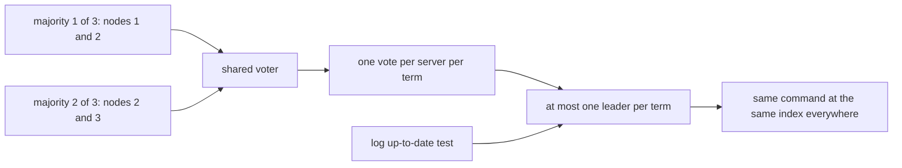
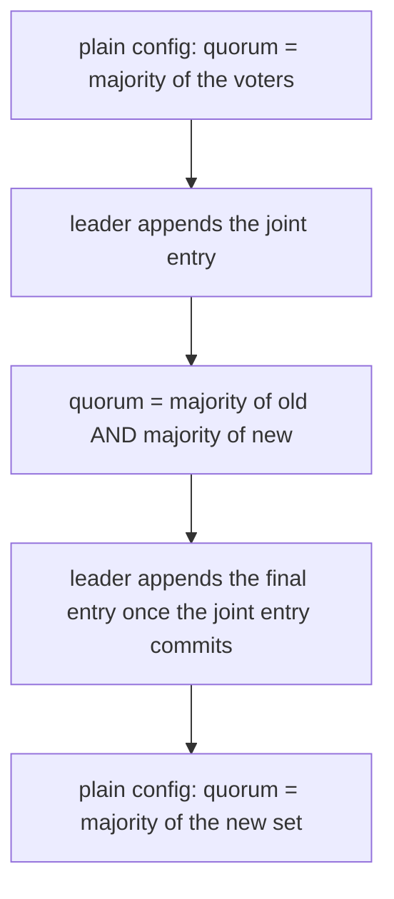
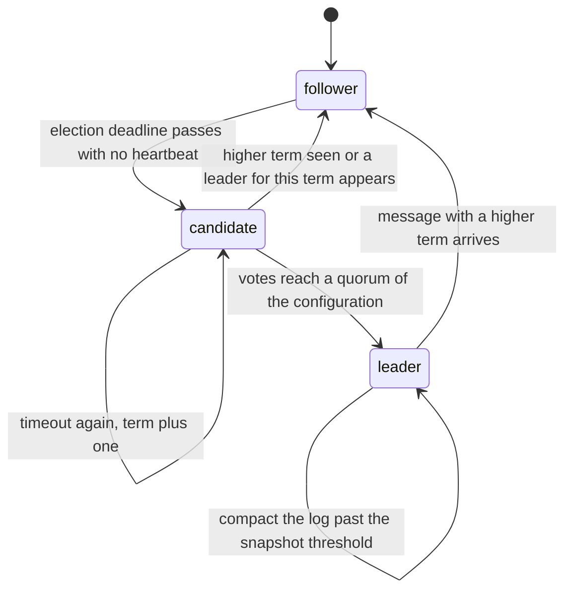
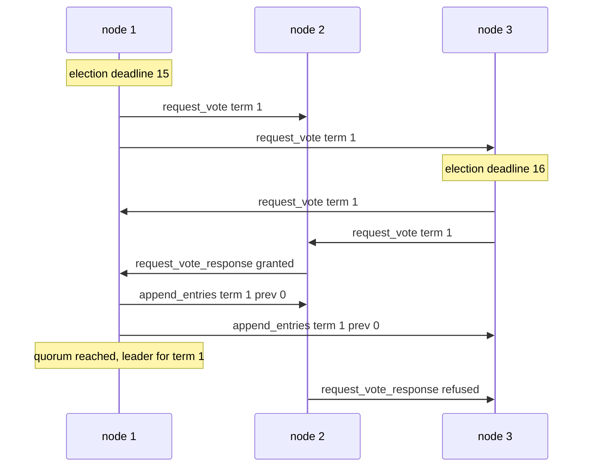

# 801 — Implement production-grade Raft library (replication, reconfiguration, snapshots).

> **Tier:** Master · **CTCI chapter:** Ch 9 — System Design and Scalability
> **Task spec:** [801-implement-production-grade-raft-library-replication-reconfigurat.md](../../../tasks/master/801-implement-production-grade-raft-library-replication-reconfigurat.md)
> **Solutions:** [Python](../../../solutions/python/master/801-implement-production-grade-raft-library-replication-reconfigurat/solution.py) ·
> [Java](../../../solutions/java/master/801-implement-production-grade-raft-library-replication-reconfigurat/Solution.java) ·
> [JavaScript](../../../solutions/javascript/master/801-implement-production-grade-raft-library-replication-reconfigurat/solution.js) ·
> [C#](../../../solutions/csharp/master/801-implement-production-grade-raft-library-replication-reconfigurat/Solution.cs)

## 1. Problem restatement

**The modelling contract first**, because "production-grade Raft" in one process can mean many
things. What the four solutions build is a *faithful in-process simulation*: every server runs the
full protocol state machine (`follower`, `candidate`, `leader`), and all communication travels over
an explicit deterministic network of `(deliver_at, seq, src, dst, payload)` messages with per-link
one-way latency and FIFO ordering. There is no disk, no thread, no socket: time is an integer tick
advanced by the driver, latencies are 1..3 ticks and election timeouts are 14..21 ticks
(`ELECTION_TIMEOUT_BASE = 14`, `ELECTION_TIMEOUT_JITTER = 8`, `HEARTBEAT_INTERVAL = 4`,
`LATENCY_BASE = 1`, `LATENCY_JITTER = 2`). That is what makes every run reproducible and the
invariants cheap to check.

What is *simulated*: elections with seeded timeouts, `RequestVote` with the log-up-to-date test and
the "recent leader" vote-suppression rule, `AppendEntries` carrying `prev-log-index/term` with a
term-based backtrack hint, commit only once an entry of the *current* term is stored on a quorum,
log compaction with `InstallSnapshot`, and single-change joint-consensus reconfiguration.

What is *asserted* (never assumed — `Cluster` records every leadership claim and every apply in
`note_leader`/`note_applied`, so a violation would be observed rather than engineered away):
election safety, state machine safety, log matching over recorded snapshots of every live log,
leader completeness across a leader crash, snapshot equivalence against `replay`, liveness while a
quorum is reachable, and quorum arithmetic against a brute-force subset enumeration.

What is *omitted* versus etcd/tikv-raft: chunked snapshot streaming (one whole-image message here),
the paper's "catch the new server up before the joint entry commits" bookkeeping (new servers start
empty and are caught up by ordinary replication), ReadIndex/lease reads, pre-vote, and the client
session layer.

**Inputs.** A cluster of `n` servers and a command stream:

| Call | Meaning |
| --- | --- |
| `Cluster(ids, seed, snapshot_threshold)` | build the servers, the network and the driver |
| `submit(command)` | append `("set", k, v)` / `("incr", k, d)` / `("del", k)` through the current leader |
| `run(rounds, record_every)` | tick every node, deliver due messages, apply committed entries, advance the tick |
| `crash(id)` / `revive(id)` / `wipe(id)` / `change_config(voters)` | stop, restart with state, restart empty, re-append a joint configuration |

**Outputs.** A deterministic report plus the assertion set behind it. The run in `main()` prints:

```text
runs: 3-server failover term 1 -> 2, 40 increments on 5 servers, snapshot at index 24, 3->5->3 reconfiguration
recorded log states: 116, committed entries: 40, safety violations: 0
messages for 12 commands on 5 servers: 294 (24.5 per command, 0 dropped)
```

| Scenario | Expected result |
| --- | --- |
| `Cluster([1,2,3], seed=7)`, stepped until a leader exists | term-1 leader is **node 1**; seeded deadlines were 15 (node 1), 16 (node 3), 20 (node 2) |
| `submit(("set","x",1))` on that leader | all three `machine` dicts become `{"x": 1}`, with `commit_index = last_applied = 1` and `term_at(1) = 1` |
| `Cluster([1,2,3], seed=31, snapshot_threshold=4)` after six sets with node 3 down | `snapshot_index = 4`, `snapshot_term = 1`, `image = {k0:0, k1:1, k2:2, k3:3}`, log keeps only `k4`, `k5`, `prefix_terms = [(1, 1)]` |
| a previously wiped node is revived | the leader must send at least one `InstallSnapshot`, and the node ends with `machine == nodes[1].machine` |
| three servers, two crashed | `leader() is None` after 600 ticks, with no recorded safety violation |

## 2. Intuition

The naive replication design is one leader that broadcasts every command and a follower that stands
in when the leader dies. It breaks the moment the network partitions: two leaders can each collect
"a majority" if you forget that majorities of the same set must intersect, and a stale follower can
be elected with a *shorter* log and then overwrite committed entries. Adding elections without a
term concept makes it worse, because two elections in flight are indistinguishable from a late
reply of an old one.

The key insight is that Raft's safety rests on exactly two pieces of arithmetic:

1. **Quorums intersect.** Any two majorities of the same `n` share a server, and a server votes at
   most once per term, so at most one leader exists per term.
2. **Terms are monotone and elections compare logs.** A candidate can only win with a log at least
   as up to date (`last term`, then `length`) as every voter's, so a leader always holds every
   committed entry.

Everything else is bookkeeping that keeps those two true under failures: `prev-log-index/term` on
`AppendEntries` makes log matching inductive, "commit an entry of the current term only" stops the
commit index outrunning an entry that could still be overwritten, and joint consensus makes quorum
arithmetic a majority of *two* sets so a reconfiguration can never produce disjoint majorities.



Joint consensus changes only the quorum predicate: during a reconfiguration a set is a quorum when
it is a majority of the old configuration *and* a majority of the new one, so no quorum of the
transition can intersect neither side.



## 3. Algorithm

The driver loop (`Cluster.step`) is the whole "cluster" in five steps:

1. Take `now = net.now` and increment the round counter.
2. For every live node in id order call `tick(now, cluster)`: a follower whose `election_deadline`
   passed calls `start_election`; a leader calls `_replicate` when the heartbeat interval elapsed
   and `_advance_commit` whenever a match index moved.
3. `net.deliver_due()` pops every message with `deliver_at <= now` in `(time, seq)` order and hands
   it to `node.receive`, counting messages addressed to dead nodes as dropped.
4. For every live node `apply_committed(cluster)` applies the newly committed prefix in index order
   to the deterministic state machine, then `net.now` moves to the minimum of the next queued
   delivery and every node's `next_event_time()`, never backwards.

Serving a vote request (`RaftNode.handle_request_vote`):

1. Adopt a higher term through `step_down` and clear `voted_for`.
2. Ignore the request entirely if a leader is live and the suppression window has not expired — no
   term bump, no vote.
3. Refuse if `voted_for` names somebody else in this term.
4. Refuse unless the candidate's log is up to date: compare `(last_log_term, last_log_index)`.
5. Otherwise grant: set `voted_for`, `persist()` the hard state, reset the election deadline.

Serving an append (`RaftNode.handle_append_entries`):

1. Adopt a higher term; reject a lower term without touching the log.
2. Reject a same-term message from anything other than the known leader.
3. If `prev_log_index` has a different term, truncate there and answer with the *first index of the
   conflicting term* — the term-based backtrack hint that saves a round trip per conflicting entry.
4. Append, advance `commit_index` to `min(leader_commit, last_log_index)`, answer with `match_index`.

```text
procedure start_election(node, now, cluster)
    node.state ← candidate
    node.current_term ← node.current_term + 1
    node.voted_for ← node.id
    node.votes ← {node.id}
    node._reset_deadline(now, node.current_term)
    voters ← node.config_voters, or the union of both halves when node.joint is set
    for each voter in voters except node.id do
        network.send(node.id, voter, ("request_vote", node.current_term, node.id,
                                      node.last_log_index(), node.last_log_term()))
    end
    if has_quorum(node.votes, node.config_voters, node.joint) then
        node.become_leader(now, cluster)
    end
end

procedure advance_commit(node, cluster)
    for candidate ← node.last_log_index() down to node.commit_index + 1 do
        if node.term_at(candidate) = node.current_term and
           the voters with match_index >= candidate form a quorum then
            node.commit_index ← candidate
            break
        end
    end
end
```

`become_leader` is the one-line transition that follows a won election: it records the claim with
`cluster.note_leader`, initialises `next_index`/`match_index` for every voter and replicates at once.
The commit rule has two clauses on purpose: an entry counts as committed when it sits on a quorum
*and* belongs to the leader's own term. A leader that simply counted replicas of an old-term entry
could commit something a future leader is still free to overwrite.



## 4. Worked example

`Cluster([1, 2, 3], seed=7)`, ticked until a leader exists. The seeded deadlines are 15 (node 1),
16 (node 3) and 20 (node 2) — the jitter of `ELECTION_TIMEOUT_JITTER = 8` is what keeps
simultaneous candidacies rare. Each row is one queued message, with the tick at which it was *sent*
(delivery happens 1..3 ticks later, FIFO per link).

| Tick | Event | Effect on the election |
| --- | --- | --- |
| 15 | node 1's deadline fires | becomes candidate in term 1, votes for itself, sends `request_vote` to 2 and 3 |
| 16 | node 3's own deadline fires | campaigns in term 1 too, sends `request_vote` to 1 and 2 |
| 17 | node 2's grant reaches node 1 | node 1 holds `{1, 2}`, a majority of 3 |
| 18 | node 1 calls `become_leader` | records the term-1 claim and sends `append_entries` to 2 and 3 |
| 18 | node 1 answers node 3's request | refused: it already voted for itself in term 1 |
| 18 | node 2 refuses node 3 | it already voted for node 1 in this term |
| — | final state | node 1 leader/term 1, node 2 follower/term 1 (deadline 35), node 3 candidate/term 1 (deadline 34) |

Node 3 stays a candidate because it never reached a majority; the next heartbeat (tick 22 below)
resets its deadline and returns it to `follower`. That is the liveness half of the protocol, and the
reason the driver asserts `wait_for_leader` instead of sleeping.



**Committing one command**, continuing the same run. `submit(("set","x",1))` is called at tick 19
and returns index 1; the leader's log is then `[(1, ("set","x",1))]`.

| Tick | Message | Consequence |
| --- | --- | --- |
| 19 | `append_entries_response` from node 2 arrives | reply to the tick-18 heartbeat |
| 21 | `append_entries_response` from node 3 arrives | node 3 back to `follower` |
| 22 | leader sends `append_entries` with `prev = 0` to 2 and 3 | the entry rides the next heartbeat |
| 24 | both responses arrive | a majority has `match_index >= 1` and the entry is of term 1, so `commit_index = 1` |
| 24 | `apply_committed` on every node | all three machines hold `{"x": 1}` |
| — | final state | `commit_index = last_applied = 1`, `term_at(1) = 1`, `last_log_index = 1` on all three |

Compaction on the same code path, with `snapshot_threshold = 4` and node 3 crashed: after six
committed `set` commands the leader holds

| Field | Value | Why |
| --- | --- | --- |
| `snapshot_index` / `snapshot_term` | `4` / `1` | the compacted prefix, with `prefix_terms = [(1, 1)]` |
| `image` | `{k0:0, k1:1, k2:2, k3:3}` | the frozen machine, equal to `replay(committed, 4)` |
| `log` | `[(1, ("set","k4",4)), (1, ("set","k5",5))]` | only entries after the prefix survive |

Reviving node 3 with `wipe` empties its log, so the leader's `next_index` falls below the snapshot
index and the lagging server is caught up by `InstallSnapshot` rather than by an `AppendEntries`
that can no longer be built from a compacted prefix.

## 5. Complexity

Let `n` be the number of voting servers and `m` the number of committed commands. Every number below
comes from the simulation: "time" is a virtual tick and "messages" are elements of the network
queue, so these are protocol costs, not throughput or latency of a real cluster.

| Measure | Bound | Why it holds |
| --- | --- | --- |
| Messages per command | `O(n)`; measured 24.5 for 5 servers over 12 commands (294 messages, 0 dropped) | one broadcast of `n - 1` appends plus `n - 1` responses per replication round, amortised against the 4-tick heartbeat |
| Ticks per command | `O(1)` rounds in the steady state, `O(election timeout)` after a crash | the clock jumps to the next interesting event, so idle ticks cost nothing |
| Space per server | `O(committed prefix)`, bounded by the snapshot threshold once compaction runs | `compact()` advances `snapshot_index`; the run asserts `len(log) <= 4 * threshold` |
| Apply cost | `O(m)` total, `O(1)` amortised per entry | each server applies each index exactly once, in index order |
| Election | `O(n)` messages, two round-trip latencies | `request_vote` to `n - 1` peers, grants back |
| Joint reconfiguration | `O(n)` messages per entry, `O(n)` per quorum check | `has_quorum` intersects the granted set with both halves |
| Verification | `O(rounds · n² · log length)` for log matching, `O(2^n)` for the quorum brute force | the checks are exhaustive over recorded states and subsets, and run once per scripted scenario |

The comparison point is a naive single-leader broadcast with no terms: it also spends `O(n)`
messages per command and `O(1)` ticks, but it cannot survive an election and has no answer to
"which of these two leaders is real". Raft's extra cost over that design is heartbeat traffic (an
`n - 1` broadcast every 4 ticks while idle) and the joint-consensus rounds; in exchange elections
are safe and the cost of a leader crash is bounded by one election timeout plus one round trip.

## 6. Pitfalls and edge cases

- **Quorum arithmetic during reconfiguration.** A joint quorum is a majority of the old set *and* a
  majority of the new set: `has_quorum({1,2}, (1,2,3), ((1,2,3),(1,2,3,4,5)))` is false and the
  solution asserts it. Forgetting one half is how a reconfiguration creates disjoint majorities, and
  `_advance_commit` needs the same care with terms: it requires
  `term_at(candidate) == current_term`, so a new leader cannot commit an old-term entry merely
  because it is widely replicated.
- **Vote suppression and double voting.** A `request_vote` arriving while a leader is live is ignored
  *entirely* — no term bump, no vote — so a partitioned server cannot disturb a healthy cluster, and
  two requests with the same term change neither the vote nor the term.
- **Log comparison order, and stale messages.** Compare `last_log_term` first, then
  `last_log_index`, so a longer but older log is refused; a lower-term `AppendEntries` must not move
  the term back and a same-term one from a second leader must be rejected. Both are tested by calling
  the handler with hand-built messages.
- **Quorum arithmetic of one and of none.** `Cluster([9])` must elect itself with `net.sent == 0`
  and commit locally, because a quorum of one is itself; with two of three servers crashed the
  cluster must stay leaderless for 600 ticks instead, and the failed elections must register no
  leadership claim. A predicate that demands two servers breaks the first case, one that accepts a
  minority breaks the second.
- **Snapshot equivalence, wiped versus revived.** The compacted `image` must equal
  `replay(committed, snapshot_index)` and `term_at` must stay answerable inside the prefix — that is
  why `prefix_terms` keeps the term-run boundaries instead of a single index. `revive` keeps log and
  hard state (`from_persisted` round-trips them exactly) while `wipe` clears everything and forces
  the `InstallSnapshot` path; confusing the two hides the bug that a wiped server cannot be caught
  up by appends alone.

## 7. Variants and follow-ups

- **Reads without a log entry.** Adding leases to this protocol turns the log-index question into a
  cluster-time question — [808-implement-highly-available-lease-based-leader-election-with-fail.md](../../../tasks/master/808-implement-highly-available-lease-based-leader-election-with-fail.md)
  models the drift guards that keep two leaders from being active at once.
- **Snapshotting state that lives on many shards.** Raft snapshots one server's prefix; a global
  state needs markers and in-transit sets instead —
  [807-implement-global-scale-consistent-snapshot-across-geographically.md](../../../tasks/master/807-implement-global-scale-consistent-snapshot-across-geographically.md).
- **When a server may lie.** [811-implement-byzantine-fault-tolerant-replicated-state-machine-prac.md](../../../tasks/master/811-implement-byzantine-fault-tolerant-replicated-state-machine-prac.md)
  replaces majorities with `2f + 1` certificates and detects double voting instead of assuming it
  cannot happen.

## 8. Check yourself

1. In the traced election, node 3 became a candidate in term 1 and node 2 refused it. Why is that
   enough, and what has to happen before node 3 stops campaigning?

<details><summary>Show answer</summary>

A candidate needs a majority of votes in its term, and node 2 already voted for node 1 in term 1, so
node 3 can never reach a quorum in that term. It stops being a candidate as soon as it receives an
`AppendEntries` from the leader with `>= current_term`: the handler resets its election deadline and
returns it to `follower` — the heartbeat at tick 22 did exactly that.

</details>

2. Why does `_advance_commit` refuse to commit an entry whose term is older than the leader's?

<details><summary>Show answer</summary>

Because such an entry may still be overwritten. Only an entry of the current term proves that a
majority holds the whole prefix up to that index, which is the induction step of leader
completeness. Committing "widely replicated old-term entries" would let the commit index run ahead
of safety.

</details>

3. A lagging server that was wiped is caught up by `InstallSnapshot`. Why can the leader not simply
   send it an `AppendEntries`?

<details><summary>Show answer</summary>

Because the entries it needs are inside the compacted prefix: the leader's log no longer starts at
index 1, so it cannot build an `AppendEntries` with a `prev_log_index` the follower can match. The
whole image is the only representation of that prefix that still exists, which is why
`snapshot_payload()` exists and why the test asserts `net.installs >= 1`.

</details>
