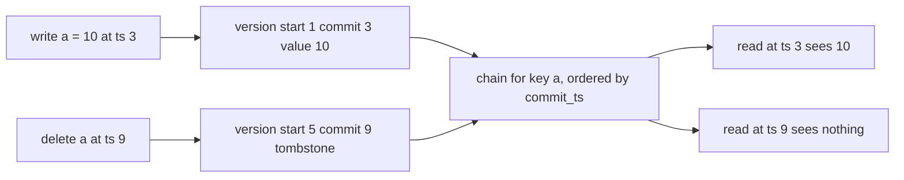
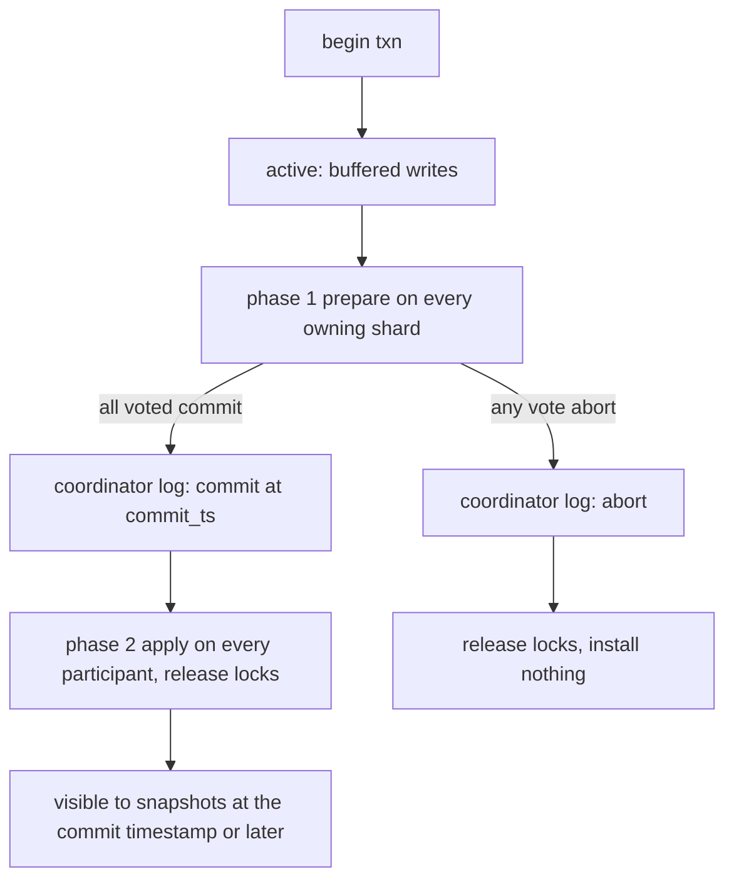
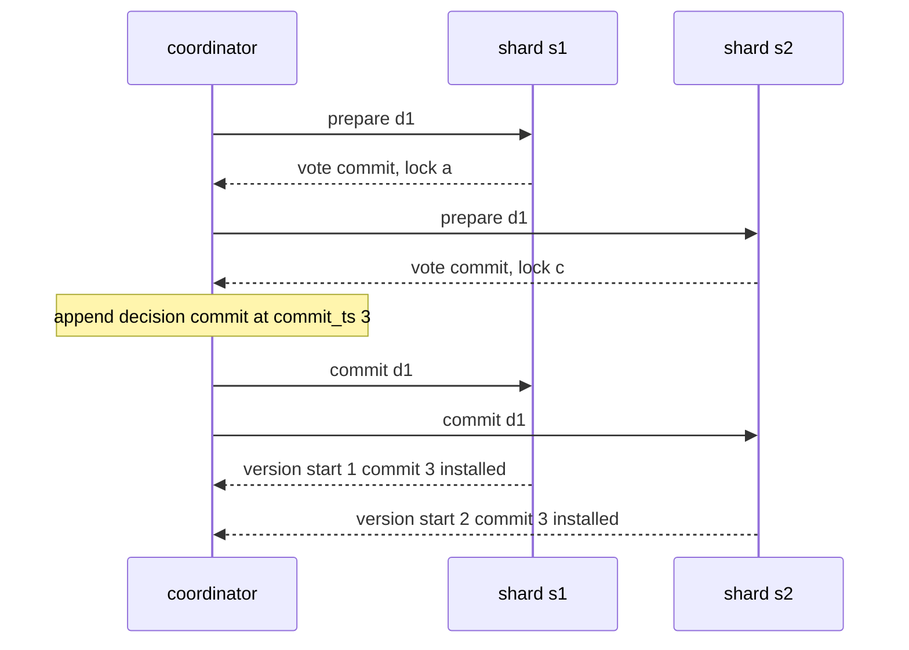

# 802 — Implement fully ACID transactional key-value store with MVCC and 2PC.

> **Tier:** Master · **CTCI chapter:** Ch 9 — System Design and Scalability
> **Task spec:** [802-implement-fully-acid-transactional-key-value-store-with-mvcc-and.md](../../../tasks/master/802-implement-fully-acid-transactional-key-value-store-with-mvcc-and.md)
> **Solutions:** [Python](../../../solutions/python/master/802-implement-fully-acid-transactional-key-value-store-with-mvcc-and/solution.py) ·
> [Java](../../../solutions/java/master/802-implement-fully-acid-transactional-key-value-store-with-mvcc-and/Solution.java) ·
> [JavaScript](../../../solutions/javascript/master/802-implement-fully-acid-transactional-key-value-store-with-mvcc-and/solution.js) ·
> [C#](../../../solutions/csharp/master/802-implement-fully-acid-transactional-key-value-store-with-mvcc-and/Solution.cs)

## 1. Problem restatement

**The modelling contract.** The distributed store lives in one process. Keys are partitioned over
shards ("participants") — `fresh_store()` gives `s1` the keys `a`/`b` and `s2` the keys `c`/`d` — and
each shard holds a **multi-version** map: one version chain per key whose entries carry
`(start_ts, commit_ts, value, tombstone)`. Timestamps come from a single monotone coordinator counter,
and a version's `commit_ts` is also its write timestamp, so a read at `ts` sees exactly the newest
version with `commit_ts <= ts`. Writes are buffered in the transaction and only reach the shards
through two-phase commit: phase one is `prepare`, phase two is `apply`/`release`.

The interesting uncertainty is *not* the network (there is none — messages are an explicit outbox
drained on demand). It is the interleaving, so the workload is a scripted schedule of actions
(`begin`, `read`, `write`, `delete`, `prepare`, `decide`, `finish`, `commit`, `crash`, `restart`,
`quiesce`) replayed by `run_schedule`, plus a pseudo-random `generated_schedule(seed, steps)`.

**Asserted** (each against an independently written oracle where one exists): atomicity on every
participant or none — including a participant that votes abort and a coordinator crash both before and
after the commit point; durability by rebuilding both participants with `rebuild_shard(name, wal)` and
comparing version chains, decisions and visible state; isolation by comparing the store against
`replay_serial(committed, upto)` (a plain-dict serial replay in commit order); bank-transfer
conservation; timestamp monotonicity; and GC safety by brute force over every snapshot timestamp.

**Omitted** versus CockroachDB/Spanner: one process, no network; participants never time out (the
crash and recovery points are scripted); there is no atomicity across *transaction logs* beyond the
single coordinator log; range scans and predicate locks are absent, so phantom protection is per key;
the storage engine is a dict of lists.

| Call | Meaning |
| --- | --- |
| `System(coords, shards)` / `fresh_store()` | build the coordinator and the participants |
| `begin(txn_id)` / `read` / `write` / `delete` | snapshot reads and buffered writes |
| `prepare(txn_id)` | phase 1: every participant votes `(True, "commit")` or `(False, reason)` |
| `decide(txn_id)` / `finish(txn_id)` | the commit point, then phase 2 (`apply` + `release`) |
| `crash_coordinator()` / `restart_coordinator()` | recovery re-ships decided transactions, aborts in-doubt ones |
| `visible_state(ts)` / `Shard.visible(key, ts)` / `gc(watermark)` | what a snapshot sees, and reclamation |

The generated run prints:

```text
generated schedule: 22 committed, 7 aborted, 4 keys, 4 version chains
gc watermark 52: 74 -> 58 versions, snapshots above the watermark unchanged
bank: 41 transfers, 23 committed, total preserved at 400
```

| Scenario | Expected result |
| --- | --- |
| `w1` and `w2` both write `a`, `w1` prepares first | votes `(True, False)`; `w2.reason == "s1: key a locked by w1"` |
| the same pair after `decide`/`finish` | `w1.commit_ts == 3`, one version `(start 1, commit 3, 1)`, `visible_state() == {"a": 1}`, `locks_held() == {}` |
| `t2` writes `b`, `t3` (started earlier) reads `b` twice around `t2`'s commit | both reads return `None` — the snapshot never moves |
| `x1` writes `a` and `c`, but `c` was committed after `x1.start_ts` | `prepare` is `False`, `s1.locks == ["a"]`, `s2.locks == []`, and after the abort both shards are untouched |
| `d1` prepares and decides `commit`, then the coordinator crashes | `quiesce() == 0` and `visible_state() == {}`; after `restart_coordinator()` it re-ships 2 decisions and the state becomes `{"a": 7, "c": 8}` |

## 2. Intuition

The naive design is a single lock per key with read and write locks: reads block while a writer
holds a lock, and a coordinator that dies holding locks blocks the store until a timeout fires. Both
problems are structural. Blocking readers make throughput collapse under contention, and a *cascade*
of locks turns one slow transaction into a store-wide stall that a timeout can only resolve by
guessing.

The key insight is to separate *what a transaction sees* from *what is currently being written*:

- **Readers take no locks at all.** Every write installs a new version instead of overwriting, so a
  reader can be handed the version that was current when it started and keep that consistent picture
  forever. This is snapshot isolation, and it is the reason `visible(key, ts)` never blocks.
- **The only conflict that matters is write–write.** Two transactions that write the same key must
  not both commit, and the cheapest way to detect that is a per-key write lock taken only in phase
  one. No-wait locking (abort instead of wait) makes the lock graph acyclic by construction, so 2PL
  here is deadlock free.
- **The commit point is a single record.** The coordinator appends its decision to its own log and
  *then* sends phase two. Everything before that record may be aborted; everything after it is
  re-shipped on recovery until every participant has applied it.



The two-phase part is what makes a *multi-shard* transaction atomic: nothing is installed until every
owner has voted, so an abort leaves no half-written row behind, and the decision record is the only
thing recovery needs.



## 3. Algorithm

Writing and reading inside a transaction:

1. `begin(txn_id)` stamps the transaction with `start_ts = next_ts()` and an empty read/write set.
2. `read(txn_id, key)`: if the key is in the buffer return the buffered value (read-your-writes);
   otherwise ask the owning shard for `visible(key, start_ts)` and record the answer in
   `read_history[key]`.
3. `write`/`delete`: buffer `value`, or `TOMBSTONE` for a delete — nothing reaches a shard yet, and
   `participants(txn)` is simply the set of shards owning the written keys.

Two-phase commit:

1. `prepare(txn_id)`: for every participant, `Shard.prepare` refuses if any written key is locked by
   another transaction or if the key's newest `commit_ts` is greater than `start_ts`
   (first-committer-wins); otherwise it takes the locks, records `prepared[txn_id]` and appends a
   `("lock", ...)` record to its write-ahead log.
2. Any refusal aborts the transaction; because a refusal happens *before* the locks of that
   participant are taken, the abort only has to release what earlier participants already hold.
3. `decide(txn_id)`: if every participant voted commit, append `("decision", txn_id, commit_ts)` to
   the coordinator log and return `commit`; otherwise return `abort`. This record is the commit point.
4. `finish(txn_id)`: ship "commit" — `Shard.apply(txn_id, commit_ts)` installs every buffered version
   with `commit_ts` and releases the locks — or "abort", which only releases the locks.
5. `Shard.apply` is idempotent via `decided[txn_id]`, so re-shipping a decision is harmless.

```text
procedure prepare(txn_id)
    txn ← transactions[txn_id]
    votes ← []
    for each participant in participants(txn) do
        vote, reason ← participant.prepare(txn_id, txn.start_ts, txn.writes)
        note_vote(txn_id, participant.name, vote)
        votes.append(vote)
        if not vote then
            txn.reason ← participant.name + ": " + reason
            return False
        end
    end
    return all(votes)
end

procedure decide(txn_id)
    txn ← transactions[txn_id]
    if every note_vote(txn_id) is True then
        txn.commit_ts ← next_ts()
        coord_log.append(("decision", txn_id, txn.commit_ts))
        txn.decision ← "commit"
    else
        coord_log.append(("decision", txn_id, "abort"))
        txn.decision ← "abort"
    end
    return txn.decision
end

procedure finish(txn_id)
    txn ← transactions[txn_id]
    for each participant in participants(txn) do
        if txn.decision = "commit" then
            participant.apply(txn_id, txn.commit_ts)     # idempotent
        else
            participant.release(txn_id)
        end
    end
end

procedure recover()
    for each record in coord_log do
        if record is a decision then
            re-ship it to every participant of that transaction   # apply or release
        else
            abort it and release every lock it took               # prepared but never decided
        end
    end
end
```

A trivial consequence of that layout: a transaction with a decision is re-shipped until it is applied
(the `decided` map makes the second ship a no-op), and a transaction that was prepared but never
decided is aborted and its locks dropped.



## 4. Worked example

The canonical write/write conflict, exactly as `main()` drives it: `w1` and `w2` both write `a` in
shard `s1`, and `w1` reaches `prepare` first.

| Step | Action | State afterwards |
| --- | --- | --- |
| 1 | `begin w1` | `w1.start_ts = 1` |
| 2 | `begin w2` | `w2.start_ts = 2` |
| 3 | `write w1 a 1` | buffered only; `s1.versions["a"]` still absent |
| 4 | `write w2 a 2` | buffered only; no conflict yet |
| 5 | `prepare w1` | vote `True`; `s1.locks["a"] = "w1"` |
| 6 | `prepare w2` | vote `False`, `w2.reason = "s1: key a locked by w1"` |
| 7 | `decide w1` | decision `commit`, `w1.commit_ts = 3` — the commit point |
| 8 | `finish w1` | applies version `(start 1, commit 3, value 1, tombstone False)`, releases the lock |
| 9 | `decide w2` / `finish w2` | decision `abort`; nothing installed, nothing to release |
| 10 | `quiesce` | 2 phase-2 messages delivered |

The end state is `visible_state() == {"a": 1}`, `committed == [(3, "w1", {"a": 1})]` and
`locks_held() == {}`. The assertion set checks three consequences of that ordering: `w2` never
appears in the commit order, `s1.decided` has no entry for `w2`, and no version of `a` ever carries
the value `2` — an aborted transaction leaves no trace, only a lock that was released.

A second flavour of the same machinery is the *stale participant* case. `x1` writes `a` (shard `s1`)
and `c` (shard `s2`), but `c` was committed by another transaction at a `commit_ts` above
`x1.start_ts`. `s1.prepare` succeeds and locks `a`; `s2.prepare` refuses because
`newest commit_ts > start_ts`, so the whole transaction aborts and the lock on `s1` is released.
The assertion `sorted(cross.shards["s1"].locks) == ["a"] and sorted(cross.shards["s2"].locks) == []`
pins down the ordering: a participant that is going to refuse must not take its lock first.

Garbage collection closes the MVCC story: `gc(watermark)` keeps, per key, the newest version at or
below the watermark plus every version above it. In the generated run a watermark of 52 turned 74
versions into 58, and the check brute-forces every timestamp at or above the watermark to prove no
snapshot changed; a watermark above the oldest live snapshot is rejected instead of silently
corrupting a reader.

## 5. Complexity

Let `k` be the number of keys a transaction writes, `s` the number of participants it touches, and
`c` the length of a key's version chain. Everything is measured in in-process operations: there is no
network, so "messages" are outbox entries drained by the schedule.

| Measure | Bound | Why it holds |
| --- | --- | --- |
| `prepare` at one participant | `O(k)` plus the chain scan for the newest `commit_ts` | one dict lookup per written key plus a scan of that key's chain |
| Coordinator per transaction | `O(s + k)` | one vote per participant, one buffer per written key |
| `visible(key, ts)` | `O(c)` | the chain is scanned for the newest version with `commit_ts <= ts` |
| `scan(ts)` | `O(total versions)` | one `visible` call per key, which is what the serial oracle replays too |
| Lock footprint | `O(k)` at a time | locks are taken per written key and dropped on apply or release |
| Version storage | `O(commits × keys written)`, trimmed by `gc` | every commit appends a version; GC keeps the newest at or below the watermark plus everything above it |
| Recovery | `O(decided + in-doubt)` | decisions are re-shipped, in-doubt transactions are aborted |

The alternative — a lock-only store with read locks — reads in `O(1)` and writes in `O(1)`, and so
does this one *in the absence of contention*: MVCC's cost is the version chain, which turns a write
into an append and a read into a scan. What it buys is that a reader never blocks a writer and a
writer never blocks a reader, so long transactions stop being a global problem; the price is storage
and GC. The measured run makes that concrete: 22 committed transactions kept 4 version chains, and a
watermark of 52 reclaimed 16 of 74 versions.

## 6. Pitfalls and edge cases

- **A delete is a version, not a removal.** `TOMBSTONE` hides the key from every snapshot that reads
  at or after its `commit_ts` while the old value stays readable at older timestamps; popping the key
  from the map would destroy history and break repeatable read.
- **Repeatable read must be observable.** `read_history[key]` records every read, and the checks
  assert `[None, None]` for two reads around another transaction's commit. A read that "refreshes" the
  timestamp silently breaks the guarantee the transaction was promised.
- **Read-your-writes versus snapshot.** A transaction must see its own buffered write while another
  transaction must not: `t3` reads `None` while `t2` reads `20`.
- **A refusing participant must not leave a lock behind, and first-committer-wins is not optional.**
  Validation compares the *newest committed* `commit_ts` with `start_ts`, so a transaction that
  started before another committed must abort even if the lock is free — the check with `x1` and the
  pre-committed `c` covers exactly that, and the reason string plus the empty lock set on the shard
  that refused are asserted.
- **Crash after the commit point.** The decision is on disk, so recovery must re-ship it; before the
  commit point it must abort. The two cases are tested separately with `crash_coordinator()` placed
  immediately after `decide` and immediately after `prepare`.
- **Idempotent phase two.** `apply` returns `False` without installing anything if `txn_id` is already
  in `decided`, which is what makes a re-shipped decision during recovery safe.
- **GC watermark versus live snapshots.** Lowering the watermark below a live snapshot removes the
  version that snapshot would have read; the implementation rejects such a watermark rather than
  pretending the problem away.
- **Absent key versus tombstone.** Both read as `None` through `visible`, but only the tombstone keeps
  a chain entry — the GC test depends on that distinction.

## 7. Variants and follow-ups

- **Run the coordinator through a replicated log.** The single coordinator log is the one place where
  a real system needs consensus; [801-implement-production-grade-raft-library-replication-reconfigurat.md](../../../tasks/master/801-implement-production-grade-raft-library-replication-reconfigurat.md)
  is that log, and the two tasks together are essentially Percolator.
- **Push the same protocol across shards of a SQL layer.** [804-implement-distributed-sql-with-sharding-routing-and-distributed.md](../../../tasks/master/804-implement-distributed-sql-with-sharding-routing-and-distributed.md)
  runs the same prepare/decide shape over shards that also answer routed queries, joins and top-N.
- **Let replicas conflict instead of locking.** [805-implement-eventual-consistent-multi-master-datastore-with-confli.md](../../../tasks/master/805-implement-eventual-consistent-multi-master-datastore-with-confli.md)
  keeps the multi-version idea but resolves conflicts by merge instead of by abort.
- **Cheaper reclamation.** [806-implement-fully-persistent-b-tree-with-copy-on-write-pages-and-c.md](../../../tasks/master/806-implement-fully-persistent-b-tree-with-copy-on-write-pages-and-c.md)
  is the same "never overwrite, keep old versions readable" idea at page granularity, with a
  reachability collector instead of a watermark.

## 8. Check yourself

1. Why is the write lock taken in phase one rather than at `write` time?

<details><summary>Show answer</summary>

Because taking it early would hold a lock across the whole transaction, which is exactly the
blocking behaviour MVCC is meant to remove — and it would abort transactions that never actually
conflict. Taking it in `prepare` means the lock is held only for the interval between the vote and
`apply`/`release`, and the no-wait rule keeps the lock graph acyclic.

</details>

2. What stops a transaction that started before a conflicting commit from overwriting it?

<details><summary>Show answer</summary>

The `newest > start_ts` test in `Shard.prepare`. It refuses the vote even when the key is unlocked, so
the transaction aborts instead of installing a version on top of a value it never saw — that is
first-committer-wins snapshot isolation, and it is why `x1` cannot lock `s2`.

</details>

3. The coordinator crashes right after `decide`. What must recovery do, and what would it do
   differently for a transaction that only reached `prepare`?

<details><summary>Show answer</summary>

For the decided one it re-ships the decision (`resent == 2` for the two-shard transaction) and phase
two installs the versions idempotently; for a prepared-but-undecided one it aborts and releases the
locks, installing nothing. The test asserts `visible_state() == {}` before recovery and
`{"a": 7, "c": 8}` after, with `locks_held() == {}` in both cases.

</details>

4. Why does GC keep the newest version at or below the watermark *plus* everything above it, instead
   of just truncating the chain at the watermark?

<details><summary>Show answer</summary>

Because the version at or below the watermark is what a snapshot taken exactly at the watermark must
read; dropping it would make that snapshot see nothing. Everything above the watermark belongs to
newer snapshots that may still be live, which is why the watermark itself must not be raised above
the oldest live reader.

</details>
