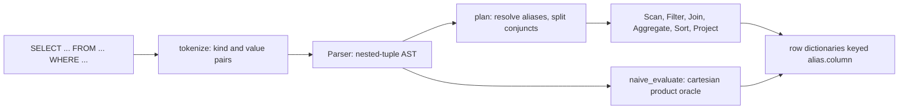
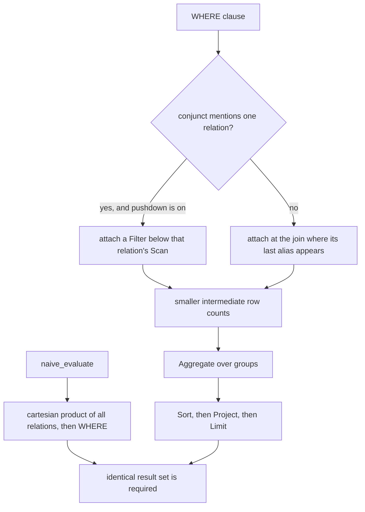
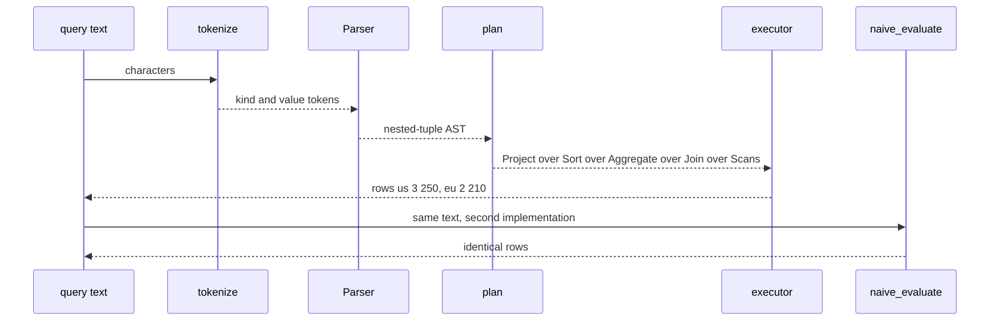

# 803 — Build a small SQL engine with parser, planner, and executor supporting joins and aggregates.

> **Tier:** Master · **CTCI chapter:** Ch 9 — System Design and Scalability
> **Task spec:** [803-build-a-small-sql-engine-with-parser-planner-and-executor-suppor.md](../../../tasks/master/803-build-a-small-sql-engine-with-parser-planner-and-executor-suppor.md)
> **Solutions:** [Python](../../../solutions/python/master/803-build-a-small-sql-engine-with-parser-planner-and-executor-suppor/solution.py) ·
> [Java](../../../solutions/java/master/803-build-a-small-sql-engine-with-parser-planner-and-executor-suppor/Solution.java) ·
> [JavaScript](../../../solutions/javascript/master/803-build-a-small-sql-engine-with-parser-planner-and-executor-suppor/solution.js) ·
> [C#](../../../solutions/csharp/master/803-build-a-small-sql-engine-with-parser-planner-and-executor-suppor/Solution.cs)

## 1. Problem restatement

**The modelling contract.** A complete miniature query engine, end to end, *in one process*: a hand
written `tokenize` scanner, a recursive-descent `Parser` on the precedence ladder
`OR < AND < NOT < comparison < additive < multiplicative < primary`, a `plan` function that resolves
every column and builds a tree of operators, and an executor whose operators are `Scan`, `Filter`,
`Join` (nested loop, `inner`/`left`/`cross`), `Aggregate` (hash groups over
COUNT/SUM/AVG/MIN/MAX with SQL NULL semantics), `Having`, `Sort`, `Project`, `Distinct` and `Limit`.
Rows are plain dictionaries keyed `"alias.column"`.

The correctness contract is deliberately stronger than "it works on my query": everything is checked
against a **second, differently written implementation**. `naive_evaluate` materialises the whole
cartesian product of the relations, applies the complete WHERE — join conditions included — with its
own three-valued evaluator, then groups, sorts and projects in plain Python. A disagreement about
pushdown, join ordering, NULL handling or operator order therefore shows up as a difference between
two result sets.

**Omitted** versus a real engine: no catalog metadata, indexes, statistics or cost model — the join
order is a deterministic smallest-relation-first rule, not a cost-based choice; no transactions, DDL,
subqueries, window functions or UPDATE/DELETE; the type system is Python `int`, `str` and `None`;
GROUP BY keys may be expressions but HAVING/ORDER BY see only the select list, the group keys and the
underlying columns; rows live in memory, so the data set is tiny (4 departments, 6 employees, 4
projects).

| Input | Output |
| --- | --- |
| a query string plus `CATALOG`, a dict of table name to list of row dicts | a list of row dicts with `alias.column` (or alias) keys |
| `plan(select, catalog, pushdown)` | the operator tree, printable through `describe()` |
| `naive_evaluate(text, catalog)` | the oracle's rows, produced by a different algorithm |

The run in `main()` prints:

```text
engine/oracle agreement on 16 queries; pushed plan: ('Project', ('e.name', 'd.region'), ('Join', 'inner', ('Filter', "(d.region = 'us')", ('Scan', 'dept', 'd')), ('Filter', '(e.salary > 80)', ('Scan', 'emp', 'e'))))
catalog: emp 6 rows, dept 4 rows, project 4 rows; cross product 24
grouped totals: [(1, 2, 210), (2, 2, 180), (3, 1, 70), (None, 1, 200)]
```

| Query | Result |
| --- | --- |
| `SELECT COUNT(*), COUNT(mgr), SUM(salary), AVG(salary), MIN(salary), MAX(salary) FROM emp` | `6, 4, 660, 110.0, 70, 200` — `COUNT(*)` counts rows, `COUNT(mgr)` skips the two NULLs |
| `... FROM emp e JOIN dept d ON e.dept_id = d.id GROUP BY region ORDER BY total DESC` | `us` with `n = 3`, `total = 250`; then `eu` with `n = 2`, `total = 210` |
| `SELECT name FROM emp WHERE dept_id = NULL` | no rows: `= NULL` is never true |
| `SELECT nope FROM emp` / `SELECT name FROM emp AS e JOIN dept AS d ON e.dept_id = d.id WHERE region > 1` | `SqlError: unknown column 'nope'` / `SqlError: ambiguous column 'name': matches d, e` |

## 2. Intuition

The naive engine is a chain of string operations: split the query on spaces, look for `SELECT`,
`FROM` and `WHERE`, then loop over every table and every row. It collapses quickly. Without
precedence, `salary > 50 + 60` parses as `(salary > 50) + 60`; without aliases, a self-join cannot say
which `name` it means; without a plan, the `WHERE` clause is applied only after the full cartesian
product, which for this catalog is `6 × 4 = 24` rows per pair and grows multiplicatively with each
added table.

The key insight is that a query has three clearly separable lives:

1. **Syntax.** A lexer produces `(kind, value)` tokens; a recursive-descent parser walks the
   precedence ladder and yields an *immutable nested-tuple AST*. Nothing is evaluated yet, so the
   same AST can be described, re-planned or compared with the oracle's input.
2. **Semantics.** Planning resolves every column reference against the aliases in scope — into a
   `"alias.column"` key — and splits the WHERE into conjuncts. Each conjunct that mentions exactly
   one relation can be pushed into that relation's `Scan`; the rest wait until the join where their
   last alias becomes available. A plan that is wrong about scope fails loudly here instead of
   silently returning rows.
3. **Execution.** Operators produce rows lazily, one relation at a time, so the intermediate row
   count is the *result* size rather than the product size.

Pushing a filter into a scan is the whole performance story of a small engine: the `Scan` reads
fewer rows, and everything above it — joins, aggregates, sorts — sees the reduced input. The planner
also orders joins smallest-relation-first, which is the cheapest deterministic guess you can make
without statistics.



## 3. Algorithm

1. `tokenize(text)` scans characters into `(kind, value)` tokens, rejecting an unterminated string
   literal or an unknown character *with the offending position*.
2. `Parser.parse_select` reads `SELECT [DISTINCT]` items, `FROM` table refs with optional `AS`
   aliases and `JOIN` clauses (`inner`/`left`/`cross` with an `ON` predicate), then `WHERE`,
   `GROUP BY`, `HAVING`, `ORDER BY` (per-key `ASC`/`DESC`) and `LIMIT`; each expression level calls
   the next one down the ladder.
3. `relation_specs(select, catalog)` fixes the alias of every relation and rejects duplicate aliases
   and unknown tables.
4. `resolve(expr, scope)` rewrites `("col", alias, column)` against the in-scope aliases and raises on
   an unknown or ambiguous column.
5. `conjuncts(where)` splits the WHERE on `AND`; `aliases_in(conjunct, known)` decides where each
   conjunct can run, which is what `plan` uses to push single-relation predicates into their scans and
   to attach the remaining ones at the join that introduces their last alias.
6. `collect_calls`/`rewrite_calls` number the aggregate calls into slots, so HAVING and ORDER BY can
   refer to `COUNT(*)` results by position.
7. Execution pulls rows: `Scan` → `Filter` → `Join` → `Aggregate` → `Having` → `Sort` → `Project` →
   `Distinct` → `Limit`.
8. `eval_expr` implements three-valued logic: a comparison with NULL yields NULL, `NOT NULL` is NULL,
   and a WHERE keeps a row only when the predicate is *true*.

```text
procedure plan(select, catalog, pushdown)
    relations ← relation_specs(select, catalog)
    scope ← every alias with its column names
    for each join condition do resolve it against the aliases available so far end
    conjuncts ← split(select.where, "AND")
    pushed, remaining ← [], []
    if pushdown then
        for each conjunct do
            if every alias it mentions belongs to one relation then
                pushed[relation] ← pushed[relation] + conjunct
            else
                remaining ← remaining + conjunct
            end
        end
    else
        remaining ← conjuncts
    end
    node ← Scan(smallest relation) wrapped in a Filter per pushed conjunct
    for each further relation in increasing size order do
        node ← Join("inner", node, Scan(relation), join condition)
        for each conjunct whose last alias just became available do
            node ← Filter(conjunct, node)
        end
    end
    for each remaining conjunct do node ← Filter(conjunct, node) end
    node ← Aggregate(node, group keys, aggregate slots)
    node ← Having / Sort / Project / Distinct / Limit as the query asks
    return node
end

procedure aggregate_rows(groups, calls)
    result ← []
    for each group key and its rows do
        row ← group key columns
        for each call in calls do
            values ← evaluated arguments over the group rows, skipping NULL
            row[call.slot] ← finalize(call.name, values)
        end
        result.append(row)
    end
    return result                     # COUNT of no rows is 0, SUM/AVG/MIN/MAX of no rows is NULL
end
```

`finalize` is where SQL's NULL rules live: `COUNT(*)` counts rows, `COUNT(col)` counts non-NULL
values, `SUM`/`AVG`/`MIN`/`MAX` return NULL for an empty input, and `AVG` divides by the non-NULL
count rather than by the row count.



## 4. Worked example

Take the query

```text
SELECT region, COUNT(*) AS n, SUM(salary) AS total
FROM emp AS e JOIN dept AS d ON e.dept_id = d.id
GROUP BY region ORDER BY total DESC
```

`parse` returns the AST whose `tables` list carries the join condition
`("cmp", "=", ("col","e","dept_id"), ("col","d","dept_id"))` and whose `order_by` entry is
`("order", ("col", None, "total"), True)` — the `True` is `DESC`. `plan(ast, CATALOG)` then produces,
via `describe()`:

```text
('Project', ('region', 'n', 'total'),
   ('Sort', 1,
     ('Aggregate', 2,
       ('Join', 'inner', ('Scan', 'dept', 'd'), ('Scan', 'emp', 'e')))))
```

Two planner decisions are visible in that shape. The join's **outer** side is `dept` (4 rows), not
`emp` (6 rows), because the smallest-relation-first rule picks it; and the only predicate is the join
condition, so there is nothing for pushdown to move below the join in this query. For

```text
SELECT e.name, d.region FROM emp AS e JOIN dept AS d ON e.dept_id = d.id
WHERE d.region = 'us' AND e.salary > 80
```

the pushed plan in the report shows exactly where the conjuncts landed:

```text
('Project', ('e.name', 'd.region'),
   ('Join', 'inner',
     ('Filter', "(d.region = 'us')", ('Scan', 'dept', 'd')),
     ('Filter', '(e.salary > 80)', ('Scan', 'emp', 'e'))))
```

Operator by operator for the first query:

| Operator | Rows out | Detail |
| --- | --- | --- |
| `Scan dept d` | 4 | `(1, eng, eu)`, `(2, sales, us)`, `(3, ops, us)`, `(4, lab, apac)` |
| `Scan emp e` | 6 | ids 1–6; employee 6 has `dept_id = None` |
| `Join inner` | 5 | the NULL department matches nothing, so `fi` is dropped |
| `Aggregate` | 2 | `eu`: `n = 2`, `total = 120 + 90 = 210`; `us`: `n = 3`, `total = 110 + 70 + 70 = 250` |
| `Sort total DESC` | 2 | `us` before `eu` |
| `Project` | 2 | `[('us', 3, 250), ('eu', 2, 210)]` |

`naive_evaluate` on the same text returns the same rows through the cartesian product and its own
evaluator — 24 candidate pairs reduced by the join condition — which is the check that the pushdown
and the join order did not change the answer. The same pattern is what the report's
`grouped totals: [(1, 2, 210), (2, 2, 180), (3, 1, 70), (None, 1, 200)]` is: the ungrouped key
`None` is the employee whose `dept_id` is NULL, and its row is *not* merged with any other group.



## 5. Complexity

Let `t` be the number of tokens, `r` the row count of a relation, and `n` the output row count.

| Measure | Bound | Why it holds |
| --- | --- | --- |
| Parse | `O(t)` | recursive descent with one token lookahead, no backtracking |
| Plan | `O(relations²)` for the smallest-first ordering, `O(conjuncts × aliases)` for the pushdown split | both are small lists; no statistics exist, so no cost model runs |
| Nested-loop join | `O(rows(L) * rows(R))` | one comparison per pair, which is why pushdown and join order matter |
| Aggregate | `O(rows)` hashing into groups, `O(rows)` per call | each value is folded once into its group |
| Sort | `O(n log n)` | `sort_key` builds a per-row key tuple with NULL-last handling |
| Whole engine | dominated by the join: `O(t + rows(L) * rows(R) + n log n)` | the operators above the join are linear in their input |
| `naive_evaluate` | `O(product of all relation sizes)` = 24 rows here | it builds every pair before filtering, and it is deliberately not optimised |

The comparison is the point of the exercise: the oracle is *allowed* to be quadratic in the number of
relations, because it is written to be obviously correct. The engine is fast only by being careful
about where predicates run and how joins are ordered — which is exactly the difference a real engine
spends its cost model, statistics and indexes on. Nothing here is measured in wall-clock time; the
observable cost is the number of rows each operator hands upward.

## 6. Pitfalls and edge cases

- **Precedence.** `NOT (mgr IS NULL)`, `salary > 50 + 60` and `a OR b AND c` must bind the way the
  ladder says; a parser that folds left to right silently changes the answer. The AST-shape tests pin
  the binding down.
- **Three-valued logic.** `dept_id = NULL` is never true; the query returns no rows for any input, and
  the same holds inside `NOT` and `AND`. `compare` and `naive_eval` implement the same truth tables so
  the two engines agree.
- **`COUNT(*)` versus `COUNT(col)` on empty input.** `COUNT(*)` is 6 for `emp` while `COUNT(mgr)` is
  4; over a query that matches no rows, `COUNT(*) = 0` but `SUM`/`AVG`/`MIN`/`MAX` are NULL, not 0.
- **Ambiguity and scope.** `name` in a self-join scope is an error naming both aliases; `d.name` is
  fine. `resolve` also rejects a non-grouped projection and an arity mistake in `HAVING`.
- **A conjunct must not be pushed below the relation that introduces its alias.** `WHERE e.salary > 80`
  belongs under `emp`'s scan, while the join condition belongs at the join; pushing either one too far
  down produces an execution error instead of rows.
- **NULLs in ORDER BY.** The multi-key sort puts NULLs last and handles a `DESC` key, so
  `ORDER BY salary DESC, name ASC` is deterministic even with `dept_id = None` rows in play.
- **`CROSS JOIN` is not `JOIN`.** The cross-join form of the same query returns the 24 candidate rows
  *without* the join condition, and adding the condition back in the WHERE reproduces the 5-row inner
  join — the test asserts both paths against the same oracle.
- **Errors are values, not crashes.** An unterminated string, a missing `FROM`, an empty projection,
  a dangling operator and trailing input all raise `SqlError` with a position or name, and the checks
  assert the messages.
- **Determinism.** Two runs of the same query over the same catalog must produce the same rows in the
  same order; the tests assert it explicitly, because an unordered aggregate can otherwise leak a
  dict's iteration order.

## 7. Variants and follow-ups

- **Add a cost model.** Smallest-first is a placeholder; [857-implement-ml-based-cost-model-for-query-planner-with-online-lear.md](../../../tasks/master/857-implement-ml-based-cost-model-for-query-planner-with-online-lear.md)
  learns the estimates from feedback, and [855-implement-automated-plan-regression-detector-for-query-optimizer.md](../../../tasks/master/855-implement-automated-plan-regression-detector-for-query-optimizer.md)
  watches a plan battery for exactly the regressions this task's assertions guard against.
- **Re-plan while executing.** [856-implement-runtime-adaptive-operator-re-optimization-and-replanni.md](../../../tasks/master/856-implement-runtime-adaptive-operator-re-optimization-and-replanni.md)
  starts from the same operator tree but revises it with runtime cardinalities.
- **Put the tables behind shards.** [804-implement-distributed-sql-with-sharding-routing-and-distributed.md](../../../tasks/master/804-implement-distributed-sql-with-sharding-routing-and-distributed.md)
  keeps this operator vocabulary and adds routing, aggregates as partials plus a combine step, and
  two-phase commit.
- **Test the engine by differential fuzzing.** The oracle pattern here (two independent
  implementations, compared on generated inputs) scales into
  [854-implement-system-for-differential-testing-and-fuzzing-of-databas.md](../../../tasks/master/854-implement-system-for-differential-testing-and-fuzzing-of-databas.md).

## 8. Check yourself

1. Why does the planner put `dept` on the outer side of the join, and what would it take to do better?

<details><summary>Show answer</summary>

Because `dept` has 4 rows and `emp` 6, and the rule is smallest-relation-first — a deterministic
guess that needs no statistics. A real optimizer would estimate the *cardinality* of each side after
its pushed filters (which for the `us` predicate is 2 of 4 rows) and would consider index or hash
joins rather than nested loops.

</details>

2. `SELECT name FROM emp WHERE dept_id = NULL` returns no rows. Why is that correct rather than a
   bug in `eval_expr`?

<details><summary>Show answer</summary>

Because SQL uses three-valued logic: comparing anything with NULL yields NULL, and a WHERE only keeps
a row when its predicate is true. The plan does not need special treatment — `eval_expr` returns
`None` for the comparison and the `Filter` drops the row. To test for absence you must write
`dept_id IS NULL`, which is a different operator.

</details>

3. `AVG(salary)` over `emp` is `110.0`, but `SELECT COUNT(*), SUM(salary) FROM emp WHERE salary >
   10000` returns `(0, None)`. Why can `AVG` not simply divide the sum by the number of rows?

<details><summary>Show answer</summary>

Because `AVG` divides by the number of *non-NULL* values, and with no rows at all there is nothing to
divide: `SUM` is NULL and so is `AVG`. Dividing by the row count would produce 0, and it would also be
wrong for a column with NULLs — `COUNT(mgr) = 4` out of 6 rows shows why the denominator is not the
row count.

</details>
