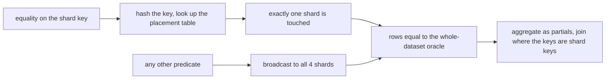
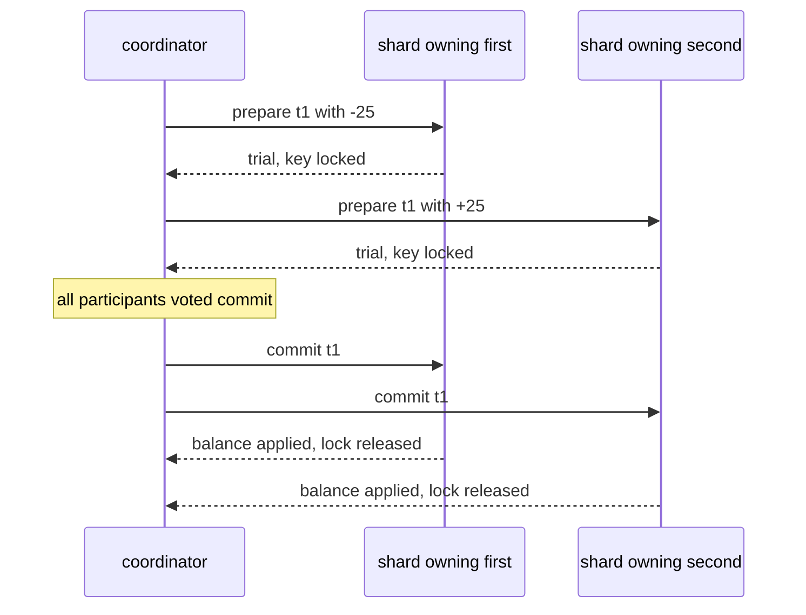
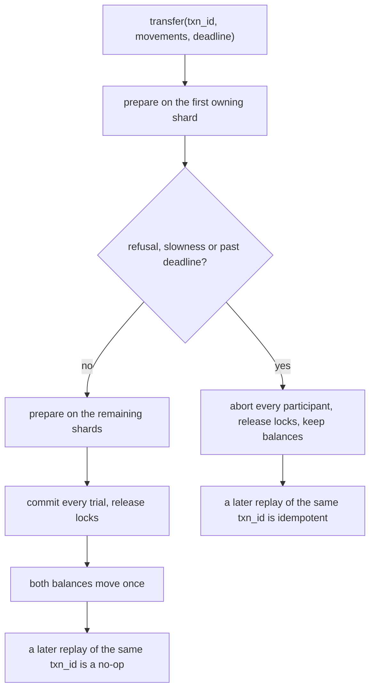

# 804 — Implement distributed SQL with sharding, routing, and distributed transactions.

> **Tier:** Master · **CTCI chapter:** Ch 9 — System Design and Scalability
> **Task spec:** [804-implement-distributed-sql-with-sharding-routing-and-distributed.md](../../../tasks/master/804-implement-distributed-sql-with-sharding-routing-and-distributed.md)
> **Solutions:** [Python](../../../solutions/python/master/804-implement-distributed-sql-with-sharding-routing-and-distributed/solution.py) ·
> [Java](../../../solutions/java/master/804-implement-distributed-sql-with-sharding-routing-and-distributed/Solution.java) ·
> [JavaScript](../../../solutions/javascript/master/804-implement-distributed-sql-with-sharding-routing-and-distributed/solution.js) ·
> [C#](../../../solutions/csharp/master/804-implement-distributed-sql-with-sharding-routing-and-distributed/Solution.cs)

## 1. Problem restatement

**The modelling contract.** A distributed SQL layer over an explicit set of *in-process* shards.
Rows are hash-partitioned by primary key through a placement table `(table, key) -> shard` that
carries a monotonic `placement_version`, so routing is a pure function of the key plus the current
placement:

- **routing.** An equality predicate on the shard key is answered by exactly one shard
  (`Predicate(..., pinned_key=42)`); anything else is broadcast. The layer counts the shards it
  touched (`cluster.visits`) and the rows it read (`cluster.rows_fetched`), so the checks can prove
  the pruning actually happened instead of assuming it.
- **aggregates.** COUNT/SUM/AVG are per-shard partials plus `combine_aggregate`, so AVG must combine
  sums and counts and never the partial averages.
- **joins.** A join whose keys are the shard keys of both tables is co-located and runs locally per
  shard with no data movement; any other join broadcasts the small side. Both must equal the
  whole-dataset oracle.
- **sort and limit.** A k-way merge over per-shard sorted streams with a bounded fetch, so a top-N
  query materialises far fewer rows than the table holds.
- **transactions.** Two-phase commit across the owning shards with no-wait locking: every participant
  prepares — locking its keys and validating the resulting rows — before the decision is applied
  anywhere; a refusal, a slow participant or an expired deadline aborts on every shard.
- **rebalancing.** Moving a key range rewrites the placement table in a single version bump, so a
  reader always finds a row exactly once, on the old owner or the new one.

**Asserted**, each against an independently written whole-dataset oracle (`oracle_scan`,
`oracle_aggregate`, `oracle_join`, `oracle_top_n`): routing totality and balance, pruning, aggregate
pushdown equivalence, join equivalence for both paths, top-N pruning, atomicity of cross-shard
transfers on every abort path, idempotent replay, rebalance safety, and determinism.

**Omitted** versus CockroachDB/Vitess: one process, so shards are dictionaries and messages are method
calls; there is no consensus layer, so the placement table is assumed to be published atomically by an
external directory service and the checks only assert what a reader observes; there is no SQL front
end — plans are small operator objects; shards never crash or restart, they only refuse or answer
slowly; there are no secondary indexes, so only primary-key predicates prune and everything else is
broadcast.

```text
routing: 1000 keys over 4 shards, spread 49, integrity problems 0
aggregates over 69 broadcast rows: count=69 sum=9372 avg=135.826
joins: 60 co-located rows, 120 broadcast rows, 120 rows read; top-N returned 5 rows
transactions: commit/refusal/timeout/deadline/idempotent replay; rebalance moved 10 keys in one version bump
```

| Scenario | Expected result |
| --- | --- |
| `scan([Predicate("id = 42", ..., pinned_key=42)])` | `cluster.visits == 1`, rows equal to the whole-dataset scan |
| `scan([Predicate("balance > 120", ...)])` | `cluster.visits == 4` and `rows_fetched == 120` — every row read exactly once |
| `combine_aggregate("avg", [(2, 10), (2, 30)])` | `10.0` (sum 40 over count 4); the naive average-of-averages `20.0` is asserted *wrong* |
| `colocated_join("users", "orders", "id", "user_id")` | 60 rows for 60 orders, all shards visited, no rows shipped |
| `broadcast_join("users", "regions", "region", "id")` | 120 rows for 120 users, `rows_fetched == 120` |
| `transfer("t1", {first: -25, second: 25}, 8, validator)` | `"commit"`, both balances move by exactly 25, no lock survives |

## 2. Intuition

The naive distributed query reads every shard, ships everything to a coordinator and joins there. It
is correct and useless: reading a single row touches the whole cluster, an aggregate ships `N` rows to
compute one number, and a join ships the larger table. The cost model is "move the data to the code"
when it should be "move the code to the data".

The key insight is that the placement function is *known* to both the client and the shard, and every
operator can therefore be reorganised around it:

- **Routing.** Because the shard is `hash(key)`, an equality predicate on the key names its shard
  before any I/O happens; everything else must fan out. Pruning is not an optimisation you hope for —
  it is a property the counter `visits` makes observable.
- **Partial aggregates.** An aggregate is pushed down only when the merge is a *join of partials*:
  COUNT and SUM combine by adding, AVG combines as `(sum, count)`. Combining `AVG` with `AVG` is the
  same class of error as averaging averages in a spreadsheet, and the code asserts that the trap is
  not taken.
- **Join placement.** If both sides are sharded on the join key, the join decomposes into independent
  local joins — no row crosses a shard boundary. Otherwise one side is small and gets broadcast, and
  the result must still equal the cartesian-product oracle.
- **Atomicity is a separate problem.** A single-shard write needs no protocol; a cross-shard transfer
  needs 2PC, because the alternative — applying on the first shard and hoping the second follows — is
  exactly the partial update the task refuses to allow.



## 3. Algorithm

1. `build(shard_count, users, orders, seed)` creates the shards, hashes every primary key into a
   placement entry, and loads the rows.
2. `candidates(predicates)` splits the predicates into a pinned key (at most one) and the rest; the
   pinned key selects a single shard via `shard_of(table, key)` → `owner(key)`, otherwise every shard
   is a candidate.
3. `scan(predicates)` reads `rows_of(table, shard_name)` from each candidate, applies the predicates
   locally and appends the rows, incrementing `visits` and `rows_fetched` as it goes.
4. `aggregate(predicates, kind, column)` collects `(count, sum)` partials per shard and returns
   `combine_aggregate(kind, partials)`: `count` adds counts, `sum` adds sums, `avg` divides the total
   sum by the total count.
5. `colocated_join(left, right, left_key, right_key)` runs one hash join per shard when both tables
   are sharded on the join keys; `broadcast_join` ships the small table to every shard that owns a row
   of the large one.
6. `top_n(column, limit, descending)` asks every shard for its own top `limit`, then merges the
   streams with a k-way merge and truncates — the merge only ever holds `limit` rows per stream.
7. `transfer(txn_id, movements, deadline, validator)`: `Shard.prepare(txn_id, deltas, validator)`
   locks the touched keys, applies the deltas to a *trial* copy and asks the validator to reject it;
   only if every participant votes commit does `commit(txn_id, trial)` install the trial — otherwise
   `abort(txn_id)` releases the locks and nothing changes.
8. `move_keys(table, keys, destination)` rewrites the placement entries and bumps
   `placement_version` once, then moves the physical rows.

```text
procedure scan(predicates, table)
    pinned ← the predicate carrying a pinned_key, or None
    shards ← [shard_of(table, pinned.key)] if pinned else all shards
    visits ← visits + length(shards)
    rows ← []
    for each shard in shards do
        for each row in shard.rows_of(table) do
            rows_fetched ← rows_fetched + 1
            if every predicate accepts row then rows.append(row) end
        end
    end
    return rows
end

procedure aggregate(predicates, kind, column)
    partials ← []
    for each shard in candidates(predicates) do
        rows ← scan(predicates, "users") in shard
        partials.append((length(rows), sum of column over rows))
    end
    return combine_aggregate(kind, partials)
end

procedure transfer(txn_id, movements, deadline, validator)
    trials ← []
    for each shard in shards owning a moved key do
        deltas ← movements restricted to that shard's keys
        trial ← shard.prepare(txn_id, deltas, validator)
        if trial is a refusal or the clock is past deadline then
            for each taken trial do shard.abort(txn_id) end
            return "abort: " + reason
        end
        trials.append((shard, trial))
    end
    for each (shard, trial) in trials do shard.commit(txn_id, trial) end
    return "commit"
end
```

The prepare step is where all three failure modes are caught, and all of them look the same to the
caller: `"abort: balance would go negative"` from the validator, `"abort: timeout"` when a participant
is slow, and `"abort: deadline"` when the transaction runs out of time. In every case the locks are
released, no balance changes, and a later replay of the same `txn_id` is accepted idempotently.



## 4. Worked example

The run in `main()` builds four shards with 120 users and 60 orders (`seed=7`), then exercises the
whole path. Every number below is printed by the run.

| Check | Observed | What it proves |
| --- | --- | --- |
| 1000 probe keys routed | spread 49 across 4 shards, `integrity() == []` | routing is total and roughly balanced; no key is stored twice |
| `id = 42` scan | `visits == 1` | a shard-key equality prunes to one shard |
| `balance > 120` scan | `visits == 4`, `rows_fetched == 120` | a non-key predicate broadcasts, reading each row once |
| distributed COUNT/SUM/AVG over the broadcast predicate | `count=69`, `sum=9372`, `avg=135.826` — equal to the oracle | partials combine correctly, and AVG is sum over count |
| `combine_aggregate("avg", [(2,10), (2,30)])` | `10.0`, not `20.0` | the average-of-averages trap is asserted away |
| co-located join `users ⋈ orders` | 60 rows, all shards visited, no rows shipped | the join decomposes per shard (60 orders, one user each) |
| broadcast join `users ⋈ regions` | 120 rows, `rows_fetched == 120` | each user matched exactly one region through the small side |
| `top_n("balance", 5)` | 5 rows, equal to the oracle, ordered by the merge key | the k-way merge truncates per shard |
| transfer `t1` | `"commit"`, first `-25`, second `+25`, no lock left, WAL non-empty | cross-shard atomicity, and both participants logged what they applied |

The interesting rows are the aborting ones, because each takes a different path to the same end state.
With a validator that rejects a negative balance, `t2` aborts and `{row["id"]: row["balance"]}` is
unchanged. With the second key's shard marked slow (`ledger.slow_shards`), `t3` aborts with
`"timeout"`. With `deadline == 1`, `t4` aborts on the deadline. In all three cases
`all(not shard.locks for shard in ledger.shards.values())` holds, so no abort path leaks a lock — and
then `t5` still commits, and re-running `t5` returns `"commit"` again *without* moving the amount a
second time, because the participants are idempotent on the transaction id.

| Step | `t2` refusal | `t3` slow participant | `t4` expired deadline |
| --- | --- | --- | --- |
| prepare on first | vote commit | vote commit | vote commit |
| prepare on second | validator refuses | no answer in time | not reached |
| decision | abort | abort with `timeout` | abort with `deadline` |
| balances | unchanged | unchanged | unchanged |
| locks | released | released | released |



Rebalancing is the last scenario: with 40 users over 4 shards, `move_keys` relocates 10 of them to one
destination, `placement_version` grows by exactly one, and the sorted `(id, balance)` snapshot of the
whole dataset is unchanged — every row is still reachable exactly once, from its new owner.

## 5. Complexity

Let `S` be the number of shards, `N` the rows in a table, `k` the requested top-N size, and `p` the
number of participants in a transaction.

| Operation | Bound | Why it holds |
| --- | --- | --- |
| Pinned scan | `O(rows in one shard)` | the hash names one shard; the counter proves `visits == 1` |
| Broadcast scan | `O(S + N)` | every shard is contacted and each row is read once (`rows_fetched == N`) |
| Pushed aggregate | `O(S + N)` with `O(1)` combine | per-shard partials, then a fixed-size combine |
| Co-located join | `O(N_left + N_right)` | each shard joins its own partition, so no row moves |
| Broadcast join | `O(N_left + S · rows of small side)` | the small side is replicated to each shard |
| Top-N | `O(S · k)` held in memory | each shard returns at most `k` rows and the merge truncates |
| Transfer | `O(p)` prepare round trips plus `O(keys)` locks | every participant votes before anything is applied |
| Rebalance | `O(keys moved)` plus one placement version bump | the placement table is rewritten atomically |

The comparison is the centralised engine: it does the same work in one place, so its join is `O(N²)`
in the worst case and its top-N needs all `N` rows sorted. Pushdown changes the *shape* of the cost
rather than the asymptotic bound for one table — the win is that a pinned query never touches the
other shards, a pushed aggregate never ships `N` rows to the coordinator, and a co-located join never
moves a row. The measurements above are per-operation counters, not wall-clock times: shards are
dictionaries and the network is absent, so what is being measured is *how much work each plan path
does*, which is exactly what a real distributed planner has to reason about.

## 6. Pitfalls and edge cases

- **Combining partial averages.** `combine_aggregate("avg", ...)` must divide the total sum by the
  total count; the run asserts both the correct value and that it is *not* the average of the partial
  averages.
- **A pinned predicate is only valid on the shard key.** Pinning on a non-key column silently returns
  a subset of the rows; pruning is checked against the whole-dataset oracle for exactly this reason.
- **A transaction that touches one shard is not a transaction in trouble.** Two-phase commit reduces
  to a single local prepare plus commit, and the single-shard case is what the rebalance tests lean
  on — but it must still release its locks.
- **Every abort path must release the locks it already took.** The refusal happens *after* a
  participant has locked its keys, so the abort has to walk back over the participants that already
  voted; the test asserts the empty lock set after all three failure modes.
- **Idempotent replay.** Re-sending `t5` returns `"commit"` again but must not move the amount twice.
  Without a per-transaction record of what was applied, a retry becomes a double spend.
- **A slow participant is a failure, not a wait.** `slow_shards` makes the second participant miss the
  deadline, which must abort the whole transaction; blocking forever is not an option in a system with
  a deadline.
- **`descending=True` top-N.** The same merge routine serves both directions, so the ordering
  assertion covers the flip; a comparator that only handles ascending order returns the wrong rows.
- **`rows_fetched` is part of the contract.** A "working" plan that reads every shard for a pinned
  query is a bug even though the rows match, which is why the counters are asserted separately.
- **Rebalancing must be atomic to the reader.** Ten keys move in one version bump, and the dataset
  snapshot must be identical before and after; moving rows before publishing the placement would let a
  reader find a row twice or not at all.

## 7. Variants and follow-ups

- **The same protocol with a real storage engine underneath.** [802-implement-fully-acid-transactional-key-value-store-with-mvcc-and.md](../../../tasks/master/802-implement-fully-acid-transactional-key-value-store-with-mvcc-and.md)
  keeps versions per key and adds snapshot isolation on top of this prepare/commit shape.
- **Where the placement table comes from.** Here it is assumed atomic; in reality it is a replicated
  log, which is [801-implement-production-grade-raft-library-replication-reconfigurat.md](../../../tasks/master/801-implement-production-grade-raft-library-replication-reconfigurat.md).
- **Plan-level quality.** Partial aggregates and join placement are the physical operators of a real
  planner; [857-implement-ml-based-cost-model-for-query-planner-with-online-lear.md](../../../tasks/master/857-implement-ml-based-cost-model-for-query-planner-with-online-lear.md)
  learns when pushdown pays off, and [855-implement-automated-plan-regression-detector-for-query-optimizer.md](../../../tasks/master/855-implement-automated-plan-regression-detector-for-query-optimizer.md)
  guards the plans against regressions.
- **Snapshotting a live sharded dataset.** Money conservation across shards is the same invariant
  [807-implement-global-scale-consistent-snapshot-across-geographically.md](../../../tasks/master/807-implement-global-scale-consistent-snapshot-across-geographically.md)
  proves for a marker-based snapshot.

## 8. Check yourself

1. Why is `combine_aggregate("avg", [(2, 10), (2, 30)])` equal to `10.0` rather than `20.0`?

<details><summary>Show answer</summary>

Because the partials are `(count, sum)` pairs, not averages: two rows summing to 10 and two summing to
30 give a total sum of 40 over a total count of 4, so the average is 10.0. Averaging the partial
averages would give `(5 + 15) / 2 = 10` here by luck, which is why the test uses `(2,10)` and
`(2,30)`: the average of the partial averages is `(10 + 30) / 2 = 20`, and the assertion rejects it.

</details>

2. A pinned scan and a broadcast scan return the same rows. Why is that not enough to call the plan
   correct?

<details><summary>Show answer</summary>

Because correctness of the *answer* does not prove pruning happened: a plan that broadcasts everything
returns the right rows and reads the whole cluster. That is why `cluster.visits` and
`cluster.rows_fetched` are asserted as well — `visits == 1` for the pinned case, `visits == 4` and
`rows_fetched == 120` for the broadcast case.

</details>

3. All three failure modes (validator refusal, slow participant, expired deadline) abort. What has to
   be true for the abort to be safe?

<details><summary>Show answer</summary>

Nothing may have been applied before the decision, and every lock taken by a participant that already
voted must be released. That is why `prepare` validates against a *trial* copy and the commit is the
only place that installs it: at abort time the trial is simply discarded, and the test asserts both the
unchanged balances and the empty lock sets.

</details>

4. `move_keys` bumps `placement_version` exactly once. Why does that single bump matter?

<details><summary>Show answer</summary>

Because a reader resolves a key through the placement table, so a partially visible rebalance would let
one reader see the row on the old shard and another miss it entirely. One version bump means every
reader switches from the old placement to the new one atomically, and the sorted snapshot of the
dataset is unchanged across the move.

</details>
