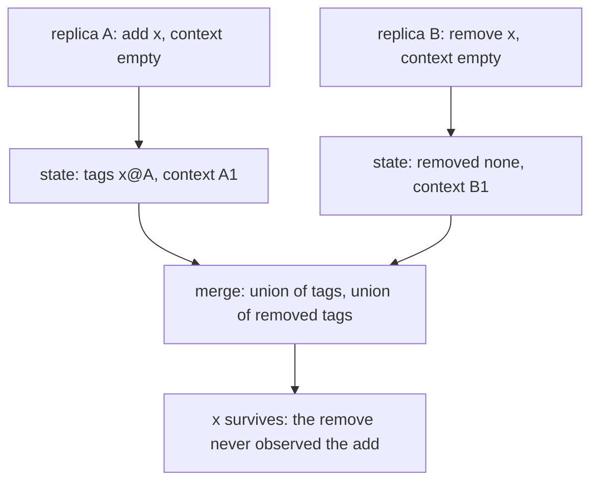
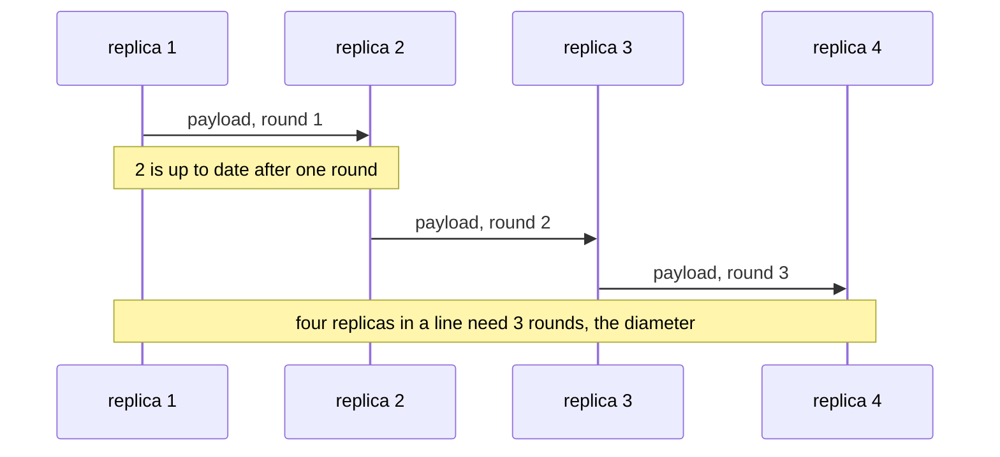
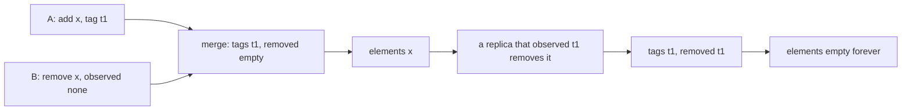

# 805 — Implement eventual-consistent multi-master datastore with conflict resolution policies.

> **Tier:** Master · **CTCI chapter:** Ch 9 — System Design and Scalability
> **Task spec:** [805-implement-eventual-consistent-multi-master-datastore-with-confli.md](../../../tasks/master/805-implement-eventual-consistent-multi-master-datastore-with-confli.md)
> **Solutions:** [Python](../../../solutions/python/master/805-implement-eventual-consistent-multi-master-datastore-with-confli/solution.py) ·
> [Java](../../../solutions/java/master/805-implement-eventual-consistent-multi-master-datastore-with-confli/Solution.java) ·
> [JavaScript](../../../solutions/javascript/master/805-implement-eventual-consistent-multi-master-datastore-with-confli/solution.js) ·
> [C#](../../../solutions/csharp/master/805-implement-eventual-consistent-multi-master-datastore-with-confli/Solution.cs)

## 1. Problem restatement

**The modelling contract.** Every replica is writable. Replicas talk over an explicit in-memory
network (a queue of plain state payloads, `send`/`deliver`/`round`) and converge because every
conflict is resolved by a merge that is **commutative, associative and idempotent**. Four policies
live side by side under one interface (`POLICIES = ("lww", "mvr", "counter", "or_set")`, dispatched by
`merge_values`, summarised by `resolve_value` and serialised by `canonical`):

| Policy | State per key | Merge rule |
| --- | --- | --- |
| last-writer-wins | one `(value, stamp)` where `stamp = (local counter, replica id)` | keep the greater stamp; a tie is broken deterministically by the replica id |
| multi-value | a set of `(value, stamp)` | union, then prune every stamp dominated by a newer one |
| PN-counter | per-replica increment and decrement vectors | componentwise addition, so the total is exact arithmetic |
| observed-remove set | add tags plus the set of *observed* add tags that were removed | concurrent add survives a remove; a remove that observed the add is permanent |

Each replica also keeps a version vector, bumped on every local write and merged componentwise, so a
payload is "value plus causal context" and `dominates(left, right)` is decidable.

**Asserted**: strong eventual consistency (after quiescence all replicas have byte-identical
`canonical` dumps, for every policy), order independence (all six merge orders of three states, and a
four-message schedule delivered in all twenty-four orders, reach the same state), idempotence,
monotonicity step by step during a scripted run, the policy semantics themselves, the version-vector
dominance relation being a partial order and merge being its join, and a liveness bound: anti-entropy
on a line topology converges within the network diameter, and a write is visible on a neighbour after
exactly one round.

**Omitted** versus Riak/Cassandra: one process, no sockets; clocks are *logical* — LWW orders by a
stamp, never by wall-clock time, which is what makes the resolution deterministic; there are no
failures, no replica recovery, no compaction of version vectors, no read-repair from a hinted
handoff, and the workload is a small scripted schedule rather than a stream of client traffic.

```text
policies: lww, mvr, counter, or_set; full-mesh convergence: 1 rounds, line of 4: 3 rounds
order independence: 6 merge permutations and 24 delivery orders agree
counter converged to 9; OR-set concurrent add/remove resolved to ['x'], then removed to []
```

| Scenario | Expected result |
| --- | --- |
| the same key written on two replicas with stamps `(5, 1)` and `(5, 2)` | both replicas end with the second replica's value — the tie breaks by replica id, not by arrival order |
| a counter with `+4`, `+7` and `-2` spread over three replicas | every replica reports exactly `9` |
| `add("x")` on one replica concurrent with `remove("x")` on another | `elements("x")` is `["x"]` — the concurrent add wins |
| then a `remove("x")` on a replica that has observed the add | `[]`, permanently: no resurrection later |
| four replicas in a line gossip to quiescence | 3 rounds — exactly the diameter |

## 2. Intuition

The naive multi-master design is "last write wins by timestamp". It has two failure modes that only
show up in production: clock skew decides which write survives (so two replicas can disagree forever),
and a *lost update* is indistinguishable from a normal one — the losing write simply disappears with
no record that it ever happened.

The key insight is to stop thinking about *when* a write happened and start thinking about the
**structure of the state**. Whatever a replica merges must be a value in a lattice, merged with its
join: the join is commutative, associative and idempotent by construction, so the order in which
replicas gossip, and how many times they retransmit, cannot change the quiescent state. Everything
else follows:

- **LWW** is the join of a totally ordered stamp set: `max` on `(counter, replica id)`, which is
  deterministic precisely because the replica id breaks ties.
- **Multi-value** is union plus a pruning step: keep only the stamps that no other stamp dominates,
  so the application gets to see *genuinely concurrent* values instead of an arbitrary winner.
- **PN-counter** is componentwise addition on vectors, which is a join on the
  "happened-before" partial order and cannot lose a delta that a single monotone number would.
- **Observed-remove set** keeps the add *tags* rather than the elements; a remove records which tags
  it observed, so an add it never saw survives while a seen add can never come back.



Idempotence is what makes gossip safe: re-delivering the same payload merges a state with itself and
changes nothing, which is also why anti-entropy can be unconditional instead of tracking what a peer
already knows.

## 3. Algorithm

A local operation (`Replica.put`, `Replica.remove`):

1. Bump the replica's own component of its version vector and build the write's stamp from that
   counter plus the replica id.
2. Apply the policy to the local state: LWW replaces if the new stamp is greater, MVR adds a value
   and prunes dominated ones, the counter adds a delta to the right component, the OR-set adds a tag.
3. Record the operation in the causal context (`version`), which is what later merges use to decide
   dominance.

An anti-entropy round (`Cluster.round`, `Cluster.broadcast`):

1. Each replica produces `payload()` — the whole state plus its version vector.
2. The network queues one payload per edge of the current topology (full mesh or a line) per round.
3. `deliver` merges the payload into the receiving replica: version vectors are merged componentwise,
   then the per-key states are merged with `merge_values(policy, local, remote)`.
4. `converged()` compares `canonical(policy, state)` dumps, so "have we converged" is a byte
   comparison and not an equality of Python objects.

```text
procedure merge_replica(local, remote)
    local.version ← componentwise max(local.version, remote.version)
    for each key in remote.state do
        if key is missing locally then
            local.state[key] ← remote.state[key]
        else
            local.state[key] ← merge_values(policy, local.state[key], remote.state[key])
        end
    end
end

procedure merge_values(policy, left, right)
    if policy = "lww" then
        return the pair with the greater stamp, tie broken by the larger replica id
    if policy = "mvr" then
        stamps ← union of left and right stamps
        return the stamps not dominated by another stamp in the union
    if policy = "counter" then
        return componentwise sum of the increment and decrement vectors
    if policy = "or_set" then
        return (union of add tags, union of removed tags)
    end
end

procedure anti_entropy_round(cluster)
    for each edge (sender, target) in cluster.topology do
        network.send(sender, target, cluster.replicas[sender].payload())
    end
    network.deliver_all(cluster.replicas)
    return cluster.converged()
end
```



The bound is exactly the topology: on a full mesh every replica hears every write in one round
(measured `1 rounds`), while a line of four needs three hops, and no schedule can make it faster
because information only travels along edges.

## 4. Worked example

**A counter that only adds.** The three replicas apply deltas `+4`, `+7` and `-2` concurrently, each
in its own vector component. One round of gossip is enough for the full mesh, and every replica then
reports `4 + 7 - 2 = 9` — the measured `counter converged to 9`. Had the counter been a single number
with "last write wins", one of the three deltas would have been silently lost, and nothing in the
state would record that it existed.

| Round | Event | State at each replica |
| --- | --- | --- |
| 0 | local writes on 1, 2 and 3 | each holds only its own component: `+4`, `+7`, `-2` |
| 1 | full-mesh payloads | every replica holds all three components, total `9` |
| 2 | redundant payloads | merging a state with itself changes nothing (idempotence) |

**Concurrent add and remove on an OR-set.** Replica A adds `x` without having seen anything; replica
B removes `x` without having seen A's add. The merge keeps the add tag because the removal set is a
set of *observed* tags and does not contain A's tag, so the resolve step reports `['x']` — concurrent
add wins. A later remove issued by a replica that *has* observed the add puts A's tag into the removal
set, and from then on every merge — including a merge with a stale payload that still carries the tag —
produces `[]`: the removal is permanent and cannot be resurrected.



**Order independence.** Three previously written states merged in all six orders, and a schedule of
four messages delivered in all twenty-four orders, both reach the same state
(`order independence: 6 merge permutations and 24 delivery orders agree`). That is the property the
lattice formulation buys: nothing in the implementation sorts the messages, because the merge itself
makes the order irrelevant.

## 5. Complexity

Let `r` be the number of replicas, `e` the number of edges in the topology, and `k` the number of keys.

| Measure | Bound | Why it holds |
| --- | --- | --- |
| Local write | `O(1)` for LWW and the counter, `O(stamps)` for MVR and OR-set | the vector component and one key's state are touched |
| Merge of two replicas | `O(k)` keys plus `O(r)` for the version vector | every key is merged once, the context is a small vector |
| Round | `O(e)` messages, each carrying the full payload | anti-entropy is unconditional: full mesh `r(r-1)`, line `2(r-1)` |
| Rounds to converge | `O(diameter)`: measured 1 for a full mesh and 3 for a line of four | information moves at most one edge per round |
| Space per key | `O(1)` stamp for LWW, `O(concurrent writes)` for MVR, `O(r)` counters, `O(adds)` tags | the policy decides what history is kept |
| Verification cost | `O(permutations × merge)`, 6 and 24 schedules here | the order-independence checks are exhaustive over small schedules |

The comparison point is the single-master design of
[801-implement-production-grade-raft-library-replication-reconfigurat.md](../../../tasks/master/801-implement-production-grade-raft-library-replication-reconfigurat.md):
one leader gives linearizability for `O(n)` messages per write and a commit point, but every write
must reach it. A multi-master merge is cheaper per write (local, no quorum) and survives partitions,
at the price of *no* commit point: two replicas may answer different values to two clients, and
strong convergence only says the disagreement is bounded in time, not absent.

## 6. Pitfalls and edge cases

- **Logical stamps, not wall-clock time.** Every check here is reproducible only because ordering uses
  `(counter, replica id)`. With physical clocks, LWW is neither deterministic nor fair, and the
  quiescent state depends on which machine's clock drifted.
- **The tie-break must be total.** Two writes with the same counter on two replicas must not depend on
  arrival order, so the replica id is part of the stamp; the assertions check both orders.
- **A counter is not one number per replica.** Keeping a single integer, or merging only the maximum,
  loses concurrent deltas — the `9` above only appears with componentwise vectors.
- **Idempotence is not optional for gossip.** Merging the same state twice must leave it unchanged;
  the checks merge repeatedly and compare dumps, which is what catches an "append the whole set" bug
  in an OR-set.
- **Monotonicity.** Merging must never drop a value a replica has already observed and stamps must
  never move backwards; the scripted run asserts this after every step, not only at the end.
- **MVR pruning must use dominance, not equality.** A later write prunes older stamps; equal stamps
  from two replicas are one *concurrent* value pair, not duplicates to be folded away.
- **Version vectors are not comparable in general.** `dominates` is a partial order: two concurrent
  contexts dominate each other in neither direction. Treating "not equal" as "greater" collapses
  concurrency into a false ordering.
- **Liveness needs a topology argument.** Full mesh converges in one round; a line of four needs three,
  and the checks assert the diameter bound rather than "eventually".
- **A stale payload is not a rollback.** Merging an old payload after a newer one must not resurrect
  removed elements or lower a counter; a "replace" merge instead of a join breaks this.

## 7. Variants and follow-ups

- **Strengthen the ordering.** [810-implement-cross-datacenter-replication-with-causal-consistency-g.md](../../../tasks/master/810-implement-cross-datacenter-replication-with-causal-consistency-g.md)
  keeps the version vector but adds a delivery buffer, so replicas never apply a write before its
  dependencies — a session guarantee this task deliberately does not offer.
- **Give up on convergence order and elect a leader.** [801-implement-production-grade-raft-library-replication-reconfigurat.md](../../../tasks/master/801-implement-production-grade-raft-library-replication-reconfigurat.md)
  replaces merges with a log, which makes reads linearizable but writes need a quorum.
- **Transactions on top of replicas.** [802-implement-fully-acid-transactional-key-value-store-with-mvcc-and.md](../../../tasks/master/802-implement-fully-acid-transactional-key-value-store-with-mvcc-and.md)
  shows the other half of the spectrum: versions plus 2PC give snapshot isolation and a commit point.
- **Snapshot the whole cluster.** [807-implement-global-scale-consistent-snapshot-across-geographically.md](../../../tasks/master/807-implement-global-scale-consistent-snapshot-across-geographically.md)
  needs a consistent cut across shards, which is the question LWW-based convergence never has to ask.

## 8. Check yourself

1. Why does merging the partial averages of a counter-like value go wrong, and which policy in this
   task has the same shape of bug?

<details><summary>Show answer</summary>

Averaging averages weights groups that do not have the same size, and a PN-counter merged as a single
number loses deltas. The fix in both cases is to keep the *decomposition* (sum and count for the
average, per-replica vectors for the counter) and to define the merge as a join on that
decomposition: the counter here converges to exactly 9 only because increments and decrements are
merged componentwise.

</details>

2. Two replicas both hold `{"k": (v, (5, 1))}` and `{"k": (v2, (5, 2))}`. What do they converge to, and
   why is that not arbitrary?

<details><summary>Show answer</summary>

Both converge to `v2`: the stamps are incomparable on the counter but comparable by replica id, which
is part of the stamp, so "greater stamp" is a total order. That is what makes LWW deterministic
under any delivery order, and the tie-break is asserted in both message orders.

</details>

3. An OR-set remove issued without seeing a concurrent add leaves the element present. What makes the
   *permanent* removal afterwards work?

<details><summary>Show answer</summary>

Tags. The add is stored as a unique tag rather than as the element, and a remove records the set of add
tags it observed. The first remove observed nothing, so the tag survives; the second observed the tag
and puts it in the removal set, after which any merge — even with a stale payload carrying the tag —
still reports the element as removed. Without tags, a remove would have to remove "the element", which
is exactly what makes resurrection possible.

</details>

4. The line of four replicas converges in three rounds and a full mesh in one. Where does the bound
   come from?

<details><summary>Show answer</summary>

From the topology: one round moves information across one edge, so the number of rounds is the
diameter. The line has diameter 3 and the mesh has diameter 1, and the checks assert those numbers
rather than a loose "eventually converges" claim.

</details>
