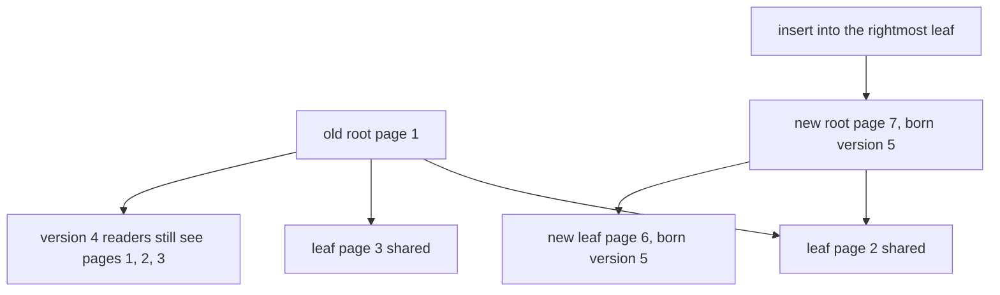
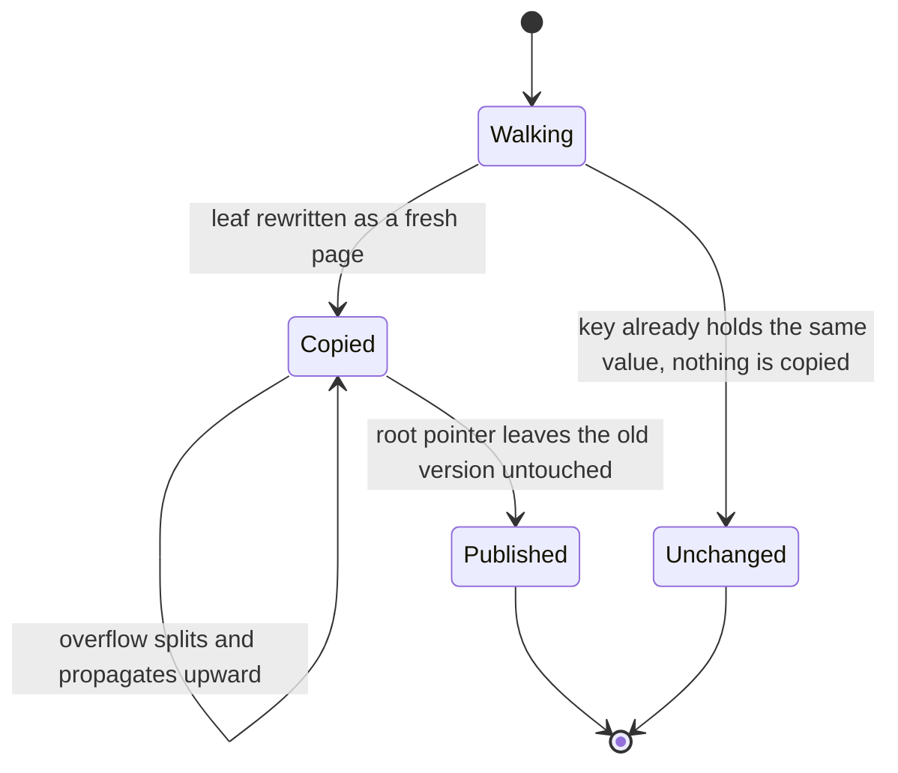
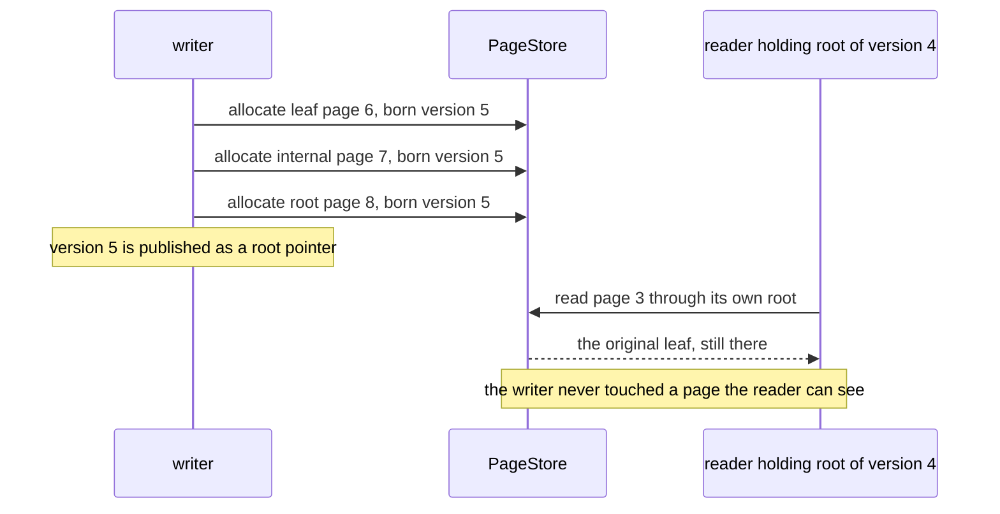

# 806 — Implement fully persistent B-tree with copy-on-write pages and concurrency.

> **Tier:** Master · **CTCI chapter:** Ch 9 — System Design and Scalability
> **Task spec:** [806-implement-fully-persistent-b-tree-with-copy-on-write-pages-and-c.md](../../../tasks/master/806-implement-fully-persistent-b-tree-with-copy-on-write-pages-and-c.md)
> **Solutions:** [Python](../../../solutions/python/master/806-implement-fully-persistent-b-tree-with-copy-on-write-pages-and-c/solution.py) ·
> [Java](../../../solutions/java/master/806-implement-fully-persistent-b-tree-with-copy-on-write-pages-and-c/Solution.java) ·
> [JavaScript](../../../solutions/javascript/master/806-implement-fully-persistent-b-tree-with-copy-on-write-pages-and-c/solution.js) ·
> [C#](../../../solutions/csharp/master/806-implement-fully-persistent-b-tree-with-copy-on-write-pages-and-c/Solution.cs)

## 1. Problem restatement

**The modelling contract.** A *fully persistent* B+-tree over a page store: every mutation copies the
pages on the path from the root to the changed node instead of modifying them, so a version is just a
root pointer and every earlier version stays readable forever. `Page` holds `(leaf, values, children,
born)` — `born` is the version whose contents the page holds — and `PageStore` is the only mutable
object in the whole structure: it hands out increasing page ids and remembers the generation of each
page.

Pages hold at most `MAX_ENTRIES = 4` entries with minimum degree `MIN_ENTRIES = 2`: a full page
(`MAX + 1` entries) splits into two pages of at least `MIN` around a promoted separator, deletes borrow
from a sibling with spare entries and otherwise merge with a sibling — dropping the separator that
disappears with them — and the root shrinks when its last separator goes away. Values live in leaves
only; internal pages hold separator keys and child pointers, which is exactly what makes a split a
*copy-up* rather than a move.

**Concurrency** is modelled the way copy-on-write makes it possible: a reader takes a root and can
never be blocked or invalidated by a writer, because a writer cannot touch a page a reader holds — it
publishes new pages instead. The checks re-read an old root after dozens of writes and follow a cursor
that keeps scanning its own version while writers insert and delete around it.

**Asserted**, most of it against a plain-dict oracle recording the state after every single operation:

| Group | What is checked |
| --- | --- |
| version equivalence | every historical root returns exactly the oracle state for point lookups, full flattens and bounded range scans |
| structure | leaf keys sorted and unique, internal keys sorted, `children = keys + 1`, all leaves at equal depth, every non-root page between `MIN` and `MAX` entries, separator strictly above the left child's maximum and at most the right child's minimum |
| persistence | a page is born in the version that first needed it, no version reaches a younger page, and an old root still returns the old rows after many writes |
| copy-on-write cost | an insert copies the path, a no-op copies none, adjacent versions share everything but the copied path, and total allocations stay far below one full path per version |
| deletes | borrowing, merging and root shrinking keep every version equal to the oracle; emptying the tree yields the empty version and rebuilding works |
| garbage collection | a brute-force reachability walk over the live roots equals the collector's keep set, and every freed page was unreachable |
| isolation, scale | interleaved writer/reader schedules never expose a partial update; 400-key bulk loads and descending insert orders stay logarithmic, and identical workloads produce identical page shapes |

**Omitted** versus a storage engine: pages live in a dict instead of on disk (no buffer pool, no
write-ahead log, no crash recovery, no checksums); there are no threads — the "concurrent" schedule is
an explicit interleaving; the workload is a few hundred keys, so the page counts below are exact
counters rather than estimates.

```text
history: 141 versions, 529 live pages, 529 allocations, depth 4
copy-on-write: at most 7 pages copied per insert at depth 3; 400-key depth 5
deletes: 136 versions, 0 structural problems; collector freed 324 of 378 pages for 3 live roots
```

| Scenario | Expected result |
| --- | --- |
| bulk load of 400 keys | `depth == 5`, every structural invariant holds |
| 141 versions of a small key set | `529` pages allocated in total, `529` still live at the end, `depth == 4` |
| an insert into a depth-3 tree | at most 7 pages copied, and a no-op (`put` of an existing key/value) copies none |
| old root re-read after dozens of writes | identical rows to the oracle state at that version |
| collector over three live roots | frees 324 of 378 pages, exactly the pages no live root reaches |

## 2. Intuition

The naive way to keep history is to copy the whole tree on every update: correct, and hopeless, because
each insert costs `O(N)`. The other naive way is to keep one tree and a write-ahead log of operations:
cheap, but every reader must replay history to answer a query, and a long-lived reader pins the log.

The key insight is that a mutation only *changes* the path from the root to the touched leaf. So:

- **Copy the path, share everything else.** A new version is a new root whose children are either new
  (the copied path) or the *same page objects* as before (every untouched subtree). Reading an old
  version works because nothing was modified in place.
- **The page's generation is the whole persistence proof.** A page records the version that created
  it; if a version could reach a page born later, the structure would not be persistent — that single
  invariant is what `generation_problems` checks, and it is why "append-only" is not the same thing as
  persistent.
- **Structural changes are copy-up, not move.** Because values live only in leaves and internal pages
  hold separators, a split creates two fresh leaves and a fresh parent, and the old page is left
  untouched for the versions that still point at it.
- **Readers need no locks.** A writer publishes; it never mutates a page a reader can see. So a cursor
  can hold a root and keep scanning while writers churn, which is what the interleaved schedule
  demonstrates rather than asserts.



## 3. Algorithm

1. `put(key, value)` walks from the current root to the target leaf, recording the path.
2. The leaf is rewritten as a fresh page (`allocate(leaf, values, children, born=version)`); if it
   overflows, it splits into two pages around the median separator and the parent — a new page as well
   — gets the promoted key and an extra child.
3. Splits propagate upward in the same way; if the root splits, a fresh root with two children is
   published and the depth grows by one.
4. `delete(key)` rewrites the path as well; a leaf that drops below `MIN` first borrows from a sibling
   with spare entries and otherwise merges with one, removing the separator that disappears with them.
5. `search`, `scan(low, high)` and `cursor(root, low, high)` work purely from a root pointer, so any
   historical version can be queried with no coordination.
6. `PageStore.collect(roots)` marks reachable pages from the live roots and frees the rest, the way a
   persistent store reclaims the versions nobody will read again.

```text
procedure put(key, value)
    version ← version + 1
    new_root, split ← insert_rec(root, key, value, version)
    if split then
        new_root ← store.allocate(leaf=False, keys=[split.separator],
                                  children=[new_root, split.right], born=version)
    end
    roots[version] ← new_root
end

procedure insert_rec(page_id, key, value, version)
    page ← store.read(page_id)
    if page.leaf then
        values ← page.values with key mapped to value          # replace or insert in sorted order
        fresh ← store.allocate(True, values, [], version)
        if length(values) <= MAX_ENTRIES then
            return fresh, None
        end
        left, separator, right ← split_leaf(fresh)             # both halves get at least MIN_ENTRIES
        return left, Split(separator, right)
    end
    child ← the child page whose key range contains key
    new_child, split ← insert_rec(child, key, value, version)
    keys ← page.keys, children ← page.children with new_child substituted
    if split is not None then
        keys, children ← insert the separator and split.right after new_child
    end
    fresh ← store.allocate(False, keys, children, version)      # the old page is never mutated
    if length(keys) <= MAX_ENTRIES then
        return fresh, None
    end
    left, separator, right ← split_internal(fresh)
    return left, Split(separator, right)
end

procedure collect(roots)
    reachable ← every page id reachable from the live roots, following child pointers
    for each page id in the store do
        if id is not in reachable and no live version reaches it then free it end
    end
    return freed count
end
```



## 4. Worked example

A small run: a tree that has grown to depth 3 (root, one level of internal pages, leaves) with
`MAX_ENTRIES = 4`, then one insert into a leaf that has room, then one insert that forces a split.

| Step | Version | Pages allocated | Pages now reachable from the new root |
| --- | --- | --- | --- |
| bulk load of the first keys | 1 | root + internal + leaves | all of them |
| insert into a non-full leaf | 5 | leaf copy + each ancestor copy | the fresh path plus every untouched subtree |
| insert that splits the leaf | 6 | two fresh leaves + fresh parent (+ ancestors) | the two halves plus the new separator |
| `put` of an existing key/value | 7 | none | the same root — a no-op copies nothing |
| read the version-1 root | — | — | the *original* pages, untouched by versions 5–7 |

The measured run reports `141 versions, 529 live pages, 529 allocations, depth 4`, and the
copy-on-write assertion caps an insert at **7 copied pages at depth 3** — the copied path plus the two
halves of a split. The comparison that makes those numbers meaningful is "one full path per version":
the totals stay far below it because siblings and untouched subtrees are shared, and `generation_problems`
verifies that no version reaches a page born later.

Deletes are the other half of the story: `deletes: 136 versions, 0 structural problems` — borrowing
from a sibling, merging two leaves, dropping the separator that goes away with them and shrinking the
root all keep every historical version equal to the oracle. Emptying the tree produces the empty
version rather than a tree with one empty root, and rebuilding from that state works because the store
never rewrote a page in place.



Garbage collection is the last piece: `collect(roots)` walks every page reachable from the live roots
and frees the rest, and the checks compare that set against an independent brute-force walk. With three
live roots the run frees 324 of 378 pages — every freed page provably unreachable from any retained
version.

## 5. Complexity

Let `B = MAX_ENTRIES` be the page capacity, `N` the number of keys, and `h` the tree height.

| Measure | Bound | Why it holds |
| --- | --- | --- |
| Point lookup | `O(h · log B)` | one binary search per level, and `h = O(log_B N)`; measured `depth == 5` for 400 keys |
| Insert | `O(h · log B)` plus page allocation | the path is copied; a split adds two fresh pages and one separator, per level at worst |
| Pages copied per insert | the path, measured at most 7 at depth 3 | a non-splitting insert copies one page per level; a split adds the halves and the new parent |
| Range scan | `O(m + h)` for `m` returned entries | leaf links plus the descent to the first leaf |
| Historical read | same as a current read | a version is a root pointer, so no replay and no log is needed |
| Space | `O(h · pages per version)` new pages per version, shared elsewhere | untouched subtrees are shared, so a version costs its copied path |
| Garbage collection | `O(pages)` | one reachability walk, but it must be re-run against the set of live roots |
| Structural check | `O(pages)` per version, `O(versions × pages)` over a run | which is why the checks are a battery of small runs rather than a benchmark |

The alternative — copying the whole tree per update — costs `O(N)` per write rather than `O(log N)`,
and the log-based alternative costs `O(1)` per write but `O(history)` per read. Copy-on-write sits in
between and is the only one of the three that makes an *old version* cheap: a root pointer is a handle
to a complete, immutable snapshot, which is why MVCC stores and Git-like systems use the same idea.

## 6. Pitfalls and edge cases

- **`born` must never move backwards.** A page created for version `v` may not be reachable from an
  earlier version; the `generation_problems` walk is what catches a "reuse the page if it is the
  newest version" shortcut, which silently destroys older readers.
- **A no-op must copy nothing.** `put` of an unchanged key/value returns the same root; allocating on
  a no-op inflates the store and breaks the "adjacent versions share the path" claim.
- **Splits must copy up, not move.** Because separators are copied into a fresh internal page, the old
  page stays valid for older versions; moving the separator would corrupt them.
- **Lazy vs eager root shrink.** When the last separator goes, the root must be replaced by its only
  child, otherwise the tree grows an empty level and the depth assertion fails.
- **Borrow before merge.** A leaf below `MIN` entries that can borrow keeps both siblings alive; a
  merge removes a separator, which is the case the structural check cares about most.
- **`children = keys + 1` after every split.** The most common split bug is an off-by-one in the child
  list, and it shows up as a separator whose bounds violate "strictly above the left maximum".
- **Empty tree and single-key tree.** Emptying yields the *empty version* rather than a root with no
  entries; a one-key tree must still answer scans, and both are asserted.
- **Duplicates and descending inserts.** Bulk loading 400 keys in descending order is the adversarial
  case for split behaviour; the run asserts the same invariants and a logarithmic height.
- **A cursor holds a version, not a lock.** A reader that follows child pointers from a fixed root is
  consistent by construction; a reader that re-reads the *current* root mid-scan can see a mixed state.
- **GC needs the set of live roots.** Freeing pages reachable from a version someone still holds is
  silent corruption, which is why the collector's answer is compared against a brute-force walk rather
  than trusted.

## 7. Variants and follow-ups

- **MVCC at the key level.** [802-implement-fully-acid-transactional-key-value-store-with-mvcc-and.md](../../../tasks/master/802-implement-fully-acid-transactional-key-value-store-with-mvcc-and.md)
  keeps per-key version chains and reclaims them with a watermark — the same "never overwrite, keep old
  readers alive" trade at a different granularity.
- **Snapshots across many shards.** [807-implement-global-scale-consistent-snapshot-across-geographically.md](../../../tasks/master/807-implement-global-scale-consistent-snapshot-across-geographically.md)
  asks the same question — what does a version look like when the state is not one tree? — for a
  distributed ledger.
- **Versioned blobs with dedup.** [819-implement-memory-efficient-checkpointing-for-massive-models-bloc.md](../../../tasks/master/819-implement-memory-efficient-checkpointing-for-massive-models-bloc.md)
  uses block-level sharing across versions, which is copy-on-write at chunk granularity.
- **Deep-dedup compressed runtimes.** [897-implement-compressed-neural-network-runtime-with-weight-sharing.md](../../../tasks/master/897-implement-compressed-neural-network-runtime-with-weight-sharing.md)
  shares weight pages between layers the way this task shares untouched subtrees.

## 8. Check yourself

1. Why is a version just a root pointer, and what invariant makes that safe?

<details><summary>Show answer</summary>

Because no mutation ever modifies a reachable page: every changed page is a fresh page, so the pages
an older root points at are exactly as they were. The invariant that makes it safe is the generation
rule — a page born for version `v` is never reachable from a version before `v` — which
`generation_problems` verifies for every page.

</details>

2. An insert at depth 3 copies at most 7 pages while the tree holds far more. Where do the savings
   come from, and what is the cost?

<details><summary>Show answer</summary>

From sharing: only the path from the root to the changed leaf (plus the two halves of a split) is new,
so all siblings and untouched subtrees are reused. The cost is space — every version leaves its copied
path behind — which is why the store needs a collector that frees pages no live root reaches.

</details>

3. Why does the tree need `collect(roots)` rather than freeing the pages of a version as soon as a
   newer version exists?

<details><summary>Show answer</summary>

Because a version is a root pointer that may still be held by a reader, a cursor or another snapshot.
Only reachability from the *set of live roots* — computed by a walk — tells you a page is garbage; the
check compares the collector's set against an independent brute-force walk, and asserts that every
freed page was unreachable.

</details>

4. What would break if `put` reused the existing page when the key already held the same value?

<details><summary>Show answer</summary>

Nothing in this workload's *rows*, but the structural claims: the page would have to be mutated in
place or re-allocated pointlessly. Mutating it makes an older root see a newer page (a generation
violation), and allocating on a no-op breaks the "adjacent versions share everything but the copied
path" bound. It is asserted that a no-op copies zero pages.

</details>
