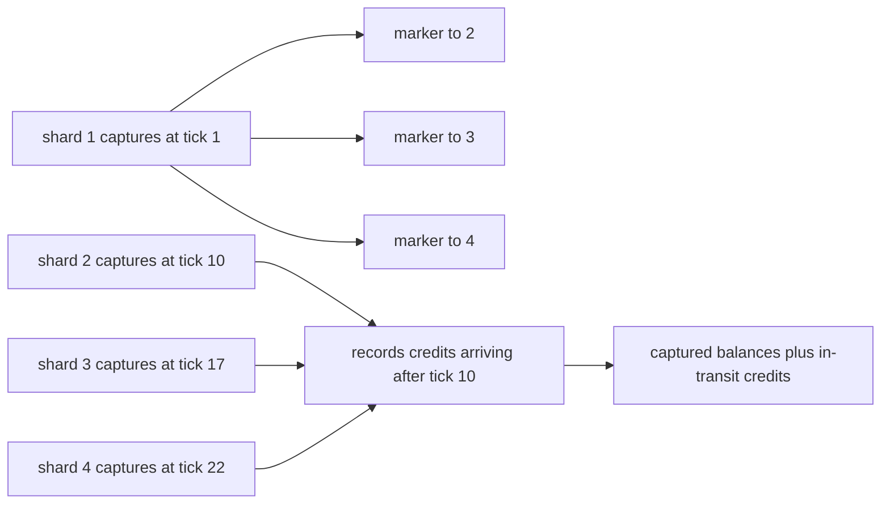
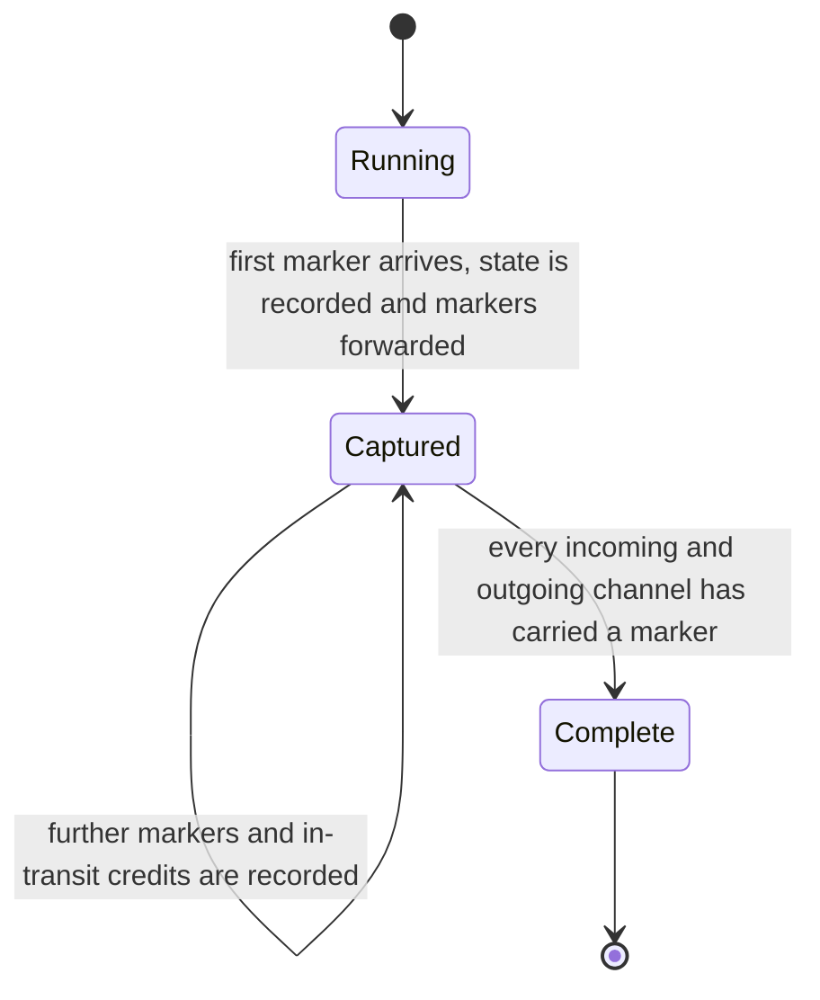
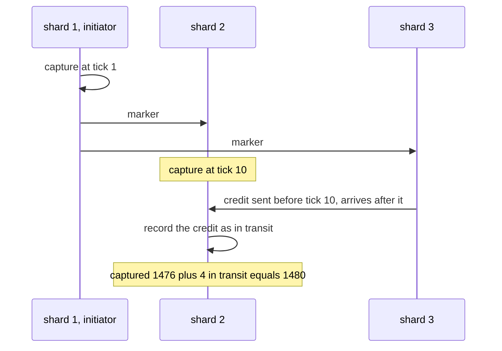

# 807 — Implement global scale consistent snapshot across geographically distributed shards.

> **Tier:** Master · **CTCI chapter:** Ch 9 — System Design and Scalability
> **Task spec:** [807-implement-global-scale-consistent-snapshot-across-geographically.md](../../../tasks/master/807-implement-global-scale-consistent-snapshot-across-geographically.md)
> **Solutions:** [Python](../../../solutions/python/master/807-implement-global-scale-consistent-snapshot-across-geographically/solution.py) ·
> [Java](../../../solutions/java/master/807-implement-global-scale-consistent-snapshot-across-geographically/Solution.java) ·
> [JavaScript](../../../solutions/javascript/master/807-implement-global-scale-consistent-snapshot-across-geographically/solution.js) ·
> [C#](../../../solutions/csharp/master/807-implement-global-scale-consistent-snapshot-across-geographically/Solution.cs)

## 1. Problem restatement

**The modelling contract.** A Chandy–Lamport global snapshot of a geo-distributed ledger, all in one
process. Shards sit in different regions and talk over FIFO channels with a *fixed* per-link one-way
latency. `Snapshot.begin(network, initiator)` injects a marker into every outgoing channel; a shard
records its local state (`capture`) the **first** time it sees a marker, forwards markers on its own
outgoing channels and records every application message that arrives *after* its capture — the classic
in-transit set. The result is a **consistent cut**: what every shard includes is a prefix of that
shard's history, and any receive inside the cut implies its send is inside the cut too.

The workload is a ledger: `transfer` debits one account and ships a credit message to the shard that
owns the destination account, so money is either *on* a shard or *inside* a channel. That gives the
snapshot an invariant a wrong snapshot cannot satisfy: the sum of all captured balances plus the amount
of every recorded in-transit credit equals the opening total. A `naive_snapshot` that grabs every shard
at one wall-clock instant is implemented alongside, and the checks show it breaking the invariant while
the marker protocol does not.

**Asserted:**

| Invariant | Check |
| --- | --- |
| cut consistency | for every message, if the receiver applied it before its capture then the sender sent it before its capture — brute-forced over the whole event log |
| prefix property | each captured state equals an independent replay of that shard's logged mutations up to its capture point |
| in-transit exactness | the recorded set is exactly the messages sent before the sender's capture and received after the receiver's |
| money conservation | captured balances plus in-transit credits equal the opening total for every snapshot, while the naive grab loses what is in flight |
| referential integrity | in-transit credits are always positive, so no account is reported short and no balance goes negative |
| non-blocking | transfers keep flowing during the snapshot, and the protocol adds exactly one marker per directed edge and nothing else |
| termination, determinism | every snapshot completes within a few diameters after the injection, and identical schedules produce identical snapshots |

**Omitted** versus a production snapshot service: one process, so the network is an explicit event
queue rather than sockets; channels are FIFO with a *fixed* per-link latency — a jittered per-message
latency would reorder messages on a link and break the marker protocol, which the checks would
immediately expose — and there is no loss, retransmission or view change; the ledger has a few accounts
per shard; the snapshot is held in memory rather than streamed to object storage, and the "wall clock"
used for the naive comparison is a simulated counter.

```text
busy snapshot: 4 shards, 6 transfers, 4 in-transit credits, 12 markers over 12 directed edges
conservation: captured 1476 + in transit 4 = 1480 (opening 1480); naive grab total 454
consistency problems: idle 0, busy 0, ledger 0; capture instants [17, 10, 22, 1]
```

| Scenario | Expected result |
| --- | --- |
| snapshot of 4 shards | capture instants `[17, 10, 22, 1]` — the shards do **not** capture at one instant |
| the same run's markers | exactly 12, one per directed edge of the mesh |
| money accounting | `1476 captured + 4 in transit = 1480`, exactly the opening total |
| the naive wall-clock grab on the busy workload | total `454` — the credits in flight are simply lost |
| a transfer sent before a capture and received after | appears in the in-transit set with a positive amount, and no balance is negative |

## 2. Intuition

The naive way to snapshot a distributed system is to stop everything, copy it, and start again. The
Internet-scale version of the same idea is worse: there is no global clock, so "everyone grab your
state at time `T`" cannot be implemented — the shards disagree about `T` by however much their clocks
drift, and every message in flight at the wrong moment is either double counted or lost. The run makes
that concrete: the wall-clock grab reports `454` against an opening total of `1480`.

The key insight is that a snapshot is not a *moment*, it is a **cut through the message graph**, and a
cut can be defined by message order instead of by time. Marker messages travel on the very same FIFO
channels as the data, so:

- When a shard sees its first marker, everything it has applied so far is unambiguously *before* the
  cut and everything it applies later is unambiguously *after* it — no clock is involved.
- Because channels are FIFO, a marker cannot overtake an application message on the same link, so the
  boundary is well defined per channel.
- Anything that was sent before the sender's capture and arrives after the receiver's capture is
  recorded as **in transit**. That set is exactly the money the naive grab loses: it is neither on a
  shard nor missing, it is on a wire, and the consistent cut captures it as a first-class part of the
  snapshot.



## 3. Algorithm

1. `begin(network, initiator)` sets the snapshot id and injects one marker on every outgoing channel of
   the initiator.
2. `receive_marker(network, shard, source)`: if this is the shard's **first** marker, `capture` the
   shard's local state (its balances plus the sequence number of the last mutation it applied) and
   forward markers on every outgoing channel *except* the one the marker arrived on. Later markers only
   record that another incoming channel is done.
3. `receive_transfer(network, shard, source_shard, message)`: if the shard has already captured, the
   credit is added to the snapshot's in-transit set before being applied locally; otherwise it is
   ordinary ledger traffic.
4. `Snapshot.complete()` is true once every incoming channel of every shard has seen a marker, and
   `pending_markers()` reports the ones still missing.
5. `Snapshot.state()` returns the captured balances plus `in_transit_total()`; `in_transit_ids()` makes
   the recorded credits auditable.
6. `cut_consistency_problems` and `prefix_problems` re-derive both properties from the event log after
   the fact, and `in_transit_oracle` recomputes the in-transit set from send and receive times
   independently of the protocol's own bookkeeping.

```text
procedure snapshot_begin(network, initiator)
    snapshot.id ← next id
    snapshot.captured ← empty map
    for each outgoing channel (initiator, target) do
        network.send(initiator, target, "marker", payload=snapshot.id)
    end
    capture(network, initiator)
end

procedure capture(network, shard)
    snapshot.captured[shard.name] ← (copy of shard.balances, shard.last_seq)
    snapshot.captured_at[shard.name] ← network.now
end

procedure receive_marker(network, shard, source)
    snapshot.marked_in[shard.name] ← snapshot.marked_in[shard.name] + {source}
    if shard.name is not in snapshot.captured then
        capture(network, shard)
        for each outgoing channel (shard, target) except source do
            network.send(shard, target, "marker", payload=snapshot.id)
        end
    end
end

procedure receive_transfer(network, shard, source, message)
    if shard.name is in snapshot.captured then
        snapshot.in_transit.append((source, shard.name, message.amount))
    end
    apply the debit or credit to shard.balances
end

function conservation_holds(snapshot, opening_total)
    captured ← sum of every captured balance
    return captured + snapshot.in_transit_total() = opening_total
end
```

Every step of the protocol is one message or one local decision, which is what makes it non-blocking:
a shard keeps serving transfers while it waits for its first marker.



## 4. Worked example

The busy run takes a snapshot of a four-shard ledger while six transfers are in flight, and every number
below is printed by `main()`.

| Quantity | Value | What it means |
| --- | --- | --- |
| shards | 4 | a full mesh, so 12 directed edges |
| markers | 12 | exactly one per directed edge, none repeated |
| capture instants | `[17, 10, 22, 1]` | the initiator captured at tick 1 and the others on their first marker, up to 21 ticks later |
| transfers driven during the snapshot | 6 | the workload never pauses, which is the non-blocking claim |
| in-transit credits recorded | 4 | messages sent before the sender's capture and received after the receiver's |
| captured balances | 1476 | what the four shards held at their own capture instants |
| captured + in transit | `1476 + 4 = 1480` | equal to the opening total — money conservation |
| naive wall-clock grab | 454 | the same workload read at one instant, with the credits in flight lost |
| consistency problems | idle 0, busy 0, ledger 0 | cut consistency, the prefix property and the ledger check all pass in every scenario |

The second row is the interesting one for a reviewer: because the marker protocol captures at
*different* instants, the individual captures look inconsistent from the outside — shard 3 captured 17
ticks after shard 1 — and yet the cut is consistent, because every message that crossed between two
captures is in the recorded in-transit set. `cut_consistency_problems` verifies exactly that property
by brute force over the event log: for every message, "received before the receiver's capture" implies
"sent before the sender's capture". `prefix_problems` separately replays each shard's own mutation log
up to its capture sequence and compares it with the captured balances, and `in_transit_oracle`
recomputes the in-transit set from raw send and receive times, so the protocol's bookkeeping is checked
against an independent derivation rather than against itself.



## 5. Complexity

Let `E` be the number of directed channels, `S` the number of shards, `A` the accounts, and `M` the
messages that cross the cut.

| Measure | Bound | Why it holds |
| --- | --- | --- |
| Marker messages | exactly `|E|` — measured 12 for 4 shards | one per directed edge; later markers on the same channel are not re-forwarded |
| Snapshot state | `O(A)` captured balances plus `O(M)` in-transit entries | the captured state is copied once per shard, and only crossed messages are recorded |
| Non-blocking overhead | one message per edge, no locks, no pauses | transfers are applied the same way whether or not a snapshot runs |
| Termination | a few diameters after the injection | markers travel along edges like any other message |
| Conservation check | `O(A + M)` | one sum over captured balances and one over the in-transit amounts |
| Cut-consistency verification | `O(messages²)` brute force over the event log | every send is compared with every receive, which is affordable because the log is small |
| Space for history | `O(mutations)` per shard | the prefix property replays the shard's logged mutations |

The comparison is a stop-the-world snapshot: it is trivially consistent and costs all the availability
of every shard for the duration; the wall-clock grab is cheap and simply wrong (454 against 1480 here).
Chandy–Lamport costs `|E|` extra messages and no downtime, and the in-transit set is what makes the
cut *pay* for itself: without it, money in flight would silently vanish from the accounting.

## 6. Pitfalls and edge cases

- **FIFO channels with fixed latency.** Markers only define a cut if a marker cannot overtake an
  application message on the same link. Adding per-message jitter would reorder a link, and the checks
  would immediately report a consistency problem — the model documents this rather than hiding it.
- **Capture on the *first* marker, not on every marker.** Recording state twice (once per incoming
  channel) mixes two different cuts and breaks both the prefix property and conservation.
- **Do not forward a marker back where it came from.** The channel that delivered the marker already
  has its marker; re-sending it can make the protocol loop.
- **In-transit credits are real money, not bookkeeping leftovers.** They must be added to the total and
  must be positive, otherwise a snapshot reports a shard short and can show a negative balance.
- **A message entirely inside the cut is not in transit.** Only the crossings are recorded; recording
  everything that arrives during the snapshot double counts.
- **The naive comparison is the point.** Grab-at-one-instant loses the credits in flight (`454`), which
  is why the run keeps both implementations and asserts the difference.
- **Termination needs every channel.** `pending_markers` is empty only when each incoming channel has
  seen a marker; declaring completion early yields a cut with holes.
- **The prefix property is separate from consistency.** A *consistent* cut can still capture a state
  that never existed on that shard if the capture reads the shard's state partially; comparing against a
  replay of the shard's own mutation log catches that.
- **The initiator is a shard too.** It captures when it injects the markers, and it must be included in
  the accounting like any other shard.

## 7. Variants and follow-ups

- **Snapshots of streaming pipelines.** [852-implement-global-snapshotting-for-distributed-streaming-pipeline.md](../../../tasks/master/852-implement-global-snapshotting-for-distributed-streaming-pipeline.md)
  applies the same marker idea with barriers in a dataflow graph, where the in-transit set becomes
  buffered records per operator.
- **Per-server compaction.** [801-implement-production-grade-raft-library-replication-reconfigurat.md](../../../tasks/master/801-implement-production-grade-raft-library-replication-reconfigurat.md)
  snapshots one server's log prefix instead of a global cut — a local operation that still has to prove
  its image equals a replay.
- **Versioned state instead of a cut.** [806-implement-fully-persistent-b-tree-with-copy-on-write-pages-and-c.md](../../../tasks/master/806-implement-fully-persistent-b-tree-with-copy-on-write-pages-and-c.md)
  gets snapshot isolation from persistent pages, which removes the protocol entirely when the state
  lives in one store.
- **Causal delivery across regions.** [810-implement-cross-datacenter-replication-with-causal-consistency-g.md](../../../tasks/master/810-implement-cross-datacenter-replication-with-causal-consistency-g.md)
  orders messages by version-vector dependencies, which is the other way to reason about "what
  happened before what" across datacenters.

## 8. Check yourself

1. The four shards capture at ticks `1`, `10`, `17` and `22`. Why is that not an inconsistent snapshot?

<details><summary>Show answer</summary>

Because the snapshot is a cut through the message graph, not an instant in time. What matters is that
every message whose *receive* is inside the cut has its *send* inside the cut as well, which the marker
protocol guarantees on FIFO channels, and that the messages crossing the boundary are recorded as
in-transit. Conservation — `1476 + 4 = 1480` — is the evidence that nothing fell between the captures.

</details>

2. Why does the naive wall-clock grab report `454` instead of `1480`?

<details><summary>Show answer</summary>

Because it reads the shards at one instant and ignores everything in flight: a transfer debits its
source shard at the sender and credits the destination only when the message arrives, so every credit
that has not arrived yet is simply missing from the sum. The marker protocol does not have a global
instant to get wrong — it records those crossings instead.

</details>

3. There are 12 markers for 4 shards. Where does that number come from?

<details><summary>Show answer</summary>

From the directed edges of the mesh: `4 × 3 = 12`. One marker per directed edge is enough, because a
shard captures on its first marker and then only needs to learn that each remaining incoming channel
has delivered one. A jittered or lossy channel would need more (retransmissions or acknowledgements),
which this model explicitly rules out.

</details>

4. A credit is sent at tick 5 and received at tick 12; the sender captured at tick 9 and the receiver at
   tick 10. Is it in transit, and why does that matter?

<details><summary>Show answer</summary>

Yes: it was sent before the sender's capture (`5 < 9`) and received after the receiver's capture
(`12 > 10`), which is exactly the in-transit condition. Ignoring it would make the snapshot understate
the total by the amount of the credit — the same failure the naive grab demonstrates — and the
`in_transit_oracle` recomputes the set from send and receive times to make sure the protocol's
bookkeeping agrees.

</details>
