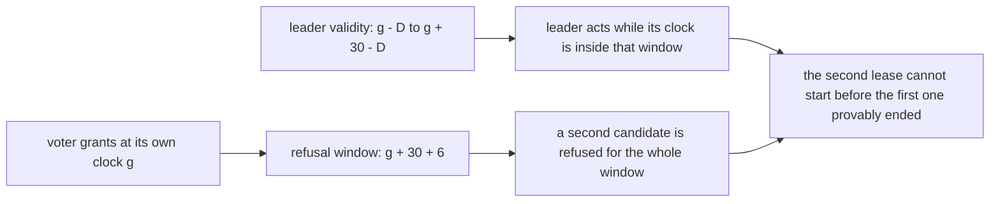
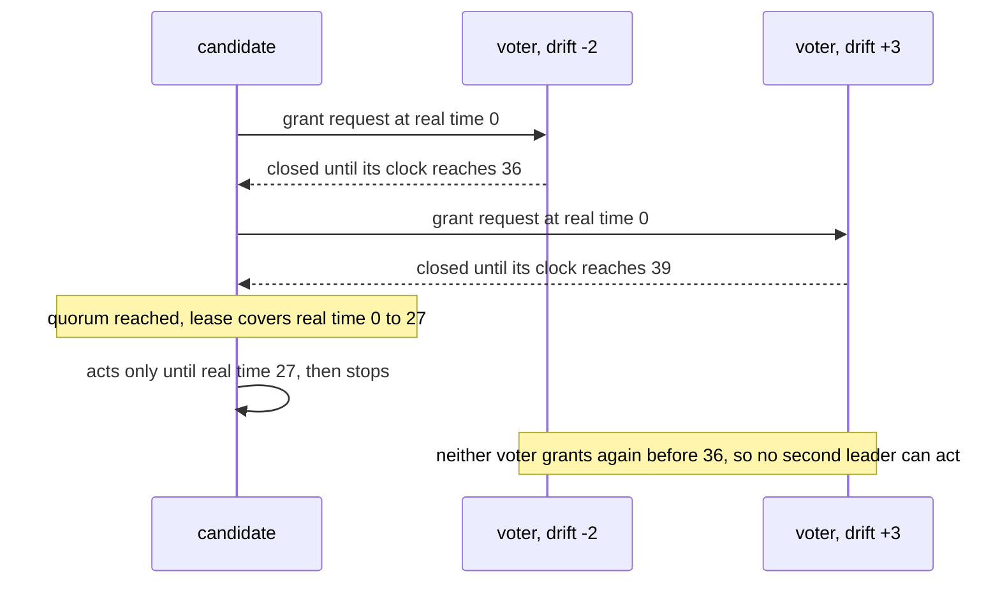
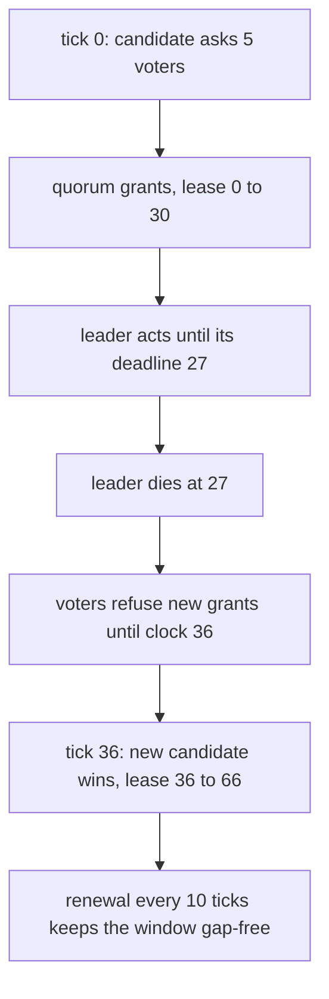

# 808 — Implement highly-available lease-based leader election with failover testing.

> **Tier:** Master · **CTCI chapter:** Ch 9 — System Design and Scalability
> **Task spec:** [808-implement-highly-available-lease-based-leader-election-with-fail.md](../../../tasks/master/808-implement-highly-available-lease-based-leader-election-with-fail.md)
> **Solutions:** [Python](../../../solutions/python/master/808-implement-highly-available-lease-based-leader-election-with-fail/solution.py) ·
> [Java](../../../solutions/java/master/808-implement-highly-available-lease-based-leader-election-with-fail/Solution.java) ·
> [JavaScript](../../../solutions/javascript/master/808-implement-highly-available-lease-based-leader-election-with-fail/solution.js) ·
> [C#](../../../solutions/csharp/master/808-implement-highly-available-lease-based-leader-election-with-fail/Solution.cs)

## 1. Problem restatement

**The modelling contract.** Lease-based leader election with bounded clock drift, simulated as a
deterministic real-time schedule. Real time is an explicit integer tick; every server has a local clock
`t + drift` with `|drift| <= D` (`DEFAULT_DRIFT = 3`). A candidate collects grants from a quorum of
voters; a voter that grants a lease refuses every later grant until **its own** clock has passed the
grant time plus the lease length plus the drift guard (`VOTER_GUARD = 2D = 6`), and the leader only
acts while **its own** clock is inside the granted interval minus its own drift guard.

Those two guards are what make the protocol safe: any two quorums intersect in a voter, and that
voter's refusal window covers the whole of the first lease *in real time even though the two sides
disagree about the clock*, so a second leader cannot become active until the first leader has provably
stopped — including the case where the two clocks differ by the full `D`. The default lease is
`DEFAULT_DURATION = 30` ticks.

**Asserted**, by brute-forcing the resulting schedule after the run:

| Invariant | Check |
| --- | --- |
| mutual exclusion | all lease validity windows in a run are pairwise disjoint in real time, even with extreme but legal drifts, crashes, renewals and frequent failover |
| bounded stop time | a leader that loses its quorum stops acting by its deadline, and no action is ever recorded after the deadline |
| no stale leader | a partitioned (minority) candidate acquires nothing and performs nothing |
| failover liveness | after a leader dies a new lease is acquired within `VOTER_GUARD + D` ticks of the old deadline, and the cluster keeps an active leader for the rest of the run |
| renewal continuity | a healthy leader renews before expiry and its validity window is gap-free |
| quorum arithmetic | the quorum predicate accepts exactly the majority subsets (brute force) |
| clock monotonicity | lease terms increase, grants never move a voter's refusal window backwards, and a voter never grants twice inside one refusal window |
| necessity of the drift bound | with a voter drifting beyond `D` the pairwise disjointness check *fails*, which is what shows the bound is load bearing rather than decorative |
| determinism | identical schedules produce identical leases, leaders and window sets |

**Omitted** versus Chubby/Spanner: one process, so messages are immediate and the network is not
modelled — the interesting uncertainty is *clock drift*, which is modelled explicitly; there is no log
replication (a leader here is only a right to act), no reconfiguration of the member set, no watchdog
process on the voters, and timeouts are driven by the schedule rather than by timers.

```text
hostile schedule: 24 leases over 5 voters, drifts [3, 0, -2, 0, 0], actions 200
failover: old lease ended at 27, new lease started at 36 (9 ticks later)
overlap detection: legal runs 0 / 0, deliberately broken run 1
```

| Scenario | Expected result |
| --- | --- |
| 200-tick hostile schedule with 5 voters | 24 leases, 200 leader actions, **zero** overlapping validity windows |
| the leader dies | the next lease starts **9** ticks after the old one ended: `VOTER_GUARD + DEFAULT_DRIFT = 6 + 3` |
| a minority candidate asks for a lease | acquires nothing, performs no action |
| a voter whose drift is set beyond `D` | the overlap detector fires exactly once — the failure the guards exist to prevent |
| a healthy leader renewing every 10 ticks | its validity windows touch but never overlap and never leave a gap |

## 2. Intuition

The naive election is "whoever holds the smallest clock value becomes leader". It fails in the
partition case for a reason that has nothing to do with the network: two leaders can be convinced they
are the only one, because each of them trusted its own clock. Lease-based election fixes that by making
leadership *expire*, and the interesting part is the arithmetic that decides when.

The key insight is that a leader's right to act is not a boolean, it is an **interval in real time**,
and both sides of the protocol must be pessimistic about each other's clocks:

- The **voter** must stay closed long enough that even if the old leader's clock is `D` ahead of the
  voter's own (so the leader thinks it has more time left than the voter does), the refusal still
  covers the leader's whole believing-window. That is why the voter waits
  `grant + duration + VOTER_GUARD` rather than `grant + duration`.
- The **leader** must stop early by its own drift guard, because its clock may be `D` behind, so the
  interval it acts in is `[start, end - D]` rather than `[start, end]`.

Because any two quorums of `n` voters intersect in at least one voter, the second candidate must ask a
voter that is still inside its refusal window. The price is the failover latency: the next lease cannot
start before the old one *plus* the guard, which in this run is exactly `6 + 3 = 9` ticks.



## 3. Algorithm

1. `Cluster.try_acquire(candidate, real_time)` asks the voters in `voters_in_order(candidate)`; each
   `Voter.grant(real_time, duration, holder)` checks its own clock and either records a refusal window
   `clock + duration + VOTER_GUARD` or refuses.
2. If the grants form a quorum (`quorum_of(size)` = strict majority), the candidate holds a `Lease`
   whose validity is `[grant, grant + duration]` **as the leader sees it**, and it acts only inside
   `[start, end - drift]` (`Lease.covers`, `Cluster.act`).
3. `Cluster.renew(lease, real_time, duration)` is a second acquisition against the same voters while
   the leader is healthy; a renewal that arrives inside a voter's refusal window is refused, which is
   why renewals must be scheduled strictly before expiry (`renew_every = 10` of a 30-tick lease).
4. `Cluster.expire(real_time)` ends a lease that is no longer valid, so a leader that lost its quorum
   stops acting by its deadline instead of drifting on.
5. `window_overlaps(leases)` and `action_problems(cluster)` post-process the whole schedule: every pair
   of validity windows is compared in real time, and every recorded action is checked against its
   lease's deadline.
6. `run_schedule(cluster, ticks, renew_every, plan, duration, candidates)` drives a scripted hostile
   schedule — crashes, renewals, minority candidacies and extreme legal drifts.

```text
procedure try_acquire(candidate, real_time, duration)
    granted ← []
    for each voter in voters_in_order(candidate) do
        window ← voter.grant(real_time, duration, candidate)
        if window is a guarantee then granted.append(voter) end
        if the granted set is a quorum then
            return Lease(holder=candidate, start=real_time, end=real_time + duration,
                         drift=candidate.drift)
        end
    end
    return None                      # a minority candidate must acquire nothing
end

procedure voter_grant(voter, real_time, duration, holder)
    if voter.clock(real_time) is past voter.closed_until then
        voter.closed_until ← voter.clock(real_time) + duration + VOTER_GUARD
        return refusal window closure
    end
    return refusal                 # already promised to somebody whose lease may still be running
end

procedure act(cluster, lease, real_time)
    if lease.covers(real_time) then
        record an action at real_time
    else
        expire(lease, real_time)     # a leader past its deadline performs nothing
    end
end
```

The two lines that carry the whole argument are the voter's `+ VOTER_GUARD` and the leader's
`covers()` test with its own drift subtracted; everything else is scheduling.



## 4. Worked example

The hostile run uses five voters with drifts `[3, 0, -2, 0, 0]`, and grants 24 leases over the schedule
while the leader performs 200 actions. Every number below is printed by the run.

| Quantity | Value | Reading |
| --- | --- | --- |
| voters / drifts | 5, `[3, 0, -2, 0, 0]` | the extreme legal cases plus neutral clocks |
| leases granted | 24 | the schedule forces repeated failover and renewal |
| leader actions | 200 | one action per tick while a lease is valid |
| overlapping validity windows | 0 | mutual exclusion holds in real time despite the drifts |
| failover latency | old lease ended at 27, new lease started at 36 | **9** ticks = `VOTER_GUARD (6) + DEFAULT_DRIFT (3)` |
| deliberately broken run | 1 overlap detected | with a voter drifting past `D` the detector fires, so the bound is not decorative |

The ninth tick is worth reading twice, because it is the *whole* cost of the design and it is exactly
what the guards predict. The old leader stopped at 27; the new leader cannot start before the slowest
voter's refusal window has closed, and that window is `grant + 30 + 6` measured on a clock that may be
behind real time by up to `3`. So the earliest safe start is the old deadline plus
`VOTER_GUARD + D`, and `action_problems` verifies the other half: no action is recorded at or after a
lease's deadline, so the old leader is provably silent before the new one begins.



Renewals are the same protocol run early: with `renew_every = 10` a healthy leader renews at 10 and 20
inside a 30-tick lease, so its validity windows touch without overlapping and without a gap. A renewal
that arrives late lands inside a voter's refusal window and is refused — which is what turns a slow
leader into a demonstrated failure instead of a silent overlap. The minority case is asserted
separately: a candidate that reaches fewer than a quorum of voters acquires nothing, so a partitioned
server can neither act nor disturb the incumbent.

## 5. Complexity

Let `n` be the number of voters, `L` the lease duration and `T` the number of ticks in the schedule.

| Measure | Bound | Why it holds |
| --- | --- | --- |
| Acquisition | `O(n)` grants, one round trip | each voter answers from its own clock, no coordination between voters |
| Renewal | `O(n)` per renewal, `T / renew_every` of them | renewals are acquisitions with the same voter set |
| Failover latency | `O(VOTER_GUARD + D)` = 9 ticks here, independent of `n` | the bound is set by the clocks, not by the number of voters |
| Action storage | `O(T)` recorded actions and `O(leases)` windows | the analysis is done after the run, over the schedule |
| Verification | `O(leases²)` window comparisons plus `O(T)` action checks | brute force, affordable because a run is a few hundred ticks |
| Quorum check | `O(2^n)` in the brute-force test, `O(n)` in the hot path | the predicate is validated exhaustively once, then used as a count |
| Clock safety | `O(1)` per grant and per action | two comparisons: the voter's window and the leader's deadline |

The comparison is a lock-based election: a lock server gives `O(1)` acquire and release and a failover
as fast as the network, but nobody can tell whether the old leader is still running — unless the client
checks the lock on every operation, which costs a round trip per operation. Leases trade that round
trip for bounded uncertainty: the leader may act for free while its lease holds, and the system
guarantees a gap of `guard + drift` in which no leader acts at all.

## 6. Pitfalls and edge cases

- **Forgetting the drift guard on the voter.** `grant + duration` alone is not enough: the old leader's
  clock may be `D` ahead, so it still believes it has `D` ticks left. The broken run with an oversized
  drift exists to prove that the guard, not luck, is what prevents overlap.
- **Forgetting the drift guard on the leader.** A leader that acts until `end` (rather than `end - D`)
  can act after a voter has already started granting somebody else.
- **Renew too late.** A renewal that arrives after the refusal window has opened is refused, and the
  leader must stop; scheduling renewals at a third of the lease (`10` of `30`) leaves room for a retry.
- **A minority candidate must acquire nothing.** The quorum check happens before *and* after each
  grant; stopping early on a clear majority is fine, assuming success on a lost message is not.
- **A lease is not a lock across a partition.** The lease holder keeps acting until its deadline, and
  that is by design — the guarantee is that no *other* leader acts in the same interval, not that this
  one notices the partition immediately.
- **Action after the deadline.** Every recorded action is checked against its lease's validity; even a
  single action past the deadline would break the pairwise-disjointness argument.
- **Renewal continuity.** Touching windows are fine, gaps are not: a gap is a window in which the
  cluster has no leader, which the run asserts never happens on the healthy path.
- **Lease terms must increase.** A voter that moves its refusal window backwards (or grants twice
  inside one window) breaks the ordering assumption, so both are asserted per grant.
- **Ticks, not wall-clock seconds.** The whole schedule is integers, which is what makes "was any
  action performed after the deadline" a decidable question after the fact.

## 7. Variants and follow-ups

- **Replicate a log under the leader.** [801-implement-production-grade-raft-library-replication-reconfigurat.md](../../../tasks/master/801-implement-production-grade-raft-library-replication-reconfigurat.md)
  uses the same election quorums but turns leadership into a log, at which point leases become a
  read-optimisation rather than the whole safety story.
- **Reads without a round trip.** The natural use of a lease is a linearizable read served locally
  while the lease holds, which is exactly the Spanner read-lease trick this model abstracts.
- **Bounded uncertainty elsewhere.** [807-implement-global-scale-consistent-snapshot-across-geographically.md](../../../tasks/master/807-implement-global-scale-consistent-snapshot-across-geographically.md)
  avoids the clock question entirely by defining a cut through messages instead of through time — the
  other way to get consistency without a global clock.
- **Scheduling under uncertainty.** [809-implement-elastic-autoscaling-policy-with-predictive-forecasting.md](../../../tasks/master/809-implement-elastic-autoscaling-policy-with-predictive-forecasting.md)
  is the same "act on a forecast and be punished for being late" control problem without the safety
  requirement.

## 8. Check yourself

1. Why does the voter close its window for `duration + VOTER_GUARD` instead of just `duration`?

<details><summary>Show answer</summary>

Because the leader may believe it has more time than the voter thinks it does: with a drift of `+D`, the
leader's own view of the deadline is `D` later than the voter's. Closing for `duration + 2D` covers the
full interval in which the leader could still legitimately act, so no grant can be issued while the old
leader might act — which is what makes the new lease start at exactly the old deadline plus
`guard + D`.

</details>

2. Failover took 9 ticks. Which two terms produce that number?

<details><summary>Show answer</summary>

`VOTER_GUARD (6) + DEFAULT_DRIFT (3)`: the guard is `2D`, and the extra `D` accounts for the voter's
own clock being behind real time by up to `D`. The bound is a property of the clocks, not of the number
of voters or the network.

</details>

3. A leader loses its quorum but keeps running. Where is that caught, and why is it not a violation of
   mutual exclusion by itself?

<details><summary>Show answer</summary>

`action_problems` checks every recorded action against its lease deadline, and `expire` ends a lease at
its deadline, so a leader that lost its quorum may act only until the lease it already holds runs out —
that is precisely the lease's meaning. It is not an overlap because the voters refuse new grants for
that whole window, so no successor can be active simultaneously.

</details>

4. The run performs a deliberately broken schedule and *expects* the overlap detector to fire. Why is
   that test more valuable than a passing legal run?

<details><summary>Show answer</summary>

Because a detector that never fires proves nothing — it might simply be unable to see overlaps. By
mis-configuring a voter to drift beyond `D` and asserting that the same pairwise-disjointness check
reports exactly one overlap, the test shows the check is sensitive and that the drift bound is doing the
work rather than merely being documented.

</details>
