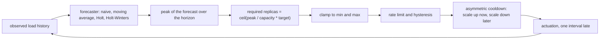
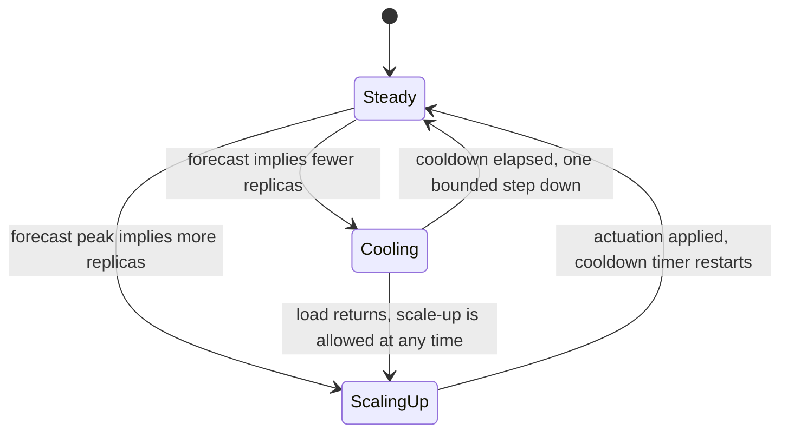
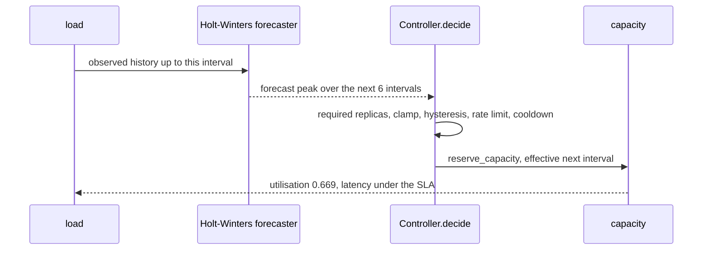

# 809 — Implement elastic autoscaling policy with predictive forecasting and control loop.

> **Tier:** Master · **CTCI chapter:** Ch 9 — System Design and Scalability
> **Task spec:** [809-implement-elastic-autoscaling-policy-with-predictive-forecasting.md](../../../tasks/master/809-implement-elastic-autoscaling-policy-with-predictive-forecasting.md)
> **Solutions:** [Python](../../../solutions/python/master/809-implement-elastic-autoscaling-policy-with-predictive-forecasting/solution.py) ·
> [Java](../../../solutions/java/master/809-implement-elastic-autoscaling-policy-with-predictive-forecasting/Solution.java) ·
> [JavaScript](../../../solutions/javascript/master/809-implement-elastic-autoscaling-policy-with-predictive-forecasting/solution.js) ·
> [C#](../../../solutions/csharp/master/809-implement-elastic-autoscaling-policy-with-predictive-forecasting/Solution.cs)

## 1. Problem restatement

**The modelling contract.** An elastic capacity controller for a service whose load follows a trend
plus a daily season plus seeded noise. The generator is analytic —
`generate_load(steps, seed, base=90.0, trend=0.55, seasonal=45.0, noise=7.0)` with
`PERIOD = 24` — so forecast error can be measured against a *known* truth (`truth_of`) rather than
against another guess. Four forecasters are implemented and compared: `forecast_naive` (last value),
`forecast_moving_average` (window 6), `holt_linear` (level and trend) and `holt_winters` (additive
level, trend and season with `alpha=0.45, beta=0.2, gamma=0.25`), each fitted on the observed history
only and scored on a holdout window by `mean_absolute_percentage_error` inside `backtest`.

The control loop turns a forecast into a replica count:

```text
required = ceil(peak(forecast over the horizon) / (capacity per replica * target utilisation))
```

then clamps to `[min, max]`, rate-limits the change per interval, damps it with hysteresis so noise
cannot move it, and holds it back with an **asymmetric cooldown**: scale-ups may happen at any time,
scale-downs wait, because shedding capacity too eagerly turns a dip into an outage. Utilisation drives
latency through a deterministic text-book queueing curve (`latency_ms`), so the SLA
(`LATENCY_BASE_MS = 10.0`, `SLA_MS = 40.0`) is a concrete threshold instead of a hand wave, and
`CAPACITY_PER_REPLICA = 100.0` with `TARGET_UTILISATION = 0.70` fixes the arithmetic.

**Asserted:** forecast quality (Holt-Winters beats the naive baseline on the holdout, and the seasonal
model reproduces the generator's own seasonality — autocorrelation at the period beats a half-period
lag); degenerate inputs (a constant series forecasts constant with no invented trend, a series shorter
than the window still forecasts, zero load asks for the minimum); the SLA on a ramping seasonal
workload; the *predictive benefit* against a reactive controller with identical parameters, measured
rather than asserted by construction; stability (a constant workload produces no scaling events,
cooldowns are honoured, the per-interval change is rate limited, hysteresis absorbs the noise); bounds
(replica counts inside `[min, max]`, and an overload beyond max capacity reported instead of silently
ignored); and determinism (identical seeds produce identical load, forecasts and decisions).

**Omitted** versus a Kubernetes HPA with a predictive add-on: one process, so the "cluster" is a
formula rather than pods; there is no warm-up, no cold start and no scheduling delay — the only
dynamics are the one-interval actuation delay; the load generator is analytic so error can be measured
against truth; the latency curve is a textbook utilisation model rather than measured queueing data;
and cost is counted simply as replica-seconds.

```text
forecast MAPE on the holdout: naive 6.20%, moving average 6.06%, linear 26.15%, seasonal 2.27%
ramp run: 220 intervals, 4 scaling events, violations 0 vs reactive 0, peak utilisation 0.669 vs 0.723
capacity: 881 replica-seconds for an instantaneous ideal of 719 (static peak would need 1100)
```

| Scenario | Expected result |
| --- | --- |
| holdout MAPE over the seasonal workload | naive `6.20%`, moving average `6.06%`, Holt linear `26.15%`, Holt-Winters `2.27%` |
| 220-interval ramp | 4 scaling events, 0 SLA violations, peak utilisation `0.669` — under the `0.70` target |
| the same workload under a reactive controller | 0 violations too, but peak utilisation `0.723`, i.e. above target |
| capacity spent | 881 replica-seconds against an instantaneous ideal of 719, where a static peak plan needs 1100 |
| a constant workload | no scaling events at all: hysteresis and cooldown absorb the noise |

## 2. Intuition

The naive autoscaler is reactive: if utilisation today is above target, add a replica; if it is below,
remove one. It is stable on a flat workload and always late on a real one, because a replica added now
only helps in the next interval — by which time the load has moved again. The second naive design is
worse in the other direction: provision for the peak of the year, pay for it every minute.

The key insight is that capacity decisions are made **one interval ahead of the capacity arriving**, so
the input to the decision should be a *forecast*, not a measurement. That immediately raises three
engineering questions that the task answers explicitly:

- **How good is the forecast?** Measured against the generator's own truth: the seasonal model reaches
  `2.27%` MAPE where the naive baseline is `6.20%`, and a model without a seasonal term (Holt linear)
  is far worse at `26.15%` because it extrapolates the ramp through the daily cycle.
- **How do you stop a noisy signal from thrashing?** Hysteresis (a dead band around the target),
  rate limiting (a bounded change per interval) and cooldown (a waiting period after a scaling event),
  made asymmetric so that scale-ups are always allowed and scale-downs wait.
- **What is the cost of being early?** Replica-seconds. The predictive controller spends `881` where an
  instantaneous ideal would be `719` and a static peak plan `1100`; being slightly early is what keeps
  peak utilisation at `0.669` instead of the reactive `0.723`.



## 3. Algorithm

1. `generate_load(steps, seed, ...)` produces the observable series; `truth_of` keeps the noise-free
   trend-plus-season component so the forecast can be scored against the truth rather than against
   itself.
2. `backtest(series, forecaster, horizon=6, train_fraction=0.75)` fits on the first 75% and scores the
   holdout, so no forecaster is judged on data it has seen.
3. `Controller.forecast_peak(history)` runs the chosen forecaster over the horizon and takes the peak;
   `replicas_for(peak_load, capacity, target)` converts it into a replica count and
   `Controller.decide(tick, history)` applies clamping, hysteresis, the rate limit and the cooldown.
4. `simulate(loads, controller)` runs the loop: capacity arrives one interval after the decision
   (`reserve_capacity`), `latency_ms(utilisation)` scores the interval against the SLA, and
   `summarise` counts violations, scaling events and replica-seconds.
5. `run_controller(loads, predictive, cooldown=4, **kwargs)` builds the predictive or the reactive
   variant with identical parameters, which is what makes the comparison meaningful.

```text
function holt_winters(series, horizon, period, alpha, beta, gamma)
    level ← average of the first period
    trend ← (average of the second period - average of the first) / period
    season ← the first period's deviations from level
    for each value in the series after the first period do
        prediction ← level + trend + season[index mod period]
        error ← value - prediction
        level ← level + alpha * error
        trend ← trend + beta * error
        season[index mod period] ← season[index mod period] + gamma * error
    end
    return level + step * trend + season[(length + step) mod period] for step in 1..horizon
end

function decide(tick, history)
    if tick - last_scale_tick < cooldown and the new count is smaller then
        return current count                     # scale-down waits, scale-up does not
    end
    peak ← forecast_peak(history)
    wanted ← replicas_for(peak, CAPACITY_PER_REPLICA, TARGET_UTILISATION)
    wanted ← clamp(wanted, min_replicas, max_replicas)
    if abs(wanted - current) is inside the hysteresis band then
        return current                           # the change is not worth an actuation
    end
    return current + clamp(wanted - current, -max_change, +max_change)
end
```

The reactive variant is the same `decide` with `forecast_peak(history)` replaced by the last observed
value, which is exactly the comparison the run makes.



## 4. Worked example

The ramp run drives `220` intervals of trend plus a 24-tick season and noise; both controllers see the
identical series with identical parameters.

| Quantity | Predictive | Reactive | Reading |
| --- | --- | --- | --- |
| SLA violations | 0 | 0 | both keep the latency threshold in this workload |
| peak utilisation | 0.669 | 0.723 | the predictive controller stays under the 0.70 target; the reactive one does not |
| scaling events | 4 | — | the whole 220 intervals are absorbed by four decisions |
| replica-seconds | 881 | — | against an instantaneous ideal of 719 and a static-peak plan of 1100 |

The forecast table that drives those decisions, measured on the same holdout window:

| Forecaster | MAPE on the holdout | Why |
| --- | --- | --- |
| naive (last value) | 6.20% | ignores the trend entirely, so it lags the ramp |
| moving average (6) | 6.06% | smooths the noise but still lags the ramp |
| Holt linear (level + trend) | 26.15% | extrapolates the ramp through the daily cycle, so it is badly wrong at the season's extremes |
| Holt-Winters (level + trend + season, period 24) | 2.27% | the seasonal term removes the cycle, leaving a small residual error |

The last row is why the controller is worth building: it is the only model whose error is small enough
that a decision taken one interval early is still the right decision. The capacity number completes the
argument — `881` replica-seconds is 22% more than a clairvoyant ideal (`719`) and 20% less than merely
provisioning for the peak forever (`1100`), so the controller buys the SLA at a bounded premium instead
of at unbounded cost.



Degenerate inputs are asserted separately, because a controller that only works on the realistic series
is not finished: a constant series must produce a constant forecast with no invented trend and *no*
scaling events at all, a series shorter than the window must still be forecastable (the naive and
moving-average paths handle it, Holt-Winters falls back), and a zero load must ask for the minimum
number of replicas rather than dividing by a zero peak.

## 5. Complexity

Let `T` be the number of intervals, `H` the forecast horizon, `W` the moving-average window, `P` the
seasonal period (24) and `R` the replica count.

| Measure | Bound | Why it holds |
| --- | --- | --- |
| Holt-Winters fit | `O(T)` per interval, `O(T + H)` for the whole forecast | one pass of exponential updates plus `H` seasonal lookups |
| Moving average / naive | `O(W)` and `O(1)` per interval | a rolling window versus the last sample |
| Decision | `O(1)` given the forecast | clamp, hysteresis comparison, rate limit, cooldown test |
| Simulate | `O(T)` intervals with `O(1)` work each | utilisation, latency and the replica-seconds integral |
| Verification | `O(T)` per scenario plus the reactive run | the run keeps both controllers and compares them interval by interval |
| Reporting cost | replica-seconds | the integral of `R` over the run: 881 here, against an ideal of 719 |

The comparison is the reactive controller: `O(1)` per interval with no forecast at all, and it is
harder to beat than it looks — on this workload it also has zero SLA violations. What it does not have
is headroom: its peak utilisation is `0.723` against the predictive `0.669`, so it is running closer to
the latency cliff, where a slightly worse interval would produce violations. The predictive controller
trades `O(T)` forecasting work per interval for that margin, and the static peak plan trades 1100
replica-seconds of always-on cost for the same margin. None of this is wall-clock time: capacity is
counted in replica-seconds and latency comes from a deterministic utilisation curve, which is what
makes the comparison reproducible.

## 6. Pitfalls and edge cases

- **Forecast error is measured against a known truth, not against the model.** `truth_of` keeps the
  noise-free component, so `2.27%` is an error against the generator, not a self-referential score.
- **No seasonality means no season to extrapolate.** Holt linear is *much* worse (`26.15%`) than the
  seasonal model on the same data; adding a trend to a cyclic signal without a season term is the trap.
- **A constant series must not invent a trend.** An initialisation that divides by zero or seeds a
  spurious slope produces a gradually drifting forecast and phantom scaling events.
- **A series shorter than the window.** The first intervals have no full history; the moving average and
  Holt-Winters must degrade gracefully instead of indexing before the start of the series.
- **Zero load.** `required` must ask for the minimum, not for zero replicas: the division by target
  utilisation is safe, but an `ceil` of a tiny number still needs the floor.
- **Asymmetric cooldown.** Scale-ups must never be delayed by a cooldown — that would turn a load spike
  into an outage — while scale-downs must be, or a single noisy interval sheds capacity.
- **Hysteresis and the rate limit are different tools.** Hysteresis ignores changes too small to bother
  with; the rate limit bounds the size of a change that *is* made. Removing either produces a
  saw-tooth in the replica count.
- **The actuation delay is the whole problem.** Capacity decided at interval `t` is available at
  `t + 1`, and the simulation models exactly that; a controller evaluated with instantaneous actuation
  looks artificially good.
- **Overload beyond max must be reported.** When the required count exceeds `max`, the correct
  behaviour is to clamp and *say so*, not to pretend the SLA is met.
- **Determinism.** Identical seeds must produce identical load, forecasts and decisions; any use of
  library randomness in the generator breaks the measured comparisons.

## 7. Variants and follow-ups

- **The control loop without the safety requirement.** [808-implement-highly-available-lease-based-leader-election-with-fail.md](../../../tasks/master/808-implement-highly-available-lease-based-leader-election-with-fail.md)
  is the same "act on an estimate, be punished for being late" structure where correctness, not
  utilisation, is the constraint.
- **Cost-aware scheduling.** [817-implement-scheduler-for-heterogeneous-gpu-cpu-cluster-with-multi.md](../../../tasks/master/817-implement-scheduler-for-heterogeneous-gpu-cpu-cluster-with-multi.md)
  places work on a heterogeneous fleet with isolation, which is the capacity question this loop answers
  the other way round.
- **Sketching instead of forecasting.** [823-implement-real-time-anomaly-detection-via-streaming-pca-or-sketc.md](../../../tasks/master/823-implement-real-time-anomaly-detection-via-streaming-pca-or-sketc.md)
  watches the same kind of series for anomalies, where the goal is detection rather than prediction.
- **Elastic membership under a collective.** [816-implement-distributed-training-system-with-fault-tolerant-all-re.md](../../../tasks/master/816-implement-distributed-training-system-with-fault-tolerant-all-re.md)
  is the case where the "replica count" is the world size of a distributed job and changing it changes
  the result.

## 8. Check yourself

1. Why is the predictive controller's peak utilisation (`0.669`) more informative than its violation
   count?

<details><summary>Show answer</summary>

Because both controllers have zero violations on this workload, so the count does not separate them.
Utilisation is the *margin*: `0.669` is safely under the `0.70` target while `0.723` is already past it,
so the reactive controller is operating where a slightly worse interval would produce violations. The
predictive controller spends the extra replica-seconds (881 vs an ideal 719) to buy that margin.

</details>

2. Holt linear has `26.15%` MAPE against `2.27%` for Holt-Winters on the same series. What does that
   tell you about the data and the model?

<details><summary>Show answer</summary>

That the series has a strong daily cycle (period 24): a model with level and trend but no seasonal term
extrapolates the ramp straight through the cycle, so it is badly wrong at the extremes, while an
additive seasonal term removes almost all of the error. It is also a warning about component selection —
adding trend components to a seasonal signal is not automatically progress.

</details>

3. What is the difference between hysteresis, the rate limit and the cooldown in `decide`?

<details><summary>Show answer</summary>

Hysteresis is a dead band: a change smaller than the band is not worth acting on. The rate limit bounds
how many replicas one decision may add or remove. The cooldown is a waiting period after an actuation,
and here it is asymmetric — it applies only to scale-downs, because delaying a scale-up risks an SLA
violation while delaying a scale-down only risks cost.

</details>

4. `capacity: 881 replica-seconds for an instantaneous ideal of 719`. Where do the extra 162
   replica-seconds go?

<details><summary>Show answer</summary>

Into being early: capacity is decided one interval before it is needed, and the forecast peak is taken
over a horizon, so the controller occasionally holds a replica that a clairvoyant planner would have
dropped. The premium is bounded (881 versus 1100 for a static peak plan) and it is exactly what buys
the `0.669` peak utilisation instead of `0.723`.

</details>
