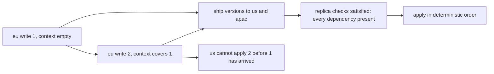
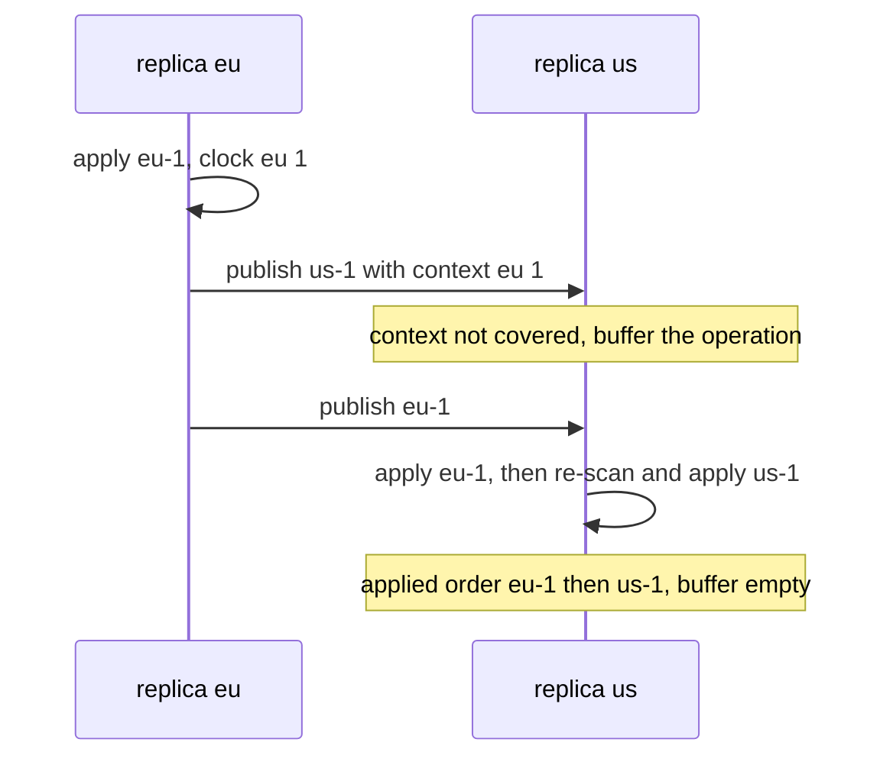
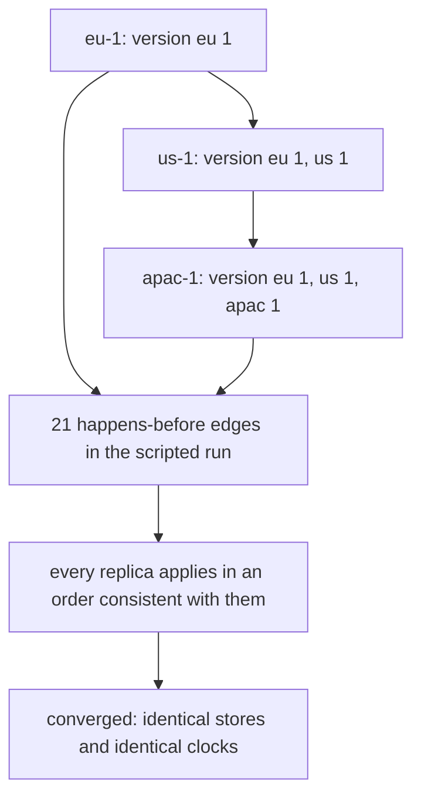

# 810 — Implement cross-datacenter replication with causal consistency guarantees.

> **Tier:** Master · **CTCI chapter:** Ch 9 — System Design and Scalability
> **Task spec:** [810-implement-cross-datacenter-replication-with-causal-consistency-g.md](../../../tasks/master/810-implement-cross-datacenter-replication-with-causal-consistency-g.md)
> **Solutions:** [Python](../../../solutions/python/master/810-implement-cross-datacenter-replication-with-causal-consistency-g/solution.py) ·
> [Java](../../../solutions/java/master/810-implement-cross-datacenter-replication-with-causal-consistency-g/Solution.java) ·
> [JavaScript](../../../solutions/javascript/master/810-implement-cross-datacenter-replication-with-causal-consistency-g/solution.js) ·
> [C#](../../../solutions/csharp/master/810-implement-cross-datacenter-replication-with-causal-consistency-g/Solution.cs)

## 1. Problem restatement

**The modelling contract.** Causal consistency across geographically distributed replicas
(`build_cluster(names=("eu", "us", "apac"), latency=...)`). Every write gets a **version vector**: the
writer's own counter plus the context it observed when it wrote, which is exactly the set of
dependencies that must be delivered before the write may be applied anywhere else. A replica applies a
local write immediately; a replicated write is buffered until every dependency is present
(`Replica.satisfied`), and then applied — together with anything else that became enabled — in a
deterministic order. Because a dependency can never be missing when a write is applied, the applied
order at every replica is a linear extension of happens-before, and the buffers drain to the same state
everywhere once the network quiesces.

**Sessions** carry a causal token (a version vector). A read with a token blocks until the replica's
clock covers the token (`Replica.covers`, `Cluster.session_read`), which gives read-your-writes and
monotonic reads without any global ordering: the replica waits only for the operations that session
actually ran ahead of.

**Asserted**, several checks against independent derivations rather than against the implementation:

| Invariant | Check |
| --- | --- |
| causality | happens-before computed from the write log (same-origin sequence plus recorded dependencies) equals the relation implied by strict version-vector dominance, pair by pair — two independent codings of the same order — and the relation is acyclic |
| delivery order | for every pair with a happens-before edge, the first is applied before the second at **every** replica, brute-forced over all pairs and replicas, including a run that forces a message to overtake its dependency |
| buffering | an operation whose dependencies have not arrived is never applied, and the buffer drains to exactly the missing set once they do |
| convergence | after quiescence all replicas hold identical stores and identical clocks |
| session guarantees | read-your-writes across datacenters, monotonic reads with an advancing token, and a read that waits only for operations inside its token |
| eventual, not strong | an unreplicated write is invisible elsewhere until it is replicated, and that is *not* a causality violation |
| idempotence, determinism | redelivering an operation changes neither the state nor the applied log; identical schedules produce identical states, orders and buffer high-water marks |

**Omitted** versus Cosmos DB / CockroachDB: one process, so the "network" is an explicit queue with a
fixed per-link latency; there are no transactions, no compaction of version vectors, and no failure or
recovery of a replica; concurrent writes to the same key are resolved by a deterministic rank
(`version_rank`: the version sum, then the sorted components) rather than by an application policy; the
workload is a small deterministic schedule, which is what makes the brute-force order checks
affordable.

```text
scripted run: 7 operations, 21 causal edges, 14 messages, 7 applied per replica
forced overtake: buffered 1 at its high-water mark, final order ['eu-1', 'us-1']
session guarantees: read-your-writes, monotonic reads and unblocked empty/unknown tokens all observed
```

| Scenario | Expected result |
| --- | --- |
| scripted run | 7 operations, 21 happens-before edges, 14 messages, 7 applied at every replica |
| a dependent write forced to arrive before its dependency | it is buffered (high-water mark 1) and applied after it; the final order is `['eu-1', 'us-1']` |
| the same write replicated to two datacenters | the second datacenter does not see it until it is replicated — this is eventual, not strong, and not a violation |
| a session that wrote then read with its token | the read returns its own write (`read-your-writes`) |
| a repeated delivery of the same operation | state and applied log unchanged (idempotence) |

## 2. Intuition

The naive replication design ships every write to every datacenter immediately and applies it on
arrival. It converges, but it can show a client a *cause before its effect*: if a primary writes `x`
and, after seeing that write, writes `y` in another datacenter, the second write can arrive first and
be applied on a replica that has not seen `x` yet. Applications that read that replica observe an
impossible history.

The key insight is that "happened before" can be *represented in the write itself* — that is what the
version vector is — and that a replica can then enforce the order locally without any coordination:

- A write carries the context its author had observed, so the dependency set is self-describing; no
  message needs to be ordered by the network.
- A replica applies a write only when its own clock covers every dependency, so the applied history is
  always a linear extension of happens-before. Anything that cannot be applied yet waits in the buffer.
- Two concurrent writes are genuinely unordered, so no rule is needed to "fix" them: the replica picks
  a deterministic rank so that every replica ends up with the same state, but no client is promised
  that one happened before the other.
- Sessions get stronger guarantees for free: a token is just the version vector the session has
  observed, and waiting for it to be covered by a replica's clock gives read-your-writes and monotonic
  reads without a quorum, a leader, or a global clock.



## 3. Algorithm

1. `Cluster.write(datacenter, key, value)`: the replica bumps its own component of its version vector,
   builds the operation with that vector as its context, applies it locally and publishes it to the
   other replicas (`Network.publish`).
2. `Replica.receive(operation)`: if `satisfied(operation)` — every component of the operation's context
   is at or below the replica's clock — apply it; otherwise push it into the buffer.
3. After each apply, re-scan the buffer: an operation that became satisfied is applied too, and the
   same is tried again, so one delivery can unblock a chain. The re-scan uses `version_rank` to pick a
   deterministic order when several operations are enabled at once.
4. `Replica.apply` merges the operation's context into the replica's clock and records the operation in
   the applied log, which the causality checks read.
5. `session_read(datacenter, key, token)`: wait (`wait_for`) until the replica's clock covers the token,
   then read. That single rule gives both session guarantees, and it waits only for the operations
   inside the token.
6. `happens_before_from_log` and `happens_before_from_vectors` derive the relation twice — once from
   same-origin sequences plus recorded dependencies, once from strict componentwise dominance — and
   `order_violations` brute-forces every pair and replica against the applied order.

```text
procedure receive(replica, operation)
    if replica.satisfied(operation) then
        apply(replica, operation)
    else
        replica.buffer.append(operation)
        replica.high_water ← max(replica.high_water, length(replica.buffer))
        return buffered
    end
    return applied
end

procedure apply(replica, operation)
    replica.clock ← componentwise max(replica.clock, operation.version)
    replica.store[operation.key] ← resolve with version_rank against any concurrent value
    replica.applied.append(operation.name)
    progress ← true
    while progress do                                 # one arrival can unblock a chain
        progress ← false
        for each waiting in sorted(replica.buffer, by version_rank) do
            if replica.satisfied(waiting) then
                replica.buffer.remove(waiting)
                replica.clock ← componentwise max(replica.clock, waiting.version)
                replica.store[waiting.key] ← resolve with version_rank
                replica.applied.append(waiting.name)
                progress ← true
            end
        end
    end
end

procedure session_read(cluster, datacenter, key, token)
    cluster.wait_for(datacenter, token)                # until the replica's clock covers the token
    return cluster.replicas[datacenter].read(key)
end
```



The two lines that matter in `apply` are the componentwise merge of the version vector and the
re-scan: without the merge, dependencies could never become satisfied; without the re-scan, a chain of
buffered operations would need one delivery per link instead of draining at once.

## 4. Worked example

The scripted run performs 7 operations across the three datacenters and produces 21 happens-before
edges, 14 messages and 7 applied operations at each replica. The interesting scenario is the
**forced overtake**, in which a dependent operation is delivered before its dependency:

| Step | Event | State at the receiving replica |
| --- | --- | --- |
| 1 | `eu-1` written at `eu` | applied immediately; clock `eu: 1` |
| 2 | `us-1` written at `us` with context `eu: 1` | applied at `us`; published to `eu` and `apac` |
| 3 | the network delivers `us-1` to `apac` **before** `eu-1` | `satisfied` is false, so it is buffered — the buffer's high-water mark is the measured 1 |
| 4 | `eu-1` arrives at `apac` | applied, then the re-scan finds `us-1` satisfied |
| 5 | `us-1` applied at `apac` | final applied order `['eu-1', 'us-1']` — the cause precedes the effect despite the delivery order |

That is the whole guarantee in one trace: the *messages* arrived out of order and the *applied history*
did not. `order_violations` verifies it systematically — for every pair related by happens-before, at
every replica — and the causality check separately proves the two derivations of the relation agree:
the log-based one (same-origin sequence plus recorded dependencies) and the vector-based one (strict
componentwise dominance) are compared pair by pair, and `acyclic` confirms the relation has no cycles.



Session guarantees come from the same machinery and are asserted explicitly. A session that writes at
`eu` and then reads at `apac` with its token blocks until `apac`'s clock covers the version, so it sees
its own write. A session that reads with an advancing token never goes backwards, because the token
only grows and coverage is monotone. And a token that is empty or refers to operations the replica has
never heard of does not block: the read proceeds, which is what the "unblocked empty/unknown tokens"
observation records. Note what is *not* claimed: an unreplicated write is invisible elsewhere until it
arrives, so the system is eventual, not strongly consistent — the checks confirm that this is not a
causality violation, because no replica claims the write happened and then contradicts it.

## 5. Complexity

Let `R` be the number of replicas, `O` the number of operations, `D` the number of dependencies per
operation, and `B` the buffer size.

| Measure | Bound | Why it holds |
| --- | --- | --- |
| Local write | `O(1)` to bump the clock, `O(R)` to encode the version vector | the context is a fixed-size vector |
| Receive | `O(D)` for the `satisfied` test, plus `O(B log B)` for a re-scan | the buffer is re-scanned after every apply |
| Message traffic | `O(O · R)` in this model — measured 14 messages for 7 operations | each publish goes to the other replicas |
| Convergence | one network latency plus the dependency depth | buffers drain as soon as the missing dependencies arrive |
| Space | `O(O · R)` for logs and clocks, `O(B)` buffered | nothing is compacted in this prototype |
| Session read | `O(wait)` — bounded by the latency to the dependency | the token is a version vector comparison |
| Verification | `O(O² · R)` for the pair-by-pair order check, plus `O(O²)` for the two happens-before derivations | brute force over pairs and replicas, which is why the workload is small |

The comparison is strong consistency: a quorum commit
([801-implement-production-grade-raft-library-replication-reconfigurat.md](../../../tasks/master/801-implement-production-grade-raft-library-replication-reconfigurat.md))
gives linearizable reads but costs a round trip per write and stops progress when a quorum is
unreachable. Causal consistency costs one version vector per write, a buffer per replica and no
coordination at all — every replica accepts writes and applies them as soon as it can — and it buys
exactly the guarantee applications usually need: no cause is ever observed after its effect.

## 6. Pitfalls and edge cases

- **Applying a write whose dependencies are missing.** That is the entire bug the buffer exists to
  prevent; the check forces an overtake and asserts the buffer's high-water mark and the final order.
- **Forgetting the re-scan.** Delivering a dependency unblocks the buffer; without a re-scan the
  operation waits for its own retransmission, and convergence slows to one dependency per message.
- **The version vector must be merged, not overwritten.** `apply` takes the componentwise maximum, so a
  replica's own component is never lost when a remote operation arrives.
- **Concurrent writes need a deterministic tie-break.** `version_rank` (version sum, then sorted
  components) is not a claim about causality — it is only there so every replica stores the same value.
  Treating the rank as a happens-before edge would make the causality check fail.
- **`strictly_dominates` is strict.** Two versions where each dominates the other on some component are
  *concurrent*; using non-strict dominance everywhere collapses concurrency into a false order.
- **A session token is not a quorum.** Waiting for coverage only waits for the operations inside the
  token, which is why an empty or unknown token must not block — that is asserted, not assumed.
- **Eventual is not a bug.** A write not yet replicated must be invisible elsewhere; the run separates
  "not yet visible" from "causally violated" on purpose.
- **Idempotence.** Redelivery must not append the operation twice or change the store; the checks
  replay a delivery and compare the applied log.
- **Arbitrary delivery order.** With `R - 1` other replicas publishing concurrently, the arrival order
  is arbitrary, so the determinism assertion is about the *applied* order and final state, not about
  the network.

## 7. Variants and follow-ups

- **Resolve conflicts by merge instead of by rank.** [805-implement-eventual-consistent-multi-master-datastore-with-confli.md](../../../tasks/master/805-implement-eventual-consistent-multi-master-datastore-with-confli.md)
  gives up the dependency buffer entirely and keeps only policies whose merge is a lattice join.
- **Pay for a total order.** [801-implement-production-grade-raft-library-replication-reconfigurat.md](../../../tasks/master/801-implement-production-grade-raft-library-replication-reconfigurat.md)
  replaces version vectors with a log index, which is stronger and slower.
- **Transactions across datacenters.** [802-implement-fully-acid-transactional-key-value-store-with-mvcc-and.md](../../../tasks/master/802-implement-fully-acid-transactional-key-value-store-with-mvcc-and.md)
  adds snapshot isolation and a commit point on top of timestamped versions.
- **Snapshot a causal history.** [807-implement-global-scale-consistent-snapshot-across-geographically.md](../../../tasks/master/807-implement-global-scale-consistent-snapshot-across-geographically.md)
  takes a cut through the same message graph, which is what a consistent snapshot of these replicas
  would have to be.

## 8. Check yourself

1. Why is a version vector enough to enforce causal order without any coordination between replicas?

<details><summary>Show answer</summary>

Because the *writer* records what it had observed, so each operation carries its own dependency set.
A replica compares that set with its own clock — a purely local decision — and buffers anything it
cannot yet honour. No message ordering, no leader and no quorum is required, because the order
information travels inside the data.

</details>

2. In the forced-overtake trace, `us-1` arrived before `eu-1` at `apac` and was still applied second.
   Why is the buffer's high-water mark of 1 significant?

<details><summary>Show answer</summary>

It shows the protocol buffered exactly what it had to and no more: only the operation whose dependency
was missing waited, and the re-scan applied it as soon as `eu-1` arrived, without any retransmission.
A high-water mark that kept growing would indicate the re-scan is not unblocking chains, which is the
difference between `O(depth)` and `O(depth × messages)` convergence.

</details>

3. Two clients write different values to the same key in different datacenters. Is that a causality
   violation?

<details><summary>Show answer</summary>

No. Neither write observed the other, so they are concurrent; the version vectors are incomparable and
happens-before does not relate them. The replica still has to store one of them, which is what
`version_rank` decides deterministically, but that choice is a storage convention, not a causal claim —
the causality check compares the log-derived relation with the vector-derived one and would flag a rank
that pretended to be an edge.

</details>

4. A session reads with a token whose operations the replica has never seen. What should happen, and
   why is "block forever" wrong?

<details><summary>Show answer</summary>

The read proceeds. The token is a lower bound on what the session has observed, and a replica that
cannot cover it either has the operations in flight or the token refers to a datacenter it has not
heard from; blocking would tie a session to a quorum it never asked for. Read-your-writes and monotonic
reads only require waiting for the operations *inside* the token, which is exactly what
`wait_for(datacenter, token)` does.

</details>
