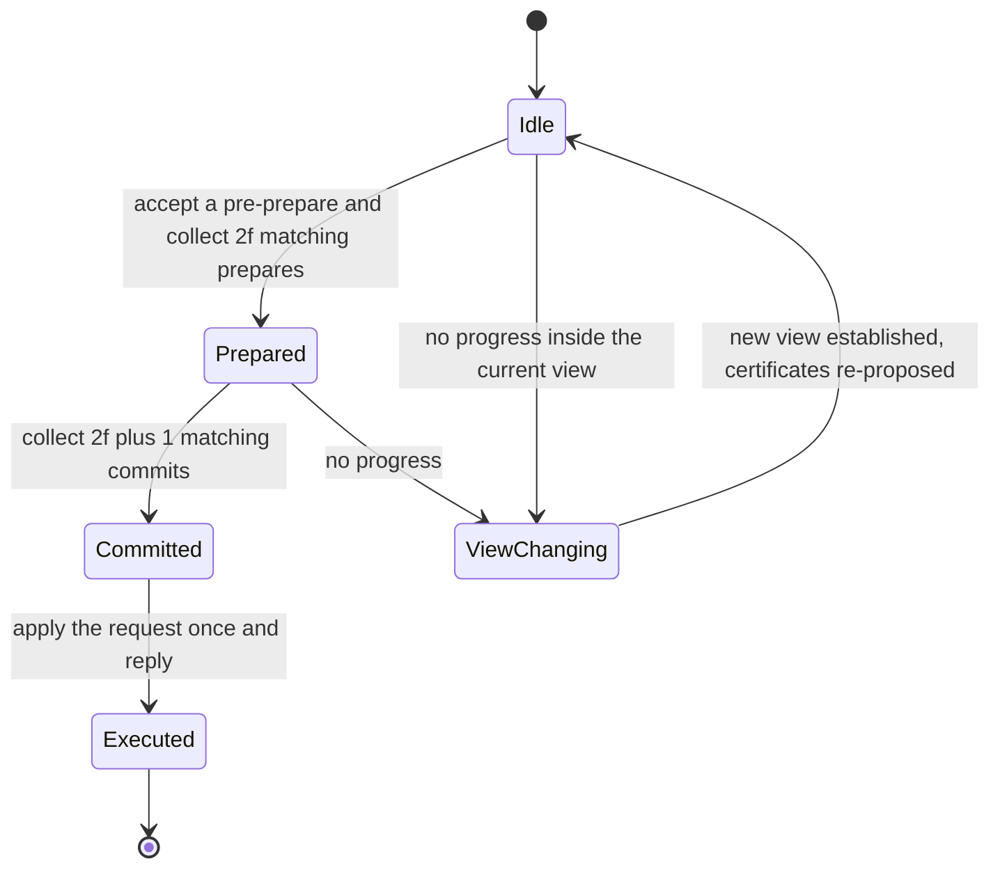
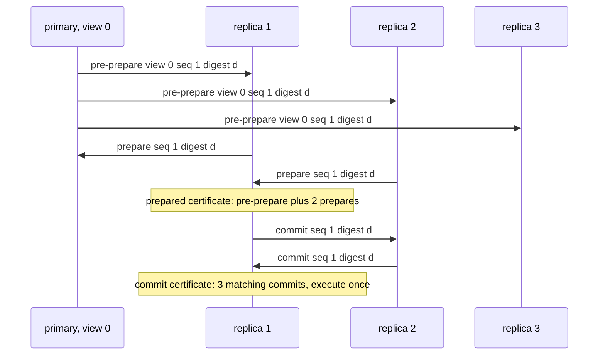

# 811 — Implement Byzantine fault-tolerant replicated state machine (Practical BFT).

> **Tier:** Master · **CTCI chapter:** Ch 9 — System Design and Scalability
> **Task spec:** [811-implement-byzantine-fault-tolerant-replicated-state-machine-prac.md](../../../tasks/master/811-implement-byzantine-fault-tolerant-replicated-state-machine-prac.md)
> **Solutions:** [Python](../../../solutions/python/master/811-implement-byzantine-fault-tolerant-replicated-state-machine-prac/solution.py) ·
> [Java](../../../solutions/java/master/811-implement-byzantine-fault-tolerant-replicated-state-machine-prac/Solution.java) ·
> [JavaScript](../../../solutions/javascript/master/811-implement-byzantine-fault-tolerant-replicated-state-machine-prac/solution.js) ·
> [C#](../../../solutions/csharp/master/811-implement-byzantine-fault-tolerant-replicated-state-machine-prac/Solution.cs)

## 1. Problem restatement

**The modelling contract.** PBFT as a deterministic message-passing simulation over `n = 3f + 1`
replicas. Three phases per view:

1. The primary assigns a sequence number and multicasts `PRE-PREPARE (view, seq, digest, request)`, and
   processes its own proposal like any other replica.
2. A replica that *accepts* the pre-prepare — right view, from that view's primary, inside the
   watermarks, digest matching the request, not already seen — multicasts `PREPARE`. A replica holding
   a pre-prepare plus `2f` matching prepares from **distinct** replicas has a **prepared certificate**
   and multicasts `COMMIT`.
3. A replica that collects `2f + 1` matching commits records the **commit certificate**, executes the
   request and replies to the client once.

Certificates are what make the protocol safe: any two quorums of size `2f + 1` out of `3f + 1` share at
least `f + 1` replicas, so at least one shared replica is *correct*, and a correct replica never
prepares or commits two different digests for the same sequence number. The checks verify exactly that:
executed values of all correct replicas are compared per sequence number, the certificates behind them
are intersected, and a violation is reported **together with the replicas whose double vote would have
been necessary**. View changes are explicit (`start_view_change`, `on_view_change`, `on_new_view`): a
replica that cannot make progress asks for the next view and the new primary re-proposes the
certificates it collected.

**Asserted:**

| Invariant | Check |
| --- | --- |
| agreement | no two correct replicas execute different requests at the same sequence number, across every run, view and fault injection — brute-forced over all correct replicas and sequence numbers |
| certificates | every execution is justified by `2f + 1` matching commits, and when two conflicting certificates exist at one sequence number the detector names the replicas that must have voted twice |
| quorum arithmetic | any two `2f + 1` quorums out of `3f + 1` share at least `f + 1` replicas, and with at most `f` faulty replicas the shared part contains a correct one (brute-forced over all subsets for `n = 4` and `n = 7`) |
| validation | digest mismatch, a pre-prepare from a non-primary, a sequence outside the watermarks, a duplicate pre-prepare, a prepare without a pre-prepare, a prepare for the wrong digest, a commit without being prepared and a commit for a never-prepared digest are all rejected and never executed |
| liveness | requests commit with `f` faulty replicas; a silent primary stalls the cluster until a view change, after which progress resumes; a minority of correct replicas can never make anything execute |
| client view | the client accepts an answer only after `f + 1` matching replies |
| checkpoints | a checkpoint becomes stable on `2f + 1` matching checkpoint digests and not before |

**Omitted** versus a real PBFT deployment: one process and an explicit message queue with a link
latency, so there is no real cryptography (digests only) and no signatures on the messages, which means
the model can demonstrate *equivocating* behaviour but not defend against a faulty replica forging
another's identity; checkpoint garbage collection is not implemented, only the stability rule; the
watermarks are fixed for the run.

```text
normal run: 3 requests, 90 messages, 4 replicas, quorum 3 of 4
faults: silent primary + view change, equivocating primary, two silent replicas — agreement violations 0 anywhere except the crafted counter-example
tight bound: 2 faulty of 4 produced 1 agreement violation and named double voters [0, 1]
```

| Scenario | Expected result |
| --- | --- |
| 3 requests on 4 replicas (`f = 1`, quorum `2f + 1 = 3`) | all correct replicas execute the same request per sequence number; the run sends 90 messages |
| a silent primary | no progress in that view; after the view change the new primary re-proposes the prepared certificates and the requests commit |
| an equivocating primary that proposes two digests for one sequence | no correct replica prepares both, so no two correct replicas execute different requests |
| two silent replicas (`f = 2` of 4) | a minority of correct replicas can never make anything execute |
| two *Byzantine* replicas of 4 acting together | exactly 1 agreement violation, and the detector names double voters `[0, 1]` — the bound `n = 3f + 1` is tight |

## 2. Intuition

The naive replicated state machine is "the primary tells everyone what to do". It survives crashes and
fails immediately against a lying primary: the primary sends request `A` to half the replicas and
request `B` to the other half at the same sequence number, and every replica believes it has the truth.

The key insight is that agreement cannot be established by one message, and cannot be established by
majorities either — with Byzantine faults the quorum must be large enough that two quorums *overlap in
enough replicas that at least one of them is honest*:

- **Two phases of voting, not one.** `PREPARE` proves that `2f + 1` replicas (including the primary)
  agree on one digest for the sequence number, and commits `2f + 1` of them to it. That is the
  *prepared certificate*: after it exists, no conflicting request can gather a certificate at the same
  sequence number without `f + 1` replicas voting twice — impossible when at most `f` are faulty.
- **`COMMIT`, not `PREPARE`, triggers execution.** Preparation only orders the request within the view;
  the commit certificate is what makes the order survive a view change, because the new primary
  re-proposes the certificates it saw rather than inventing its own order.
- **The primary is just one more voter.** It processes its own pre-prepare, so a faulty primary that
  sends conflicting messages still cannot create two conflicting certificates.
- **The bound is `n = 3f + 1`, not `2f + 1`.** That `+1` is what makes the intersection argument work
  when votes can be *wrong* instead of merely *late*, and the run demonstrates that dropping it produces
  agreement violations.


## 3. Algorithm

1. `Cluster.request(text, client)`: the primary for the current view (`is_primary`) assigns the next
   sequence number and emits the pre-prepare to the other replicas.
2. `Replica.handle(message)` dispatches; `on_pre_prepare` validates view, sender, watermarks, digest and
   duplicates, then records the pre-prepare and broadcasts `PREPARE`.
3. `on_prepare` counts prepares per `(view, sequence, digest)` from distinct replicas; at `2f` matching
   prepares plus its own pre-prepare the replica has a prepared certificate and broadcasts `COMMIT`.
4. `on_commit` counts commits per digest; at `2f + 1` matching commits it records the commit
   certificate and calls `execute(view, sequence, digest)`, which applies the request once and replies.
5. `start_view_change(new_view)` / `on_view_change` / `on_new_view`: a replica that cannot make progress
   asks for the next view; when the new view is established, the new primary re-proposes the
   certificates it collected in the earlier view, so committed requests are never lost.
6. `Cluster.run(rounds)` advances the link latency and delivers messages; `view_change(new_view)` forces
   a view transition for the fault scenarios, and `forged_vote` injects equivocating messages.

```text
procedure on_pre_prepare(replica, message)
    if message.view is not the current view then return reject("wrong view") end
    if message.sender is not the primary of message.view then return reject("not primary") end
    if message.sequence is outside the watermarks then return reject("out of watermarks") end
    if digest(message.request) is not message.digest then return reject("digest mismatch") end
    if (message.view, message.sequence) is already recorded then return reject("duplicate") end
    replica.log[message.sequence] ← (message.digest, message.request)
    broadcast(replica, ("prepare", view, message.sequence, message.digest))
end

procedure on_prepare(replica, message)
    if replica has no pre-prepare for this sequence or its digest differs then return reject end
    count prepares for (view, sequence, digest) from distinct replicas
    if count reaches 2f then
        record the prepared certificate
        broadcast(replica, ("commit", view, sequence, digest))
    end
end

procedure on_commit(replica, message)
    if replica never prepared this digest then return reject end
    count commits for (view, sequence, digest) from distinct replicas
    if count reaches 2f + 1 then
        record the commit certificate
        execute(view, sequence, digest)      # exactly once per sequence number
        reply to the client
    end
end
```



## 4. Worked example

The normal run uses 4 replicas, so `f = 1` and the quorum is `2f + 1 = 3` of 4. One request goes
through three phases; the run sends 90 messages while committing 3 requests.

| Phase | Message | What a correct replica needs | Result |
| --- | --- | --- | --- |
| 1 | `PRE-PREPARE(view, seq, digest, request)` from the primary | right view, primary matches, inside watermarks, digest of the request, not seen before | the replica records the proposal and prepares |
| 1 | `PREPARE(view, seq, digest)` from each replica | `2f = 2` matching prepares from **distinct** replicas plus its own pre-prepare | a prepared certificate, so the replica commits |
| 2 | `COMMIT(view, seq, digest)` from each replica | `2f + 1 = 3` matching commits, each from a replica that was prepared | a commit certificate, so the replica executes exactly once |
| 3 | reply to the client | the client counts matching replies and accepts on `f + 1 = 2` | the client's answer is not a single replica's word |

The two certificate sizes are the whole protocol in numbers: `2f` prepares for the *prepared*
certificate and `2f + 1` commits for the *commit* certificate. Quorum intersection is checked
exhaustively for `n = 4` and `n = 7`: any two `2f + 1` subsets out of `3f + 1` share at least `f + 1`
replicas, so with at most `f` faulty replicas the shared part contains at least one correct replica —
which is why a conflicting certificate cannot exist.

Fault injection is where the design earns its keep:

| Injected fault | Observed behaviour |
| --- | --- |
| silent primary | the cluster stalls in that view; after `view_change` the new primary re-proposes the collected certificates and the requests commit |
| equivocating primary (two digests for one sequence number) | correct replicas never prepare both, so no two correct replicas execute different requests — 0 agreement violations |
| two silent replicas (2 of 4) | the remaining correct minority cannot reach `2f + 1` commits, so nothing executes at all: safety is not traded for liveness |
| two Byzantine replicas of 4 (i.e. `f = 2` with `n = 4`, violating `n = 3f + 1`) | 1 agreement violation, with double voters named as `[0, 1]` |



The last row of the fault table is the most instructive. Two Byzantine replicas of four are enough to
produce an agreement violation, because `n = 4` only tolerates `f = 1`; the detector does not merely
report "violation", it intersects the two conflicting certificate sets and names the replicas that must
have voted twice (`[0, 1]`). That is the tightness claim of PBFT made concrete: `2f + 1` is the wrong
bound, and the `+1` in `3f + 1` is exactly the replicas the intersection argument needs.

## 5. Complexity

Let `n = 3f + 1` be the number of replicas and `m` the number of requests.

| Measure | Bound | Why it holds |
| --- | --- | --- |
| Messages per request | `O(n²)` — all-to-all both in prepare and commit | each of `n` replicas broadcasts to `n - 1` others; the run sends 90 messages for 3 requests |
| Latency to commit | 3 message delays (pre-prepare, prepare, commit) plus one reply round | three phase transitions, each one network hop |
| State per replica | `O(watermark window)` sequence numbers, each with a digest and a certificate | certificates are the memory cost of the protocol |
| Certificate check | `O(n)` per `(view, sequence, digest)` | counting distinct senders |
| Client confirmation | `f + 1` matching replies | one replica could be faulty, `f + 1` cannot all be |
| View change | `O(n²)` messages, `O(1)` extra view | every replica tells every replica which view it wants, then the new primary re-proposes |
| Verification | `O(n²)` per sequence number for the agreement brute force, `O(2^n)` for the quorum intersections | exhaustive over replicas and subsets |

The comparison points are:
[Raft](801-implement-production-grade-raft-library-replication-reconfigurat.md), which is `O(n)` per
request with `n` of `2f + 1` replicas, and a crash-fault-tolerant quorum protocol in general: PBFT buys
tolerance of *lying* replicas by roughly squaring the message count and adding a whole extra phase, and
the `3f + 1` versus `2f + 1` replica count is the price in hardware. Nothing here is wall-clock time:
latency is a hop counter in the simulation, so the numbers measure protocol shape, not a deployment.

## 6. Pitfalls and edge cases

- **Prepared is not committed.** Executing on `2f` prepares would execute a request that a view change
  can still reorder; only the `2f + 1` commits justify execution, and `certificate_problems` checks
  every execution against its certificate.
- **Counting prepares from distinct replicas.** A single Byzantine replica can send many messages;
  counting messages rather than senders is how a quorum becomes fakeable. The checks include preparing
  twice from one replica and a `forged_vote` injection.
- **Prepare without a pre-prepare.** A replica must not prepare a digest it never saw proposed, or a
  faulty primary can create a prepared certificate that nobody else can reconstruct.
- **Watermarks.** A sequence number outside the window is rejected, otherwise an old proposal could be
  replayed later; duplicate pre-prepares for the same sequence are rejected as well.
- **Equivocation is not caught by validation alone.** Both conflicting pre-prepares pass the local
  validation rules; what stops them is that no correct replica prepares both, so no conflicting
  certificate can form. The run demonstrates exactly this.
- **A silent primary stalls progress, and that is the correct behaviour.** Liveness needs the explicit
  view change; the certificate re-proposal in `on_new_view` is what keeps committed requests from
  being lost across it.
- **Losing liveness is not losing safety.** With only a minority of correct replicas nothing executes —
  the two-silent-replicas scenario — and there are still zero agreement violations.
- **Checkpoint stability at `2f + 1`, not `f + 1`.** A checkpoint matters for garbage collection, where
  a wrong answer means discarding state another replica still needs, so it uses the same Byzantine
  quorum.
- **The client needs `f + 1` replies.** A single reply could come from the very Byzantine replica the
  protocol is designed around.
- **`n = 3f + 1` is a hard requirement.** The deliberately over-faulty run (2 of 4) shows a violation;
  a reader who "optimises" the replica count down to `2f + 1` loses exactly this property.

## 7. Variants and follow-ups

- **Crash faults only.** [801-implement-production-grade-raft-library-replication-reconfigurat.md](../../../tasks/master/801-implement-production-grade-raft-library-replication-reconfigurat.md)
  keeps the same state machine and log but needs only `2f + 1` replicas and `O(n)` messages per request.
- **Consensus without a known member set.** [833-implement-consensus-over-heterogeneous-trust-federated-consensus.md](../../../tasks/master/833-implement-consensus-over-heterogeneous-trust-federated-consensus.md)
  replaces "majority of `n`" with trust-weighted quorums across federated participants.
- **A replicated log with liveness proofs.** [831-implement-blockchain-light-client-with-spv-proofs-and-pruning.md](../../../tasks/master/831-implement-blockchain-light-client-with-spv-proofs-and-pruning.md)
  is the "verify the certificate without holding the state" version of the same question — the client
  view above, taken seriously.
- **Certificate-free agreement among equals.** [810-implement-cross-datacenter-replication-with-causal-consistency-g.md](../../../tasks/master/810-implement-cross-datacenter-replication-with-causal-consistency-g.md)
  is a reminder that not every replication problem needs a total order; causal consistency gives up
  ordering and needs no quorum at all.

## 8. Check yourself

1. Why does a replica execute only after `2f + 1` commits instead of after the prepared certificate?

<details><summary>Show answer</summary>

Because preparation is scoped to the view: a prepared request is ordered only as long as the view
lasts, and a view change can legitimately re-propose a different order for requests that never
committed. The commit certificate is what survives the view change — `f + 1` of its replicas are
correct and will carry the certificate into the new view — so execution must wait for it.

</details>

2. Two Byzantine replicas of four produce an agreement violation. Why can't the protocol prevent that?

<details><summary>Show answer</summary>

Because `n = 4` only tolerates `f = 1` under the `n = 3f + 1` bound. With two faulty replicas the two
`2f + 1 = 3`-sized quorums can intersect in the faulty replicas only, so no correct replica is forced
to prevent the conflict — the shared correct replica that the safety argument relies on does not exist.
The detector reports one violation and names the double voters `[0, 1]` precisely because the
intersection is too small.

</details>

3. The check counts prepares from *distinct* replicas. What goes wrong without that word?

<details><summary>Show answer</summary>

A single Byzantine replica could send `2f` prepare messages itself and hand a correct replica a fake
prepared certificate. The quorum argument is about *replicas*, not messages, so counting senders rather
than messages is what makes "at most `f` faulty" meaningful; the `forged_vote` injection tests this.

</details>

4. A silent primary stalls the cluster until a view change. Why is a view change not a safety risk?

<details><summary>Show answer</summary>

Because the new primary can only re-propose requests it has certificates for, and a prepared certificate
is held by at least `f + 1` correct replicas that carried it across the change. So the new view can
reorder requests that were never committed, but it cannot change or drop one already committed —
safety comes from the certificate, liveness from the view change.

</details>
