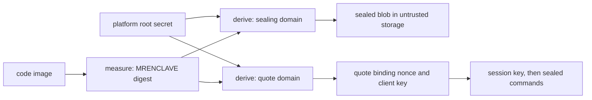
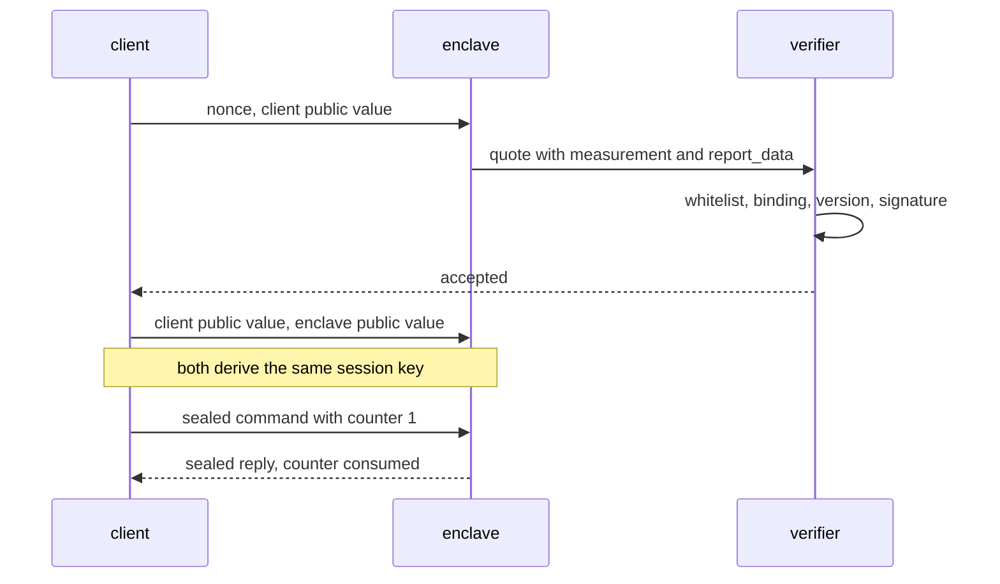
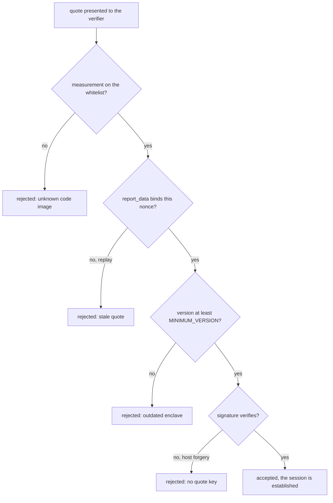

# 812 — Implement secure enclave-backed key-value store with remote attestation.

> **Tier:** Master · **CTCI chapter:** Ch 9 — System Design and Scalability
> **Task spec:** [812-implement-secure-enclave-backed-key-value-store-with-remote-atte.md](../../../tasks/master/812-implement-secure-enclave-backed-key-value-store-with-remote-atte.md)
> **Solutions:** [Python](../../../solutions/python/master/812-implement-secure-enclave-backed-key-value-store-with-remote-atte/solution.py) ·
> [Java](../../../solutions/java/master/812-implement-secure-enclave-backed-key-value-store-with-remote-atte/Solution.java) ·
> [JavaScript](../../../solutions/javascript/master/812-implement-secure-enclave-backed-key-value-store-with-remote-atte/solution.js) ·
> [C#](../../../solutions/csharp/master/812-implement-secure-enclave-backed-key-value-store-with-remote-atte/Solution.cs)

## 1. Problem restatement

**The modelling contract.** An SGX-style trusted execution environment, modelled with the standard
library only. A `Platform` owns a root secret (the CPU's fused key); an `Enclave` is created from a code
image and its identity is `measure(image)` — a digest of that image, the MRENCLAVE of the design. From
the platform secret and the measurement the enclave derives, **in separate domains** (`derive(domain,
...)`), a *sealing* key and a *quote* key, which gives the two properties everything else rests on:

- **Sealing.** The store is written to untrusted storage as one blob under an **encrypt-then-MAC**
  construction: a keystream pad for confidentiality and a keyed tag over the header, the associated
  data and the ciphertext for integrity. Only an enclave with the same code image can derive the key,
  and any modification of the blob — one flipped bit, a swapped blob, an older snapshot — is caught by
  the tag before a single byte is decrypted.
- **Attestation.** A relying party sends a fresh nonce and its Diffie-Hellman public value; the enclave
  returns a quote containing its measurement and
  `report_data = digest(nonce || client public value)`, signed with the quote key. The verifier accepts
  it only if the measurement is on its whitelist, the report data binds *this* nonce, the signature
  verifies and the enclave version is at least `MINIMUM_VERSION = 3` — so a replayed quote, a quote from
  a different code image and a host-forged quote are all rejected.
- **Session.** The client then completes the Diffie-Hellman exchange inside the attested session, and
  every later command is sealed with the session key and carries a session counter that rejects
  replays.

The **host is modelled as an adversary**: it sees every blob and every message but never the platform
secret, and it can tamper, replay, swap, roll back and forge — all of which the checks make it try.

**Asserted:**

| Group | What is checked |
| --- | --- |
| measurement | equal images agree, a one-byte image change does not, and keys derived for different measurements never collide |
| sealing | seal/unseal round-trips the state, the blob contains no plaintext, a flipped bit anywhere rejects it, and another enclave's blob is rejected |
| attestation | an honest quote verifies; a wrong whitelist entry, a replayed nonce, a stale quote, a modified quote and an unversioned enclave are all rejected; a host without the platform secret cannot forge one |
| key agreement | both sides derive the same session key, and an eavesdropper holding only the public values derives a different one |
| channel | a command with a broken MAC is rejected, a replayed command is rejected by the session counter, and no plaintext leaves the enclave unmasked |
| durability, rollback | a restarted enclave with the same image recovers the sealed state exactly, and restoring an older blob with a lower monotonic counter is refused |
| isolation, determinism | the host never sees plaintext values — only ciphertext, counters and quotes — and identical scripts produce identical blobs, quotes and sessions |

**Omitted** versus real SGX: no hardware, no real key provisioning and no signature scheme — a keyed
digest built from the standard library stands in for the MAC and the signature, and a keystream pad
stands in for a block cipher, so every security statement is a *measurement over this implementation*
("this host cannot produce a quote the verifier accepts") rather than a reduction; one process, so the
"untrusted storage" and the "network" are objects; there is no enclave migration, no attestation
collateral, and the monotonic counter is an integer in the model rather than a real TPM.

```text
measurement 7c48ba5cbcfa7349; sealing key and quote key derived in separate domains
sealing: 110-byte blob, 6 tamper attempts refused, plaintext never on the wire
attestation: whitelist, replay, binding, signature, forgery and version checks all rejected as expected
```

| Scenario | Expected result |
| --- | --- |
| seal a small store and unseal it in a restarted enclave | the state comes back exactly, from a 110-byte blob that contains no plaintext |
| flip one bit anywhere in the blob | rejected by the tag before decryption (one of six refused tamper attempts) |
| replayed quote with an old nonce | rejected: `report_data` does not bind the fresh nonce |
| quote from an enclave below version 3 | rejected by the version check |
| host forges a quote without the platform secret | rejected: the signature does not verify |
| the host restores an older blob | refused by the monotonic counter, so the store cannot be wound back |

## 2. Intuition

The naive design puts the encryption key in the application, or derives it from a password, and hopes
the operator of the machine is honest. It fails the moment the machine itself is the adversary: the key
is in the same memory the host can read, and the storage it protects is under the host's control.

The key insight is that two different secrets come out of *one* platform secret plus a *measurement of
the code*, and their separation is what makes the whole design work:

1. **The measurement is the identity.** Nothing else identifies "which code" is running: the digest of
   the image is reproducible from public information, so a relying party can hold a whitelist of
   acceptable measurements, and the enclave can derive keys from a secret nobody else has plus a
   measurement everybody can see.
2. **Sealing binds data to code.** Because the sealing key is derived from the measurement, another
   program — including the host — cannot derive it, and a modified blob cannot be opened at all: the
   tag is checked before any decryption, so tampering never reaches the ciphertext.
3. **Attestation binds *this* session to that code.** A quote alone proves "an enclave with measurement
   `M` exists", which is replayable. Binding `report_data = digest(nonce || client public value)` to a
   nonce the client just generated makes the quote fresh *and* binds it to the very Diffie-Hellman
   exchange the client is about to finish — so the session key is shared with that enclave and no other.
4. **Counters stop the host from rewinding.** Encryption plus MAC prevent forgery but not rollback:
   only a monotonic counter that must advance refuses an old, valid blob.



## 3. Algorithm

1. `Platform.create(image, version)` instantiates an enclave: `measure(image)` is its identity and
   `derive("sealing", secret, measurement)` / `derive("quote", secret, measurement)` give the two keys,
   in separate domains so that a key leaked in one role cannot be used in the other.
2. `Enclave.seal_state()` serialises the store, pads it with `keystream(key, nonce, length)` and tags
   the header, the associated data and the ciphertext; `load_state(blob)` verifies the tag, then
   compares the blob's counter with the enclave's own to refuse a rollback.
3. `Client.challenge()` sends a fresh nonce and its DH public value; `Enclave.quote(nonce,
   client_public)` builds `report_data` and signs it with the quote key.
4. `Verifier.verify(quote, nonce, client_public, fresh=True)` checks the whitelist, the nonce binding,
   the signature and `version >= MINIMUM_VERSION`, rejecting with a reason otherwise.
5. `Client.agree(enclave_public)` and `Platform.ephemeral(label, salt)` complete the DH exchange, and
   both sides derive the same session key.
6. `Client.command(session_key, key, operation, value)` seals each command with the session key and a
   monotonically increasing counter; `Enclave.handle(session_key, message, counter)` rejects a broken
   MAC or a counter that was already used.

```text
procedure attest(enclave, client)
    nonce ← client.fresh_nonce()
    client_public ← client.ephemeral("dh", nonce)
    report_data ← digest(nonce, client_public)
    quote ← (measurement = enclave.measurement, report_data,
             version = enclave.version, signature = sign(quote_key, report_data, version))
    return quote
end

procedure verify(verifier, quote, nonce, client_public)
    if quote.measurement is not in verifier.whitelist then return reject("measurement") end
    if quote.report_data is not digest(nonce, client_public) then return reject("binding") end
    if quote.version is below MINIMUM_VERSION then return reject("version") end
    if not verify_signature(quote) then return reject("signature") end
    return accept
end

procedure load_state(enclave, blob)
    if not tag_matches(blob) then return TamperError("tag") end
    if blob.counter is below enclave.counter then return TamperError("rollback") end
    enclave.store ← unpack(blob.ciphertext XOR keystream(enclave.sealing_key, blob.nonce, blob.length))
    enclave.counter ← blob.counter
end
```

Both checks live on the *host's* side of the trust boundary, which is the point: the verifier and the
load path validate what the host handed them, and they never need to trust it.



## 4. Worked example

The run exercises the whole path; every number below is printed by `main()`.

| Quantity | Value | Reading |
| --- | --- | --- |
| measurement | `7c48ba5cbcfa7349` | the identity of the image; a one-byte change produces a different one, and sealing keys for different measurements never collide |
| sealed blob | 110 bytes | one encrypt-then-MAC blob holding the whole store, with no plaintext in it |
| tamper attempts refused | 6 | flipped bits, a swapped blob, an older snapshot: all rejected by the tag or the counter |

The attestation table is the interesting one, because every row is a *different* attack and a different
check stops it:

| Attempt | Check that refuses it |
| --- | --- |
| honest quote from the right image | accepted (whitelist, binding, version and signature all pass) |
| quote from an image that is not on the whitelist | measurement check |
| replayed quote captured from an earlier handshake | `report_data` does not match the fresh nonce |
| quote whose `report_data` was edited to match the new nonce | signature check — the host has no quote key |
| stale quote from a lower enclave version | version check (`MINIMUM_VERSION = 3`) |
| quote manufactured entirely by the host | signature check: the quote key is derived from the platform secret, which the host does not have |

The sealing side is symmetric: the host can copy, flip and reorder blobs, and the tag-or-counter rule
refuses all of it, so the only thing a host ever holds is ciphertext, counters and quotes. Session
commands add a counter as well, so a captured command cannot be replayed even if its MAC is intact.



## 5. Complexity

Let `n` be the number of bytes sealed, `k` the number of keys in the store, and `c` the number of
commands in a session.

| Measure | Bound | Why it holds |
| --- | --- | --- |
| Seal / unseal | `O(n)` | one keystream pass plus one tag computation over the same bytes |
| Tamper detection | `O(n)` in the worst case, `O(1)` on the common path | the tag covers the whole blob, so a modification is found before decryption |
| Measurement | `O(image size)` once per enclave creation | a digest of the image |
| Attestation | `O(1)` messages, one DH exponentiation | a nonce, a public value and a signed quote |
| Session setup | `O(1)` | both sides do one DH computation and derive one key |
| Command | `O(1)` per command plus `O(c)` for the counter set | a MAC, a counter comparison and the operation |
| Store state | `O(k + n)` | the serialised store plus a counter |

The comparison is a plain encrypted store with a password-derived key: sealing is the same `O(n)` work,
but the key is available to anyone who can read the process's memory or the configuration, so a
compromised host decrypts everything and can present an old blob as current. Sealing *from the
measurement* removes the first problem (the key never exists outside an enclave with that exact code)
and attestation removes the second-order problem (a client cannot tell which code it is talking to
without a fresh, bound quote) — at the cost of a hardware root of trust nobody can audit in this model,
and a version/whitelist policy that a relying party must actually maintain.

## 6. Pitfalls and edge cases

- **Checking the tag after decrypting.** The construction is encrypt-then-MAC precisely so a modified
  blob is refused *before* any plaintext is produced; decrypt-then-check leaks a decryption of
  attacker-chosen bytes.
- **A quote without a nonce binding is replayable.** `report_data` must bind the fresh nonce *and* the
  client's public value, otherwise an attacker can replay an old — perfectly valid — quote and hijack
  the session setup.
- **Whitelist and version are policy, not cryptography.** A verifier that accepts any measurement has
  verified a signature over nothing useful; `MINIMUM_VERSION` exists so a known-bad enclave cannot
  attest even with a valid signature.
- **Rollback needs a counter.** Encryption and MAC say nothing about freshness, so restoring an older
  valid blob would silently undo writes; the monotonic counter is refused on the load path.
- **Key domains must be separate.** If sealing and quote keys were the same value, a host that obtained
  one (for example by observing its use) could forge quotes; the derived keys are asserted never to
  collide across measurements and domains.
- **The session counter is per session, and it must be checked before execution.** A captured command
  with a valid MAC is otherwise executable forever.
- **No plaintext in the blob.** The check greps the sealed bytes; a partial-padding bug that leaves a
  key name in the clear breaks the isolation claim.
- **Restart must recover exactly.** A restarted enclave with the same image derives the same sealing key
  and must produce byte-identical state; anything nondeterministic in serialisation breaks durability.
- **The host is assumed to see everything.** Any design decision that relies on the host not looking at
  a value is wrong, which is why the checks enumerate what the host holds.
- **A one-byte image change must change the measurement.** Otherwise a modified enclave could open
  another enclave's data, which is the entire point of binding the sealing key to the image.

## 7. Variants and follow-ups

- **Chain of trust above the enclave.** [841-implement-secure-enclaves-chain-of-trust-verification-demo.md](../../../tasks/master/841-implement-secure-enclaves-chain-of-trust-verification-demo.md)
  verifies a root of trust and a chain to the image, which is the provisioning question this task
  assumes solved.
- **Searchable encryption on the sealed data.** [814-implement-searchable-encrypted-index-with-limited-leakage-and-pr.md](../../../tasks/master/814-implement-searchable-encrypted-index-with-limited-leakage-and-pr.md)
  lets a *server* answer queries without the plaintext at all — the same isolation goal without a
  trusted CPU.
- **Verifiable computation instead of a trusted CPU.** [830-implement-verifiable-computation-for-ml-inference-with-succinct.md](../../../tasks/master/830-implement-verifiable-computation-for-ml-inference-with-succinct.md)
  and [834-implement-zk-snark-circuit-for-a-simple-arithmetic-program-toy.md](../../../tasks/master/834-implement-zk-snark-circuit-for-a-simple-arithmetic-program-toy.md)
  replace "trust this hardware" with "check this proof".
- **Sealed state that must survive a restart with history.** [806-implement-fully-persistent-b-tree-with-copy-on-write-pages-and-c.md](../../../tasks/master/806-implement-fully-persistent-b-tree-with-copy-on-write-pages-and-c.md)
  is the storage half: versions and rollback protection map onto the monotonic counter here.

## 8. Check yourself

1. Why are the sealing key and the quote key derived in separate domains from the same secret?

<details><summary>Show answer</summary>

Because they are used on opposite sides of the trust boundary. The sealing key never leaves the enclave
and must not be usable to produce an attestation; the quote key produces a signature the *host
observes* and forwards, and a design that reused one key would let a host that saw a sealing-key usage
(by any means, including a bug) forge quotes. Domain separation means a compromise of one role does not
grant the other, and the run asserts the derived keys never collide.

</details>

2. A quote containing the right measurement and a valid signature is not enough. What is missing?

<details><summary>Show answer</summary>

Freshness *and* session binding. An old quote is a valid signature over an old `report_data`, so without
a nonce challenge it can be replayed, and without binding the client's Diffie-Hellman public value the
client could end up establishing a session key with a different party than the one it verified. That is
why `report_data = digest(nonce || client_public)` and why a replayed nonce is asserted to be refused.

</details>

3. Why is a monotonic counter needed at all, given the blob is encrypted and MACed?

<details><summary>Show answer</summary>

Because encryption and integrity say nothing about *newness*: an older blob is a valid blob. A host that
restores yesterday's image would silently roll back the store, so the load path compares the blob's
counter with the enclave's own and refuses anything older — one of the six refused tamper attempts.

</details>

4. The host "sees every blob and every message but never the platform secret". Which of the six
   attestation checks would stop a host that has a *valid recording* of a previous session?

<details><summary>Show answer</summary>

The binding check. The recording has a valid signature and a whitelisted measurement, so the whitelist,
signature and version checks all pass; only the nonce inside `report_data` is old, which the binding
check catches. That is exactly why the protocol requires a fresh nonce per handshake instead of
accepting a stored quote.

</details>
