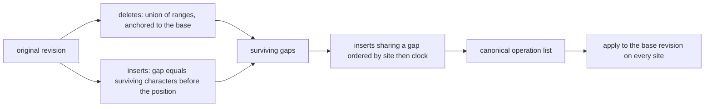
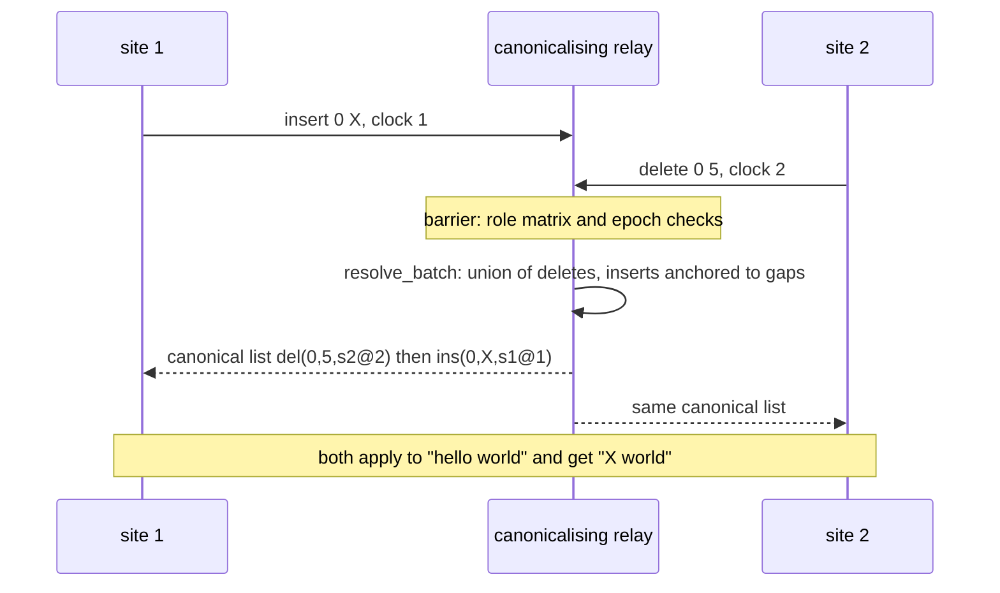
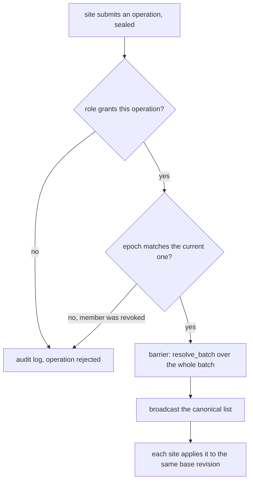

# 813 — Implement end-to-end encrypted collaborative editor with operational transforms and access control.

> **Tier:** Master · **CTCI chapter:** Ch 9 — System Design and Scalability
> **Task spec:** [813-implement-end-to-end-encrypted-collaborative-editor-with-operati.md](../../../tasks/master/813-implement-end-to-end-encrypted-collaborative-editor-with-operati.md)
> **Solutions:** [Python](../../../solutions/python/master/813-implement-end-to-end-encrypted-collaborative-editor-with-operati/solution.py) ·
> [Java](../../../solutions/java/master/813-implement-end-to-end-encrypted-collaborative-editor-with-operati/Solution.java) ·
> [JavaScript](../../../solutions/javascript/master/813-implement-end-to-end-encrypted-collaborative-editor-with-operati/solution.js) ·
> [C#](../../../solutions/csharp/master/813-implement-end-to-end-encrypted-collaborative-editor-with-operati/Solution.cs)

## 1. Problem restatement

**The modelling contract.** A collaborative editor replicates one document over N sites that edit
concurrently. A site emits an operation — `Op.insert(pos, text, site, clock)` or
`Op.delete(pos, length, site, clock)` — against the revision it has seen, and applies it optimistically
to its own copy. The server is a **canonicalising relay**: at each barrier (`EditorServer.barrier`) it
takes the batch of operations that are concurrent with respect to the current revision, integrates the
whole batch into one canonical operation list with `resolve_batch`, and broadcasts it.

Integration has a precise meaning here:

- Every **delete** in the batch removes its range from the *original* revision, so the batch removes the
  union of all deleted ranges (`merge_ranges`, `union_length`): overlapping deletes remove the union,
  and identical deletes cancel to a no-op.
- Every **insert** is anchored to the *gap* it points at — the number of surviving characters before its
  position (`project`) — and an insert that points inside a deleted range is pinned to the front of that
  hole, so a concurrent insert is never silently lost.
- Inserts that share a gap are ordered by `(site id, Lamport clock)` (`Op.order_key`), which makes the
  result a function of the batch alone: independent of arrival order, of the fold order and of the
  machine.

The canonical resolution is cross-checked against **two independent implementations of the same
specification**: the pairwise `transform(a, b) -> (a', b')` obeying the TP1 commute law

```text
apply(apply(doc, a), b')  ==  apply(apply(doc, b), a')
```

which is what a client uses to rebase one operation against another, and `oracle_final`, a
specification-level implementation that keeps the surviving characters in a list and assigns every
insert to a gap — a representation completely different from the operation-list resolver.

**Access control** is a role/permission matrix (`ROLE_PERMISSIONS`: `owner` with `ins/del/admin/comment`,
`editor` with `ins/del`, `commenter` with `comment`, `viewer` with nothing) evaluated by the server for
every operation against the member's role and the epoch the operation was issued in. Revocation bumps
the epoch, so operations already in flight from a removed member are rejected, and a key rotation makes
content written after the revocation unreadable with the retired key. Content is sealed end to end with
a pad-and-tag construction: a keystream XORed into the plaintext plus a keyed tag over the ciphertext
(encrypt-then-MAC), which detects tampering and wrong keys.

**Asserted:** TP1 exhaustively over a small operation space (196 pairs, 196 cross-checks), the resolver
against the semantic oracle on 200 randomised concurrent batches and against the pairwise transform over
every pair, permutation invariance of the canonical revision (1351 permutations), the length-conservation
law, multi-round multi-site convergence against a sequential replay oracle, byte-identical replay of two
independent runs, bounds checking of submitted operations, the role matrix with rejected operations,
permission and epoch rejection, an audit log of every decision, opaque ciphertext (no plaintext keyword
occurs in the sealed bytes), seal/unseal round-trip, tamper detection, and that a retired key cannot open
rotated content.

**Omitted:** all cryptography is toy-scale (no real key material, no block cipher, no signatures — a
keystream plus a keyed digest), and the server, the sites and the network live in one process driven
synchronously.

```text
checks: TP1 pairs=196, pair cross-checks=196, random batches=200, permutations=1351
revisions=12, document bytes=40, ciphertext bytes=523, keyword hits=0
```

| Scenario | Expected result |
| --- | --- |
| `insert(0, "X", s1, 1)` concurrent with `delete(0, 5, s2, 2)` on `"hello world"` | canonical list `[del(0,5,s2@2), ins(0,'X',s1@1)]`, document `"X world"` |
| two inserts at the same position (`3`) from `s1` and `s2` | `"helYZlo world"` — the tie breaks by site id, not by arrival order |
| two identical deletes of `[0, 5)` | `" world"` — the union, not a double removal |
| overlapping deletes `[2, 6)` and `[0, 4)` | `"world"` — the union `[0, 6)` is removed once |
| a removed member's in-flight operation | rejected by the epoch check and recorded in the audit log |

## 2. Intuition

The naive collaborative editor sends each keystroke to the server and broadcasts it. Two clients editing
at the same time then apply operations against different revisions, and the classic symptom is text that
moves under the cursor: an insert that "should" be at position 3 lands inside a paragraph somebody else
deleted, or two concurrent inserts swap places on different machines — the document diverges.

The key insight is to make the resolution a **pure function of the batch**, not of the order the
operations happen to arrive in:

- **Deletes are ranges against the original revision.** Expressing them as ranges rather than as
  positions means overlapping deletes compose by union, and identical deletes are idempotent. This is
  what removes "who deleted first" from the problem.
- **Inserts are anchored, not positioned.** An insert that only carries "position 3" is meaningless once
  the document shifts; anchoring it to the number of *surviving* characters before it makes it survive
  any number of concurrent deletions, and pinning an insert that points inside a deleted hole to the
  front of that hole means no typed character is ever dropped.
- **A total order on the leftovers.** Inserts that share a gap are ordered by `(site, clock)`, which is
  available in the operation itself, so every replica computes the same answer regardless of when it
  learned about the operations.
- **Encryption is orthogonal, and the server is still the policy point.** The relay cannot read the
  document (the ciphertext contains none of the plaintext keywords), but it does evaluate the role
  matrix and the epoch for every operation, which is what makes revocation effective against
  already-sent operations.



## 3. Algorithm

1. A site emits an operation against its own revision and applies it optimistically; `validate_batch`
   rejects an out-of-bounds position or length before anything is sent.
2. `EditorServer.barrier(submissions, issued_epoch)`: every submission is checked against the role
   matrix (`can`) and the epoch it was issued in; rejected operations are recorded in the audit log.
3. `resolve_batch(base, ops)`: `merge_ranges` folds every delete into the union of removed ranges,
   `project(pos, removed)` maps each insert position to the gap of surviving characters before it, and
   inserts are sorted by `order_key` before being emitted as the canonical list.
4. `apply_ops(document, ops)` applies the canonical list, so every replica that applies the same list to
   the same base reaches the same text.
5. `transform(a, b)` computes the rebased `(a', b')` pair a client uses when it learns about a concurrent
   operation; the checks verify the TP1 law for every pair in the operation space.
6. `seal` / `unseal` wrap the payload, `rotate_key` retires a key, and `history_signature` gives each
   round a comparable fingerprint.

```text
function resolve_batch(base, ops)
    removed ← merge_ranges([op.range for op in ops where op is a delete])
    inserts ← []
    for each op in ops where op is an insert do
        gap ← project(op.pos, removed)        # surviving characters before the position
        inserts.append((gap, op.site, op.clock, op.text))
    end
    sort inserts by gap, then site, then clock
    return [delete(r) for r in removed] + [insert(gap, text) for each insert in order]
end

procedure barrier(server, submissions, issued_epoch)
    accepted ← []
    for each submission in submissions do
        if submission.issued_epoch is not the current epoch then
            audit(submission.site, "epoch revoked")
            continue
        end
        if not can(server, submission.site, kind of submission.ops) then
            audit(submission.site, "permission")
            continue
        end
        accepted.append(submission)
    end
    revision ← resolve_batch(server.doc, flatten(accepted))
    apply_ops(server.doc, revision)
    server.revision ← server.revision + 1
    server.history.append(history_signature(server))
    return revision
end
```



## 4. Worked example

Take `base = "hello world"` and one concurrent batch: `site 1` inserts `X` at position 0, `site 2`
deletes five characters at position 0. `resolve_batch` returns the canonical list

```text
[del(0, 5, s2@2), ins(0, 'X', s1@1)]
```

and `apply_ops(base, ...)` yields `"X world"` — the same string `oracle_final` computes from its
character-list representation. The insert survived because its gap is 0 surviving characters before
position 0, and the delete removed `hello` exactly once.

| Batch | Canonical behaviour | Result on `"hello world"` |
| --- | --- | --- |
| `ins(0,'X',s1@1)` + `del(0,5,s2@2)` | delete first, insert anchored to gap 0 | `"X world"` |
| `ins(3,'Y',s1@1)` + `ins(3,'Z',s2@2)` | both anchored to the same gap, ordered by site | `"helYZlo world"` |
| `del(0,5,s1@1)` + `del(0,5,s2@2)` | identical ranges merge to one range | `" world"` |
| `del(2,4,s1@1)` + `del(0,4,s2@2)` | union `[0, 6)` | `"world"` |

The last two rows are the ones that catch a position-based implementation: applying `del(0,5)` twice
would remove ten characters, and applying `del(2,4)` then `del(0,4)` against the *shifted* document
removes the wrong text. Because both are ranges against the original revision, the answer is the union.

Correctness is then checked three ways, which is what makes the resolver trustworthy:

| Check | Size | What it proves |
| --- | --- | --- |
| TP1 law over the operation space | 196 pairs, 196 cross-checks | the pairwise `transform` really commutes: `apply(apply(doc, a), b') == apply(apply(doc, b), a')` |
| resolver versus `oracle_final` | 200 randomised concurrent batches | two different representations of the same specification agree |
| permutation invariance | 1351 permutations | the canonical revision depends on the batch as a set, not on the fold order |

The run then keeps 12 revisions of a small document, and the sealed payload is 523 bytes of ciphertext
for 40 bytes of document with `keyword hits = 0` — the server relays ciphertext it cannot read, which is
also why revocation must work on the *metadata* (role, epoch) rather than on content.



## 5. Complexity

Let `b` be the number of operations in a batch, `d` the number of deleted ranges, `c` the length of the
document, and `p` the number of pairs probed by the TP1 test.

| Measure | Bound | Why it holds |
| --- | --- | --- |
| `resolve_batch` | `O(b log b + d log d)` | fold the ranges, project each insert, sort the inserts by `(gap, site, clock)` |
| `apply_ops` | `O(c + b)` | one pass over the base plus the inserts |
| `transform(a, b)` | `O(1)` per pair | interval arithmetic on two ranges, plus position shifting |
| TP1 verification | `O(p)` = 196 pairs here, each with two applications | exhaustive over the operation space, not random sampling |
| Permutation invariance | `O(permutations × resolve)` = 1351 batches | the most expensive check, and the reason the corpus is small |
| Seal / unseal | `O(c)` | one keystream pass and one tag over the same bytes |
| Server work per barrier | `O(b log b + c)` plus one role-matrix lookup per operation | the matrix is a constant map from role to permission set |

The comparison is a naive editor that broadcasts each operation and lets every site apply it in arrival
order: `O(1)` per operation, no resolution at all, and no two sites agree once a concurrent delete
happens. Intent-preserving CRDTs are the other end of the spectrum — they get commutativity from the
data structure and pay for it with permanent tombstones and metadata. This design sits in the middle: a
central canonicalising relay keeps the algorithm simple and small, at the cost of a barrier and of
trusting the relay for ordering (though not for reading).

## 6. Pitfalls and edge cases

- **Deletes as positions instead of ranges.** Applying `del(0,5)` twice against the shifted document
  removes ten characters; the union-of-ranges rule is what makes repeated and overlapping deletes
  idempotent.
- **An insert inside a deleted hole.** Pinning it to the front of the hole is what keeps a concurrent
  insert alive; dropping it silently loses a user's keystroke, and the checks compare against
  `oracle_final`, which would notice.
- **Ties between inserts at the same gap.** `(site, clock)` must be part of the canonical order, or the
  document depends on arrival order — the `"helYZlo world"` row shows the intended result.
- **Concurrent insertion and deletion of the same text.** The two rules compose: deletes take the union
  of the base, and every insert is anchored to a surviving gap, so an insert can never be applied to
  characters that another member removed.
- **Bounds checking before sending.** A position or length outside the base revision is rejected by
  `validate_batch`, so a stale client cannot inject a corrupt operation that later replicas must undo.
- **Epoch-based revocation is about *in-flight* operations.** An operation already in the network from a
  removed member must be rejected; checking only at submission time leaves that window open, which is
  why the epoch is part of the operation.
- **Key rotation is not retroactive for revocation.** Content written after the revocation is
  unreadable with the retired key, but content written before it is not magically protected — the check
  asserts the retired key cannot open the rotated content, not that history is rewritten.
- **Permission granularity.** `viewer` has no permissions at all and `commenter` only comments; a matrix
  that treats "can see" as "can edit" is the classic access-control bug, and every rejected operation is
  recorded in the audit log.
- **Order-independent sealing.** The ciphertext must be deterministic for a given plaintext and key,
  otherwise two runs of the same schedule produce different bytes and the byte-identical replay check
  fails.
- **Optimistic application.** A site applies against its own revision before the barrier, so it must
  re-apply the canonical list when it arrives; the convergence check compares every site against a
  sequential replay oracle after each round.

## 7. Variants and follow-ups

- **Encrypt so the server can search.** [814-implement-searchable-encrypted-index-with-limited-leakage-and-pr.md](../../../tasks/master/814-implement-searchable-encrypted-index-with-limited-leakage-and-pr.md)
  keeps the untrusted relay but lets it answer queries over the sealed data, with the leakage measured
  rather than hidden.
- **Trusted hardware instead of end-to-end encryption.** [812-implement-secure-enclave-backed-key-value-store-with-remote-atte.md](../../../tasks/master/812-implement-secure-enclave-backed-key-value-store-with-remote-atte.md)
  puts the plaintext in an enclave and attests the code that handles it.
- **RBAC and auditing for a database.** [853-implement-fine-grained-access-control-and-auditing-for-database.md](../../../tasks/master/853-implement-fine-grained-access-control-and-auditing-for-database.md)
  generalises the role matrix and the audit log to a full data platform.
- **Consistent cuts instead of optimistic merges.** [807-implement-global-scale-consistent-snapshot-across-geographically.md](../../../tasks/master/807-implement-global-scale-consistent-snapshot-across-geographically.md)
  is the alternative to concurrency resolution: define a cut that no operation can straddle.

## 8. Check yourself

1. Why is `insert` anchored to a gap instead of carrying a position?

<details><summary>Show answer</summary>

Because a position is meaningless once other members delete text: the character at position 3 may not
exist after the batch is integrated. The gap — the number of *surviving* characters before the position —
is invariant under concurrent deletions, and pinning an insert that points inside a deleted range to the
front of that hole means the insert is never lost. The `"X world"` trace shows both rules at once.

</details>

2. Two sites insert at position 3 concurrently. What determines the order, and why can't it be arrival
   order?

<details><summary>Show answer</summary>

`(site id, Lamport clock)`, taken from the operation itself. Arrival order differs per site, so using it
would produce a different document on each replica; the run asserts permutation invariance (1351
permutations) precisely to rule that out. In the example `s1` precedes `s2`, giving `"helYZlo world"`.

</details>

3. `del(0,5)` from two sites produces `" world"`, not a ten-character deletion. Which check enforces
   that, and how does the suite make sure?

<details><summary>Show answer</summary>

The union-of-ranges rule in `resolve_batch`: deletes are ranges against the original revision, so
identical ranges merge and overlapping ones union. It is verified both directly (that batch) and
indirectly, because `oracle_final` builds its answer from a completely different representation and the
200 randomised batches compare the two.

</details>

4. The server cannot read the document (`keyword hits = 0`), yet it still enforces access control. How?

<details><summary>Show answer</summary>

From metadata: each submission carries its site and the epoch it was issued in, and the role matrix is
evaluated against the member's role for the *kind* of operation (`ins`, `del`, `comment`, `admin`).
Revocation bumps the epoch, so a revoked member's in-flight operation fails the epoch check. Nothing in
that decision needs the plaintext, which is why end-to-end encryption and server-side policy can coexist.

</details>
