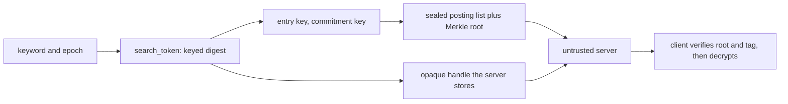
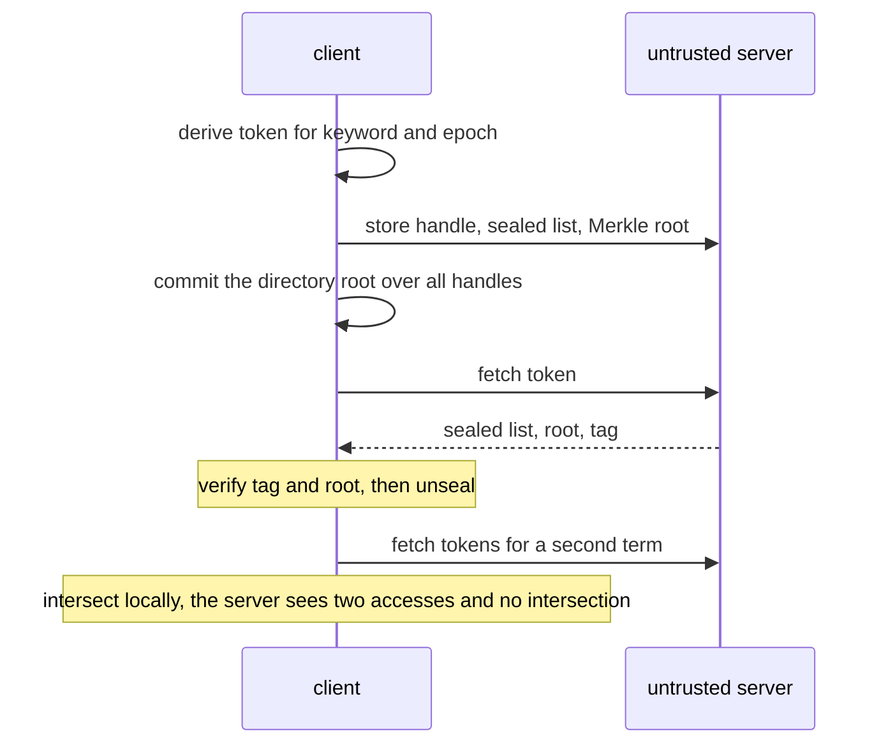
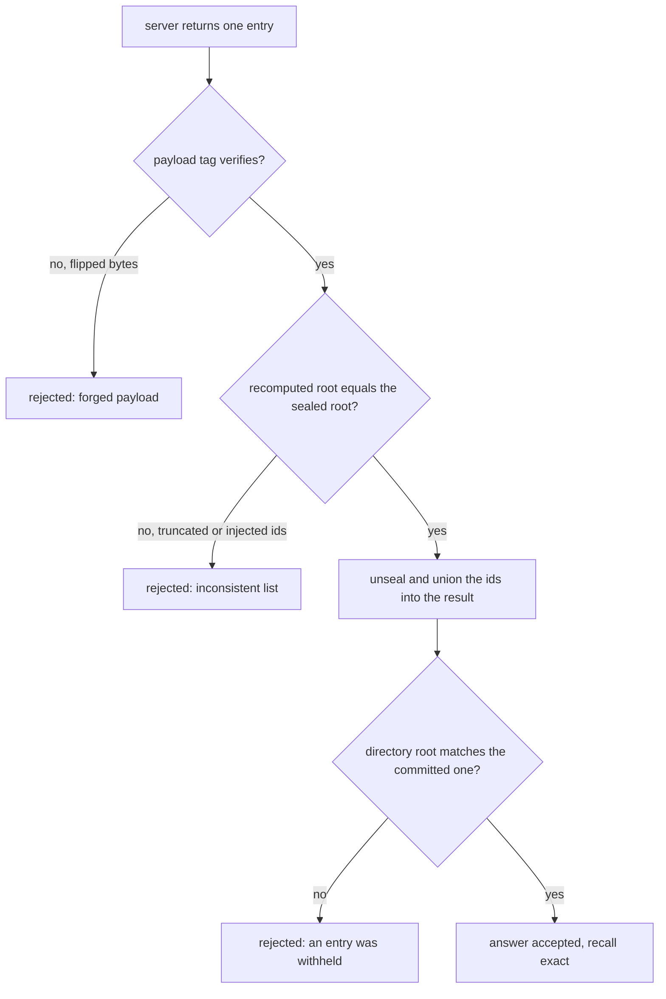

# 814 — Implement searchable encrypted index with limited leakage and proof-of-correctness.

> **Tier:** Master · **CTCI chapter:** Beyond — Security & Privacy
> **Task spec:** [814-implement-searchable-encrypted-index-with-limited-leakage-and-pr.md](../../../tasks/master/814-implement-searchable-encrypted-index-with-limited-leakage-and-pr.md)
> **Solutions:** [Python](../../../solutions/python/master/814-implement-searchable-encrypted-index-with-limited-leakage-and-pr/solution.py) ·
> [Java](../../../solutions/java/master/814-implement-searchable-encrypted-index-with-limited-leakage-and-pr/Solution.java) ·
> [JavaScript](../../../solutions/javascript/master/814-implement-searchable-encrypted-index-with-limited-leakage-and-pr/solution.js) ·
> [C#](../../../solutions/csharp/master/814-implement-searchable-encrypted-index-with-limited-leakage-and-pr/Solution.cs)

## 1. Problem restatement

**The modelling contract.** A *searchable symmetric encryption* (SSE) index lets a client hand an
untrusted server a set of opaque entries such that the server can answer equality searches without ever
seeing a keyword or a document identifier. The construction here is the classic inverted-index layout:

| Piece | How it works |
| --- | --- |
| search token | `search_token(key, keyword, epoch)` — a keyed digest — so the server can locate an entry but cannot invert a handle into the keyword |
| sealed posting list | `seal(entry_key(key, token), doc_ids)` — a keystream pad plus a keyed tag — so only the holder of the token can open it |
| per-entry commitment | `list_root` folds the sorted document ids with their count into a Merkle root, and `root_tag` authenticates it; dropping, injecting or truncating ids changes the root |
| directory commitment | `directory_root(key, tokens)` over all entry handles, so withholding a *whole* entry is detectable: the client re-derives the root over the server's token set and compares it with the root committed at upload time |
| updates | appended, never rewritten: a batch of new documents is uploaded at a fresh epoch, which makes the index **forward private** in the measurable sense — a token captured before an update returns exactly the list it returned before |

The price is explicit: a query costs one lookup per surviving epoch per term. The leakage that remains
is the leakage an inverted-index SSE cannot avoid, and it is *measured* rather than claimed: the number
of distinct `(keyword, epoch)` handles (keyword cardinality), the search pattern (a repeated query
produces an identical token sequence) and the access pattern (which handles a query touches, and how
many ids each returned list carries). Conjunctive queries fetch one list per term and intersect on the
client, so the server never learns which documents matched the conjunction.

**Asserted:** token determinism and epoch domain separation; handles and payloads containing no plaintext
keyword; exact agreement with a plaintext `oracle` for single-term and conjunctive queries (recall and
precision 1.0); the proof accepting an honest answer and a re-encoded but content-identical list, while
rejecting a flipped payload, a truncated payload and a forged commitment; directory verification
detecting a withheld or injected entry; the forward-privacy measurement together with its lookup-cost
bound; an unknown keyword returning empty; a repeated term collapsing to one id per document; and a scale
run over 200 documents where recall stays exact and the cost stays bounded by terms times epochs.

**Omitted:** all cryptography is toy-scale — keyed `splitmix64` digests and a keystream pad, no HMAC, no
block cipher, no real key material — so every security statement is a *measurement over this
implementation*, never a reduction; client, server and network live in one process and are driven
synchronously; there is no oblivious transfer, no padding and no ORAM layer, so the leakage metrics
printed are exactly the ones this layout exposes; and a server that answers "no such entry" for a handle
it *did* store is caught only by the directory commitment, not by the per-entry proof.

```text
checks: entries(small corpus)=8, entries(200 docs, 3 epochs)=20, lookups per 2-term AND=6
leakage: keyword_cardinality=17, deterministic_answers=True, handles_per_keyword=3, server_sees_intersection=False
```

| Scenario | Expected result |
| --- | --- |
| small corpus uploaded | 8 entries (one per `(keyword, epoch)` handle) |
| 200 documents over 3 epochs | 20 entries: the index grows by *appending* epochs, not by rewriting |
| a two-term AND | 6 lookups = 2 terms × 3 surviving epochs, then an intersection on the client |
| the same query twice | identical token sequence, identical answer (`deterministic_answers=True`) |
| a server that truncates a posting list | the client's recomputed root differs, so the answer is rejected |

## 2. Intuition

The naive attempt at searchable encryption is to encrypt each document and let the server decrypt
everything to answer a query — which is not encryption at all — or to encrypt each document but leave an
inverted index in the clear, which leaks the whole vocabulary. The interesting middle ground accepts that
*the server must learn something* and builds the index so that it learns as little as possible.

The key insight is that the client can compute the address of a posting list from the keyword and a
secret, and the server can then be asked "give me the entry at this handle" without ever learning what
the handle means:

1. **Addresses are pseudonyms, not names.** `search_token(key, keyword, epoch)` is a keyed digest, so an
   equality search becomes a single lookup, and the server cannot invert a handle into a keyword. The
   epoch in the domain separates the *same* keyword's lists across updates, which is what makes forward
   privacy possible at all.
2. **The client verifies; it does not trust.** Each list carries a commitment over its sorted ids with
   their count, so dropping, injecting or reordering ids changes the root. That turns "the server said so"
   into "the server's answer is consistent with the commitment I hold".
3. **Withholding a whole entry needs a second commitment.** A missing handle is invisible to a per-entry
   proof — there is no entry to verify — so the client also commits to the *set of handles*. That is the
   directory commitment, and it is why an entry the server quietly drops is detectable.
4. **Conjunctive queries are solved on the client.** Fetch one list per term, intersect locally, and the
   server never learns which documents satisfied the conjunction — the leakage is the union of the
   per-term accesses, not the intersection's size.



## 3. Algorithm

1. `SearchClient.upload_batch(server, documents, epoch)` tokenises each document with `tokenize`, derives
   a token per keyword at that epoch, seals the posting list under `entry_key(key, token)`, and stores
   `(payload, tag, sealed_root)` under the token with `EncryptedIndexServer.store`.
2. `commit_directory(server)` computes `directory_root(key, tokens)` over every stored handle and keeps
   it client-side.
3. `search(server, keyword, epochs)` walks the surviving epochs for that keyword, fetches each entry,
   verifies the tag and the root with `list_root`/`root_tag`, and unions the ids.
4. `conjunctive(server, terms, epochs)` fetches one list per term per epoch and intersects on the
   client; `server_sees_intersection` stays false because the intersection happens after the fetch.
5. `verify_directory(server)` re-derives the directory root over the server's token set and compares it
   with the committed one, which is what catches a withheld or injected entry.
6. `TamperingServer` is the adversarial counterpart: it flips, truncates and re-encodes lists so the
   client-side proof path is exercised by a server that is actually trying to lie.

```text
procedure search(client, server, keyword, epochs)
    ids ← empty set
    for each epoch in epochs do
        token ← search_token(client.key, keyword, epoch)
        entry ← server.fetch(token)
        if entry is missing then continue end
        if not tag_matches(client, entry) then return error("forged commitment") end
        doc_ids ← unseal(entry_key(client.key, token), entry.payload)
        if list_root(client, token, doc_ids) is not entry.sealed_root then
            return error("truncated or injected list")
        end
        ids ← ids ∪ doc_ids
    end
    return ids
end

procedure conjunctive(client, server, terms, epochs)
    lists ← [search(client, server, term, epochs) for term in terms]
    return intersection(lists)          # computed on the client, so the server never sees it
end

procedure verify_directory(client, server)
    root ← directory_root(client.key, sorted(server.tokens()))
    if root is not client.committed_directory_root then
        return error("an entry was withheld or injected")
    end
    return verified
end
```



## 4. Worked example

Every number below is printed by the run.

| Quantity | Value | Reading |
| --- | --- | --- |
| entries for the small corpus | 8 | one entry per `(keyword, epoch)`: the server stores handles, not keywords |
| entries for 200 documents over 3 epochs | 20 | updates append new epochs; a token captured earlier keeps returning its old list (forward privacy) |
| lookups for a two-term AND | 6 | `2 terms × 3 surviving epochs` — the explicit price of forward privacy |
| keyword cardinality | 17 | the leakage metric: how many distinct `(keyword, epoch)` handles the server can count |
| handles per keyword | 3 | one per epoch — the search pattern a repeated query leaks |
| `server_sees_intersection` | False | the intersection happens on the client, so the server learns the two accesses, not which documents matched both |

The proof path is what separates this from "just encrypt the values":

| Server behaviour | Client-side detection |
| --- | --- |
| honest answer | accepted: tag verifies and the recomputed root equals the committed one |
| re-encoded but content-identical list | accepted — the commitment is over the ids, not over the bytes |
| one id flipped in the payload | the tag over the payload fails |
| the list truncated by one id | the count is folded into the Merkle root, so the recomputed root differs |
| a forged commitment to a shortened list | `root_tag` fails: the server has no commitment key |
| an entry removed from the store entirely | the *directory* root changes, so the client sees that a handle is missing |

That last row is the subtle one: a per-entry proof cannot detect the absence of an entry, because there
is nothing to check. The directory commitment closes that gap, which is why it is asserted separately
from the per-list proof.



## 5. Complexity

Let `T` be the number of distinct terms, `E` the number of epochs, `n` the number of documents, and `m`
the average posting-list length.

| Measure | Bound | Why it holds |
| --- | --- | --- |
| Upload | `O(total tokens)` per batch | one sealed entry per `(keyword, epoch)`, appended never rewritten |
| Single-term search | `O(E)` lookups plus `O(m)` ids | one lookup per surviving epoch: measured 6 lookups for 2 terms × 3 epochs |
| Conjunctive search | `O(T · E)` lookups plus `O(sum of list lengths)` for the intersection | the server sees one access per term per epoch |
| Proof verification | `O(m)` per list | a Merkle root over the sorted ids |
| Directory verification | `O(total handles)` | one root over the whole token set |
| Server storage | `O(T · E)` entries | the index grows with updates instead of being re-encrypted |
| Leakage | keyword cardinality `O(T · E)`, search pattern per repeated query, list lengths per access | measured: cardinality 17, handles per keyword 3 |

The comparison is the obvious alternatives. Encrypting documents and decrypting them server-side is
`O(n)` per query and leaks everything. A single-epoch SSE index has `O(1)` lookups per term but leaks
whether a query's result set *changed* after an update, because the same handle returns different
content. This layout moves that to `O(E)` lookups per term and, in exchange, a token captured earlier
returns exactly the list it returned before — the forward-privacy property, measured by comparing the
two answers rather than asserted. All costs are in-process operations on toy digests: nothing here
measures real cryptographic throughput.

## 6. Pitfalls and edge cases

- **No epoch in the token.** Without domain separation per update, a captured token reveals new
  documents that match the keyword — exactly the forward-privacy failure the measurements look for.
- **Trusting the server's root.** The client recomputes the root from the ids it unsealed; comparing it
  with the server's own root would be circular, and the `TamperingServer` exists to make that mistake
  observable.
- **Truncation needs the count in the commitment.** A root over ids alone cannot distinguish a shortened
  list from a genuine one, which is why `list_root` folds the count in.
- **A missing entry is invisible to the per-entry proof.** Only the directory commitment catches a
  withheld handle; treating the per-list proof as sufficient is the design bug this task specifically
  guards against.
- **Unknown keyword.** The search must return an empty result rather than an error or a fabricated
  entry; the check asserts it.
- **Repeated term inside one document.** A document that mentions a keyword twice must contribute one id,
  not two, or recall/precision against the oracle breaks.
- **Intersection on the client.** Intersecting on the server leaks the result size and which documents
  matched all terms; the flag `server_sees_intersection` is asserted false.
- **Re-encoding must still verify.** A server that reorders or re-pads a list without changing its
  content should pass; a check that compares raw bytes would fail honest answers and push implementers
  into trusting the server.
- **Handle collisions across keywords.** Tokens must be domain separated from commitment keys, otherwise
  a token could be used to forge a commitment for another list.
- **Zero documents.** An empty corpus must produce an empty index and empty answers, not a root over no
  handles that then fails verification.

## 7. Variants and follow-ups

- **Give the server the plaintext but not the host.** [812-implement-secure-enclave-backed-key-value-store-with-remote-atte.md](../../../tasks/master/812-implement-secure-enclave-backed-key-value-store-with-remote-atte.md)
  puts the search inside an attested enclave instead of hiding it from the server.
- **Hide the access pattern too.** A stronger design pads and shuffles accesses (ORAM) so the server
  cannot even count list lengths; the leakage metrics printed here are exactly what such a layer would
  have to remove.
- **Deduplicate and version the index.** [806-implement-fully-persistent-b-tree-with-copy-on-write-pages-and-c.md](../../../tasks/master/806-implement-fully-persistent-b-tree-with-copy-on-write-pages-and-c.md)
  shows how an index can keep history cheaply while remaining verifiable, which is the storage side of
  the epoch design.
- **Search over embeddings instead of keywords.** [815-implement-real-time-vector-search-at-billion-vector-scale-with-s.md](../../../tasks/master/815-implement-real-time-vector-search-at-billion-vector-scale-with-s.md)
  is the approximate-nearest-neighbour analogue, where the query itself is the thing being hidden.

## 8. Check yourself

1. Why does every posting list carry a Merkle root over its sorted ids *plus the count*?

<details><summary>Show answer</summary>

So the client can detect three different lies: an injected id, a dropped id and a truncated list. Sorted
ids make the root canonical (independent of the server's ordering), and folding the count in is what
makes truncation detectable — a root over ids alone would let a prefix of the list verify as genuine.

</details>

2. A server withholds one whole entry. Which check catches it, and why does the per-entry proof fail?

<details><summary>Show answer</summary>

The directory commitment. A per-entry proof verifies entries the client actually receives; an entry that
is not returned has no proof to check, so the client would simply see a smaller result set. Re-deriving
`directory_root` over the server's token set and comparing it with the committed root shows that a
handle disappeared.

</details>

3. A two-term conjunctive query costs 6 lookups with 3 epochs. What would it cost with one epoch, and what
is being bought with the extra lookups?

<details><summary>Show answer</summary>

Two lookups (one per term) instead of six. The extra `E`-fold cost buys forward privacy: because each
update appends a fresh epoch rather than rewriting the lists, a token captured before the update still
returns exactly the old list and cannot be used to learn which new documents contain the keyword. That is
the trade the task measures: cost bounded by terms times epochs against a measurable leakage reduction.

</details>

4. The run asserts `server_sees_intersection = False`. Why is that worth a metric of its own?

<details><summary>Show answer</summary>

Because intersecting server-side would leak the conjunction's result size and which documents matched
*all* terms — a much stronger leak than the per-term accesses the client unavoidably reveals. Fetching
one list per term and intersecting locally keeps the server's view at "these two handles were accessed",
which is the leakage the printed metrics describe.

</details>
