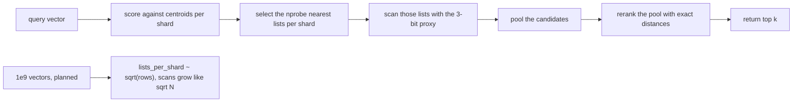
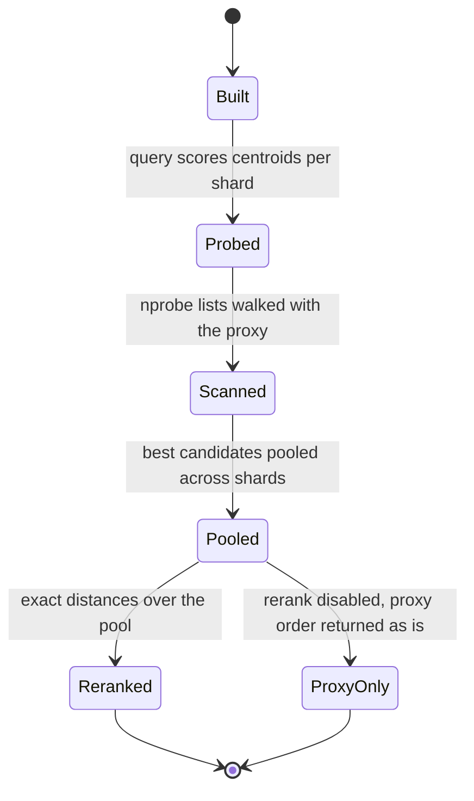
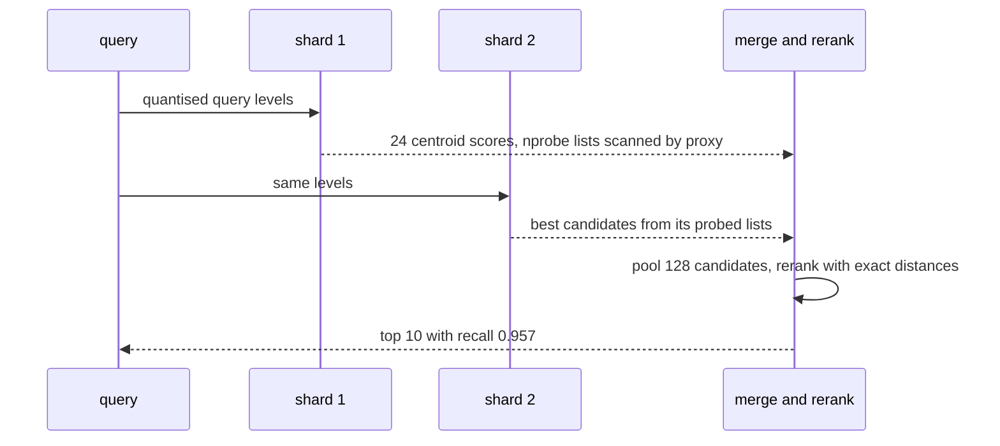

# 815 — Implement real-time vector search at billion-vector scale with sharding and reranking.

> **Tier:** Master · **CTCI chapter:** Beyond — Advanced Data Structures & Algorithms
> **Task spec:** [815-implement-real-time-vector-search-at-billion-vector-scale-with-s.md](../../../tasks/master/815-implement-real-time-vector-search-at-billion-vector-scale-with-s.md)
> **Solutions:** [Python](../../../solutions/python/master/815-implement-real-time-vector-search-at-billion-vector-scale-with-s/solution.py) ·
> [Java](../../../solutions/java/master/815-implement-real-time-vector-search-at-billion-vector-scale-with-s/Solution.java) ·
> [JavaScript](../../../solutions/javascript/master/815-implement-real-time-vector-search-at-billion-vector-scale-with-s/solution.js) ·
> [C#](../../../solutions/csharp/master/815-implement-real-time-vector-search-at-billion-vector-scale-with-s/Solution.cs)

## 1. Problem restatement

**The modelling contract — and the honest reading of "billion".** This implementation builds the whole
production path *in process*: a warehouse of embeddings split over shards, each shard carrying a coarse
quantiser (an IVF: `kmeans` centroids plus one inverted list per centroid) so a query only touches the
few lists whose centroids are nearest, plus a **rerank** stage that rescores the short candidate list with
exact distances. The constants are `DIMENSION = 12`, `SHARDS = 8`, `NLIST = 24` lists per shard,
`NPROBE = 6` lists probed, `K = 10`, `POOL = 128` candidates pooled, and `QUANT_BITS = 3` (8 levels per
coordinate) for the cheap proxy.

What is *materialised* is 600 vectors of dimension 12; what is *planned* is 10^9. `scale_plan(total_vectors,
dimension, shard_count, nprobe)` models the storage and per-query cost of the same layout at any `N`,
using the standard rule that keeps a list at constant size, `lists_per_shard ~ sqrt(rows_per_shard)`, so
with a fixed `nprobe` the modelled candidate scans grow like `sqrt(N)` instead of `N`. The claim is a
typed parameter plus an analysis on the same code path as the small measured experiment — not a benchmark
of a billion vectors, because a billion vectors are not resident here.

| Piece | What it does |
| --- | --- |
| `shard_of(vector_id, shard_count)` | a keyed `splitmix64` mix of the id, so a shard owns a deterministic partition that is stable as the index grows |
| `VectorCluster` | one `IvfShard` per shard, built with deterministic Lloyd k-means (farthest-point initialisation, so there is no random seed to fix) |
| `IvfShard.scan` | scores the query against every centroid of the shard and scans the `nprobe` nearest lists using the 3-bit scalar-quantised proxy |
| `VectorCluster.search` | pools the candidates from every shard and **reranks the pool with exact float distances** — the rerank is what turns coarse ordering into the final top-k |
| `scale_plan` | the modelled storage and per-query cost at any `N`, with sublinear growth |

**Asserted:** identical answers across two runs; shards partitioning the id space exactly (nothing lost,
nothing duplicated) with a bound on the imbalance; exact-distance agreement with a hand-computed L2
oracle on a tiny case; full recall when every list is probed; recall@10 above 0.9 over 30 perturbed
queries against brute force; reranking measurably beating the quantised-only ordering; monotone recall in
`nprobe`; the answer always a subset of the candidate pool; per-query cost budgets (centroid distances,
exact rerank calls, fraction of the corpus touched, weighted operation count); and the sublinear growth of
the modelled cost at 10^9 and 4·10^9. Edge cases: `k` above the corpus size, duplicate vectors, a query
equal to a stored vector, an empty shard, an empty corpus, a single-vector corpus, and a dimension
mismatch.

**Omitted:** 600 vectors of dimension 12 in one process, so "billion" is a modelled parameter rather than
terabytes of resident floats; distances are exact float arithmetic (no SIMD, no float16, no product
quantisation codes); the shard count is small, so a query fans out to every shard instead of going through
a routing tier; and the latency budget is a deterministic weighted operation count — there are no clocks,
threads, sockets or sleeping anywhere.

```text
recall@10: two-stage=0.957 proxy-only=0.800 full-probe=1.000 (gains on 29/30 queries)
cost/query: centroids=192 scanned=201 rerank=128 of 600; modelled 1e9 scan=715584
```

| Scenario | Expected result |
| --- | --- |
| 30 perturbed queries, `nprobe = 6` of 24 lists | recall@10 `0.957` with reranking, `0.800` without it, `1.000` when every list is probed |
| reranking | improves the result on 29 of the 30 queries |
| one query | 192 centroid distances (8 shards × 24 lists), 201 vectors scanned by the proxy, 128 of 600 vectors reranked exactly |
| the modelled 10^9-vector index | a candidate scan of 715584, i.e. about 0.07% of the corpus |
| two identical runs | byte-identical answer sets |

## 2. Intuition

The naive vector search compares the query with every vector: exact, simple, and `O(N · D)` — at a billion
vectors it is hopeless, and its cost grows linearly with the corpus. The naive fix is to compare only
quantised codes: fast, but the coarse ordering is wrong often enough that the true nearest neighbours are
missed.

The key insight is that accuracy and cost live in different stages, and the two-stage design exploits that
split:

1. **A cheap proxy decides what to look at.** A 3-bit scalar quantisation of each coordinate (8 levels)
   makes a distance estimate essentially free, and an IVF layout means only the lists whose centroids are
   nearest are ever scanned (`nprobe` of `NLIST`). The recall of *this* stage is `0.800`, which is not
   good enough — and it is not meant to be.
2. **Exact distances decide the answer.** The pool of candidates is rescored with real float distances in
   `VectorCluster.search`, and the recall jumps to `0.957` while only `128` of `600` vectors are ever
   compared exactly. Reranking is not a refinement of a good answer; it is what makes the answer good.
3. **Sharding changes the constant, the list rule changes the exponent.** Splitting by a hash of the id
   partitions the space and lets shards be independent. The sublinear claim comes from a different
   decision: keeping lists at constant size (`lists_per_shard ~ sqrt(rows_per_shard)`), so the number of
   candidates a query sees grows like `sqrt(N)` for a fixed `nprobe` — which is what `scale_plan` models
   and the checks verify at 10^9.



## 3. Algorithm

1. `shard_of(vector_id, shard_count)` mixes the id so a shard owns a deterministic partition;
   `build_shards` groups the vectors accordingly.
2. `kmeans(points, clusters, iterations)` runs deterministic Lloyd iterations from a farthest-point
   initialisation, so no random seed is needed and two runs produce the same centroids.
3. `IvfShard.scan(query_levels, query, nprobe, counters)` computes the `nprobe` nearest centroids from
   the query's quantised levels, then walks those lists counting distances with the proxy.
4. `VectorCluster.search(query, k, nprobe, pool, counters, rerank)` collects the best `pool` candidates
   across shards, resolves them with `exact_top` (real float distances) when `rerank` is true, and returns
   the top `k`.
5. `proxy_ranking` is the same search with reranking disabled, which is how the run measures what
   reranking buys.
6. `scale_plan(total_vectors, dimension, shard_count, nprobe)` returns the modelled storage and per-query
   cost at a given `N`, including the sublinear candidate count.

```text
procedure search(cluster, query, k, nprobe, pool, rerank)
    query_levels ← quantise(query)
    candidates ← []
    for each shard in cluster.shards do
        shard.scan(query_levels, query, nprobe, counters)   # proxy distances over the nearest lists
        candidates.append(shard.best[:pool])
    end
    pool_best ← best pool candidates by proxy distance
    if rerank then
        rerank pool_best with sq_distance(query, vector)    # exact float arithmetic
        counters.rerank ← counters.rerank + length(pool_best)
    end
    return top k of the ordered pool_best
end

function scale_plan(total_vectors, dimension, shard_count, nprobe)
    rows_per_shard ← total_vectors / shard_count
    lists_per_shard ← round(sqrt(rows_per_shard))          # constant list size as the corpus grows
    scanned ← shard_count * nprobe * (rows_per_shard / lists_per_shard)
    return (storage = total_vectors * dimension * bytes per code,
            centroid_calls = shard_count * lists_per_shard,
            candidate_scans = scanned)
end
```



## 4. Worked example

One query against the materialised 600-vector corpus, `K = 10`, `nprobe = 6` of 24 lists per shard, and a
pool of 128 candidates. Every number below is printed by the run.

| Stage | Count | Reading |
| --- | --- | --- |
| centroid distances | 192 | `8 shards × 24 lists` — every shard scores all of its centroids, which is the fixed first-stage cost |
| vectors scanned by the proxy | 201 | the probed lists hold a third of the tiny corpus, which is the documented, deliberately modest pruning at `N = 600` |
| exact reranks | 128 of 600 | the final ordering touches 21% of the corpus, not all of it |
| recall@10, proxy only | 0.800 | ordering by 3-bit codes alone loses one true neighbour in five |
| recall@10, two-stage | 0.957 | reranking the same pool recovers almost all of it |
| recall@10, all lists probed | 1.000 | with `nprobe = NLIST` the search degenerates to brute force, as it must |
| queries where reranking helped | 29 of 30 | evidence rather than belief that the second stage earns its cost |

The pruning factor here deserves an honest reading: at `N = 600` with 24 lists of about 25 vectors,
probing 6 lists still touches about a third of the corpus, and the weighted operation count stays under
75% of brute force. The small run's purpose is the *recall and rerank measurement*; the sublinear pruning
factor is what `scale_plan` models and what the checks verify at 10^9, where a query touches under 0.1%
of the corpus.

| `N` | modelled candidate scans | fraction of the corpus |
| --- | --- | --- |
| 600 | 201 | 33% |
| 10^9 | 715584 | about 0.07% |

The modelled growth is the point: between those two rows the corpus grows by a factor of about 1.7
million while the scan grows by a factor of about 3500 — the signature of `sqrt(N)` scaling, and the
reason a fixed `nprobe` with constant-size lists is the rule to follow.



The edge cases are asserted on the same code path, because a production tier meets all of them: `k` above
the corpus size returns the whole corpus, duplicate vectors do not break the pool, a query equal to a
stored vector returns that vector first, an empty shard and an empty corpus return empty results, a
single-vector corpus works with `nprobe = 1`, and a dimension mismatch is rejected rather than silently
producing garbage distances.

## 5. Complexity

Let `N` be the number of vectors, `D` the dimension, `S` the number of shards, `L` the lists per shard,
`P` the pool size and `k` the result size.

| Measure | Bound | Why it holds |
| --- | --- | --- |
| Build | `O(N · L · D)` for exact Lloyd k-means, `O(N · D)` for assignment | `kmeans` runs a fixed number of iterations from a farthest-point start |
| First stage | `O(S · L · D)` centroids + `O(S · nprobe · (N/(S·L)) · D)` proxy scans | measured 192 centroid distances and 201 scanned vectors at `N = 600` |
| Rerank | `O(P · D)` exact distances | measured 128 of 600 vectors reranked |
| Total per query | `O(S·L·D + nprobe·(N/L)·D + P·D)` | the middle term is the only one that grows with the corpus |
| Memory | `O(N · D · QUANT_BITS / 8)` for the codes plus `O(N · D)` for exact floats | the proxy representation is what makes scanning cheap |
| With `L ~ sqrt(N/S)` | scans grow like `O(sqrt(N) · sqrt(S) · D)` for fixed `nprobe` | modelled: 715584 at 10^9, about 0.07% of the corpus |
| Verification | `O(queries · N · D)` for the brute-force oracle over 30 queries | the oracle is exact by definition, so it is the expensive side |

The comparison is brute force: `O(N · D)` per query with recall exactly 1.0. The two-stage index trades a
little recall (`0.957` here, and the checks require above `0.9`) for a query cost that stops growing
linearly — and the honest statement of the trade is the measured table: `128` exact comparisons instead of
`600` at this scale, and a modelled `715584` instead of `10^9` at the planned one. Everything here is a
counted operation, not wall-clock latency, so the numbers measure algorithmic shape and not a service level.

## 6. Pitfalls and edge cases

- **Returning the proxy ordering.** Without `exact_top`, recall drops to `0.800`; the two-stage design only
  works because the cheap stage *selects* and the expensive stage *decides*.
- **`nprobe` too small.** Recall is monotone in `nprobe`, and the checks assert it, so tuning down to save
  cost is visibly a recall decision rather than a free win.
- **Random k-means initialisation.** Non-deterministic centroids make two runs disagree; farthest-point
  initialisation removes the seed entirely, which is what the determinism assertion needs.
- **Shard imbalance.** Hashing the id gives a deterministic partition with a bound on the spread; a
  partition that concentrates vectors in one shard reintroduces the linear scan on the hot shard.
- **The pool must be a superset of the answer.** The returned ids are asserted to be a subset of the
  candidate pool, which catches an implementation that "reranks" something it never scanned.
- **`k` larger than the corpus.** Returning fewer rows than requested is a silent truncation bug; the
  check asks for more than exist and expects all of them.
- **Duplicates and identical queries.** A duplicate vector must not confuse the pool, and a query equal to
  a stored vector must return it first with distance 0.
- **Empty and single-vector corpora.** An empty shard must be skipped rather than producing a division by
  zero, and a corpus of one must work with any `nprobe`.
- **Dimension mismatch.** Distances between different dimensions are meaningless; the check expects a
  rejection instead of a silently shorter loop.
- **Quoting the billion claim honestly.** The modelled numbers come from `scale_plan` on the same code
  path — they are an analysis, not a benchmark, and the tutorial should be read that way.

## 7. Variants and follow-ups

- **Better codes instead of more candidates.** Product quantisation or HNSW would improve the first stage
  so fewer candidates need reranking; the measurement structure here (recall with and without rerank,
  cost per query) is exactly how such a change should be evaluated.
- **Shard routing instead of fan-out.** With enough shards a query should go to a subset; the sharding
  here deliberately fans out to keep the id partition observable.
- **Hide the query.** [814-implement-searchable-encrypted-index-with-limited-leakage-and-pr.md](../../../tasks/master/814-implement-searchable-encrypted-index-with-limited-leakage-and-pr.md)
  is the privacy analogue where the server must not learn what is being searched for.
- **Serve embeddings with versioning.** [865-implement-transparent-model-serving-with-versioning-canary-shado.md](../../../tasks/master/865-implement-transparent-model-serving-with-versioning-canary-shado.md)
  and [850-implement-monetizable-feature-store-with-lineage-versioning-and.md](../../../tasks/master/850-implement-monetizable-feature-store-with-lineage-versioning-and.md)
  are the serving and lineage layers such an index usually sits under.
- **Embeddings inside a feature pipeline.** [820-implement-sparse-embedding-table-sharding-and-warm-up-strategies.md](../../../tasks/master/820-implement-sparse-embedding-table-sharding-and-warm-up-strategies.md)
  shards embedding tables for training, with warm-up instead of recall as the metric.

## 8. Check yourself

1. Why does the two-stage design beat both brute force and proxy-only search?

<details><summary>Show answer</summary>

Because it spends each stage on what it is good at. The proxy is cheap enough to scan many candidates but
orders them badly (`0.800` recall if used alone); exact distances are accurate but too expensive for the
whole corpus. Selecting with the proxy and reranking the pool with exact distances gives `0.957` recall
while comparing only `128` of `600` vectors — and the run shows reranking helped on 29 of 30 queries
rather than asserting it helped in general.

</details>

2. Where does the `sqrt(N)` come from, given the sharding is linear?

<details><summary>Show answer</summary>

Not from the sharding but from the list rule: keeping `lists_per_shard ~ sqrt(rows_per_shard)` holds the
average list size constant, so with a fixed `nprobe` the number of candidates a query scans grows like
`sqrt(N)`. That is why the modelled scan goes from `201` at `N = 600` to `715584` at `N = 10^9` — a factor
of about 3500 for a corpus 1.7 million times larger.

</details>

3. `nprobe = 24` (all lists) gives recall `1.000`. Why is that not the recommended setting?

<details><summary>Show answer</summary>

Because it degenerates to brute force over the shard: recall is exactly 1.0 by construction, and the cost
is the full corpus scan. The point of the IVF layout is that `nprobe` is a *tunable* trade between recall
and candidates scanned, which the monotone-recall check makes explicit; `6` of `24` here buys `0.957`
recall for a third of the corpus.

</details>

4. The billion-vector claim is "a typed parameter and an analysis". What exactly is measured, and what is
   modelled?

<details><summary>Show answer</summary>

Measured: recall@10 against a brute-force oracle over 30 perturbed queries, the rerank gain, the per-query
counters (192 centroid distances, 201 scans, 128 exact reranks of 600) and the shard partition's
exactness. Modelled: the storage and per-query cost at 10^9 and 4·10^9 via `scale_plan` on the same code
path. Separating the two is what keeps the claim honest — the small run proves the algorithm, the plan
projects the scale.

</details>
