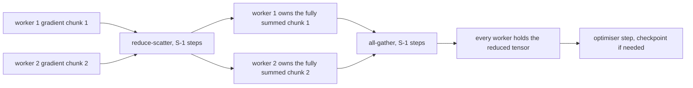
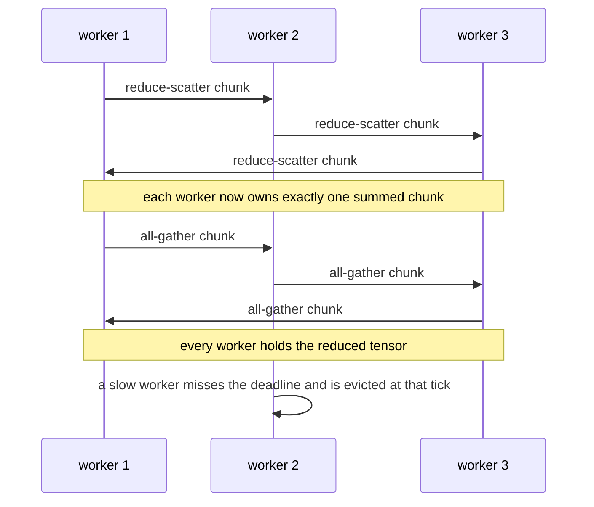
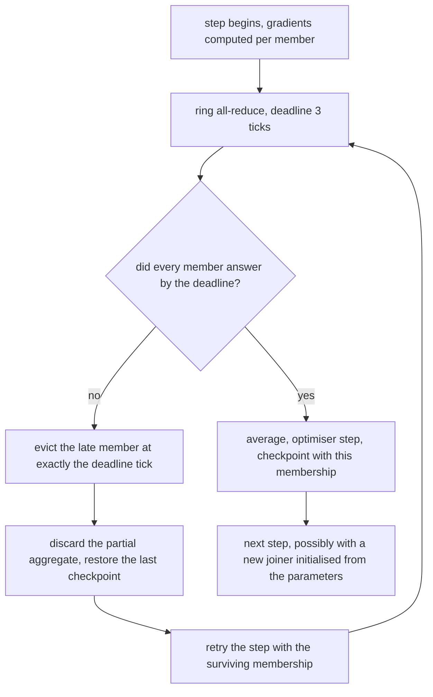

# 816 — Implement distributed training system with fault-tolerant all-reduce and elastic workers.

> **Tier:** Master · **CTCI chapter:** Beyond — Machine Learning & AI
> **Task spec:** [816-implement-distributed-training-system-with-fault-tolerant-all-re.md](../../../tasks/master/816-implement-distributed-training-system-with-fault-tolerant-all-re.md)
> **Solutions:** [Python](../../../solutions/python/master/816-implement-distributed-training-system-with-fault-tolerant-all-re/solution.py) ·
> [Java](../../../solutions/java/master/816-implement-distributed-training-system-with-fault-tolerant-all-re/Solution.java) ·
> [JavaScript](../../../solutions/javascript/master/816-implement-distributed-training-system-with-fault-tolerant-all-re/solution.js) ·
> [C#](../../../solutions/csharp/master/816-implement-distributed-training-system-with-fault-tolerant-all-re/Solution.cs)

## 1. Problem restatement

**The modelling contract.** Data-parallel training of a large model is one collective performed over and
over: every worker computes the gradient of its own shard, an **all-reduce** averages the gradients across
the world, and the optimiser steps. The all-reduce here is the bandwidth-optimal **ring**: a
reduce-scatter phase and an all-gather phase, `2 * (S - 1)` steps in which every worker sends exactly
`2 * (S - 1) / S` of the tensor, so no worker is ever the bottleneck.

Messages travel over an explicit in-memory network whose cost is
`LATENCY_TICKS + ceil(words / BANDWIDTH_WORDS_PER_TICK)` ticks (`LATENCY_TICKS = 2`,
`BANDWIDTH_WORDS_PER_TICK = 4`), and the schedule is driven by advancing that tick counter — never by
sleeping, threads or a clock — so a run is fully deterministic and reproducible. Parameters and gradients
are `fractions.Fraction`, so every comparison against the reference is **exact**: no float tolerance, no
drift.

Fault tolerance is layered on the same collective:

- Every step has a deadline (`STEP_DEADLINE_TICKS = 3`); a worker whose message arrives after it is
  declared failed **at exactly that tick** — a straggler and a crashed worker are the same event in a
  synchronous trainer.
- The collective aborts, the partial accumulators are thrown away, and training resumes from the last
  checkpoint with the surviving members only, so **no committed version ever contains a partial
  aggregate**.
- **Elastic workers** are supported: a member that joins later is initialised from the coordinator's
  parameters, and the world size used in the averaging is the membership of that step.

**Asserted:** the network's latency/bandwidth model and delivery order; ring all-reduce against a
straightforward elementwise-sum oracle for world sizes `1, 2, 3, 5, 8`; correctness under padding (a
tensor that is not a multiple of the world size) and for an empty and a zero tensor; the measured
per-worker traffic and message count against the closed form `2 * (S - 1) / S * words` and `2 * (S - 1)`;
gradient-sum correctness; `K` steps of data-parallel SGD agreeing *exactly* with an independent serial
oracle for even and uneven shards; the failure tick matching the deadline exactly; the safety invariant
that every committed parameter version equals the oracle over that step's membership; the loss-accounting
identity (the recovered sum differs from the full sum by exactly the failed worker's gradient); elastic
join equivalence against a static run; straggler eviction; survival when all but one worker die;
determinism of two identical runs; and the makespan bound.

**Omitted:** one process, no real UDP/NCCL; no floating point (exact rationals instead of bf16/fp32);
bulk-synchronous steps with a fixed per-step deadline rather than asynchronous streaming; one model tensor
and a quadratic loss so the gradients are checkable by hand; and checkpoints taken every step, where a
real trainer would checkpoint every few minutes.

```text
all-reduce: world sizes 1, 2, 3, 5, 8 verified; traffic per member = 2(S-1)/S * words
training: 6 steps exact vs serial oracle; failures caught at tick 3; elastic join verified; makespan=90 ticks
```

| Scenario | Expected result |
| --- | --- |
| ring all-reduce, `S` in `{1, 2, 3, 5, 8}` | equal to the elementwise-sum oracle, with `2(S-1)` messages per worker |
| tensor not a multiple of `S` | correct after padding; an empty or zero tensor is also correct |
| 6 data-parallel SGD steps | parameters identical to an independent serial oracle, for even and uneven shards |
| a worker slower than the deadline | declared failed at exactly tick 3, the partial aggregate discarded, training resumes from the checkpoint |
| a late joiner | initialised from the coordinator's parameters; the result matches a static run of the same membership |
| all but one worker die | the run survives with `S = 1`, where all-reduce is the identity and no message is sent |

## 2. Intuition

The naive data-parallel trainer has every worker send its gradients to rank 0, which sums them and
broadcasts the result. It is `O(S)` messages per worker, and the traffic concentrates on one worker: rank
0 receives `S - 1` tensors and sends a tensor to each of `S - 1` peers, so its network cost is roughly
twice everybody else's. Adding more workers makes the bottleneck worse, which is the opposite of
scaling.

The key insight is that the collective can be organised so that **every worker sends and receives the same
amount**, and the ring is the canonical construction: the tensor is cut into `S` chunks and two phases
run around a logical ring.

- **Reduce-scatter:** in `S - 1` steps each worker sends one chunk and accumulates one chunk, ending with
  exactly one fully summed chunk per worker. The `S - 1` steps touch only the chunks a worker still needs,
  so each worker sends `(S - 1)/S` of the tensor.
- **All-gather:** another `S - 1` steps rotate the finished chunks, so each worker sends the remaining
  `(S - 1)/S` and ends with the whole reduced tensor. Total traffic per worker: `2(S - 1)/S` of the
  tensor, messages `2(S - 1)` — both exactly what the run measures against the closed form.
- **Synchrony is the fault detector.** Because the collective is bulk-synchronous with a deadline, "slow"
  and "dead" are the same event: the ones who arrive on time decide, the late one is evicted, and the
  step's partial aggregate is discarded rather than committed. That is why the safety invariant is stated
  as "every committed parameter version equals the oracle over that step's membership".
- **Elasticity is a membership question, not a topology question.** A joiner is initialised from the
  coordinator's parameters and the world size for averaging is the current membership, so the same ring
  code serves `S = 1` and `S = 8`, including the degenerate single-worker case where the collective sends
  nothing.



## 3. Algorithm

1. `Trainer.step(speeds, deadline_ticks)` computes each active member's gradient from its shard and calls
   `ring_all_reduce` with the current membership.
2. `pad_to(tensor, multiple)` pads so the tensor divides evenly into `S` chunks; the padding is visible in
   the traffic accounting, which is why correctness under padding is asserted.
3. `ring_all_reduce` runs `S - 1` reduce-scatter steps and `S - 1` all-gather steps, calling
   `Network.send` for each and `Network.drain` to advance the tick counter; `Message.cost` is
   `latency + ceil(words / bandwidth)`.
4. `evict_late(network, deadline, events)` inspects arrivals: a message past the deadline causes its
   sender to be evicted **at that tick**, the collective to be aborted and the step to be rescheduled
   without it.
5. The optimiser applies the averaged gradient; `serial_oracle` recomputes the same `K` steps on one
   worker so the comparison is against an independent implementation, not against itself.
6. Joins and failures are scripted (`fixed_membership`, `variable_membership`), so the elastic path is
   exercised deterministically instead of by chance.

```text
procedure ring_all_reduce(network, members, tensors, speeds, deadline)
    size ← length(members)
    chunks ← split each tensor into size equal chunks
    for step in 1 .. size - 1 do                        # reduce-scatter
        sender ← members[step]
        target ← members[(step + 1) mod size]
        chunk ← (step - 1) mod size                     # the chunk that is still moving
        network.send(sender, target, chunks[chunk], speeds)
        accumulate the received chunk into the target's own
        evict_late(network, deadline)                   # a straggler dies at the deadline, exactly
    end
    for step in size - 1 .. 2 * size - 2 do             # all-gather
        sender ← members[step mod size]
        target ← members[(step + 1) mod size]
        chunk ← (step - size + 1) mod size
        network.send(sender, target, chunks[chunk], speeds)
        evict_late(network, deadline)
    end
    return the reduced tensor on every member still in members
end

procedure trainer_step(trainer, deadline)
    gradients ← [gradients_from_shard(member, trainer.params, shard) for member in trainer.active]
    reduced ← ring_all_reduce(trainer.network, trainer.active, gradients, trainer.speeds, deadline)
    if any member was evicted then
        discard the reduction and retry the step with the surviving membership
        restore trainer.params from the last checkpoint
    end
    trainer.params ← trainer.params - learning_rate * reduced / length(trainer.active)
    checkpoint trainer.params, membership = trainer.active
end
```



## 4. Worked example

The ring's cost is a closed form, and the run measures it for five world sizes.

| `S` | reduce-scatter steps | all-gather steps | messages per worker | traffic per worker |
| --- | --- | --- | --- | --- |
| 1 | 0 | 0 | 0 | 0 |
| 2 | 1 | 1 | 2 | `1 × words` |
| 3 | 2 | 2 | 4 | `4/3 × words` |
| 5 | 4 | 4 | 8 | `8/5 × words` |
| 8 | 7 | 7 | 14 | `7/4 × words` |

Two things are worth reading from the table. The `S = 1` row is not a special case bolted on: with one
member the collective sends nothing and all-reduce is the identity, which is exactly what lets the system
survive until only one worker is left. And the traffic column approaches `2 × words` as `S` grows while
being bounded by it for every `S` — no worker ever sends a full copy, which is the bandwidth-optimality
claim in one line.

The training loop is then checked against an independent serial oracle:

| Run | Result |
| --- | --- |
| 6 SGD steps, even shards | parameters identical to `serial_oracle` exactly — the rationals make "identical" a real comparison |
| 6 SGD steps, uneven shards (padding involved) | identical again, so padding did not change the arithmetic |
| a worker that misses the deadline | declared failed at tick 3 (`STEP_DEADLINE_TICKS`), the partial aggregate discarded, the step retried from the checkpoint |
| a worker that joins mid-run | initialised from the coordinator's parameters; the result matches a static run of the same final membership |
| all but one worker failing | the run completes with `S = 1` |
| the whole schedule | makespan 90 ticks, including the failed step and the elastic join |

The loss-accounting identity is the sharpest of these checks: when a worker is evicted, the gradient sum
that the survivors compute must differ from the full sum by **exactly** the failed worker's gradient. That
is a much stronger statement than "the loss went up", and it is only checkable because the arithmetic is
exact.



## 5. Complexity

Let `S` be the world size, `W` the number of words in the tensor, `L` the latency per message and `B` the
bandwidth in words per tick.

| Measure | Bound | Why it holds |
| --- | --- | --- |
| Ring steps | `2(S - 1)` | `S - 1` reduce-scatter plus `S - 1` all-gather |
| Traffic per worker | `2(S - 1)/S × W` words, bounded by `2W` | each worker sends one chunk per step and there are `2(S - 1)` steps |
| Ticks per step | `2(S - 1)(L + ceil(chunk / B))` | each step is one message, and `chunk = W / S` words |
| Ideal ticks | `2W / B` for large `S` | the latency term vanishes as chunks shrink; the traffic term approaches `2W` words per worker |
| Overhead vs tree/broadcast | `O(log S)` messages but an `O(S)` hot spot at the root | the ring has no hot spot, which is why it is the default in NCCL-style collectives |
| Fault handling | `O(1)` extra steps plus one checkpoint restore | the failed step is discarded and retried, never partially committed |
| Verification | `O(steps × S × W)` against the serial oracle, exact | rationals make each comparison exact rather than tolerance-based |

The comparison is the naive rank-0 gather: `S - 1` messages in and `S - 1` messages out, all on one worker,
so the root moves `2(S - 1)/S` of the tensor *per other worker's contribution* — a `O(S)` hot spot that
makes the aggregate throughput fall as workers are added. The ring pays a fixed `2(S - 1)` steps of
latency for a perfectly balanced `2(S - 1)/S` traffic per worker, which is what the measured table above
shows and what the closed-form assertions enforce. Note the units: ticks and words, not seconds — the
network is a formula, so these numbers describe the collective's shape, not a real cluster's throughput.

## 6. Pitfalls and edge cases

- **`S = 1` is not a special case to bolt on.** With one member the loop bodies never run and the reduced
  tensor is the input; an implementation that assumes at least two workers fails exactly when it matters
  (all but one worker dying).
- **Tensors that do not divide by `S`.** Padding is required, and the padded words are part of the traffic
  accounting; the check asserts the result is still exact against the oracle.
- **Empty and zero tensors.** A zero-length tensor must not produce a division by zero in the chunk
  arithmetic, and a zero tensor must all-reduce to zero.
- **Counting messages versus words.** Traffic and message count are separate assertions
  (`2(S-1)/S × words` and `2(S-1)`), because a chunked implementation can hit one and miss the other.
- **A straggler is a failure at the deadline, not a wait.** Making the trainer block on the slowest worker
  turns one slow node into a global slowdown; here the deadline decides, and the failed step is discarded.
- **Never commit a partial aggregate.** The safety invariant is that every committed parameter version
  equals the oracle over *that step's membership*; committing the survivors' partial sum while claiming
  the full membership is the bug this check exists to catch.
- **The loss-accounting identity is exact.** The recovered sum must differ from the full sum by exactly the
  failed worker's gradient — a statement only possible with rationals, and a sharp test of "did you drop
  the right thing".
- **Joins must initialise from the coordinator.** A joiner that starts from zero contributes a wrong
  gradient; the elastic path is compared against a static run with the same membership.
- **Membership defines the average.** Dividing by the *configured* world size instead of the step's
  membership silently scales the update whenever the membership changes.
- **Determinism.** Advancing a tick counter rather than sleeping is what makes two identical runs produce
  identical schedules, tick by tick.

## 7. Variants and follow-ups

- **Pipeline parallelism instead of data parallelism.** [818-implement-model-parallel-training-partitioner-and-pipeline-paral.md](../../../tasks/master/818-implement-model-parallel-training-partitioner-and-pipeline-paral.md)
  splits the model rather than the batch, where the collective becomes a pipeline of micro-batches.
- **Checkpointing a huge model cheaply.** [819-implement-memory-efficient-checkpointing-for-massive-models-bloc.md](../../../tasks/master/819-implement-memory-efficient-checkpointing-for-massive-models-bloc.md)
  is the other half of the "resume from the last checkpoint" requirement here, with block-level dedup.
- **Scheduling the workers.** [817-implement-scheduler-for-heterogeneous-gpu-cpu-cluster-with-multi.md](../../../tasks/master/817-implement-scheduler-for-heterogeneous-gpu-cpu-cluster-with-multi.md)
  decides which of these workers exist and with what isolation, which is what `speeds` abstracts here.
- **Numerics as a first-class concern.** [826-implement-automatic-mixed-precision-training-full-pipeline-with.md](../../../tasks/master/826-implement-automatic-mixed-precision-training-full-pipeline-with.md)
  replaces the exact rationals with mixed precision and loss scaling, which is where the exactness checked
  here has to become a tolerance again.

## 8. Check yourself

1. Why is the ring bandwidth-optimal, in one sentence, and what does it cost in latency?

<details><summary>Show answer</summary>

Because every worker sends exactly `2(S - 1)/S` of the tensor — no worker ships a full copy and no worker
is a hot spot — which is the lower bound up to a factor for an all-reduce. The cost is `2(S - 1)` messages
of latency, which is what grows linearly with the world size even though the traffic does not.

</details>

2. A worker is slow but not dead. Why does the trainer treat it as failed?

<details><summary>Show answer</summary>

Because the collective is bulk-synchronous: every step waits for every member, so a slow member delays
everybody, and waiting indefinitely converts one slow node into a global outage. The deadline makes "too
slow" and "dead" the same event at a known tick (`3` here), after which the step is discarded and retried
without it.

</details>

3. What exactly does "no committed version ever contains a partial aggregate" forbid?

<details><summary>Show answer</summary>

Committing the survivors' partial sum as if it were the average over the full membership of that step. The
check compares every committed parameter version against the oracle over the membership of *that step*, and
the loss-accounting identity sharpens it: the recovered sum must differ from the full sum by exactly the
evicted worker's gradient.

</details>

4. Why do the checks use `Fraction` rather than floats?

<details><summary>Show answer</summary>

So the comparisons are exact. With floats, "the training run matches the serial oracle" becomes a
tolerance question, and small errors from padding, membership changes or an uneven shard count hide inside
the tolerance. Exact rationals make every assertion a strict equality — which is why the padding case and
the uneven-shard case can be asserted at all.

</details>

5. A worker joins mid-run. What has to be true for the result to match a static run of the same membership?

<details><summary>Show answer</summary>

The joiner must be initialised from the coordinator's current parameters (starting from zero would inject
a wrong gradient), the world size used to average must be the *step's* membership rather than the
configured size, and the ring must handle the new member from the next collective on. The run asserts
equivalence against a static run with the same final membership rather than a loose "it still trains".

</details>
