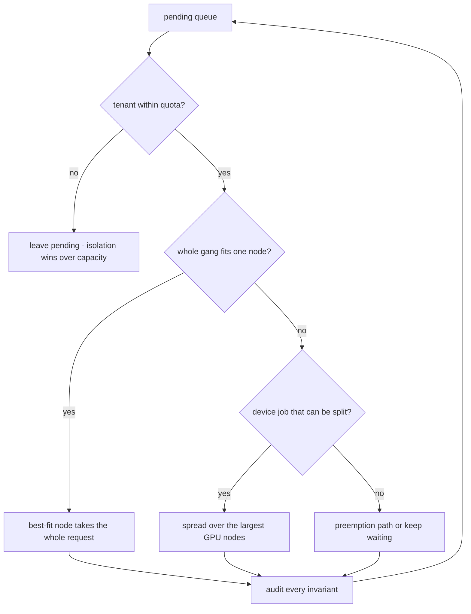
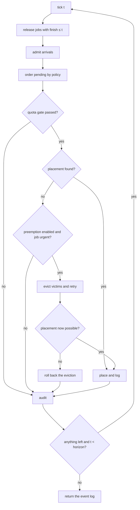
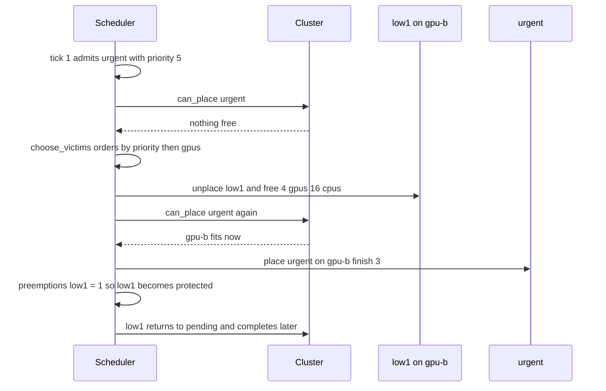

# 817 — Implement scheduler for heterogeneous GPU/CPU cluster with multi-tenant isolation.

> **Tier:** Master · **CTCI chapter:** Ch 9 — System Design and Scalability
> **Task spec:** [817-implement-scheduler-for-heterogeneous-gpu-cpu-cluster-with-multi.md](../../../tasks/master/817-implement-scheduler-for-heterogeneous-gpu-cpu-cluster-with-multi.md)
> **Solutions:** [Python](../../../solutions/python/master/817-implement-scheduler-for-heterogeneous-gpu-cpu-cluster-with-multi/solution.py) ·
> [Java](../../../solutions/java/master/817-implement-scheduler-for-heterogeneous-gpu-cpu-cluster-with-multi/Solution.java) ·
> [JavaScript](../../../solutions/javascript/master/817-implement-scheduler-for-heterogeneous-gpu-cpu-cluster-with-multi/solution.js) ·
> [C#](../../../solutions/csharp/master/817-implement-scheduler-for-heterogeneous-gpu-cpu-cluster-with-multi/Solution.cs)

## 1. Problem restatement

**Input.** A *cluster* of heterogeneous nodes, a set of *tenants* with quotas, and a *workload* of jobs.
The Python fixture is small enough to hold in your head:

| Fixture piece | Values |
| --- | --- |
| Nodes | `gpu-a` 2 GPUs / 16 GPU-mem / 8 CPUs / 32 mem (label `gpu`), `gpu-b` 4 / 24 / 16 / 64 (label `gpu`), `cpu-c` 0 / 0 / 32 / 128, `cpu-d` 0 / 0 / 8 / 16 |
| Tenants | `alpha` 4 GPUs and 24 CPUs, `beta` 4 GPUs and 24 CPUs, `gamma` 2 GPUs and 16 CPUs |
| Job | `(name, tenant, gpus, gpu_mem, cpus, mem, duration, priority, arrival)` |

**Output.** A discrete-tick schedule: for every job either a *placement* — a list of
`{node, gpus, gpu_mem, cpus, mem}` parts whose per-resource sum equals the request exactly — or a
pending entry, plus the metrics `makespan`, `utilisation`, `wait`, `preemptions` and the `events` log of
`place` / `complete` / `preempt` records.

**Constraints (the invariants the solutions audit after every tick).**

1. No node is ever oversubscribed on `gpus`, `gpu_mem`, `cpus` or `mem`, and no counter goes negative.
2. A job is *gang scheduled*: all of its request is placed at once or none of it is, and the placement is
   never partially released.
3. Device affinity: a job with `gpus > 0` or `gpu_mem > 0` never lands on a CPU-only node.
4. Tenant isolation: the tenant's live usage never exceeds its quota, whatever the queue looks like.
5. No double release, no job completing twice, and no victim preempted beyond the configured bound.

**Concrete behaviour asserted by the shipped runs.**

| Scenario | Expected result |
| --- | --- |
| One-wave workload `w1` (alpha, 1 GPU, 3 ticks), `w2` (beta, 1 GPU, 7 ticks), `w3` (gamma, 4 CPUs, 2 ticks) | every `place` event at tick 0, all three complete, `makespan = 8` |
| 40-job multi-tenant workload built from seed `0xC1057`, `policy="drf"`, horizon 400 | `violations = 0`, 40 completions, `makespan = 23`, `utilisation = 0.73`, 4 spread placements |
| `hog` asking `gamma` for 4 GPUs (its quota allows 2) | stays pending, charges the tenant nothing; the same job with 2 GPUs completes |
| `fat` asking for 8 GPUs and 8 CPUs | larger than any node and larger than the cluster: reported pending, never hangs the loop |
| `wide` alpha gang of 3 GPUs plus `narrow` beta job | spread over two GPU nodes and both complete |
| `urgent` (priority 5, arrives at tick 1) against `low1`/`low2` | with `preempt=True`, first placement at tick 1 and `preemptions == {'low1': 1}`; with `preempt=False` it starts later |

## 2. Intuition

The obvious scheduler is a queue plus a scan: take the head job, walk the nodes, hand it to the first
node with room. That fails in three ways at once. A 4-GPU gang that meets a nearly empty `gpu-a` and a
packed `gpu-b` is *partially* placeable — and a partial placement breaks the gang contract. A tenant can
quietly consume a neighbour's capacity, so quotas mean nothing. And a high-priority job that arrives
while the cluster is full waits behind arbitrarily long work with no way to make room.

The key insight is to stop treating scheduling as one decision and split it into four decisions that each
own an invariant:

- **Isolation is checked before capacity.** `tenant_room` runs first, so an over-quota job is rejected
  even when the cluster is empty; capacity is a second, independent gate.
- **Placement has two shapes, not one.** Try the whole gang on one node (best fit: keep the big nodes
  free); only if no single node fits, spread the gang across nodes — which is allowed only for jobs whose
  request can be *partitioned*, and the Python solution restricts spreading to device jobs.
- **Ordering is a policy, not the algorithm.** `first_fit`, `best_fit` and `drf` are three sort keys over
  the same pending list; the audit never changes.
- **Preemption is provisional.** Victims are evicted speculatively; if the job still cannot be placed the
  eviction is rolled back, so no victim is ever punished for nothing, and a victim that has already been
  preempted `max_preemptions` times is protected from further eviction.



## 3. Algorithm

The scheduler is a tick loop. One tick is one scheduling round — no threads, nothing sleeps, no
wall-clock time.

1. **Release.** For every running job with `finish <= tick`, unplace it (subtracting every part and the
   tenant charge), drop its placement, and emit a `complete` event.
2. **Admit.** Move every future job with `arrival <= tick` into the pending list. Every pending job gets
   one tick added to its `wait` counter.
3. **Order.** Sort the pending list with the selected policy. Each policy is a total order, so the run is
   deterministic.
4. **Gate on the tenant.** Skip any job whose request would push its tenant above `gpu_quota` / `cpu_quota`.
5. **Place.** `can_place` returns a placement or nothing: the best single fitting node if there is one,
   otherwise a spread over GPU nodes in decreasing GPU capacity.
6. **Preempt (optional).** If there is no placement and the job has positive priority, `choose_victims`
   returns the shortest prefix of lower-priority, unprotected running jobs that frees enough of *every*
   resource. Evict them, retry the placement, and roll the evictions back if the retry fails.
7. **Commit.** Count a preemption per victim, protect a victim that reached the bound, re-queue victims,
   place the job, set `finish = tick + duration`, log `place` / `preempt` events.
8. **Audit.** Re-check capacity, quota, gang atomicity, affinity and non-negative counters, then advance
   the tick.

```text
procedure simulate(nodes, tenants, jobs, policy, preempt, horizon)
    cluster ← fresh Cluster with the nodes and one usage table per tenant
    pending ← jobs with arrival ≤ 0
    future  ← jobs with arrival > 0, sorted by arrival then name
    running ← empty map from job name to (job, placement)
    protected ← empty set
    tick ← 0
    while pending or running or future is non-empty and tick < horizon do
        release every running job whose finish ≤ tick
        move every future job with arrival ≤ tick into pending
        add one tick to the wait counter of every pending job
        for job in order_pending(cluster, live pending jobs, policy) do
            if not has tenant room for job then continue
            parts ← can_place(cluster, job, all nodes)
            evicted ← empty list
            if parts is empty and preempt and job.priority > 0 then
                for name in choose_victims(job, running, protected, max_victims) do
                    unplace the victim and remember it
                end
                if any victim was evicted then parts ← can_place(cluster, job, all nodes)
                if parts is still empty then restore every victim and clear the list
            end
            if parts is empty then continue
            for each evicted victim do
                push it back onto pending and count the preemption
                if its preemption count reached max_preemptions then protect it
            end
            place job on parts and set job.finish ← tick + job.duration
            remove job from pending
        end
        audit(cluster, running, tick)
        tick ← tick + 1
    end
    return events, placements, metrics
end
```

The two placement helpers are the whole "heterogeneous" story:

```text
function can_place(cluster, job, nodes)
    fitting ← nodes that have a GPU when the job needs one and whose free
              capacity covers the whole request on every resource
    sort fitting by (free gpus, free cpus, node name)
    if fitting is not empty then return a single part on the first node
    if job does not need a device then return nothing
    remaining ← copy of the request
    for node in nodes sorted by decreasing GPU capacity do
        if node has no GPU then continue
        take ← per-resource minimum of remaining and node free capacity
        if take.gpus = 0 then continue
        append one part with take and subtract take from remaining
        if remaining is all zero then stop
    end
    return the parts when remaining is all zero, otherwise nothing
end

function order_pending(cluster, live, policy)
    if policy = "first_fit" then sort by priority desc, arrival, name
    if policy = "best_fit"  then sort by priority desc, gpus·1000 + cpus desc, name
    if policy = "drf"       then sort by priority desc, tenant dominance asc, arrival, name
    otherwise raise an unknown-policy error
end

function choose_victims(job, running, protected, max_victims)
    order ← running entries by victim priority asc, victim gpus desc, name
    freed ← zero counters
    for each victim in that order do
        skip victims whose priority is at least the job priority and protected victims
        add the victim request to freed
        if freed covers the job request on every resource then return the victims so far
        if the victim count reached max_victims then return nothing
    end
    return nothing
end
```

`dominance(tenant)` is `max(used_gpus / gpu_quota, used_cpus / cpu_quota)` — the dominant-resource claim
that makes DRF stop a CPU-heavy tenant from starving a GPU tenant. The three policies share this loop
untouched; only the sort key differs, which is why the audit is written once.



**Documented deviations across the four solutions.** Java keeps the same audit but restricts a job to a
single node, re-queues victims with their remaining duration, and limits preemption to one victim per
tick belonging to the same tenant. C# models a gang as a set of identical tasks that must sit on distinct
nodes and rejects requests that can never be admitted. JavaScript gives nodes an accelerator *type*
(A100 / V100 / none) and adds an independent replayer that recomputes usage from the event log. The
Python file — the one traced below — is the variant with three policies, whole-cluster spreading and the
rollback rule.

## 4. Worked example

Trace the one-wave fixture with the default `policy="drf"` and `preempt=False`. All three jobs arrive at
tick 0 with priority 0, so DRF falls back to `arrival` and then `name`: `w1`, `w2`, `w3`.

| Tick | Action | `gpu-a` used | `gpu-b` used | `cpu-d` used | Running |
| --- | --- | --- | --- | --- | --- |
| 0 | order `w1, w2, w3`; `w1` best-fit → `gpu-a` | 1/4/2/4 | 0 | 0 | `w1` |
| 0 | `w2` fits `gpu-a` (free 1 GPU, 4 CPUs) → `gpu-a` | 2/8/4/8 | 0 | 0 | `w1 w2` |
| 0 | `w3` needs no device: `cpu-d` has key (0, 4), `gpu-a` (2, 4) → `cpu-d` | 2/8/4/8 | 0 | 0/0/4/4 | `w1 w2 w3` |
| 2 | `w3.finish = 2`, unplace and complete | 2/8/4/8 | 0 | 0 | `w1 w2` |
| 3 | `w1.finish = 3`, complete | 1/4/2/4 | 0 | 0 | `w2` |
| 7 | `w2.finish = 7`, complete | 0 | 0 | 0 | — |
| 8 | nothing left to run, loop exits | 0 | 0 | 0 | — |

Every `place` event carries tick 0, so the assertion "a one-wave workload must be placed at tick 0"
holds; `makespan` is `max(completion tick) + 1 = 1 + 7 = 8`, which is the longest single job plus the
closing tick. Note the third row: `w3` is a CPU-only job, so `can_place` sorts *all* four nodes by
`(free gpus, free cpus, name)` and `cpu-d` wins with free GPUs of 0 even though it is the smallest CPU
node. Best fit is a tie-break, not a load balancer.

The preemption fixture shows the provisional eviction in action. At tick 0, `low1` (4 GPUs) takes
`gpu-b` — it does not fit the 2-GPU `gpu-a` — and `low2` (2 GPUs, 8 CPUs, 32 mem) exactly fills `gpu-a`,
so both GPU nodes are full. At tick 1 `urgent` arrives.



The trace is exactly what the fixture measures: `preemptions == {'low1': 1}`, `max` preemptions per
victim `<= 1`, `first_place(urgent) == 1` with preemption versus later without it, and the makespan grows
by no more than 4 ticks, because a preempted job keeps its work in the queue instead of losing it. If the
retry had failed, the rollback would have re-placed `low1` byte-for-byte and cleared the eviction list —
the code does that before it ever re-queues a victim.

## 5. Complexity

Let `N` be the node count, `P` the pending queue length, `R` the running set, `K` the resource keys (4),
and `T` the number of ticks until the horizon.

| Measure | Bound | Why it holds |
| --- | --- | --- |
| Time per tick | O(P log P + P · (N · K + R log R)) | one sort of the pending list; per job a node scan, and only the preemption path sorts the running set |
| Time, whole run | O(T · P · N · K) worst case | a tick that places nothing still scans every pending job against every node |
| Space | O(N · K + P + R) | usage tables, the pending list and the running map; placements add one part per node touched |
| Spread placement | O(N · K) | one pass over the GPU nodes in decreasing capacity, no backtracking |
| Alternative: partial placement | — | would run in the same asymptotics and break invariant 2, which is why it is rejected |

The dominant cost is not the arithmetic but the number of ticks: `T` is bounded by the horizon (400 for
the 40-job run, which finishes with `makespan = 23` — the loop exits as soon as `pending`, `running` and
`future` are all empty, long before the horizon). `utilisation` is the accumulated GPU-tick sum divided
by `total("gpus") · ticks`, hence the measured `0.73` on the backlogged run: the cluster was busy most of
the time, but a discrete tick model leaves idle gaps that no amount of scheduling removes.

## 6. Pitfalls and edge cases

- **A job bigger than any node.** `fat` (8 GPUs) never fits `gpu-a` (2) or `gpu-b` (4). It must be
  reported as pending and charge nothing; looping until the horizon is the correct outcome, a crash is not.
- **A job bigger than the tenant quota.** `hog` asks `gamma` for 4 GPUs where the quota is 2. The quota
  gate fires before capacity is even considered, so `cluster.tenant_used["gamma"]["gpus"] == 0`.
- **A job bigger than the cluster.** With only CPU-only nodes, a job asking for a GPU must return no
  placement rather than a spread that ignores affinity.
- **Empty cluster / empty workload.** `simulate([], tenants, [job], horizon=5)` returns the job pending;
  an empty workload completes instantly with an empty event log.
- **Zero-request job.** A degenerate job still occupies the gang path and must audit cleanly.
- **Unknown policy.** `order_pending` raises on a policy string it does not know, rather than silently
  defaulting — a silent default would make a typo look like a fair schedule.
- **Preemption that buys nothing.** The rollback exists precisely because `choose_victims` works on
  *summed* requests: freeing 4 GPUs on one node does not help a job that needs 2 GPUs on each of two
  nodes. Without the retry-plus-rollback, victims would be evicted for no reason.
- **Victim thrashing.** `max_preemptions` and the `protected` set bound how often one job can be evicted;
  the fixture asserts the bound.
- **Determinism.** Two runs of the same workload and policy produce identical `events`; every random
  choice goes through the fixed-seed `splitmix64` stream, and every sort has a name tie-break.
- **Metrics are not wall-clock.** "Latency" is measured in logical ticks; `wait` is a count of ticks a
  job spent pending, not milliseconds.
- **Simplifications kept honest.** Nodes and jobs are records in one process; devices are integer
  counters, not real GPUs or MIG slices; memory is a single scalar; nothing sleeps; preemption re-queues
  a job rather than restoring a checkpoint, so checkpoint cost is assumed free.

## 7. Variants and follow-ups

- **Reserve instead of preempt.** A backfill/reservation scheduler keeps a high-priority job's slot free
  while filling the rest with short work — the C# file's "best job first" loop is a step towards it.
- **Chain the scheduler to a training system.** A preempted gang in production is a gang that must resume
  from a checkpoint: see
  [816-implement-distributed-training-system-with-fault-tolerant-all-re.md](../../../tasks/master/816-implement-distributed-training-system-with-fault-tolerant-all-re.md).
- **Add memory-aware packing and per-tenant fairness metrics.** The
  [935-implement-multi-tenant-gpu-scheduler-with-preemption-and-memory.md](../../../tasks/master/935-implement-multi-tenant-gpu-scheduler-with-preemption-and-memory.md)
  task extends this exact model with memory pressure and eviction policy.
- **Put the scheduler under an SLA instead of a queue.** Latency-sensitive inference wants admission
  control against a percentile target rather than best-fit packing: see
  [905-implement-real-time-sla-aware-scheduler-for-multi-tenant-inferen.md](../../../tasks/master/905-implement-real-time-sla-aware-scheduler-for-multi-tenant-inferen.md).
- **Elasticity above the scheduler.** Deciding whether to add nodes is a different policy that consumes
  the same utilisation metric this loop produces — see
  [809-implement-elastic-autoscaling-policy-with-predictive-forecasting.md](../../../tasks/master/809-implement-elastic-autoscaling-policy-with-predictive-forecasting.md).

## 8. Check yourself

1. Why does the quota check run before the placement search?

<details><summary>Show answer</summary>

Because isolation is a *hard* property of the tenant contract, not a consequence of spare capacity. If
capacity were checked first, an over-quota job would be placed whenever a node happened to be free, and
the tenant's usage would exceed its quota — the audit's `quota` violation. Checking `tenant_room` first
makes over-quota requests wait even on an idle cluster, which is what the `hog` fixture asserts.

</details>

2. `w3` requests 4 CPUs and no device. Why does it land on `cpu-d` rather than on `gpu-a`?

<details><summary>Show answer</summary>

Because `can_place` sorts the fitting nodes by `(free gpus, free cpus, name)` and `cpu-d` has zero GPUs:
its key is `(0, 4)` against `gpu-a`'s `(2, 4)`. Best fit means "leave the scarce resource free", so a
CPU-only job prefers the node that has no GPU to give away. The whole request still lands on one node.

</details>

3. What exactly does the rollback in the preemption path protect?

<details><summary>Show answer</summary>

It protects victims from a *pointless* eviction. `choose_victims` frees enough resources in aggregate, but
the retried `can_place` may still fail because the freed resources are on the wrong nodes or of the wrong
kind. When that happens the code re-places every victim with its recorded placement, restores the running
and placement maps, and clears the eviction list, so the audit sees no leaked capacity and no victim
counts as preempted.

</details>

4. Why is the 40-job run's `makespan` (23) far below its horizon (400)?

<details><summary>Show answer</summary>

The loop condition is `pending or running or future`, so the simulation stops as soon as the queue is
drained; the horizon is only a safety bound against a non-terminating schedule. `makespan` is
`max(completion tick) + 1`, so 23 means the last completion happened at tick 22 — a small cluster
draining 40 jobs of 1 to 4 ticks each, with waits from contention rather than from the horizon.

</details>

5. Two runs with the same workload produced identical event logs. Which design decisions make that true?

<details><summary>Show answer</summary>

Three: all randomness comes from a fixed-seed `splitmix64` stream (`Rng(0xC1057)`), every ordering is a
total order with an explicit tie-break (`name`, or `arrival` then `name`), and time advances in integer
ticks instead of depending on thread interleaving or wall-clock. Determinism is a checked property here,
not an incidental one.

</details>
