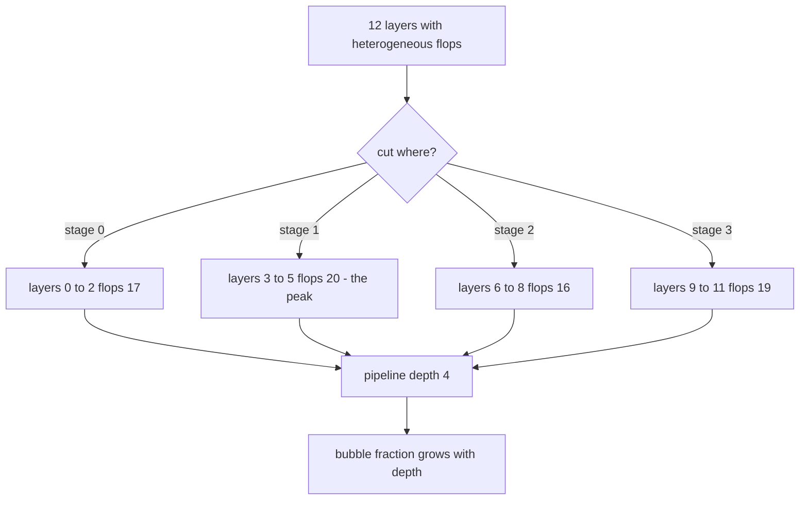
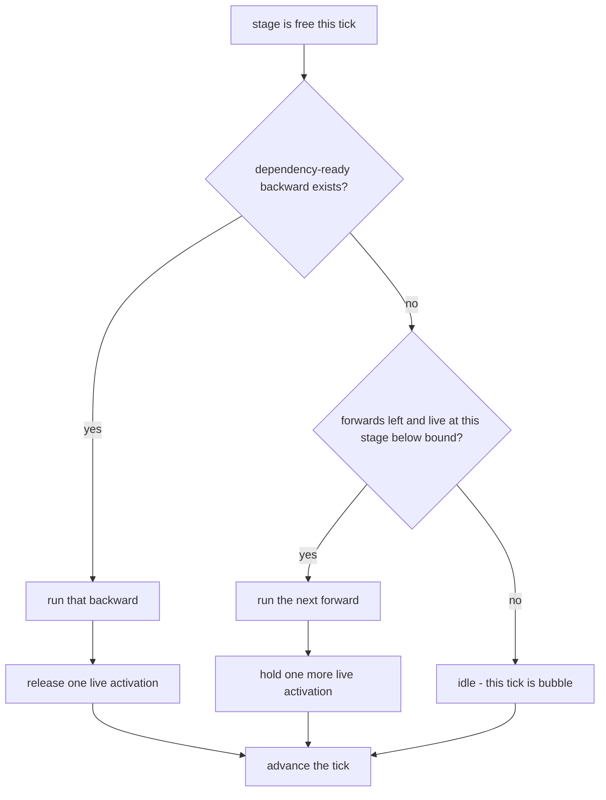
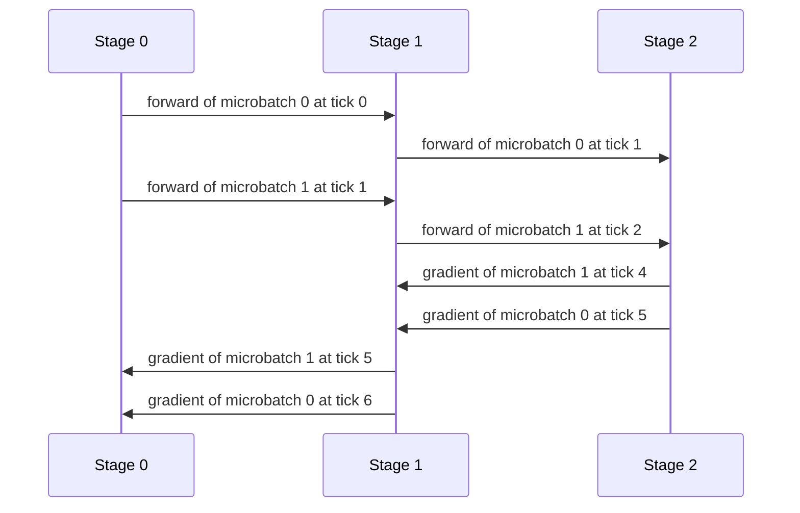

# 818 — Implement model parallel training partitioner and pipeline parallel executor.

> **Tier:** Master · **CTCI chapter:** Beyond — Machine Learning & AI
> **Task spec:** [818-implement-model-parallel-training-partitioner-and-pipeline-paral.md](../../../tasks/master/818-implement-model-parallel-training-partitioner-and-pipeline-paral.md)
> **Solutions:** [Python](../../../solutions/python/master/818-implement-model-parallel-training-partitioner-and-pipeline-paral/solution.py) ·
> [Java](../../../solutions/java/master/818-implement-model-parallel-training-partitioner-and-pipeline-paral/Solution.java) ·
> [JavaScript](../../../solutions/javascript/master/818-implement-model-parallel-training-partitioner-and-pipeline-paral/solution.js) ·
> [C#](../../../solutions/csharp/master/818-implement-model-parallel-training-partitioner-and-pipeline-paral/Solution.cs)

## 1. Problem restatement

**Input.** A layered model as an ordered list of `Layer(name, flops, activation_mb, param_mb, weight,
bias)`, a stage count `P`, an optional device `memory_limit`, and a microbatch count `m`.

**Output.** Two objects:

1. `partition_stages(layers, P, memory_limit)` → `P` contiguous `(start, end)` half-open ranges that cover
   every layer exactly once and minimise the **heaviest** stage's `flops`, subject to
   `params + activations <= memory_limit` per stage.
2. `run_pipeline(P, m, policy)` → a tick-by-tick schedule of `forward` and `backward` tasks per stage,
   with `makespan`, `bubble`, the per-stage peak activation count and the finish time of every
   `(stage, kind, microbatch)` task.

**Constraints.**

1. Contiguity: stage `p`'s range ends exactly where stage `p + 1`'s begins; no stage is empty.
2. Optimality: "the lightest possible heaviest stage" is *measured*, not asserted — the dynamic program
   must reproduce brute-force enumeration of every composition.
3. Feasibility: a model that cannot fit the memory limit, `P > L` layers, or `P = 0` must raise rather
   than silently over-commit a device.
4. Schedule validity: one task per stage per tick, every dependency finished strictly earlier, and every
   `(stage, kind, microbatch)` task runs exactly once.
5. Memory hierarchy: GPipe holds exactly `m` live activations per stage; 1F1B holds at most `min(m, P)`
   and strictly fewer whenever `m > P` — at no cost in makespan.

**Concrete behaviour asserted by the shipped Python run.**

| Scenario | Expected result |
| --- | --- |
| `sample_layers(12)` into 4 stages | ranges `(0,3) (3,6) (6,9) (9,12)`, stage flops `17, 20, 16, 19`, heaviest `20` against an average of `18.0` |
| `sample_layers(6)` into 3 stages | ranges `(0,2) (2,4) (4,6)`, flops `11, 10, 16`; brute force agrees on the peak `16` |
| `(P, m)` in `(1,4) (2,3) (3,5) (4,8) (4,3) (6,2)`, both policies | `makespan == 2 · (m + P - 1)` and `bubble == (P - 1) / (m + P - 1)` |
| `(P, m) = (4, 8)` | GPipe peak `8`, 1F1B peak `<= min(8, 4) = 4`, same makespan |
| 3 layers, 5 microbatches as one batch or split in halves | pipelined loss and accumulated gradients equal the closed form exactly |

The layers themselves are deterministic: `sample_layers(count)` sets `flops = 3 + (index · 5) mod 7`,
`activation_mb = 2 + index mod 3`, `param_mb = 1 + (index · 3) mod 5`, with exact `Fraction` weights. The
heterogeneity is deliberate — layers of cost 3 and cost 9 in the same chain are what make an even split of
layer *counts* the wrong answer.

## 2. Intuition

**Naive partition.** Give every stage `L / P` layers. On the 12-layer sample that is 3 layers each, and the
three-layer groups cost `3+8+6 = 17`, `4+9+7 = 20`, `5+3+8 = 16`, `6+4+9 = 19` — the heaviest stage gates the
whole pipeline, so the average (`18.0`) is irrelevant and the peak (`20`) is the number that matters. A
greedy balancer that fills each stage until it crosses the average is a heuristic; the solutions do not
trust it, they run the exact dynamic program and then *compare the answer against exhaustive enumeration*.

**Naive pipeline.** Run one microbatch end to end through all stages, then the next: at any instant only one
stage works and `P - 1` devices idle. Feeding microbatches instead means stage `p` works on microbatch `k`
while stage `p + 1` works on microbatch `k - 1` — the fill-and-drain shape whose length is the classical
`2 · (m + P - 1)` ticks, of which `(P - 1) / (m + P - 1)` are bubble.

The unifying insight is that both halves are *the same shape*: a chain of dependent units with per-unit
costs. Partitioning decides where to cut the chain; pipelining decides in what order to walk the cut chain.
Both are answered by making the dependency structure explicit — prefix sums for the partition, an explicit
`F(s, k) ← F(s-1, k)`, `B(s, k) ← F(s, k)`, `B(s, k) ← B(s+1, k)` graph for the executor — and then letting a
generic search (a DP, a greedy tick loop) run over it.



## 3. Algorithm

**Part A — the partitioner.** `best[k][p]` is the smallest achievable heaviest-stage load when the first
`k` layers are spread over `p` stages, and `choice[k][p]` remembers the cut that achieved it.

1. Build prefix sums for `flops`, `param_mb` and `activation_mb` so a range workload is one subtraction.
2. Initialise `best[0][0] = 0` and everything else to infinity.
3. For every `end` from 1 to `L`, every `stage` from 1 to `P`, and every `start` from `stage - 1` to
   `end - 1`: skip the transition when the prefix is unreachable or when the range
   `[start, end)` violates the memory limit; otherwise relax
   `candidate = max(best[start][stage - 1], flops[end] - flops[start])`.
4. If `best[L][P]` is infinite, no feasible partition exists: raise.
5. Walk `choice` backwards to recover the ranges and return them in forward order.

```text
function partition_stages(layers, stages, memory_limit)
    count ← length(layers)
    if stages < 1 then raise
    if stages > count then raise
    build prefix sums flops, params, acts of length count + 1
    best[0][0] ← 0, every other best entry ← infinity
    for end ← 1 to count do
        for stage ← 1 to stages do
            for start ← stage - 1 to end - 1 do
                if best[start][stage - 1] is infinity then continue
                if memory_limit is set and the range memory exceeds it then continue
                candidate ← max(best[start][stage - 1], flops[end] - flops[start])
                if candidate < best[end][stage] then
                    best[end][stage] ← candidate
                    choice[end][stage] ← start
                end
            end
        end
    end
    if best[count][stages] is infinity then raise "no feasible partition"
    walk choice backwards from (count, stages) collecting the ranges
    return the ranges in forward order
end
```

The recurrence is the classic "minimise the maximum segment sum" DP with one extra gate: the memory test
`feasible(start, end)`, which is why a three-layer stage of cheap layers can still be rejected on a small
device.

**Part B — the executor.** One tick is one scheduling opportunity; a stage is a serial host that runs at
most one task per tick, and a task starts only when its stage is free *and* every dependency finished in an
earlier tick.

1. Build the dependency graph: `F(s, k)` depends on `F(s-1, k)`; `B(s, k)` depends on `F(s, k)` and
   `B(s+1, k)`.
2. Keep per-stage counters: `next_forward`, `next_backward`, the `busy_until` tick, the set of started
   tasks and the set of live `(stage, microbatch)` activations.
3. Each tick, for every free stage, apply the policy's greedy rule to pick at most one ready task.
4. Record `finish = tick + 1`, mark the stage busy until then, append an event, and update the live
   activation set (a forward adds one, a backward removes one).
5. Track the peak over time; stop when all `2 · P · m` tasks have finished.

```text
function run_pipeline(stages, microbatches, policy)
    graph ← dependency graph of forwards and backwards
    busy_until, next_forward ← zeroed per stage
    next_backward ← microbatches - 1 per stage
    started, live ← empty sets
    in_flight ← min(microbatches, stages)
    tick ← 0
    while not every task finished do
        for stage ← 0 to stages - 1 do
            if busy_until[stage] > tick then continue
            forward_key ← (stage, "F", next_forward[stage])
            if policy = "gpipe" then
                choose forward_key when its dependencies finished and the forward budget is left
                otherwise choose the backward task next_backward[stage] when it is ready
            otherwise
                choose the lowest-numbered ready backward that has not started
                otherwise choose the next ready forward while live activations on this stage < in_flight
            end
            if nothing was chosen then continue
            start the task, finish it at tick + 1 and add or remove its live activation
        end
        peak ← max(peak, live activations on the busiest stage)
        tick ← tick + 1
    end
    makespan ← max finish time; bubble ← 1 - task count / (stages · makespan)
    return events, finish, makespan, bubble, peak
end
```

The two policies differ *only* in that choice and only GPipe's rule is "all forwards, then backwards from
the last microbatch backwards". That is what makes their makespan identical while their peak memory
differs: 1F1B's in-flight cap of `min(m, P)` per stage is the memory rule, and it never delays a
dependency because a ready backward always wins over the next forward.



**Documented deviations across the four solutions.** Java adds a greedy balancer next to the DP and the
brute-force oracle to show the DP is never worse, and uses integer vectors so gradient equality is exact.
JavaScript makes a task occupy its stage for as many ticks as that stage has layers and gives 1F1B an
explicit warm-up of `P - 1 - p` forwards per stage. C# implements 1F1B only, charging each action the
group's `groupFlops` ticks and enforcing the in-flight bound as "partition `p` may not start a forward
while it already holds more than `P - p` forwarded-but-not-backwarded microbatches". The Python file
traced here is the version where a stage costs exactly one tick per task, which is what makes the closed
forms `2 · (m + P - 1)` and `(P - 1) / (m + P - 1)` hold exactly.

## 4. Worked example

**Part A.** `sample_layers(12)` has flops `3 8 6 4 9 7 5 3 8 6 4 9` (total 72). Prefix sums are
`0 3 11 17 21 30 37 42 45 53 59 63 72`.

| Stage | Range | Layers | Flops | Why the DP keeps it |
| --- | --- | --- | --- | --- |
| 0 | `[0, 3)` | 0, 1, 2 | 17 | taking `[0, 4)` would be 21 and set a peak the DP can beat |
| 1 | `[3, 6)` | 3, 4, 5 | 20 | becomes the peak; `[3, 5)` costs 13 but pushes 7 into stage 2 |
| 2 | `[6, 9)` | 6, 7, 8 | 16 | the cheap valley, absorbs the remaining cheap layers |
| 3 | `[9, 12)` | 9, 10, 11 | 19 | 19 keeps stage 1's 20 as the only peak |

A peak of 19 is impossible: with four stages the best case would need every grouping to stay at or below
19, but from prefix 17 the next plausible cuts are 21 (cost 4) and 30 (cost 13), and the remaining 51 or 42
flops cannot be split into three or two groups of at most 19. Brute force confirms the optimum, and the DP
is checked against it on five more shapes.

**Part B.** `run_pipeline(3, 2, "gpipe")` — three stages, two microbatches. Every stage costs one tick, so
the schedule is the fill-and-drain shape, verified directly from the emitted events:

| Tick | Stage 0 | Stage 1 | Stage 2 | Live pairs |
| --- | --- | --- | --- | --- |
| 0 | `F0` | idle | idle | `(0,0)` |
| 1 | `F1` | `F0` | idle | `(0,0) (0,1) (1,0)` |
| 2 | idle | `F1` | `F0` | `(0,1) (1,0) (1,1) (2,0)` |
| 3 | idle | idle | `F1` | 4 pairs — the peak `m = 2` per stage |
| 4 | idle | idle | `B1` | 3 pairs |
| 5 | idle | `B1` | `B0` | 2 pairs |
| 6 | `B1` | `B0` | idle | 1 pair |
| 7 | `B0` | idle | idle | empty |

`makespan = 8 = 2 · (2 + 3 - 1)`, and `bubble = 1 - 12 / (3 · 8) = 0.5 = (3 - 1) / (2 + 3 - 1)`. The
`12` is `2 · P · m`: six forwards plus six backwards, each exactly one tick. Note that stages are busy on
6 of 8 ticks — the two idle ticks per stage are the pipeline bubble that no scheduling rule can remove.



For `m = 2` and `P = 3` the two policies coincide on memory (`min(m, P) = 2 = m`), which is exactly why the
file only claims a strict 1F1B win when `m > P` — with `P = 4, m = 8`, GPipe peaks at 8 live activations per
stage while 1F1B stays at or below 4, at the same makespan.

## 5. Complexity

Let `L` be the layer count, `P` the stage count, `m` the microbatch count.

| Measure | Bound | Why it holds |
| --- | --- | --- |
| Partition, time | O(L² · P) | three nested loops over `end`, `stage`, `start`; the memory test is O(1) thanks to prefix sums |
| Partition, space | O(L · P) | the `best` and `choice` tables |
| Brute force oracle | O(C(L - 1, P - 1) · P) | every composition of `L` into `P` contiguous groups is enumerated; `_compositions(6, 3)` yields `10` = `C(5, 2)` |
| Pipeline, time | O(P · m) ticks in the loop, O(P · m) tasks | `2 · P · m` tasks of one tick each, with at most `P` candidate scans per tick |
| Pipeline, makespan | 2 · (m + P - 1) | fill takes `m + P - 1` ticks, drain takes the same |
| Pipeline, bubble | (P - 1) / (m + P - 1) | closed form measured for six `(P, m)` pairs and both policies |
| Activation memory | GPipe `m` per stage, 1F1B `min(m, P)` | measured peaks: GPipe equals `m` exactly; 1F1B is strictly smaller whenever `m > P` |

The asymptotics say the interesting trade is `m` versus `P`: the bubble shrinks like `(P - 1) / m`, so more
microbatches hide a deeper pipeline, while 1F1B keeps the activation bill at `min(m, P)` instead of `m`. The
executor's own cost — building the dependency graph — is O(P · m) and is not the bottleneck.

## 6. Pitfalls and edge cases

- **`P > L`.** Rejected with a `ValueError`: with more stages than layers some stage would be empty, and an
  empty stage is a stage that can never hold work.
- **`P = 0`.** Rejected before any table is allocated, so the failure is a clear message rather than an
  index error.
- **Infeasible memory.** `memory_limit = biggest_layer_memory - 1` cannot fit the largest single layer, so
  no partition exists and the code raises instead of quietly returning an over-committing cut.
- **Equal layer costs.** The DP's `<` when relaxing keeps the first cut found, which makes the result
  deterministic; the shipped checks assert that two calls return identical ranges.
- **`P = 1`.** No pipeline depth, no bubble: `bubble == 0.0` and the makespan collapses to `2 · m`.
- **`m = 1`.** Bubble is `(P - 1) / P` — the worst case, and the reason the file asserts bubble `< 1.0`.
- **`m > P` is required for a 1F1B memory win.** With `m <= P` both schedules hold the same number of live
  activations, so claiming a memory improvement there would be wrong.
- **Dependencies must finish *strictly* earlier.** The tick loop requires `finish[dependency] <= tick` for a
  task starting at `tick + 1`; allowing equality would overlap two tasks on one stage.
- **Empty or degenerate stage ranges.** Every range must satisfy `start < end`, which the shipped run checks
  for six shapes including `(5, 5)` and `(7, 1)`.
- **Numeric exactness.** The Python, Java, JavaScript and C# files all use exact rational or integer
  arithmetic precisely so the pipelined gradient can be compared with the closed-form gradient without a
  tolerance; a float version could only compare within an epsilon.
- **Simplifications kept honest.** A stage costs one tick per task regardless of real FLOPs; inter-stage
  communication is free (no bandwidth model); there is no activation recomputation, no virtual or
  interleaved stages, no real device and no threads.

## 7. Variants and follow-ups

- **Trade compute for memory.** Activation checkpointing recomputes instead of storing, which changes the
  live-activation bound 1F1B fights: see
  [819-implement-memory-efficient-checkpointing-for-massive-models-bloc.md](../../../tasks/master/819-implement-memory-efficient-checkpointing-for-massive-models-bloc.md).
- **Shrink the activations themselves.** Mixed precision halves the bytes per live activation, a different
  lever on the same memory budget: see
  [826-implement-automatic-mixed-precision-training-full-pipeline-with.md](../../../tasks/master/826-implement-automatic-mixed-precision-training-full-pipeline-with.md).
- **Cut the gradient traffic between stages.** The pipeline here assumes free communication; compressing
  gradients is what makes the assumption closer to true — see
  [934-implement-distributed-gradient-compression-with-error-correction.md](../../../tasks/master/934-implement-distributed-gradient-compression-with-error-correction.md).
- **Put the pipeline inside a training system.** Fault tolerance, elastic membership and checkpoint/resume
  are the system-level counterpart of this executor — see
  [816-implement-distributed-training-system-with-fault-tolerant-all-re.md](../../../tasks/master/816-implement-distributed-training-system-with-fault-tolerant-all-re.md).

## 8. Check yourself

1. Why is "evenly split the layer count" not optimal on the 12-layer sample?

<details><summary>Show answer</summary>

Because layer costs are heterogeneous (`3 + (index · 5) mod 7`, so 3 to 9) and the pipeline is gated by the
*heaviest* stage, not the total. An even split into 3-layer groups gives 17, 20, 16, 19 — peak 20 — while
the average is 18: the extra 2 flops of the second stage are what the whole pipeline waits on. The DP is
free to give a stage fewer or cheaper layers to pull the peak down.

</details>

2. The DP and brute force agree. Why keep both?

<details><summary>Show answer</summary>

Because "optimal" is otherwise an assertion about the code. Brute force enumerates every composition
(`_compositions(6, 3)` yields `C(5, 2) = 10` of them) and is obviously correct but exponential; the DP is
polynomial but its recurrence can be wrong. Running both on five small shapes turns the claim "the DP is
optimal" into a measured equality, which is the same trick the pipeline executor uses for its makespan and
bubble closed forms.

</details>

3. Both policies give `makespan = 8` for `P = 3, m = 2`. What is actually different?

<details><summary>Show answer</summary>

Only the greedy rule for choosing a task on a free stage: GPipe runs all forwards and then backwards from the
last microbatch backwards, while 1F1B prefers a dependency-ready backward and caps the in-flight forwards per
stage at `min(m, P)`. The task graph and the total work are identical, so the fill-and-drain length is
identical; what changes is how many activations must be alive at once. Here `min(2, 3) = 2 = m`, so even the
memory is identical — the measured 1F1B win needs `m > P`.

</details>

4. Where does `bubble = 0.5` come from for this trace?

<details><summary>Show answer</summary>

`bubble = 1 - tasks / (stages · makespan) = 1 - 12 / (3 · 8) = 0.5`, since each of the 6 forwards and 6
backwards occupies one stage-tick. Equivalently `(P - 1) / (m + P - 1) = 2 / 4 = 0.5`: two ticks of a
four-tick forward chain are fill, and the drain mirrors it. A deeper pipeline with the same batch count makes
it worse; more microbatches make it better.

</details>

5. Why does the partitioner treat the memory limit as a hard gate rather than a cost?

<details><summary>Show answer</summary>

Because a stage whose parameters plus activations exceed the device memory cannot run at all — it is not a
slower option, it is an infeasible one. Hence `feasible(start, end)` filters transitions out of the DP
entirely, and a limit smaller than the largest single layer makes `best[L][P]` infinite so the function
raises instead of returning a partition that would over-commit a device.

</details>
