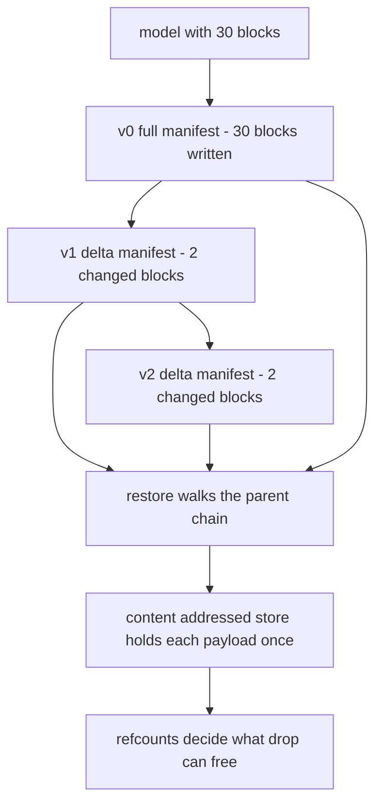
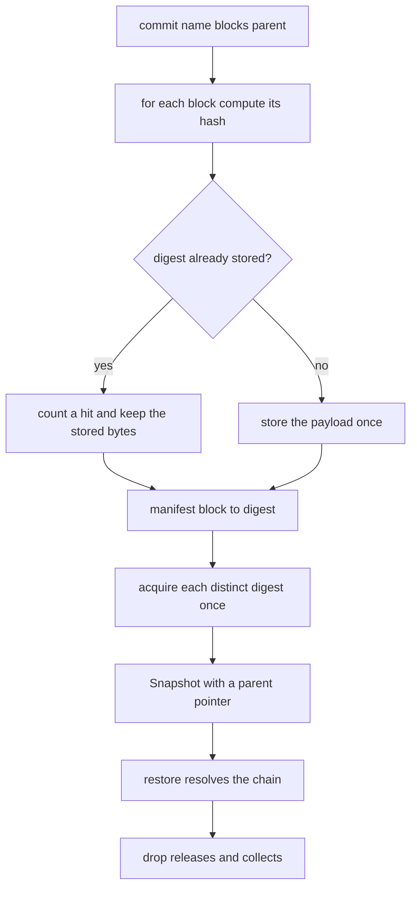
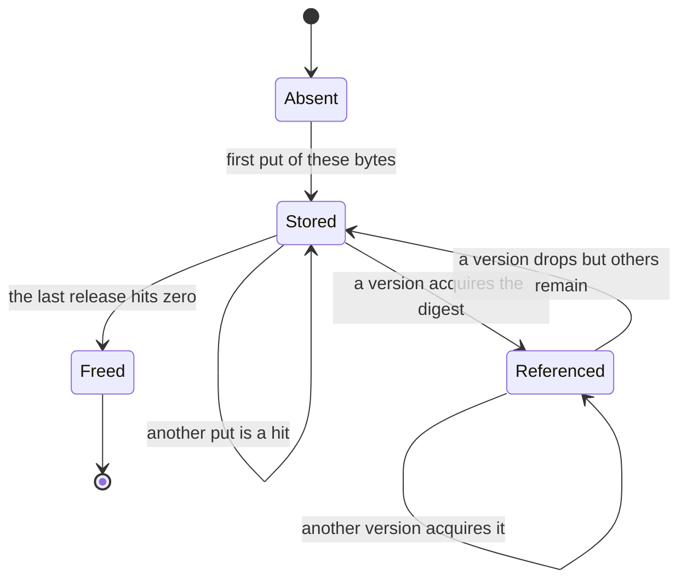
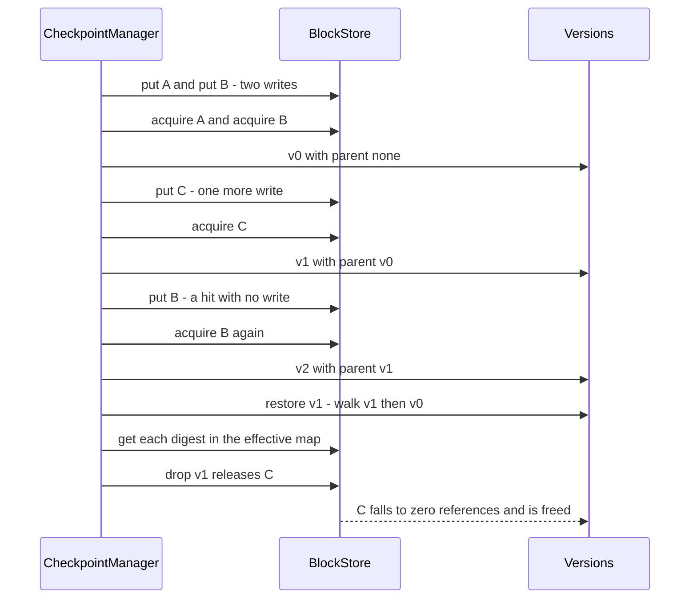

# 819 — Implement memory-efficient checkpointing for massive models (block-level dedup).

> **Tier:** Master · **CTCI chapter:** Beyond — Machine Learning & AI
> **Task spec:** [819-implement-memory-efficient-checkpointing-for-massive-models-bloc.md](../../../tasks/master/819-implement-memory-efficient-checkpointing-for-massive-models-bloc.md)
> **Solutions:** [Python](../../../solutions/python/master/819-implement-memory-efficient-checkpointing-for-massive-models-bloc/solution.py) ·
> [Java](../../../solutions/java/master/819-implement-memory-efficient-checkpointing-for-massive-models-bloc/Solution.java) ·
> [JavaScript](../../../solutions/javascript/master/819-implement-memory-efficient-checkpointing-for-massive-models-bloc/solution.js) ·
> [C#](../../../solutions/csharp/master/819-implement-memory-efficient-checkpointing-for-massive-models-bloc/Solution.cs)

## 1. Problem restatement

**Input.** A *checkpoint version* is a name plus a map from block name (for example `block07`) to a
*payload* — in these files a tuple of bytes, standing in for a tensor — and an optional `parent` version.
A training-like workload produces a chain of versions: the first writes the whole model, each later one
rewrites a few blocks and inherits the rest.

**Output.** A checkpoint store with four observable answers:

| Operation | Contract |
| --- | --- |
| `commit(name, blocks, parent)` | write the given blocks, return a `Snapshot` whose manifest maps block name → payload hash, inheriting everything else from `parent` |
| `restore(snapshot)` | the *effective* block map, rebuilt by walking the parent chain, with every payload verified against its hash |
| `drop(snapshot)` | release the version's own references and physically free the payloads whose refcount reached zero |
| `physical_bytes()` / `ratio()` | what is actually stored, and the total logical bytes of all live versions divided by it |

**Constraints.**

1. **Content addressing.** The same payload always maps to the same digest; one changed byte changes it.
2. **Write once.** `put` is idempotent: a payload is written the first time only, and re-putting it is a hit.
3. **Read integrity.** `get` re-hashes what it hands back, so a corrupted payload raises instead of being
   silently returned.
4. **Refcount-exact collection.** `drop` frees exactly the payloads no live version references, and never
   frees a payload another live version still needs.
5. **Restore fidelity.** Every version restores byte-identically to a hashing-free reference model built
   with plain dictionaries.

**Concrete behaviour asserted by the shipped Python run.**

| Scenario | Expected result |
| --- | --- |
| 200 versions × 50 blocks, seed-driven, `update_fraction = 8` | `1191` distinct blocks stored in `19056` bytes, dedup ratio `8.4x` |
| Reuse-heavy 40 version × 30 block workload | store block count and bytes equal the oracle's distinct payloads; ratio `> 5.0` (measured `8.63x`) |
| All-distinct workload | ratio exactly `1.0x` — nothing to dedup |
| Same delta at fine vs coarse granularity | `4` bytes stored versus `8` |
| 400 random 6-byte payloads | no hash collision; an out-of-range byte in a payload is rejected |
| `drop` of a shared owner | the shared block survives, the unshared one is freed, refcounts match the oracle |

## 2. Intuition

The naive checkpoint service writes the whole model every epoch. With `V` versions and a model of `N`
blocks of `k` bytes that is `V · N · k` bytes; on the 40-version fixture with 30 blocks of 8 bytes it is
`9600` bytes of logical state, and on the 200-version fixture far more. Two facts about training
checkpoints kill almost all of that waste:

- **Versions are mostly identical to their predecessors.** A step touches a small fraction of the
  parameters, so a version should record only what changed and *inherit* the rest — a delta manifest.
- **Blocks are already duplicated inside a model.** Tied embeddings, repeated initialisation and
  unchanged layers mean the same bytes appear under many names, in the same or different versions.

The key insight is to make storage *content addressed*: name a payload by the hash of its bytes instead of
by where it lives. Then both sources of duplication collapse into one mechanism — the second commit of the
same bytes is a no-op write plus a hit counter — and the only bookkeeping left is *who still needs this
payload*, which is exactly a refcount.



There is a second, subtler payoff: `restore` no longer needs to trust the version's own manifest to be
complete. A version is a *parent pointer plus a diff*, and the full map is derived by walking that chain —
which is why the shipped check compares every restore against an independent plain-dictionary model.

## 3. Algorithm

**Storage layer (`BlockStore`).**

1. `put(payload)`: compute `digest = block_hash(payload)`; if the digest is known, assert the stored bytes
   are equal (a collision would otherwise be silent) and count a hit; otherwise store once, count a write
   and add the payload length to `bytes_written`.
2. `get(digest)`: raise if the digest is unknown; re-`block_hash` the stored payload and raise if it does
   not match — tamper detection.
3. `acquire(digest)` / `release(digest)`: increment, or decrement and delete the payload when the count
   falls to zero; releasing a payload that was never referenced is an error.

**Version layer (`Snapshot`, `CheckpointManager`).**

4. `commit` writes every block it is given, records the manifest, then `acquire`s each *distinct* digest in
   that manifest once — a version that mentions the same payload under two names holds one reference.
5. `Snapshot.resolve` walks the parent chain to the root, then applies the manifests root-first so a child
   overrides its parent, and finally `get`s every payload so the returned map is verified.
6. `drop` releases each of the version's own digests, returns the ones that were actually freed, and
   removes the version from the live list — a dropped version can no longer be dropped again.

```text
function block_hash(payload)
    h ← length(payload) · 0x9E3779B97F4A7C15 + 0xA5A5A5A5
    for byte in payload do
        if byte is outside 0 to 255 then raise
        h, mixed ← splitmix64(h xor byte)
        h ← h + mixed
    end
    return h as 16 hexadecimal digits
end

method put(payload)
    digest ← block_hash(payload)
    if digest is stored then
        if stored bytes differ from payload then raise a collision
        count a hit
    else
        store payload, count a write, add length(payload) to bytes written
    end
    return digest
end

method commit(name, blocks, parent)
    manifest ← empty map
    for block in sorted(blocks) do
        manifest[block] ← put(blocks[block])
    end
    for digest in the distinct digests of manifest do
        acquire(digest)
    end
    version ← Snapshot(name, manifest, parent)
    append version to the live versions
    return version
end

method resolve(snapshot, store)
    chain ← the snapshot followed by every ancestor up to the root
    effective ← empty map
    for node in reverse order of chain do
        for block and digest in node.manifest do
            effective[block] ← digest
        end
    end
    return a map from block to the verified payload for each entry in effective
end

method drop(snapshot)
    freed ← empty list
    for digest in the distinct digests of snapshot.manifest do
        if release(digest) then append digest to freed
    end
    remove snapshot from the live versions
    return freed
end
```

`release` returning "was this the last reference" is what makes collection exact; without it `drop` could
only guess, and guessing either leaks bytes or corrupts a live version.



The payload life cycle, seen as a small state machine, is the same story told from the bytes' point of
view:



## 4. Worked example

Three versions over a two-block model, traced on the real hashing code. Payloads: `A = (1, 2, 3)`,
`B = (1, 2, 4)`, `C = (9, 9, 9)`.

| Step | Call | Store action | Stored digests | Refcounts |
| --- | --- | --- | --- | --- |
| 1 | `commit("v0", {block0: A, block1: B})` | `put(A)` new, `put(B)` new | `875d78be854d0201`, `5aec6e684e5fd413` | `A:1 B:1` |
| 2 | `commit("v1", {block1: C}, v0)` | `put(C)` new | adds `45f23fa90fdc8a3a` | `A:1 B:1 C:1` |
| 3 | `commit("v2", {block1: B}, v1)` | `put(B)` is a **hit** — zero new bytes | unchanged | `A:1 B:2 C:1` |
| 4 | `restore(v1)` | resolve `v1 → v0`, `v0` first, then `v1` | — | returns `{block0: (1,2,3), block1: (9,9,9)}` |
| 5 | `drop(v1)` | release `C` only (its own manifest) | removes `45f23fa90fdc8a3a` | `A:1 B:2` |
| 6 | `restore(v0)` | unchanged and still valid | — | returns `{block0: (1,2,3), block1: (1,2,4)}` |

Three versions, six block references, but only three payloads of three bytes are ever stored: `physical_bytes
= 9`, `writes = 3`, `hits = 1`. Step 5 is the interesting one — `v1` introduced `C`, and only `v1` held it, so
dropping `v1` frees exactly `C` while `B` survives on two references and `A` on one. The measured ratio after
the drop is `2.0` (six logical bytes of live versions over three physical bytes).



The same shape at scale is what the shipped run measures: 200 versions of a 50-block model store `1191`
distinct payloads in `19056` bytes for a ratio of `8.4x`. The ratio is not a magic constant — it is
`total logical bytes of live versions / distinct bytes stored`, and it grows with the update fraction, which
is why the all-distinct workload reports exactly `1.0x`.

## 5. Complexity

Let `B` be blocks per version, `k` bytes per block, `V` live versions and `D` the depth of a version's
parent chain.

| Measure | Bound | Why it holds |
| --- | --- | --- |
| `block_hash` | O(k) time, O(k) to pass the payload | one splitmix64 fold step per byte, with a range check |
| `put` / `get` | O(k) time | hashing dominates; the dict hit is O(1) expected |
| `commit` | O(B · k + B log B) | hash every given block, then sort the names and the distinct digests |
| `resolve` | O(D + B) plus O(B · k) for verification | one pass per ancestor to build the effective map, then one `get` per block |
| `drop` | O(B log B) | sort the version's own digests and decrement each refcount |
| Space | O(Σ distinct payload bytes + Σ manifest entries) | one copy per distinct payload, one name→digest entry per block per version |
| Naive full checkpoints | `V · B · k` bytes | every version stores the whole model, so nothing is shared |

The trade is storage for CPU: `resolve` re-derives the full map from the chain instead of reading a
materialised copy, so a restore costs `O(D + B)` map work — cheap next to reading the payloads, and it is
what allows `commit` to write a handful of blocks instead of all of them.

Measured on the shipped workloads: the average delta manifest in the 40-version run is under `6` blocks out
of `30` (asserted), and the finer-granularity fixture stores `4` bytes where the coarse one stores `8` for
the same logical update.

## 6. Pitfalls and edge cases

- **Empty and zero-length payloads.** `block_hash(())` is stable and a zero-length payload stores fine, but
  it contributes `0` to `physical_bytes`, so a byte-count-only health check can miss it. A version with no
  blocks at all restores to an empty map and is still droppable.
- **Out-of-range bytes.** `block_hash((256,))` raises: a payload element must be a byte. Silently masking
  would make two different payloads hash the same.
- **Hash collisions.** The 64-bit fold is a toy hash, so the checks explicitly measure that 400 random
  6-byte payloads produce 400 distinct digests. `put` also asserts that a digest collision would have equal
  bytes, and `get` re-hashes, so a real collision surfaces as an error rather than as wrong data.
- **Corrupted payload.** Overwriting a stored payload so it no longer matches its digest makes `get` raise;
  restoring a version that needs a missing block raises `BlockStoreError` instead of returning a short map.
- **Releasing something you never referenced.** `release` asserts on an unknown digest — a double drop of the
  same version is caught by the `only a live version can be dropped` check.
- **Reference counting the wrong thing.** References are acquired per *distinct digest in the version's own
  manifest*, not per block. A version that maps `block01` and `block02` to the same payload holds one
  reference to it, and dropping that version frees it if nobody else holds it.
- **Shared payloads must survive.** The garbage-collection fixture constructs a payload owned by two
  versions, drops one owner, and asserts the payload is still live with the oracle's refcount and that the
  other version still restores.
- **Dropped is not deleted.** A dropped snapshot stays in the manager's `dropped` list for the audit, but it
  is no longer restorable in the sense that dropping it again is an error.
- **Granularity is a policy, not a detail.** Small blocks dedup better for localised updates (`fine = 4`
  bytes versus `coarse = 8` in the fixture) at the cost of more manifest entries; there is no universally
  optimal block size.
- **Determinism.** Every version, block name and mutation comes from the fixed-seed splitmix64 stream, and
  manifests are built from sorted block names, so two runs produce identical stores.
- **Simplifications kept honest.** Payloads are small integer tuples, the hash is a 64-bit fold rather than a
  cryptographic content hash, storage is one process's dictionaries, and there is no compression, no sharded
  store, no concurrent writer and no remote read path.

## 7. Variants and follow-ups

- **Checkpoint the activations of a pipeline instead of parameters.** The same delta idea applies to live
  activations, which is the memory lever the partitioner of
  [818-implement-model-parallel-training-partitioner-and-pipeline-paral.md](../../../tasks/master/818-implement-model-parallel-training-partitioner-and-pipeline-paral.md)
  balances against pipeline depth.
- **Resume a computation, not just a model.** Operator-level checkpointing needs exactly the manifest and
  refcount machinery here, plus stream offsets — see
  [936-implement-transparent-operator-checkpointing-and-resume-in-compu.md](../../../tasks/master/936-implement-transparent-operator-checkpointing-and-resume-in-compu.md).
- **Track which experiment produced which bytes.** A registry is a content-addressed store with provenance
  and lineage on top — see
  [871-implement-reproducible-ml-experiments-registry-with-artifact-pro.md](../../../tasks/master/871-implement-reproducible-ml-experiments-registry-with-artifact-pro.md).
- **Write the same bytes in half the space.** Quantising the payload before hashing changes the dedup ratio
  and the restore semantics, which is one reason the two levers live in different tasks — see
  [826-implement-automatic-mixed-precision-training-full-pipeline-with.md](../../../tasks/master/826-implement-automatic-mixed-precision-training-full-pipeline-with.md).

## 8. Check yourself

1. Why is a version a *parent pointer plus a diff* instead of a full manifest?

<details><summary>Show answer</summary>

Because consecutive training checkpoints differ in a tiny fraction of blocks. Writing only the changed blocks
costs a handful of hashes and writes per version (under `6` of `30` blocks on average in the fixture) instead
of the whole model, and `resolve` reconstructs the complete map by applying the manifests root-first along
the chain, so the delta and the full checkpoint restore to exactly the same thing.

</details>

2. The store holds one payload per distinct hash. How does `drop` know it may physically free one?

<details><summary>Show answer</summary>

Every version acquires one reference per *distinct digest in its own manifest*. `release` decrements the
counter and returns `True` only when it reaches zero, which is the definition of "no live version references
these bytes". A version that mentions the same payload twice therefore holds a single reference, and a shared
payload survives the drop of one of its owners — both properties the checks compare against a hashing-free
oracle.

</details>

3. Why does `get` re-hash the payload it is about to return?

<details><summary>Show answer</summary>

Because content addressing only means something if the content still matches its name. If a payload is
corrupted in place, returning it would hand a caller silently wrong bytes. Re-hashing costs one pass over the
block and turns corruption and a mismatched digest into `BlockStoreError`, which the fixture asserts by
corrupting a payload and by asking for a block that is not there.

</details>

4. The all-distinct workload reports a ratio of exactly `1.0x`. Is that a bug?

<details><summary>Show answer</summary>

No — it is the honest lower bound. When no two payloads are equal, dedup has nothing to collapse, so the
distinct bytes equal the logical bytes. It is checked precisely because a dedup implementation that
"improves" storage even with no duplicates would be double counting.

</details>

5. What changes if the block size is halved?

<details><summary>Show answer</summary>

Manifests grow (more entries per version) while each update touches a smaller fraction of the model, so the
dedup ratio improves on localised updates: the granularity fixture stores `4` bytes with fine blocks versus
`8` with coarse ones for the same logical delta. It is a trade-off rather than a free win, which is why the
file measures both instead of recommending one.

</details>
