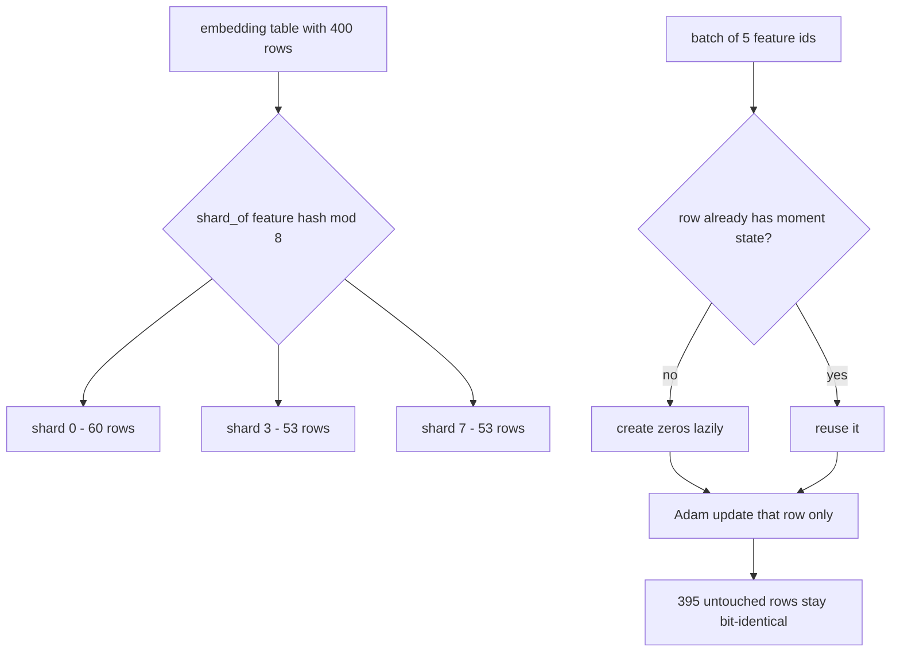
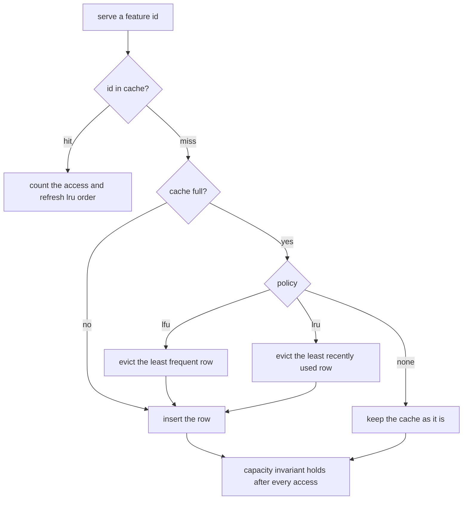
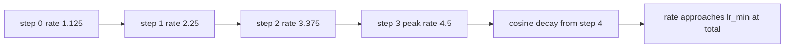

# 820 — Implement sparse-embedding table sharding and warm-up strategies for recommender systems.

> **Tier:** Master · **CTCI chapter:** Beyond — Machine Learning & AI
> **Task spec:** [820-implement-sparse-embedding-table-sharding-and-warm-up-strategies.md](../../../tasks/master/820-implement-sparse-embedding-table-sharding-and-warm-up-strategies.md)
> **Solutions:** [Python](../../../solutions/python/master/820-implement-sparse-embedding-table-sharding-and-warm-up-strategies/solution.py) ·
> [Java](../../../solutions/java/master/820-implement-sparse-embedding-table-sharding-and-warm-up-strategies/Solution.java) ·
> [JavaScript](../../../solutions/javascript/master/820-implement-sparse-embedding-table-sharding-and-warm-up-strategies/solution.js) ·
> [C#](../../../solutions/csharp/master/820-implement-sparse-embedding-table-sharding-and-warm-up-strategies/Solution.cs)

## 1. Problem restatement

**Input.** An embedding table of `FEATURES = 400` rows of `DIM = 6` floats split over `SHARDS = 8` shards; a
batch of feature ids (5 distinct rows in the shipped fixture) with a target vector per row; a training
schedule described by `(total, warmup, lr_max, lr_min)`; and a serving traffic stream of feature ids drawn
from a deterministic Zipf mixture into a row cache of fixed capacity.

**Output.** Four answers, each checked against an independent reference:

| Piece | Contract |
| --- | --- |
| `EmbeddingTable` + `shard_of(feature, shards)` | every feature belongs to exactly one shard, placement is deterministic and balanced, a missing feature resolves to a zero row |
| `sparse_step` versus `dense_step` | Adam over *only the rows the batch touched* must equal the dense optimiser on those rows exactly, and leave every other row and its moment state bit-identical |
| `warmup_schedule` | linear ramp to `lr_max` at step `warmup`, then cosine decay to `lr_min` at `total`, with the endpoints, the peak position, monotonicity and the bound all checked |
| `RowCache` | `none` / `lru` / `lfu` / prefetch-frequent over the same traffic, with the capacity invariant after every access and every hit rate below Belady's offline optimum |

**Concrete behaviour asserted by the shipped Python run.**

| Scenario | Expected result |
| --- | --- |
| 400 features, 8 shards | shard sizes `[60, 51, 56, 53, 41, 32, 54, 53]`, coverage exactly `0..399` in order, placement deterministic |
| Batches of 5 rows over 6 Adam steps | the sparse optimiser equals the dense oracle; only touched rows have moment state |
| `lr_max = 4.5`, `warmup = 4` | the first step's learning rate is `1.1250 = lr_max / warmup` against `4.5000` for a constant peak rate |
| Constant rate above the stability limit (curvature 2, so `lr < 1` is required) | diverges on its first step; the ramp's loss is non-increasing across the ramp |
| `lr_max = 0.9` (stable), 40 steps | both schedules converge; printed final losses `226.8336` (ramp) and `5.9235` (constant) |
| Zipf traffic, one cache capacity | hit rates `none = 0.713`, `lru = 0.722`, `lfu = 0.771`, warmed `= 0.775`, offline optimum `= 0.843` |

## 2. Intuition

Four independent problems live in this one task, and each has the same shape: *the full structure is
enormous, but one step touches a tiny, skewed part of it.*

- **Sharding.** A table with billions of rows does not fit on one parameter server. Rows are assigned by a
  hash of the feature id, so membership does not depend on insertion order and needs no coordination:
  `shard_of(feature, shards) = mix(feature, salt) mod shards`.
- **Sparse optimisation.** A batch of a few hundred feature ids touches a few hundred rows. Materialising
  Adam's moment state for the whole table would double or triple the memory bill, so state is created
  *lazily*, keyed by feature, on first touch. The interesting part is proving this equals a dense optimiser:
  the dense oracle walks the whole table and skips untouched rows inside the loop, so "bit-identical
  untouched rows" becomes a measured property rather than an assumption.
- **Warm-up.** A freshly initialised table with a large learning rate takes a huge first step and can
  diverge immediately. Ramping the rate from `lr_max / warmup` up to `lr_max` and then decaying it
  cosinusoidally keeps the early trajectory bounded — the fixture shows the constant peak rate diverging on
  its very first step while the ramp's loss falls monotonically.
- **Serving cache.** Idle GPUs are not the only cost: a recommender's *feature lookup* traffic is
  Zipf-distributed, so caching the head of the distribution before traffic arrives turns misses into hits.
  The measured ladder `prefetch > lfu > lru > none` is the payoff, and Belady's offline optimal hit rate is
  the ceiling that proves the numbers are plausible.



## 3. Algorithm

**Sharding.** Hash the feature id with a salted mix and take it modulo the shard count. The table stores
`placement[shard] = [features...]` built in sorted feature order, so two constructions with the same seed
produce the same layout.

```text
function shard_of(feature, shards)
    return mix(feature, salt 0x5EEDBEEF) mod shards
end

method build_table(features, dimension, shards, seed)
    rows ← one random vector of `dimension` units per feature from a fixed-seed stream
    placement ← a list per shard
    for feature in sorted order of rows do
        append feature to placement[shard_of(feature, shards)]
    end
    return rows and placement
end
```

**Sparse Adam.** The batch is reduced to its distinct features first, then each row is updated with the
bias-corrected Adam rule; the per-row step count drives the correction, which is why state must exist per
row rather than per table.

```text
function _adam_row(row, target, lr, moment, variance, count)
    gradient ← row - target
    for index in range of row do
        moment[index] ← BETA1 · moment[index] + (1 - BETA1) · gradient[index]
        variance[index] ← BETA2 · variance[index] + (1 - BETA2) · gradient[index]^2
        m_hat ← moment[index] / (1 - BETA1^count)
        v_hat ← variance[index] / (1 - BETA2^count)
        updated[index] ← row[index] - lr · m_hat / (sqrt(v_hat) + EPS)
    end
    return updated
end

function sparse_step(table, batch, targets, lr, state)
    touched ← sorted distinct features of batch
    losses ← empty list
    for feature in touched do
        moment, variance, count ← state.get(feature) or zeros with count 0
        count ← count + 1
        updated ← _adam_row(table.rows[feature], targets[feature], lr, moment, variance, count)
        store moment, variance, count back into state for this feature
        table.rows[feature] ← updated
        append the quadratic loss of updated against the target
    end
    return touched, losses
end
```

`dense_step` and `dense_reference` implement the same update while iterating `sorted(table.rows)` and
skipping features that are not in the batch, which is what makes the equality check meaningful: a lazy state
dict that accidentally created entries for untouched rows would fail `set(sparse_state) == set(touched)`.

**Warm-up schedule.** The ramp is `lr_max · (step + 1) / warmup`, and after the ramp the rate follows a
cosine from `lr_max` down to `lr_min` over `total - warmup` steps.

```text
function warmup_schedule(step, total, warmup, lr_max, lr_min)
    if total ≤ 0 then raise
    if lr_min > lr_max then raise
    if warmup ≤ 0 then
        progress ← min(1, (step + 1) / total)
        return lr_min + (lr_max - lr_min) · 0.5 · (1 + cos(pi · progress))
    end
    if step < warmup then
        return lr_max · (step + 1) / warmup
    end
    span ← max(1, total - warmup)
    progress ← min(1, (step - warmup + 1) / span)
    return lr_min + (lr_max - lr_min) · 0.5 · (1 + cos(pi · progress))
end
```

**Serving cache.** A fixed-capacity cache with an explicit policy: `lru` moves a hit to the back of an
order list and evicts the front when full; `lfu` evicts the entry with the lowest observed frequency, ties
broken by feature id; `none` never inserts after the first miss. A warm start preloads the hottest rows from
a deterministic frequency sketch.

```text
method access(cache, feature)
    cache.frequency[feature] ← cache.frequency.get(feature, 0) + 1
    hit ← feature is in cache.entries
    if hit and cache.policy = "lru" then
        move feature to the back of cache.order
    end
    if not hit then
        insert feature, evicting a victim while the cache is full
            lfu chooses the smallest frequency with the smallest id
            lru chooses the front of the order list
            none never evicts and never inserts
    end
    if size of cache.entries > cache.capacity then raise
    return hit
end

function optimal_hit_rate(traffic, capacity)
    Belady: on a miss evict the cached feature whose next use is furthest away
    return hits / length(traffic)
end
```



**Documented simplifications.** Rows are six-dimensional floats in one process rather than billions of
parameters on sharded servers; the shard map is a hash rather than a placement plan with replication; the
optimiser is a hand-written scalar-vector Adam with no fused kernels, no loss scaling and no gradient
compression; the loss is a per-row quadratic so trajectories are checkable by hand; the traffic generator is
a deterministic Zipf mixture rather than production logs; and the frequency history the prefetch policy uses
is a deterministic sketch.

## 4. Worked example

**Sharding.** `EmbeddingTable(400, shards=8)` places features by `mix(feature, 0x5EEDBEEF) mod 8` and the
resulting sizes are:

| Shard | 0 | 1 | 2 | 3 | 4 | 5 | 6 | 7 |
| --- | --- | --- | --- | --- | --- | --- | --- | --- |
| Rows | 60 | 51 | 56 | 53 | 41 | 32 | 54 | 53 |

The mean is `400 / 8 = 50`, so the extremes 60 and 32 are the imbalance a hash gives you for free — bounded
(the fixture asserts the bound) but not perfect, and `coverage()` still returns `0..399` in ascending order,
which is the real invariant: nothing lost, nothing duplicated, every shard non-empty.

**One sparse step.** A three-row batch `[0, 0, 2]` with `targets[0] = (1, 1)`, `targets[2] = (0.5, 0.5)` and
`lr = 0.5`, against a table of dimension 2 seeded with `seed = 1`:

| Step | Feature | Row before | Row after | State count | Loss |
| --- | --- | --- | --- | --- | --- |
| 1 | 0 | `(0.133123, 0.491564)` | `(0.633123, 0.991564)` | 1 | `0.067335` |
| 2 | 2 | `(-0.111471, 0.525789)` | `(0.388529, 0.025789)` | 1 | `0.118651` |

The duplicate id collapses: `touched = [0, 2]`, so the batch's three lookups cost **two** row updates. The
first Adam step moves exactly `lr = 0.5` in each coordinate, because with `count = 1` the bias correction
makes `m_hat / sqrt(v_hat) = sign(gradient)`. Feature 1 is untouched: its row stays `(0.942006, -0.111282)`
and `state` contains only features `0` and `2`, which is precisely what `dense_step` (which walks all four
rows) also produces.

**The schedule.** With `total = 40`, `warmup = 4`, `lr_max = 4.5`:

| Step | 0 | 1 | 2 | 3 | 4 | 5 | 39 |
| --- | --- | --- | --- | --- | --- | --- | --- |
| Rate | 1.125 | 2.25 | 3.375 | 4.5 | 4.4914 | 4.4658 | 0.0 |

The ramp reaches `lr_max` exactly at step `warmup - 1`, then the cosine walks down to `lr_min`. The measured
first-step movement is `1.1250` where a constant peak rate would move `4.5000` — and with curvature 2 (so
stability requires `lr < 1`) the constant rate diverges on that first step while the ramped run's loss never
increases across the ramp. With a *stable* peak (`lr_max = 0.9`) both converge; the printed final losses are
`226.8336` for the ramp and `5.9235` for the constant rate, the honest cost of the slow start.



**The serving cache.** Over the same deterministic Zipf traffic the four policies measure:

| Policy | none | lru | lfu | warmed lfu | Belady offline |
| --- | --- | --- | --- | --- | --- |
| Hit rate | 0.713 | 0.722 | 0.771 | 0.775 | 0.843 |

`lru` beats `none` slightly, `lfu` beats `lru` clearly (Zipf rewards frequency over recency), and preloading
the hottest rows adds a little on top. Every measured rate stays *below* the offline optimum, which is the
sanity bound: no online policy can beat Belady, and a number above `0.843` would mean the simulation is
wrong.

## 5. Complexity

Let `N` be the feature count, `d` the dimension, `b` the distinct features in a batch, `T` the traffic length
and `C` the cache capacity.

| Measure | Bound | Why it holds |
| --- | --- | --- |
| `shard_of` | O(1) | one salted splitmix64 round, then a modulo |
| Table construction | O(N · d) | one random row per feature plus one sorted pass to build the placement |
| `sparse_step` | O(b · d) | only the batch's distinct features are visited and updated |
| `dense_step` / `dense_reference` | O(N · d) or O(N) row visits | the oracle walks the full table and skips inside the loop |
| Optimiser cost ratio | `N / b` | with `N = 400` and `b = 5` the sparse path visits `80×` fewer rows |
| Moment state | O(rows touched) | created lazily per feature, not per table |
| `warmup_schedule` | O(1) | closed form, no state |
| Cache `access` | O(C) worst case | `lfu` scans the cached entries to find the minimum; `lru` is O(1) with an order list |
| Cache run | O(T · C) worst case | `T` accesses, each possibly evicting |
| `optimal_hit_rate` | O(T · C) | Belady needs the next-use distances of the cached entries; it is an offline oracle, not a deployable policy |

The comparison that matters is the optimiser one: the dense implementation is `N / b` times more work per
step, and with `N = 400` and skew-heavy traffic the ratio only widens as the table grows, because batch size
does not grow with the table.

## 6. Pitfalls and edge cases

- **Duplicate ids in a batch.** `sparse_step` starts with `sorted(set(batch))`, so a batch `[0, 0, 2]` costs
  two updates, not three. Update-per-lookup would silently apply different step counts to the same row.
- **Missing feature.** `lookup` returns a zero row instead of raising, matching a hashed embedding table
  where an unseen id maps to the default vector.
- **Untouched rows must be bit-identical.** The fixture snapshots every row and every moment entry before a
  step and asserts equality afterwards — nothing but the touched rows may move.
- **Moment state scope.** `set(sparse_state) == set(touched) == set(dense_state)`: a dense oracle that
  pre-creates state for all rows would disagree, which is exactly the bug the check is designed to catch.
- **Empty batch.** Zero touched rows, zero losses, no state created.
- **Degenerate shapes.** One feature, one shard, a zero-capacity cache, a cache larger than the table, a
  zero warm-up and a warm-up that outlasts the run are all exercised; `capacity = 0` must never insert.
- **Empty traffic.** `RowCache.run` returns `1.0` for an empty stream — a degenerate hit rate rather than a
  division by zero.
- **Schedule validation.** `total > 0`, `lr_max >= 0`, `lr_min >= 0` and `lr_min <= lr_max` are checked;
  a warm-up of zero or more switches straight to the cosine.
- **Stability is a property of the problem, not of the schedule.** A constant peak rate is fine when the
  curvature allows it (`lr < 1` here) — the ramp buys stability, not free speed, and the final-loss numbers
  show the trade.
- **LFU tie-breaking.** Eviction order is `(frequency, feature id)`, so equal-frequency rows cannot make the
  simulation non-deterministic.
- **Capacity invariant.** `access` asserts the entry count never exceeds capacity *after* every call, so an
  eviction bug surfaces on the access that caused it.
- **Hit rates cannot beat Belady.** The offline optimum is computed by a different algorithm and every
  measured rate is compared against it.
- **Simplifications kept honest.** No real parameter servers, no replication plan, no fused Adam kernels, no
  loss scaling, no gradient compression, no production traffic traces.

## 7. Variants and follow-ups

- **Sharding a retrieval index instead of a parameter table.** The same hashing idea partitions vectors, but
  the metric is recall rather than hits — see
  [815-implement-real-time-vector-search-at-billion-vector-scale-with-s.md](../../../tasks/master/815-implement-real-time-vector-search-at-billion-vector-scale-with-s.md).
- **Make the optimiser cheaper in another dimension.** Loss scaling and mixed precision change what a step
  costs without changing which rows it touches — see
  [826-implement-automatic-mixed-precision-training-full-pipeline-with.md](../../../tasks/master/826-implement-automatic-mixed-precision-training-full-pipeline-with.md).
- **Serve embeddings with provenance.** A feature store adds lineage and point-in-time correct reads on top
  of the same lazy, sharded rows — see
  [850-implement-monetizable-feature-store-with-lineage-versioning-and.md](../../../tasks/master/850-implement-monetizable-feature-store-with-lineage-versioning-and.md).
- **Compress what crosses the shards.** When rows are updated on remote parameter servers, the interesting
  question becomes the gradient traffic between them — see
  [934-implement-distributed-gradient-compression-with-error-correction.md](../../../tasks/master/934-implement-distributed-gradient-compression-with-error-correction.md).

## 8. Check yourself

1. Why does the optimiser create moment state lazily instead of once for the table?

<details><summary>Show answer</summary>

Because Adam's moment and variance vectors are per row and the table is mostly cold. Materialising them for
every row triples the memory bill for rows that may never be read. Lazy creation keeps state proportional to
the *touched* rows, and the dense oracle proves the optimisation is sound: it produces the same updates and
leaves untouched rows and untouched state bit-identical.

</details>

2. A batch is `[0, 0, 2]`. How many rows does `sparse_step` update, and why?

<details><summary>Show answer</summary>

Two — features `0` and `2`. The batch is reduced with `sorted(set(batch))` before the loop, so a repeated id
within a batch is one update with one increment of the per-row step count. In the traced step the losses were
`0.067335` and `0.118651`, one per distinct feature.

</details>

3. What does the warm-up actually protect against, and what does it cost?

<details><summary>Show answer</summary>

It protects against a first step that is large relative to the freshly initialised weights. The ramp's first
rate is `lr_max / warmup` (`1.1250` versus `4.5000` for the constant peak rate in the fixture), which bounds
the maximum parameter displacement. With curvature 2 the constant peak rate diverges on its first step while
the ramp's loss decreases monotonically. The cost is a slower start, visible when the peak rate is already
stable: the ramped run's final loss was `226.8336` against `5.9235` for the constant rate.

</details>

4. Why does `lfu` beat `lru` on this workload, and why does the warmed cache beat plain `lfu`?

<details><summary>Show answer</summary>

The traffic is Zipf-distributed, so a small set of rows accounts for a large share of accesses; evicting by
*observed frequency* keeps that head resident, which is why `lfu = 0.771` beats `lru = 0.722`. The warmed cache
starts with those hot rows already inserted from a frequency sketch, so early accesses that would have been
compulsory misses become hits — a small further gain to `0.775`, all still below Belady's `0.843`.

</details>

5. The shard sizes are `[60, 51, 56, 53, 41, 32, 54, 53]` around a mean of 50. Is the hashing broken?

<details><summary>Show answer</summary>

No. A hash distributes *some* deterministically but not uniformly for any fixed number of keys; the fixture
asserts a bounded imbalance rather than equality, and the invariant that really matters is coverage: every
feature appears in exactly one shard, in order, so `coverage()` returns `0..399` and no row is lost or
duplicated. Perfect balance would require a placement plan, which is a different (and less robust) design.

</details>
