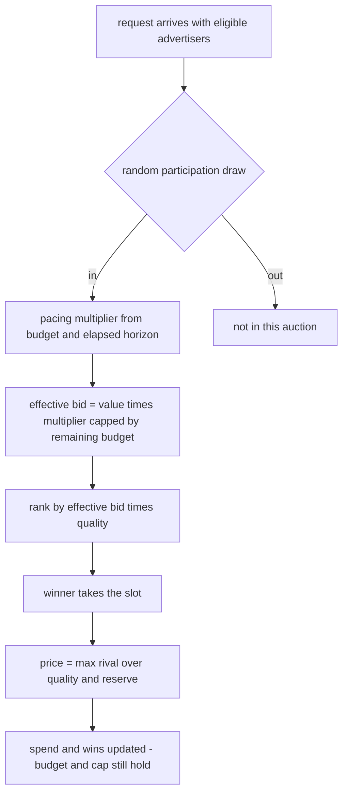
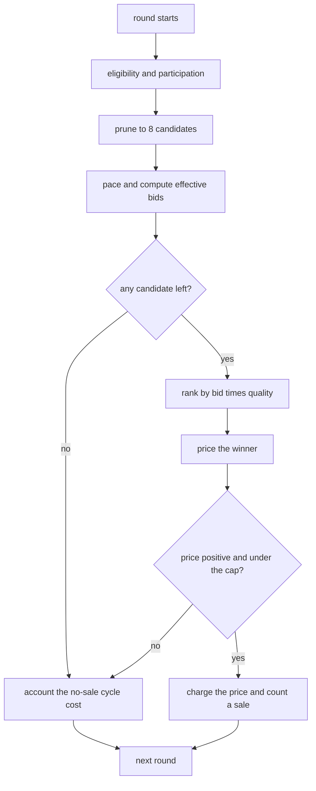
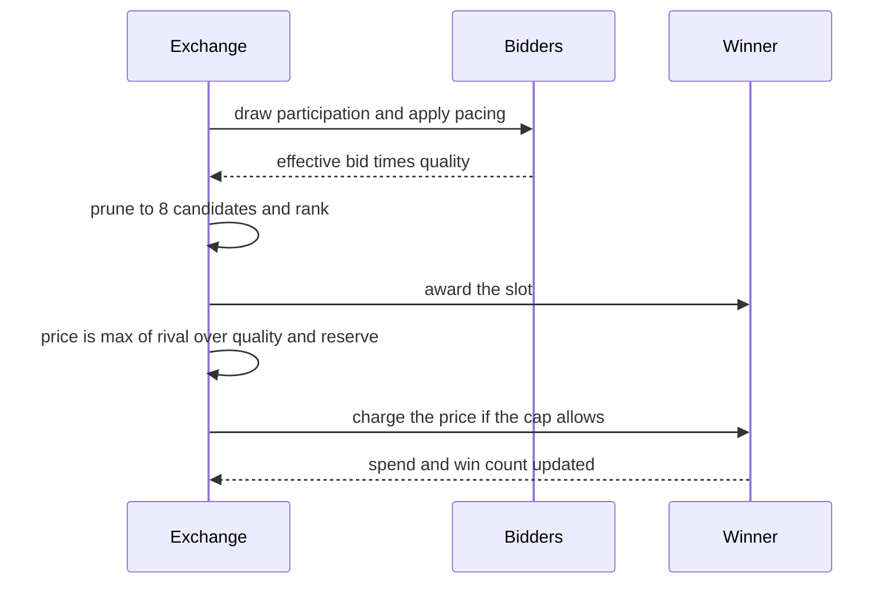

# 821 — Implement revenue-optimized bidding engine with real-time constraints (auction simulator).

> **Tier:** Master · **CTCI chapter:** Beyond — Machine Learning & AI
> **Task spec:** [821-implement-revenue-optimized-bidding-engine-with-real-time-constr.md](../../../tasks/master/821-implement-revenue-optimized-bidding-engine-with-real-time-constr.md)
> **Solutions:** [Python](../../../solutions/python/master/821-implement-revenue-optimized-bidding-engine-with-real-time-constr/solution.py) ·
> [Java](../../../solutions/java/master/821-implement-revenue-optimized-bidding-engine-with-real-time-constr/Solution.java) ·
> [JavaScript](../../../solutions/javascript/master/821-implement-revenue-optimized-bidding-engine-with-real-time-constr/solution.js) ·
> [C#](../../../solutions/csharp/master/821-implement-revenue-optimized-bidding-engine-with-real-time-constr/Solution.cs)

## 1. Problem restatement

**Input.** Bidders `Advertiser(name, value, quality, budget, cap)`; slots
`Slot(index, position)` with a decreasing position weight; a reserve price; and a market script of
sequential auction rounds.

**Output.** Four answers, each with its own independent check.

| Piece | Contract |
| --- | --- |
| `best_allocation(bidders, slots, reserve)` | the injective assignment of eligible bidders to slots maximising reported welfare `value × quality × slot.position`, with `reserve` as a floor on eligibility |
| `vcg_outcome` / `second_price_outcome` | prices: multi-slot VCG charges each winner the welfare others lost (externality); the single-slot market charges `max(rival / winner.quality, reserve)` capped by the winner's own bid |
| `optimal_reserve(values, probabilities)` | the reserve maximising the **exact** expected revenue of a two-bidder second-price auction over a discrete distribution |
| `run_market(...)` | a real-time loop of rounds with per-advertiser pacing, frequency caps, a hard spend cap and a per-decision cost in simulated cycles |

**Constraints.**

1. Welfare optimality is *measured*: the bitmask DP must equal brute-force enumeration of every injective
   assignment (checked on 24 random instances).
2. Strategy proofness: reporting your true value must be optimal — checked by brute force over a grid of
   misreports, together with individual rationality (no winner pays more than its value) and the reserve
   floor.
3. Safety in the live market: no advertiser ever overspends its budget or exceeds its frequency cap.
4. Liveness: a competitive campaign still spends at least `0.9` of its budget, and pacing keeps a mid-tier
   campaign on budget too.
5. Real-time budget: every decision's cycle count stays under `LATENCY_BUDGET_CYCLES = 400`, with the
   candidate set pruned to `horizon_slots × 2 = 8` bidders.

**Concrete behaviour asserted by the shipped Python run.**

| Scenario | Expected result |
| --- | --- |
| 24 random instances | DP welfare equals the brute-force optimum |
| 2 slots, VCG | revenue `8.88`, truthfulness by brute force, every payment non-negative |
| Uniform values on `1..4` | optimal reserve `r* = 3`, exact expected revenue `2.3125` against `1.8750` with no reserve |
| Uniform values on `1..10` | `r* = 6`, matching the classical `(high + 1) / 2` rule |
| 200 rounds, 4 advertisers, `reserve = 1` | revenue `479.9` over `174` sales; mean `25.9` and p99 `44` cycles against a budget of `400` |
| Same market unpaced | lower total revenue, front-loaded first half, and the mid-tier campaign spends less |
| Degenerate cases | empty market earns `0`, a zero-budget campaign never wins, a cap of `2` binds at exactly `2` sales, a tie is broken by name and pays the winner's own bid |

## 2. Intuition

The naive auction is "highest bid wins, pays the second-highest bid". It is also, on a single item,
strategy proof. Three things break it as soon as the problem becomes real.

- **Many slots, many bidders.** With `S` slots the assignment is a matching, and "sort by bid" is not
  optimal once quality and slot position enter welfare: a high-quality cheap bidder may deserve the top slot
  more than a low-quality rich one. That is a small assignment problem, solved here by a bitmask DP over
  `(slot, set of already-placed bidders)`.
- **Truthfulness must survive the reserve.** The tempting implementation filters bidders below the reserve
  *before* the auction. That breaks strategy proofness, because the filter depends on reports. The solution
  models the floor as a **dummy bidder per slot** with value `reserve` and quality `1`, so the allocation
  rule maximises welfare over a pool whose values do not depend on anybody's report — and then prices winners
  by their externality.
- **Money must last.** An advertiser with a daily budget who wins the first 50 expensive auctions runs out
  and disappears, which lowers total revenue. `pace` pulls the spend towards the fraction of the horizon
  elapsed: `clamp(1 + shape · (target − actual), 0.05, 2.0)`, so a lagging campaign bids more aggressively
  and a leading one bids less.

The unifying insight is that every piece is a *counterfactual*: the DP asks "what would welfare be if this
bidder were placed elsewhere", VCG asks "what would welfare be without you", the optimal reserve asks "what
happens if this floor is applied to every pair of values", and pacing asks "what should my bid be given how
much of the horizon and budget are left".



## 3. Algorithm

**Allocation (bitmask DP).** Let the eligible bidders be sorted by name and indexed `0..B-1`.

1. `best[slot][mask]` is the maximum welfare obtainable using the first `slot` slots and the bidder subset
   `mask`; `best[0][0] = 0` and everything else is `-infinity`.
2. For each slot and mask, carry the state forward with the slot left unsold, and additionally try placing
   every bidder not in the mask, gaining `value · quality · position`.
3. Recover the assignment by walking `choice` backwards from the best final mask.

```text
function best_allocation(bidders, slots, reserve)
    eligible ← bidders with value at least reserve, sorted by name
    best[0][0] ← 0 while every other cell stays negative infinity
    for slot ← 0 to width - 1 do
        for mask ← 0 to 2^count - 1 do
            if best[slot][mask] is negative infinity then continue
            relax the "leave this slot unsold" transition into best[slot + 1][mask]
            for index ← 0 to count - 1 do
                if bit index is set in mask then continue
                gain ← eligible[index].value · eligible[index].quality · slots[slot].position
                relax the transition into best[slot + 1][mask with bit index set] using gain
            end
        end
    end
    pick the mask with the largest best[width][mask] and walk the choices back
    return the map from bidder name to the slot it won
end
```

**Pricing.** Single slot: rank by `value · quality`, and the winner pays
`max(rival_value · rival_quality / winner.quality, reserve)`, capped at its own value. Multi-slot: add one
reserve dummy per slot, allocate, then charge each winner the welfare everyone else lost.

```text
function vcg_outcome(bidders, slots, reserve)
    pool ← bidders plus one dummy bidder per slot with value reserve and quality 1
    allocation ← best_allocation(pool, slots, reserve 0)
    total ← welfare(allocation, pool, slots)
    for each real winner in allocation do
        own ← the welfare this winner contributes in its slot
        without ← best_allocation(pool minus this winner, slots, reserve 0)
        payment ← max(0, welfare(without) - (total - own))
    end
    return payments and their sum
end
```

**Optimal reserve.** The expected revenue of a two-bidder second-price auction is a closed form over the
discrete distribution, because every pair of values is enumerated rather than sampled.

```text
function expected_second_price_revenue(reserve, values, probabilities)
    revenue ← 0
    for each left value with left probability do
        for each right value with right probability do
            if both are below the reserve then continue - no sale
            if both are at least the reserve then add price · max(reserve, min(left, right))
            otherwise add price · reserve
        end
    end
    return revenue
end

function optimal_reserve(values, probabilities)
    best_reserve ← 0 and best_revenue ← the revenue of a zero reserve
    for reserve in the sorted distinct values do
        revenue ← expected_second_price_revenue(reserve, values, probabilities)
        if revenue beats best_revenue then keep this reserve
    end
    return best_reserve and best_revenue
end
```

**The live market.** Each round draws participation, applies pacing, prices the candidates, applies the
budget and cap gates, and accounts the cost of the decision in cycles.

```text
function run_market(advertisers, rounds, reserve, horizon_slots, paced, enforce_cap)
    for round_index ← 0 to rounds - 1 do
        participants ← advertisers that are eligible for the reserve and win the participation draw
        if there are more than horizon_slots · 2 participants then keep the best ones
        for each participant do
            if paced then multiplier ← pace(advertiser, round_index, rounds)
            bid ← effective bid with the multiplier and, when capped, the remaining budget
        end
        rank the priced candidates by bid · quality then name
        when there is a winner do
            price ← max(next best bid · quality / winner.quality, reserve)
            price ← min(price, winner effective bid, winner budget - winner spend)
            if price is positive and the winner is under its cap then
                charge the winner and count a sale, using the full cycle cost
            end
        end
        otherwise account the cheaper no-sale cycle cost
    end
    return revenue, sales, events, per-round cycles, mean cycles and p99 cycles
end
```

The cycle model is part of the contract: `examined × 7 + 11 + 5` for a sale and
`examined × 7 + 5` for a decision that sells nothing, with the candidate set pruned to `8` so the
worst case `8 × 7 + 11 + 5 = 72` sits far inside the `400`-cycle budget.



**Documented simplifications.** One process instead of an exchange's request path; expected revenue is
enumerated exactly over a small discrete distribution instead of estimated from traffic; the cost model
counts simulated cycles rather than microseconds; quality scores are static rather than predicted; the market
has no competitive bidding feedback (one advertiser's presence does not change another's value) and no bid
shading.

## 4. Worked example

**One single-slot auction.** The market fixture is four advertisers with quality `1.0`, unit bidding
multiplier and `reserve = 1`:

| Advertiser | value | quality | budget | cap |
| --- | --- | --- | --- | --- |
| cheap | 3 | 1.0 | 60 | 400 |
| mid | 7 | 1.0 | 120 | 400 |
| rich | 15 | 1.0 | 300 | 400 |
| tiny | 2 | 1.0 | 10 | 400 |

Ranked by `value · quality`: rich (15), mid (7), cheap (3), tiny (2). The winner is `rich`, the rival price
is `7`, so `price = max(7 / 1.0, 1) = 7`, capped by the winner's own effective bid (`15`) and by
`budget − spend`. `rich` pays `7` and gains one win. When the tie fixture (`alpha` and `beta`, both value
`5`) is run instead, the tie breaks on the name: `alpha` wins and pays `max(5 / 1.0, 1) = 5` — its own bid,
the classic tie outcome.

**Pacing.** `pace` compares the fraction of the horizon elapsed with the fraction of the budget spent. At
round 50 of 200 the target is `0.25`; a campaign that has spent `10%` of its budget gets
`clamp(1 + 3 · (0.25 − 0.10), 0.05, 2.0) = 1.45`, so its `15` bid becomes `21.75`; a campaign that has spent
`40%` gets `clamp(1 + 3 · (0.25 − 0.40), 0.05, 2.0) = 0.55`, so it bids less. The measured consequence is
that the paced market earns more revenue and shifts spend into the second half, while the unpaced market
front-loads its budget and dies early.

**The optimal reserve, by hand.** With two bidders and values uniform on `1..4` there are `16` equally likely
pairs:

| Pairs | Count | Revenue each | Contribution |
| --- | --- | --- | --- |
| both below `r = 3` | 4 | no sale | `0` |
| both at least `3` | 4 | `min(left, right)` → `3, 3, 3, 4` | `13` |
| exactly one at least `3` | 8 | the reserve `3` | `24` |

Total `37 / 16 = 2.3125`. With no reserve every pair sells at `min(left, right)`, which sums to `30`, so
`30 / 16 = 1.8750`. The grid search finds exactly that: `r* = 3` with `2.3125` against `1.8750`. For values
uniform on `1..10` the search returns `r* = 6`, which is the classical `(high + 1) / 2` rule rounded to a
candidate value.



**The market trace.** Over 200 rounds the paced market earns `479.9` from `174` sales, with a decision cost of
`25.9` cycles on average and `44` at p99 — a tenth of the `400`-cycle budget. The checks around it are the
safety story: every advertiser's spend stays at or below its budget, every win count stays at or below its
cap, revenue equals total spend exactly, and `rich` and `mid` each finish at or above `90%` of budget.

## 5. Complexity

Let `S` be the slots, `B` the eligible bidders, `R` the rounds, `C` the candidates examined (pruned to
`horizon_slots × 2 = 8`) and `V` the distinct candidate values.

| Measure | Bound | Why it holds |
| --- | --- | --- |
| Welfare DP | O(S · 2^B · B) time, O(S · 2^B) space | one transition per (slot, mask, unplaced bidder) |
| Brute force oracle | Σ over `k` of `P(B, k)` | every injective assignment of up to `min(S, B)` bidders is enumerated |
| VCG | `B + 1` allocations | one allocation plus one "without me" allocation per winner |
| Optimal reserve | O(V³) | `V` candidate reserves, each evaluated over `V²` value pairs |
| Market round | O(C log C) | one prune and one sort of the priced candidates |
| Market total | O(R · C log C) | 200 rounds in the fixture |
| Decision cost | `C · 7 + 11 + 5` cycles | measured mean `25.9`, p99 `44`, budget `400` |
| Determinism | — | participation, values and tie-breaks are fixed-seed and name-ordered |

The exponential DP is exactly why the market prunes. `S · 2^B · B` is fine for the four-bidder fixture and
hopeless for a real exchange, so the loop caps the candidate set at eight and the cycle accounting shows the
budget is respected with an order of magnitude of headroom.

## 6. Pitfalls and edge cases

- **No eligible bidders.** With everyone below the reserve the single-slot auction returns `(None, 0.0)` and
  the market records a no-sale cycle instead of dividing by an empty rival price.
- **One bidder.** The rival price is `0`, so the winner pays the reserve — individual rationality and the
  reserve floor at the same time.
- **A bid below the reserve.** Filtered out by `eligible`, never allocated and never priced.
- **Zero budget.** A campaign with `budget = 0` never wins: `pace` returns `0`, the effective bid is clamped
  to the remaining budget, and the price check rejects `price <= 0`.
- **Frequency cap.** With `cap = 2` over 50 rounds the market records exactly `2` sales — the cap binds
  precisely and is re-checked after every round.
- **Ties.** Ranking uses `(value × quality, name)`, so `alpha` beats `beta` deterministically, and the tie
  makes the winner pay its own bid. Without the name tie-break, revenue would be irreproducible.
- **The reserve must be a bidder, not a filter.** Filtering below-reserve bidders before maximising welfare
  changes the allocation rule as a function of the reports and breaks strategy proofness; the dummy-bidder
  construction is what the brute-force misreport grid verifies.
- **Individual rationality.** VCG payments are the externality but never more than the winner's value; the
  per-winner `max(0, ...)` also keeps a winner from being charged a negative amount.
- **Pacing clamps.** The multiplier is clamped into `[0.05, 2.0]`, so a wildly off-budget campaign cannot bid
  a hundred times its value on one impression.
- **Front-loading without pacing.** The unpaced market is still safe (eligibility and the budget clamp hold),
  but it earns less and its first half dominates — that is a liveness failure, not a safety one.
- **Latency accounting is part of the answer.** Every round records its cycle cost, and both the mean and the
  p99 are asserted against the budget, so "fast" is a measured property of the simulated cost model rather
  than a claim.
- **Simplifications kept honest.** Expected revenue is enumerated over a small discrete distribution rather
  than estimated from traffic; quality scores are static; there is no competitive feedback and no bid
  shading.

## 7. Variants and follow-ups

- **Estimate the traffic instead of enumerating it.** A real exchange needs a value distribution and a
  click-through model rather than an exact expectation over `16` pairs — the streaming estimators in
  [823-implement-real-time-anomaly-detection-via-streaming-pca-or-sketc.md](../../../tasks/master/823-implement-real-time-anomaly-detection-via-streaming-pca-or-sketc.md)
  are the same "exact over the sketch, not over the world" trade.
- **Score requests and detect fraud before bidding.** Real-time scoring in front of the auction is
  [822-implement-fraud-detection-streaming-pipeline-with-low-latency-sc.md](../../../tasks/master/822-implement-fraud-detection-streaming-pipeline-with-low-latency-sc.md).
- **Learn the pacing policy.** The hand-written pacing multiplier here is the hand-tuned version of what
  Bayesian optimisation over a black-box objective would search, see
  [828-implement-black-box-optimizer-with-bayesian-optimization-and-ei.md](../../../tasks/master/828-implement-black-box-optimizer-with-bayesian-optimization-and-ei.md).
- **Search hyperparameters under a budget the same way.** Budget-constrained search with early stopping is
  literally the same pacing problem for training runs — see
  [827-implement-distributed-hyperparameter-search-with-early-stopping.md](../../../tasks/master/827-implement-distributed-hyperparameter-search-with-early-stopping.md).

## 8. Check yourself

1. Why does the DP track a *set* of already-placed bidders instead of just the number placed?

<details><summary>Show answer</summary>

Because the assignment must be injective: the gain of placing bidder `i` in slot `s` depends on whether `i`
is still available, and a count alone cannot tell you which bidders are used. `best[slot][mask]` over the
2^B subsets encodes exactly that, and the DP's answer is checked against brute-force enumeration of every
injective assignment on 24 random instances.

</details>

2. The reserve is modelled as a dummy bidder rather than as a filter. Why?

<details><summary>Show answer</summary>

Because a filter applied before allocation makes the allocation rule depend on the reports, which destroys
strategy proofness: a bidder could shade its bid to change who is filtered. A dummy bidder with value equal
to the reserve and quality 1 makes the floor part of the welfare maximisation over a pool whose values are
independent of the reports, so VCG pricing on top of it stays truthful — which the file verifies by brute
force over a grid of misreports.

</details>

3. For two bidders with values uniform on `1..4`, why is `2.3125` better than `1.8750`?

<details><summary>Show answer</summary>

The `16` equally likely pairs split three ways: the `4` pairs with both values below `3` earn nothing, the
`4` pairs with both values at least `3` earn `min(left, right)` (`3, 3, 3, 4` = `13`), and the `8` mixed pairs
earn exactly the reserve (`24`). `37 / 16 = 2.3125`. With no reserve every pair sells at `min(left, right)`,
which sums to `30`: `30 / 16 = 1.8750`. The reserve trades some volume for a higher price on the pairs that
still sell.

</details>

4. What exactly does pacing change, and why does it raise revenue?

<details><summary>Show answer</summary>

It scales each advertiser's effective bid by `clamp(1 + 3 · (target − actual), 0.05, 2.0)`, where `target` is
the elapsed fraction of the horizon and `actual` the spent fraction of the budget. An advertiser that is
behind bids more aggressively and one that is ahead bids less, so budgets are spread across the horizon
instead of being burned in the first half. The measured effect in the fixture is higher total revenue, more
second-half revenue and better spend for the mid-tier campaign, while safety (no overspend, no cap breach) is
unchanged.

</details>

5. `mean_cycles = 25.9` and `p99 = 44` against a budget of `400`. Where do those numbers come from?

<details><summary>Show answer</summary>

From the decision cost model, not from a clock: a decision costs `examined × 7` to price the candidates,
`+11` to run the slot allocation and `+5` for the pricing pass when it sells, or just `+5` when it does not.
The candidate set is pruned to `horizon_slots × 2 = 8`, so the worst case is `8 × 7 + 11 + 5 = 72` cycles.
The checks assert the p99 and the per-round maximum against `LATENCY_BUDGET_CYCLES = 400`.

</details>
