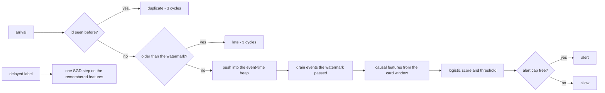
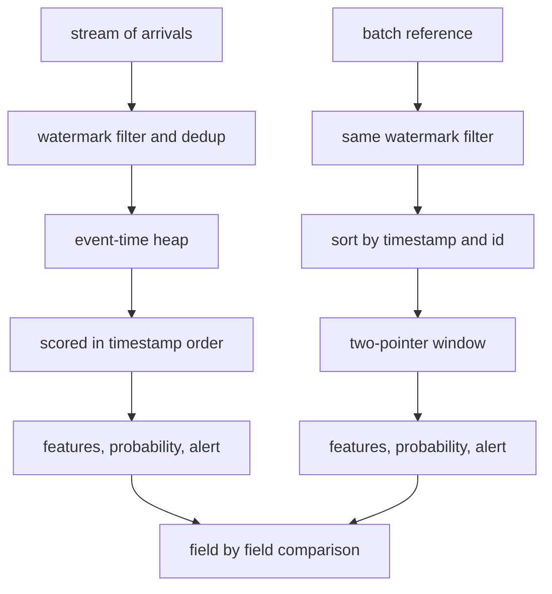
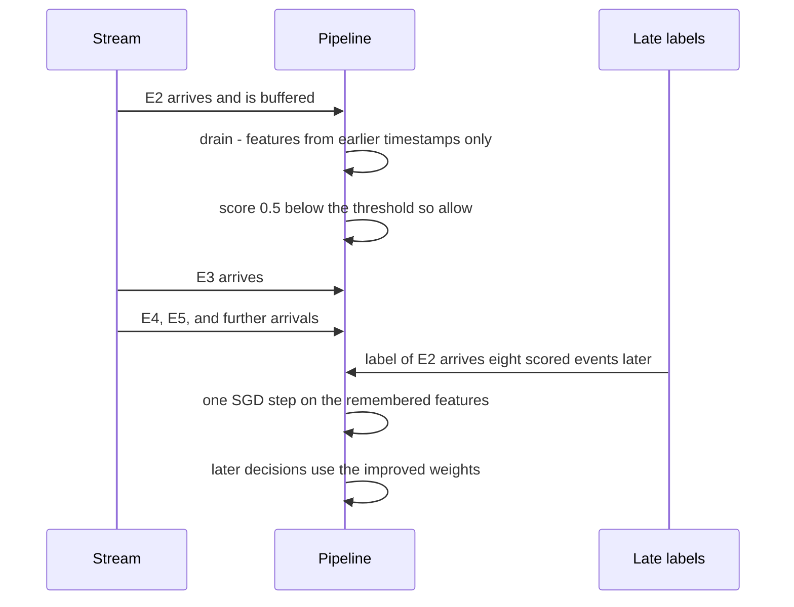

# 822 — Implement fraud-detection streaming pipeline with low-latency scoring and feedback.

> **Tier:** Master · **CTCI chapter:** Beyond — Machine Learning & AI
> **Task spec:** [822-implement-fraud-detection-streaming-pipeline-with-low-latency-sc.md](../../../tasks/master/822-implement-fraud-detection-streaming-pipeline-with-low-latency-sc.md)
> **Solutions:** [Python](../../../solutions/python/master/822-implement-fraud-detection-streaming-pipeline-with-low-latency-sc/solution.py) ·
> [Java](../../../solutions/java/master/822-implement-fraud-detection-streaming-pipeline-with-low-latency-sc/Solution.java) ·
> [JavaScript](../../../solutions/javascript/master/822-implement-fraud-detection-streaming-pipeline-with-low-latency-sc/solution.js) ·
> [C#](../../../solutions/csharp/master/822-implement-fraud-detection-streaming-pipeline-with-low-latency-sc/Solution.cs)

## 1. Problem restatement

**Input.** A stream of payment `Event(event_id, timestamp, card, merchant, amount, label)` that arrives
mostly in order with duplicates, out-of-order arrivals and some very late stragglers; a logistic model with
`FEATURES = 4` weights; a decision threshold; and labels that become known only some events later.

**Output.** Per event a decision record `(features, probability, alert, lookups, cycles, tick)`, plus
counters, a latency profile and the learned weights.

| Piece | Contract |
| --- | --- |
| `ingest` | dedup by `event_id` (exactly once) and reject anything older than the watermark `max_timestamp − ALLOWED_LATENESS`, buffering the rest in event-time order |
| `drain` | release buffered events whose timestamp has fallen behind the watermark, in `(timestamp, id)` order, and run features → score → decide on each |
| `raw_features` | **causal** features from the card's own sliding window: strictly earlier timestamps only, so events sharing a timestamp can never influence each other |
| `feedback` | one SGD step per delayed label, using the remembered feature vector of that event |
| `batch_reference` | an independent oracle that applies the same watermark rule and then scans in timestamp order with a two-pointer window |
| `run_stream` | the driver: arrivals, delayed labels, drift, latency and quality reporting |

**Constraints.**

1. Exactly-once scoring, with `processed + duplicate + late == arrivals`.
2. Every feature, probability and decision must equal the batch oracle, including under out-of-order
   arrival.
3. Scoring order must be timestamp order, not arrival order.
4. No leakage: a later event must never change an earlier decision.
5. Every decision must fit `BUDGET_CYCLES = 40` simulated cycles, not just the p99.
6. The alert rate is capped at `ALERT_CAP_PER_WINDOW = 6` per window of `timestamp // 10`.

**Concrete behaviour asserted by the shipped Python run.**

| Scenario | Expected result |
| --- | --- |
| 800-event stream, seed `0xF00D`, `learn=False` | features/probabilities/alerts/lookups identical to the batch reference; `processed + duplicate + late == 800` |
| Latency | mean `7.2`, p99 `14`, budget `40`, worst lookups `5`, worst event-time delay `5` ticks |
| Cold model | AUC `0.500` before any feedback |
| After delayed feedback | held-out AUC `0.763`, whole-stream `0.777` against an oracle ceiling of `0.781`; precision `0.100 → 0.325`, recall `0.481` |
| Drift fixture (`adapt=True`) | alert rate `0.129 → 0.117` as the threshold moves `0.60 → 0.70`, ranking preserved |
| Degenerate streams | empty, single event, all-fraud, all-legit and a duplicate flood all counted correctly |

## 2. Intuition

A fraud pipeline is hard for reasons that have nothing to do with model quality.

- **Events arrive out of order and twice.** A retry after a network timeout delivers the same payment again;
  a delayed partition delivers an event with an old timestamp. Scoring the duplicate double-counts the
  velocity of a card, and scoring the straggler against a window that has already moved on produces features
  that are simply wrong. Hence the two gates: an id set for duplicates, and a watermark with an allowed
  lateness for event-time.
- **Features must be causal.** If two events share a timestamp, neither may see the other — otherwise the
  feature value depends on arrival order and the streaming result cannot match a batch recomputation.
  `raw_features` uses `other.timestamp < event.timestamp`, strictly.
- **Labels are late.** The label for a decision arrives long after the response was sent, so learning must
  happen *after* the fact on remembered features, and it must be impossible for a label to influence a
  decision that preceded it. That is the no-leakage property, measured by appending events to the future of
  the stream and demanding the earlier decisions stay bit-identical.
- **Work per event is budgeted.** Scoring happens inside a request's tail latency, so the cost model counts
  cycles per stage and the checks assert that *every* decision stays under the budget, with the window and
  pruning bounds making that true by construction.

The unifying insight: correctness here is mostly about *event time*. Once the pipeline decides, per event,
what it is allowed to know (only strictly earlier events inside a bounded window), the streaming pass and the
batch recomputation become the same function, and the oracle comparison is a real test rather than a hopeful
one.



## 3. Algorithm

**Stage 1 — ingest (3 cycles).**

1. If the id was seen before, count a duplicate and stop.
2. Else record the id; if `max_timestamp` is set and the event's timestamp is older than
   `max_timestamp − lateness`, count a late event and stop.
3. Otherwise advance the watermark and push `(timestamp, event_id, event)` onto a min-heap.

**Stage 2 — drain.** Pop every buffered event whose timestamp is at most `max_timestamp − lateness` and score
it. Because the heap is keyed by `(timestamp, event_id)`, scoring happens in timestamp order regardless of
the order the events arrived in.

**Stage 3 — features, score, decide.**

4. `raw_features` counts, for this card, the events with `timestamp − WINDOW_SIZE <= other.timestamp <
   timestamp`, plus one lookup per such event: `[1.0, amount / 500, min(velocity, 6) / 6, merchant_risk]`.
5. Score `Σ weight · feature`, apply `sigmoid`, and alert when the probability reaches the threshold **and**
   the window of `timestamp // 10` still has alert capacity.
6. Append the event to the history, prune history older than `timestamp − WINDOW_SIZE − lateness`, remember
   the feature vector for feedback, and account the cycles.

**Stage 4 — feedback.** For a label arriving now, look up the remembered features of that event and take one
logistic-regression step: `weights += lr · (label − sigmoid(score)) · features`.

```text
procedure ingest(event)
    charge INGEST_COST cycles
    if event id was already seen then count a duplicate and return
    record the id
    if the watermark exists and event timestamp is below the watermark minus lateness then
        count a late event and return
    end
    raise the watermark to the maximum of the current value and this timestamp
    push (timestamp, id, event) onto the event-time heap
end

procedure drain(force)
    while the heap is not empty do
        if not force and the oldest timestamp is above the watermark minus lateness then stop
        pop the oldest event and score it
    end
end

function raw_features(event, history)
    velocity ← 0 and lookups ← 0
    for other in history do
        if other card differs from this card then continue
        if timestamp - WINDOW_SIZE ≤ other timestamp and other timestamp < timestamp then
            lookups ← lookups + 1
            velocity ← velocity + 1
        end
    end
    return [1, amount / 500, min(velocity, 6) / 6, merchant risk] and the lookup count
end

procedure score_event(event)
    features, lookups ← raw_features(event, history)
    cycles ← lookups · LOOKUP_COST
    probability ← sigmoid(score(weights, features))
    cycles ← cycles + FEATURES · SCORE_COST
    window ← timestamp // 10
    alert ← probability ≥ threshold and used alerts in window < ALERT_CAP_PER_WINDOW
    cycles ← cycles + DECIDE_COST
    record the decision, bump the counters, append to history and remember the features
end

procedure feedback(event_id, label)
    features ← remembered features of event_id, or nothing when they were evicted
    error ← label - sigmoid(score(weights, features))
    for index in range of weights do
        weights[index] ← weights[index] + LEARNING_RATE · error · features[index]
    end
end
```

**The oracle.** `batch_reference` reproduces the whole computation with plain lists: it filters duplicates
and late events with the same watermark rule, sorts by `(timestamp, id)`, then walks a two-pointer sliding
window so that the velocity and the lookup count are computed by a different code path. Every field the
streaming pass produces is compared against it field by field.



**Documented simplifications.** Events are small records in one process instead of a Kafka/Flink topology;
cycles are a deterministic cost model rather than wall-clock latency and nothing sleeps; the event-time delay
is measured in ticks; the model is a four-feature logistic regression trained with plain SGD rather than
gradient-boosted trees over a feature store; labels are synthesised from the same features with an
unobservable component, so no model can reach AUC `1.0`; drift is a parameter shift in the generator.

## 4. Worked example

**A four-event stream, traced end to end.** Events: `E0(t=0, card 1, merchant 1, 100)`,
`E1(t=0, card 2, merchant 0, 40)`, `E2(t=1, card 1, merchant 2, 450)`, `E3(t=2, card 1, merchant 1, 200)`;
cold weights `[0, 0, 0, 0]`, threshold `0.6`, `WINDOW_SIZE = 8`.

| Event | Features `[bias, amount/500, velocity/6, risk]` | Lookups | Cycles | Probability | Decision |
| --- | --- | --- | --- | --- | --- |
| `E0` | `[1.0, 0.2, 0.0, 0.4]` | 0 | `0 + 8 + 2 = 10` | `0.5` | allowed |
| `E1` | `[1.0, 0.08, 0.0, 0.0]` | 0 | `10` | `0.5` | allowed |
| `E2` | `[1.0, 0.9, 0.166667, 0.9]` | 1 | `1 + 8 + 2 = 11` | `0.5` | allowed |
| `E3` | `[1.0, 0.4, 0.333333, 0.4]` | 2 | `2 + 8 + 2 = 12` | `0.5` | allowed |

`E2` counts exactly one lookup — `E0` is card 1 within the window — and `E3` counts two, since both `E0`
(age 2) and `E2` (age 1) are card 1 inside the window. Every probability is `0.5` because a cold logistic
model scores `0` and `sigmoid(0) = 0.5`, below the `0.6` threshold: that is why the full 800-event cold run
prints `0 alerts`.

**One feedback step.** The label for `E2` arrives and turns out to be `1`. `error = 1 − sigmoid(0) = 0.5`, so
each weight moves by `0.35 · 0.5 · feature`:

| Weight | bias | amount | velocity | risk |
| --- | --- | --- | --- | --- |
| Before | 0.0 | 0.0 | 0.0 | 0.0 |
| Step | `0.175` | `0.1575` | `0.0291667` | `0.1575` |

Scoring `E3` with the updated weights gives `0.310722` and a probability of `0.577062` — still below `0.6`,
but decisively above the `0.5` the cold model would have produced, and that is the direction the whole
delayed-feedback loop pushes.



**At scale.** The 800-event stream scores `800` events with `0` duplicates and `0` late arrivals, at a mean
of `7.2` cycles and a p99 of `14` against the `40`-cycle budget, and never more than `5` lookups in a
decision. Delayed feedback lifts the cold `0.500` AUC to `0.763` on a held-out split and `0.777` over the whole
stream, against an oracle ceiling of `0.781` — the remaining gap is the unobservable component of the label
generator, not a bug. Precision rises from `0.100` to `0.325` while recall reaches `0.481`. The drift fixture
shows the adaptation: as the generator shifts, the alert rate is brought from `0.129` down to `0.117` by
raising the threshold from `0.60` to `0.70`, without destroying the ranking.

## 5. Complexity

Let `N` be the arrivals, `B` the buffered (un-drained) events, `W` the events inside one card's window and
`F = 4` the feature count.

| Measure | Bound | Why it holds |
| --- | --- | --- |
| `ingest` | O(1) expected + O(log B) heap push | one set lookup and one heap insertion |
| `drain` | O(log B) per released event | one pop per scored event |
| `raw_features` | O(W) time, `W` lookups | scans the pruned history for the card's window |
| `_score_event` | O(W + F) | the scan plus a dot product; cycles are `W · 1 + F · 2 + 2` |
| Whole stream | O(N log B + ΣW) | every event is ingested once and scored once |
| `batch_reference` | O(N · W) worst case | a two-pointer window per event over the sorted stream |
| History pruning | O(W) after each score, bounded by `WINDOW_SIZE + lateness` | events older than `timestamp − 8 − 5` are dropped |
| Feedback | O(F) per label | one SGD step per remembered feature vector |
| Memory | O(ids + B + W + FEEDBACK_MEMORY) | the id set, the heap, the window and the last `400` feature vectors |
| Measured | mean `7.2`, p99 `14`, max `40`-cycle budget, max `5` lookups | the cost model is deterministic |

The important structural bound is that a decision's cost depends on the *window*, not on the stream length:
pruning the history to `WINDOW_SIZE + ALLOWED_LATENESS` keeps `W` bounded, which is what makes the per-event
budget a constant rather than a function of traffic.

## 6. Pitfalls and edge cases

- **Duplicates.** The same `event_id` twice must be rejected the second time, and the counters must stay
  complete: `processed + duplicate + late == arrivals` is checked before and after injecting two duplicate
  arrivals.
- **Late stragglers.** An event older than `watermark − ALLOWED_LATENESS` is counted as late and never enters
  the buffer — scoring it against a moved-on window would compute features that no batch recomputation can
  reproduce.
- **Out-of-order arrival.** The stream swaps every seventh pair, so arrival order differs from timestamp
  order; `scored_order` must still be sorted, which the heap guarantees by keying on `(timestamp, id)`.
- **Events sharing a timestamp.** Strict `<` in the window test means neither can influence the other; using
  `<=` would make the features depend on arrival order and break the oracle comparison.
- **No leakage.** Appending twelve future events must leave every earlier probability and alert
  bit-identical; labels are only played back after `delay = 8` further scored events.
- **Evicted feedback memory.** With more than `FEEDBACK_MEMORY = 400` remembered vectors the oldest are
  dropped; `feedback` returns `False` for an unknown id instead of raising, so a label for a forgotten event
  is simply skipped.
- **Alert cap.** The cap is per window of `timestamp // 10` and is consumed before the decision is recorded;
  a window that already raised six alerts allows the rest even when the model is confident.
- **Cold start.** An all-zero weight vector scores `0` and yields exactly `sigmoid(0) = 0.5`, so a fresh
  pipeline alerts on nothing at threshold `0.6`. That is the measured `0 alerts` in the cold run, and the
  reason the feedback numbers start from AUC `0.500`.
- **Latency is a cost model, not a clock.** The checks assert that *every* decision is inside the budget,
  because a p99 alone would hide a single pathological event; the window and cap bounds are what make the
  worst case finite.
- **Empty and degenerate streams.** An empty stream, a single event, all-fraud, all-legit and a duplicate
  flood are all counted without dividing by zero; `p99` and `mean` return `0` for an empty cost history.
- **Simplifications kept honest.** No Kafka or Flink, no threads, no wall-clock, no gradient-boosted trees,
  no feature store, no production labels.

## 7. Variants and follow-ups

- **Price the decision once it is made.** The bidder that consumes this score is the auction engine in
  [821-implement-revenue-optimized-bidding-engine-with-real-time-constr.md](../../../tasks/master/821-implement-revenue-optimized-bidding-engine-with-real-time-constr.md).
- **Detect the drift instead of reacting to a rate.** Streaming PCA and sketches estimate the same shift
  without labels — see
  [823-implement-real-time-anomaly-detection-via-streaming-pca-or-sketc.md](../../../tasks/master/823-implement-real-time-anomaly-detection-via-streaming-pca-or-sketc.md).
- **Join the stream to a reference table.** The velocity feature here is a window aggregate; a real pipeline
  needs stateful joins against a feature store, see
  [850-implement-monetizable-feature-store-with-lineage-versioning-and.md](../../../tasks/master/850-implement-monetizable-feature-store-with-lineage-versioning-and.md).
- **Monitor the served model, not just the stream.** Precision decaying under drift is exactly what an
  automated monitoring loop has to catch — see
  [929-implement-end-to-end-automated-ml-system-with-monitoring-drift-a.md](../../../tasks/master/929-implement-end-to-end-automated-ml-system-with-monitoring-drift-a.md).

## 8. Check yourself

1. Why is the watermark rule needed when the pipeline already deduplicates by id?

<details><summary>Show answer</summary>

They solve different problems. Dedup removes *repeats of the same event*; the watermark removes *first copies
that arrive too late*. A straggler with a timestamp older than `watermark − 5` would be scored against a
window that has already advanced past its position, producing a velocity no batch recomputation could
reproduce — so it is counted as late and dropped rather than silently corrupting the features.

</details>

2. Why must `raw_features` compare timestamps strictly?

<details><summary>Show answer</summary>

Because events can share a timestamp (the fixture gives every pair of events the same tick). With `<=`, the
velocity of two same-tick events would depend on which was scored first, so the same event could get
different features depending on arrival order, and the streaming pass could not equal the batch oracle. The
strict comparison makes the feature a function of event time alone.

</details>

3. What is checked by the no-leakage test?

<details><summary>Show answer</summary>

That a decision is a function of the past only. The file runs the first `100` events alone, then runs the same
prefix followed by twelve fabricated future events, and asserts every earlier probability and alert is
bit-identical. Feedback is delivered only after `delay = 8` further scored events, so a label can never reach
a decision that preceded it.

</details>

4. A cold pipeline reports zero alerts. Is something broken?

<details><summary>Show answer</summary>

No. All weights start at zero, so every score is `0` and every probability is `sigmoid(0) = 0.5`, below the
`0.6` threshold. The interesting numbers are the ones after feedback: the cold AUC of `0.500` (chance) rises
to `0.763` held-out and `0.777` over the whole stream, against a ceiling of `0.781` set by the unobservable
part of the label generator.

</details>

5. How can a decision cost be bounded when the history grows for the whole run?

<details><summary>Show answer</summary>

Because the history is pruned after every score to events at or after `timestamp − WINDOW_SIZE −
ALLOWED_LATENESS`, so a decision only scans events inside the card's window plus the lateness margin. Cycles
are `lookups · 1 + 4 · 2 + 2`: the measured maximum was `5` lookups and `40` cycles is the budget, with mean
`7.2` and p99 `14`. Without the pruning, the per-event cost would grow with the run length and the budget
would be a hope rather than an invariant.

</details>
