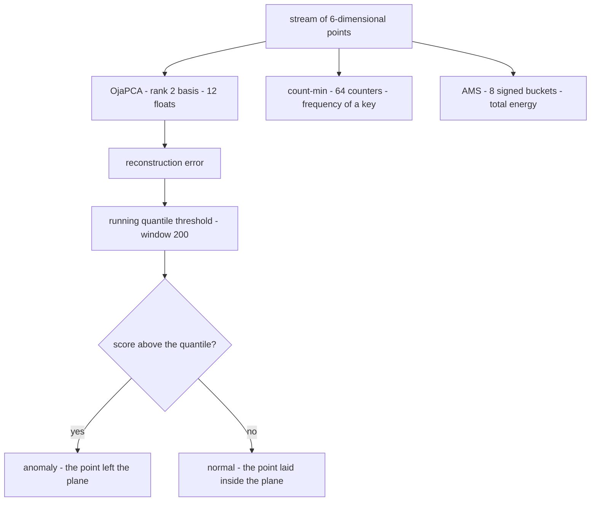
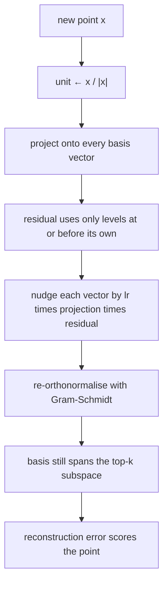
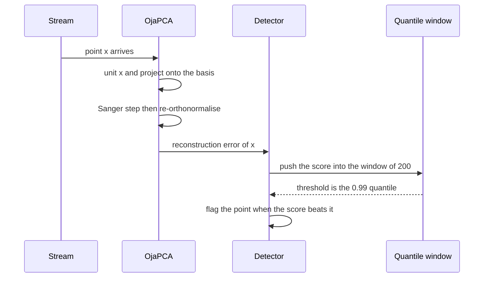

# 823 — Implement real-time anomaly detection via streaming PCA or sketching.

> **Tier:** Master · **CTCI chapter:** Beyond — Machine Learning & AI
> **Task spec:** [823-implement-real-time-anomaly-detection-via-streaming-pca-or-sketc.md](../../../tasks/master/823-implement-real-time-anomaly-detection-via-streaming-pca-or-sketc.md)
> **Solutions:** [Python](../../../solutions/python/master/823-implement-real-time-anomaly-detection-via-streaming-pca-or-sketc/solution.py) ·
> [Java](../../../solutions/java/master/823-implement-real-time-anomaly-detection-via-streaming-pca-or-sketc/Solution.java) ·
> [JavaScript](../../../solutions/javascript/master/823-implement-real-time-anomaly-detection-via-streaming-pca-or-sketc/solution.js) ·
> [C#](../../../solutions/csharp/master/823-implement-real-time-anomaly-detection-via-streaming-pca-or-sketc/Solution.cs)

## 1. Problem restatement

**Input.** A stream of `DIMENSION = 6` float vectors, of which "normal" points lie close to a hidden
rank-2 plane and anomalies point away from it; a target rank `RANK = 2`; a learning rate
`LEARNING_RATE = 0.05`; a detection window of `200` scores and a `0.99` quantile threshold; and an anomaly
cadence of one injected point every `ANOMALY_RATE = 40` indices.

**Output.** Three sketches and one detector.

| Piece | Contract |
| --- | --- |
| `OjaPCA` | a rank-`k` orthonormal basis updated by Sanger's rule — `w_i += lr · y_i · (x − Σ_{j≤i} y_j w_j)` with `y_j = w_j · x` — in `O(d · k)` memory and `O(d · k · (k + 1))` work per point |
| `CountMinSketch` | a fixed counter table estimating key frequencies; every estimate must be an overestimate |
| `AmsSketch` | signed buckets whose squared sums estimate the stream's second moment (the Frobenius energy) |
| `Detector` | score = reconstruction error under the streaming basis, threshold = running quantile of recent scores, with the basis adapting online |

**Constraints.**

1. The recovered subspace is compared with the *generative* basis and with a batch power iteration over the
   accumulated covariance — "it tracks the principal directions" is measured, not assumed.
2. Count-min estimates never undershoot, stay inside the collision bound (`updates / width` scaled), and the
   heavy hitters match the exact top-`k`.
3. The AMS median-of-means estimate must land near the exact energy: measured relative error below `0.35`
   for the median of five sketches and below `0.25` for the mean of 21 independent trials.
4. Memory must not grow with the stream, and the per-point work must stay inside the `O(d · k · (k + 1))`
   budget.
5. Under a distribution shift an adaptive basis must reconstruct better than a frozen one.

**Concrete behaviour asserted by the shipped Python run.**

| Scenario | Expected result |
| --- | --- |
| 800-point stream, rank 2, 600 updates | subspace error against the generative plane `0.010` streaming versus `0.005` for the batch power iteration |
| Count-min, 16 columns × 4 rows | worst overestimate `19`; bound `updates / width × 3`; average overestimate below `updates / width` |
| AMS, 800 points, 8 buckets | median-of-means energy `387.66` against the exact `539.89` — a relative error of `0.28`, inside the `0.35` check |
| Detection | AUC `1.000` and recall `1.000` at a 1% false-positive threshold |
| Drift at index 400 | tail reconstruction error `0.237` adaptive versus `0.790` frozen |
| Degenerate cases | constant stream, `d = 1`, `k = d` so the error vanishes, an empty stream, a single point |

## 2. Intuition

Three different questions, all answered with memory that does not grow with the stream.

- **What does "normal" look like?** Computing the covariance and taking its top eigenvectors is a batch
  operation: you need every point at once and `O(d²)` memory. Streaming PCA replaces it with a *moving*
  estimate: keep the top `k` directions and nudge them towards each new point. Sanger's rule is Oja's rule
  with the already-extracted directions subtracted, which is what keeps the basis from collapsing onto a
  single dominant direction.
- **How often did I see this key?** A hash table grows with distinct keys. A count-min sketch uses a fixed
  table and hashes each key into one counter per row, taking the minimum: another key can only *add* to a
  counter, so the estimate can be too high but never too low — a one-sided error that makes it usable as a
  conservative filter.
- **How big is this stream?** The second moment `Σ |x|²` is a useful scale for normalisation and drift. The
  AMS sketch hashes each point's energy into a signed bucket; cross terms cancel in expectation, so the sum
  of squared buckets estimates the energy from `O(1)` state, and taking the median over independent hash
  families removes the variance.

The unifying insight is that all three are *randomised summaries with a one-sided or self-correcting error*:
they trade exactness for constant memory, and every claim about them is checked against an exact reference —
the generative basis, the true counts, the exact energy.



## 3. Algorithm

**Streaming PCA (Sanger's rule).** For each point: normalise it, project it onto every basis vector, rebuild
each vector using only the directions at or before its own level, nudge it by
`lr · y_i · residual`, and re-orthonormalise. Normalising matters: without it a few large outliers would
capture the basis instead of being detected by it.

```text
procedure update(basis, point, rate)
    if the norm of point is zero then return
    unit ← point / norm(point)
    projections ← for each basis vector v do measure v · unit
    updated ← empty list
    for level ← 0 to rank - 1 do
        residual ← unit minus the sum over inner ≤ level of projections[inner] · basis[inner]
        updated[level] ← basis[level] + rate · projections[level] · residual
    end
    basis ← orthonormalise(updated)   # Gram-Schmidt, so the basis stays orthonormal
    charge rank · (rank + 1) · dimension operations
end

function error(basis, point)
    rebuilt ← sum over v of (v · point) · v
    return the Euclidean norm of point - rebuilt
end
```

**Count-min sketch.** `depth` row sums with independent salts; `add` increments one counter per row, and
`estimate` returns the minimum, which is the standard guarantee that collisions only inflate.

```text
procedure cm_add(key, amount)
    for level ← 0 to depth - 1 do
        column ← hash(key, salt of level) mod width
        tables[level][column] ← tables[level][column] + amount
    end
end

function cm_estimate(key)
    return the minimum over levels of tables[level][hash(key, salt of level) mod width]
end
```

**AMS energy.** Each point's energy is added into a round-robin bucket with a pseudo-random sign; the
estimator is the sum of the squared bucket sums, and the reported value is the median over several
independent sketches.

```text
procedure ams_add(point)
    energy ← point · point
    index ← updates mod bucket count
    sign ← plus one or minus one from hash(updates, salt)
    buckets[index] ← buckets[index] + sign · energy
    updates ← updates + 1
end

function ams_energy()
    return the sum over buckets of bucket squared
end
```

**Detector.** Score each point with the reconstruction error, update the basis, and compare the score with
the running `0.99` quantile of the last `WINDOW = 200` scores. Because the basis keeps adapting, the
threshold and the model both follow a shift in the stream.

```text
procedure observe(detector, point)
    score ← error(basis, point)
    update(basis, point, rate)          # the model follows the stream
    push score into the recent-score window, evicting the oldest entry
    threshold ← the configured quantile of the window
    flag ← score above the threshold
    return score and flag
end
```



**Documented simplifications.** Dimensions are six and the stream is a few thousand points in one process
instead of thousands of dimensions and millions of points; arithmetic is plain floats (no float16, no GPU,
no sketch quantisation); drift is a parameter change in the generator; and the anomaly threshold is a running
quantile of the scores rather than a calibrated tail model.

## 4. Worked example

**One Sanger step, in full.** A rank-1 basis over two dimensions initialised to
`w = (0.808223, -0.588877)` (unit norm), rate `0.5`, and the point `(3, 4)`, whose unit vector is
`(0.6, 0.8)`:

| Quantity | Formula | Value |
| --- | --- | --- |
| projection `y` | `w · unit` | `0.808223 · 0.6 − 0.588877 · 0.8 = 0.013832` |
| residual | `unit − y · w` | `(0.588821, 0.808145)` |
| updated `w` | `w + lr · y · residual` | `(0.812296, −0.583287)` |
| renormalised | `w / |w|` | `(0.812275, −0.583274)` |
| error before | residual length of `x − (w · x) w` | `4.999522` |
| error after | same, with the new basis | `4.998924` |

The projection is small here because the random initial basis happens to be nearly perpendicular to the
point, so one step barely moves the error — which is exactly why a stream is needed: after `600` updates the
rank-2 basis is `0.010` away from the generative plane, only twice the `0.005` of a batch power iteration
that has seen all `800` points.

**A count-min table.** Width `4`, depth `2`; keys `1, 1, 2, 2, 3, 3, 4, 5` are inserted, so the exact counts
are `1 → 2, 2 → 2, 3 → 2, 4 → 1, 5 → 1`:

| Key | Exact count | Estimate | Overestimate |
| --- | --- | --- | --- |
| 1 | 2 | 5 | 3 |
| 2 | 2 | 2 | 0 |
| 3 | 2 | 5 | 3 |
| 4 | 1 | 1 | 0 |
| 5 | 1 | 1 | 0 |
| 6 (never inserted) | 0 | 0 | 0 |

Every estimate is at or above the truth and none is below — the one-sided error that makes the sketch safe
as a conservative filter. The collision floor here is `updates / width = 8 / 4 = 2`, and the mean
overestimate must stay under it, while a single key may exceed it by up to a factor of three (the fixture's
bound is `updates / width × 3`, and the 16×4 fixture measured a worst case of `19`).

**AMS energy.** Inserting `(1,0)`, `(0,1)` and `(1,1)` into a two-bucket sketch gives bucket sums
`(-1, 1)`, so the estimate is `1 + 1 = 2` against an exact energy of `1 + 1 + 2 = 4`. A single sketch is
noisy by design; the shipped run takes the median of five independent signed sketches over `800` points and
lands at `387.66` against the exact `539.89`, a `0.28` relative error inside the `0.35` check.



**Detection and drift.** On the anomalous stream the detector reaches AUC `1.000` and recall `1.000` at a 1%
false-positive threshold, because an injected anomaly is built by projecting a random direction *out* of the
generative plane and scaling it by `6.0`, so its reconstruction error is far above the plane's. Under the
drift at index 400 the adaptive detector's tail error falls to `0.237` while a basis frozen on the first 300
points sits at `0.790`: the same code path that follows the past also follows a shift, which is the practical
argument for keeping the model streaming.

## 5. Complexity

Let `d` be the dimension, `k` the rank, `n` the stream length, `W = 200` the score window, `w` and `h` the
count-min width and depth, and `b` the AMS bucket count.

| Measure | Bound | Why it holds |
| --- | --- | --- |
| `OjaPCA.update` | O(d · k · (k + 1)) work, O(d · k) memory | one projection per level plus Gram-Schmidt; measured memory `RANK · DIMENSION = 12` floats |
| `OjaPCA.error` | O(d · k) | reconstruct by summing `k` rank-1 outer products |
| Count-min `add` / `estimate` | O(h) time, O(w · h) counters | one counter per row; the fixture uses a `16 × 4 = 64`-counter table |
| AMS `add` / `energy` | O(d) for the energy, O(b) to sum the buckets | the bucket array is fixed at `8` |
| Detector per point | O(d · k + W) | the update plus the quantile over the window |
| Batch power iteration | 40 iterations over the accumulated covariance | the reference the streaming basis is compared against |
| Detection AUC | O(n log n) | sort the scores and count concordant pairs |
| Whole stream | O(n · d · k) | constant per-point work, so the total is linear in the stream |

The two invariants worth repeating are that memory is independent of `n` (only the basis, the counters and
the window are kept) and that work per point is independent of `n`; the bisection of any window or table
would break one of them.

## 6. Pitfalls and edge cases

- **Zero vectors.** `update` counts the point and returns without touching the basis when the norm is zero,
  so a constant zero stream cannot divide by zero.
- **Constant stream.** All points identical ⇒ a valid rank-1 direction, score `0`, no alerts; the fixture
  exercises it explicitly.
- **`d = 1`.** A single dimension makes the basis trivially the sign of the value; no special case is
  needed, but a rank greater than `d` would be.
- **`k = d`.** With as many directions as dimensions the reconstruction is exact and the error vanishes —
  the detector then has nothing to detect, which is why `k` is a modelling choice rather than "bigger is
  better".
- **Empty stream and single point.** `p99`-style window statistics must not divide by an empty window;
  `median` of an empty list is guarded by the callers' length checks.
- **Outliers capturing the basis.** The update normalises the point before learning; without that, the very
  anomalies the detector is meant to catch would dominate the subspace and hide themselves.
- **Rank collapse.** Skipping the Gram-Schmidt re-orthonormalisation lets both vectors converge to the same
  direction, so a rank-2 basis would effectively be rank 1.
- **Count-min underestimation is impossible, overestimation is expected.** The checks assert
  `max(errors) <= updates / width × 3` *and* `max(errors) > 0`: a table that never overestimates would mean
  the hashing is broken, not that it is perfect.
- **A single AMS sketch is noisy.** The guarantee is a median-of-means statement (`relative < 0.35` for the
  median of five sketches, `relative < 0.25` for the mean over 21 trials), so judging one sketch is a misuse.
- **Negative energy estimates.** Individual bucket contributions carry signs, but the estimator is a sum of
  squares and the checks assert it is never negative.
- **Determinism.** Every random direction, basis seed and hash salt is fixed, so two runs produce identical
  scores and identical drift numbers.
- **Simplifications kept honest.** Six dimensions in one process, plain floats, no GPU, no quantised codes,
  drift as a generator parameter and a running-quantile threshold rather than a calibrated tail model.

## 7. Variants and follow-ups

- **Score the event stream that feeds this detector.** A fraud pipeline needs exactly this kind of
  bounded-memory score under a latency budget — see
  [822-implement-fraud-detection-streaming-pipeline-with-low-latency-sc.md](../../../tasks/master/822-implement-fraud-detection-streaming-pipeline-with-low-latency-sc.md).
- **Detect heavy hitters instead of a subspace.** The count-min sketch here is one row of a much larger
  streaming-summary family, merged and compared across nodes in
  [847-implement-heavy-hitter-detection-with-distributed-sketches-merge.md](../../../tasks/master/847-implement-heavy-hitter-detection-with-distributed-sketches-merge.md).
- **Approximate joins on top of sketches.** The same one-sided-error reasoning powers sketch-based joins in
  [849-implement-scalable-approximate-joins-in-streaming-sketch-based.md](../../../tasks/master/849-implement-scalable-approximate-joins-in-streaming-sketch-based.md).
- **Track drift as a first-class signal.** Turning the reconstruction error into a monitored drift alarm is
  what an automated ML system needs — see
  [929-implement-end-to-end-automated-ml-system-with-monitoring-drift-a.md](../../../tasks/master/929-implement-end-to-end-automated-ml-system-with-monitoring-drift-a.md).

## 8. Check yourself

1. Why does Sanger's rule subtract the projections of earlier levels in the residual?

<details><summary>Show answer</summary>

To keep the vectors from collapsing onto the same direction. Oja's rule alone converges to the top-1
direction; subtracting `Σ_{j≤i} y_j w_j` removes the components already explained by the lower levels, so
vector `i` is pushed towards the *new* variance and stays orthogonal after re-orthonormalisation. That is
what makes the result a rank-2 subspace rather than two copies of one direction — the measured error against
the generative plane is `0.010`.

</details>

2. The point `(3, 4)` barely changed the basis in the worked example. Why?

<details><summary>Show answer</summary>

The projection `y = w · unit` was `0.013832`, because the randomly initialised basis happened to be almost
perpendicular to the point. The step size is `lr · y · residual`, so a projection near zero means an almost
zero step, and the error only moved from `4.999522` to `4.998924`. Streaming PCA is a slow-moving estimate:
it converges over hundreds of points, not one.

</details>

3. Why can a count-min estimate never be below the true count?

<details><summary>Show answer</summary>

Each counter is a sum of non-negative increments, and the key's own updates are always included in every row
it hashes to; other keys only *add* to those counters. Taking the minimum over rows therefore gives a value
that is at least the true count, and the minimum is the row with the fewest collisions. That one-sided error
is why the sketch is used for conservative decisions such as "this key is definitely at least this hot".

</details>

4. Why is the AMS estimator read as a median over independent sketches?

<details><summary>Show answer</summary>

A single signed sketch has high variance: cross terms between keys cancel only in expectation. Independent
hash families give independent estimates, and the median cuts the tail — the shipped run reports `387.66`
against an exact `539.89` (relative error `0.28`) for the median of five sketches, while the mean over 21
trials must sit within `0.25` of the truth to demonstrate that the estimator is roughly unbiased.

</details>

5. What does the drift fixture actually prove about adaptive versus frozen models?

<details><summary>Show answer</summary>

That the same scoring rule can be right or useless depending on whether the model moves. Both detectors are
the identical class; one keeps updating on the post-drift points, the other was trained on the first 300 and
frozen. Their tail reconstruction errors are `0.237` and `0.790`, and the adaptive run's tail is still
within a factor of `1.5` of its pre-drift error — the stream did not just get better by accident, it
re-covered the new normal.

</details>
