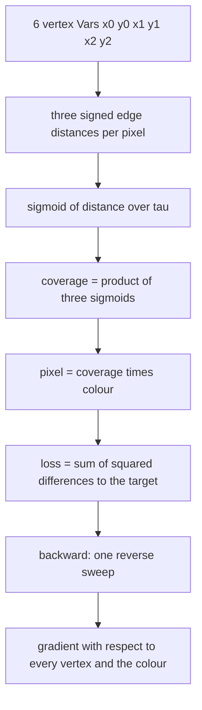
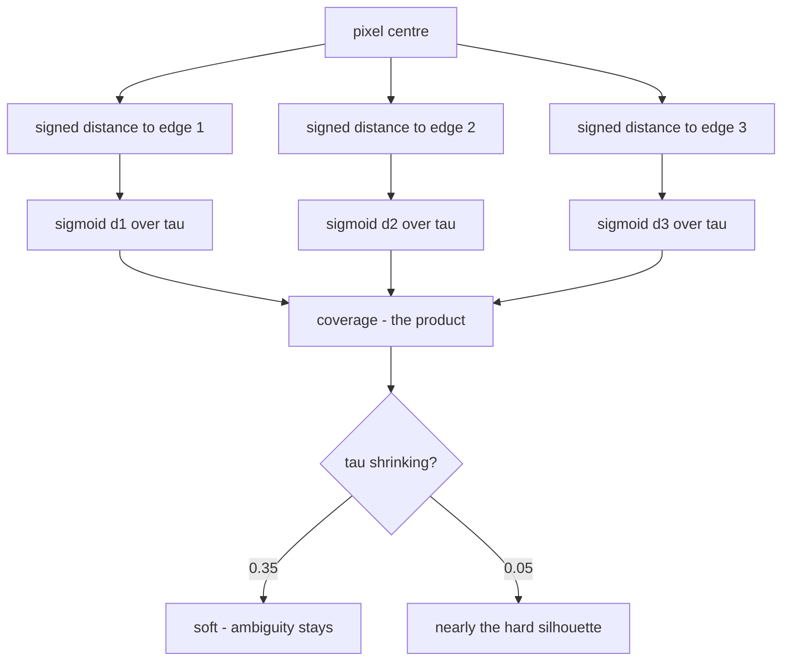
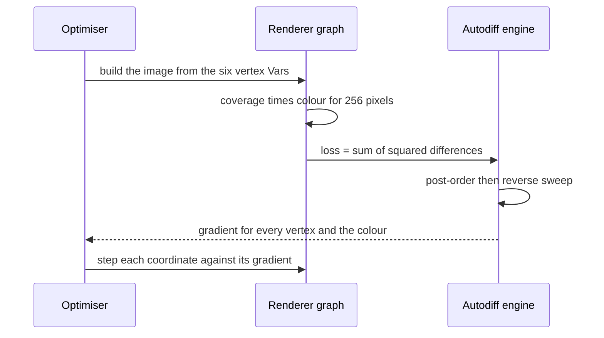

# 824 — Implement differentiable renderer basic and integrate into autograd.

> **Tier:** Master · **CTCI chapter:** Beyond — Machine Learning & AI
> **Task spec:** [824-implement-differentiable-renderer-basic-and-integrate-into-autog.md](../../../tasks/master/824-implement-differentiable-renderer-basic-and-integrate-into-autog.md)
> **Solutions:** [Python](../../../solutions/python/master/824-implement-differentiable-renderer-basic-and-integrate-into-autog/solution.py) ·
> [Java](../../../solutions/java/master/824-implement-differentiable-renderer-basic-and-integrate-into-autog/Solution.java) ·
> [JavaScript](../../../solutions/javascript/master/824-implement-differentiable-renderer-basic-and-integrate-into-autog/solution.js) ·
> [C#](../../../solutions/csharp/master/824-implement-differentiable-renderer-basic-and-integrate-into-autog/Solution.cs)

## 1. Problem restatement

**Input.** Six vertex coordinates (a triangle in counter-clockwise order), a colour, an image size
`SIZE = 16`, and a softness temperature `TAU = 0.35`. A target image is used only by the fit.

**Output.** An image — one autodiff node per pixel — plus the ability to call `backward` once on any loss
built from that image and obtain gradients with respect to geometry and colour.

| Piece | Contract |
| --- | --- |
| `Var` | a scalar autodiff node holding `value`, `grad`, and the `(parents, partials)` pairs of the primitive that created it |
| `backward(root)` | one reverse sweep: post-order traversal, zeroed adjoints, `root.grad = 1`, then `parent.grad += node.grad · partial` in reverse order |
| `edge_distance` | the signed distance from a pixel centre to an edge: cross product (twice a triangle area) divided by the edge length, so the result is in pixels |
| `render` | `coverage(p) = Π_i sigmoid(d_i / tau)` per pixel, multiplied by the colour — the whole rasteriser is built from engine primitives, so no hand-written renderer gradient exists |
| `hard_coverage` / `triangle_area` | the exact silhouette (same edge functions without the soft switch) and the shoelace area, used as references |

**Constraints.**

1. Every primitive's analytic gradient must match central finite differences, including a nested composite
   and the diamond case where one variable feeds two paths.
2. Coverage must stay inside `[0, 1]` and converge to the hard indicator as `tau` falls, and the soft total
   must approach the exact triangle area.
3. Orientation is a convention: a clockwise triangle renders empty.
4. Gradients with respect to all six vertex coordinates must match finite differences of the rendered loss.
5. Degenerate scenes — zero area, a single pixel, a huge temperature, a triangle entirely off-screen — must
   produce finite values and finite gradients.

**Concrete behaviour asserted by the shipped Python run.**

| Scenario | Expected result |
| --- | --- |
| Unit triangle `(4,4) (12,4) (8,12)`, 16×16, `tau = 0.35` | soft area `32.70` against the exact `32.00` |
| Ambiguity `Σ min(coverage, 1 − coverage)` | `11.473` at `tau = 0.35`, `0.181` at `tau = 0.05` |
| Diamond derivative | `x*x + x` at `x = 2` gives `5` |
| Vertex gradients | all six match central finite differences; the colour gradient equals the sum of coverage |
| Gradient-descent fit | loss `7.978 → 0.000`, worst vertex error `0.000` against the target `(6,5) (11,6) (7,11)` |
| Determinism | two identical renders and two identical backward sweeps agree exactly |

## 2. Intuition

A classic rasteriser answers "is this pixel centre inside this triangle" with an `if`. That `if` is a step
function: its derivative is zero almost everywhere and undefined on the edge, so nothing upstream — vertex
positions, colour, camera — can ever receive a gradient. Two ideas fix it.

**Replace the branch with a smooth switch.** The signed distance from a pixel centre to an edge tells you
both *which side* the pixel is on and *how far* it is. Passing it through `sigmoid(d / tau)` gives a value
near `1` well inside, near `0` well outside, and a smooth ramp within `~tau` pixels of the edge. Multiplying
the three edge factors approximates "inside" while staying differentiable everywhere — including exactly on
the edges, where the hard test is discontinuous.

**Write the rasteriser in the autodiff engine's own primitives.** If `coverage` is built from `Var`
arithmetic and `sigmoid`, then the pixel value is a node in the same graph as the loss, and one reverse sweep
produces `d loss / d vertices` without anybody deriving the renderer's analytic gradient by hand. The engine
only needs the local partials of `add`, `mul`, `sigmoid` and friends; the chain rule does the rest, and a
vertex used by three edges simply accumulates three contributions.



## 3. Algorithm

**The engine.** `Var` stores a float value, an adjoint, and for each operand the local partial of the
primitive with respect to that operand. `backward` walks the graph once.

1. Collect the subgraph in post-order by an explicit stack (each node is appended after all of its parents),
   so the list is a topological order of a DAG built strictly forward.
2. Zero every adjoint in that order, then seed `root.grad = 1`.
3. Walk the order in reverse; for each node and each `(parent, partial)` pair do
   `parent.grad += node.grad · partial`. Because the walk is reverse topological, a node's adjoint is already
   complete when it is propagated, and a value on several paths accumulates every contribution.

```text
procedure backward(root)
    order ← post-order of the subgraph that produced root, operands before consumers
    for node in order do
        node.grad ← 0
    end
    root.grad ← 1
    for node in reverse order of order do
        for parent with partial in node operands do
            parent.grad ← parent.grad + node.grad · partial
        end
    end
end
```

**The renderer.** Each pixel value is a product of three smooth coverage factors.

```text
function edge_distance(base, tip, pixel)
    numerator ← (tip.x - base.x) · (pixel.y - base.y) - (tip.y - base.y) · (pixel.x - base.x)
    length ← tangent_sqrt((tip.x - base.x)^2 + (tip.y - base.y)^2)
    return numerator / length
end

function render(vertices, colour, size, tau)
    pixels ← empty list
    for row in range(size) do
        for column in range(size) do
            pixel is centred at column + 0.5 and row + 0.5
            coverage ← 1
            for corner in 0 1 2 do
                following ← (corner + 1) mod 3
                d ← edge_distance(vertices at corner, vertices at following, pixel)
                coverage ← coverage · sigmoid(d / tau)
            end
            append coverage · colour to pixels
        end
    end
    return pixels
end
```

`tangent_sqrt(x) = sqrt(x + 1e-12)` is the one deliberate hack: a degenerate triangle has a zero-length
edge, and the floor keeps that division finite instead of producing a `NaN` that would poison every
gradient. `hard_coverage` uses the same numerators with the sign test `numerator > 0`, and `triangle_area`
uses the shoelace formula — both are references for the soft version, not part of the differentiable path.



**The fit.** `loss_to_target` sums squared differences between the rendered pixels and a target image, and
gradient descent takes fixed-size steps in the direction the reverse sweep reports.

```text
procedure fit(vertices, target, steps, learning_rate)
    for step in range(steps) do
        total ← sum over pixels of (rendered pixel - target pixel)^2
        backward(total)
        for each vertex coordinate do
            coordinate ← coordinate - learning_rate · coordinate.grad
        end
    end
end
```



**Documented simplifications.** A scalar tape rather than a tensor one — at scale the engine keeps one node
per tensor op with a vectorised adjoint, but the graph shape, the single sweep and the cost argument are
unchanged; one flat-shaded 2D triangle on a small image instead of meshes with depth buffering, texture
gradients, lighting and a camera model; and the rasteriser walks every pixel rather than bounding the
triangle's tile.

## 4. Worked example

**Coverage of four pixel centres** on the unit triangle `(4,4) (12,4) (8,12)`, whose exact area is
`32`. Edge order is `(4,4)→(12,4)`, `(12,4)→(8,12)`, `(8,12)→(4,4)`:

| Pixel centre | Distances to the three edges | Coverage at `tau = 0.35` | Coverage at `tau = 0.05` |
| --- | --- | --- | --- |
| `(8.5, 4.5)` | `0.5, 2.9069, 3.8013` | `0.806464` | `0.999955` |
| `(8.5, 3.5)` | `−0.5, 3.3541, 4.2485` | `0.193307` | `0.000045` |
| `(6.5, 6.5)` | `2.5, 3.8013, 1.118` | `0.959845` | `1.000000` |
| `(8.5, 12.5)` | `8.5, −0.6708, 0.2236` | `0.083932` | `0.000001` |

Row 1 is a pixel half a pixel above the base edge: deep inside according to two edges, straddling according
to the first, so the soft value is `0.81` and the shadow of the edge is real. Lower the temperature and the
same pixel is essentially covered (`0.999955`) — the soft renderer converges to the hard one. Row 3 shows a
pixel comfortably inside on all three distances, where both temperatures agree to six decimals.

Summing all `256` pixels gives the soft area `32.70` against the exact `32.00`, and the ambiguity metric
`Σ min(coverage, 1 − coverage)` — the file's "shadow of doubt" — falls from `11.473` at `tau = 0.35` to
`0.181` at `tau = 0.05`. The soft renderer is not an approximation of the rasteriser in the sense of being
wrong; it is an interpolation whose error you can dial.

**Two derivatives.** The diamond `out = x*x + x` with `x = 2` gives `x.grad = 5`, because the same variable
arrives twice and both contributions accumulate (`2x + 1 = 5`). For the image, the file compares every one of
the six vertex gradients against central finite differences of the rendered loss and also checks the analytic
identity `d(image)/d(colour) = Σ coverage`, which holds because each pixel is `coverage · colour`.

**The fit.** Starting from the unit triangle and a target image rendered from
`(6,5) (11,6) (7,11)`, gradient descent reduces the loss from `7.978` to `0.000` and leaves the worst vertex
error at `0.000` — the optimizer finds vertices that reproduce the target image pixel for pixel. Nothing in
that loop knows anything about triangle rasterisation: it only calls the loss and the sweep.

## 5. Complexity

Let `P = SIZE²` pixels, `T = 3` edges per pixel, and `V = 6` vertex coordinates.

| Measure | Bound | Why it holds |
| --- | --- | --- |
| `render` forward | O(P · T · d) work, O(P · T) nodes | `T` edge distances and `T` sigmoids per pixel, each a node in the graph |
| `backward` | O(nodes + edges) | every node is visited a constant number of times in the post-order and again in the reverse sweep |
| Memory | O(P · T) | the tape holds one node per primitive; no matrix is materialised |
| Gradient of one vertex | O(P) | each pixel touches every vertex through the three distances |
| Per optimisation step | O(P · T) | one forward render plus one sweep |
| Pixel-walking rasteriser | O(P) even for a tiny triangle | the bounding-tile optimisation would turn this into O(triangle area) |
| Exact area / silhouette | O(P) | the references walk the same pixels |

The asymptotics are deliberately unimpressive in `P`. The point of the task is the *cost of
differentiability*: adding gradients costs one extra sweep over the same tape, with no second renderer and no
per-primitive derivative written by hand. In a production engine the tape is tensor-based and the adjoint of
each op is vectorised, which turns `O(P · T)` nodes into `O(1)` nodes and the same `O(P · T)` arithmetic.

## 6. Pitfalls and edge cases

- **The branch is the bug.** Any `if inside` in the rasteriser kills the gradient; every decision in the
  differentiable path must be a smooth function of the distances.
- **Temperature too large.** With a huge `tau` every pixel's sigmoids sit near `0.5` and the shape visually
  disappears — the fixture asserts this renders finite values and finite gradients rather than exploding.
- **Temperature too small.** Near-hard coverage makes gradients vanish away from the silhouette; the file
  only goes to `tau = 0.05`, where coverage is `0.999955` inside and `0.000045` outside.
- **Zero-area triangle.** The edge length is `0`, so the denominator needs the `+1e-12` floor; without it the
  division produces an infinite distance and a `NaN` gradient.
- **Off-screen triangle.** Every distance is large and negative or positive, coverage collapses to `0`, and
  the gradient is finite (essentially zero) — a real failure mode for fitting, but not a crash.
- **Orientation.** The sign test uses `numerator > 0` for inside, so a clockwise triangle renders empty. This
  is a convention, not a bug, and the fixture asserts it.
- **Shared variables.** A vertex feeds three edges and both of its own coordinates appear in several
  distances; a reverse sweep that *assigns* instead of *accumulates* would silently drop contributions. The
  diamond check exists precisely to catch that.
- **Node identity.** The post-order traversal keys on `id(node)`, so a node reachable by two paths is pushed
  once; a value-based check would loop forever on a diamond.
- **Single-pixel image.** `SIZE = 1` must still render one coverage value and a finite gradient.
- **Not the true area.** The soft sum is `32.70` against `32.00` at the default temperature. Use the hard
  coverage when you want an area measurement; use the soft one when you want a gradient.
- **Determinism.** All arithmetic is plain float math with no sampling, so two renders and two sweeps agree
  exactly — the fixture compares both.
- **Simplifications kept honest.** Scalar tape, one flat-shaded triangle, no depth buffer, no textures, no
  lighting, no camera, and every pixel visited rather than just the triangle's tile.

## 7. Variants and follow-ups

- **Make the physics differentiable the same way.** The identical reverse-mode idea applied to a simulator is
  [825-implement-end-to-end-differentiable-physics-simulation-toy.md](../../../tasks/master/825-implement-end-to-end-differentiable-physics-simulation-toy.md).
- **Differentiate through a whole training pipeline.** Mixed precision adds loss scaling on top of the same
  sweep — see
  [826-implement-automatic-mixed-precision-training-full-pipeline-with.md](../../../tasks/master/826-implement-automatic-mixed-precision-training-full-pipeline-with.md).
- **Write the reverse pass for fused kernels.** The scalar tape becomes a tensor tape and the adjoint is
  vectorised in
  [883-implement-automatic-differentiation-for-gpu-kernels-across-fused.md](../../../tasks/master/883-implement-automatic-differentiation-for-gpu-kernels-across-fused.md).
- **Offload the pixels.** Rendering to a GPU changes where the tape lives but not what it records — see
  [876-implement-parallel-n-body-gravitational-simulator-with-gpu-offlo.md](../../../tasks/master/876-implement-parallel-n-body-gravitational-simulator-with-gpu-offlo.md).

## 8. Check yourself

1. Why does `sigmoid(d / tau)` make the coverage differentiable on the edges?

<details><summary>Show answer</summary>

Because it replaces the step `d > 0` with a smooth function of the same signed distance. On the edge the
hard indicator jumps from `0` to `1`, so its derivative is undefined there and zero elsewhere; the sigmoid
has a well-defined derivative `s · (1 − s)` at every distance, which peaks exactly on the edge. Multiplying
the three factors keeps the product smooth, so `d coverage / d vertex` exists everywhere.

</details>

2. What exactly does `backward` guarantee by walking in reverse post-order?

<details><summary>Show answer</summary>

That every node's adjoint is complete before it is used. A node's adjoint is the sum of contributions arriving
from the nodes that consumed it, all of which appear later in post-order, so the reverse walk visits them
first. That is what makes the diamond work: `out = x*x + x` at `x = 2` accumulates `2x` and `1` to give `5`
instead of overwriting one contribution with the other.

</details>

3. The soft area is `32.70` and the exact area is `32.00`. Which one is "right"?

<details><summary>Show answer</summary>

Both, for different purposes. `hard_coverage` is the true silhouette and measures the exact area of the
triangle; the soft renderer is a differentiable interpolation whose total converges to the same number as
`tau` falls (the ambiguity drops from `11.473` to `0.181`, and inside/outside pixels reach `0.999955` and
`0.000045`). The `0.70` difference is the price of having a gradient at all.

</details>

4. Why does `tangent_sqrt` exist?

<details><summary>Show answer</summary>

`edge_distance` divides by the edge length, and a zero-area triangle has an edge of length zero, which would
make the distance infinite and the gradient `NaN`. `sqrt(x + 1e-12)` keeps the denominator positive for any
degenerate triangle while leaving the normal case essentially unchanged, so the "finite values and finite
gradients" check passes for the degenerate fixtures.

</details>

5. Nothing in the fit loop mentions triangles. Where does the geometry gradient come from?

<details><summary>Show answer</summary>

From the graph itself. The pixel values are nodes created by `Var` primitives, so the six vertex `Var`s that
feed the edge distances are upstream of every pixel; the loss is a sum of squared differences built from
those same nodes. One `backward` call therefore delivers
`d loss / d vertex = Σ_pixels 2 (pixel − target) · d pixel / d vertex` with no renderer-specific derivative
written anywhere — which the six finite-difference comparisons verify.

</details>
