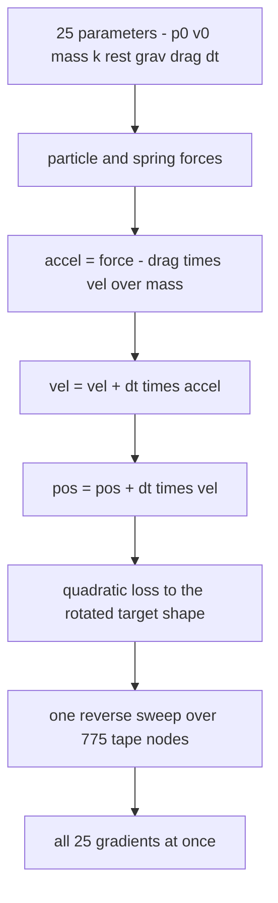
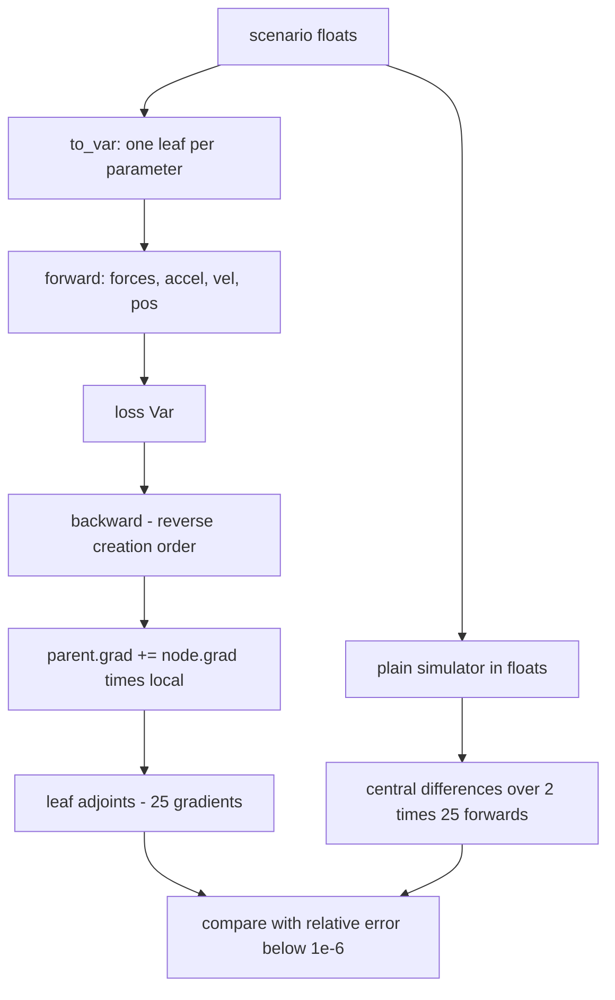
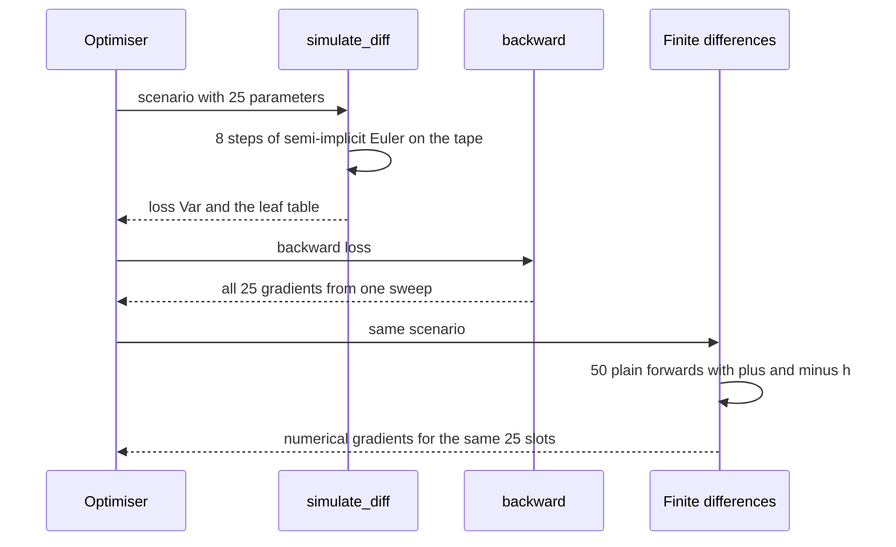

# 825 — Implement end-to-end differentiable physics simulation toy.

> **Tier:** Master · **CTCI chapter:** Beyond — Machine Learning & AI
> **Task spec:** [825-implement-end-to-end-differentiable-physics-simulation-toy.md](../../../tasks/master/825-implement-end-to-end-differentiable-physics-simulation-toy.md)
> **Solutions:** [Python](../../../solutions/python/master/825-implement-end-to-end-differentiable-physics-simulation-toy/solution.py) ·
> [Java](../../../solutions/java/master/825-implement-end-to-end-differentiable-physics-simulation-toy/Solution.java) ·
> [JavaScript](../../../solutions/javascript/master/825-implement-end-to-end-differentiable-physics-simulation-toy/solution.js) ·
> [C#](../../../solutions/csharp/master/825-implement-end-to-end-differentiable-physics-simulation-toy/Solution.cs)

## 1. Problem restatement

**Input.** A tiny 2D world: `particles = 3` points on a circle of radius `0.4`, springs `(0,1) (1,2) (0,2)`
with stiffness `30 + 5·s` and rest lengths equal to the initial separations, initial velocities
`(0.02·i, −0.01·(i+1))`, masses `1.0 + 0.25·i`, gravity `(0, −9.81)`, linear drag `0.35`, timestep `0.01`,
`steps = 8`, and target positions at the same circle rotated by `0.6` radians.

**Output.** Two things: the simulated trajectory and loss, and — the actual deliverable — the gradient of
that loss with respect to **all `25` simulation inputs at once**: gravity, drag, `dt`, every initial position,
every initial velocity, every mass, every stiffness and every rest length.

| Piece | Contract |
| --- | --- |
| `Var` | a scalar tape node: value, adjoint, and `(parent, local partial)` pairs recorded by the primitive |
| `backward(root)` | collect the reachable subgraph, order by creation index descending, zero the adjoints, seed `root.grad = 1`, then `parent.grad += node.grad · local` — one sweep covers every parameter |
| `simulate_plain` | the *same* update rules in plain floats: the forward-pass oracle and the function finite differences differentiate |
| `simulate_diff` | the differentiable forward pass, built from `Var` primitives only |
| `apply_spring` | the strain force written once and instantiated twice through `PLAIN_OPS` / `VAR_OPS`, so both engines run the same expression tree in the same order |
| `mechanical_energy` | kinetic + spring + gravitational potential, for the conservation and dissipation invariants |

**Constraints.**

1. The differentiable forward pass must agree with the plain simulator bit for bit.
2. Analytic gradients must match the closed form in the spring-free free-fall case (an analytic oracle, not
   finite differences) and match central finite differences of the plain simulator with relative error below
   `1e-6` for every parameter.
3. A zero-stiffness spring contributes exactly zero gradient, and coincident particles must not produce a
   `NaN`.
4. Physics invariants must hold: momentum conservation without drag and gravity, energy error of order `dt`,
   and strictly decreasing energy with positive drag.
5. One reverse sweep must replace the `2 · #params` forward passes that central differences need.

**Concrete behaviour asserted by the shipped Python run.**

| Scenario | Expected result |
| --- | --- |
| 3 particles, 3 springs, 8 steps | `775` tape nodes, `25` parameters |
| Gradient cross-check | maximum finite-difference error `7.37e-09` |
| Gradient descent on the loss | `0.0851589 → 3.16467e-05` with the particles landing on their targets |
| Free fall, 2 steps, 1 particle | position `y: 0 → −0.00108065 → −0.00313852`, loss `0.02866008` |
| Gradient check on that scenario | analytic and central differences agree to ten decimals on all nine parameters |

## 2. Intuition

"End to end" is the whole point. A planner or an optimiser does not want the derivative of the loss with
respect to the *state at some intermediate time*; it wants the derivative with respect to the inputs it can
actually choose — initial positions and velocities, masses, stiffnesses, gravity, drag, the timestep. Two
ways to get them:

- **Finite differences.** Perturb each parameter by `±h`, run the whole simulation again, subtract. For `P`
  parameters that is `2P` extra simulations, each of which must be *exactly* reproducible, and the accuracy
  is limited by the choice of `h` (`1e-6` here) because of cancellation.
- **Reverse-mode autodiff through the simulator.** Build the forward pass out of differentiable primitives,
  then run one sweep. The cost is one extra pass over the tape — `775` nodes for eight steps — and it yields
  all `25` gradients simultaneously, exactly.

The subtlety is that the simulator must be *differentiable as written*, not merely "have derivatives
somewhere". Two places where that bites:

- **The spring normal.** `dist = sqrt(dx² + dy²)` is differentiated through; freezing it as a constant would
  silently drop the `d(1/dist)` term, and the force would look differentiable while being subtly wrong.
- **Zero separation.** At `dist = 0` the normal is undefined, so the code truncates: below `EPS = 1e-12` the
  strain is multiplied by zero, which yields a zero force *and* a truncated derivative path. That is exactly
  what a production engine does, and it is applied identically in both engines so the bit-identity check still
  holds.



## 3. Algorithm

**Forward pass (semi-implicit Euler).** For each step: accumulate gravity per particle, add each spring's
strain force to both of its endpoints, then update velocities and positions.

```text
function apply_spring(dx, dy, k, rest, ops)
    dist ← ops.sqrt(ops.add(ops.mul(dx, dx), ops.mul(dy, dy)))
    if ops.value(dist) > EPS then
        strain ← ops.div(ops.mul(ops.sub(dist, rest), k), dist)
    else
        strain ← ops.mul(ops.sub(dist, rest), 0)     # zero separation: force 0 and derivative cut
    end
    return ops.mul(strain, dx), ops.mul(strain, dy)
end

procedure step(state, scenario)
    force[i] ← mass[i] · gravity for every particle
    for each spring (i j) with stiffness k and rest length rest do
        dx, dy ← pos[i] - pos[j]
        fx, fy ← apply_spring(dx, dy, k, rest, ops)
        force[i] ← force[i] - (fx, fy)
        force[j] ← force[j] + (fx, fy)
    end
    for each particle and axis do
        accel ← (force - drag · vel) / mass
        vel ← vel + dt · accel
        pos ← pos + dt · vel
    end
end
```

`simulate_plain` calls the same `apply_spring`, `step` shape with `PLAIN_OPS` (float arithmetic);
`simulate_diff` calls it with `VAR_OPS`, so every intermediate is a tape node. That is why the two forward
passes agree to the last bit instead of "approximately": they are the same expression tree.

**Reverse pass.** `backward` is the same shape as in the renderer task: reachable subgraph, reverse creation
order, adjoint accumulation.

```text
procedure backward(root)
    order ← every node reachable from root, sorted by creation index descending
    for node in order do node.grad ← 0
    root.grad ← 1
    for node in order do
        if node.grad is non-zero then
            for parent with local in node.parents do
                parent.grad ← parent.grad + node.grad · local
            end
        end
    end
end

function autodiff_gradient(scenario)
    loss, leaves ← simulate_diff(scenario)
    backward(loss)
    return the adjoint of each leaf in parameter_names order
end
```

Two implementation details are load-bearing. `p0_leaves` and `v0_leaves` are captured **before** the loop
starts, because the state variables `pos` and `vel` are rebound each step — without that capture the
"initial position" leaf would be a mid-simulation node and its gradient would be wrong. And the leaves are
retrieved from a dictionary, so `autodiff_gradient` returns the adjoints in a stable order that
`finite_difference_gradient` (which flattens and unflattens the scenario) can be compared against index by
index.





**Documented simplifications.** A scalar tape rather than a tensor one (at scale one node per tensor op with
a vectorised adjoint); an explicit integrator only, with no implicit solve, no collisions and no contacts;
and everything deterministic and in-process — no threads, no GPU, no wall-clock, no randomness.

## 4. Worked example

**Two steps of free fall, by hand and by code.** One particle, no springs, mass `1.0`, initial velocity
`(0, −0.01)`, gravity `(0, −9.81)`, drag `0.35`, `dt = 0.01`, starting at `(0.4, 0)`.

| Step | Force | Accel `(force − drag·vel) / mass` | Velocity after | Position after |
| --- | --- | --- | --- | --- |
| 1 | `(0, −9.81)` | `(0, −9.8065)` | `(0, −0.108065)` | `(0.4, −0.00108065)` |
| 2 | `(0, −9.81)` | `(0, −9.77217725)` | `(0, −0.2057867725)` | `(0.4, −0.00313852)` |

Drag makes the second step slightly slower than the first, exactly as `−drag·vel` requires, and the
positions match the plain simulator's collected trace to eight decimals. The loss against the rotated target
is `0.02866008`.

**The gradients, checked against central differences.** All nine parameters of that scenario, from one
sweep and from `2 × 9` plain forward passes:

| Parameter | Autodiff | Central differences |
| --- | --- | --- |
| `grav[0]` | `0.0000209353` | `0.0000209353` |
| `grav[1]` | `-0.0000686185` | `-0.0000686185` |
| `drag` | `-0.0000029318` | `-0.0000029318` |
| `dt` | `0.1390827839` | `0.1390827839` |
| `p0[0][0]` | `0.0698657540` | `0.0698657540` |
| `p0[0][1]` | `-0.2289955071` | `-0.2289955071` |
| `v0[0][0]` | `0.0013899877` | `0.0013899877` |
| `v0[0][1]` | `-0.0045558937` | `-0.0045558937` |
| `mass[0]` | `0.0000010261` | `0.0000010261` |

The pattern is worth reading: after only two steps the loss is far more sensitive to the initial position
(`−0.229` for the `y` coordinate, which moves the particle directly toward or away from the target) than to
gravity or drag, and `dt` is the largest single sensitivity (`0.139`) because a longer step advances the
whole fall. On the full 3-particle, 8-step scenario the shipped run compares all `25` parameters and reports a
maximum finite-difference error of `7.37e-09`.

**Physics invariants.** With gravity and drag the world dissipates: the same two-step scenario's mechanical
energy goes from `5e-05` to `-0.0096` as the particle falls and loses energy to drag. The file's own
invariants are sharper — with drag and gravity switched off, total momentum is conserved to rounding; the
energy error is of order `dt`; and any positive drag makes the energy strictly decrease over the horizon.

**Optimisation.** Gradient descent driven purely by the tape takes the loss from `0.0851589` to
`3.16467e-05`: the initial conditions that carry the triangle onto the rotated target shape are found by the
same sweep the checks use, which is the end-to-end claim in one line.

## 5. Complexity

Let `S` be the steps, `N` the particles, `J` the springs and `P` the parameter count (25 in the fixture).

| Measure | Bound | Why it holds |
| --- | --- | --- |
| Forward pass | O(S · (N + J)) arithmetic | forces, then one velocity and position update per particle per axis |
| Tape size | O(S · (N + J)) | measured `775` nodes for 8 steps and 3 particles |
| `backward` | O(tape) | every node is visited a constant number of times |
| All `P` gradients | O(tape + P) | one sweep covers every leaf simultaneously |
| Central differences | `2P` forward passes | 50 simulations for the fixture's 25 parameters |
| Memory | O(S · (N + J)) | the tape itself; nothing is recomputed |
| Fit cost | O(steps · tape) | one forward plus one sweep per optimisation step |

The comparison the task exists to make: one sweep of `775` nodes versus `2 · 25 = 50` full simulations. As
`P` grows — a mesh instead of three particles — the gap becomes the difference between a usable planner and
an unusable one.

## 6. Pitfalls and edge cases

- **Freezing the distance.** Writing the spring force with a cached `dist` instead of the differentiated
  `sqrt(...)` removes the `d(1/dist)` term; the gradient still looks plausible and is wrong. The fixtures'
  finite-difference comparison is what catches it.
- **Coincident particles.** At zero separation the normal is `0/0`, so the strain is truncated
  (`strain = (dist − rest) · 0`) giving a zero force and a cut derivative; the edge case asserts no `NaN`.
- **Zero-stiffness spring.** `k = 0` must contribute exactly `0.0` to every gradient, not "approximately
  zero" — an implementation that multiplies before checking would leak a tiny non-zero value.
- **Capturing initial conditions.** `p0_leaves` and `v0_leaves` are snapshotted before the integration loop;
  reading `pos` after the loop would return the final state and silently produce wrong gradients for the
  inputs the task is about.
- **Bit-identity.** `simulate_plain` and `simulate_diff` must run *the same expression tree*. Sharing
  `apply_spring` through an `ops` bundle is what guarantees it; writing the two forces separately would make
  the check flaky at the last bit.
- **Gradient ordering.** `parameter_names`, `flatten` and `unflatten` must agree exactly, or the comparison
  would pair a gradient with the wrong numerical estimate and "find" an error that is not there.
- **Step size in the numerical check.** `h = 1e-6` balances truncation against cancellation; the achieved
  `7.37e-09` maximum error tells you the balance is right, and a much larger `h` would inflate it.
- **`dt` as a parameter.** Treating the timestep as a constant would hide a real sensitivity — it is the
  largest one in the worked example — so it stays a leaf.
- **Energy with drag.** With drag or gravity active the energy is *supposed* to change; the conservation
  invariant only applies to the drag-free, gravity-free case, and a check that asserted conservation
  everywhere would be wrong.
- **Degenerate scenarios.** Zero steps, negative gravity, a huge `dt` (which can make the explicit
  integrator unstable) and coincident targets are all finite but physically meaningless — the invariants are
  the only guard.
- **Simplifications kept honest.** Scalar tape, explicit integrator only, no contacts, no implicit solve, no
  threads, no GPU.

## 7. Variants and follow-ups

- **Differentiate something that renders instead of simulates.** The same reverse sweep drives image
  gradients in
  [824-implement-differentiable-renderer-basic-and-integrate-into-autog.md](../../../tasks/master/824-implement-differentiable-renderer-basic-and-integrate-into-autog.md).
- **A demo of differentiable programming around this idea.** A broader roadmap of what to differentiate
  appears in
  [907-implement-differentiable-programming-demo-for-physical-simulatio.md](../../../tasks/master/907-implement-differentiable-programming-demo-for-physical-simulatio.md).
- **Vectorise the tape.** Fused kernels need the adjoint of a whole tensor op, which is the same graph with
  a much wider node — see
  [883-implement-automatic-differentiation-for-gpu-kernels-across-fused.md](../../../tasks/master/883-implement-automatic-differentiation-for-gpu-kernels-across-fused.md).
- **Plan in the loop.** Model-predictive control consumes exactly these gradients with respect to control
  inputs — see
  [918-implement-dynamic-qp-solver-for-real-time-control-in-robotics-mp.md](../../../tasks/master/918-implement-dynamic-qp-solver-for-real-time-control-in-robotics-mp.md).

## 8. Check yourself

1. Why is differentiating through the simulator better than finite differences here?

<details><summary>Show answer</summary>

Two reasons. Cost: one sweep over the tape (775 nodes) yields all 25 gradients, while central differences
need `2 × 25 = 50` complete simulations. Accuracy: the analytic adjoints match the numerical estimates to
`7.37e-09` at best, and the attainable numerical accuracy is limited by the step size `h = 1e-6` because of
cancellation, whereas the reverse sweep has no such floor.

</details>

2. What does the `EPS` guard do, and why is it applied in the plain simulator too?

<details><summary>Show answer</summary>

When two particles coincide, `dist = 0` makes the spring normal `dx/dist, dy/dist` undefined. The guard
replaces the strain with `(dist − rest) × 0` below `1e-12`, so the force is zero *and* the derivative path is
truncated. It exists in both engines so that the plain and differentiable forward passes stay bit-identical —
a guard in only one of them would break the equality check and, worse, make the numerical oracle differ from
the analytic one at exactly the points the edge-case tests hit.

</details>

3. Why must `apply_spring` be written once and shared through `PLAIN_OPS` / `VAR_OPS`?

<details><summary>Show answer</summary>

Because the claims are equality claims. The differentiable pass must equal the plain pass bit for bit, and the
finite-difference gradients must differentiate *exactly* the function the analytic sweep differentiates. Two
hand-written copies of the force expression can differ in operation order, and floating-point addition is not
associative, so the equality would become approximate and the correctness argument would evaporate.

</details>

4. The largest gradient in the worked example is with respect to `dt`. Is that expected?

<details><summary>Show answer</summary>

Yes. `dt` appears twice per step (velocity and position updates) and scales the whole trajectory, so over two
steps its sensitivity (`0.13908`) dominates the sensitivities to gravity (`−0.0000686`) or drag
(`−0.0000029`), which only shift the trajectory slightly at this scale. It is also why `dt` is kept as a leaf
rather than frozen as a constant.

</details>

5. Momentum is conserved without drag and gravity, but the energy only to order `dt`. Why the difference?

<details><summary>Show answer</summary>

Semi-implicit Euler applies internal spring forces in equal and opposite pairs, so the total momentum changes
only by floating-point rounding regardless of the step size. Energy, however, is not exactly conserved by any
fixed-step integrator: the error is O(dt) per step and accumulates over the horizon. Adding positive drag
makes the energy strictly decrease, which is the dissipativity the file checks instead.

</details>
