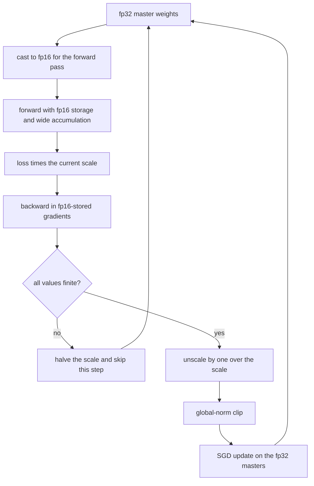
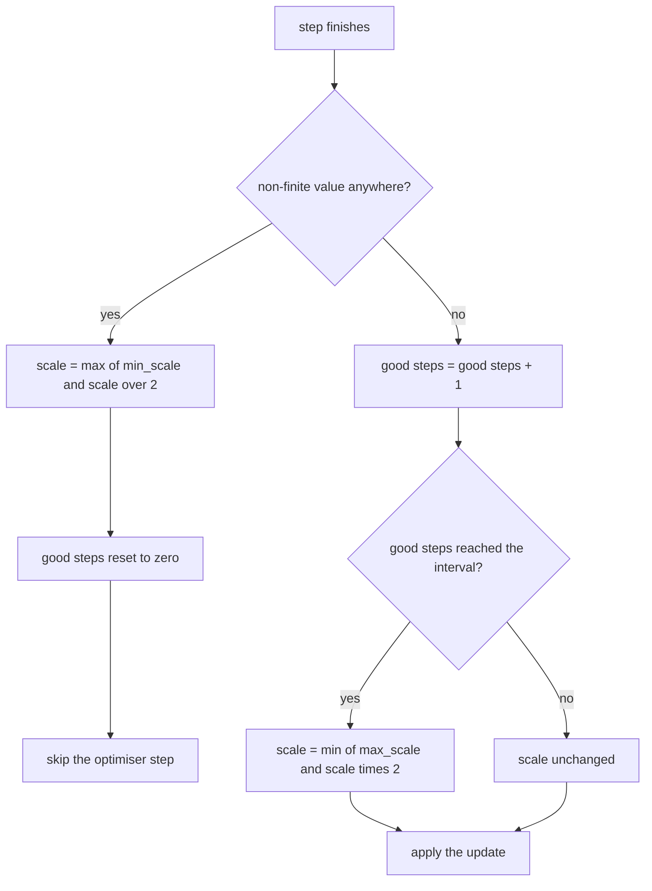
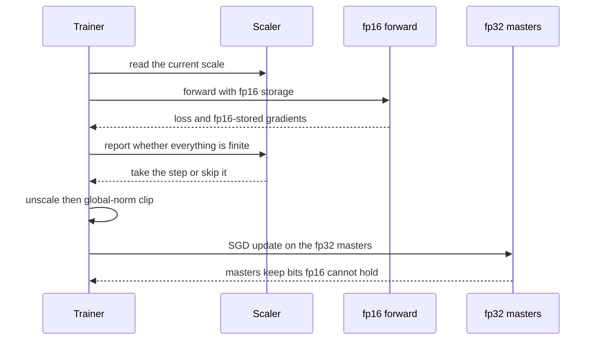

# 826 — Implement automatic mixed-precision training full pipeline with loss-scaling.

> **Tier:** Master · **CTCI chapter:** Beyond — Machine Learning & AI
> **Task spec:** [826-implement-automatic-mixed-precision-training-full-pipeline-with.md](../../../tasks/master/826-implement-automatic-mixed-precision-training-full-pipeline-with.md)
> **Solutions:** [Python](../../../solutions/python/master/826-implement-automatic-mixed-precision-training-full-pipeline-with/solution.py) ·
> [Java](../../../solutions/java/master/826-implement-automatic-mixed-precision-training-full-pipeline-with/Solution.java) ·
> [JavaScript](../../../solutions/javascript/master/826-implement-automatic-mixed-precision-training-full-pipeline-with/solution.js) ·
> [C#](../../../solutions/csharp/master/826-implement-automatic-mixed-precision-training-full-pipeline-with/Solution.cs)

## 1. Problem restatement

**Input.** A tiny deterministic model — a `2 → 3 → 1` MLP with a `tanh` hidden layer and mean-squared error —
and a deterministic dataset of nine points `([x, 0.5x], sin(1.7x))`; a learning rate, a step count
(`160` in the shipped run), a global-norm clipping bound and a dynamic loss scaler configured with
`init_scale = 4.0`, `growth_interval = 3`, `backoff = 2.0`, `min_scale = 1.0`, `max_scale = 1024.0`.

**Output.** A training report: the loss curve, the per-step scale, the number of skipped (overflowed) steps
and the number of clipped steps, the gradient norms before and after clipping, and the final fp32 master
weights.

| Piece | Contract |
| --- | --- |
| `fp16(x)` | a faithful binary16 model: 11-bit significand (1 implicit + 10 stored), the subnormal grid `2^-24` below `2^-14`, overflow to infinity at `65520`, NaN/inf propagated |
| `forward` | weights and activations **stored** in fp16 while products and accumulations stay wide — the "fp16 storage, fp32 accumulate" rule |
| `loss_and_grads` | analytic backprop, optionally loss-scaled (`d(S·loss)/dw = S · d(loss)/dw`) with fp16-stored gradients |
| `LossScaler` | powers of two only: double after `growth_interval` consecutive finite steps, halve on a non-finite step, and *skip the optimiser step* |
| `train` | master fp32 weights, scaled backward, unscale, global-norm clip, SGD update on the masters |

**Constraints.**

1. Rounding must be faithful: exactly representable values are fixed points, and every normal value satisfies
   `|fp16(x) − x| <= 2^-11 |x|` (half an 11-bit ULP).
2. Overflow and non-finite screening must descend into nested parameter structures and trigger the skip rule.
3. Scaling by a power of two must be **lossless**: scale by `S`, unscale by `1/S`, and the gradient must come
   back bit for bit.
4. Clipping must happen *after* unscaling, otherwise the effective bound shrinks to `max_norm / scale`.
5. Skipped steps must leave the masters bit-identical, and the whole pipeline must be bit-reproducible.

**Concrete behaviour asserted by the shipped Python run.**

| Scenario | Expected result |
| --- | --- |
| 400 deterministic probes | worst relative rounding error `4.784e-04` against the `2^-11 = 4.883e-04` limit |
| `fp16(6.0e4)` / `fp16(7.0e4)` | `60000` is representable; `70000` becomes infinity |
| `fp16(1e-9)` | `0.0` — and `fp16(1e-9 · 1024) ≠ 0`, so scaling rescues it |
| Scale by `2^10` then unscale | gradients recover bit for bit |
| AMP run, `steps = 160`, `max_norm = 0.5` | loss `0.000003` against fp32 `0.003143`, scale `1024`, `0` skips, `2` clips |
| Master weights | `13/13` are not representable in fp16 |
| Poisoned two-step run | both steps skipped, scale `16 → 8`, masters unchanged |

## 2. Intuition

Mixed precision is attractive because the *storage* of weights, activations and gradients dominates memory
traffic, and half the bits means half the bytes. It is dangerous for exactly one reason: binary16 has an
11-bit significand and a narrow exponent range, so many values simply cannot survive the round trip.

Three failure modes, three mechanisms:

- **Rounding.** Every fp16 store rounds. `0.31` becomes `0.31005859375`. That is acceptable — it is half an
  ULP — but it means the *master* copy of the weights must stay wide, or the updates get quantised away.
- **Underflow.** Small gradients flush to zero below `2^-25`. A gradient of `1e-9` is *exactly* zero in fp16,
  so the parameter it belongs to stops learning entirely. Multiplying the loss by a power of two multiplies
  every gradient by that power, lifting tiny values onto the grid — and because the factor is a power of two,
  multiplying and dividing are exact.
- **Overflow.** The same scaling pushes large gradients past `65520` into infinity. That is why the scale must
  *move*: up when steps keep succeeding, down the moment a non-finite value appears, and the step must be
  skipped entirely rather than applied with a corrupt gradient.

Together they form a control loop around the backward pass: the scale is the actuation, the finiteness check
is the sensor, and the skip is the safety interlock.



## 3. Algorithm

**The fp16 model.** Round to nearest on the binary16 grid, with three regimes.

```text
function fp16(x)
    if x is not finite then return x
    sign ← -1 when x is negative otherwise 1
    a ← absolute value of x
    if a ≥ 65520 then return sign · infinity
    if a < 2^-14 then return sign · round(a / 2^-24) · 2^-24     # subnormal grid
    mantissa, exponent ← frexp(a)                                  # a = mantissa · 2^exponent
    return sign · ldexp(round(mantissa · 2048) / 2048, exponent)    # 11 significant bits
end
```

**Forward and backward.** Every stored tensor passes through `store(x, half)`, so the fp16 *storage* is
modelled exactly while the accumulation stays wide.

```text
function forward(params, x, half)
    x_hat ← store each input coordinate
    z1[j] ← Σ_k store(W1[j][k]) · x_hat[k] + store(b1[j])
    a1[j] ← store(tanh(z1[j]))
    out ← Σ_j store(W2[0][j]) · a1[j] + store(b2[0])
    return store(out) and the cache of x_hat, z1 and a1
end

function loss_and_grads(params, batch, half, scale)
    loss ← the mean squared error over the batch
    for each sample do
        d_out ← scale · 2 · (out - y) / batch size
        for j in 0..2 do
            grads[W2][j] ← grads[W2][j] + d_out · a1[j]
            d_z1 ← d_out · store(W2[j]) · (1 - a1[j]^2)      # tanh derivative
            grads[b1][j] ← grads[b1][j] + d_z1
            for k in 0..1 do
                grads[W1][j][k] ← grads[W1][j][k] + d_z1 · x_hat[k]
            end
        end
        grads[b2] ← grads[b2] + d_out
    end
    when half then round every stored gradient to fp16
    return loss and the gradients
end
```

**The scaler.** A two-state control loop, with powers of two so that scaling and unscaling are exact.

```text
method report(scaler, finite)
    if not finite then
        scale ← max(min_scale, scale / backoff)
        good_steps ← 0
        return False            # the optimiser step must be skipped
    end
    good_steps ← good_steps + 1
    if good_steps ≥ growth_interval then
        good_steps ← 0
        scale ← min(max_scale, scale · 2)
    end
    return True
end
```

**The pipeline.** One step, in order: scaled forward/backward, finiteness screen, skip-or-continue,
unscale, clip, update.

```text
procedure train_step(params, batch, scaler, half, lr, max_norm)
    scale ← scaler scale when half otherwise 1
    loss, grads ← loss_and_grads(params, batch, half, scale)
    take ← scaler.report(all values of loss and grads are finite) when half
                otherwise the finiteness screen alone
    if not take then return without touching params end
    when half then multiply every gradient by 1 / scale        # unscale before clipping
    norm ← the global L2 norm of the gradients
    if norm > max_norm then
        multiply every gradient by max_norm / norm
    end
    subtract lr times each gradient from the corresponding master weight
end
```



**Documented simplifications.** Python floats are doubles, so "fp32 accumulate" is really "double
accumulate": the storage precision — the thing loss scaling exists for — is modelled exactly, while the
accumulation precision is modelled loosely, which is why the invariants that depend only on storage
precision are the exact ones. The model and dataset are tiny so the run is instant, and there is no CUDA, no
autocast dispatch and no fused optimiser.

## 4. Worked example

**The fp16 grid.** The same helper, applied to a few values, shows all three regimes:

| Input | `fp16(input)` | Regime |
| --- | --- | --- |
| `0.375` | `0.375` | a grid point, fixed |
| `1024.0` | `1024.0` | a power of two, fixed |
| `0.31` | `0.31005859375` | normal value, rounded to half a ULP |
| `1/3` | `0.333251953125` | normal value, rounded |
| `60000.0` | `60000.0` | below the `65520` overflow threshold |
| `70000.0` | `inf` | overflow — non-finite, so the step must be skipped |
| `2^-24` | `2^-24` | one step of the subnormal grid, survive |
| `2^-25` | `0.0` | half a subnormal step, flushed to zero |
| `1e-9` | `0.0` | far below the grid — this is what loss scaling rescues |

The measured worst relative error over 400 deterministic probes is `4.784e-04` against the theoretical bound
`2^-11 = 4.883e-04`, so the model is faithful rather than merely plausible.

**Why the scale must be a power of two.** Scaling the loss by `S = 1024` multiplies every gradient by
`1024 = 2^10`, which is exact in binary floating point: the fixture computes the gradients at scale `1` and
at scale `1024`, checks that every scaled entry is exactly `1024 ×` its unscaled twin, and that dividing by
`1024` recovers the unscaled values bit for bit. The rescue is just as concrete: `fp16(1e-9) == 0.0`, but
`fp16(1e-9 · 1024)` is non-zero, and after unscaling the gradient is back at its true size instead of being
silently dropped.

**One pipeline step, hand-derived.** With `lr = 0.1`, no clipping (`max_norm = 1e9`) and the fp32 path, the
first update of `W1[0][0]` is checked against a chain rule written out by hand:

| Quantity | Value |
| --- | --- |
| Initial loss | `0.23378527` |
| Hand-derived `dL/dW1[0][0]` | `-0.2734340942` |
| Expected `W1[0][0]` | `0.33734340942231217` |
| Actual `W1[0][0]` after one step | `0.33734340942231217` |

**The AMP run.** Over 160 steps with `max_norm = 0.5` the scale climbs one notch every three finite steps —
`4, 4, 4, 8, 8, 8, 16, …` up to the `max_scale` of `1024` — with no overflow at all, and the early gradient
norms show why clipping is needed: `0.8648` and `0.5357` exceed the `0.5` bound and are clipped, while
`0.3121`, `0.1587`, `0.0726` and `0.0330` are not. The run finishes with loss `0.000003` against `0.003143`
for the fp32 baseline, which satisfies the check that mixed precision costs no accuracy (`amp <= 1.10 ×
baseline`), and `13/13` master weights are *not* representable in fp16 — proof that the wide master copy is
carrying bits the half-precision forward cannot.



**Poisoned input.** A two-step run on anchors whose gradients overflow skips both steps and halves the scale
`16 → 8`; the master weights come out bit-identical to the input, which is the difference between "loss
scaling" and "loss scaling plus a correct skip rule".

## 5. Complexity

Let `P` be the parameter count (`13` here), `B` the batch size (the dataset has nine points) and `S` the step
count.

| Measure | Bound | Why it holds |
| --- | --- | --- |
| `fp16` | O(1) | `frexp`/`ldexp` plus one rounding, no table |
| Forward pass | O(P · B) | the MLP is `2 → 3 → 1`, so all three layers contribute a constant per sample |
| Backward pass | O(P · B) | the same loops traversed once, with the tanh derivative per hidden unit |
| Finiteness screen | O(P) | one pass over the flattened gradients, descending into nested lists |
| Unscale / clip | O(P) | a single scaling pass each |
| Memory | O(P · B) for the cache plus O(P) for the masters | the masters are the *extra* memory that buys the accuracy |
| Whole run | O(S · P · B) | `160` steps of a 13-parameter model over 9 samples |

The cost story of AMP is not in the flops, it is in the memory traffic: storing the forward tensors in fp16
halves the bytes moved, and the price is the fp32 master copy plus the scaler bookkeeping — both `O(P)`, and
both why the invariants in this task are about *precision*, not speed.

## 6. Pitfalls and edge cases

- **Clipping in the scaled space.** The gradients arrive multiplied by `S`. Clipping them to `max_norm` there
  would silently shrink the real bound to `max_norm / S`, and the fixture asserts that the clipped steps
  coincide with a raised scale precisely to make that mistake visible.
- **Forgetting to unscale at all.** The update would be `S` times too large — the classic "diverging AMP run
  with a suspiciously large learning rate".
- **Scaling by something other than a power of two.** `0.1/0.3` style factors are not exact, so scaling and
  unscaling can lose bits; the scaler only ever doubles or halves.
- **Non-power-of-two overflow thresholds.** `65520` is the largest finite binary16 value; the check uses
  `60000` (finite) and `70000` (infinite) either side of it.
- **Not skipping the step.** Applying an update computed from infinities propagates `NaN` into every
  parameter. The poisoned fixture asserts that both skipped steps leave the masters bit-identical.
- **Underflow mistaken for convergence.** A `1e-9` gradient is zero in fp16; without scaling, the parameter
  stops moving and the loss plateaus at a level nobody can explain.
- **Rounding the masters.** If the weights themselves were stored in fp16, updates smaller than half a ULP
  would vanish; `13/13` non-representable master weights is the measurable evidence that the wide copy is
  doing work.
- **Finiteness screening that only looks at the loss.** A finite loss with an infinite gradient is the
  common overflow case, so `every_finite` descends into the nested gradient lists and checks them too.
- **Skipping the scaler reset.** After an overflow the `good_steps` counter must reset, otherwise the scale
  climbs straight back into the overflow on the next three steps.
- **Backoff floor.** Halving must stop at `min_scale = 1.0`; without the floor a pathological run drives the
  scale to zero and loses the rescue entirely.
- **Determinism.** The dataset, the initialisation and the scaler schedule are fixed — no `random`, no clock
  — so two runs produce identical masters, which the file checks.
- **Simplifications kept honest.** Double accumulation instead of true fp32, a `2 → 3 → 1` model, no CUDA, no
  autocast dispatch, no fused optimiser.

## 7. Variants and follow-ups

- **Differencing through the pipeline.** The backward pass here is analytic; its differentiable cousin is
  built from a tape in
  [825-implement-end-to-end-differentiable-physics-simulation-toy.md](../../../tasks/master/825-implement-end-to-end-differentiable-physics-simulation-toy.md).
- **Shrink the gradients before they cross a network.** Compression is the communication-side analogue of the
  storage-side trick — see
  [934-implement-distributed-gradient-compression-with-error-correction.md](../../../tasks/master/934-implement-distributed-gradient-compression-with-error-correction.md).
- **Save memory by checkpointing instead of quantising.** The other lever on the training memory bill is
  [819-implement-memory-efficient-checkpointing-for-massive-models-bloc.md](../../../tasks/master/819-implement-memory-efficient-checkpointing-for-massive-models-bloc.md).
- **Split the model so precision matters less per device.** Model and pipeline parallelism change where the
  tensors live: see
  [818-implement-model-parallel-training-partitioner-and-pipeline-paral.md](../../../tasks/master/818-implement-model-parallel-training-partitioner-and-pipeline-paral.md).

## 8. Check yourself

1. Why must the scaler only ever produce powers of two?

<details><summary>Show answer</summary>

Because scaling and unscaling are then exact. Multiplying by `2^k` only shifts the exponent, so no significand
bits are lost; `0.1` would round, and a loss scaled by a non-power-of-two would come back slightly different
from the original. The fixture checks exactly this: the gradients at scale `1024` are bit-for-bit `1024 ×` the
unscaled gradients, and dividing by `1024` recovers the originals.

</details>

2. What does loss scaling actually protect, given that the fp16 model already rounds?

<details><summary>Show answer</summary>

Underflow, not rounding. Rounding costs half an ULP and is tolerable. Underflow is not: `fp16(1e-9)` is
`0.0`, so a small gradient disappears completely and the parameter it points at never updates. Scaling the
loss by `2^k` lifts those gradients onto the grid, they are stored faithfully, and unscaling returns them at
their true size — demonstrated by the fixture with `1e-9`, which only survives the scaled round trip.

</details>

3. Why is the skip rule as important as the scale itself?

<details><summary>Show answer</summary>

Because an overflow makes the gradient computation useless: some entry is `inf`, so any update derived from
it would write `NaN` into the masters. The rule is "if any value is non-finite, halve the scale and do not
touch the weights" — the poisoned two-step run skips both steps, backs off `16 → 8`, and leaves the masters
bit-identical, which is the safest possible response to a step that cannot be trusted.

</details>

4. The run clips steps whose gradient norm is `0.8648` and `0.5357` but not `0.3121`. What does that prove?

<details><summary>Show answer</summary>

That clipping happens *after* unscaling and works on the real gradient scale. The bound is `max_norm = 0.5`,
and those norms are the unscaled values, so the first two steps exceed it and get scaled down to `0.5`, while
`0.3121` is already inside and is left alone. If clipping happened in the scaled space, the effective bound
would be `0.5 / scale`, and steps with a large scale would be over-clipped — a failure the fixture tries to
provoke by asserting that the clipped steps coincide with a raised scale.

</details>

5. What is proven by `13/13` master weights being unrepresentable in fp16?

<details><summary>Show answer</summary>

That the fp32 master copy is not decoration. Every one of the thirteen weights carries bits an fp16 store
would round away, so if the optimiser updated the half-precision values directly, the small updates would be
quantised to nothing and training would stall. Keeping wide masters and casting only for the forward pass is
what makes the pipeline work, and the count is a measurable consequence of that design.

</details>
