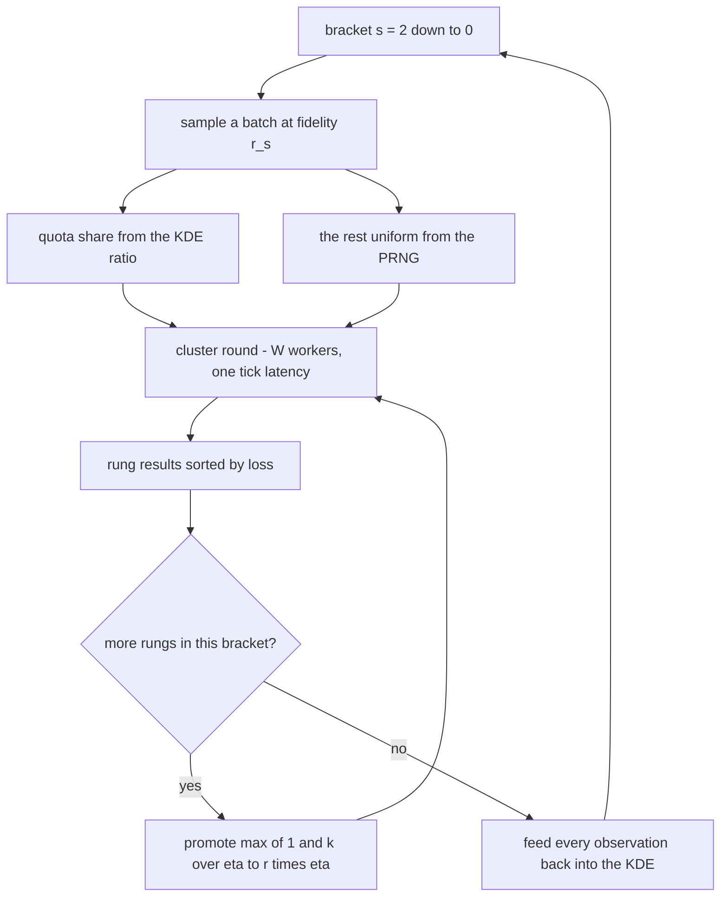
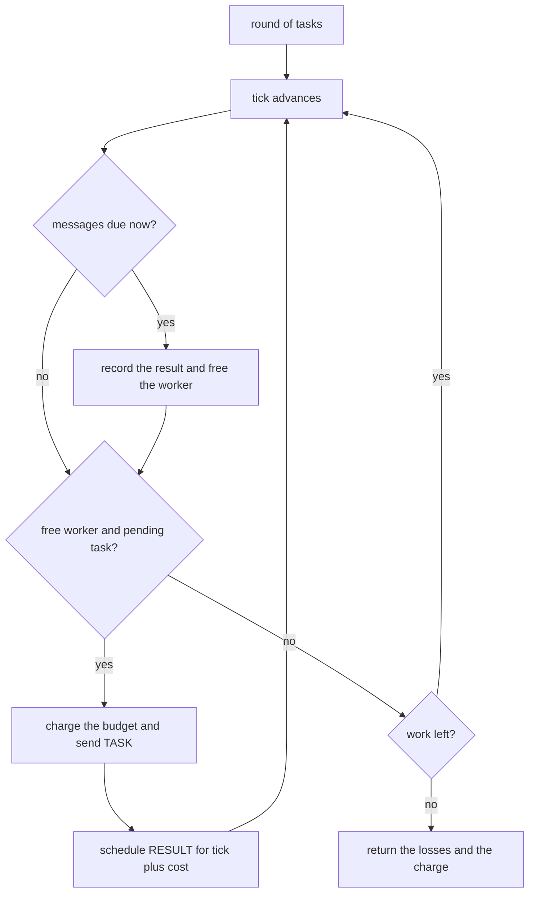
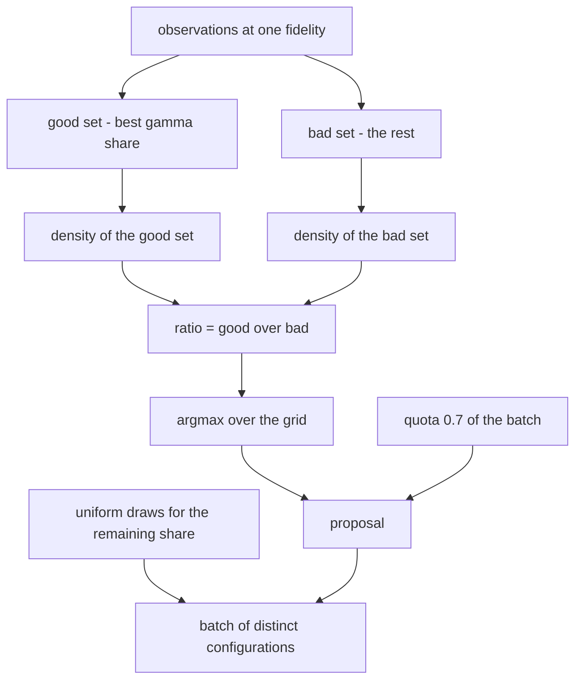

# 827 — Implement distributed hyperparameter search with early stopping and resource allocation (BOHB).

> **Tier:** Master · **CTCI chapter:** Beyond — Machine Learning & AI
> **Task spec:** [827-implement-distributed-hyperparameter-search-with-early-stopping.md](../../../tasks/master/827-implement-distributed-hyperparameter-search-with-early-stopping.md)
> **Solutions:** [Python](../../../solutions/python/master/827-implement-distributed-hyperparameter-search-with-early-stopping/solution.py) ·
> [Java](../../../solutions/java/master/827-implement-distributed-hyperparameter-search-with-early-stopping/Solution.java) ·
> [JavaScript](../../../solutions/javascript/master/827-implement-distributed-hyperparameter-search-with-early-stopping/solution.js) ·
> [C#](../../../solutions/csharp/master/827-implement-distributed-hyperparameter-search-with-early-stopping/Solution.cs)

## 1. Problem restatement

**Input.** A discrete search space — the full grid of `DIMS = ((0.5, 0.25, 0.125, 0.0625), (1, 2))`, so eight
`(learning rate, depth)` configurations; `ETA = 3`, `R_MAX = 9`, `R_MIN = 1`, `S_MAX = 2`; a KDE sampler
with bandwidth `1.0`, `gamma = 0.2`, `n_min = 3`, exploration `quota = 0.7`; a cluster of `W` workers with a
one-tick message latency and a task cost of `budget` ticks.

**Output.** The incumbent configuration and its loss, the budget the cluster actually charged, the message
log, the peak concurrency, and the per-rung history — plus an independently enumerated resource oracle to
compare the charge against.

| Piece | Contract |
| --- | --- |
| `fidelity_schedule` | Hyperband brackets `s = S_MAX … 0` with `n_s = ceil((S_MAX + 1) / (s + 1) · eta^s)` configurations at fidelity `r_s = R_MAX · eta^-s` |
| `rung_schedule` | the successive-halving plan `(configurations, budget)` per rung, promoting `max(1, k // eta)` |
| `KDESampler` | two 1-D Gaussian KDEs over the *grid index* — one fitted to the best `gamma` share of observations at a fidelity, one to the rest — with the proposal equal to the argmax of their density ratio |
| `Cluster` | `W` workers driven by an explicit tick loop: each task becomes a `TASK` message and its result comes back as a `RESULT` message after `cost(budget)` ticks |
| `hyperband` | the driver: run every bracket, feed every observation back into the sampler, keep the best full-fidelity run |

**Constraints.**

1. Resource accounting must be exact: the budget charged equals the independently enumerated rung schedule —
   nothing lost, nothing double-charged.
2. Every rung must promote exactly `max(1, k // eta)` configurations, and that set must be the rung's own loss
   order.
3. Early stopping must be real: only promoted configurations are re-evaluated, at a strictly higher fidelity.
4. The cluster must never exceed `W` concurrent tasks, must reach `W`, and must never deliver a message before
   it was sent.
5. The search must be bit-reproducible and **worker-count invariant**: one worker charges the same budget and
   returns the same incumbent as several.

**Concrete behaviour asserted by the shipped Python run.**

| Scenario | Expected result |
| --- | --- |
| Fidelity schedule | brackets `(s=2, n=9, r=1)`, `(s=1, n=5, r=3)`, `(s=0, n=3, r=9)` |
| Resource accounting | `74` units charged, against a bracket bound of `84` and `180` for twenty full-fidelity runs |
| Ranking-aligned instance | incumbent `(0.0625, 2)` — exactly the brute-force optimum of the grid |
| Misleading instance | cheap-fidelity argmin `(0.5, 2)` but full-fidelity argmin `(0.125, 2)`; the search lands on `(0.25, 2)` with loss `0.14787` against the optimum `0.12120` |
| Sampler | the proposal maximises an independently recomputed density ratio; batches contain no duplicates; the model stays cold until `n_min` observations exist |

## 2. Intuition

Hyperparameter search is a budget allocation problem before it is a modelling problem. Two ideas combine.

**Hyperband: spend most of the budget where it is cheapest.** A configuration that will fail can usually be
recognised early, so run many configurations briefly and keep the best fraction. The brackets encode a whole
family of such trade-offs: the widest bracket runs `n = 9` configurations at one epoch and keeps three, then
one; the narrowest runs only three configurations but each at the full nine epochs. The closed forms
`n_s = ceil((S_MAX + 1)/(s + 1) · eta^s)` and `r_s = R_MAX · eta^-s` are what make the trade-off explicit
instead of a guess.

**BOHB: sample near what worked.** Uniform sampling throws away everything the search has learned. Instead,
split the observations at a fidelity into a "good" set (the best `gamma = 0.2` share) and a "bad" set, fit a
density to each, and propose the point maximising `density_good / density_bad` — the TPE rule, made
deterministic by evaluating the ratio over the whole grid. Keep a `quota = 0.7` share of every batch from the
model and the rest uniform: exploitation with a guaranteed exploration floor, and stay entirely random until
`n_min = 3` observations exist.

The third ingredient is that these runs happen on a cluster, so the loop has to be a *distributed* one: work
is dispatched as messages, a worker is busy for `budget` ticks, and the coordinator learns nothing until the
result message arrives. Modelling that with an explicit tick loop makes the cost assertion meaningful — the
charged budget is what the cluster really spent, not what the sampler wished it had spent.



## 3. Algorithm

**The fidelity schedule and the rung plan.**

1. For `s` from `S_MAX` down to `0`, emit `n_s = ceil((S_MAX + 1)/(s + 1) · eta^s)` configurations at
   `r_s = R_MAX · eta^-s`, with `s + 1` rungs.
2. Within a bracket, rung sizes are `n, n // eta, n // eta², …`, stopping at `1`.
3. The rung plan multiplies the budget by `eta` after each rung and stops when only one configuration remains
   or the next budget would exceed `R_MAX` — that plan is the resource oracle.

```text
function fidelity_schedule(s_max, eta, r_max)
    brackets ← empty list
    for s ← s_max down to 0 do
        append a bracket with n = ceil((s_max + 1) / (s + 1) · eta^s)
                             r = floor(r_max · eta^-s)
                             and s + 1 rungs
    end
    return brackets
end

function rung_schedule(n, rungs, r, r_max)
    plan ← empty list and budget ← r
    for size in the rung sizes of n with the given rung count do
        append (size, budget) to plan
        if size = 1 or budget · eta > r_max then stop
        budget ← budget · eta
    end
    return plan
end
```

**The KDE proposal.** Observations are stored per fidelity; `split(budget)` takes the best
`max(1, ceil(gamma · count))` as "good" and the rest as "bad"; the score of a grid point is
`density(x, good) / density(x, bad)`, with `infinity` when there is no bad set and `None` while the model is
cold.

```text
function density(x, points)
    return the mean over points of exp(-(x - point)^2 / (2 · bandwidth^2))
end

function ratio(x, budget)
    good, bad ← split the observations at this budget into the best gamma share and the rest
    if good is empty then return nothing            # the model is cold
    if bad is empty then return infinity            # every observation is good
    return density(x, good) / density(x, bad)
end

function propose(budget, exclude)
    best ← nothing
    for index in every grid index not excluded do
        score ← ratio(index, budget)
        if score is nothing then return nothing
        keep the index with the largest score
    end
    return best
end

function sample_batch(count, budget)
    target ← min(count, grid size)
    when there are at least n_min observations do
        take ceil(quota · count) proposals, skipping indices already picked
    end
    fill the remainder with uniform draws from the PRNG, skipping picked indices
    return the distinct picked indices
end
```

**The cluster.** One explicit tick loop: at every tick, deliver due messages (a `RESULT` frees its worker and
records the loss), then hand free workers the next pending task, charge its budget, and schedule its `RESULT`
for `cost(budget)` ticks later.

```text
method run_round(tasks)
    pending ← the task list
    running ← an empty map from worker to task id, results ← empty map, tick ← 0
    while pending is non-empty or running is non-empty do
        tick ← tick + 1
        for each message delivered at this tick do
            if the message is a RESULT then record its loss and free the worker
        end
        for worker in the worker pool do
            if the worker is busy or there is nothing pending then continue
            pop a task, charge its budget to the cluster, log the dispatch tick
            send a TASK message now and schedule the RESULT message at tick + cost
            mark the worker busy
        end
        track the peak number of busy workers
    end
    return the results
end
```



**The driver.** For each bracket: sample `n_s` distinct configurations at fidelity `r_s`, run them through the
cluster, keep the best `max(1, k // eta)`, evaluate those at `r_s · eta`, and so on until one configuration
remains at `R_MAX`. Every observation is fed to the sampler, and the best run seen at `R_MAX` is the
incumbent.

```text
function hyperband(kind, workers, seed)
    sampler ← KDESampler with the given seed and the grid
    cluster ← Cluster with the given worker count and the objective
    for bracket in fidelity_schedule() do
        configs ← sampler.sample_batch(bracket.n, bracket.r)
        budget ← bracket.r
        while true do
            losses ← cluster.run_round(the configs at this budget)
            record every (config, loss, budget) into the sampler
            keep ← max(1, number of results // eta) configurations with the smallest loss
            if only one configuration remains and budget = R_MAX then stop
            budget ← budget · eta and configs ← keep
        end
    end
    return the incumbent, the messages and the cluster
end
```

**Documented simplifications.** Fidelity is one integer `budget` and a run costs `budget` ticks, so simulated
time is a faithful proxy for cost without wall-clock; the model is a 1-D KDE over grid indices rather than
BOHB's adaptive multi-variate KDE over a configuration tree, while the density-ratio proposal and the
exploration quota — the parts that make BOHB *BOHB* — are unchanged; and there are no threads, sockets,
sleeping or randomness beyond the seeded splitmix64 stream.

## 4. Worked example

**The bracket plans.** With `S_MAX = 2`, `ETA = 3` and `R_MAX = 9` the schedule has three brackets, and the
independent rung oracle produces:

| Bracket `s` | `n_s` | `r_s` | Rung plan `(configs, budget)` | Nominal cost |
| --- | --- | --- | --- | --- |
| 2 | 9 | 1 | `(9,1) (3,3) (1,9)` | `27` |
| 1 | 5 | 3 | `(5,3) (1,9)` | `24` |
| 0 | 3 | 9 | `(3,9)` | `27` |

The widest bracket is the cheapest per configuration, which is the whole Hyperband argument in one row: nine
configurations at one epoch cost the same `9` units as the *single* configuration the narrowest bracket runs
at nine epochs.

**Why the charge is 74 and not 78.** The nominal plan totals `27 + 24 + 27 = 78`, but the first bracket asks
for nine configurations out of a grid of eight. `sample_batch` caps at the grid size, so the rung holds eight
distinct configurations at budget `1` (`8` units), promotes `8 // 3 = 2` at budget `3` (`6` units), then one at
budget `9` (`9` units) — `23` units instead of `27`. The measured total is `74` against a bracket bound of
`84`, and against `180` for the naive alternative of running twenty configurations at maximum fidelity. That
gap is the resource-allocation claim, and it is checked against the enumerated rung schedule rather than
assumed.

**The promotion rule.** In bracket `s = 1` the rung holds five configurations at budget `3`; `5 // 3 = 1`, so
exactly one is promoted to budget `9`, and it is the one with the smallest loss in that rung. The file
re-derives the promotion set from the rung's own loss order and asserts the promoted count equals
`max(1, floor(k / eta))` for every rung of every bracket — including the degenerate `k < eta` case where the
floor is `0` but the rule still promotes one.

**The two objectives.** `base_loss` is `0.05(log2(lr) + 3.6)² + 0.02(depth − 1.6)²`, so the grid optimum is
`(0.0625, 2)`.

| Instance | Optimal at the cheap fidelity | Optimal at the full fidelity | Incumbent found | Incumbent loss |
| --- | --- | --- | --- | --- |
| `aligned` (`base + base/budget`) | same ranking as full | `(0.0625, 2)` | `(0.0625, 2)` | the grid optimum |
| `misleading` (extra `bonus` and `trap` terms) | `(0.5, 2)` | `(0.125, 2)` | `(0.25, 2)` | `0.14787` against `0.12120` |

The misleading instance is the honest half of this task. Its cheap-fidelity ranking is deliberately reversed
by a bonus that loves `depth = 2` and a trap that loves a large learning rate, so the search is genuinely
fooled: the incumbent is *not* the optimum, and the file measures the damage (a loss within the documented
factor of the optimum) instead of pretending low-fidelity signals are always faithful.



## 5. Complexity

Let `G` be the grid size (`8`), `O` the observations at a fidelity, `T` the tasks in a round, `W` the
workers, and `B` the number of brackets.

| Measure | Bound | Why it holds |
| --- | --- | --- |
| `fidelity_schedule` | O(B) | one closed form per bracket |
| `density` | O(O) | one Gaussian per observation, 1-D and exact on the grid |
| `ratio` / `propose` | O(O · G) | a density ratio per grid point |
| `sample_batch` | O(G² · O) worst case | `ceil(quota · count)` proposals, each scanning the grid |
| `run_round` | O(T + total cost) ticks | every worker step and every message is one tick step |
| Charged budget | Σ rung `configs × budget` — `74` in the fixture | exact, and compared against the enumerated plan |
| Messages | 2 per task | one `TASK`, one `RESULT` |
| Whole search | O(Σ over brackets of tasks) | `8 + 2 + 1 = 11`, `5 + 1 = 6`, `3` = 20 tasks in the aligned run |

The resource numbers are where the design pays: `74` units of budget for a search that would cost `180` if
every sampled configuration were run to the end, with the difference coming from early stopping rather than
from a smaller search space.

## 6. Pitfalls and edge cases

- **Asking for more configurations than the grid holds.** The widest bracket wants `9` from a grid of `8`;
  `sample_batch` caps at the grid size, which is why the measured charge is `74` rather than the nominal `78`.
  A sampler that silently returned duplicates would over-charge and re-run identical work.
- **Duplicate configurations inside one rung.** Every pick excludes the indices already chosen, and the model
  proposals and uniform draws share that exclusion set.
- **Cold start.** Until `n_min = 3` observations exist at a fidelity, `propose` returns `None` and the whole
  batch is uniform — otherwise a density ratio fitted to one or two points would dominate the search.
- **Division by an empty bad set.** When every observation is "good" the ratio is `infinity` rather than a
  `ZeroDivisionError`; the fixture checks the value.
- **Promotion flooring to zero.** `k // eta` is `0` when `k < eta`, so the rule is `max(1, …)`; promoting
  nothing would end a bracket early and silently drop the low-fidelity brackets.
- **Budget leakage.** Every task is charged exactly once, at dispatch, and the total is compared with the
  enumerated rung schedule. Charging at completion as well, or charging promoted configurations twice, shows
  up immediately in that comparison.
- **Rung budget growth.** The plan stops multiplying once the next budget would exceed `R_MAX`; growing it
  anyway would spend budget on a fidelity nobody asked for.
- **A misleading low-fidelity signal.** This is a property of the objective, not a bug: the fixture's
  `misleading` instance reverses the cheap ranking, and the honest outcome is an incumbent that is not the
  optimum.
- **Concurrency.** The tick loop must never run more than `W` tasks at once and must reach `W` when there is
  work; the peak is recorded, and the message log is checked for any delivery before its send.
- **Worker-count invariance.** The parallel run must charge the same budget and return the same incumbent as a
  single serialised worker, which is only true because budget is charged per task rather than per unit of
  wall-clock.
- **Determinism.** All randomness comes from a seeded splitmix64 stream and every tie is broken by index, so
  the whole search — including the sampling decisions — is bit-reproducible.
- **Simplifications kept honest.** One integer fidelity, a 1-D KDE over grid indices rather than a
  multi-variate tree, no threads, no sockets, no sleeping.

## 7. Variants and follow-ups

- **Model the surrogate probabilistically.** BOHB's sampler is a density ratio; a Gaussian-process version
  with an expected-improvement acquisition is the other classic answer — see
  [828-implement-black-box-optimizer-with-bayesian-optimization-and-ei.md](../../../tasks/master/828-implement-black-box-optimizer-with-bayesian-optimization-and-ei.md).
- **Search architectures instead of scalars.** The same bracket-and-promote loop drives a discrete
  architecture search with resource constraints — see
  [898-implement-neural-architecture-search-pipeline-with-resource-cons.md](../../../tasks/master/898-implement-neural-architecture-search-pipeline-with-resource-cons.md).
- **Add fidelity levels to a simulator.** Multi-fidelity orchestration is the same budget-allocation question
  with surrogates — see
  [906-implement-multi-fidelity-simulation-orchestration-with-surrogate.md](../../../tasks/master/906-implement-multi-fidelity-simulation-orchestration-with-surrogate.md).
- **Put budgets and SLOs around the search.** A platform that enforces spend limits is the production
  counterpart — see
  [938-implement-safe-experiment-platform-that-enforces-slos-and-budget.md](../../../tasks/master/938-implement-safe-experiment-platform-that-enforces-slos-and-budget.md).

## 8. Check yourself

1. Why does the widest bracket get the most configurations and the smallest fidelity?

<details><summary>Show answer</summary>

Because that is where information is cheapest. A configuration that is hopeless usually looks bad after one
epoch, so spending one unit on nine candidates and promoting a third of them costs the same `9` units as
running one candidate for the full nine epochs, while covering far more of the space. The closed forms
`n_s = ceil((S_MAX + 1)/(s + 1) · eta^s)` and `r_s = R_MAX · eta^-s` keep the total budget comparable across
brackets, and the fixture asserts the ordering from `s = 2` down to `s = 0`.

</details>

2. The plan looks like it should cost `78` units but the measured charge is `74`. Where do the four units go?

<details><summary>Show answer</summary>

The first bracket wants `9` configurations from a grid of `8`. `sample_batch` caps the batch at the grid size,
so the rung runs `8` configurations at budget `1` (`8` units), promotes `8 // 3 = 2` at budget `3` (`6` units)
and one at budget `9` (`9` units) — `23` instead of `27`. The other two brackets run as planned (`24` and
`27`), so the total is `74`. Duplicate-free batches are a correctness requirement, not an optimisation.

</details>

3. What exactly does the density ratio buy over uniform sampling?

<details><summary>Show answer</summary>

It concentrates the cheap evaluations near configurations that already look promising at the same fidelity:
the proposal is the argmax of `density(good) / density(bad)` over the grid, so a point that looks like the
best `gamma = 0.2` share of past observations scores high. The `quota = 0.7` share keeps that exploitation
bounded, and the remaining `30%` stays uniform, so the search can never lose coverage entirely — and a
batch's proposals explicitly exclude the indices already chosen.

</details>

4. The `misleading` instance ends on `(0.25, 2)` instead of the optimum `(0.125, 2)`. Is that a bug?

<details><summary>Show answer</summary>

No — it is the point of that fixture. Its objective adds a bonus and a trap term that invert the cheap-fidelity
ranking (`cheap argmin (0.5, 2)` versus `full argmin (0.125, 2)`), so a Hyperband-style search that trusts
early signals gets fooled. The file asserts that the incumbent differs from the optimum and reports the
measured gap (`0.14787` against `0.12120`) rather than hiding it, which is what makes the `aligned` success
meaningful: on a faithful fidelity signal the incumbent is exactly the brute-force optimum.

</details>

5. Why must the search be worker-count invariant?

<details><summary>Show answer</summary>

Because the budget accounting is the deliverable. If the charged budget depended on parallelism, the cost
claim would be about a particular machine rather than about the algorithm. The cluster charges each task's
budget once at dispatch and never charges for waiting, so one serialised worker and several parallel workers
charge exactly the same `74` units and return the same incumbent — at the price of taking more simulated
ticks.

</details>
