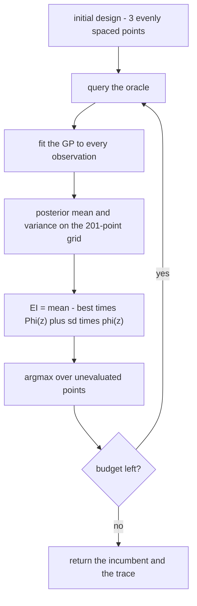
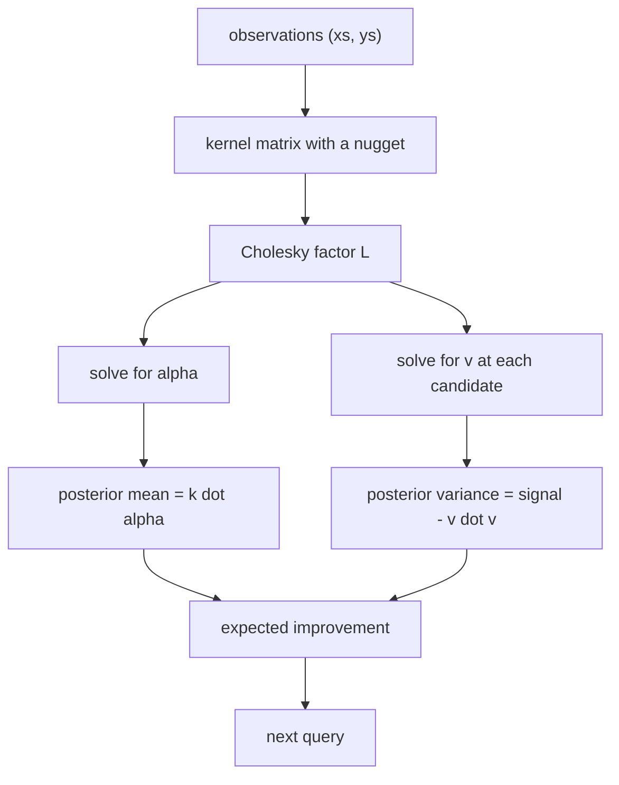
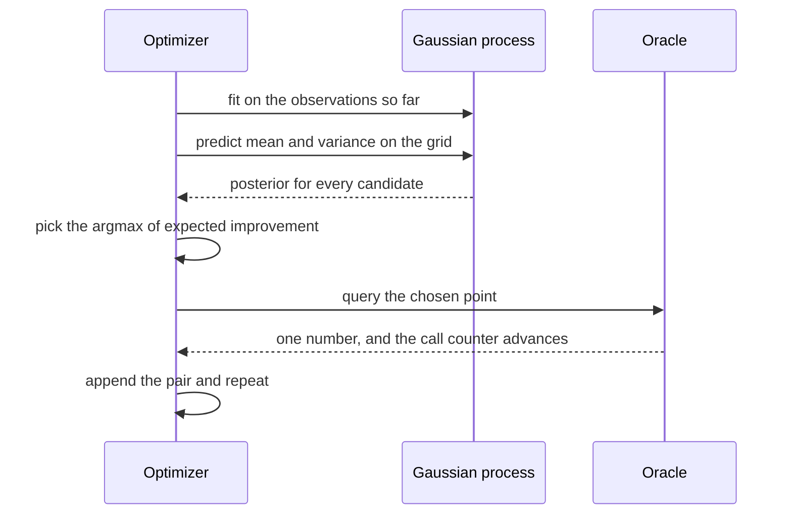

# 828 — Implement black-box optimizer with Bayesian optimization and EI acquisition.

> **Tier:** Master · **CTCI chapter:** Beyond — Machine Learning & AI
> **Task spec:** [828-implement-black-box-optimizer-with-bayesian-optimization-and-ei.md](../../../tasks/master/828-implement-black-box-optimizer-with-bayesian-optimization-and-ei.md)
> **Solutions:** [Python](../../../solutions/python/master/828-implement-black-box-optimizer-with-bayesian-optimization-and-ei/solution.py) ·
> [Java](../../../solutions/java/master/828-implement-black-box-optimizer-with-bayesian-optimization-and-ei/Solution.java) ·
> [JavaScript](../../../solutions/javascript/master/828-implement-black-box-optimizer-with-bayesian-optimization-and-ei/solution.js) ·
> [C#](../../../solutions/csharp/master/828-implement-black-box-optimizer-with-bayesian-optimization-and-ei/Solution.cs)

## 1. Problem restatement

**Input.** A black-box function `f : [0, 1] → R` behind an `Oracle` with a hard evaluation budget (`24` in the
shipped run); a `201`-point candidate grid; a Gaussian process with a squared-exponential kernel, fixed
lengthscale `0.1`, signal variance `1.0` and nugget `noise = 1e-10`; and `initial = 3` evenly spaced design
points.

**Output.** A query trace, the incumbent `(best_x, best_y)`, the best-so-far history and the number of
evaluations used — plus, for comparison, a uniform `random_search` over the same grid with the same budget.

| Piece | Contract |
| --- | --- |
| `rbf(a, b, ls, signal)` | `signal · exp(−0.5((a − b)/ls)²)` — the covariance between two inputs |
| `cholesky` / `solve_cholesky` | a dense Gram matrix factorised as `L Lᵀ` and solved by forward/back substitution; `solve_gauss` is the plain-elimination oracle |
| `GaussianProcess` | `fit(xs, ys)` builds the kernel matrix with a nugget, `predict(x)` returns the posterior mean and a non-negative variance |
| `expected_improvement(mean, sd, best)` | the closed form `(mean − best)·Φ(z) + sd·φ(z)` with `z = (mean − best)/sd`, and the deterministic branch for `sd = 0` |
| `ei_quadrature` | Simpson's rule with `20000` nodes for the definition `∫_best^∞ (t − best)·N(t; mean, sd²) dt` |
| `BlackBoxOptimizer` | initial design, then the argmax of EI over unevaluated grid points with a variance tie-break |
| `Oracle` | counts its own calls and raises when the budget is exhausted |

**Constraints.**

1. The linear algebra must be exact: the Cholesky factor must reproduce the matrix and agree with
   Gauss elimination.
2. The kernel must be positive semi-definite on every sampled pair — `k(x, x) = signal`,
   `|k(x, y)| <= k(x, x)`, non-negative `2 × 2` determinant.
3. The closed-form EI must match numerical quadrature of its definition.
4. Interpolation and extrapolation must behave: an observed point's posterior mean returns the observation and
   its variance collapses to the nugget; far from data the mean returns to the prior mean `0` and the variance
   to the prior `1.0`.
5. The optimizer must respect the budget exactly, never query a point twice, and improve monotonically in the
   best-so-far sequence.

**Concrete behaviour asserted by the shipped Python run.**

| Scenario | Expected result |
| --- | --- |
| EI versus Simpson quadrature | worst absolute difference `1.04e-14` |
| Quadratic with ripple, 24 evaluations | incumbent `0.3750` with `0.019975` against the exhaustive optimum `0.3746` with `0.019977` |
| Cumulative regret, Bayesian versus uniform | `5.57e-05` vs `2.30e-02` on the hardest of five instances; never worse on any of them |
| GP interpolation | mean at an observed point equals its observation, variance equals the nugget |
| GP extrapolation | mean `→ 0`, variance `→ 1.0` far from all observations |

## 2. Intuition

A black box gives you one number per evaluation and nothing else — no gradient, no shape. If evaluations are
expensive, the question becomes *where to look next*, and the answer has two parts that pull against each
other:

- **Exploit.** Somewhere near the best point found so far there is probably something better.
- **Explore.** Where nothing has been measured, the uncertainty is large and the true optimum could be hiding.

Bayesian optimisation resolves the tension with a **posterior**: a Gaussian process fitted to every `(x, y)`
so far says, for each candidate, what a normal distribution over the function value looks like there
(mean, variance). Then a single scalar — expected improvement — prices the two motives in the right units:
expected improvement over the current incumbent, integrating over the whole posterior distribution.

`EI = (μ − best)·Φ(z) + σ·φ(z)` with `z = (μ − best)/σ` reads directly as the two terms: the first is the
exploitation bonus (how much better the mean looks), the second is the exploration bonus (how wide the
distribution is, weighted by how far the upper tail reaches). Both vanish when σ → 0, which is exactly right:
a point whose value is already known cannot improve anything.

Everything in the pipeline is then checkable against an independent oracle: the Cholesky solve against Gauss
elimination, the closed-form EI against numerical quadrature, and the grid argmax against an exhaustive scan.
That is what turns "Bayesian optimisation works" into a set of measurable claims.



## 3. Algorithm

**The Gaussian process.** With a squared-exponential kernel, the posterior at a candidate `x` uses two
Cholesky solves of the same factor.

1. Build `K` with `K[i][j] = rbf(xs[i], xs[j], ls, signal)` and add the nugget to the diagonal.
2. Factorise `K = L Lᵀ`.
3. Solve `L Lᵀ α = ys` for `α`; the posterior mean is `k(x)·α`.
4. Solve for `v = L⁻¹ k(x)`; the posterior variance is `signal − v·v`, clamped at zero.

```text
function predict(point, xs, ys, lower, alpha)
    k ← [rbf(point, xs[i]) for each observation i]
    mean ← the dot product of k with alpha
    v ← forward substitution solving lower · v = k
    variance ← max(0, signal - v · v)
    return mean and variance
end

procedure fit(xs, ys)
    K[i][j] ← rbf(xs[i], xs[j], lengthscale, signal) for every pair
    add the nugget to the diagonal of K
    lower ← cholesky(K)
    alpha ← solve_cholesky(lower, ys)
end
```

**The acquisition.** The closed form and the quadrature reference compute the same number by different means.

```text
function expected_improvement(mean, sd, best)
    if sd = 0 then return max(0, mean - best)
    z ← (mean - best) / sd
    return (mean - best) · normal_cdf(z) + sd · normal_pdf(z)
end

function ei_quadrature(mean, sd, best, nodes)
    when sd = 0 then integrate over the single point mean
    integrate over [max(best, mean - 12·sd), mean + 12·sd] with Simpson's rule
    return the integral of (t - best) · normal density at t
end
```

**The loop.** A deterministic initial design, then one EI maximisation per step.

```text
function choose(xs, ys)
    fit the Gaussian process to xs and ys
    best ← the largest observation so far
    for every grid point not already observed do
        mean, variance ← predict that point
        score ← expected_improvement(mean, sqrt(variance), best)
        keep the point with the largest score, breaking near-ties by larger variance
    end
    return the chosen point
end

function run(oracle, initial_points)
    xs ← three evenly spaced grid points unless the caller supplies a design
    ys ← query the oracle at each of them
    while the oracle has budget left do
        pick ← choose(xs, ys)
        if nothing can be picked then stop
        append pick to xs and its oracle value to ys
    end
    return the trace, the incumbent and the best-so-far history
end
```

The tie-break matters: when several candidates have the same EI to within `1e-15`, the one with the larger
posterior variance is chosen, which keeps the search deterministic *and* exploratory rather than dependent on
the grid's list order.





**Documented simplifications.** One-dimensional black boxes on a candidate grid — no multi-start continuous EI
optimisation, no marginal-likelihood training of the kernel hyperparameters (lengthscale and signal variance
are fixed), and no parallel batching. The GP is dense and `O(n³)`, which is fine for `n <= 24`; at scale it
would be replaced by a sparse or inducing-point approximation. Everything is deterministic: no wall-clock, no
threads, no unseeded randomness.

## 4. Worked example

**Posterior behaviour.** Fit the GP to three observations `0.25 → −0.015625`, `0.5 → −0.015625`,
`0.75 → −0.140625` of a quadratic with a small ripple, then look at the posterior:

| Point | Role | Mean | sd | EI against best `−0.015625` |
| --- | --- | --- | --- | --- |
| `0.25` | observed | `-0.01562500` | `0.00001000` | `0.00000399` |
| `0.5` | observed | `-0.01562500` | `0.00001000` | `0.00000399` |
| `0.375` | between two observations | `-0.01112657` | `0.77335802` | `0.31077965` |
| `0.0` | far from data | `-0.00066955` | `0.99903244` | `0.40607866` |
| `1.0` | far from data | `-0.00616169` | `0.99903244` | `0.40330582` |

Three things are visible at once. Interpolation works exactly: at `0.25` and `0.5` the mean *is* the
observation, and the sd is `1e-5 = sqrt(1e-10)`, the nugget. Extrapolation works: at `0.0` and `1.0` the mean
is a hair from the prior `0` and the sd is `0.999` of the prior `1.0`. And EI prefers the unknown:
`x = 0.0` scores `0.4061` and `x = 1.0` scores `0.4033`, both *above* the interesting interval near `0.375`,
because all three observations are equal — the GP has no reason to believe anything is better anywhere, so
expected improvement is maximised where the variance is largest. The optimizer therefore opens with
`0.0, 1.0`, then `0.375, 0.625, 0.125` as information accumulates.

**Convergence on the real instance.** The shipped run on a quadratic with a ripple spends its full `24`
evaluations and lands on `0.3750` with `0.019975`, against the exhaustive grid optimum `0.3746` with
`0.019977` — a difference far below any practical tolerance, from 24 samples out of 201 candidates. Over five
deterministic instances the cumulative regret of the Bayesian search stays below uniform random sampling at
the same budget:

| Instance parameter | Bayesian regret | Uniform regret |
| --- | --- | --- |
| `0.15` | `3.98e-06` | `3.98e-06` |
| `0.28` | `5.57e-05` | `2.30e-02` |
| `0.43` | `2.84e-05` | `6.04e-04` |
| `0.67` | `9.92e-06` | `1.73e-03` |
| `0.82` | `2.84e-05` | `3.82e-03` |

The first instance is a tie because both searches happen to sample the optimum immediately; the wide ones are
where the model earns its keep, with two to three orders of magnitude less regret.

**The two oracles for EI.** Closed form versus Simpson quadrature with `20000` nodes agree to `7.6e-16` on a
hand-picked triple `(mean 0.3, sd 0.4, best 0.5)`, and the worst difference across the file's checks is
`1.04e-14`. That is the standard way to trust a formula you did not derive yourself in this session: integrate
its definition numerically and compare.

## 5. Complexity

Let `n` be the number of observations (`<= 24`), `G` the candidate grid size (`201`), and `E` the evaluation
budget.

| Measure | Bound | Why it holds |
| --- | --- | --- |
| `cholesky` | O(n³) | one dot product per lower-triangular entry |
| `fit` | O(n²) plus the factorisation | the kernel matrix is `n × n`, then `O(n³)` |
| `solve_cholesky` | O(n²) | forward then back substitution |
| `predict` | O(n²) | the kernel vector plus one forward substitution |
| `choose` | O(n² · G) | one prediction per candidate, with `O(n²)` each |
| Whole search | O(E · n² · G) | `24` steps over `201` candidates |
| `ei_quadrature` | O(nodes) = `20000` | Simpson's rule; it is the oracle, not the hot path |
| Memory | O(n²) | the kernel matrix and its factor |

The design decision is the grid: with `G = 201` the EI maximisation is an exhaustive scan of a cheap function,
so there is no local-optimizer nondeterminism and no risk of a missed isolated peak. In a continuous
formulation the same `O(n²)`-per-point cost would be paid inside a multi-start optimizer, and the GP's `O(n³)`
would be attacked with inducing points instead.

## 6. Pitfalls and edge cases

- **`sd = 0`.** Dividing by zero in `z = (μ − best)/σ` is the classic EI bug; the code returns the
  deterministic improvement `μ − best` instead, and the branch is exercised by the degenerate fixture.
- **Negative posterior variance.** Rounding can make `signal − v·v` slightly negative; the prediction clamps
  it at zero, which also keeps `sqrt` well-defined. Without the clamp, `sd` would be `NaN` and EI would be
  silently useless.
- **No nugget.** A kernel with no jitter can make `K` numerically singular once two observations coincide;
  the `1e-10` nugget also *is* the interpolation floor measured as sd `1e-5`.
- **Querying an observed point again.** The candidate scan excludes every `x` already in `xs`, so the search
  never wastes an evaluation — the fixture asserts no point is repeated.
- **Budget overrun.** `Oracle.query` raises the moment the budget is exhausted rather than quietly returning
  extra values, so "24 evaluations" is a fact about the run and not a hope.
- **Ties in EI.** Near-ties within `1e-15` are broken by the larger posterior variance, which keeps the choice
  deterministic and stops the grid's list order from deciding the search.
- **An all-equal target.** With every observation the same, EI is maximal at the largest variance — pure
  exploration — and no division by a zero spread occurs.
- **`best` versus the true optimum.** EI is defined against the *incumbent*, and it is strictly decreasing in
  it: a higher best means less room to improve. The fixture checks that monotonicity.
- **The acquisition is not the answer.** EI decides where to look; the returned answer is the best query
  actually made, which is why a run can be "one step behind" the true optimum by design.
- **Fixed hyperparameters.** The lengthscale `0.1` is far shorter than the interval, so the GP is very
  flexible; changing it changes the search's character. The task fixes it deliberately rather than hiding
  hyperparameter training inside a toy.
- **Determinism.** The initial design, the grid, the tie-breaks and the uniform baseline's PRNG are all fixed,
  so two runs produce identical query sequences.
- **Simplifications kept honest.** One dimension, a fixed kernel, a grid argmax, no batches, no wall-clock, no
  threads.

## 7. Variants and follow-ups

- **Pair the model with a fidelity schedule.** BOHB uses a density ratio instead of EI and a Hyperband budget
  instead of a fixed one — see
  [827-implement-distributed-hyperparameter-search-with-early-stopping.md](../../../tasks/master/827-implement-distributed-hyperparameter-search-with-early-stopping.md).
- **Search over surrogate models.** The same acquisition question appears when choosing which simulation
  fidelity to run — see
  [906-implement-multi-fidelity-simulation-orchestration-with-surrogate.md](../../../tasks/master/906-implement-multi-fidelity-simulation-orchestration-with-surrogate.md).
- **Trade the exact posterior for scale.** Kernel methods that keep the GP's shape but cut the `O(n³)` cost
  are the sparse and sketch-based approximations of
  [823-implement-real-time-anomaly-detection-via-streaming-pca-or-sketc.md](../../../tasks/master/823-implement-real-time-anomaly-detection-via-streaming-pca-or-sketc.md).
- **Wrap the search in a safety envelope.** Real systems bound the spend and the risk of every suggested
  experiment — see
  [938-implement-safe-experiment-platform-that-enforces-slos-and-budget.md](../../../tasks/master/938-implement-safe-experiment-platform-that-enforces-slos-and-budget.md).

## 8. Check yourself

1. Why does the optimizer start by querying `0.0` and `1.0` rather than the promising interval around `0.375`?

<details><summary>Show answer</summary>

Because all three initial observations have the same value, so the posterior mean is flat and EI is driven by
the exploration term `σ·φ(z)`. That term is largest where the variance is largest, and the variance is largest
farthest from data: sd `0.999` at the ends against `0.773` near `0.375`, giving EI `0.4061` and `0.4033`
against `0.3108`. It is the correct behaviour for a model that has no evidence yet about where improvement
lives.

</details>

2. What does the `sd = 0` branch protect against?

<details><summary>Show answer</summary>

The closed form divides by the standard deviation: `z = (μ − best)/σ`. At an observed point the posterior has
collapsed to the nugget, and exactly at a noiseless observation `σ` is `0`, so the division would produce
`NaN`. The branch returns the deterministic improvement `max(0, μ − best)`, which is the correct limit of the
formula and the value the quadrature oracle also produces.

</details>

3. Why keep `solve_gauss` and `ei_quadrature` in the file at all?

<details><summary>Show answer</summary>

Because they are independent implementations of the same quantity. `solve_gauss` performs plain elimination
with partial pivoting, so agreement with `solve_cholesky` proves the factorisation and the substitutions are
right, not just self-consistent. `ei_quadrature` integrates the *definition* of expected improvement with
Simpson's rule over `20000` nodes, and the observed agreement (`1.04e-14` worst case) is what licenses trusting
the closed form. Oracles are how a numerical file argues with itself.

</details>

4. The residual is `1.04e-14` for EI but the reported regression is `5.57e-05` on the hardest instance. Why
   does the optimizer not find the exact optimum?

<details><summary>Show answer</summary>

Because the budget is `24` evaluations out of `201` candidates, and EI decides where to look without knowing
the function. The best query it makes is `0.3750` with `0.019975` against the exhaustive `0.3746` with
`0.019977` — a residual far smaller than the grid spacing's worth of function variation, and the comparison
that matters is against the uniform baseline, which on the same instance accumulates regret `2.30e-02`. The
claim is *sample efficiency*, not exactness.

</details>

5. Why does the candidate scan exclude previously evaluated points and break ties by variance?

<details><summary>Show answer</summary>

Re-querying an observed point cannot add information, so excluding known points spends the budget on new
information; the fixture asserts no query is ever repeated. The variance tie-break handles the case where two
candidates have identical EI to within `1e-15` (common in a symmetric initial state): choosing the larger
variance keeps the behaviour deterministic *and* exploratory, instead of letting the grid's list order decide
which side of the symmetry is explored first.

</details>
